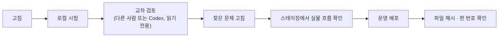

# 기여 안내

croScan을 고치는 팀원을 위한 순서와 규칙입니다. 한 번 읽으면 무엇을 고칠 때 어느 문서를 보고 어떤 시험을 돌리면 되는지 알 수 있습니다.

**이 문서에서 알 수 있는 것**
- 개발 환경을 준비하고 앱을 띄우는 법
- 고칠 곳별로 먼저 읽을 문서와 돌릴 시험
- 코드 규칙(규칙이 판정, 원본 불변, 경보는 내려가지 않음 …)
- 리뷰(교차 검토)와 배포 순서, 문서를 함께 고치는 규칙

## 목차
1. [준비](#1-준비)
2. [고칠 곳별 안내](#2-고칠-곳별-안내)
3. [지켜야 할 코드 규칙](#3-지켜야-할-코드-규칙)
4. [시험 돌리기](#4-시험-돌리기)
5. [리뷰와 배포](#5-리뷰와-배포)
6. [문서 고치기](#6-문서-고치기)
7. [커밋 규칙](#7-커밋-규칙)

---

## 1. 준비

| 필요한 것 | 까닭 |
|---|---|
| Python 3.12 | 서버와 시험 |
| Java 17 이상 | PDF 표 읽기(한컴 OpenDataLoader) |
| 한국어 글꼴(맑은 고딕 · 나눔고딕) | 추가검토서·체크리스트 PDF |
| Node.js (선택) | 화면 상태 시험 `check_ui_state.py` |

```bash
pip install -r requirements.txt
```

```bash
uvicorn server.app:app --port 8765
```

- 데이터는 `data/`(git 제외)에 쌓입니다. 시험을 돌릴 때는 `CROSCAN_DATA`를 임시 폴더로 정합니다. 그래야 저장소가 더러워지지 않습니다.
- 언어 모델 없이도 뜹니다. 모델이 필요한 기능만 실패합니다. 모델 서버가 있으면 `LLM_URL`로 가리킵니다.
- 모델 파일(`*.gguf`)과 `.env`는 저장소에 없습니다. 팀 공유 위치에서 받습니다([SECURITY.md](SECURITY.md)).

---

## 2. 고칠 곳별 안내

| 고칠 것 | 먼저 읽기 | 주로 만지는 파일 | 꼭 돌릴 시험 |
|---|---|---|---|
| 확인 질문(묻는 것·순서·묻지 않는 경우) | [05](docs/05_멀티턴_질문.md) | `server/augment.py`, `server/need_catalog.py`, `server/store.py` | `check_questions`, `check_questions_material`, `check_store` |
| 반장 말 읽기(AI 해석 카드) | [05b](docs/05b_AI_판독.md) | `server/understand.py`, `server/llm.py` | `check_understand`, `check_interpret`(둘 다 모델 서버 없이 돎. `check_interpret`는 PDF 읽기 환경 필요) |
| 반영본·별지·추가검토서 | [08](docs/08_반영본과_별지.md) | `server/reflect.py`, `server/addendum.py` | `check_reflect`, `check_render`, `check_form_intact` |
| 위험 체크리스트 | [07](docs/07_위험체크리스트.md) | `server/checklist.py`, `server/checklist_spec.json`, `server/checkai.py` | `check_checklist`, `check_checklist_material`, `check_checkai` |
| 쌍 판정·규칙 | [06](docs/06_쌍작업_판정.md) | `server/pairs.py`, `server/pair_rules.json` | `check_pairs`, `check_pairs_material`, `check_pairs_final`, `check_pairs_cases` |
| 판정보류 질문·협조 문자 | [06b](docs/06b_보류질문_holdq.md) | `server/holdq.py`, `server/coordnote.py`, `server/posting.py` | `check_hybrid`, `check_coordnote` |
| 근거·검색 | [10](docs/10_근거와_자료.md) | `server/retrieval.py`, `server/evidencemap.py`, `tools/build_corpus.py` | `check_retrieval`, `check_explain` |
| 화면 | [02](docs/02_화면시연_반장.md), [03](docs/03_화면시연_안전관리자.md), [DESIGN.md](DESIGN.md) | `web/app.js`, `web/index.html`, `web/style.css` | `check_ui_state`, 스테이징에서 직접 확인 |
| 끝점·접근 통제 | [04b](docs/04b_API.md) | `server/app.py` | `check_access`, `check_proxy_headers` |

시험마다 무엇을 보는지는 [11 시험과 평가](docs/11_시험과_평가.md)에 있습니다.

---

## 3. 지켜야 할 코드 규칙

| 규칙 | 지키는 법 |
|---|---|
| 판정은 규칙이 | 기본 질문·체크리스트 기본 제안·쌍 순위를 모델 출력으로 정하지 않습니다. 모델 결과(보완 질문, 추가 후보, 칸 제안)는 서버 검사를 거친 뒤 「제안」으로만 보입니다. 그 제안은 사람이 확인합니다. |
| 모델로 가는 문은 하나 | 판독 기능의 모델 호출은 `server/llm.py`(`call_json()`, `prefill()`)를 거칩니다. 예외는 기본으로 꺼진 옛 `/api/chat`과 모델 상태 확인뿐입니다. 새 기능은 직접 HTTP로 부르지 않습니다. |
| 원본 불변 | 올린 PDF는 읽기만 합니다. 쓰는 곳은 반영본(여백)과 별지뿐입니다. 절대 쓰지 않는 칸은 [08](docs/08_반영본과_별지.md)의 표를 지킵니다. |
| 경보는 내려가지 않음 | 지금 모인 서류로 낸 경보를 하한(바닥값)으로 남깁니다(`floor()`). 반장 답으로 이 경보를 낮추지 않습니다. 기준본(v1) 시험이 이 규칙을 지키는지 봅니다. |
| 남의 작업은 미확인 | 다른 팀 작업에 대한 말은 내 허가서 칸에 쓰지 않습니다. 별지 병행작업 칸에 「미확인」으로만 씁니다. |
| 낡은 답 버리기 | 서류가 바뀌면 그 칸을 보고 받은 답은 낡은 답이 됩니다(`fp`·`fp_keys`). 새 기능도 `augment.answers_now()`나 `standing()`을 거쳐 답을 읽습니다. |
| 표본 맞춤 금지 | 시연 자료 한 건에만 맞는 예외를 만들지 않습니다. 같은 성질의 문장 전체에 맞는 규칙으로 고칩니다. |
| 근거 없는 인용 금지 | 검수하지 않은 검색 후보를 「근거」로 쓰지 않습니다([10](docs/10_근거와_자료.md)). 법령 조항은 원문을 확인한 것만 씁니다. |
| 화면 문구 | 「AI가 판단」 「승인」 「안전 확보」 같은 말을 쓰지 않습니다. croScan이 하지 않는 일을 하는 것처럼 들리기 때문입니다. |
| 화면 판 번호 | `web/` 파일을 고치면 `index.html`·`evidence.html`의 `?v=` 판 번호를 올립니다. |
| 주석 | 주석에는 「왜」를 씁니다. 양과 말투는 주변 코드에 맞춥니다. 근거 자료가 있으면 자료 번호를 적습니다. |

---

## 4. 시험 돌리기

하나만:

```bash
PYTHONIOENCODING=utf-8 python tools/check_pairs_final.py
```

모두(bash):

```bash
set -o pipefail; for f in tools/check_*.py; do case "$f" in tools/check_form_intact.py|tools/check_proxy_headers.py) continue;; esac; echo "== $f"; PYTHONIOENCODING=utf-8 CROSCAN_DATA="$(mktemp -d)" python "$f" | tail -2 || echo "FAIL $f"; done
```

- `check_form_intact`(원본 PDF · 제출 PDF · 종류)와 `check_proxy_headers`(`--conf`)는 인자가 필요합니다.
- PDF 읽기(Java)가 필요한 시험과 모델이 필요한 시험이 있습니다. 못 돌린 시험은 「못 돌림」이라고 적습니다. 통과했다고 쓰지 않습니다.
- 숫자를 적을 때는 시험이 출력한 값을 그대로 씁니다.

---

## 5. 리뷰와 배포



- **교차 검토.** 고친 사람이 아닌 다른 눈으로 봅니다. 팀은 Codex를 읽기 전용으로 써 왔습니다. 검토 회차는 미리 정합니다. 마지막 회차에서 찾은 것을 모두 고치고 끝냅니다. 검토 결과는 사실 확인 없이 그대로 받지 않습니다. 코드에서 재현해 본 뒤 고칩니다.
- **스테이징.** 스테이징은 운영과 같은 이미지에 `server/`·`web/`를 붙인 컨테이너입니다. 바깥에는 열지 않습니다. SSH 터널로 엽니다([12 §6](docs/12_배포와_운영.md#6-스테이징과-운영)).
- **보고.** 확인하지 않은 것을 확인했다고 쓰지 않습니다. 못 한 것은 못 했다고 씁니다.

---

## 6. 문서 고치기

- 동작이나 수치가 바뀌면 같은 커밋에서 `docs/`의 해당 문서를 고칩니다. 수치는 코드에서 다시 셉니다.
- 문서 규칙은 [docs/STYLE.md](docs/STYLE.md)입니다(요약 · 「이 문서에서 알 수 있는 것」 · 목차 · 무엇→왜→어떻게→코드→시험→한계).
- 화면이 바뀌면 그림도 다시 찍습니다. 그림은 `docs/images/`에 있습니다. 그림의 번호는 문서의 표와 맞춥니다.
- `docs/reference/`는 당시 설계 기록입니다. 지금과 다르면 고치지 말고 [14](docs/14_자료대조와_검토이력.md)의 차이 표에 적습니다.

---

## 7. 커밋 규칙

- 커밋 하나에는 한 가지 변경을 담습니다. 제목은 무엇을 왜 바꿨는지 한국어로 짧게 씁니다(예: `쌍 판정: 입회하에 용접도 화기로 읽음`).
- 키·토큰·서버 주소·실명·전화번호를 넣지 않습니다. 시연 자료는 이미 가린 값(김XX, 010-XXXX-XXXX)을 씁니다.
- 모델 파일과 `data/`는 `.gitignore`가 빼 줍니다. `.gitignore`는 파일 크기를 보지 않습니다. 그래서 100MB가 넘는 파일은 올리기 전에 따로 확인합니다.
