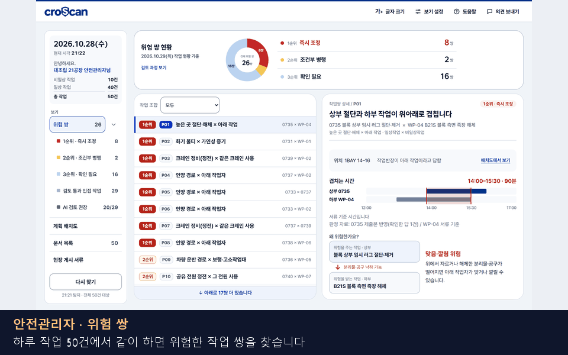
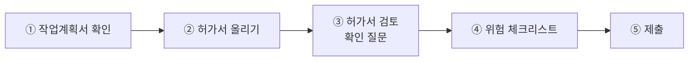
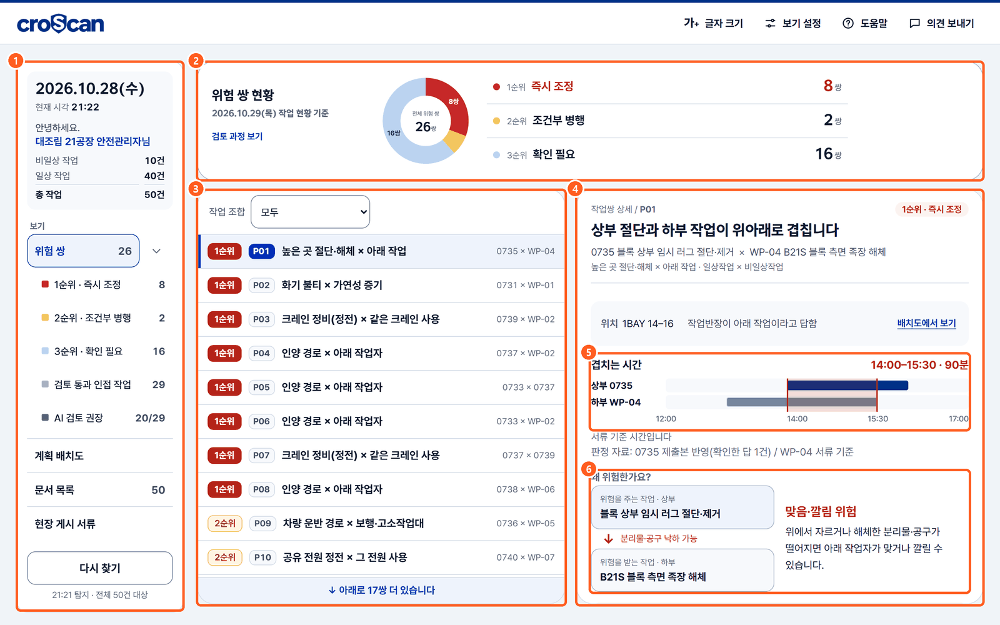
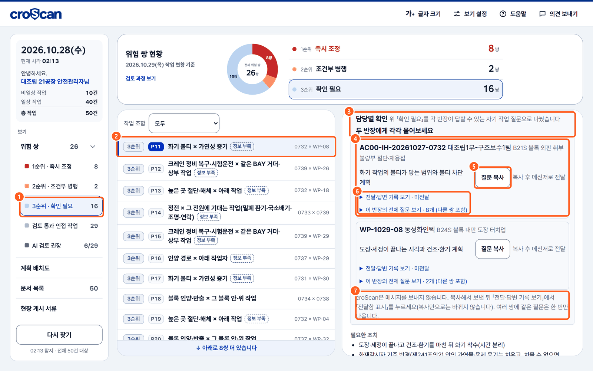
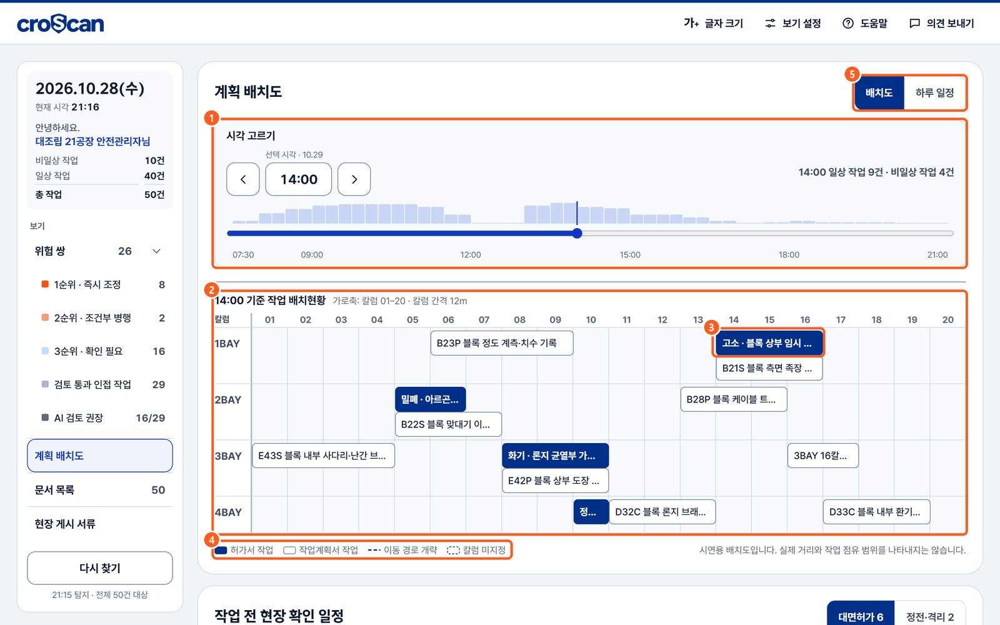
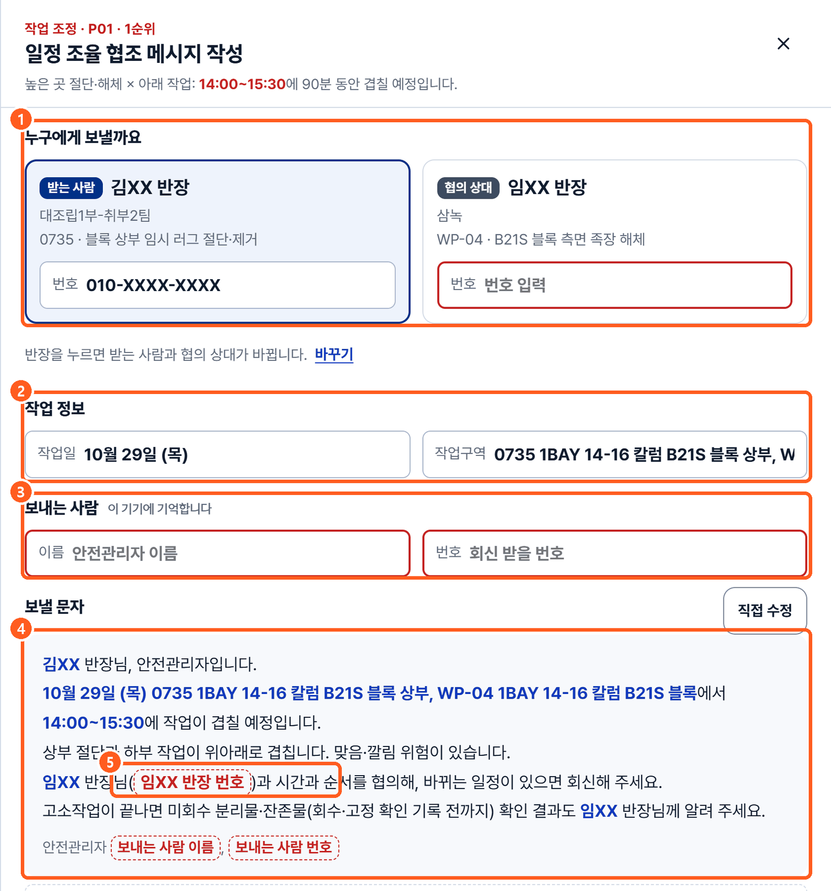
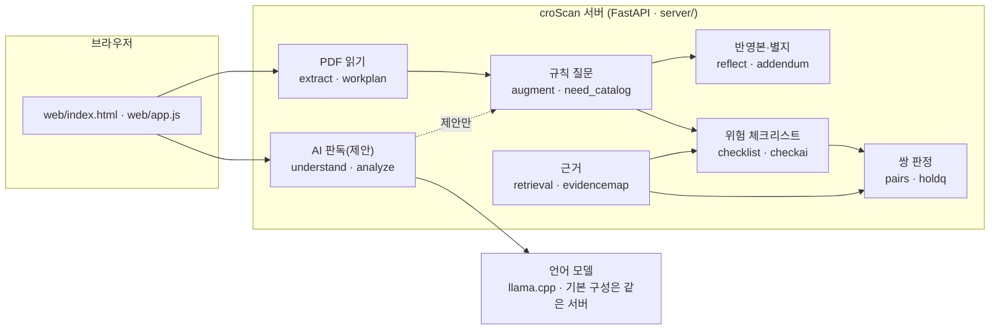

<div align="center">

# croScan

**조선소 위험작업허가서 사전검토 도우미**

작업반장이 허가서를 내기 전에 빠뜨린 것을 묻고,<br/>
안전관리자가 그날 작업 가운데 **함께 하면 위험한 작업 쌍**을 찾도록 돕습니다.<br/>
판정은 규칙이, 제안은 AI가, **확정과 승인은 사람이** 합니다.

[한눈에 보기](docs/01_한눈에보기.md) ·
[화면 시연(반장)](docs/02_화면시연_반장.md) ·
[화면 시연(안전관리자)](docs/03_화면시연_안전관리자.md) ·
[전체 문서](docs/README.md) ·
[용어집](docs/13_용어집.md)

</div>

**이 문서에서 알 수 있는 것**
- croScan이 하는 일과 하지 않는 일
- 작업반장 5단계와 안전관리자 화면을 실제 화면으로
- 규칙·AI·사람의 역할 나눔과 핵심 수치
- 띄우는 법, 그리고 개발·시험·운영 문서로 가는 길

> 낯선 말: **BAY**는 공장 안 구역, **칼럼**은 기둥 번호로 나타낸 위치, **LOTO**는 설비 에너지를 끊고 잠금장치·꼬리표로 다시 켜지지 않게 하는 절차, **2중점검 Y**는 허가서에 당일 아침 대면허가 대상으로 표시된 작업입니다. 더 많은 말은 [용어집](docs/13_용어집.md).

---

## 목차
1. [화면으로 먼저 보기](#1-화면으로-먼저-보기)
2. [무엇을 푸나](#2-무엇을-푸나)
3. [작업반장 5단계](#3-작업반장-5단계)
4. [안전관리자 화면](#4-안전관리자-화면)
5. [어떻게 동작하나](#5-어떻게-동작하나)
6. [핵심 수치](#6-핵심-수치)
7. [저장소 구조](#7-저장소-구조)
8. [바로 띄우기](#8-바로-띄우기)
9. [문서 지도](#9-문서-지도)
10. [하지 않는 것 · 저장소에 없는 것](#10-하지-않는-것--저장소에-없는-것)

---

## 1. 화면으로 먼저 보기

전체 화면 → 기능 부분 확대 → 아래 자막 설명 순서로 넘어갑니다. 화면마다 번호를 붙여 설명한 문서는 [02](docs/02_화면시연_반장.md)·[03](docs/03_화면시연_안전관리자.md)입니다.

<table>
<tr>
<th width="50%">작업반장: 계획서 → 허가서 → 질문 → 체크리스트 → 제출</th>
<th width="50%">안전관리자: 위험 쌍 → 담당별 확인 → 배치도 → 문자</th>
</tr>
<tr>
<td></td>
<td></td>
</tr>
</table>

> 화면은 2026-11-01 스테이징 서버에서 `samples/시연_하루` 자료로 찍었습니다. 숫자는 시연 자료 기준입니다.

---

## 2. 무엇을 푸나

| 현장의 문제 | croScan이 하는 일 |
|---|---|
| 허가서에 「08:00~16:59」처럼 근무시간 전체를 적거나 위치를 부서 이름으로 적습니다. 그러면 실제로 위험한 시간과 위치를 알 수 없습니다. | 비었거나 애매한 칸만 골라 반장에게 묻습니다. 답은 반영본(원본 칸 위 여백에 파란 글씨)과 별지로 남깁니다. **원본은 건드리지 않습니다.** |
| 서류는 작업마다 따로입니다. 그래서 위에서 절단하는데 아래에서 족장을 해체하는 것 같은 **작업 간 위험**이 안 보입니다. | 허가서 작업끼리, 그리고 허가서 작업과 작업계획서(일상) 작업 사이를 봅니다. 시간·장소·설비가 겹치는 쌍을 **규칙 36개**로 찾아 1·2·3순위로 보여 줍니다. 일상작업끼리의 조합은 보지 않습니다. |
| 안전관리자가 모자란 정보를 반장마다 따로 물어야 합니다. | 정보가 모자란 쌍이 있으면 반장마다 **자기 작업만 묻는 질문 문안**을 만듭니다. 작업 조정 문자 초안도 만듭니다(보내기는 사람이). |

기존 절차는 그대로입니다. 하이세스(Hi-SEs, 회사 안전 전산) 신청, 승인권한자 전산승인, 당일 현장 확인, 2중점검 Y 작업의 아침 대면허가가 그 절차입니다. croScan은 그보다 앞에 오는 「안전팀 검토자료 제출」 단계입니다. → [01 한눈에 보기](docs/01_한눈에보기.md)

---

## 3. 작업반장 5단계



<table>
<tr>
<td width="50%"></td>
<td width="50%"></td>
</tr>
<tr>
<td><b>③ 확인 질문</b> · ① 질문한 칸을 문서에서 강조 ② 근거(관측)와 함께 하나씩 질문 ③ 「왜 묻나요?」 ④ 버튼 답 · 「모름」은 안전팀 확인으로 ⑥ 말로 한꺼번에 답해도 됨</td>
<td><b>③ AI 해석 카드</b> · 반장이 적은 문장을 읽어 ② 원문 인용(←)과 들어갈 칸(→)을 제안 ③ 남의 작업 이야기는 「미확인」으로 별지에 ⑤ 반영본 미리보기. <b>반장이 확인해야</b> 들어갑니다</td>
</tr>
<tr>
<td></td>
<td></td>
</tr>
<tr>
<td><b>④ 위험 체크리스트</b> · croScan이 허가서를 보고 위험요인을 미리 채움. 항목마다 「해당 / 해당 없음 / 안전팀 확인」을 고름. 「위험한 이유 보기」를 누르면 근거와 조선업 중대재해 사례집의 사고 사례. 남은 항목은 「다음 미완료로 이동」으로 찾아감</td>
<td><b>핵심 정보 확인 창</b> · ④ 체크리스트로 넘어가기 전에 모름·미확인·비어 있음을 맨 위에, 시간·위치처럼 실수하기 쉬운 것만 한 번 더</td>
</tr>
</table>

번호마다 자세한 설명: [02 화면 시연: 작업반장](docs/02_화면시연_반장.md)

---

## 4. 안전관리자 화면

<table>
<tr>
<td width="50%"></td>
<td width="50%"></td>
</tr>
<tr>
<td><b>위험 쌍</b> · 시연 하루 50건에서 26쌍(1순위 8 · 2순위 2 · 3순위 16). 겹치는 시간 막대, 위험을 주는 작업 → 받는 작업, 필요한 조치</td>
<td><b>담당별 확인</b> · 쌍에 확인할 사유가 있으면 반장마다 자기 작업만 묻는 질문으로 나눔(1·2순위에도 나옴). 「전달함 표시」「답변 받음 표시」는 사람이 누름</td>
</tr>
<tr>
<td></td>
<td></td>
</tr>
<tr>
<td><b>계획 배치도</b> · 고른 시각에 BAY × 칼럼마다 무슨 작업을 하는지(판정 아님)</td>
<td><b>작업 조정 문자</b> · 쌍마다 반장 한 명씩 받을 협조 문자 초안. croScan은 보내지 않습니다</td>
</tr>
</table>

번호마다 자세한 설명: [03 화면 시연: 안전관리자](docs/03_화면시연_안전관리자.md)

---

## 5. 어떻게 동작하나



| 원칙 | 뜻 |
|---|---|
| 규칙이 판정 | 기본 질문, 체크리스트 기본 제안, 쌍 판정은 규칙으로 만듭니다. 같은 서류를 넣으면 결과도 같습니다. AI가 찾은 보완 질문과 체크리스트 추가 후보도 서버 검사를 거쳐야 화면에 보입니다. |
| AI는 제안 | 모델은 반장의 말을 읽고 어느 칸에 넣을지 제안합니다. 규칙이 못 본 것도 짚습니다. 하지만 판정 점수는 바꾸지 않습니다. 모델이 없어도 앱은 돕니다. |
| 사람이 확정 | AI 제안은 카드로 보여 주고 반장이 확인해야 반영합니다. 경보는 안전관리자가 검토합니다. |
| 원본 불변 | 올린 PDF는 바꾸지 않습니다. 답은 반영본·별지로만 남깁니다. |
| 경보는 내려가지 않음 | 지금 모인 서류로 낸 경보는 반장 답을 반영해도 그보다 낮아지지 않습니다. 이 경보가 하한(바닥값)으로 남습니다(floor). 다만 제출본 답 때문에만 생긴 경보는 다음 제출에서 답이 바뀌면 사라질 수 있습니다. |

자세한 구조: [04 아키텍처](docs/04_아키텍처.md) · 질문: [05](docs/05_멀티턴_질문.md) · AI: [05b](docs/05b_AI_판독.md) · 쌍: [06](docs/06_쌍작업_판정.md)

---

## 6. 핵심 수치

| 무엇 | 지금 코드 기준 |
|---|---|
| 허가서 종류 | 5종: 화기 · 밀폐 · 고소 · 중량물인양 · 정전LOTO |
| 쌍 규칙 | 36개 ([`server/pair_rules.json`](server/pair_rules.json)) |
| 위험 체크리스트 | 86항목, 사고 사례 40항목 · 48건 ([`server/checklist_spec.json`](server/checklist_spec.json)) |
| 연구 ref(체크리스트 항목이 가리키는 조사자료 번호) | 81개 중 73개를 412쪽 조사본에 연결 |
| 근거 코퍼스(검색에 쓰는 자료 모음) | 634조각, 등급 [법령] [공공] [조선사] [팀] [예시] |
| 질문 상한 | 검토 1건에 응답 요청 12회(재질문·AI 해석 카드·마무리 포함, 재질문은 그중 3회까지) |
| 시험 | `tools/check_*.py` 34종 |
| 시연 하루 (시연 자료 기준) | 작업 50건(허가서 10 · 계획서 40) · 후보 445쌍(허가서끼리 45 + 허가서×계획서 400) · 시간 겹침 151 · 같은 BAY·위치 확인 필요 37 · 위험 쌍 26(공유 설비·잔류위험 포함이라 37에서 추린 수는 아님) · 판정보류 질문 55개 |

---

## 7. 저장소 구조

```text
croScan/
├─ server/                FastAPI 서버와 규칙·판독 모듈
│  ├─ app.py              끝점 · 접근 통제
│  ├─ augment.py          규칙 질문 (멀티턴)
│  ├─ understand.py       반장 말 → 칸 제안 (AI)
│  ├─ reflect.py          반영본 · 별지에 넣을 곳
│  ├─ addendum.py         추가검토서 PDF
│  ├─ checklist.py        위험 체크리스트 (+ checklist_spec.json)
│  ├─ pairs.py            쌍 판정 (+ pair_rules.json)
│  ├─ holdq.py            판정보류 → 반장별 질문
│  ├─ retrieval.py        근거 검색 (+ knowledge/)
│  └─ …                   모듈 지도는 docs/04 §7
├─ web/                   화면 (index.html · app.js · style.css · evidence.html)
├─ tools/                 시험(check_*), 평가(eval_*), 자료 생성
├─ samples/               시연·시험용 허가서 · 작업계획서 · 시연 하루 DB
├─ deploy/oidc-proxy/     사내 로그인(SSO) 프록시 예시
├─ llm/                   언어 모델 컨테이너 (모델 파일은 없음)
├─ docs/                  안내 문서 · 그림 · 원래 설계 기록(reference/)
├─ Dockerfile · docker-compose.yml · DOCKER.md
└─ DESIGN.md              화면 디자인 정의
```

---

## 8. 바로 띄우기

준비: Python 3.12, Java 17 이상(PDF 표 읽기), 한국어 글꼴(Windows 맑은 고딕 · 리눅스 나눔고딕).

```bash
pip install -r requirements.txt
```

```bash
uvicorn server.app:app --port 8765
```

- 브라우저에서 `http://localhost:8765`를 열고 「로그인」을 누릅니다(시연판은 계정 없음).
- 작업반장: `samples/시연_하루/작업계획서/`와 `samples/시연_하루/허가서/`의 PDF를 올립니다.
- 안전관리자: 로그인에서 「안전관리자」를 고르면 `samples/시연_하루/demo_day.sqlite3`를 읽습니다.
- 언어 모델이 없어도 뜹니다. 모델 서버가 있으면 `LLM_URL`로 가리킵니다.
- Docker·스테이징·운영·SSO: [12 배포와 운영](docs/12_배포와_운영.md), [DOCKER.md](DOCKER.md)

고친 뒤에는 시험을 돌립니다(Windows는 `PYTHONIOENCODING=utf-8`).

```bash
python tools/check_pairs_final.py
```

전체 시험 목록과 돌리는 법: [11 시험과 평가](docs/11_시험과_평가.md) · 기여 방법: [CONTRIBUTING.md](CONTRIBUTING.md)

---

## 9. 문서 지도

| 이런 분 | 읽을 순서 |
|---|---|
| 처음 보는 팀원 · 발표 담당 | [01](docs/01_한눈에보기.md) → [02](docs/02_화면시연_반장.md) → [03](docs/03_화면시연_안전관리자.md) → [13 용어집](docs/13_용어집.md) |
| 질문 로직 개발 | [04](docs/04_아키텍처.md) → [05](docs/05_멀티턴_질문.md) → [05b](docs/05b_AI_판독.md) → [08](docs/08_반영본과_별지.md) |
| 쌍 판정 개발 | [04](docs/04_아키텍처.md) → [06](docs/06_쌍작업_판정.md) → [06b](docs/06b_보류질문_holdq.md) → [11](docs/11_시험과_평가.md) |
| 체크리스트 · 근거 | [07](docs/07_위험체크리스트.md) → [10](docs/10_근거와_자료.md) |
| 배포 · 운영 · 보안 | [12](docs/12_배포와_운영.md) → [SECURITY.md](SECURITY.md) |
| 자료와 맞는지 확인 | [10](docs/10_근거와_자료.md) → [14](docs/14_자료대조와_검토이력.md) |

이 저장소의 위쪽 탭에서 [기여 안내(CONTRIBUTING)](CONTRIBUTING.md), [팀 약속(CODE_OF_CONDUCT)](CODE_OF_CONDUCT.md), [보안(SECURITY)](SECURITY.md), [라이선스(LICENSE)](LICENSE)를 바로 볼 수 있습니다.

---

## 10. 하지 않는 것 · 저장소에 없는 것

**croScan이 하지 않는 것**: 작업 승인·반려 · 일정 결정 · 작업 차단 · 문자 자동 전송 · 원본 PDF 수정.

**아직 못 한 것**: 실제 사용자 시험, 회사 SSO 실연결(프록시 설정까지만), GPU(지금은 CPU라 AI가 느림). 작업표준(JSP) 원문은 회사 내부 자료라 구할 수 없습니다. 그래서 번호 형식만 검사합니다. → [14 자료 대조와 검토 이력](docs/14_자료대조와_검토이력.md)

**저장소에 넣지 않은 것**: 언어 모델 파일(`*.gguf`), 키·토큰(`.env`), 실행 중 쌓이는 데이터(`data/`), QA 보고 원본. → [SECURITY.md](SECURITY.md)
