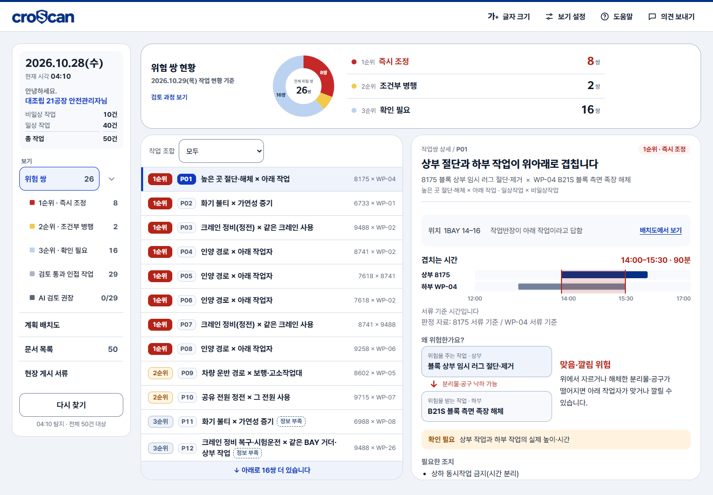

# croScan

**허가서 한 장으로 보이지 않는 위험을, 작업이 교차하는 곳에서 찾습니다.**

조선소 작업계획서·위험작업허가서를 연결하는 **제출 전 사전검토 시스템**입니다. 누락된 조건을 질문하고, 동시에 진행되는 작업의 위험과 판단 근거를 보여줍니다.

- **성과** · 2026 K-조선해커톤 **대한조선학회장상**
- **개인 기여** · 서재오 — 애플리케이션 전체 개발, 팀원 의견을 받는 QA 시스템, 영상 시스템 구현
- **구현 범위** · PDF 판독·편집, 프론트엔드, API·상태 관리, AI 연동, 규칙 판정, 평가 도구
- **현재 단계** · 합성 자료로 동작을 검증한 해커톤 프로토타입

[발표·시연 영상](https://www.youtube.com/watch?v=cwaHOZ8pvkk) · [발표 자료 PDF](docs/presentation/croScan_본발표_예비용.pdf) · [직접 실행](#직접-실행)


## 핵심은 자동화의 범위를 정한 것입니다

| 현장의 문제 | 구현한 대응 |
|---|---|
| 허가서를 각각 읽으면 다른 작업과의 충돌을 놓침 | 시간·장소·장비 관계로 작업을 연결하고, 위험 근거와 확인할 조건을 함께 표시 |
| 현장 표현만으로 시간·위치·방법을 확정하기 어려움 | AI가 해석을 제안하고, 작업반장이 확인한 값만 반영 |
| 안전관리자에게 일정 변경 권한이 없음 | 자동 일정 조정 기능을 제거하고, 작업반장 간 협의 문안과 게시 서류로 변경 |
| 답을 고친 뒤 이전 AI 응답이 늦게 도착함 | 검토 버전을 확인해 오래된 결과의 반영을 차단 |

**AI는 제안 · 규칙은 판정 · 사람은 확인과 승인.** 기존 허가·결재 절차를 대체하지 않습니다.

## 더 살펴보기

| 알고 싶은 것 | 읽을 문서 |
|---|---|
| 어떤 문제를 풀었고, 무엇을 직접 만들었나 | [프로젝트와 기여](docs/PROJECT.md) |
| 시스템은 어떻게 연결되고, 실패를 어떻게 다루나 | [구조와 설계 판단](docs/ENGINEERING.md) |
| 수치는 어떤 조건에서 나왔고, 어디까지 믿을 수 있나 | [평가 결과와 재현](docs/EVALUATION.md) |

## 화면에서 결과까지

1. **작업반장** — 계획서·허가서 업로드 → 부족한 조건 확인 → 체크리스트 검토 → 검토 서류 생성
2. **안전관리자** — 여러 작업의 위험쌍 확인 → 판정 이유·미확인 조건 검토 → 협의 문안·현장 게시 서류 작성
3. **팀 QA** — 화면 상태와 첨부를 포함한 의견 접수 → 처리 결과·메모·진행 상태 공유



## 검증을 읽는 기준

- **합성 시연 자료 기준**입니다. 현장 정확도·사고 감소·업무시간 절감의 실측 결과가 아닙니다.
- 위험 탐지와 우선순위 일치를 따로 평가합니다. 정답표 밖 경보도 숨기지 않습니다.
- 현재 코드의 재실행 결과, 과거 AI 실험, 미검증 항목은 [평가 문서](docs/EVALUATION.md)에서 구분합니다.

## 직접 실행

Python 3.12 이상, Java 17 이상이 필요합니다. 저장소 루트에서 실행합니다.

```bash
git clone https://github.com/seojaeohcode/croScan.git
cd croScan
python -m venv .venv
# Windows: .venv\Scripts\activate
# macOS/Linux: source .venv/bin/activate
python -m pip install -r requirements.txt
python -m uvicorn server.app:app --host 127.0.0.1 --port 8765
```

- 브라우저: **http://127.0.0.1:8765** · 상태 확인: `/api/health`
- 업로드 예제: [`samples/반장_테스트/`](samples/반장_테스트/) · 관리자 시연 자료: [`samples/시연_하루/`](samples/시연_하루/)
- LLM 없이도 화면·PDF 판독·규칙 판정·관리자 시연을 확인할 수 있습니다. **AI 해석 기능은 별도 모델 서버가 필요**합니다. [모델·Docker 설정](DOCKER.md)
- 기본값은 **인증 없는 로컬 시연 모드**입니다. 기본 제출본은 프로세스 메모리에 최근 6건만 유지하며, 관리자 화면은 준비된 시연 자료를 사용합니다.
- `CROSCAN_KEEP_SUBMISSIONS=1`이면 제출본 저장·관리자 연결 시험 모드가 됩니다. [환경변수 예시](.env.example)
- QA 내용·첨부·세션 등 다른 실행 데이터는 `data/`에 저장됩니다. Python 실행은 `.env`를 자동으로 읽지 않습니다. 셸 환경변수로 지정합니다.

## 저장소 구성

| 위치 | 내용 |
|---|---|
| [`server/`](server/) · [`web/`](web/) | FastAPI 백엔드 · 브라우저 UI |
| [`tools/`](tools/) · [`samples/`](samples/) | 검증·생성 도구 · 합성 시험 자료 |
| [`docs/`](docs/README.md) | 화면별 사용법·설계·변경 이력·평가 기록 |
| [`docs/presentation/`](docs/presentation/README.md) · [`docs/videos/final/`](docs/videos/final/) | 최종 발표 PDF·PPTX · 전체/분할 시연 영상 |
| [`media/`](media/README.md) | 영상·발표 자료 제작 소스 |
| [`deploy/oidc-proxy/`](deploy/oidc-proxy/) | 사내 인증 게이트웨이 연동 예시 |

소스코드는 [Apache-2.0](LICENSE)입니다. 외부 폰트·라이브러리·발표 인용 자료는 각각의 권리와 조건을 따릅니다. [자료 출처와 공개 범위](THIRD_PARTY_NOTICES.md)
