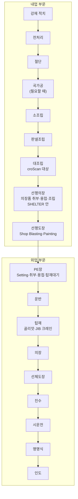
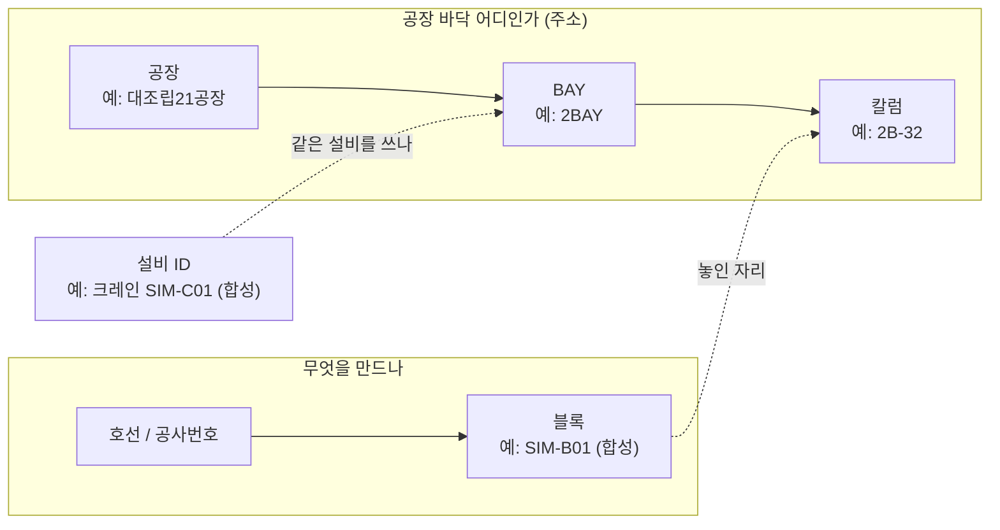
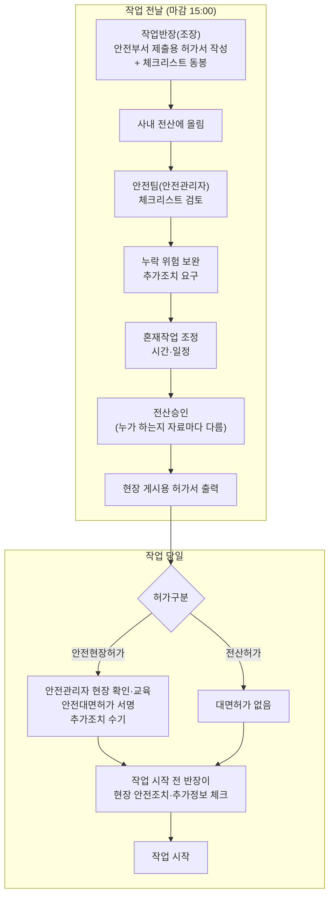
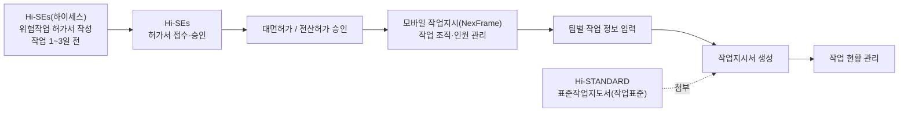
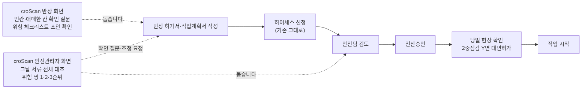
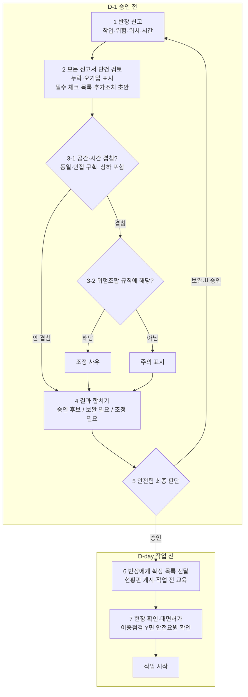
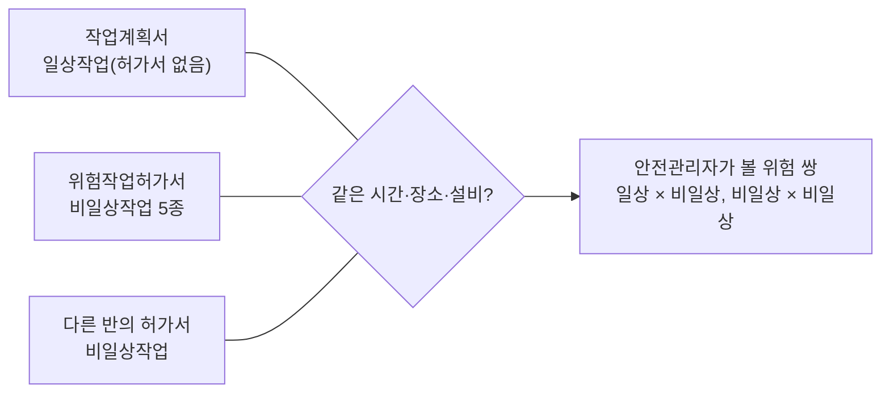
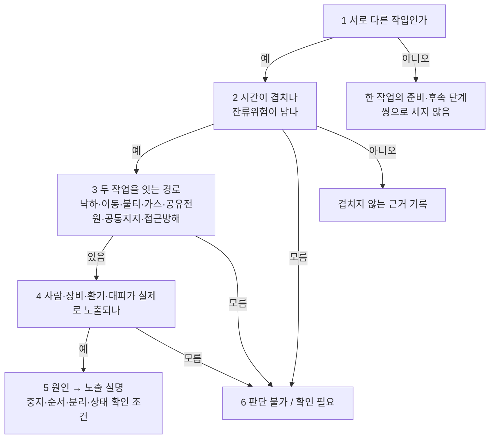

# 00 현장과 문제 이해

조선소를 처음 보는 팀원을 위한 문서입니다. 배를 만드는 순서, 위험작업허가서를 쓰고 승인하고 확인하는 사람, 함께 하면 위험한 작업 쌍을 조사 자료 그대로 정리했습니다. croScan의 기능과 화면은 [01 한눈에 보기](01_한눈에보기.md)에 있고, 이 문서는 그 바탕이 되는 현장 지식을 더 깊게 다룹니다.

**이 문서에서 알 수 있는 것**
- 조선 건조 공정과 대조립 공장, 위치를 적는 말(호선·블록·공장·BAY·칼럼)
- 허가서를 쓰는 사람·승인하는 사람·확인하는 사람, 그리고 지금 절차(As-Is)와 croScan이 들어간 절차(To-Be)
- 허가서 5종과 종류별 체크항목, 작업계획서와 허가서의 관계, 허가구분과 2중점검
- 조사자가 위험 쌍을 가르는 6단계 원칙, 일상 × 비일상 30칸 표와 비일상 × 비일상 15종, 사고 근거
- 조선 3사 자료와 법령으로 확인한 것, 자료끼리 맞지 않는 곳, 방향이 바뀐 과정

## 목차
0. [읽기 전에: 표시와 출처](#읽기-전에-표시와-출처)
1. [조선소에서 배를 만드는 순서](#1-조선소에서-배를-만드는-순서)
2. [위치를 적는 말](#2-위치를-적는-말)
3. [등장인물과 서류](#3-등장인물과-서류)
4. [허가서 한 장의 생김새](#4-허가서-한-장의-생김새)
5. [지금의 현장 전산 절차 (As-Is)](#5-지금의-현장-전산-절차-as-is)
6. [croScan이 들어간 절차 (To-Be)](#6-croscan이-들어간-절차-to-be)
7. [허가구분과 2중점검](#7-허가구분과-2중점검)
8. [허가서 5종과 종류별 체크항목](#8-허가서-5종과-종류별-체크항목)
9. [작업계획서와 허가서의 관계](#9-작업계획서와-허가서의-관계)
10. [대조립 공정 10단계와 조사 대상 작업 11종](#10-대조립-공정-10단계와-조사-대상-작업-11종)
11. [위험 쌍을 판정하는 조사자 원칙](#11-위험-쌍을-판정하는-조사자-원칙)
12. [일상작업과 비일상작업 30칸](#12-일상작업과-비일상작업-30칸)
13. [비일상작업끼리 15종](#13-비일상작업끼리-15종)
14. [허가서 작성 예시와 충돌쌍](#14-허가서-작성-예시와-충돌쌍)
15. [사고와 지침 근거 목록](#15-사고와-지침-근거-목록)
16. [조선 3사 비교와 법령 확인](#16-조선-3사-비교와-법령-확인)
17. [croScan에 주는 의미](#17-croscan에-주는-의미)
18. [자료 안의 불일치와 주의할 점](#18-자료-안의-불일치와-주의할-점)
19. [아직 모르는 것](#19-아직-모르는-것)
20. [방향 변화: 기존에서 최신으로](#20-방향-변화-기존에서-최신으로)
21. [다음에 읽을 문서](#21-다음에-읽을-문서)

---

## 읽기 전에: 표시와 출처

이 문서의 모든 사실에는 표시가 붙어 있습니다. 표시는 출처 문서가 쓴 그대로 옮겼습니다.

| 표시 | 뜻 |
|---|---|
| **[확인]** | 출처 문서에 사실로 적혀 있습니다. 출처 문서의 절과 원문 쪽수를 함께 적습니다. |
| **[추정]** | 출처 문서가 「추정」 또는 「~로 보인다」라고 적었습니다. 멘토에게 확인할 것입니다. |
| **[미확인]** | 출처 문서가 공개 자료에서 찾지 못했다고 적었습니다. |

[확인]은 「출처 문서에 그렇게 적혀 있다」는 뜻입니다. 회사가 공식으로 확인해 주었다는 뜻은 아닙니다. 특히 「현장」 문서의 원문은 팀원이 모은 조사 자료입니다. 멘토 발언에서 나온 수치는 통계가 아닙니다. 그래서 「멘토 발언」이라고 따로 적었습니다.

출처는 아래 줄임말로 적습니다.

| 줄임말 | 문서 | 무엇에서 나왔나 |
|---|---|---|
| 현장 | [`reference/현장프로세스_조사자료_정리.md`](reference/현장프로세스_조사자료_정리.md) | 노션 추가본 PDF 119쪽(팀원 조사, 2026-10-25 정리). 「원문 N쪽」은 이 PDF의 쪽입니다 |
| 3사 | [`reference/조선3사_작업허가_조사.md`](reference/조선3사_작업허가_조사.md) | HD현대·한화오션·삼성중공업 공식 보고서와 법령(2026-10-25). 「보고서 N쪽」은 각 회사 보고서의 쪽입니다 |
| 이해 | [`reference/프로젝트_이해정리.md`](reference/프로젝트_이해정리.md) | 「K-조선」 폴더 파일 18개(멘토 메모, 허가서 사진, 교안 등, 2026-10-23) |
| 멘토 | [`reference/멘토질문_팀결정.md`](reference/멘토질문_팀결정.md) | 팀 결정 D1~D9와 멘토 질문 M1~M8(2026-10-23) |
| 쌍설계 | [`reference/쌍작업탐지_설계.md`](reference/쌍작업탐지_설계.md) | 쌍작업 위험탐지 첫 설계(2026-10-27) |
| 체크설계 | [`reference/위험체크리스트_설계.md`](reference/위험체크리스트_설계.md) | 위험 체크리스트 첫 설계(2026-10-27) |
| 01 | [`01_한눈에보기.md`](01_한눈에보기.md) | 지금 코드 기준 요약 |

`reference/` 문서는 개발하면서 쓴 기록입니다. 그래서 지금 코드와 다른 곳이 있습니다. 다를 때는 코드와 01~18 문서를 믿습니다([docs/README.md](README.md)).

---

## 1. 조선소에서 배를 만드는 순서

배는 한 번에 만들지 않습니다. 철판을 잘라 작은 조각을 만들고, 조각을 점점 크게 붙여 **블록**(배를 여러 조각으로 나눌 때의 큰 조각 하나)을 만듭니다. 블록을 도크에 올려 하나로 합치면 배가 됩니다.

### 1.1 멘토가 적어 준 순서

멘토 손글씨 메모의 건조 순서입니다. [확인 · 이해 §3 · 멘토 메모]

> 철판절단 → 소조립 가공 → 중조립 → 대조립 → 도장공장 → 도크 전체조립 → 선박

- **내업**(공장 안에서 하는 일) 작업장: 소조립·중조립·대조립, 선행도장입니다. 메모에는 소조립·중조립·대조립 옆에 「혼재 많음」이라고 적혀 있습니다. 혼재는 여러 작업이 한곳에 섞이는 것입니다. [확인 · 이해 §3 · 멘토 메모]
- **외업**(공장 밖에서 하는 일): 블록 탑재·조립입니다. [확인 · 이해 §3 · 멘토 메모]
- 내업과 외업의 비율 60:40은 멘토 발언입니다. 통계가 아닙니다. [확인 · 이해 §9-9]

### 1.2 교안 흐름도의 순서

교안(`선박의 흐름(교안).xls`) 흐름도는 더 자세합니다. [확인 · 이해 §8]

- **PE장은 내업과 외업 둘 다 해당합니다.** 흐름도에는 외업에만 그려져 있습니다. 발표 자료에서 주의합니다. [확인 · 멘토 D8, 팀 확인 2026-10-23]
- 교안 xls 두 개에는 셀 데이터가 없고 사진과 도형만 있습니다. 공정마다 실제 사진이 6장씩 있습니다. 멘토가 말한 「도면보다 실제 공정 사진」 발표 소재로 쓸 수 있습니다. [확인 · 이해 §8]

### 1.3 팀이 정한 7공정

팀은 7공정을 이렇게 정했습니다. [확인 · 멘토 D8, 2026-10-23 확정]

| 구분 | 공정 |
|---|---|
| 내업 | 판넬조립 · 대조립 · 선행의장 · 선행도장 |
| 외업 | 탑재 · 선체도장 |
| 둘 다 | PE장 |

croScan은 이 가운데 **대조립**을 기준으로 합니다. 대조립 공장은 블록을 크게 짜 맞추는 곳입니다. 처음에는 선행의장이 시연 공정이었습니다. 바뀐 과정은 [20절](#20-방향-변화-기존에서-최신으로)에 있습니다.

---

## 2. 위치를 적는 말

현장은 위치를 두 갈래로 적습니다. 하나는 「무엇을 만드나」(호선·블록)이고, 다른 하나는 「공장 바닥 어디인가」(공장·BAY·칼럼)입니다.

### 2.1 말의 뜻

| 말 | 뜻 | 근거 |
|---|---|---|
| 호선 / 공사번호 | 허가서 식별 칸과 반장이 넣는 「작업내용」 묶음에 있는 칸입니다. 호선은 조선소가 배마다 붙이는 번호를 부르는 말입니다(일반 용어 풀이). | 칸이 있다는 것은 [확인 · 현장 §2 · 원문 3쪽 표], [확인 · 이해 §5] |
| 블록 | 배를 나눠 만든 큰 조각입니다. 반장은 「대상 블록·설비」를 적습니다. | [확인 · 현장 §2 · 원문 3쪽 표] |
| 공장 | 작업하는 건물입니다. 허가서 사진 예: 「대조립21공장」 | [확인 · 이해 §5 사진 2] |
| BAY | 공장 안의 작업 구역입니다. 대형 조립 BAY 1개는 약 43m × 120m(5,160㎡)입니다. 한화 필리 조선소 사례입니다. | [확인 · 01 §1], 크기는 [확인 · 현장 §5] |
| 칼럼 | 기둥 번호입니다. 허가서 예: 「대조립21공장 2BAY 2B-32 칼럼」 | [확인 · 01 §1], 예시는 [확인 · 멘토 D6] |
| 설비 ID | 크레인·전원 같은 설비의 번호입니다. 같은 설비를 두 작업이 쓰면 위험 경로가 됩니다. | [확인 · 쌍설계 §2·§4] |

- 반장이 허가서에 넣는 상세 위치는 「공장·BAY·칼럼·블록」입니다. [확인 · 현장 §2 · 원문 3쪽 표]
- 실제 허가서 사진의 작업장소 칸은 「공장·작업장·구역·BAY·칼럼」입니다. [확인 · 이해 §5]

### 2.2 주소는 위험 영역이 아닙니다

조사자는 위치를 다룰 때 이렇게 주의하라고 적었습니다. [확인 · 현장 §6]

- 공장·BAY·칼럼은 **주소**입니다. 실제 위험 영역은 외곽·높이·계통 연결로 봅니다.
- 「같은 BAY면 위험, 다른 칼럼이면 안전」이라고 보지 않습니다.
- 칼럼 번호 28~32가 적혀 있다고 기둥 5개를 차지한다고 확정하지 않습니다.

croScan의 첫 설계는 이 원칙을 이렇게 옮겼습니다. [확인 · 쌍설계 §2·§8]

- 같은 BAY는 위험이 아닙니다. 같은 칼럼 주소도 「가능」(노출 2)일 뿐입니다.
- 「확인」(노출 3)이 되려면 같은 블록, 명시된 이동 경로, 같은 설비 ID, 위아래 관계가 적힌 답이나 높이 가운데 하나가 있어야 합니다.
- 실제 외곽·높이·개구부는 서류에 없습니다. 그래서 같은 블록이 아니면 「가능」 이상으로 확정하지 않습니다.
- 「천장 3호기」 같은 설비 별칭은 설비 대장이 있어야 같은 설비로 묶을 수 있습니다.

### 2.3 공간 자료는 아직 합성입니다

- 처음 확보한 공간 자료(A08)는 GOLAR LNG선 도면입니다(563개 등록, 투영겹침 1,543). 배 안쪽 자료이고 공장 작업장 도면이 아닙니다. [확인 · 이해 §7]
- 팀은 실제 도면이 없으므로 합성 작업장 구역표를 만들자고 제안했습니다. 표기는 `공장 – BAY – 칼럼(구역)`, 관계는 동일·인접·상하·통로연결입니다. 블록 위 고소 작업과 블록 아래 작업은 상하 관계로 적습니다. 이 안은 아직 확정 표시(☐)가 없습니다. [확인 · 멘토 D6]
- GOLAR 선박 3D는 발표 시각화 보조로만 씁니다. 판정 근거로 쓰지 않습니다. [확인 · 멘토 D6]
- 현장에서 쓰는 위치 단위와 「인접 위험」 기준은 멘토 질문 M5로 남아 있습니다. [확인 · 멘토 §2 M5]

---

## 3. 등장인물과 서류

### 3.1 사람

| 사람 | 하는 일 | 근거 |
|---|---|---|
| 작업반장(조장 포함) | 현장에서 작업자에게 지시합니다. 허가서를 신청합니다. 원문 표현은 「보통 조장·반장들이 신청」입니다. | [확인 · 현장 §1] |
| 협력사 | 작업반장·조장과 함께 사내 전산으로 위험작업신고서를 작성합니다. | [확인 · 이해 §3] |
| 작업책임자 · 관리자(MANAGER) | 허가서의 「작업책임자」「관리자」 칸에 이름이 들어갑니다. 허가서 사진 2쪽에서는 전산승인자가 관리자 칸의 사람이었습니다. | [확인 · 이해 §5], [확인 · 현장 §13-1] |
| 관리감독자 (supervisor) | HD현대 용어입니다. 작업책임자·관리자 쪽에 해당합니다. 고위험 3중 점검의 1차 점검자입니다. | [확인 · 3사 §1.1·§1.4] |
| 안전관리자(안전팀) | 반장이 낸 허가서를 검토하고 최종 승인합니다. 안전대면허가란에 서명합니다. | [확인 · 현장 §1] |
| 안전요원 (Safety supervisors) | 허가서 아래 「작업허가 전 추가조치 요청사항」을 손으로 적습니다. 안전관리자와 다른 직책입니다. 고위험 3중 점검의 3차 점검자입니다. | [확인 · 현장 §1], [확인 · 3사 §1.1·§1.4] |
| 세잎클로버 (협력사 안전관리자) | HD현대 용어입니다. 3중 점검의 2차로, 중대재해 차단대책 이행을 점검합니다. | [확인 · 3사 §1.1·§1.4] |

### 3.2 서류

| 서류 | 누가 쓰나 | 무엇인가 | 근거 |
|---|---|---|---|
| 안전부서 제출용 허가서 | 작업반장 | 비일상작업을 하려고 내는 서류입니다. | [확인 · 현장 §1] |
| 체크리스트 | 작업반장 | 허가서와 함께 동봉해 보냅니다. 허가서 안의 위험 포인트 체크를 가리키는 것으로 보입니다. | [확인 · 현장 §1], 뜻은 [추정 · 현장 §1] |
| 현장 게시용 허가서 | 전산에서 출력 | 안전부서가 승인한 뒤 현장에 붙입니다. 안전대면허가 행이 없습니다. | [확인 · 현장 §1] |
| 작업허가 전 추가조치 요청사항 | 안전요원(수기) | 허가서 아래 칸입니다. | [확인 · 현장 §1] |
| 작업계획서 | 1차 협력업체(양식 기준) | 일상작업의 계획입니다. 1차 협력업체용 빈 양식(현대힘스 양식, 2쪽)이 있습니다. [9절](#9-작업계획서와-허가서의-관계)에서 자세히 봅니다. | [확인 · 이해 §6] |
| 위험성평가서 | (자료에 없음) | HD현대는 비일상 작업에 「작업 허가 전 위험성평가서를 필수적으로 요구」합니다. | [확인 · 3사 §1.6 · 보고서 208~209쪽] |
| 표준작업지도서 (작업표준, JSP) | 회사 작업표준 | JSP는 Job Standard Procedure입니다. HD현대 Hi-STANDARD 시스템의 작업표준이고, 모바일 작업지시에 첨부됩니다. 허가서에 「작업표준(JSP NO.)」 칸이 있습니다. | [확인 · 3사 §1.1·§1.2·§5] |
| 모바일 작업지시서 | 모바일 작업지시 시스템에서 생성 | HD현대에서 허가 승인 뒤 팀별 작업 정보를 넣어 만듭니다. | [확인 · 3사 §1.2] |

PTW(Permit To Work)는 허가를 받아야만 할 수 있는 작업입니다. 대상 기준은 공개되어 있지 않습니다. [확인 · 현장 §1] HD현대 용어집에서는 「위험작업신고(위험작업허가)」가 PTW이고, 허가서와 신고서는 같은 것입니다. [확인 · 3사 §1.1] 한화오션 자회사는 「안전작업허가제(Permit to Safety Work, PTW)」라고 씁니다. [확인 · 3사 §2 · 보고서 44쪽]

### 3.3 누가 쓰고, 누가 승인하고, 누가 확인하나

| 단계 | 쓰는 사람 | 승인·확인하는 사람 | 근거 |
|---|---|---|---|
| 허가서·체크리스트 작성 | 작업반장(조장)·협력사 | — | [확인 · 현장 §1·§2], [확인 · 이해 §3] |
| 검토·누락 보완·혼재 조정 | — | 안전팀(안전관리자) | [확인 · 현장 §2 · 원문 9쪽] |
| 전산승인 | — | **자료마다 다릅니다.** 반장, 안전관리자, 작업부서 관리자 세 가지 설명이 있습니다. [18절](#18-자료-안의-불일치와-주의할-점) 참고 | [확인 · 현장 §13-1], [추정 · 3사 §1.3] |
| 추가조치 요청사항 | 안전요원(수기) | — | [확인 · 현장 §1] |
| 안전대면허가 | — | 안전관리자 서명 | [확인 · 현장 §1·§2] |
| 당일 현장 안전조치·추가정보 체크 | 작업반장(작업 시작 전) | — | [확인 · 현장 §2] |
| 고위험 작업 점검(HD현대) | — | 관리감독자 → 세잎클로버 → 안전요원 | [확인 · 3사 §1.4] |

이해정리의 As-Is 설명은 「안전요원이 현장 이중점검과 작업 전 교육을 하고 안전대면허가를 낸다」고 적었습니다. [확인 · 이해 §3] 현장 문서는 대면허가 서명을 안전관리자가 한다고 적었습니다. 이 차이도 [18절](#18-자료-안의-불일치와-주의할-점)에 적었습니다.

---

## 4. 허가서 한 장의 생김새

### 4.1 실제 허가서의 칸

HD현대 「기타위험(밀폐)작업 허가서」 사진 2장에서 읽은 칸입니다. [확인 · 이해 §5]

| 영역 | 칸 |
|---|---|
| 식별 | 승인번호(BS22-IV-…), 허가구분(안전현장허가 / 전산허가), 호선/공사, 작업표준(JSP No.) |
| 장소·일시 | 작업장소(공장·작업장·구역·BAY·칼럼), 주간/야간, 일별 시작·종료(여러 날짜 행) |
| 내용·조직 | 작업내용, 작업부서, 작업책임자, 관리자, 연락처·TRS, 작업인원 |
| 위험 | 유해위험요소/추가전달사항(작업부서 작성), 병행여부 |
| 현장 안전조치 | 공지문·경고표지, LOTO, 인화성물질 제거, 통행로 확보, 작업구역 통제, 병행작업 확인(SIMOPS), 소화장비, 야간 조명. **당일 작업 시작 전에 적고, 미리 적으면 안 됩니다** |
| 추가정보 | 밀폐구역(출입현황판·감시자·환기·가스측정·조명), 고소작업(출입수단·작업대·안전벨트·생명줄·추락방지), 아르곤가스·수전구역·압력(테스트압력·파이프직경)·작업높이. 대면접수 때는 적지 않습니다 |
| 발행 | 허가신청 → 전산승인 → 안전대면허가(각 일시·서명), PTW 점검 QR, 2중점검 대상 Y/N |
| 안전요원 | 작업허가 전 추가조치 요청사항(수기) |

말 풀이입니다.
- **TRS**: Trunked Radio System(업무용 주파수 공용 무전)입니다. [확인 · 3사 §5, 일반 의미만 확인] 허가서 연락처 칸의 무전 번호로 보입니다. [추정 · 3사 §5]
- **LOTO**: 설비 에너지를 끊고 잠금장치·꼬리표를 걸어 다시 켜지지 않게 하는 절차입니다([01 §1](01_한눈에보기.md#1-무엇을-푸나)).
- **SIMOPS**: 허가서의 「병행작업 확인」 칸 옆에 적힌 말입니다. 동시에 하는 작업을 확인하는 칸입니다. [확인 · 이해 §5]

### 4.2 반장이 넣는 정보 5묶음

조사 원문 3쪽 표입니다. [확인 · 현장 §2 · 원문 3쪽]

| 묶음 | 내용 | 언제·누가 |
|---|---|---|
| 1. 작업내용 | 작업명·상세, 호선/공사번호, 대상 블록·설비, 작업표준 번호 | 전날 신청 때, 반장 등 작업부서 |
| 2. 장소·일시 | 상세 위치(공장·BAY·칼럼·블록), 일자, 시작·종료, 주간·야간 | 전날 신청 때 |
| 3. 부서·담당자 | 부서·협력업체, 책임자·관리자 이름·연락처·TRS, 인원, 신청자 | 전날 신청 때 |
| 4. 유해위험요소·추가전달사항 | 예상 위험, **알고 있는 병행작업**, 주의사항·조치 계획, 밀폐·가스 사용 등 | 전날 신청 때 |
| 5. 현장 안전조치·추가정보 체크리스트 | 경고표지·통행로·구역통제·소화장비, 출입현황판·감시자·환기·가스측정·조명 등 | **작업 당일 시작 전. 미리 적으면 안 됩니다** |

### 4.3 사진 두 장이 보여 준 것

| | 사진 1 | 사진 2 |
|---|---|---|
| 작업 | 유니트4팀, 배관 내부 진입, 6일간, 2명 | 대조립21공장 2BAY, 밀폐공간 내부, 4일간, 4명 |
| 위험요소 | 「질식·소음」 | 문장이 구체적입니다 |
| 당일 체크란 | 전부 빈칸 | 대부분 체크 |
| 2중점검 · 허가구분 | Y | N, 전산허가 |
| 아래 칸 | 안전요원이 손으로 쓴 추가조치(가스농도 측정·환기·감시자 배치 등) | — |

[확인 · 이해 §5] 사진 1은 사람이 누락을 보완하는 실제 사례입니다. [확인 · 이해 §5]

### 4.4 당일 칸은 비어 있어야 정상입니다

당일 체크란은 미리 적으면 안 되는 칸입니다. 그래서 승인 전(D-1, 작업 전날)에 빈칸을 「누락」으로 잡으면 잘못된 경보가 됩니다. [확인 · 이해 §5] 팀은 이 칸들을 D-1 누락 판정에서 빼자고 정했습니다(D1). 이 결정은 팀원 확인 중으로 남아 있습니다. [확인 · 멘토 D1, 확정 ☐] 원문 3쪽 표가 이 결정을 뒷받침합니다. [확인 · 현장 §2]

D-1에 검토할 대상은 아래 네 가지로 정리되어 있습니다. [확인 · 멘토 D1]

1. 유해위험요소·추가전달사항이 작업 내용에 비해 빠졌는가 (예: 배관 내부 진입인데 「질식」만 있고 가스·환기 말이 없음)
2. 추가정보 분류(밀폐·고소·아르곤가스·수전구역·압력)가 맞는가
3. 「작업허가 전 추가조치」 초안 (안전요원이 수기로 쓰는 칸)
4. 병행여부 칸과 혼재 검토 결과가 서로 맞는가

체크리스트 설계도 같은 원칙을 지킵니다. croScan은 허가서 5번 「현장 안전조치 및 추가정보」 칸을 채우지 않습니다. 체크리스트의 조치는 모두 「…할 예정」 문장이고 「실시함·완료함」을 쓰지 않습니다. 당일 칸과 이어지는 조치에는 「당일 허가서 5번에서 확인」 표시를 붙입니다. [확인 · 체크설계 §2]

---

## 5. 지금의 현장 전산 절차 (As-Is)

### 5.1 조사 자료가 그린 흐름

[확인 · 현장 §0·§2] 「전날 15시 마감」은 조사 원문에 있습니다. 공개 자료에서는 찾지 못했습니다. [미확인 · 3사 §0-4·§5]

이해정리는 같은 흐름을 다섯 단계로 적었습니다. [확인 · 이해 §3]

1. **일상작업**: 파이프·볼트·플랜지 조립처럼 반복하는 정형 작업입니다. 건마다 신고하지 않습니다.
2. **비일상·위험작업**: 작업반장·조장·협력사가 사내 전산으로 위험작업신고서를 쓰고 위험 포인트를 직접 체크합니다.
3. **안전팀 승인권자**가 검토해 누락 항목과 주의사항을 적고, 필요하면 일정 간섭을 조정합니다. 이것이 전산승인(비대면)입니다.
4. 필요하면 안전요원이 현장 이중점검과 작업 전 교육을 하고 안전대면허가를 냅니다.
5. 작업에 착수합니다. **안전승인 없이는 작업할 수 없습니다.**

### 5.2 안전팀이 내놓는 것 4가지

[확인 · 현장 §2 · 원문 9쪽]

1. **검토·승인 결과**: 신청 내용과 위험 항목을 검토합니다.
2. **누락 위험 보완·추가조치 요청**: 빠진 위험에 의견을 달고, 작업 전에 할 조치를 요구합니다.
3. **혼재작업 조정**: 필요하면 시간·일정을 조정하고, 함께 할 수 없는 조건을 관리합니다.
4. **현장 확인·대면허가 결과**: 해당 작업만입니다. 현장 확인, 작업 전 교육, 대면허가 서명입니다.

### 5.3 공식 자료로 본 HD현대의 흐름

HD현대중공업 보고서 그림의 PTW 흐름입니다. [확인 · 3사 §1.2 · 보고서 186~187쪽]

- Hi-SEs는 HD현대의 통합HSE시스템입니다. [확인 · 3사 §0-4]
- 2023.01에 PTW와 모바일 작업지시를 이었습니다. 그 전에는 둘이 따로 돌아 관리감독자가 불편했습니다. 같은 때 모바일 작업지시에 「현장·대면·전산」 표시를 넣었습니다. [확인 · 3사 §1.2]
- 2023.12에 부서별 「중대재해 차단대책」과 PTW를 이었습니다. [확인 · 3사 §1.2]
- 2023 하반기에 모바일 작업지시 기반 현장 위험성평가가 하루 평균 3,300건이었습니다(외국인 약 1,000건/일). 허가 건수는 아니고 현장 규모를 보여 주는 값입니다. [확인 · 3사 §1.2]

### 5.4 현장의 어려움

- 안전팀에는 하루 **40~50건**이 올라옵니다. 그래서 반장이 체크한 위험 포인트만 보고 넘기고, 꼼꼼히 보지는 못합니다. 이것은 **멘토 발언**입니다(19:33). [확인 · 현장 §0·§14]
- 멘토가 말한 어려움은 위험항목 누락, 하루 한 팀에 40~50건의 검토량, 반복 행정, 30분~1시간의 착수 대기입니다. 모두 멘토가 예로 든 발언이고 실측 통계가 아닙니다. [확인 · 이해 §3·§9-9]
- 팀은 이 수치를 「어떤 논리로 설득할지」의 방향으로 씁니다. 발표에서는 「현업자 인터뷰 발언」이라고 출처를 밝힙니다. 사고 감소율은 근거 없이 주장하지 않습니다. [확인 · 멘토 D9]

---

## 6. croScan이 들어간 절차 (To-Be)

### 6.1 지금 croScan의 자리

croScan은 기존 절차를 바꾸지 않습니다. 반장이 허가서를 쓸 때와 안전팀이 검토할 때 옆에서 돕습니다. 승인·일정 결정·작업 차단은 하지 않습니다. [확인 · 01 §2·§7]

화면 순서와 단계별 기능은 [01 §2](01_한눈에보기.md#2-현장-절차-속-croscan), [02](02_화면시연_반장.md), [03](03_화면시연_안전관리자.md)에 있습니다.

### 6.2 As-Is와 To-Be를 칸마다 비교

| 단계 | 지금 (As-Is) | croScan이 있을 때 (To-Be) | 근거 |
|---|---|---|---|
| 허가서 작성 | 반장이 칸을 채우고 위험 포인트를 직접 체크합니다 | croScan이 비었거나 애매한 칸만 골라 묻습니다. 답은 반영본·별지로 남고 원본은 그대로입니다 | [확인 · 이해 §3], [확인 · 01 §1] |
| 체크리스트 | 반장이 허가서에 동봉합니다 | croScan이 허가서와 확인 질문의 답만으로 초안을 만들고, 반장이 항목마다 확인합니다 | [확인 · 현장 §2], [확인 · 체크설계 §0·§1] |
| 안전팀에 보내는 것 | 허가서 + 체크리스트 | 서류 3가지: 허가서 원본+추가검토서, 작업계획서, 위험 체크리스트 | [확인 · 체크설계 §0·§6] |
| 혼재 검토 | 안전팀이 직접 합니다. 공개된 자동 기능은 도장×화기 하나뿐입니다 | 그날 서류 전체에서 시간·장소·설비가 겹치는 쌍을 규칙으로 찾아 순위를 붙입니다 | [확인 · 3사 §1.5], [확인 · 01 §1] |
| 승인 | 사람(전산승인·대면허가) | 그대로 사람이 합니다 | [확인 · 01 §7] |
| 하이세스 등록 | 직접 합니다 | 그대로 직접 합니다 | [확인 · 체크설계 §6] |

### 6.3 안전팀 아웃풋 4가지와 croScan

조사 정리는 croScan 출력을 안전팀 아웃풋 4가지에 맞추자고 제안했습니다. [확인 · 현장 §2·§12-3] 지금 croScan에서 가까운 것을 옆에 적었습니다.

| 안전팀 아웃풋 | 조사 정리의 제안 | 지금 croScan에서 가까운 것 |
|---|---|---|
| 검토·승인 결과 | 검토 의견 | 승인·반려는 하지 않습니다 [확인 · 01 §7] |
| 누락 위험 보완·추가조치 | 추가조치 초안(안전요원 수기란) | 반장 화면의 확인 질문, 반영본·별지, 위험 체크리스트 [확인 · 01 §3] |
| 혼재작업 조정 | 혼재 조정안 | 위험 쌍 목록, 반장별 확인 질문 문안, 작업 조정 문자 초안. 문자는 자동으로 보내지 않습니다 [확인 · 01 §3·§7] |
| 현장 확인·대면허가 | 대면 확인 항목 | 2중점검·허가구분 칸은 묻지도, 정하지도, 쓰지도 않습니다 [확인 · [13 용어집](13_용어집.md)] |

### 6.4 설계 때 그린 목표 흐름

2026-10-23에 팀이 그린 목표 흐름(다인 플로우차트)입니다. 지금 앱과 다른 곳이 있어서, 흐름 아래에 차이를 적었습니다. [확인 · 이해 §4.2]

- 처음 시나리오 차트(6단계)는 겹침이 없으면 바로 체크리스트로 갔습니다. 다인 차트는 **모든 신고서를 먼저 단건 검토**합니다. 멘토 피드백(단건 누락이 핵심)에는 다인 차트가 더 맞습니다. [확인 · 이해 §4]
- 두 차트 모두 「시간·장소 겹침 ≠ 위험 확정」, 「AI 통과 ≠ 작업허가」를 전제로 합니다. [확인 · 이해 §4.1]
- 지금 앱과 다른 곳:
  - 결과 이름이 다릅니다. 설계의 「승인 후보 / 보완 필요 / 조정 필요」 대신, 지금은 쌍마다 1순위(즉시 조정)·2순위(조건부 병행)·3순위(확인 필요)를 붙입니다. [확인 · 쌍설계 §5], [확인 · 01 §6]
  - 체크리스트 초안은 허가서와 답만으로 만듭니다. 다른 작업과의 겹침은 안전관리자 단계에서 봅니다. [확인 · 체크설계 §1·§11]
  - 당일 체크와 필수 목록을 자동으로 대조하는 일은 D-day 확장 기능으로 미뤘습니다. [확인 · 이해 §4.2·§5], [확인 · 멘토 D1]

---

## 7. 허가구분과 2중점검

### 7.1 허가구분 두 가지

| 허가구분 | 안전대면허가 | 조사 원문의 사례 |
|---|---|---|
| 안전현장허가 | **필요합니다**(작업 당일 현장 확인·교육·서명) | 배관 내부 진입 + 아르곤가스 사용 |
| 전산허가 | **필요 없습니다**. 전산승인으로 끝납니다 | (준)밀폐공간 내부 작업 |

[확인 · 현장 §0·§3]

- 둘을 가르는 기준은 회사가 공개하지 않았습니다. [확인 · 현장 §3]
- 조사자는 「아르곤 사용 + 배관 내부 진입이 핵심 원인」이라고 보았습니다. [추정 · 현장 §3]

### 7.2 공식 자료로 보면 허가는 세 가지일 수 있습니다

- HD현대중공업은 PTW를 **전산허가(electronic permits)·대면허가(face-to-face permits)·현장허가(on-site permits)** 3가지로 부릅니다. [확인 · 3사 §0-1·§1.1 · 용어집]
- 모바일 작업지시 화면에도 「현장·대면·전산」이 따로 표시됩니다. [확인 · 3사 §0-1·§1.2]
- 우리 허가서의 [안전현장허가]/[전산허가]는 이 체계의 일부로 보입니다. [추정 · 3사 §0-1]
- 허가 종류는 반장이 건마다 고르지 않습니다. 2024년 계획에 「전산/대면/현장허가 대상작업 선정 협의 실시(생산부서)」와 「안전-생산 작업별 PTW 승인권한 재정립」이 있습니다. [확인 · 3사 §0-2·§1.3 · 보고서 266~267쪽]
- 그래서 허가 종류는 작업(ACT) 단위로 미리 정한 목록이고, 승인은 작업별로 생산(관리감독자)과 안전부가 나눠 맡는다고 볼 수 있습니다. [추정 · 3사 §1.3]

### 7.3 2중점검

허가서에는 「2중점검 대상 Y/N」 칸이 있습니다. [확인 · 이해 §5]

| 값 | 뜻 (회의록, 참석자3, 37:58) |
|---|---|
| Y | 아침에 현장을 보고 교육한 뒤 작업을 시작합니다 |
| N | 안전요원이 아침에 다시 와서 교육하지 않습니다 |

[확인 · 현장 §3]

- 사례에서는 Y와 안전현장허가가 같이 나왔고, N과 전산허가가 같이 나왔습니다. 둘이 원인과 결과인지는 확인되지 않았습니다(Q&A 3번). [확인 · 현장 §3]
- 「2중점검 대상 Y/N」과 「PTW점검」 QR은 HD현대의 다중 점검 체계와 관련된 것으로 보입니다. Y는 생산·안전이 아침 현장 점검과 교육을 한 뒤 착수하는 대상입니다(보고서의 「고위험 작업 시 생산·안전 2중 안전관리」 표현, 회의록 발언과 일치). [추정 · 3사 §1.4]
- 정확한 기준은 공개 자료에 없습니다. [미확인 · 3사 §1.4·§5 Q3]

### 7.4 3중 점검과의 관계

HD현대 고위험 3중 안전관리(2018.04 구축)입니다. [확인 · 3사 §1.4]

| 단계 | 담당 | 점검 대상 |
|---|---|---|
| 1차 | 관리감독자 | 일반작업 + 고위험 작업 |
| 2차 | 세잎클로버(협력사 안전관리자) | 중대재해 차단대책 이행점검 |
| 3차 | 안전요원 | 고위험 작업 + 불안전 상태·행동 |

- 고위험 작업은 부서별 점검계획을 Hi-SEs에 미리 등록하고 QR로 점검합니다. 엔진기계사업부만 2023년에 QR 점검 약 56,000건을 계획했습니다. [확인 · 3사 §1.4]
- 「일별 위험작업 LIST 공유 → 고위험 작업 실태점검」이 있습니다(보고서 208쪽). [확인 · 3사 §1.4]
- 허가서의 「PTW점검」 QR은 이 QR 점검과 이어진 것으로 보입니다. [추정 · 3사 §0-7]

---

## 8. 허가서 5종과 종류별 체크항목

### 8.1 다섯 종류

양식은 같습니다. 바뀌는 것은 제목과 「추가정보」 칸의 전용 항목뿐입니다. [확인 · 현장 §0·§4]

| 종류 | 영문 제목 | 짝이 되는 대조립 비일상작업 |
|---|---|---|
| 밀폐공간 | CONFINED SPACE ENTRY PERMIT | N2 아르곤 사용 조건의 배관 내부 진입 |
| 화기작업 | HOT WORK PERMIT | N1 중대 불량부 절단·가우징·재취부·재용접 |
| 고소작업 | WORK AT HEIGHT PERMIT | N3 블록 상부 임시 인양러그 절단·제거 |
| 중량물인양 | HEAVY LIFTING PERMIT | N4 대조립 블록의 별도 반출·이동 |
| 정전·LOTO | ELECTRICAL ISOLATION / LOTO PERMIT | N5 크레인 제어반 전기계통 고장수리 |

[확인 · 현장 §4]

말 풀이: 화기는 용접·절단 작업입니다([01 §1](01_한눈에보기.md#1-무엇을-푸나)). 가우징은 금속을 홈처럼 파내는 작업입니다. 러그는 블록을 들 때 쓰는 임시 인양고리입니다([13 용어집](13_용어집.md)).

### 8.2 종류별 「추가정보」 전용 12항목

합성 예시 허가서(원문 90~98쪽)의 항목입니다. [확인 · 현장 §4 · 원문 90~98쪽]

| 화기 | 밀폐 | 고소 | 중량물인양 | 정전·LOTO |
|---|---|---|---|---|
| 화기 종류 | 진입·대피 경로 | 작업 높이 | 대상·계획 중량 | 수리 대상·정격 |
| 절단 대상 | 진입·감시 인원 | 고소 접근수단 | 실중량·무게중심 | 전체 전원 조사 |
| 가연물 방호 | 산소농도 O2 | 발판·안전난간 | 사용 크레인 | 차단 경계·지점 |
| 불티 도달경로 | CO2·CO·H2S | 안전대 형식 | 장비 인양능력 | 잠금·열쇠 관리 |
| 절단부 지지 | 가연성가스 농도 | 안전대 부착설비 | 인양점·러그 상태 | 검전기 작동점검 |
| 절단물 회수 | 급기·배기 배치 | 러그 분리 지지 | 줄걸이 계획 | 무전압 확인 |
| 화재감시자 | 환기팬 독립전원 | 공구 낙하방지 | 반출 이동경로 | 잔류에너지 방전 |
| 용접흄 배기 | 감시·비상연락 | 하부 출입통제 | 안착·받침 조건 | 원격·자동 재기동 |
| 가연성가스 측정 | 구조 준비 | 운반물 접근 배제 | 운전·신호 담당 | 다른 설비 영향 |
| 하부 작업 통제 | 중단 후 재진입 | 고소 화기 방호 | 내부 인원 철수 | 운행 요청 통제 |
| 착수 전 병행중지 | 입·퇴실 대조 | 추락 시 구조 | 구조·통로 인계 | 복구 전 철수 |
| 종료 후 잔불확인 | 동시작업 배제 | 작업 중지 조건 | 크레인 정비 인계 | 격리 해제·인계 |

- 공통 「현장 안전조치」 8항목은 실제 양식과 같습니다. 공지문·구역통제·전원차단·병행작업·인화성물질·소화장비·통행로·야간조명입니다. [확인 · 현장 §4]
- 예시 체크 표기는 **■ = 계획 반영**, **□ = 당일 확인 대기**, **- = 비해당**입니다. [확인 · 현장 §4]
- 예시 허가서는 항목마다 설명 문구가 붙은 2단 체크 형식입니다. [확인 · 현장 §12-1]
- 화재감시자는 화기 작업 곁에서 불이 나는지 지켜보는 사람입니다. 적정공기는 사람이 숨 쉬어도 되는 공기 상태입니다. 기준은 산소 18% 이상 23.5% 미만, CO2 1.5% 미만, CO 30ppm 미만, H2S 10ppm 미만입니다. [확인 · 현장 §4], [확인 · 3사 §4 제618조]
- 조사 원문이 인용한 법령은 안전보건규칙 제38조(작업계획서), 제241조의2(화재감시자, 반경 11m), 제318·319조(전기작업·정전 잠금), 제618·619조(밀폐공간 적정공기·사전확인), 제32·44조(2m 이상 추락위험·안전대 부착설비)입니다. [확인 · 현장 §4] 이 가운데 3사 조사가 원문으로 다시 확인한 것은 [16.4절](#164-법령-확인)에 있습니다.

### 8.3 croScan 체크리스트 첫 설계의 항목

체크리스트 첫 설계(2026-10-27)는 조사자료 종류별 위험표와 「산업안전보건기준에 관한 규칙」에서 항목을 골랐습니다. 연구 ID를 `ref`로 남겼습니다. 그때는 53개였습니다. [확인 · 체크설계 §3]

| 종류 | 항목 (연구 ID) |
|---|---|
| 화기 10 | 불티(HW02-SPARK), 가연물(HW05-FIRE), 가스 폭발(HW05-EXPLOSION), 분리 부재 낙하(HW03-FALL), 받침 상실(HW03-SUPPORT), 고소 추락(HW03-ACCESS-FALL), 보호가스 질식(HW06), 흄(HW07), 감전(HW09), 잔불(HW10) |
| 밀폐 10 | 아르곤(PE01), 잔류 가스(PE02), 모르는 공기(PE03), 환기 끊김(PE04), 유입·압력(PE05), 출입 중 이동 간섭(PE06), 감시(PE08), 구조(PE10), 출입구(PE14), 추락(LU03) |
| 고소 9 | 하중 걸린 러그(LU01), 낙하(LU02), 추락(LU03), 받침(LU04), 회수(LU05), 크레인 간섭(LU06), 불티(LU07), 흄(LU09), 잔류(LU15) |
| 중량물 10 | 경로(MV01), 하부(MV02), 내부 인원(MV03), 줄걸이(MV04), 안착(MV05), 해제(MV06), 지지(MV07), 다른 크레인(MV08), 연결선(MV10), 신호(MV12) |
| 정전·LOTO 10 | 접촉(EL01), 역송전(EL02), 아크(EL03), 재가동(EL04), 시험 구동(EL05), 잔류 에너지(EL06), 다른 크레인(EL07), 상부 추락(EL08), 공유 기능(EL09), 제어 배선(EL12) |
| 공통 4 | 병행·혼재작업, 출입·통행 통제, 보호구, 비상연락·구조 |

지금 코드의 체크리스트는 86항목(공통 7 · 화기 21 · 밀폐 16 · 고소 16 · 인양 12 · LOTO 14)입니다. [확인 · 01 §6] 항목 전체는 [07 위험 체크리스트](07_위험체크리스트.md)에 있습니다.

---

## 9. 작업계획서와 허가서의 관계

### 9.1 일상과 비일상

팀은 두 말을 이렇게 정했습니다. [확인 · 멘토 D2, 2026-10-23 확정]

- **일상작업**: 신고서(허가서)를 올리지 않고 그냥 하는 작업입니다. 위험한지 안전한지와는 관계없습니다. 작업계획서에 적힙니다.
- **비일상작업**: 신고서(허가서)를 올리는 작업입니다.

HD현대도 일상·비일상 구분을 실제로 씁니다. 「안전작업 책임제」(2026.09.14 시행)가 「고위험 작업은 물론 일상 및 비일상 작업 전반에 걸쳐 관리 책임자를 명확히 지정」한다고 했습니다. [확인 · 3사 §1.6 · 에너지코리아 2026.09.28]

### 9.2 두 서류가 만나는 곳

| 관계 | 내용 | 근거 |
|---|---|---|
| 허가서 안의 「알고 있는 병행작업」 | 반장은 허가서 4번 묶음에 자기가 아는 병행작업을 적습니다. 허가서에는 「병행여부」 칸도 있습니다. | [확인 · 현장 §2], [확인 · 이해 §5] |
| 작업계획서의 「선행작업과 혼재 협의」 | 작업계획서 2쪽에 선행작업·선행조건·혼재작업·방호조치 칸이 있습니다. | [확인 · 이해 §6] |
| 일상작업도 비교에 넣어야 하는 이유 | 일상작업은 신고되지 않습니다. 그래서 작업계획서가 없으면 비교에서 빠집니다. | [확인 · 이해 §6 입력 자료 5종] |
| 하루치 규모 | 시연 하루는 허가서(비일상) 10건, 작업계획서(일상) 40건입니다. 일상×비일상 400쌍, 비일상×비일상 45쌍, 합계 445쌍입니다. 일상×일상은 범위 밖입니다. | [확인 · 쌍설계 §1] |
| 체크리스트의 근거 | 위험 체크리스트는 허가서와 그 답만으로 만듭니다. 작업계획서는 근거로 쓰지 않습니다. 다른 작업과의 겹침은 안전관리자 단계에서 봅니다. | [확인 · 체크설계 §0·§1·§11] |

### 9.3 작업계획서 양식

1차 협력업체용 빈 작업계획서(현대힘스 양식, 2쪽)의 칸입니다. [확인 · 이해 §6]

| 쪽 | 칸 |
|---|---|
| 1쪽 | 작업명, 문서와 수행업체(수행업체·작성자·책임자·호선), 일정·범위(시작·종료·시간대·상태·범위), 위치·연결(작업위치·대상ID·연결정보·도면자료), 인원·장비·사양(인원·담당배치·장비·물질·사양·높이), 1~3단계 작업 순서, 공정 단계·분류 근거 |
| 2쪽 | 선행작업과 혼재 협의(선행작업·선행조건·혼재작업·방호조치), 예비 확인 기록(공간대상·위험요소·방호상태·가동위험기간·위험종료 × 확인값·시각·유효범위), 출입·대피·이전 상태, 종료와 검토 인계(종료·해제·후속요건·검토승인) |

### 9.4 판정에 필요한 입력 5종

설계 때 정리한 입력 자료입니다. [확인 · 이해 §6]

| 입력 | 필요한 정보 | 목적 |
|---|---|---|
| 신규 비일상작업 신청 | 장소·내용·일시·부서·책임자·인원, 첨부 | 검토 대상 식별, 개별 체크리스트 |
| 일상작업계획서 | 작업ID·내용·대상·구역·예정시간·담당팀, 변경 가능 범위·선행작업·장비 | 신고되지 않는 일상작업도 비교에 넣음 |
| 기존 비일상 신청정보 | 다른 작업의 ID·내용·위치·시간·조건 | 비일상×비일상 비교 |
| 위험조합쌍·작업별 안전기준 | 공정·작업쌍·적용조건·위험·병행제한·조치·출처·버전 | 위험 검토와 체크리스트 근거 |
| 도면·공간 연결정보 | 구역·갑판·대상·경계·연결 관계 | 같은 공간·위아래·주변·같은 대상 판단 |

---

## 10. 대조립 공정 10단계와 조사 대상 작업 11종

### 10.1 대조립 공정 10단계

[확인 · 현장 §11 · 원문 116~119쪽]

| 단계 | 하는 일 | 여기서 나오는 비일상작업 |
|---|---|---|
| 1 | 도면 확인과 조립 순서 결정 | |
| 2 | 작업장·지그·받침 준비 | |
| 3 | 배재: 부재를 조립 위치에 놓음 | |
| 4 | 취부: 위치·간격을 맞추고 가용접으로 임시 고정 | |
| 5 | 용접 | |
| 6 | 사상: 용접부·표면 정리 | |
| 7 | 치수 확인과 변형 교정 | |
| 8 | 블록 반전·자세 변경 | |
| 9 | 검사(비파괴검사 포함)와 불량 보수 | N1 불량 보수 |
| 10 | 완성 확인과 블록 반출·인계 | N4 반출 |

취부·용접·사상·측정은 여러 번 되풀이됩니다. [확인 · 현장 §11]

### 10.2 일상작업 6종 (허가 없이 하는 범위로 한정)

모두 **지상·무부하·수동** 범위로 정의했습니다. 이 범위가 회사의 허가 면제를 확인했다는 뜻은 아닙니다. [확인 · 현장 §5]

| ID | 작업 | 범위에서 뺀 것 | 주변 작업에서 받는 위험 |
|---|---|---|---|
| R1 | 빈 핀지그의 수동 높이 조정 | 하중 걸린 지그, 잭업, 전동구동 | N4 반입 경로, N1·N3 절단물 |
| R2 | 블록 외부 대각선 치수검사 | 내부 진입, 블록 등반, 인양 중 측정 | N4 크레인 주행, N1·N3 절단물·불티 |
| R3 | 소형 이동식 환기팬 배치 | 전원연결·가동, 밀폐공간 진입 | N1·N3 낙하물, N4 인양 경로 |
| R4 | 취부 위치 수동 마킹 | 부재 이동, 가용접, 고소 접근 | N1 지지 해제, N3 상부 분리물, N4 인양물 |
| R5 | 용접 예정 부위 손브러시 청소 | 그라인더, 회전브러시, 가열, 용제 | N1 인접 절단 낙하, N3 러그 낙하, N4 |
| R6 | 소형 부자재 지상 수동 운반 | 크레인·호이스트, 고소, 밀폐 진입 | N3 하부 통과 낙하물, N4 동선, N1 |

[확인 · 현장 §5]

### 10.3 비일상작업 5종 (허가서 대상)

| ID | 작업 | 위험이 커지는 순간 | 확인할 입력(요약) |
|---|---|---|---|
| N1 | 중대 불량부 절단·가우징·재취부·재용접 | **마지막 연결부 절단**. 잔류열·불씨는 작업이 끝난 뒤에도 남습니다 | 절단 대상·순서, 지지계통, 분리물 중량·회수, 불티 경로, 가연물 |
| N2 | 아르곤 사용 조건의 배관 내부 진입 | 진입 뒤 **다른 팀의 가스 공급 변경**. 진입 전 측정값은 나중에 바뀔 수 있습니다 | 배관계통도, 차단 상태, 측정값·시각, 환기, 감시·구조 계획 |
| N3 | 블록 상부 임시 인양러그 절단·제거 | **절단이 끝나는 순간** 러그가 떨어져 나갑니다. 회수 전 하부 통행 | 러그 중량·사용상태, 높이, 발판·추락방호, 하부 통제 |
| N4 | 대조립 블록 별도 반출·이동 | 시험인양·주행·안착, **고정 확인 전 줄걸이 해제** | 블록·크레인 ID, 중량·무게중심, 경로, 인원 철수 |
| N5 | 크레인 제어반 전기계통 고장수리 | **복구·시험운전**, 다른 팀이 아직 잠금 중인데 복구 | 차단점·잠금 담당, 무전압, 잔류에너지, 복구 권한 |

[확인 · 현장 §5] 비일상 5종은 허가서 5종과 하나씩 짝이 됩니다. [확인 · 현장 §0]

---

## 11. 위험 쌍을 판정하는 조사자 원칙

### 11.1 판정 순서 6단계와 croScan

조사자의 6단계입니다. 오른쪽 칸은 croScan 첫 설계가 이 단계를 옮긴 방법입니다. [확인 · 현장 §6], [확인 · 쌍설계 §2]

| 단계 | 조사자 원칙 | croScan 첫 설계 |
|---|---|---|
| 1 | 서로 다른 작업건인지 봅니다. 한 작업의 준비·후속 단계를 두 작업으로 세지 않습니다 | 문서 1건 = 작업 1건. 자기 자신과는 쌍을 만들지 않습니다 |
| 2 | 시간이 겹치는지, 또는 앞 작업의 **잔류위험**(끝난 뒤에도 남는 위험)이 남는지 봅니다 | 위험 단계의 시간으로 봅니다(인양은 실제 이동 시각, 크레인 단계는 적힌 시각부터). 같은 날 이어지는 작업은 잔류위험이 없어졌다는 확인 기록이 없으면 확인 대상입니다 |
| 3 | 두 작업을 잇는 경로를 특정합니다. 낙하·이동·불티·가스·공유전원·공통지지 가운데 무엇인지 봅니다 | 규칙 16개, 전달방식 7가지 |
| 4 | 그 경로에 실제 작업자·장비·환기·대피 기능이 노출되는지 봅니다 | 원인 작업 → 노출 작업. 인원 0명이면 뺍니다. 인원 미상이면 노출 2 이하로 둡니다 |
| 5 | 원인 작업과 노출 작업, 중지·순서·장소 분리·상태 확인 조건을 설명합니다 | 규칙의 3단 문장(조건 → 원인 → 사고). 「~할 수 있다」로 씁니다 |
| 6 | 모르는 값은 **「판단 불가 / 확인 필요」**로 남깁니다. 겹치지 않는다는 근거도 기록합니다 | 시간·위치·인원이 없으면 노출 1입니다. 안전하다고 보지 않습니다 |

### 11.2 위험 전달방식 7가지

[확인 · 현장 §6]

| 전달방식 | 무엇을 보나 | 시간 특징 |
|---|---|---|
| 낙하·전도 | 분리물·받침·무게중심·전도 외곽과 사람 위치 | 마지막 절단, 지지 해제, 안착 후 |
| 이동·충돌 | 블록·후크·줄걸이·크레인 구조물 전체 외곽과 동선 | 주행·회전·시험운전 |
| 화재·불티·잔류열 | 아래·반대편 틈, 가연물, 호스 | **작업 종료 뒤에도 남음** |
| 가스·산소결핍 | 공급원 → 배관·구획 → 호흡 위치 | 시작 전에 측정해도 조건이 바뀜 |
| 공유전원·기계가동 | 같은 설비, 차단점, 연동전원, 복구 권한 | 정지·수리·시험·복구 단계 |
| 공통지지 | 절단 부재가 다른 발판·부재를 받치는가 | 한 팀의 절단이 바로 영향 |
| 접근·구조 방해 | 문·해치·감시인·덕트·구조 경로 | 실제로 점유될 때만 |

### 11.3 쓰면 안 되는 단순 규칙

원문에 적힌 금지 사항입니다. [확인 · 현장 §6]

- 「같은 BAY면 위험, 다른 칼럼이면 안전」이라고 보지 않습니다.
- **종료 시각 = 위험 소멸**로 보지 않습니다(잔류열, 잔류가스, 복구·시험).
- 칼럼 번호 28~32가 있다고 기둥 5개를 차지한다고 확정하지 않습니다.
- 가상 수치(3.6m, 4.8m, 38톤, 380V)를 실제 값으로 쓰지 않습니다. 모르는 값은 null로 두고 담당자에게 물을 질문으로 남깁니다.
- AI가 낸 설명·필요조치와 사람의 확인·실제 조치 완료를 **나눠** 기록합니다.

### 11.4 맞닿은 시간과 잔류위험

앞 작업이 10:00에 끝나고 뒤 작업이 10:00에 시작하면 어떻게 볼까요? 팀은 작업마다 다르다고 정했습니다. [확인 · 멘토 D4, 방향 확정 ☑ · 작업별 값 ☐]

- 앞 작업이 잔류물(가스·증기 등)을 남기면 바로 시작해도 **겹침**입니다. 예: 도장 뒤 바로 용접
- 남기는 것이 없으면 **겹침 아님**입니다. 예: 조립 뒤 바로 취부
- 앞 작업의 시간을 「종료 시각」까지가 아니라 「잔류 위험이 풀릴 때」까지 늘려서 비교합니다.
- 잔류 위험에는 방향이 있습니다. 「도장 → 용접」은 위험하지만 「용접 → 도장」은 다를 수 있습니다.
- 판정은 날짜별 구간으로 합니다. 야간 작업은 자정을 넘는 구간을 처리합니다.

잔류위험 기준표에 필요한 칸입니다. 예시 값은 합성입니다. [확인 · 멘토 D4]

| 칸 | 뜻 | 예시 (합성) |
|---|---|---|
| 잔류위험 | 끝난 뒤 남는 것 | 인화성 증기 / 유해가스 / 없음 / 미확인 |
| 해제방식 | 언제 풀리나 | 시간(N분 경과) / 측정(가스측정 통과) / 즉시 |
| 해제시간 | 시간 방식일 때 걸리는 시간 | 30분 (근거 없으면 비워 둠) |
| 영향받는 뒤 작업 | 어떤 작업이 이어지면 위험한가 | 화기작업(용접·절단) / 밀폐공간 진입 / 전체 |

- 해제 방식이 「측정」이면 시간을 계산하지 않습니다. 대신 「가스측정 통과 후 착수」를 체크리스트 항목으로 넣습니다.
- 잔류위험이 「미확인」이면 겹침 여부를 정하지 않고 「확인 필요」로 안전팀에 넘깁니다.
- croScan 첫 설계는 잔류위험이 시간이 지나도 저절로 사라진다고 보지 않습니다. 같은 날 뒤에 이어지는 작업은 확인 기록이 생길 때까지 「확인 필요」입니다. [확인 · 쌍설계 §8]

### 11.5 작업쌍 기록 양식

원문 5.7의 양식입니다. croScan 출력 형식으로 쓸 만하다고 적혀 있습니다. [확인 · 현장 §8]

| 칸 | 적는 방법 |
|---|---|
| 두 작업 | 각 작업의 ID·이름·대상·팀 |
| 원인 → 노출 | 어느 작업의 무엇이 어느 작업자·기능에 영향을 주는지 한 문장 |
| 시공간 | 준비·본작업·회수·복구 단계, 시작·종료, 외곽·높이·경로 |
| 연결 조건 | 공통지지·가스·전원·경로 가운데 사실로 확인된 것 |
| 사고 근거 | 출처 ID, 사실 요약, 현재 작업과 같은 점·다른 점 |
| 조치 | 누가 무엇을 어디서 언제 분리·확인하고, 어떤 조건에서 다시 시작하는지 |
| 미확인 | 값을 지어내지 않고 담당자에게 물을 질문으로 남김 |

---

## 12. 일상작업과 비일상작업 30칸

일상 6종 × 비일상 5종 = 30칸입니다. [확인 · 현장 §7]

범례: **C** 조건부 성립(직접 경로가 있을 때), **H** 보류(추가 연결을 확인하기 전), **U** 직접 연결 근거 부족, **X** 대표 제외 이력. 발생 확률이나 위험 등급이 아닙니다.

| 일상 \ 비일상 | N1 절단·재제작 | N2 아르곤 배관진입 | N3 러그제거 | N4 블록이동 | N5 전기수리 |
|---|---|---|---|---|---|
| R1 빈 핀지그 조정 | C | U | C | C | H |
| R2 대각선 치수검사 | C | U | C | C | H |
| R3 환기팬 배치 | C | X | C | C | H |
| R4 취부 마킹 | C | U | C | C | H |
| R5 손브러시 청소 | C | U | C | C | H |
| R6 부자재 운반 | C | U | C | C | H |

비일상작업마다 패턴이 같습니다. [확인 · 현장 §7]
- **N1·N3**: 절단물·낙하물이 일상작업자에게 닿습니다.
- **N4**: 운반물 외곽이 일상작업자의 동선과 겹칩니다.
- **N2**: 바깥 일상작업과 직접 이어지는 근거가 부족합니다.
- **N5**: 복구·시험운전 때만 경로가 생깁니다.

**기존 대표 4쌍**은 R6-N4, R5-N1, R6-N3, R2-N4입니다. 이 쌍들에는 사고 사례 설명이 붙어 있습니다(원문 100~104쪽). [확인 · 현장 §7]
- 2021-02-05 대조립1공장 철판 전도·끼임 사망
- 2015-06-11 가이드피스 절단 중 철판 낙하
- 2012-02-06 파이프 운반 중 캔버스도어 낙하

---

## 13. 비일상작업끼리 15종

비일상 5종끼리 같은 종류 쌍을 포함하면 15조합입니다. [확인 · 현장 §8]

| 조합 | 핵심 연결 | 상태 |
|---|---|---|
| N1×N1 | 최종 연결부 절단 (같은 지지구조) | 조건부 |
| N1×N2 | 용접가스 공급 → 진입 배관 | 조건부 |
| N1×N3 | 지지부 절단 ↔ 상부 발판 / 러그 낙하 | 조건부 |
| N1×N4 | 절단 후 약해진 부재에 반출 블록 접촉 | 조건부 |
| N1×N5 | 절단물·불티 → 열린 제어반 | 조건부 |
| N2×N2 | 공급·환기·격리 변경이 다른 진입팀에 영향 | 조건부 |
| N2×N3 | 러그 낙하 → 감시인·덕트·출입구 | 조건부 |
| N2×N4 | 사람이 들어간 배관째 블록 반출 | 조건부 |
| N2×N5 | 공유전원 차단 → 환기 중단 | **연결 확인 전 보류** |
| N3×N3 | 두 러그팀의 상하 낙하·작업대 간섭 | 조건부 |
| N3×N4 | 운반물·줄걸이가 발판 충격 | 조건부 |
| N3×N5 | 복구·시험운전이 고소팀을 침 | 조건부 |
| N4×N4 | 두 인양의 경로 교차·동시주행 | 조건부 |
| N4×N5 | 수리 중 사용, 다른 크레인 접근, 조기 복구 | 조건부 |
| N5×N5 | 한 팀 완료 후 공통전원 복구 | 조건부 |

**사례 설명이 붙은 상위 5조합**(원문 105~115쪽)입니다. [확인 · 현장 §8]

1. 블록 인양 × 크레인 제어반 수리: 1992 미국 판결문, 다른 크레인 주행륜에 끼임
2. 블록 인양 × 다른 블록 인양: 2017-05-01 거제 크레인 충돌, 6명 사망
3. 러그 제거 × 블록 인양: 2006-03-31 크레인 충돌 파편이 발판을 쳐서 15m 추락
4. 불량부 재작업 × 아르곤 배관 진입: 2013-11-30 오수탱크 아르곤 질식
5. 불량부 재작업 × 블록 인양: 2009-06-20 중조립 부재 전도, 2015-06-11 철판 낙하

30칸과 15종을 합친 45쌍에는 쌍마다 성립 조건, 위험한 시점, 확인할 정보, 조치, 사고 근거가 있습니다. [확인 · 현장 §0-6]

---

## 14. 허가서 작성 예시와 충돌쌍

조사 원문 88~99쪽에는 합성 허가서 5건과 충돌쌍 5개가 있습니다. [확인 · 현장 §9]

- 모든 값은 **교육용 합성**입니다. 장소는 SIM-S01 등, 블록은 SIM-B01 등, 크레인은 SIM-C01입니다.
- 전산승인은 모의 기록이고 대면허가는 「착수 보류」입니다. RT는 다루지 않습니다.
- 예시 허가서에는 「합성 작성 예시 | 실제 작업·측정·승인·서명 아님」 문구가 있습니다. [확인 · 현장 §13-4]

### 14.1 다섯 건과 조정안

| 작업 | 종류 | 처음 신청 (10/27) | 조정안 |
|---|---|---|---|
| N01 불량부 절제·재제작 | 화기 | 09:00~12:00 (+10/28 09:00~11:30) | 10/27 13:00~16:00. N02 퇴실 후 착수 |
| N02 폐쇄 블록 내부 유실품 회수 | 밀폐 | 09:30~11:00 | 그대로. N01·N04 중지 |
| N03 인접 블록 러그 제거 | 고소 | 10:00~12:00 | 그대로. 운반물 통과 없음 |
| N04 블록 별도 반출 | 중량물 | 10:30~11:30 | **10/28 13:30~14:30**. N01~N03 인계, N05 복구 후 |
| N05 크레인 제어반 수리 | 정전·LOTO | 08:30~11:30 | 그대로. 11:45 복구 확인 |

[확인 · 현장 §9]

처음 신청한 10/27 오전 시간을 막대로 그리면 아래와 같습니다. 표의 시각을 그대로 옮겼습니다.

```mermaid
gantt
  title 10/27 처음 신청 (교육용 합성)
  dateFormat HH:mm
  axisFormat %H:%M
  section 정전·LOTO
  N05 크레인 제어반 수리 :n05, 08:30, 11:30
  section 화기
  N01 불량부 절제·재제작 :n01, 09:00, 12:00
  section 밀폐
  N02 폐쇄 블록 내부 회수 :n02, 09:30, 11:00
  section 고소
  N03 인접 블록 러그 제거 :n03, 10:00, 12:00
  section 중량물
  N04 블록 별도 반출 :n04, 10:30, 11:30
```

### 14.2 충돌쌍 다섯 개

| 쌍 | 관계 | 겹친 시간 | 조치 |
|---|---|---|---|
| P01 N01×N02 | 같은 구획 C1: 외부 절제 ↔ 내부 회수 | 90분 | 내부 인원 모두 퇴실 후 절제, 다시 들어갈 때 공기 재측정 |
| P02 N02×N04 | N02가 들어간 블록을 N04가 들어 옮김 | 30분 | 인원표 대조, 모두 퇴실, 해치 인계 전 이동 금지 |
| P03 N03×N04 | 러그 발판이 반출 통로와 겹침 | 60분 | 고소작업과 통로 통과 시간 분리 |
| P04 N04×N05 | 인양과 수리가 같은 크레인 사용 | 60분 | LOTO 중 운행 금지, 복구·시험·인계 후 인양 |
| P05 N01×N04 | 절제 중인 블록을 별도 팀이 반출 | 60분 | 보수 완료, 지지 검토, 인계 후 반출 |

[확인 · 현장 §9] 처음 신청에서는 5쌍이 모두 시간이 겹치고, 조정안에서는 0쌍입니다. croScan 시연의 「충돌 발견 → 조정안」 장면에 쓸 수 있습니다. [확인 · 현장 §0-7·§9]

주의: 이 예시의 N02(폐쇄 블록 내부 유실품 회수)는 조사 노트의 N2(아르곤 배관 진입)와 정의가 다릅니다. [18절](#18-자료-안의-불일치와-주의할-점)에 적었습니다.

---

## 15. 사고와 지침 근거 목록

### 15.1 사고 사례 E01~E24

[확인 · 현장 §10]

| ID | 내용 | 국가·날짜 |
|---|---|---|
| E01 | 가이드피스 절단으로 지지가 풀려 철판 낙하·깔림 (대조립) | 한국 2015-06-11 |
| E02 | 인근 H빔 절단, H빔이 곡직작업자에게 낙하 | 한국 2010-09-29 |
| E03 | 아르곤 배관용접 탱크에서 다른 업체 작업자 질식 | 한국 2013-11-30 |
| E04 | 러그 제거 중 탑재 블록 도괴, 15m 추락 | 한국 2009-05-19 |
| E05 | 마킹 직후 인접 블록 인양에 끼임 | 한국 2013-11-27 |
| E06 | 현수 관부재 아래에서 마킹 중 낙하 | 미국 2004 |
| E07 | 랙 지지 제거 후 하부 마킹 중 랙 낙하 | 미국 1987 |
| E08 | 하부 패드아이 용접 중 상부 가용접 절단, 철판 낙하 | 미국 2014 |
| E09 | 크레인 축 윤활 중 동료가 블록 조정 운전 | 미국 2012 |
| E10 | 파이프 운반 중 캔버스도어 구조물 낙하 (대조립) | 한국 2012-02-06 |
| E11 | TIG 용접 후 배관 내부 비드 확인 진입, 아르곤 질식 | 한국 2018-04-24 |
| E12 | 용접 중인 배관 진입, 아르곤 질식 (내경 약 695mm) | 한국 2020-05-21 |
| E13 | 인양피스 절단 후 피스와 함께 9m 추락 | 일본 2013 |
| E14 | 크레인 전기 고장점검 중 아크플래시 (4160V) | 미국 2020 |
| E15 | 크레인 제어반 교체 부수작업 중 추락 | 한국 2008-07-28 |
| E16 | 줄걸이 일부 잔류 상태에서 권상·회전 | 한국 2006-01-13 |
| E17 | 하중 걸린 핀지그 전도 | 한국 2009-03-02 |
| E18 | 고소 치수측정 중 승강기 상승·로프 파단 | 한국 2013-10-13 |
| E19 | 가동 중 팬 조정 중 손가락 절단 | 미국 2020 |
| E20 | 인접 거더 이동 후 T빔 전도 (피해자는 반장) | 미국 2010 |
| E21 | 블라스트기 수리 중 동료 재가동 | 미국 2017 |
| E22 | 배전반 개조 중 다른 사람이 차단기 투입 | 미국 1991 |
| E23 | 탱크 임시경판 가우징 중 경판 낙하 | 한국 2019-09-20 |
| E24 | 조명 교체 준비 중 크레인 주행 | 한국 2008-01-21 |

### 15.2 기관 지침과 이전 근거

- **기관 지침**: OSHA(화기·화재감시·LOTO·그룹 LOTO·줄걸이), HSE(아르곤 질식·인양계획·고소·수동취급). [확인 · 현장 §10]
- **이전 조합 근거**: OLD-S1~S9, OLD-T1~T2. 공단 사고기록, 2017 거제 크레인 충돌 대법원 판결 등입니다. [확인 · 현장 §10]
- 원문에는 사고마다 출처 URL과 원문 발췌가 있습니다. 「적용 범위」 칸이 「현재 작업과 같은 점·다른 점」을 나눠 두었습니다. [확인 · 현장 §10]

### 15.3 멘토가 꼽은 「절대 병행할 수 없는 작업」

멘토 손글씨 메모에 혼재작업 4가지가 있습니다. ① 페인트 작업 ② 용접(TIG 용접) ③ 배관 압력 테스트 ④ 상부·하부 병행작업. 안전관리팀이 집중 단속하고, 혼재가 적발되면 작업중지를 내립니다. 혼재 규칙의 첫 근거로 가장 쓸 만하다고 적혀 있습니다. [확인 · 이해 §3 · 멘토 메모]

- 멘토는 「도장과 용접이 동일 장소에서 동시에 진행되는 경우는 드물다」고 했습니다. 그래서 도장×용접을 대표 혼재 사례로 쓰지 않습니다. [확인 · 이해 §2]
- 도장×용접 5% 미만이라는 수치도 멘토 발언이고 통계가 아닙니다. [확인 · 이해 §9-9]
- 멘토는 발표 배경으로 조선 3사의 연도별 안전사고 유형과 중대재해 유형별 사망자 비중(끼임·부딪힘·떨어짐 / 화재·폭발 / 밀폐공간)을 보여 주라고 했습니다. 혼재작업 때문에 큰 중대재해가 생긴다는 데서 문제 인식을 시작하라는 뜻입니다. 「심사위원은 현업 전문가」라서 현실성 있는 문구가 점수를 받는다고도 했습니다. [확인 · 이해 §3 · 멘토 메모]

### 15.4 근거를 쓸 때 지킬 것

- 이 사고들을 지금 작업의 사고로 바꿔 말하지 않습니다. [확인 · 현장 §10]
- croScan 첫 설계의 설명 화면도 참고 사례·법에 「이 작업의 사고가 아님」을 붙였습니다. [확인 · 쌍설계 §6]

---

## 16. 조선 3사 비교와 법령 확인

조사 정리를 읽으며 모호했던 점을 HD현대·한화오션·삼성중공업 공식 자료로 확인했습니다. [확인 · 3사 머리말]

### 16.1 한눈에 비교

| 항목 | HD현대중공업 | 한화오션 | 삼성중공업 |
|---|---|---|---|
| 허가 이름 | PTW, 위험작업신고(허가). 전산·대면·현장허가 [확인 · 3사 §1.1] | 자회사 한화오션에코텍: 안전작업허가제(Permit to Safety Work, PTW) [확인 · 3사 §2 · 보고서 44쪽] | — |
| 허가 전산 | Hi-SEs, 작업 1~3일 전 작성 → 모바일 작업지시(NexFrame) [확인 · 3사 §1.2] | 허가 시스템 세부 내용 [미확인 · 3사 §2] | — |
| 다중 점검 | 고위험 3중 안전관리: 관리감독자·세잎클로버·안전요원, QR 점검 [확인 · 3사 §1.4] | Safe Guard 119: 관리감독자·일반직 스태프·현장 안전지도요원 3계층 중복 점검 [확인 · 3사 §2 · 보고서 37쪽] | 밀폐구역 출입 QR, 무선 가스측정기 연동 [확인 · 3사 §3 · 보고서 37쪽] |
| 혼재 자동 탐지 | 도장/화기 혼재작업 금지(절대수칙), PTW 병행(도장/화기) 필터링/알람 강화(2024 과제) [확인 · 3사 §1.5] | PTW 혼재 자동 검토 [미확인 · 3사 §2] | 허가서 단계(사전) 혼재 검토 [미확인 · 3사 §3] |
| 눈에 띄는 것 | 안전작업 책임제(2026.09.14), 비일상 작업 위험성평가서 필수 [확인 · 3사 §1.6] | S급 고위험 작업 관리자 상주, 20시 이후 야간 작업허가제 [확인 · 3사 §2 · 보고서 37·42쪽] | 위치 기반으로 사람과 이동체 간섭을 실시간 분석하는 방향이 3사 중 가장 분명 [확인 · 3사 §3] |

3사 모두 고위험작업을 3단계 다중 점검으로 관리합니다. [확인 · 3사 §0-7] 그 밖의 작업 조합을 자동으로 대조한다는 공개 기록은 3사 모두 없습니다. [확인 · 3사 §0-5]

### 16.2 회사별 자세한 내용

**HD현대중공업** (자료가 가장 많음)
- 출처: 2024 안전보건 경영보고서(136쪽), 안전보고 경영계획보고서 한/영 용어집(2025.06.05). [확인 · 3사 §1]
- 사업부 안전부(Line)의 업무는 「위험작업허가 승인 및 현장확인」, 「현장 안전점검 및 모니터링」입니다(보고서 20~21쪽). [확인 · 3사 §1.3]
- 2024년 계획(266~267쪽): 「생산 주도 자율안전조직 체계 구축 — 안전-생산 작업별 PTW 승인권한 재정립」, 「전산/대면/현장허가 대상작업 선정 협의 실시(생산부서)」, 「해양 부서별 고위험 작업 개정(ACT 단위로 선정)」, 「PTW/중대재해 차단대책 일원화, 생산-안전 권한 조정」. [확인 · 3사 §1.3]
- 절대수칙 9개 가운데 하나가 「도장/화기 혼재작업 금지」입니다(200~201쪽). 어기면 그날 퇴출됩니다. [확인 · 3사 §1.5]
- 조선해양사업부 2024년 과제: 「안전허가/신고제도 합리적 운영 방안 마련 — PTW 병행(도장/화기)작업 필터링/알람 기능 강화」(264~265쪽). [확인 · 3사 §1.5]
- 해석: 전산은 특정 조합(도장×화기)만 허가 데이터로 걸러 알람합니다. 낙하·중량물·전원·가스 경로 같은 다른 조합의 자동 검토는 공개 자료에 없습니다. [확인 · 3사 §1.5]
- 비일상 작업은 「작업 허가 전 위험성평가서를 필수적으로 요구」하고, 필요하면 생산과 합동 위험성평가를 합니다(208~209쪽). [확인 · 3사 §1.6]
- 2026년에 비전센서, 바디캠, 금속표면파 통신(밀폐공간 통신 음영 해소)에 170억 원을 더 투자합니다. [확인 · 3사 §1.6]

**한화오션**
- 출처: 지속가능경영보고서 2025(165쪽), 고용노동부 설명자료(2024.10.15), 헤럴드경제(2025.11.11). [확인 · 3사 §2]
- Safe Guard 119(중대재해 척결 프로세스): 11대 사고 유형(추락·끼임·충돌·전도·화재폭발·질식·익사 등)마다 핵심 3대 대책을 두고, 3개 계층이 단계별로 중복 점검합니다(37쪽). [확인 · 3사 §2]
- S급 고위험 작업은 생산조직별로 정합니다. 작업하는 동안 관리자가 현장에 머물며 작업 전·중·후를 관리합니다(37쪽). [확인 · 3사 §2]
- 야간(20시 이후) 작업은 사업부 사전보고와 작업허가제를 시행하고, 사업부 당직자를 정합니다(42쪽). 계기는 2024.09.09 사망사고입니다. 사고가 「사전 승인되지 않은 야간작업 중」 일어났습니다(노동부 설명자료). [확인 · 3사 §2]
- 2025년 HSE 통합관제센터를 만들었습니다. HSE·인사·생산 시스템을 잇는 플랫폼입니다(27쪽). [확인 · 3사 §2]
- 생산 실행계획 최적화 플랫폼이 조립~탑재 전 공정을 통합 관리합니다(27쪽). 작업 일정 데이터가 이미 디지털로 있다는 뜻입니다. [확인 · 3사 §2]
- 트랜스포터(블록 운반차) 신호수 이탈 감지(비콘)를 실증했고, 밀폐구역 5-GAS 모니터링 시스템이 있습니다. [확인 · 3사 §2]
- 2025.11 「20대 안전 혁신 과제」에 「모바일 안전관리 시스템 구축」이 있습니다. [확인 · 3사 §2]

**삼성중공업**
- 출처: 2023 지속가능경영보고서(157쪽), 이투데이 작업중지권 기사. [확인 · 3사 §3]
- 스마트 안전 로드맵(70쪽): STEP 1(2022) 밀폐출입 QR과 가스 측정 무인화, 지게차·크레인 충돌방지 / STEP 2(2023) 고위험 작업 실시간 관제, Smart LOTO 관리 체계 / STEP 3(2024) 실시간 측위 기반 Risk 관제(POB 연계 작업 현황 모니터링, 고위험작업·작업자 Cycle 관리, 이동체·작업자 위치기반 위험 분석). [확인 · 3사 §3]
- 밀폐구역 출입 QR코드 관리 시스템: 사전 안전점검 결과 입력, 출입자 실시간 확인(37쪽). [확인 · 3사 §3]
- 산업안전보건법 제64조에 따라 도급 재해 예방 노사 합동 점검을 매월 합니다(70쪽). [확인 · 3사 §3]
- 잠깐멈춤(Work Stop)은 2022년 12,300건이고, 모바일 앱으로 작업중지를 신고합니다. [확인 · 3사 §3]

### 16.3 croScan과 기존 시스템의 관계

- 조선소에는 이미 PTW 전산(Hi-SEs 등)과 작업 중 관제(CCTV·위치·QR 점검)가 있습니다. 비어 있는 곳은 「허가 단계에서 여러 작업 조합의 혼재 위험을 미리 대조」하는 일입니다. [확인 · 3사 §6-1]
- croScan의 쌍 규칙은 기존 도장×화기 필터 기능을 넓힌 것으로 설명할 수 있습니다. [확인 · 3사 §0-5]
- croScan은 「허가 단계의 사전 검토」, 삼성의 방식은 「작업 중 실시간 관제」입니다. 서로 보완하는 관계로 설명할 수 있습니다. [확인 · 3사 §3]

### 16.4 법령 확인

| 조항 | 내용 | 결과 |
|---|---|---|
| 산업안전보건법 제64조 제1항 제7·8호 | 도급인(조선소)은 같은 장소 작업의 시기·내용·안전·보건조치를 확인합니다. 작업이 섞여 화재·폭발 등 위험 우려가 있으면 작업 시기·내용을 조정합니다. 2021.11.19 시행, 어기면 500만 원 이하 벌금(제172조) | [확인 · 3사 §4 · 신&김 해설] |
| 안전보건규칙 제241조 ④ | 화재위험작업은 작업내용·일시·안전점검 및 조치 사항을 작업장소에 서면으로 게시합니다. 현장 게시용 허가서의 법적 근거입니다 | [확인 · 3사 §4] |
| 안전보건규칙 제241조의2 | 작업반경 11미터 안에 가연물 등이 있으면 화재감시자를 둡니다 | [확인 · 3사 §4] 조사자료와 일치 |
| 안전보건규칙 제618조 | 적정공기: 산소 18% 이상 23.5% 미만, CO2 1.5% 미만, CO 30ppm 미만, H2S 10ppm 미만. 산소결핍 = 18% 미만 | [확인 · 3사 §4] 일치 |
| 안전보건규칙 제38조 ① 5호 | 전기작업 작업계획서: 50V를 넘거나 250VA를 넘는 경우 | [확인 · 3사 §4] 일치 |
| 안전보건규칙 제318·319조, 제619조, 제32·44조 | 전기작업·정전 잠금, 밀폐공간 사전확인, 2m 이상 추락위험·안전대 부착설비 | 조사 원문이 인용했습니다 [확인 · 현장 §4]. 3사 조사의 법령 표에는 없습니다 |
| 안전보건규칙 제146조 | 인양물 아래 출입 금지. croScan 첫 설계가 금지 조합 근거로 적었습니다 | [확인 · 쌍설계 §4]. 3사 조사의 법령 표에는 없습니다 |

규칙 원문 출처는 「산업안전보건기준에 관한 규칙」 현행본입니다. 최종본은 국가법령정보센터에서 확인합니다. [확인 · 3사 §4]

산안법 제64조 제1항 제8호는 도급인에게 「혼재로 인한 화재·폭발 우려 시 작업 시기·내용 조정」을 의무로 지웁니다. 발표의 「왜 필요한가」에 쓸 수 있습니다. croScan은 이 의무를 이행하는 도구로 설명할 수 있습니다. [확인 · 3사 §0-6·§6-2] croScan이 조정을 결정하지는 않습니다. 조정은 사람이 합니다. [확인 · 01 §7]

---

## 17. croScan에 주는 의미

두 조사 문서가 적은 「croScan에 주는 의미」를 합쳤습니다.

| # | 의미 | 근거 |
|---|---|---|
| 1 | **입력이 바뀝니다.** 허가서 1장이 아니라 허가서 + 체크리스트 묶음이고, 허가서 종류가 5가지입니다. 그때 추출기는 「밀폐」 양식의 추가정보만 알았습니다. 그래서 종류를 가리고 종류별 전용 12항목을 읽도록 넓혀야 했습니다. | [확인 · 현장 §12-1] |
| 2 | **검토 시간이 정해져 있습니다.** 전날 15:00에 마감되고 하루 40~50건(멘토 발언)이 들어옵니다. 혼재 판정에는 다른 반의 신청이 모두 필요합니다. 그래서 마감 뒤 그날 들어온 신청 전체를 한꺼번에 대조하는 구조가 맞습니다. | [확인 · 현장 §12-2] |
| 3 | **입력 시점**: 허가서는 작업 1~3일 전에 전산으로 작성됩니다. 그 데이터로 승인 전에 일괄 대조하는 구조가 맞습니다. | [확인 · 3사 §6-3] |
| 4 | **출력은 안전팀 아웃풋 4가지에 맞춥니다.** 검토 의견, 추가조치 초안(안전요원 수기란), 혼재 조정안, 대면 확인 항목입니다. | [확인 · 현장 §12-3] |
| 5 | **규칙표와 질문을 바로 만들 수 있습니다.** 45쌍이 위험조합 규칙표가 되고, 쌍마다 「필요한 확인정보」가 확인 질문 템플릿이 됩니다. C는 조건부 성립(확인 질문), H는 보류, U는 근거 부족, X는 제외입니다. | [확인 · 현장 §12-4] |
| 6 | **시연 데이터**: 합성 5건이 「충돌 5쌍 → 조정안」 시연이 됩니다. 다만 N02 정의를 먼저 하나로 맞춰야 합니다. | [확인 · 현장 §12-5] |
| 7 | **공정 초점**: 이 자료는 대조립이 기준이고 RT는 뺍니다. 기존 「선행의장 × RT」 시연 설계는 대조립 기준으로 바꿔야 합니다. 2026-10-24에 정한 MVP 공정과 맞습니다. | [확인 · 현장 §12-6] |
| 8 | **포지셔닝**: 비어 있는 곳은 허가 단계의 여러 작업 조합 혼재 대조입니다. 공개된 자동 기능은 도장×화기 하나뿐입니다. | [확인 · 3사 §6-1] |
| 9 | **법적 근거**: 산안법 제64조 제1항 제8호. | [확인 · 3사 §6-2] |
| 10 | **화면 용어**: 전산/대면/현장허가, 관리감독자, 안전요원, 세잎클로버, JSP(작업표준), 일상/비일상 작업을 현장 말 그대로 씁니다. | [확인 · 3사 §6-4] |
| 11 | **누가 확인할지까지**: 3사 모두 3계층 다중 점검과 QR 점검을 씁니다. croScan 결과(확인 질문·조치)를 누가(관리감독자/안전요원) 확인할지 나눠 보여 주면 기존 체계에 바로 끼울 수 있습니다. 한화오션의 S급 고위험(관리자 상주), 20시 이후 야간작업 허가도 규칙 후보입니다. | [확인 · 3사 §6-5] |

### 17.1 첫 설계에서 규칙으로 옮긴 모습

2026-10-27 쌍 탐지 첫 설계는 조사자 원칙을 규칙 16개로 옮겼습니다. 판정은 규칙만 쓰고(LLM 없음), 같은 입력이면 늘 같은 결과가 나옵니다. [확인 · 쌍설계 §1·§4]

| 규칙 | 전달방식 | 강도 | 금지 조합 | 잔류위험 |
|---|---|---|---|---|
| 화기 불티 × 가연성 증기 | 화재·불티 | 3 | ● 멘토·HD현대 전산 필터 | ● |
| 밀폐 진입 × 같은 블록 화기 | 화재·흄·산소 | 3 | ● | ● |
| 불활성가스 × 밀폐 진입 | 산소결핍 | 3 | ● | ● |
| 인양 경로 × 아래 작업자 | 이동·낙하 | 3 | ● 인양물 아래 출입 금지(제146조) | |
| 블록 인양 × 그 블록 안·위 작업 | 이동·구조 방해 | 3 | ● | ● |
| 크레인 정비(정전) × 같은 크레인 사용 | 공유설비 | 3 | ● 두 계획을 함께 지킬 수 없음 | |
| 공유 전원 정전 × 그 전원 사용 | 공유전원 | 3 | 재통전이 있어야 경로가 생김 | |
| 높은 곳 절단·해체 × 아래 작업 | 낙하 | 3 | ● 멘토: 상하 병행 금지 | |
| 압력시험 × 주변 작업 | 파열·분출 | 3 | ● 멘토 | |
| 방사선투과검사 × 통제구역 인원 | 노출 | 3 | | |
| 차량 운반 × 보행·고소작업대 | 충돌 | 3 | | |
| 같은 크레인 같은 시각 사용 | 공유설비 | 2 | | |
| 같은 BAY 다른 크레인 동시 인양 | 충돌 | 3 | | |
| 절단·해체 × 같은 블록 위 작업(공통지지) | 공통지지 | 3 | | |
| 하물·차량·낙하물 × 밀폐 출입·구조 경로 | 접근·구조 방해 | 3 | | |
| 화기 발생물 × 같은 곳 작업자 | 불티·아크광·흄 | 2 | | |

[확인 · 쌍설계 §4]

- 강도 3은 사망·중대재해 가능, 2는 중상·건강장해입니다. 노출은 3(확인)·2(가능)·1(미확인)입니다. [확인 · 쌍설계 §5]
- 1순위(즉시 조정)는 금지 조합이 노출 3으로 확인된 경우, 2순위(조건부 병행)는 강도×노출 6 이상, 3순위(확인 필요)는 3~5, 3 미만은 경보하지 않습니다. [확인 · 쌍설계 §5]
- 지금 코드의 쌍 규칙은 36개입니다. [확인 · 01 §6] 규칙 파일은 [`server/pair_rules.json`](../server/pair_rules.json), 판정 코드는 [`server/pairs.py`](../server/pairs.py), 자세한 설명은 [06 쌍작업 판정](06_쌍작업_판정.md)에 있습니다.
- 허가서 5종은 [`server/permit_kinds.py`](../server/permit_kinds.py), 체크리스트 명세는 [`server/checklist_spec.json`](../server/checklist_spec.json)에 있습니다. [확인 · 01 §6]

---

## 18. 자료 안의 불일치와 주의할 점

| # | 무엇이 다른가 | 내용 | 근거 |
|---|---|---|---|
| 1 | **전산승인을 누가 하나** | 원문 2쪽은 「허가신청 및 전산승인은 반장」, 6·9쪽은 「안전관리자가 전산승인」입니다. 허가서 사진 1쪽은 신청자 = 승인자 = 관리자(MANAGER)이고, 2쪽은 신청자가 작업책임자이고 전산승인자가 관리자 칸의 사람입니다. 그래서 「전산승인은 작업부서 관리자, 대면허가는 안전팀」이라는 해석도 됩니다. 승인 주체에 따라 croScan 사용자가 달라집니다. 멘토 확인이 필요합니다 | [확인 · 현장 §13-1] |
| 1-1 | 공식 자료로 본 전산승인 | 안전부 공식 업무는 「위험작업허가 승인 및 현장확인」입니다. 생산-안전 승인권한을 작업별로 재정립하는 중입니다. 전산허가는 생산 관리자가, 대면·현장허가는 안전부가 승인한다고 볼 수 있습니다 | [확인 · 3사 §0-3], 해석은 [추정 · 3사 §0-3·§5] |
| 2 | **N02 정의가 두 가지** | 조사 노트(원문 13~59쪽)는 「아르곤 사용 조건의 배관 내부 진입」, 합성 허가서(원문 88~99쪽)는 「폐쇄 블록 내부 유실 부품·이물 회수」입니다. 원문은 뒤쪽을 「옛 정의」라고 부릅니다 | [확인 · 현장 §13-2] |
| 3 | **양식 제목 오류로 보임** | 원문 86~87쪽 양식 제목이 84쪽과 같은 「중량물인양」입니다. 71쪽 목록대로라면 「정전·LOTO」 양식이어야 합니다 | [확인 · 현장 §13-3] |
| 4 | **합성 표시** | 예시 허가서에 「합성 작성 예시 \| 실제 작업·측정·승인·서명 아님」 문구가 있습니다. 71쪽에는 「윤리문구 제거 작업 필요」 메모가 있습니다. 발표에서 합성임을 밝히는 문구를 어떻게 남길지 정해야 합니다 | [확인 · 현장 §13-4] |
| 5 | **개인정보** | 원본 PDF 2~3쪽 사진에 실명이 있습니다. 외부 공유 전에 가려야 합니다. 정리 문서들은 역할로만 적었습니다 | [확인 · 현장 §13-5·머리말], [확인 · 이해 머리말] |
| 6 | **대면허가를 누가 내나** | 현장 문서는 안전관리자가 안전대면허가란에 서명한다고 적었습니다. 이해정리는 「안전요원이 현장 이중점검과 작업 전 교육을 하고 안전대면허가를 낸다」고 적었습니다 | [확인 · 현장 §1], [확인 · 이해 §3] |
| 7 | **15시 마감** | 조사 원문에는 「전날 15시까지」가 있습니다. HD현대 공개 자료는 「작업 시행 1~3일 전」 작성이고, 15시 마감은 없습니다 | [확인 · 현장 §0], [미확인 · 3사 §0-4·§5] |
| 8 | **멘토 수치는 통계가 아님** | 40~50건/일, 30~60분 대기, 내업:외업 60:40, 도장×용접 5% 미만은 모두 멘토 발언입니다 | [확인 · 이해 §9-9], [확인 · 멘토 D9] |
| 9 | **일상 범위는 회사 기준이 아님** | 일상 6종을 지상·무부하·수동으로 정의한 것은 조사자 정의입니다. 회사의 허가 면제를 확인했다는 뜻이 아닙니다 | [확인 · 현장 §5] |
| 10 | **가상 수치** | 3.6m, 4.8m, 38톤, 380V 같은 가상 수치를 실제 값으로 쓰지 않습니다 | [확인 · 현장 §6] |
| 11 | **설계 기록과 지금 코드의 수치** | 첫 설계는 쌍 규칙 16개, 체크리스트 53항목, 시연 하루 위험 쌍 13개(1순위 8 · 2순위 3 · 3순위 2)였습니다. 지금 코드는 쌍 규칙 36개, 체크리스트 86항목, 시연 하루 위험 쌍 26개(1순위 8 · 2순위 2 · 3순위 16, 시연 자료 기준)입니다. 수치는 지금 코드 기준 문서를 따릅니다 | [확인 · 쌍설계 §4·§7], [확인 · 체크설계 §3], [확인 · 01 §6] |
| 12 | **반장 화면 단계 순서** | 체크리스트 첫 설계의 순서는 허가서 올리기 → 허가서 검토 → 작업계획서 확인 → 위험 체크리스트 → 제출입니다. 지금 화면은 계획서 확인 → 허가서 올리기 → 확인 질문 → 위험 체크리스트 → 제출입니다 | [확인 · 체크설계 §1], [확인 · 01 §2] |
| 13 | **PE장 위치** | 교안 흐름도에는 외업에만 있지만, 팀 확인으로 내업·외업 둘 다입니다 | [확인 · 멘토 D8], [확인 · 이해 §8] |
| 14 | **공간 자료** | 확보한 공간 자료는 배 안쪽 도면(GOLAR)입니다. 공장 작업장 구역 정의가 없습니다 | [확인 · 이해 §9-6], [확인 · 멘토 D6] |

---

## 19. 아직 모르는 것

### 19.1 현장 절차 질문과 지금 상태

조사 정리가 남긴 질문(Q1~Q6)과, 3사 조사로 찾은 답입니다. [확인 · 현장 §14], [확인 · 3사 §5]

| 질문 | 조사 결과 | 상태 |
|---|---|---|
| Q1 전산이 같은 시간·장소의 다른 작업과의 혼재를 자동으로 표시하나 | HD현대는 도장×화기 조합만 PTW 필터링·알람(2024 강화 과제). 다른 조합은 공개 기록 없음 | 부분 해결 |
| Q2 안전현장허가/전산허가는 누가, 어떤 기준으로 정하나 | 작업(ACT) 단위로 전산/대면/현장 대상작업을 생산부서와 협의해 미리 선정(HD현대) | 해결(방향) |
| Q3 2중점검 Y/N은 누가, 어떤 기준으로 정하나 (멘토 M1과 같음) | 고위험 작업 다중 점검(3중, QR) 체계의 일부로 보임. 정확한 기준은 공개 자료에 없음 | 추정 |
| Q4 안전관리자가 다른 반 작업과의 혼재까지 대조하나 | 「일별 위험작업 LIST 공유」는 있음. 대조 방법은 공개 자료에 없음 | 미확인 |
| Q5 「작업허가 전 추가조치」에 혼재 조치(시간 분리, 작업 중지)도 적나 | 공개 자료에 없음 | 미확인 |
| Q6 반장이 체크할 때 주변 작업과의 혼재도 고려하나 | 공개 자료에 없음 | 미확인 |
| 검토를 얼마나 꼼꼼히 하나 | 하루 40~50건이라 위험 포인트만 보고 꼼꼼히 못 함(멘토 19:33) | 해결(멘토 발언) |
| 전산승인 주체 | [18절](#18-자료-안의-불일치와-주의할-점) 1번 | 추정 |

- 기존 질문 M2(잔류위험)는 일부만 풀렸습니다. 「종료 시각 ≠ 위험 소멸」 원칙과 작업별 잔류 요소(잔류열, 가스, 복구·시험)가 정리되었습니다. [확인 · 현장 §14]
- 기존 질문 M3(RT 통제범위)는 RT가 빠지면서 일부만 풀렸습니다. [확인 · 현장 §14]

### 19.2 멘토에게 새로 물을 것

[확인 · 3사 §7]

1. 허가 종류가 전산·대면·현장 3가지인가요? 허가서의 [안전현장허가]는 현장허가와 대면허가 가운데 어느 쪽인가요?
2. 전산허가는 작업부서 관리자가 승인하고, 대면·현장허가는 안전부가 승인하나요?
3. PTW 전산에서 도장×화기 말고도 병행작업을 걸러 주는 조합이 있나요?
4. 「2중점검 대상」은 고위험 3중 점검(QR)과 어떤 관계인가요?

### 19.3 2026-10-23에 정리한 멘토 질문

| 질문 | 묻는 것 | 답에 따라 바뀌는 곳 |
|---|---|---|
| M1 | 전산 신청 때 반장이 채우는 칸, 안전팀이 자주 더하는 내용, 2중점검 기준 | 단건 검토 대상 칸, 추가조치 초안 |
| M2 | 끝난 뒤에도 위험이 남는 작업과 다음 작업 시작 시점 | 잔류위험 기준표 |
| M3 | RT 통제구역과 시간대 | 시연 시간표, RT 통제시간 칸 |
| M4 | 충돌 때 어느 작업을 옮기고 누가 정하나 | 변경안 방향, 후속 조율 화면 |
| M5 | 현장 위치 단위와 인접 위험 기준 | 합성 구역표와 인접 관계 |
| M7 | 40~50건, 30분~1시간을 「현업자 인터뷰 발언」으로 인용해도 되나 | 발표 수치 출처 |
| M8 | 비식별 신고서와 안전팀 코멘트 예시 | 평가셋 구성 |

[확인 · 멘토 §2·§4] M6은 7공정이 D8로 확정되어 지웠습니다. [확인 · 멘토 §2]

### 19.4 아직 없는 자료

설계 때 필요한 자료는 34묶음이고, 확인한 보유자료는 20묶음이었습니다. 없는 핵심 자료는 아래와 같습니다. [확인 · 이해 §7]

- 실제 일상작업 일정표(T01), 여러 팀의 기존 비일상 신청대장(I04)
- 검증된 위험조합쌍 기준표(R01), 안전팀이 확정한 작업별 체크 항목 라이브러리(R02)
- 안전팀의 수정·승인·기각 이력(H02), 결재선·권한(H01), 효과 측정 자료(Q03)
- 공장 작업장의 구역·공간 매핑(I02·T03)

작업표준(JSP) 원문도 회사 내부 자료라 구하지 못했습니다. [확인 · 01 §7]

---

## 20. 방향 변화: 기존에서 최신으로

### 20.1 처음 croScan과 멘토링 뒤

[확인 · 이해 §2]

| 구분 | 처음 croScan | 멘토링 뒤 (2026-10-23) |
|---|---|---|
| 출발 문제 | 작업 A×B가 충돌하는지 사람이 놓침 | 신고서 한 건의 위험 포인트부터 빠질 수 있음. 여러 건 사이 혼재도 놓침 |
| 분석 단위 | 작업쌍 | **신고서 단건** + 작업쌍 |
| 입력 | PDF·엑셀·이미지 등 업체 작업문서 아무거나 | **작업계획서 / 위험작업허가신고서 / 도면** 세 가지 |
| 대표 시나리오 | 도장 × 용접 | 선행의장 의장품 조립·취부·용접(일상) × 배관 용접부 RT 검사(비일상) |
| 기술 3번 | 작업 변경 → 재비교 → 변경 기록 저장 | 일정 조정 → 위험 point checklist → 후속 조율(「?」로 미정) |
| 공간 | GOLAR LNG선 선박 도면, 3D | 선박 도면은 남음. 공장 내 선행의장 작업장 구역은 없음 |

그때의 한 줄 정의는 이랬습니다. 반장이 올린 비일상(위험)작업 신고서를 안전팀 승인 전에 검토합니다. ① 신고서 자체의 위험 포인트 누락과 ② 시간·공간이 겹치는 다른 작업과의 혼재 위험을 찾습니다. 그리고 근거와 함께 체크리스트 초안이나 위험 검토서를 만듭니다. AI 위치는 승인 전 필터(A안)이고, 승인·지시는 사람이 합니다. 우선순위는 단건 누락 검토 > 혼재 위험 검토 > 일정 조정안이었습니다. [확인 · 이해 §1]

그때 시연 시나리오(선행의장 Z-1, 합성)는 아래와 같았습니다. [확인 · 이해 §6], [확인 · 멘토 D3]

| ID | 작업 | 시간 | 예상 결과 |
|---|---|---|---|
| R01 일상 | 의장품 조립 | 08:00~10:00 | 10:00에서 맞닿음. 경계 규칙 필요 |
| R02 일상 | 의장품 취부 | 09:00~11:00 | 10~11시 겹침, RT 통제구역 안이라 조정 사유 |
| R03 일상 | 의장품 용접 | 13:00~15:00 | 겹치지 않음 |
| N01 비일상 | 배관 용접부 방사선투과검사(RT), 검사 협력사·검사반장·2명 | 10:00~11:00 | — |

### 20.2 시간 순서로 본 변화

| 때 | 바뀐 것 | 근거 |
|---|---|---|
| 2026-10-23 | 일상 = 신고서를 올리지 않는 작업, 비일상 = 올리는 작업으로 정함. 「의장품 용접(일상) vs TIG 병행 금지」는 모순이 아님 | [확인 · 멘토 D2] |
| 2026-10-23 | 시연 데이터는 팀이 새로 구성. 그림 속 RT 시간(10~11, 10~12)이 달라도 문제가 아님 | [확인 · 멘토 D3] |
| 2026-10-23 | 맞닿은 작업은 앞 작업의 잔류위험으로 판정(방향) | [확인 · 멘토 D4] |
| 2026-10-23 | 7공정 확정, 7번째는 선체도장 | [확인 · 멘토 D8] |
| 2026-10-24 | MVP 공정을 대조립으로 정함 | [확인 · 현장 §12-6] |
| 2026-10-25 | 노션 추가본(119쪽) 정리: 대조립 기준, RT 제외, 허가서 5종, 45쌍 | [확인 · 현장 머리말·§12-6] |
| 2026-10-25 | 조선 3사 공식 자료 조사: 허가 3종 체계, 도장×화기 필터, 산안법 제64조, 1~3일 전 작성 | [확인 · 3사 머리말] |
| 2026-10-27 | 쌍작업 위험탐지 첫 설계: 규칙 16개, 판정은 규칙만, 1·2·3순위 | [확인 · 쌍설계 §1·§4·§5] |
| 2026-10-27 | 위험 체크리스트는 허가서와 답만으로 만듦(사용자 결정). 작업계획서는 근거로 쓰지 않음 | [확인 · 체크설계 §1·§11] |
| 지금 코드 | 쌍 규칙 36개, 체크리스트 86항목, 시연 하루 50건 | [확인 · 01 §6] |

### 20.3 바뀌지 않은 것

- 승인과 지시는 사람이 합니다. [확인 · 이해 §1], [확인 · 01 §7]
- 시간·장소가 겹친다고 위험이 확정되지 않습니다. [확인 · 이해 §4.1], [확인 · 현장 §6]
- 모르는 값은 0이나 「위험 없음」으로 채우지 않고 「미확인」·「확인 필요」로 둡니다. [확인 · 이해 §7], [확인 · 현장 §6]
- 일정을 바꾸면 원래 쌍만이 아니라 관련된 모든 작업을 다시 비교합니다. [확인 · 이해 §7]
- AI 초안, 안전팀 수정본, 최종 확정본을 나눕니다. [확인 · 이해 §7]

---

## 21. 다음에 읽을 문서

| 궁금한 것 | 문서 |
|---|---|
| croScan이 무엇을 하는지 짧게 | [01 한눈에 보기](01_한눈에보기.md) |
| 작업반장 화면 | [02 화면 시연: 작업반장](02_화면시연_반장.md) |
| 안전관리자 화면 | [03 화면 시연: 안전관리자](03_화면시연_안전관리자.md) |
| 30칸·15종이 규칙 36개로 바뀐 모습 | [06 쌍작업 판정](06_쌍작업_판정.md) |
| 허가서 5종의 체크항목 86개 | [07 위험 체크리스트](07_위험체크리스트.md) |
| 사고 사례와 법 조문을 화면에 붙이는 법 | [10 근거와 자료](10_근거와_자료.md) |
| 낯선 현장 말 | [13 용어집](13_용어집.md) |
| 자료와 코드가 맞는지 | [14 자료 대조와 검토 이력](14_자료대조와_검토이력.md) |
| 시연 하루 자료가 어디서 왔나 | [15 자료와 시연 데이터](15_자료와_시연데이터.md) |
| 원래 조사 문서 | [`reference/`](reference/) 폴더 |
