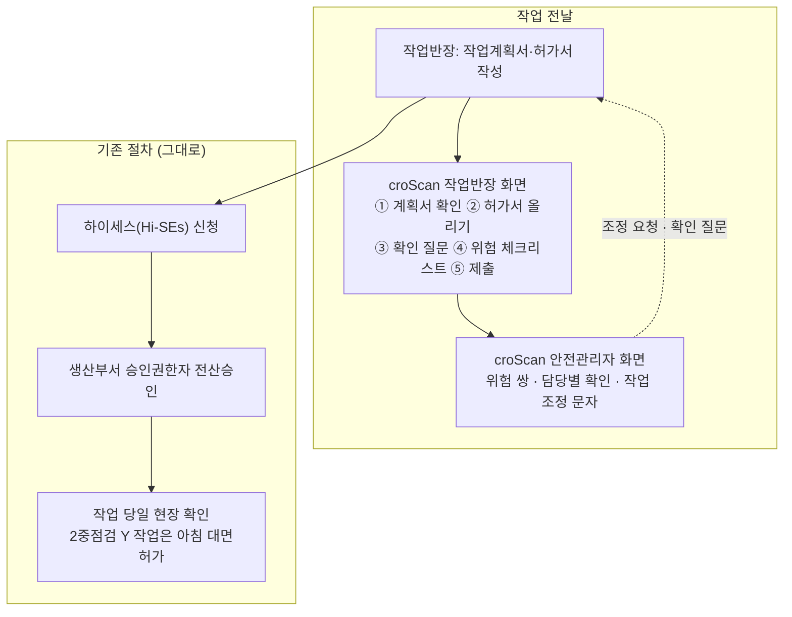
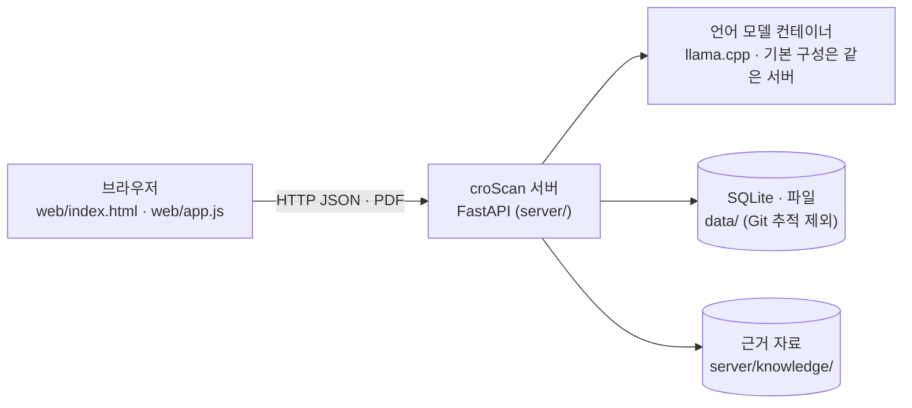

# 01 한눈에 보기

croScan은 두 사람을 돕는 웹 앱입니다. 작업반장에게는 조선소 위험작업허가서를 내기 전에 빠뜨린 것을 묻습니다. 안전관리자에게는 그날 작업 가운데 함께 하면 위험한 작업 쌍을 찾아 줍니다. 판단과 승인은 사람이 합니다.

**이 문서에서 알 수 있는 것**
- croScan이 푸는 문제와, 현장 절차 가운데 어디에 들어가는지
- 작업반장과 안전관리자가 각각 얻는 것
- 설계 원칙 다섯 가지(규칙이 판정 · AI는 제안 · 사람이 확정 · 원본 불변 · 「모름」 허용)
- 지금 코드 기준 핵심 수치와, 다음에 읽을 문서

## 목차
1. [무엇을 푸나](#1-무엇을-푸나)
2. [현장 절차 속 croScan](#2-현장-절차-속-croscan)
3. [두 사용자](#3-두-사용자)
4. [설계 원칙](#4-설계-원칙)
5. [부품 세 개](#5-부품-세-개)
6. [핵심 수치](#6-핵심-수치)
7. [하지 않는 것과 한계](#7-하지-않는-것과-한계)
8. [다음에 읽을 문서](#8-다음에-읽을-문서)

---

## 1. 무엇을 푸나

조선소 대조립 공장(블록을 조립하는 공장)에서는 하루에 수십 건의 작업이 같은 BAY(공장 안 구역)와 크레인을 나눠 씁니다. 위치는 BAY와 칼럼(기둥 번호)으로 나타냅니다. 위험작업은 위험작업허가서를 내고 승인을 받습니다. 화기(용접·절단), 밀폐공간 진입, 고소작업, 중량물 인양, 정전(LOTO: 설비 에너지를 끊고 잠금장치·꼬리표로 다시 켜지지 않게 하는 절차)이 위험작업입니다.

문제는 두 가지입니다.

| 문제 | 현장에서 생기는 일 | croScan이 하는 일 |
|---|---|---|
| 허가서 칸이 비거나 애매함 | 「08:00~16:59」처럼 근무시간 전체를 적거나 위치를 부서 이름으로 적습니다. 그러면 검토자는 실제로 위험한 시간과 위치를 모릅니다. | 비었거나 애매한 칸만 골라 반장에게 묻습니다. 답은 반영본·별지로 남기고 원본은 건드리지 않습니다. |
| 작업끼리의 위험이 서류 한 장에 안 보임 | 위에서 절단하는데 아래에서 족장 해체를 하거나 용접 불티가 닿는 곳에서 도장을 합니다. 서류는 작업마다 따로라서 이런 겹침이 안 보입니다. | 허가서 작업끼리, 그리고 허가서 작업과 작업계획서(일상) 작업 사이를 봅니다. 시간·장소·설비가 겹치는 쌍을 규칙 36개로 찾아 1·2·3순위로 보여 줍니다. 일상작업끼리의 조합은 보지 않습니다. |

---

## 2. 현장 절차 속 croScan

croScan은 기존 절차를 바꾸지 않습니다. 신청 전 점검과 안전팀 검토 사이에 들어갑니다.

- 기존 절차(하이세스 신청, 전산승인, 현장 확인, 대면허가)는 그대로입니다. croScan 제출은 그 앞에 하는 「안전팀 검토자료 제출」입니다.
- 현장 절차와 조선 3사 자료 조사는 [`reference/조선3사_작업허가_조사.md`](reference/조선3사_작업허가_조사.md), [`reference/현장프로세스_조사자료_정리.md`](reference/현장프로세스_조사자료_정리.md)에 있습니다.

---

## 3. 두 사용자

| | 작업반장 (생산부서·협력사) | 안전관리자 |
|---|---|---|
| 언제 | 작업 전날 | 작업 전날 오후~당일 아침 |
| 넣는 것 | 작업계획서 PDF 여러 건, 허가서 PDF 1건 | 지금은 시연 하루 자료(작업 50건)가 기준입니다. 반장 제출본은 허가서 번호와 작업일이 맞으면 그 작업에 연결됩니다 |
| 받는 것 | 확인 질문, 반영본·별지(추가검토서), 위험 체크리스트 PDF | 위험 쌍 목록, 반장별 확인 질문 문안, 작업 조정 문자 초안, 현장 게시 서류 |
| 화면 시연 | [02 화면 시연: 작업반장](02_화면시연_반장.md) | [03 화면 시연: 안전관리자](03_화면시연_안전관리자.md) |

화면은 야외에서 장갑을 끼고도 쓰도록 큰 버튼·고대비·글자 크기 설정을 둡니다([`../DESIGN.md`](../DESIGN.md)).

---

## 4. 설계 원칙

| 원칙 | 뜻 | 코드에서 |
|---|---|---|
| 규칙이 판정 | 기본 질문, 체크리스트 기본 제안, 쌍 판정은 규칙으로 만듭니다. 같은 서류를 넣으면 결과도 늘 같습니다. AI가 찾은 보완 질문과 추가 후보도 서버 검사를 거친 뒤에 보입니다. | [`server/augment.py`](../server/augment.py), [`server/checklist.py`](../server/checklist.py), [`server/pairs.py`](../server/pairs.py) |
| AI는 제안 | 언어 모델은 반장 말을 읽고 「어느 칸에 무엇」을 넣을지 제안합니다. 규칙이 못 본 것도 짚습니다. 하지만 쌍 판정 점수와 체크리스트 선택값은 바꾸지 않습니다. | [`server/understand.py`](../server/understand.py), [`server/analyze.py`](../server/analyze.py), [`server/llm.py`](../server/llm.py) |
| 사람이 확정 | AI 해석은 카드로 보여 주고 반장이 「확인」해야 들어갑니다. 경보는 안전관리자가 검토합니다. | `.ai-card`, 안전관리자 화면 |
| 원본 불변 | 올린 PDF는 바꾸지 않습니다. 답은 원본 칸 위 여백(반영본)과 별지에만 씁니다. | [`server/reflect.py`](../server/reflect.py), [`server/addendum.py`](../server/addendum.py) |
| 「모름」 허용 | 반장은 모르면 「모름」을 누릅니다. 그러면 안전팀 확인으로 넘어갑니다. 지금 모인 서류로 낸 경보는 반장 답을 반영해도 그보다 낮아지지 않습니다. 이 경보가 하한(바닥값)으로 남습니다(floor). 다만 제출본 답 때문에만 생긴 경보는 다음 제출에서 답이 바뀌면 사라질 수 있습니다. | [`server/pairs.py`](../server/pairs.py) `floor()` |

---

## 5. 부품 세 개

- 언어 모델이 없어도 앱은 뜹니다. 모델을 부르는 기능만 실패합니다. 규칙 질문과 판정은 그대로 돕니다.
- 기본 구성에서 모델은 같은 서버 안에서 돕니다. 그래서 서류가 외부 AI 서비스로 나가지 않습니다. 모델 주소(`LLM_URL`)는 바꿀 수 있습니다. 코드가 외부 주소를 막지는 않으므로 사내 주소로만 정합니다.
- 모델 파일과 키(.env)는 저장소에 넣지 않습니다. 자세한 것은 [04 아키텍처](04_아키텍처.md), [12 배포와 운영](12_배포와_운영.md).

---

## 6. 핵심 수치

지금 코드 기준입니다. 시연 자료로 낸 결과는 「시연 자료 기준」이라고 표시했습니다.

| 무엇 | 수치 | 어디서 |
|---|---|---|
| 허가서 종류 | 5종(화기·밀폐·고소·중량물인양·정전LOTO) | [`server/permit_kinds.py`](../server/permit_kinds.py) |
| 쌍 규칙 | 36개 | [`server/pair_rules.json`](../server/pair_rules.json) |
| 위험 체크리스트 | 86항목(공통 7 · 화기 21 · 밀폐 16 · 고소 16 · 인양 12 · LOTO 14) | [`server/checklist_spec.json`](../server/checklist_spec.json) |
| 체크리스트 사고 사례 | 40항목에 48건 | 같은 파일 `cases` |
| 연구 ref 연결 | 81개 중 73개가 412쪽 조사본에 연결 | [`server/knowledge/research_refs.json`](../server/knowledge/research_refs.json) |
| 근거 코퍼스 | 634조각 | [`server/knowledge/corpus.json`](../server/knowledge/corpus.json) |
| 질문 상한 | 검토 1건에 응답 요청 12회(재질문·AI 해석 카드·마무리 포함) | [05 멀티턴 질문](05_멀티턴_질문.md) |
| 시험 스크립트 | `tools/check_*.py` 34종 | [11 시험과 평가](11_시험과_평가.md) |
| API 끝점 | 61개 | [04b API](04b_API.md) |
| 시연 하루 | 작업 50건(허가서 10 · 작업계획서 40) → 위험 쌍 26(1순위 8 · 2순위 2 · 3순위 16) · 판정보류 질문 55개 | 시연 자료 기준, [06 §11](06_쌍작업_판정.md#11-하루-화면과-시연-자료-결과) |

---

## 7. 하지 않는 것과 한계

**하지 않는 것**: 작업 승인·반려, 일정 결정, 작업 차단, 문자 자동 전송, 원본 PDF 수정.

**아직 못 한 것** (자세한 것은 [14 자료 대조와 검토 이력](14_자료대조와_검토이력.md))
- 실제 사용자(작업반장·안전관리자) 시험은 아직 하지 않았습니다.
- 회사 SSO(사내 통합 로그인) 연결은 프록시 설정까지만 있습니다. 실제 회사 계정과는 붙이지 않았습니다.
- 작업표준(JSP) 원문은 회사 내부 자료라 구할 수 없습니다. 그래서 번호 형식만 검사합니다.
- 언어 모델은 CPU 서버에서 돌아서 느립니다(GPU 없음). 그래서 AI 결과를 기다리지 않아도 되게 만들었습니다.

---

## 8. 다음에 읽을 문서

| 이런 분 | 읽을 순서 |
|---|---|
| 처음 보는 팀원·발표 담당 | 01 → [02](02_화면시연_반장.md) → [03](03_화면시연_안전관리자.md) → [13 용어집](13_용어집.md) |
| 질문 로직을 고칠 개발자 | [04](04_아키텍처.md) → [05](05_멀티턴_질문.md) → [05b](05b_AI_판독.md) → [08](08_반영본과_별지.md) |
| 쌍 판정을 고칠 개발자 | [04](04_아키텍처.md) → [06](06_쌍작업_판정.md) → [06b](06b_보류질문_holdq.md) → [11](11_시험과_평가.md) |
| 체크리스트를 고칠 개발자 | [07](07_위험체크리스트.md) → [10](10_근거와_자료.md) |
| 배포·운영 | [12](12_배포와_운영.md) → [SECURITY](../SECURITY.md) |
| 자료와 맞는지 확인 | [10](10_근거와_자료.md) → [14](14_자료대조와_검토이력.md) |

전체 목록은 [docs/README.md](README.md)에 있습니다.
