# 02 화면 시연: 작업반장

작업반장이 croScan을 처음부터 끝까지 쓰는 모습을 실제 화면으로 따라갑니다. 화면마다 주황색 번호를 붙였습니다. 번호마다 그 자리가 무슨 기능인지, 코드는 어디 있는지 적었습니다.

**이 문서에서 알 수 있는 것**
- 작업반장이 거치는 5단계(① 작업계획서 확인 → ② 허가서 올리기 → ③ 허가서 검토 → ④ 위험 체크리스트 → ⑤ 제출)
- 화면의 각 부분이 하는 일과, 그 뒤에서 도는 서버 기능
- 원본 파일을 바꾸지 않고 「반영본·별지」로 답을 남기는 방식
- 화면에서 일부러 하지 않는 일(승인·작업 차단·자동 전송)

> 캡처는 2026-11-01 스테이징 서버에서 `samples/시연_하루`의 자료로 찍었습니다(시연 자료 기준). 인명·전화번호는 자료에서 이미 가려져 있습니다(김XX, 010-XXXX-XXXX).

## 목차
1. [한 번에 보기 (움직이는 시연)](#1-한-번에-보기-움직이는-시연)
2. [로그인](#2-로그인)
3. [① 작업계획서 확인](#3-①-작업계획서-확인)
4. [② 허가서 올리기](#4-②-허가서-올리기)
5. [③ 허가서 검토: 확인 질문](#5-③-허가서-검토-확인-질문)
6. [③ 허가서 검토: 말로 답하기와 AI 해석 카드](#6-③-허가서-검토-말로-답하기와-ai-해석-카드)
7. [③ 허가서 검토 끝: 반영본과 별지](#7-③-허가서-검토-끝-반영본과-별지)
8. [④ 위험 체크리스트](#8-④-위험-체크리스트)
9. [⑤ 제출](#9-⑤-제출)
10. [화면에서 하지 않는 일](#10-화면에서-하지-않는-일)
11. [코드 어디](#11-코드-어디)

---

## 1. 한 번에 보기 (움직이는 시연)

전체 화면 → 기능 부분 확대 → 아래 자막 설명 순서로 넘어갑니다.

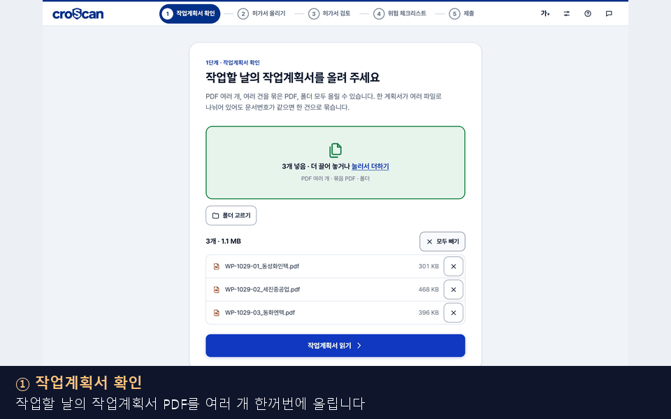

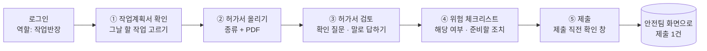

---

## 2. 로그인

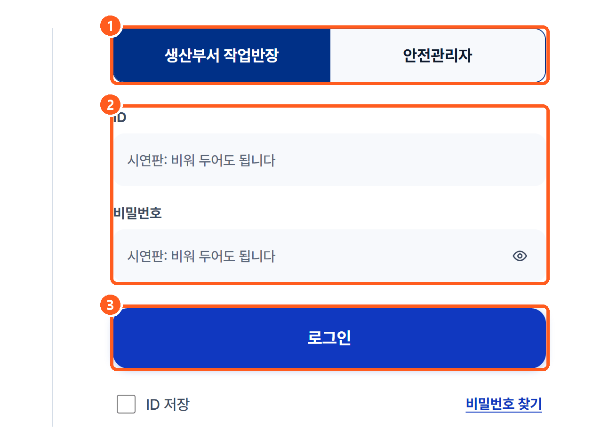

| 번호 | 무엇 | 설명 |
|---|---|---|
| 1 | 역할 고르기 | 「생산부서 작업반장」과 「안전관리자」 중 고릅니다. 고른 역할에 따라 다음 화면이 다릅니다. |
| 2 | ID·비밀번호 칸 | 시연판은 비워 두어도 됩니다. 실제 회사 계정 연결은 사내 로그인 프록시(SSO)로 붙입니다. [12 배포와 운영 §7](12_배포와_운영.md#7-사내-로그인sso-뒤에-두기) |
| 3 | 로그인 | 시연판은 누르기만 하면 들어갑니다. 계정을 만들거나 저장하지 않습니다. |

---

## 3. ① 작업계획서 확인

### 3.1 올리기

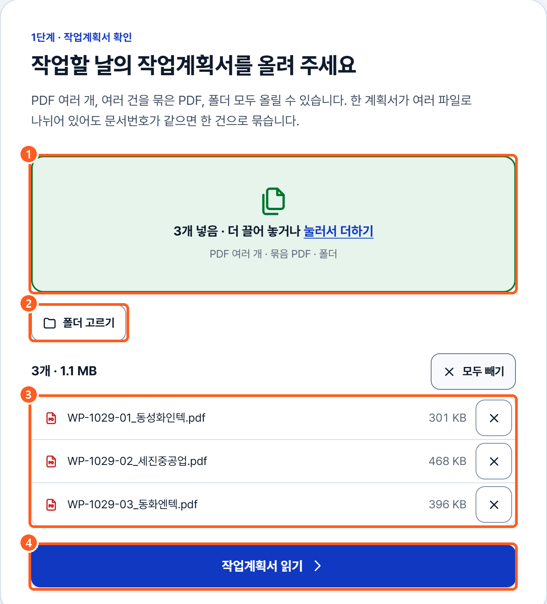

| 번호 | 무엇 | 설명 |
|---|---|---|
| 1 | 올리는 곳 | PDF 여러 개를 올립니다. 여러 건을 묶은 PDF나 폴더도 그대로 올립니다. 한 계획서가 여러 파일로 나뉘어 있어도 문서번호가 같으면 한 건으로 묶습니다. |
| 2 | 폴더 고르기 | 폴더째 고릅니다. |
| 3 | 올린 파일 목록 | 파일마다 크기와 「빼기」 버튼이 있습니다. |
| 4 | 작업계획서 읽기 | 서버가 PDF를 읽어 칸별 값으로 바꿉니다([`server/workplan.py`](../server/workplan.py)). |

### 3.2 읽은 계획서 확인

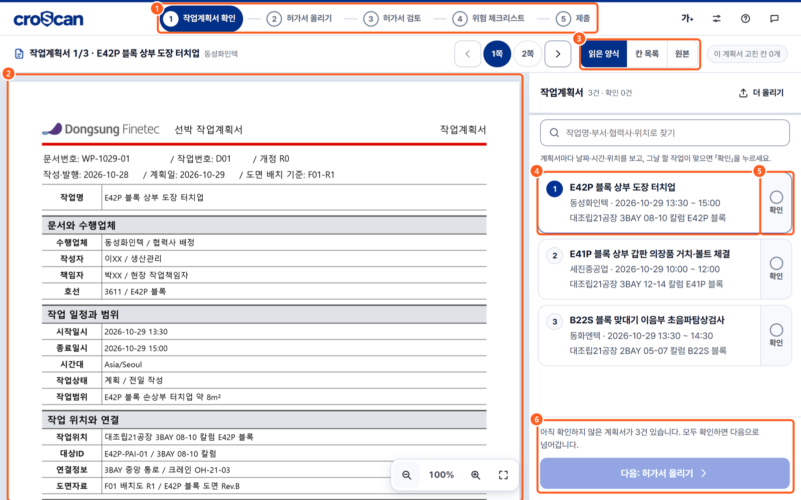

| 번호 | 무엇 | 설명 |
|---|---|---|
| 1 | 단계 표시 | 5단계와 지금 위치, 마친 단계(✓)를 보여 줍니다. 마친 단계는 눌러서 돌아갈 수 있습니다. |
| 2 | 읽은 양식 | croScan이 읽은 값을 원래 양식 모양 그대로 다시 그립니다. 반장은 읽은 값이 맞는지 눈으로 대조합니다. |
| 3 | 보기 바꾸기 | 「읽은 양식」「칸 목록」「원본」을 오갑니다. 원본은 올린 PDF 그대로입니다. |
| 4 | 계획서 카드 | 작업명·업체·날짜·시간·위치를 한 줄로 보여 줍니다. 검색창으로 작업명·부서·위치를 찾습니다. |
| 5 | 확인 | 그날 할 작업이 맞으면 누릅니다. 이 확인은 「내 작업이 맞다」는 뜻입니다. 승인이 아닙니다. |
| 6 | 다음 단계 | 올린 계획서를 모두 확인해야 버튼이 켜집니다. 남은 계획서가 있으면 몇 건 남았는지 알려 줍니다. |

> 왜 계획서를 먼저 받나: 허가서 질문 가운데 일부(시간·위치·같이 하는 작업)는 계획서와 맞춰 봐야 정확해집니다. 처음에는 허가서를 먼저 받았습니다. 그런데 두 문서의 탐색이 겹쳐서 지금 순서로 바꿨습니다.

---

## 4. ② 허가서 올리기

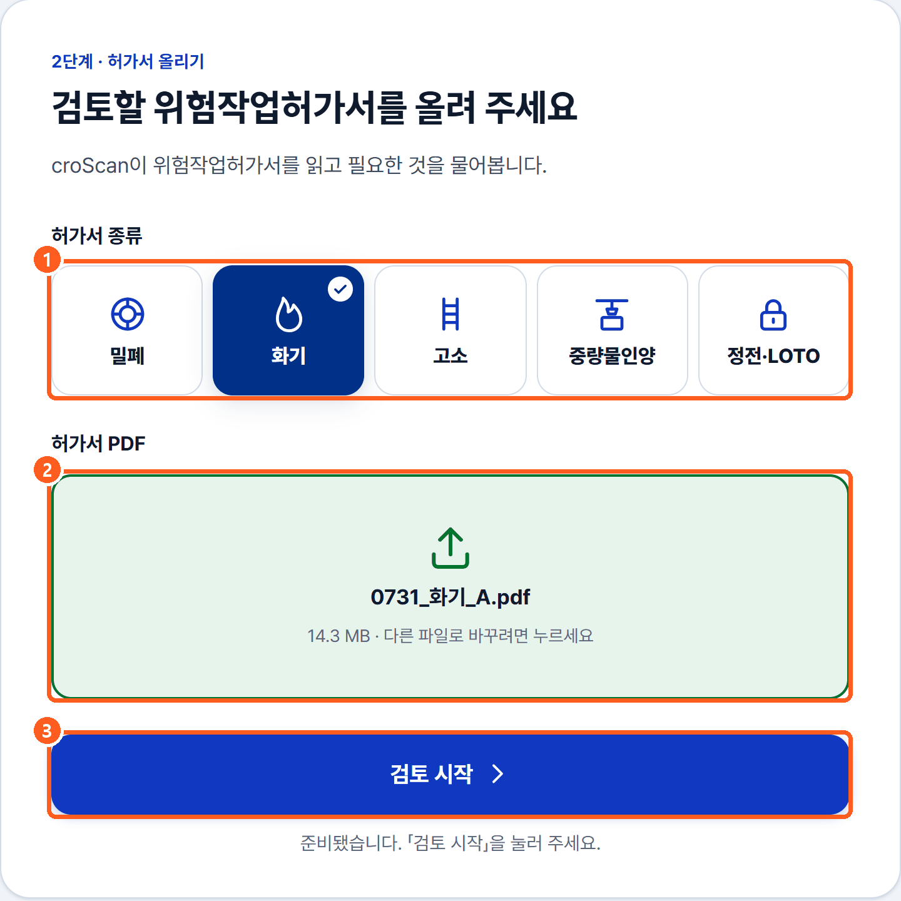

| 번호 | 무엇 | 설명 |
|---|---|---|
| 1 | 허가서 종류 | 밀폐·화기·고소·중량물인양·정전LOTO 5종입니다. 종류에 따라 읽을 칸, 물을 질문, 체크리스트가 정해집니다([`server/permit_kinds.py`](../server/permit_kinds.py)). |
| 2 | 허가서 PDF | 50MB 이하 PDF 1개입니다. 전산에서 내려받은 PDF여야 합니다. 글자 층(PDF 안에 든 글자 정보)도 있어야 합니다. 사진·스캔본은 읽지 못합니다. 올린 원본 파일은 끝까지 바꾸지 않습니다. |
| 3 | 검토 시작 | 서버가 PDF 표를 읽습니다([`server/extract.py`](../server/extract.py)). 그리고 규칙 질문을 만듭니다. |

---

## 5. ③ 허가서 검토: 확인 질문

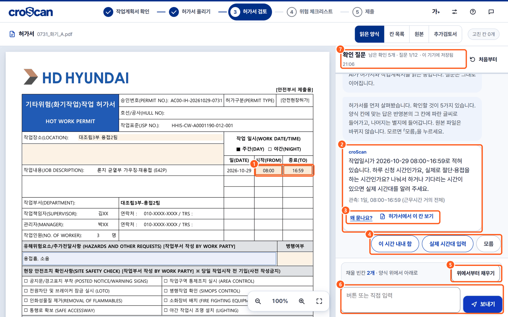

| 번호 | 무엇 | 설명 |
|---|---|---|
| 1 | 질문한 칸 강조 | 지금 묻는 칸(여기서는 시작·종료 시각)을 문서에서 바로 보여 줍니다. |
| 2 | 질문 | 비었거나 애매한 것만 한 번에 하나씩 묻습니다. 「관측」 줄에는 질문한 근거(서류에 적힌 값)를 함께 씁니다. 기본 질문은 규칙이 만듭니다([`server/augment.py`](../server/augment.py)). 업로드 때 AI가 찾은 보완 질문(검토 1건에 많아야 8개)도 있습니다. 이 질문도 서버 검사를 거쳐 같은 자리에 나옵니다([`server/analyze.py`](../server/analyze.py)). |
| 3 | 왜 묻나요? · 허가서에서 이 칸 보기 | 「왜 묻나요?」는 질문하는 이유와 근거 자료를 펼칩니다. 「허가서에서 이 칸 보기」는 문서를 그 칸으로 옮깁니다. |
| 4 | 답 버튼 | 자주 하는 답은 버튼으로 고릅니다. 모르면 「모름」을 누릅니다. 「모름」을 눌러도 검토가 막히지 않습니다. 그 질문은 「안전팀 확인」으로 넘어갑니다. |
| 5 | 위에서부터 채우기 | 빈 칸을 문서 위에서 아래 순서로 하나씩 채웁니다. |
| 6 | 입력창 | 버튼 대신 평소 말로 적어도 됩니다(다음 절). |
| 7 | 진행 표시 | 남은 확인 수와 응답 요청 번호(예: 1/12)입니다. 검토 1건의 응답 요청은 12회까지입니다. 재질문·AI 해석 카드·마무리도 여기에 셉니다(재질문은 그중 3회까지). 답은 이 브라우저에 저장됩니다. 같은 종류·같은 허가서 PDF를 다시 올리면 「이어서 하기」를 고를 수 있습니다. |

질문의 종류와 순서, 묻지 않는 경우는 [05 멀티턴 질문](05_멀티턴_질문.md)에 있습니다.

---

## 6. ③ 허가서 검토: 말로 답하기와 AI 해석 카드

### 6.1 한꺼번에 적기

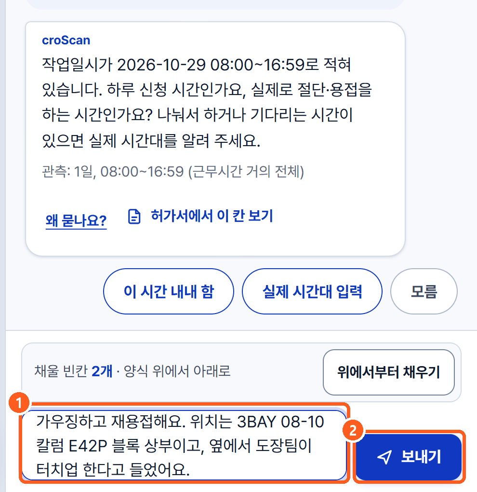

| 번호 | 무엇 | 설명 |
|---|---|---|
| 1 | 입력창 | 「실제로는 13시 30분부터 15시까지 가우징하고 재용접해요. 위치는 3BAY 08-10 칼럼 E42P 블록 상부이고, 옆에서 도장팀이 터치업 한다고 들었어요.」처럼 여러 사실을 한 문장에 적습니다. |
| 2 | 보내기 | 규칙이 먼저 읽습니다. 언어 모델은 그 뒤에 읽습니다. 모델이 없거나 늦어도 규칙 질문은 계속됩니다. |

### 6.2 AI 해석 카드

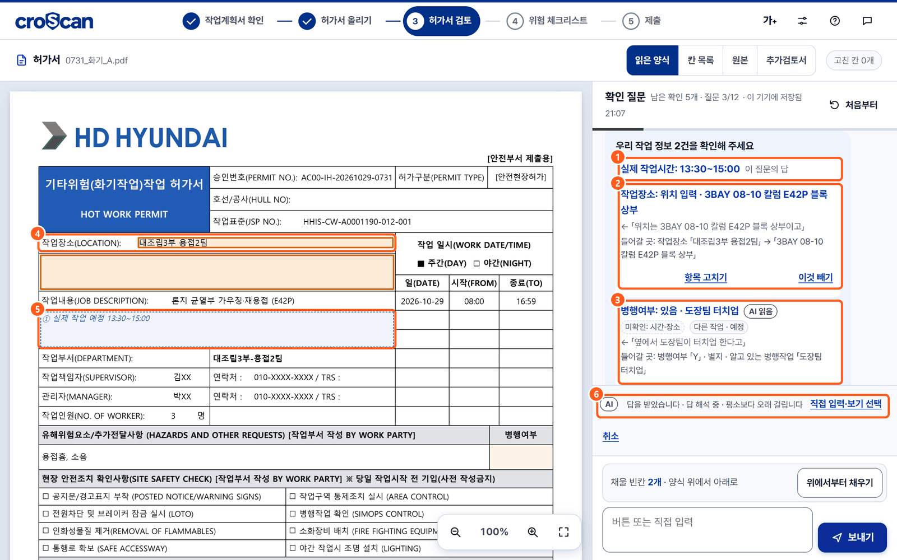

| 번호 | 무엇 | 설명 |
|---|---|---|
| 1 | 지금 질문의 답 | 「실제 작업시간 13:30~15:00」을 지금 질문의 답으로 읽었습니다. |
| 2 | 다른 칸에 들어갈 답 | 원문 인용(←)과 들어갈 곳(→)을 함께 보여 줍니다. 「항목 고치기」「이것 빼기」로 고칩니다. 반장이 「확인」을 눌러야 반영됩니다. |
| 3 | 다른 작업 이야기 | 「옆 도장팀」처럼 내 작업이 아닌 말도 있습니다. 이런 말은 「AI 읽음 · 미확인: 시간·장소」로 표시해 별지의 병행작업 칸으로 보냅니다. 남의 작업을 내 허가서 칸에 쓰지 않습니다. |
| 4 | 바뀔 칸 | 작업장소 칸이 주황색으로 표시됩니다. 원본 칸은 그대로입니다. |
| 5 | 반영본 미리보기 | 원본 칸 위 여백에 파란 글씨(① 실제 작업 예정 13:30~15:00)로 덧씁니다. |
| 6 | AI 상태 | 모델은 뒤에서 계속 읽습니다. 기다리지 않고 먼저 나온 결과부터 확인해도 됩니다. 「취소」로 해석을 멈출 수 있습니다. |

모델이 무엇을 읽는지는 [05b AI 판독](05b_AI_판독.md)에 있습니다. 어떤 읽기를 「약함」으로 표시해 체크를 풀어 두는지도 거기 있습니다.

---

## 7. ③ 허가서 검토 끝: 반영본과 별지

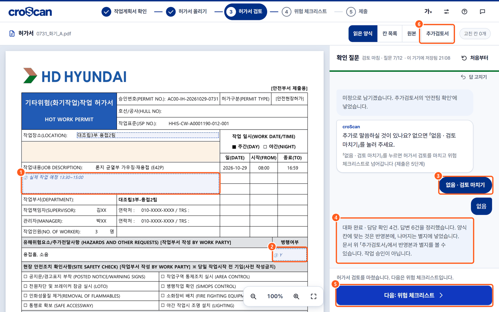

| 번호 | 무엇 | 설명 |
|---|---|---|
| 1 | 반영본 줄 | 확인한 답이 원본 칸 위에 파란 글씨로 들어갑니다. |
| 2 | 병행여부 칸 | 「Y」처럼 양식 칸에 맞는 답은 그 칸 여백에 들어갑니다. |
| 3 | 마치기 | 「없음 · 검토 마치기」로 검토를 마칩니다. |
| 4 | 정리 요약 | 양식 칸에 맞는 것은 반영본에, 나머지는 별지에 넣었다고 알려 줍니다. 「작업 승인이 아닙니다」를 함께 씁니다. |
| 5 | 다음 단계 | 위험 체크리스트로 갑니다. |
| 6 | 추가검토서 | 반영본과 별지를 PDF로 봅니다. 원본 PDF는 바꾸지 않고 따로 만듭니다. |

### 7.1 추가검토서 (반영본 + 별지)

「추가검토서」 탭을 누르면 제출할 PDF를 미리 봅니다. 아래는 별지의 첫 부분입니다(시연 흐름에서 버튼으로만 답한 경우).

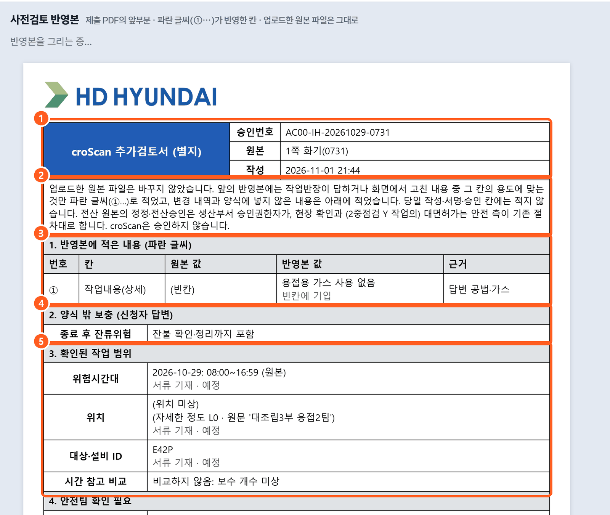

| 번호 | 무엇 | 설명 |
|---|---|---|
| 1 | 머리 | 승인번호, 원본(몇 쪽·어떤 허가서), 작성 시각. |
| 2 | 안내 문단 | 네 가지를 알립니다: 원본 파일은 바꾸지 않았음, 반영본의 파란 글씨(①…)의 뜻, 당일 작성·서명·승인 칸에는 쓰지 않음, croScan은 승인하지 않음. |
| 3 | 1. 반영본에 적은 내용 | 번호 · 칸 · 원본 값 · 반영본 값 · 근거(어느 답에서 왔는지). 빈칸을 채운 것인지 덧쓴 것인지도 적습니다. |
| 4 | 2. 양식 밖 보충 | 양식에 맞는 칸이 없는 답(예: 종료 후 잔류위험)은 여기로 갑니다. |
| 5 | 3. 확인된 작업 범위 | 위험시간대·위치·대상 설비마다 값과 출처(「서류 기재 · 예정」인지 반장 답인지)를 씁니다. 위치가 부서 이름뿐이면 「위치 미상」과 자세한 정도(L0)를 그대로 적습니다. |

그 아래에는 「4. 안전팀 확인 필요」(모름·미확인으로 남긴 것)가 이어집니다.

어느 답이 어느 칸·별지로 가는지, 절대 쓰지 않는 칸은 무엇인지는 [08 반영본과 별지](08_반영본과_별지.md)에 있습니다.

---

## 8. ④ 위험 체크리스트

### 8.1 항목 확인

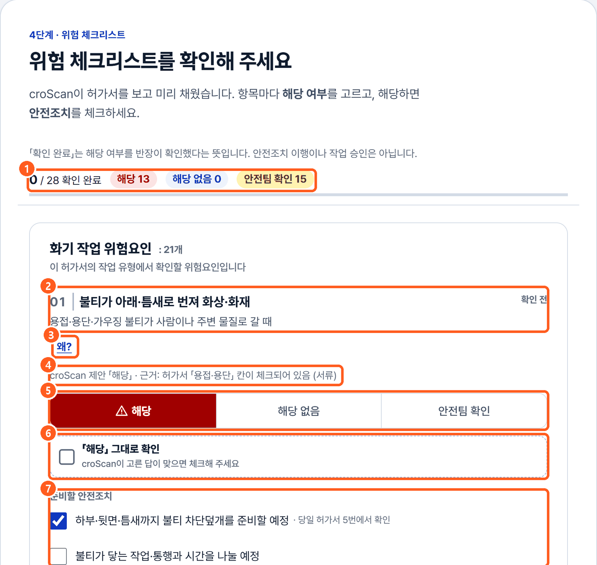

| 번호 | 무엇 | 설명 |
|---|---|---|
| 1 | 확인 현황 | 확인한 수와 해당·해당 없음·안전팀 확인 수입니다. 「확인 완료」가 되려면 모든 항목의 해당 여부를 확인해야 합니다. 「해당」 항목은 준비할 안전조치도 따로 확인해야 합니다. 허가서나 답이 바뀌면 다시 확인해야 합니다. 「확인 완료」는 조치 이행이나 승인이 아닙니다. |
| 2 | 위험요인 | 제목과 「이 위험이 생기는 때」입니다. 항목은 허가서 종류별 명세에서 옵니다(공통 7 + 종류별, 모두 86항목, [`server/checklist_spec.json`](../server/checklist_spec.json)). |
| 3 | 왜? | 제안한 이유를 펼칩니다(다음 그림). |
| 4 | croScan 제안과 근거 | 어느 칸·답을 보고 「해당」을 제안했는지 씁니다. |
| 5 | 해당 여부 | 「해당」「해당 없음」「안전팀 확인」 가운데 고릅니다. 반장이 언제든 바꿀 수 있습니다. |
| 6 | 그대로 확인 | croScan이 고른 답이 맞으면 체크합니다. 같은 버튼을 다시 누르게 하지 않고 따로 체크하게 했습니다. 그래야 확인했다는 기록이 남습니다. |
| 7 | 준비할 안전조치 | 「…할 예정」인 계획입니다. 일부는 미리 체크되어 있습니다. 「당일 허가서 5번에서 확인」처럼 허가서 칸과 이어진 것도 있습니다. |

### 8.2 왜? 펼치기

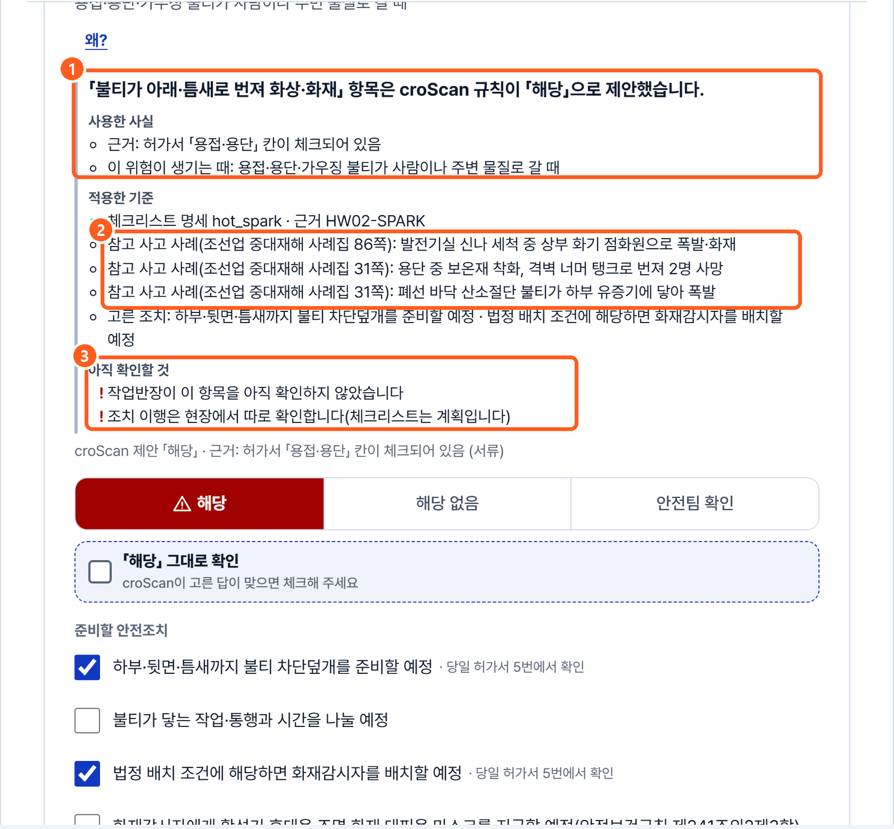

| 번호 | 무엇 | 설명 |
|---|---|---|
| 1 | 결론 | 「…항목은 croScan 규칙이 『해당』으로 제안했습니다.」 판단한 쪽이 규칙임을 밝힙니다. |
| 2 | 참고 사고 사례 | 조선업 중대재해 사례집의 쪽 번호와 사례 요약입니다. 40항목에 48건이 이어져 있습니다. |
| 3 | 아직 확인할 것 | 반장이 확인하지 않은 것, 그리고 「조치 이행은 현장에서 따로 확인합니다(체크리스트는 계획입니다)」. |

체크리스트를 채우는 규칙과 AI 추가 후보(다른 종류의 위험요인 제안)는 [07 위험 체크리스트](07_위험체크리스트.md)에 있습니다.

---

## 9. ⑤ 제출

### 9.1 제출 전 요약

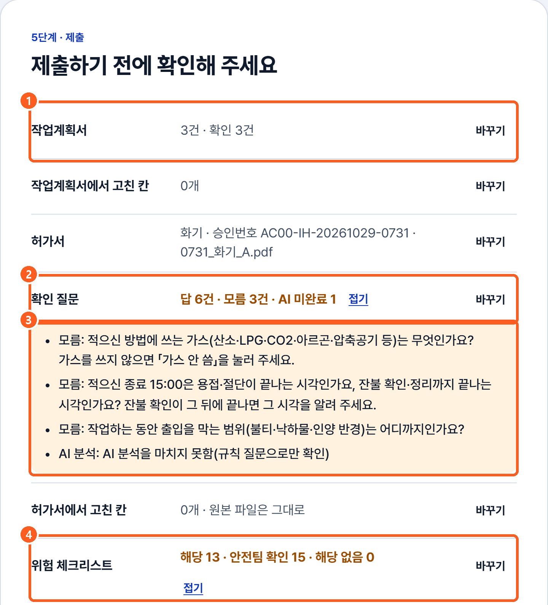

| 번호 | 무엇 | 설명 |
|---|---|---|
| 1 | 단계별 요약 | 작업계획서·허가서·확인 질문·체크리스트를 한 줄씩 요약합니다. 「바꾸기」를 누르면 그 단계로 돌아갑니다. |
| 2 | 확인 질문 요약 | 답한 수, 「모름」 수, AI가 마치지 못한 것을 셉니다. |
| 3 | 모름 목록 | 「모름」으로 남긴 질문을 그대로 보여 줍니다. 이 질문들은 안전팀 확인으로 넘어갑니다. |
| 4 | 체크리스트 요약 | 해당·안전팀 확인·해당 없음 수입니다. |

### 9.2 제출 직전 확인 창

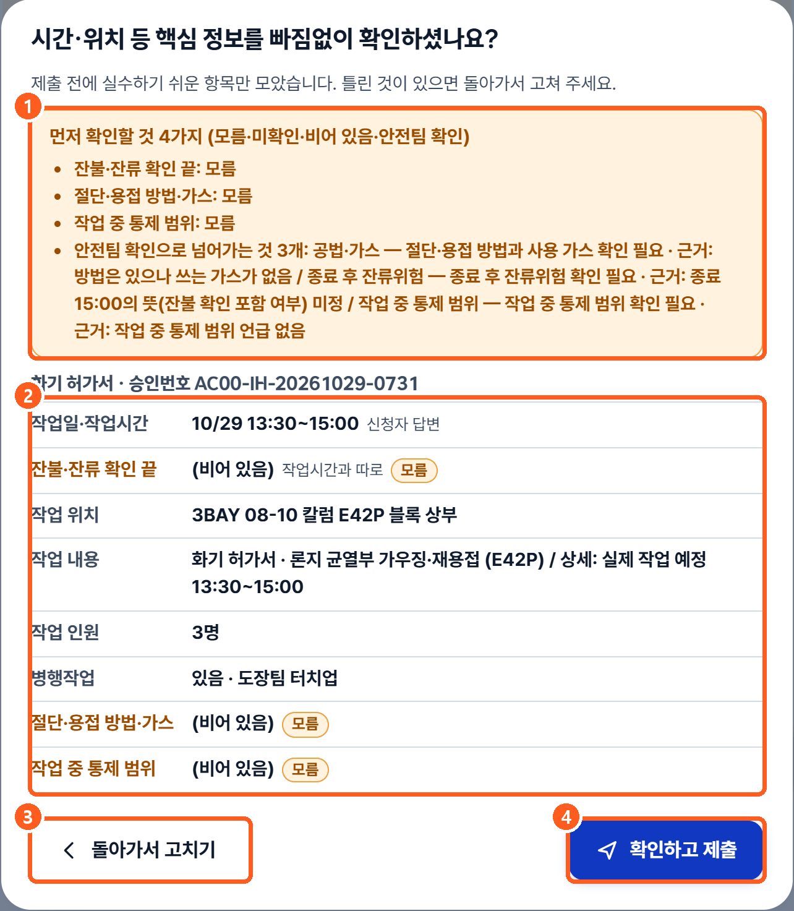

| 번호 | 무엇 | 설명 |
|---|---|---|
| 1 | 먼저 확인할 것 | 모름·미확인·비어 있음·안전팀 확인을 맨 위에 모읍니다. |
| 2 | 핵심 정보 | 작업일·시간·위치·내용·인원·병행작업처럼 실수하기 쉬운 것만 다시 보여 줍니다. 답으로 바뀐 값은 「신청자 답변」으로 표시합니다. |
| 3 | 돌아가서 고치기 | 틀리면 돌아갑니다. |
| 4 | 확인하고 제출 | 누르기 직전에 서버가 지금 답이 바뀐 서류와 맞는지 한 번 더 확인합니다. |

### 9.3 무엇이 제출되나

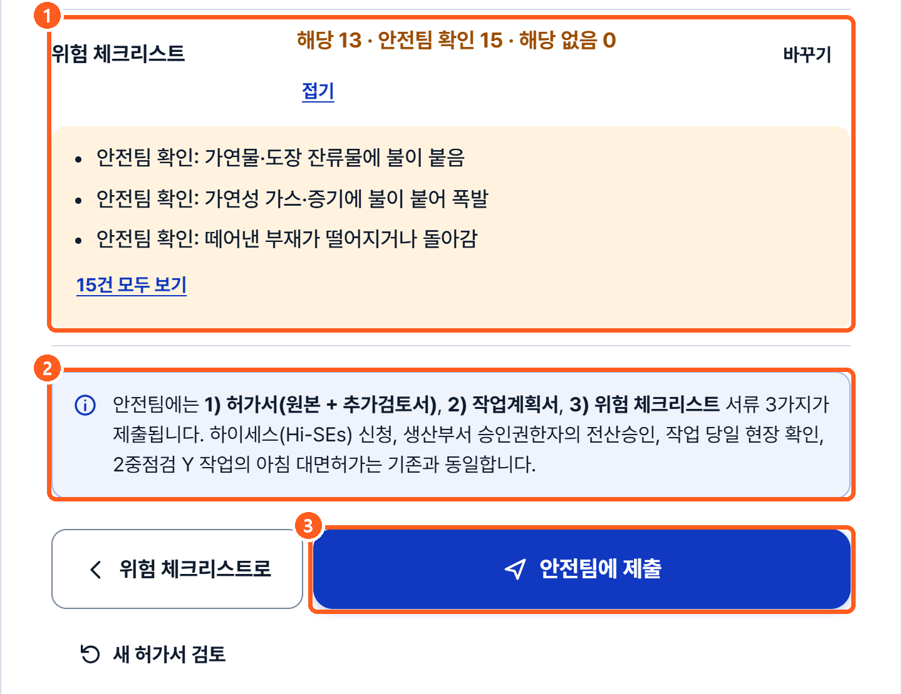

| 번호 | 무엇 | 설명 |
|---|---|---|
| 1 | 안전팀 확인 목록 | 안전팀이 볼 항목을 미리 보여 줍니다. |
| 2 | 제출 서류 | 1) 허가서(원본 + 추가검토서), 2) 작업계획서, 3) 위험 체크리스트 3가지입니다. 하이세스(Hi-SEs) 신청, 생산부서 승인권한자의 전산승인, 당일 현장 확인, 2중점검 Y 작업의 아침 대면허가는 기존과 같습니다. |
| 3 | 안전팀에 제출 | 제출 1건으로 저장됩니다([`server/submissions.py`](../server/submissions.py)). 체크리스트 확인이 남아 있으면 서버가 제출을 받지 않습니다. 지금 안전관리자 화면은 시연 하루 자료가 기준입니다. 그래서 허가서 번호와 작업일이 맞는 제출본만 그 작업에 연결됩니다. 맞지 않는 제출은 따로 표시하고 위험 쌍 검사에 넣지 않습니다. |

### 9.4 제출 완료

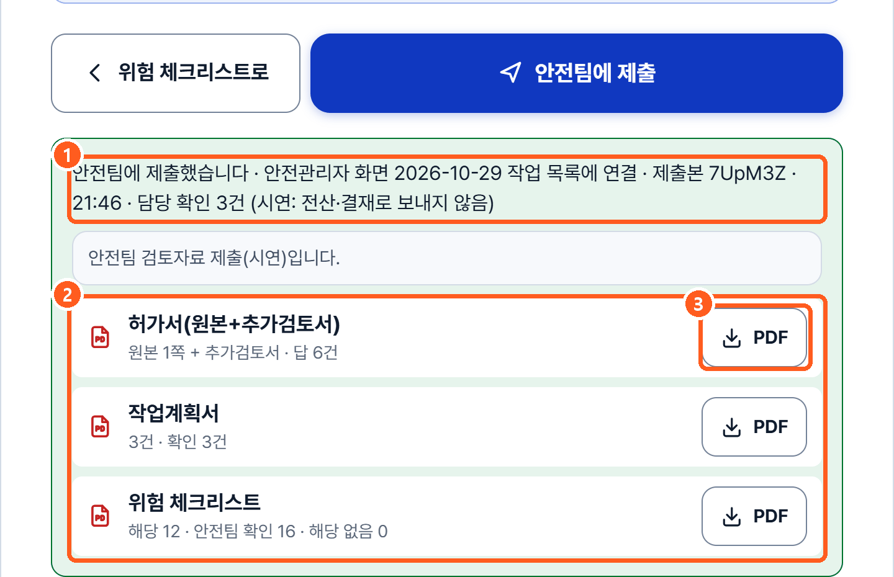

| 번호 | 무엇 | 설명 |
|---|---|---|
| 1 | 제출 결과 | 안전관리자 화면의 그날 작업 목록에 연결됐다는 것, 제출본 번호, 시각, 담당 확인 수. 「시연: 전산·결재로 보내지 않음」을 함께 씁니다. |
| 2 | 제출 서류 | 허가서(원본+추가검토서) · 작업계획서 · 위험 체크리스트. |
| 3 | PDF | 서류마다 내려받습니다. 제출 뒤에 화면을 바꿔도 제출본(스냅숏)은 그대로입니다. |

---

## 10. 화면에서 하지 않는 일

| 하지 않는 일 | 까닭 |
|---|---|
| 작업 승인·반려 | 승인은 회사의 기존 절차(하이세스, 승인권한자)가 합니다. |
| 원본 PDF 고치기 | 원본은 증빙입니다. 답은 반영본(여백 덧쓰기)과 별지에만 씁니다. |
| 다른 작업 정보를 내 허가서 칸에 쓰기 | 남의 작업은 확인하지 못한 정보입니다. 별지의 병행작업 칸에만 「미확인」으로 씁니다. |
| 「모름」을 막기 | 모르는 것은 안전팀 확인으로 넘기는 것이 맞습니다. |
| AI 결과를 바로 반영 | AI 해석은 카드로 보여 줍니다. 반장이 확인해야 들어갑니다. |

---

## 11. 코드 어디

| 화면 | 화면 코드 | 서버 |
|---|---|---|
| 로그인·단계 표시 | [`web/index.html`](../web/index.html) `s-login`, `#stepper`(5단계 표시; `#steps`는 PDF 읽기 진행 표시) | [`server/app.py`](../server/app.py) |
| ① 작업계획서 | `s-plans`, `#p-plans` | [`server/workplan.py`](../server/workplan.py), [`server/workplan_pdf.py`](../server/workplan_pdf.py) |
| ② 허가서 올리기 | `s-upload`, `#kinds` | [`server/extract.py`](../server/extract.py), [`server/form_spec.py`](../server/form_spec.py) |
| ③ 확인 질문 | `s-edit`, `#msgs` | [`server/augment.py`](../server/augment.py), [`server/need_catalog.py`](../server/need_catalog.py), [`server/review.py`](../server/review.py) |
| ③ AI 해석 카드 | `.ai-card` | [`server/understand.py`](../server/understand.py), [`server/llm.py`](../server/llm.py) |
| ③ 반영본·추가검토서 | `#v-sheet` | [`server/reflect.py`](../server/reflect.py), [`server/addendum.py`](../server/addendum.py) |
| ④ 체크리스트 | `s-check`, `.ck-item` | [`server/checklist.py`](../server/checklist.py), [`server/checkai.py`](../server/checkai.py), [`server/explain.py`](../server/explain.py) |
| ⑤ 제출 | `s-submit`, `#presub` | [`server/submissions.py`](../server/submissions.py), [`server/store.py`](../server/store.py) |

화면 쪽 전체 흐름과 끝점 목록은 [04 아키텍처](04_아키텍처.md)와 [04b API](04b_API.md)에 있습니다.
