# 03 화면 시연: 안전관리자

안전관리자가 croScan을 쓰는 모습을 실제 화면으로 따라갑니다. 안전관리자는 하루 작업 서류를 모아 봅니다. 함께 하면 위험한 작업 쌍을 찾고 반장들에게 보낼 문안을 만듭니다. 화면마다 주황색 번호를 붙였습니다.

**이 문서에서 알 수 있는 것**
- 안전관리자 화면의 네 가지 보기(위험 쌍 · 계획 배치도 · 문서 목록 · 현장 게시 서류)
- 위험 쌍의 순위(1·2·3순위)와 쌍 하나를 열었을 때 보이는 것
- 확인이 필요한 쌍을 반장별 질문으로 나누는 「담당별 확인」
- croScan이 하지 않는 일: 문자를 보내지 않고, 일정을 정하지 않고, 작업을 막지 않습니다

> 캡처는 2026-11-01 스테이징 서버에서 `samples/시연_하루`(2026-10-29 하루, 작업 50건: 허가서 10 · 작업계획서 40)로 찍었습니다. 숫자는 모두 「시연 자료 기준」입니다.

## 목차
1. [한 번에 보기 (움직이는 시연)](#1-한-번에-보기-움직이는-시연)
2. [위험 쌍 목록](#2-위험-쌍-목록)
3. [쌍 하나 자세히](#3-쌍-하나-자세히)
4. [담당별 확인 (판정보류 질문)](#4-담당별-확인-판정보류-질문)
5. [검토 과정 보기](#5-검토-과정-보기)
6. [계획 배치도](#6-계획-배치도)
7. [문서 목록](#7-문서-목록)
8. [작업 조정 문자와 현장 게시 서류](#8-작업-조정-문자와-현장-게시-서류)
9. [근거 지도](#9-근거-지도)
10. [화면에서 하지 않는 일](#10-화면에서-하지-않는-일)
11. [코드 어디](#11-코드-어디)

---

## 1. 한 번에 보기 (움직이는 시연)

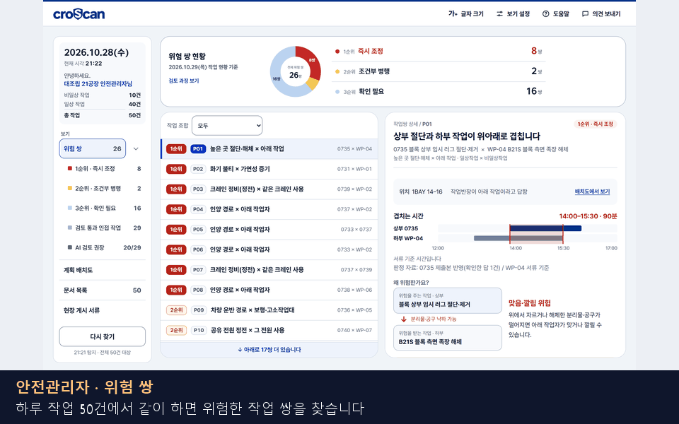

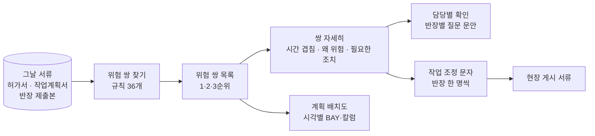

로그인은 반장과 같은 화면에서 역할만 「안전관리자」로 고릅니다.

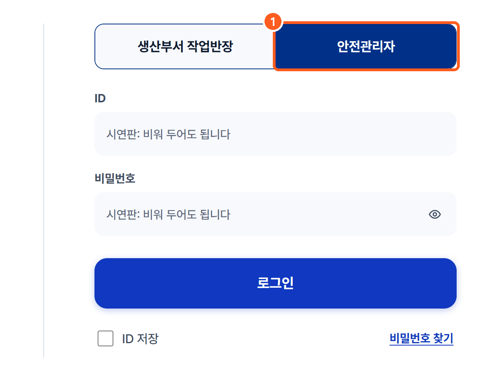

---

## 2. 위험 쌍 목록

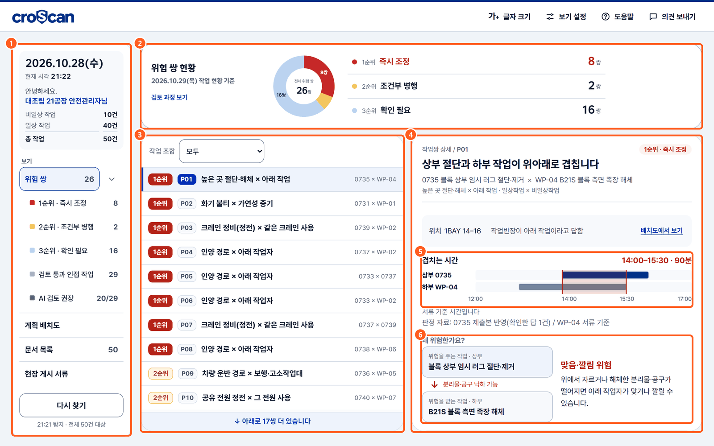

| 번호 | 무엇 | 설명 |
|---|---|---|
| 1 | 왼쪽 메뉴 | 날짜·담당 공장·작업 수(비일상 10 · 일상 40)와 네 가지 보기입니다. 지금은 시연 하루 자료가 기준입니다. 반장 제출본은 허가서 번호와 작업일이 맞으면 그 작업에 연결됩니다. 「위험 쌍」 아래에 순위별 수, 「검토 통과 인접 작업」(경보 조건에 해당하지 않은 가까운 짝), 「AI 검토 권장」이 있습니다. 「다시 찾기」를 누르면 서류가 바뀐 뒤에 다시 판정합니다. |
| 2 | 위험 쌍 현황 | 시연 자료 기준 26쌍입니다. 1순위 즉시 조정 8, 2순위 조건부 병행 2, 3순위 확인 필요 16. 순위를 누르면 목록이 그 순위로 좁혀집니다. |
| 3 | 쌍 목록 | 급한 순서입니다. 줄마다 순위, 쌍 번호(P01…), 규칙 이름(예: 「높은 곳 절단·해체 × 아래 작업」), 두 작업 번호가 있습니다. 「작업 조합」으로 일상×비일상 등을 고릅니다. |
| 4 | 고른 쌍 | 넓은 화면에서는 오른쪽에 바로 열립니다. |
| 5 | 겹치는 시간 | 두 작업의 시간을 막대로 겹쳐 그립니다(여기서는 14:00–15:30, 90분). 아래에는 이 시간이 「서류 기준 시간」인지, 반장 제출본의 답을 반영했는지 씁니다. |
| 6 | 왜 위험한가요? | 위험을 주는 작업(상부)과 받는 작업(하부), 그 사이 경로(분리물·공구 낙하)와 사고 유형(맞음·깔림)을 그립니다. |

**순위의 뜻**

| 순위 | 화면 이름 | 뜻 |
|---|---|---|
| 1순위 | 즉시 조정 | 서류로 같은 시간·같은 곳이 확인됩니다. 위험 경로도 분명합니다. 시간 분리 같은 조정이 필요합니다. |
| 2순위 | 조건부 병행 | 안전관리자가 병행 조건(차단·감시·거리)과 필요한 조치를 검토할 경보입니다. 조건을 지키면 해도 된다는 승인은 아닙니다. |
| 3순위 | 확인 필요 | 더 확인이 필요한 경보입니다. 여기에는 두 가지가 함께 들어 있습니다. 하나는 서류만으로는 위치·높이·시간이 모자라 판정을 미룬 것입니다(판정보류, 「정보 부족」 꼬리표). 다른 하나는 앞 작업의 잔류위험(앞 작업이 끝난 뒤에도 남는 위험)이 없어졌는지 확인해야 하는 것입니다(보수위험). 시연 자료 기준 16쌍 = 판정보류 13 + 보수위험 3. |

순위를 매기는 방법(S×E: 사고 강도 × 위험이 이어지는 확실성, 금지 조합, floor)은 [06 쌍작업 판정 §7](06_쌍작업_판정.md#7-판정-_path--_place--_judge)에 있습니다.

---

## 3. 쌍 하나 자세히

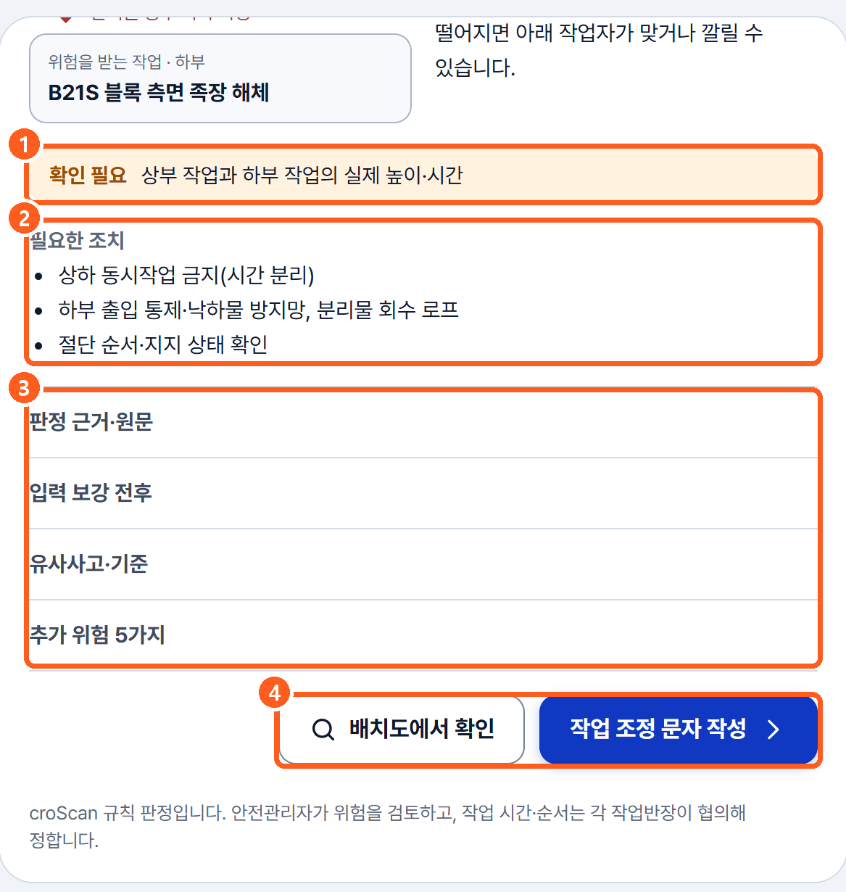

| 번호 | 무엇 | 설명 |
|---|---|---|
| 1 | 확인 필요 | 판정에 쓴 정보 가운데 아직 확인되지 않은 것입니다(예: 상부·하부 작업의 실제 높이·시간). |
| 2 | 필요한 조치 | 규칙에 적힌 표준 조치입니다(예: 상하 동시작업 금지, 하부 출입 통제·낙하물 방지망). 결정은 안전관리자가 합니다. |
| 3 | 펼쳐 보기 | 「판정 근거·원문」(어느 서류의 어느 글자에서 읽었는지), 「입력 보강 전후」(반장 답으로 무엇이 바뀌었는지), 「유사사고·기준」, 「추가 위험」입니다. |
| 4 | 다음 행동 | 「배치도에서 확인」, 「작업 조정 문자 작성」. |

---

## 4. 담당별 확인 (판정보류 질문)

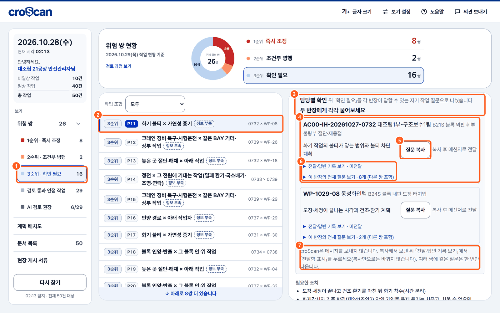

| 번호 | 무엇 | 설명 |
|---|---|---|
| 1 | 3순위 고르기 | 정보가 모자란 쌍을 먼저 봅니다. |
| 2 | 고른 쌍 | P11 화기 불티 × 가연성 증기. 「정보 부족」 꼬리표는 서류에 위치·높이·시간 같은 정보가 모자라 판정을 미뤘다는 뜻입니다. |
| 3 | 담당별 확인 | 위 「확인 필요」를 각 반장이 답할 수 있는 자기 작업 질문으로 나눴습니다. 3순위뿐 아니라 1·2순위 쌍에도 나올 수 있습니다. 확인할 이유가 더 있으면 「다른 확인사항 N개」로 규칙 문구 그대로 보여 줍니다. |
| 4 | 반장 카드 | 반장(작업)마다 카드 하나입니다. 이 쌍에 필요한 질문만 보이고, 더 있으면 「추가 질문 N개」로 접어 둡니다. 여러 쌍에 같은 질문이 있으면 한 번만 나옵니다. |
| 5 | 질문 복사 | 그 질문 하나만 「[작업 정보 확인 요청] / 대상: 작업 번호와 작업명 / 질문」 세 줄로 복사합니다. 복사되면 2초 동안 「✓ 복사됨」이 보입니다. 복사가 안 되는 브라우저에서는 글 상자를 열어 직접 복사하게 합니다. |
| 6 | 기록·전체 질문 | 「전달·답변 기록 보기」를 펼치면 질문마다 「전달함 표시」 → 「답변 받음 표시」를 누릅니다. 상태는 미전달 → 답변 대기 → 답변 받음입니다. 「이 반장의 전체 질문 보기」에는 다른 쌍 질문까지 모두와 전체 요청문(복사 버튼)이 있습니다. |
| 7 | 안내 | croScan은 메시지를 보내지 않습니다. 복사만으로는 상태가 바뀌지 않습니다. 「답변 받음」은 답을 받았다는 기록이지, 위험이 풀렸다거나 승인이라는 뜻이 아닙니다. |

시연 자료 기준으로 판정보류 질문은 55개, 대상 작업은 20건입니다. 질문을 만드는 방법은 [06b 보류질문 holdq](06b_보류질문_holdq.md)에 있습니다.

---

## 5. 검토 과정 보기

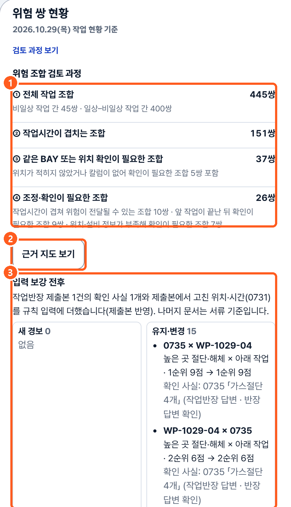

| 번호 | 무엇 | 설명 |
|---|---|---|
| 1 | 검토 과정 | 시연 자료 기준으로 후보는 445쌍입니다(허가서끼리 45 + 허가서×계획서 400, 계획서끼리는 보지 않음). 시간이 겹치는 조합은 151쌍입니다. 그중 같은 BAY이거나 위치 확인이 필요한 조합은 37쌍입니다. 최종 경보는 26쌍입니다. 최종 경보에는 공유 설비와 앞 작업의 잔류위험도 들어갑니다. 그래서 37쌍에서 다시 추린 수는 아닙니다. |
| 2 | 근거 지도 보기 | 규칙이 기대는 법령·자료를 엽니다(§9). |
| 3 | 입력 보강 전후 | 반장 제출본의 답 때문에 새로 경보가 된 것과 유지·변경된 것을 보여 줍니다. 지금 모인 서류로 낸 경보는 반장 답을 반영해도 그보다 낮아지지 않습니다. 이 경보가 하한(바닥값)으로 남습니다(floor). 다만 제출본 답 때문에만 생긴 경보는 다음 제출에서 답이 바뀌면 사라질 수 있습니다. |

---

## 6. 계획 배치도

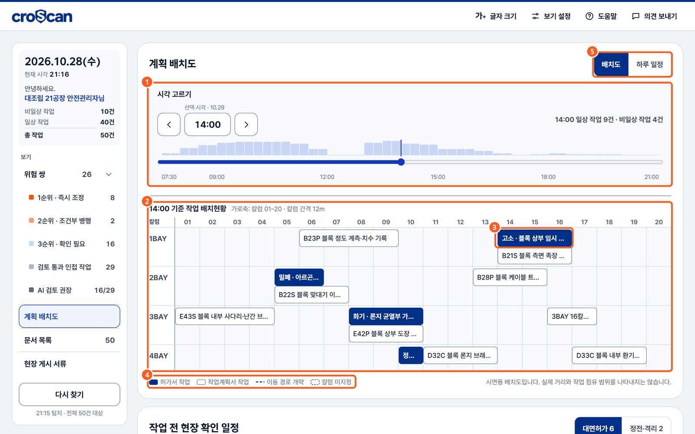

| 번호 | 무엇 | 설명 |
|---|---|---|
| 1 | 시각 고르기 | 시각을 옮기면 그때 진행 중인 작업이 바뀝니다. 막대는 시간대별 작업 수입니다. |
| 2 | BAY × 칼럼 격자 | 고른 시각에 어느 BAY·칼럼에서 무슨 작업을 하는지 보여 줍니다. |
| 3 | 허가서 작업 | 진한 칸은 허가서 작업(비일상), 흰 칸은 작업계획서 작업(일상)입니다. |
| 4 | 범례 | 이동 경로 개략, 칼럼 미지정 표시입니다. 실제 거리와 점유 범위를 나타내지 않습니다. |
| 5 | 하루 일정 | 같은 날을 시간표로 봅니다. 아래에는 대면허가 대상 작업과 정전·격리 계획을 작업 시작 시각 순으로 보여 줍니다. 대면허가 시간을 배정한 일정표는 아닙니다. |

배치도는 위치를 보여 줄 뿐 판정하지 않습니다.

---

## 7. 문서 목록

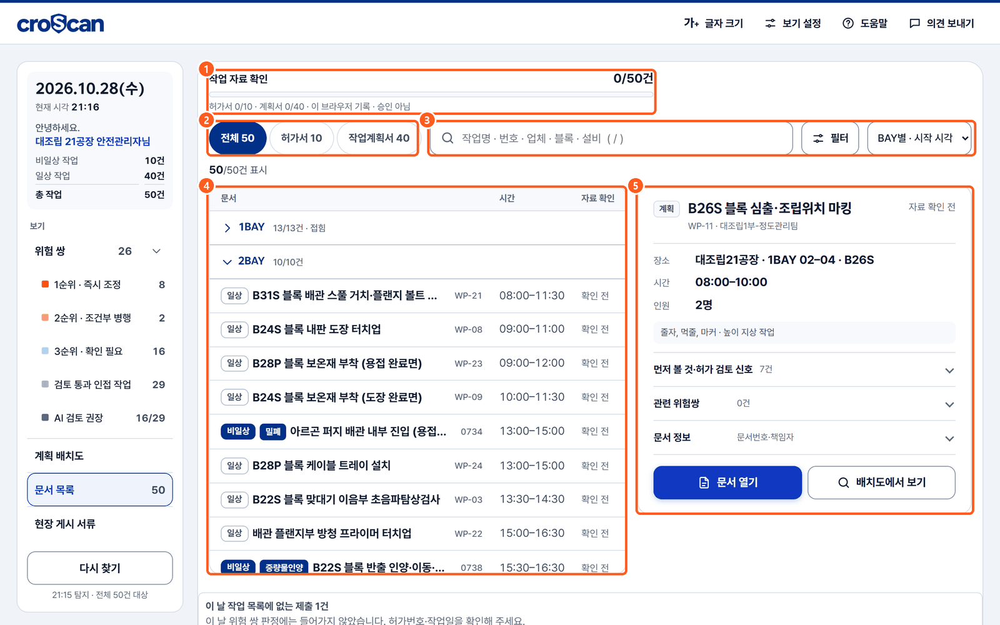

| 번호 | 무엇 | 설명 |
|---|---|---|
| 1 | 자료 확인 진행 | 필요한 서류를 모두 「확인」으로 표시한 작업 수입니다(허가서는 허가서·추가검토서·체크리스트를 모두 확인해야 함). 문서를 열기만 해서는 수가 늘지 않습니다. 표시는 이 브라우저에 저장됩니다. 서류나 제출본이 바뀌면 다시 확인해야 합니다. 승인이 아닙니다. |
| 2 | 종류 탭 | 전체 · 허가서 · 작업계획서. |
| 3 | 검색·필터·정렬 | 작업명·번호·업체·블록·설비로 찾습니다. 필터는 같은 그룹 안에서는 「또는」, 그룹끼리는 「그리고」로 묶입니다. |
| 4 | 목록 | BAY별로 묶어 시작 시각 순으로 보여 줍니다. 일상/비일상, 허가서 종류 꼬리표가 붙습니다. |
| 5 | 고른 문서 요약 | 장소·시간·인원·작업 내용, 「먼저 볼 것·허가 검토 신호」, 관련 위험쌍, 「문서 열기」「배치도에서 보기」. |

---

## 8. 작업 조정 문자와 현장 게시 서류

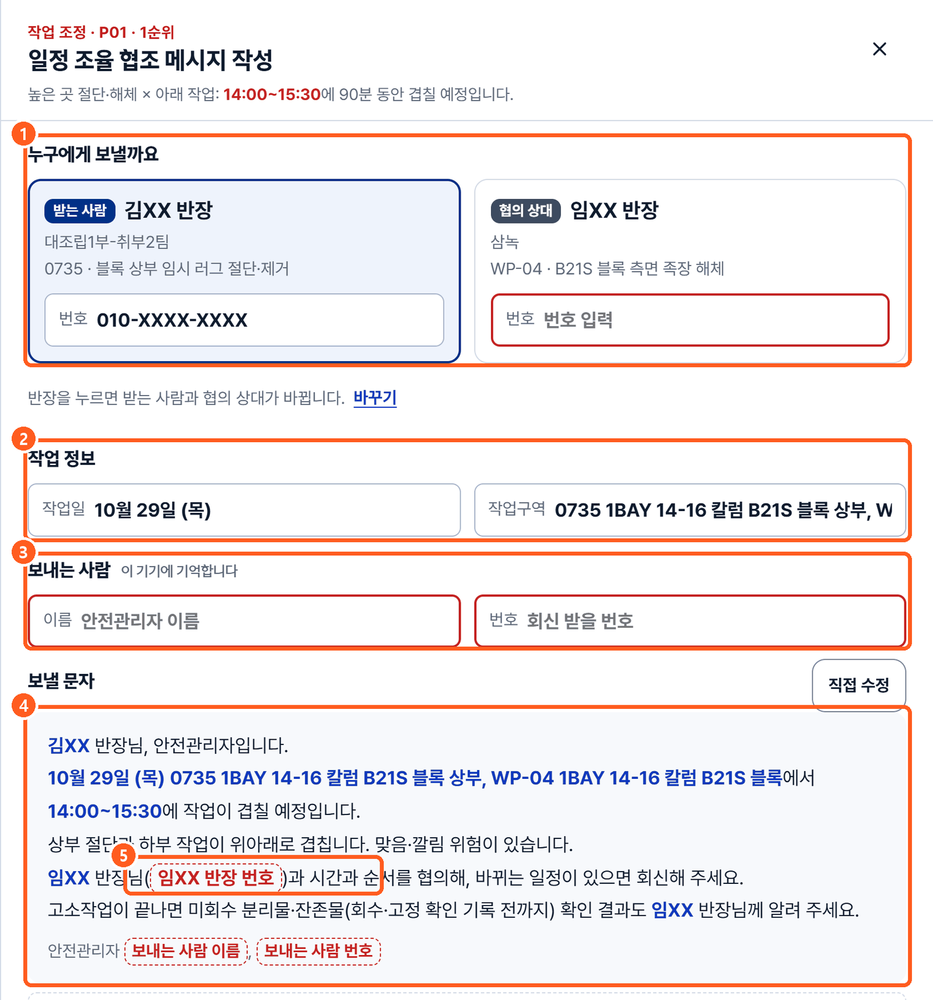

| 번호 | 무엇 | 설명 |
|---|---|---|
| 1 | 받는 사람과 협의 상대 | 쌍의 두 반장입니다. 누르면 서로 바뀌어 상대 반장에게 보낼 문자가 됩니다. |
| 2 | 작업 정보 | 작업일과 두 작업의 구역입니다. |
| 3 | 보내는 사람 | 안전관리자 이름과 회신 번호입니다. 이 기기에만 기억합니다. |
| 4 | 보낼 문자 | 겹치는 시각, 위험, 협의할 점을 쓴 초안입니다. 「직접 수정」으로 고칩니다. |
| 5 | 빈 칸 표시 | 아직 모르는 번호·이름은 빨간 점선으로 남깁니다. |

문자는 croScan이 보내지 않습니다. 복사해서 기존 연락 방법으로 보냅니다. 일정은 반장들이 협의해 정합니다. 그 다음 「서류 발행」 단계에서 현장 게시용 별지를 만듭니다([06b §11](06b_보류질문_holdq.md#11-답-다음-협조-문자와-별지)).

게시 별지의 쌍마다 행은 「우리 반이 할 일」, 「착수조건」, 「상대 작업」, 「우리 작업 일정」, 「예상 사고 경로」, 「중지·해제 조건」 순서입니다. 그 뒤에 필요하면 「조치 유지·효과 확인」, 그리고 「상대 반장·연락처」, 「대응 서류(상대 쪽)」가 옵니다. 화면 미리 보기와 PDF가 같은 행 이름을 씁니다. 이미 발행한 별지는 발행 때 모습 그대로 남습니다.

---

## 9. 근거 지도

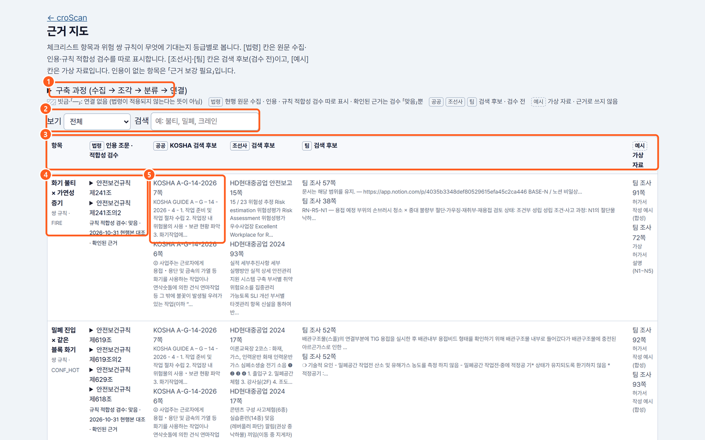

| 번호 | 무엇 | 설명 |
|---|---|---|
| 1 | 구축 과정 | 수집 → 조각 → 분류 → 연결 순서를 펼쳐 봅니다. |
| 2 | 보기·검색 | 체크리스트 항목과 쌍 규칙을 고르고 낱말로 찾습니다. |
| 3 | 등급 열 | [법령] 원문·인용 조문과 적합성 검수, [공공] KOSHA 검색 후보, [조선사] 검색 후보, [팀] 조사자료 검색 후보, [예시] 가상 자료. 검수하지 않은 후보는 근거로 인용하지 않습니다. |
| 4 | 항목 | 쌍 규칙 또는 체크리스트 항목입니다. |
| 5 | 법령 칸 | 인용 조문과 「규칙 적합성 검수: 맞음 · 날짜 · 현행본 대조」. |

등급과 검색 방법은 [10 근거와 자료](10_근거와_자료.md)에 있습니다.

---

## 10. 화면에서 하지 않는 일

| 하지 않는 일 | 까닭 |
|---|---|
| 작업 승인·중지 | 판정은 검토를 돕는 경보입니다. 결정은 안전관리자와 기존 절차가 합니다. |
| 일정 정하기 | 시간·순서는 각 작업반장이 협의합니다. 문자도 「협의해 달라」는 협조 요청입니다. |
| 문자 자동 전송 | 사내 연락 수단과 연결하지 않습니다. 안전관리자가 복사해 보냅니다. |
| 답으로 경보 낮추기 | 지금 모인 서류로 낸 경보는 반장 답을 반영해도 그보다 낮아지지 않습니다. 이 경보가 하한(바닥값)으로 남습니다(floor). 다만 제출본 답 때문에만 생긴 경보는 다음 제출에서 답이 바뀌면 사라질 수 있습니다. |
| 배치도로 판정 | 배치도는 개략 위치입니다. 실제 거리·점유 범위가 아닙니다. |

---

## 11. 코드 어디

| 화면 | 화면 코드 | 서버 |
|---|---|---|
| 안전관리자 화면 전체 | [`web/index.html`](../web/index.html) `s-safety`, [`web/app.js`](../web/app.js) `sf*` 함수 | [`server/safety.py`](../server/safety.py) |
| 위험 쌍 판정 | `#sf-plist`, `#sf-pdetail` | [`server/pairs.py`](../server/pairs.py), [`server/pair_rules.json`](../server/pair_rules.json) |
| AI 검토 권장 | `sf-nav` 「AI 검토 권장」 | [`server/pairreview.py`](../server/pairreview.py) |
| 담당별 확인 | `.sf-hq`, `sfHoldRender()` `sfHqText()` `sfHqCopy()` `sfHoldMark()` | [`server/holdq.py`](../server/holdq.py) |
| 계획 배치도 | `#sf-grid`, `#sf-time-h` (화면 쪽에서 그림) | [`server/safety.py`](../server/safety.py)의 하루 자료 |
| 문서 목록 · 고른 문서 요약 | `#sf-rows`, `#sf-doc-sum` | [`server/docsum.py`](../server/docsum.py), [`server/permitsignal.py`](../server/permitsignal.py)(허가 검토 신호) |
| 작업 조정 문자 · 게시 서류 | `#sf-post-body` | [`server/coordnote.py`](../server/coordnote.py), [`server/posting.py`](../server/posting.py) |
| 근거 지도 | [`web/evidence.html`](../web/evidence.html) | [`server/evidencemap.py`](../server/evidencemap.py), [`server/retrieval.py`](../server/retrieval.py) |
