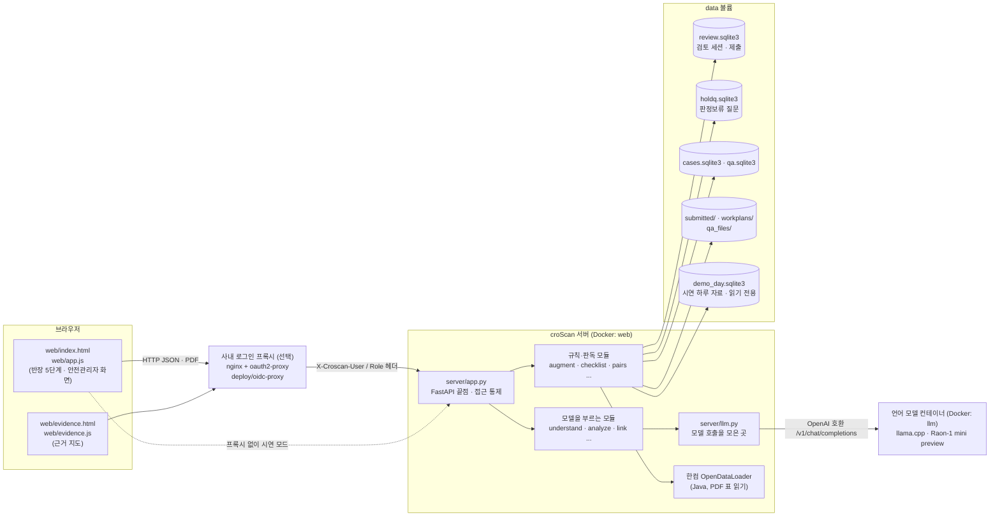
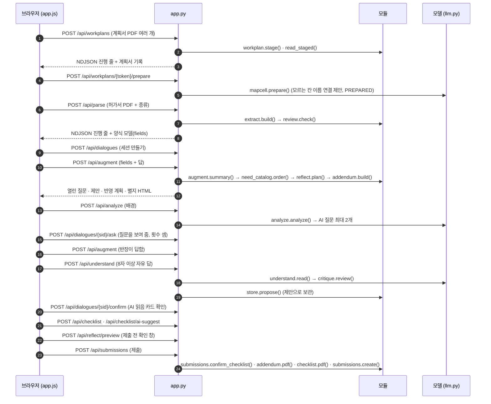
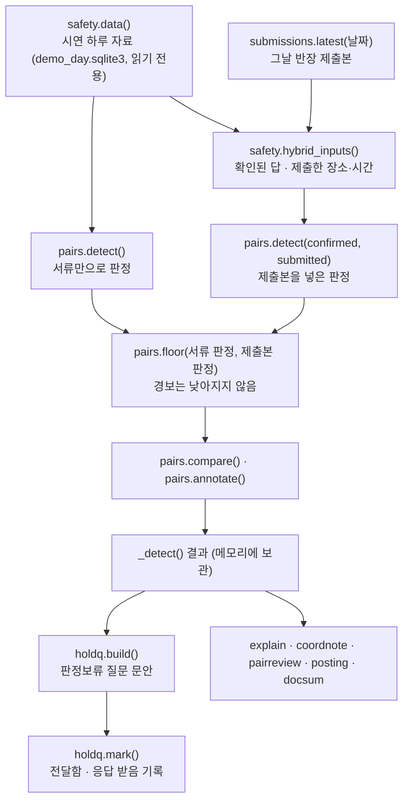

# 04 아키텍처

croScan은 브라우저 화면 하나, FastAPI 서버 하나, 사내에서 도는 언어 모델 하나로 이루어집니다. 판단은 규칙이 하고, 모델은 제안만 합니다. 확정은 언제나 사람(작업반장·안전관리자)이 합니다.

**이 문서에서 알 수 있는 것**
- croScan을 이루는 부품과 그 사이의 연결
- `server/` 안 34개 모듈이 각각 하는 일
- 작업반장 한 번의 검토와 안전관리자 화면에서 데이터가 흐르는 순서
- 상태가 어디에 저장되고 얼마나 남는지
- 「공용 답 읽기」 함수가 왜 중요한지

## 목차
1. [무엇을: 전체 그림](#1-무엇을-전체-그림)
2. [왜 이렇게 나눴나](#2-왜-이렇게-나눴나)
3. [어떻게: 작업반장 한 번의 검토](#3-어떻게-작업반장-한-번의-검토)
4. [어떻게: 안전관리자 화면](#4-어떻게-안전관리자-화면)
5. [상태는 어디에 저장되나](#5-상태는-어디에-저장되나)
6. [공용 답 읽기 함수](#6-공용-답-읽기-함수)
7. [코드 어디: 모듈 지도](#7-코드-어디-모듈-지도)
8. [시험](#8-시험)
9. [한계](#9-한계)

---

## 1. 무엇을: 전체 그림

croScan은 두 사람을 돕습니다.
- **작업반장**: 위험작업 허가서(화기·밀폐·고소·중량물인양·정전/LOTO)를 내기 전에 스스로 점검합니다. 규칙 질문에 답하고, 위험 체크리스트를 확인하고, 제출 전 확인 창을 봅니다.
- **안전관리자**: 그날 들어온 허가서와 작업계획서(그날 할 일을 적은 서류)를 모아 봅니다. croScan은 함께 하면 위험한 두 작업(쌍작업)을 찾아 줍니다.

croScan은 작업을 승인하지 않습니다. 일정을 정하거나 작업을 막지도 않습니다.

부품별 설명입니다.

| 부품 | 하는 일 | 근거 |
|---|---|---|
| 브라우저 화면 | 반장 5단계(작업계획서 확인 → 허가서 올리기 → 허가서 검토 → 위험 체크리스트 → 제출)와 안전관리자 화면 | [`web/index.html`](../web/index.html), [`web/app.js`](../web/app.js) |
| FastAPI 서버 | 모든 HTTP 끝점. 화면 파일도 `/static`과 `/`로 내보냄 | [`server/app.py`](../server/app.py) |
| OpenDataLoader | PDF의 표 칸·문단을 읽음. 이것 때문에 서버 이미지에 Java 17을 넣음 | [`server/extract.py`](../server/extract.py) `run_odl()`, [`Dockerfile`](../Dockerfile) |
| 언어 모델 | KRAFTON Raon-1 mini preview를 llama.cpp로 띄움. `--profile ai`일 때만 뜸 | [`docker-compose.yml`](../docker-compose.yml), [`llm/Dockerfile`](../llm/Dockerfile) |
| 로그인 프록시(선택) | 회사 IdP(로그인을 맡는 회사 서버)로 로그인하고 사용자·역할 헤더만 넘김 | [`deploy/oidc-proxy/`](../deploy/oidc-proxy/README.md) |
| 저장소 | SQLite 파일과 PDF 파일. Docker에서는 `/app/data` 볼륨 | [`server/qa.py`](../server/qa.py) `DATA` |

---

## 2. 왜 이렇게 나눴나

- **기본 구성은 모델을 사내에 둡니다.** 허가서에는 이름·전화번호·현장 정보가 있습니다. 그래서 기본 구성에서는 모델을 같은 서버의 컨테이너(llama.cpp)에 둡니다. 이 컨테이너는 `127.0.0.1:8000`에만 엽니다([`docker-compose.yml`](../docker-compose.yml)). 실제 요청 주소는 환경 변수 `LLM_URL`로 바꿀 수 있습니다. 코드가 외부 주소를 막지는 않습니다.
- **모델 호출은 [`server/llm.py`](../server/llm.py)에 모읍니다.** 분석·판독 같은 일반 호출은 `call_json()`을 씁니다. 호출마다 JSON 스키마(답의 정해진 모양), 생각 토큰 한도, 마감 시간이 붙습니다. 호출이 실패하면 croScan은 규칙만으로 계속합니다. 빈 곳을 추측으로 메우지 않습니다. 미리 읽기(캐시 채우기)는 `llm.prefill()`을 씁니다. 옛 `/api/chat`은 기본으로 꺼져 있습니다. 이것을 켜면 이 길을 거치지 않고 모델 서버를 직접 부릅니다.
- **CPU 서버 한 대에 모델 자리(slot)는 하나입니다.** 그래서 `llm._Slot`이 급한 순서로 줄을 세웁니다. 순서는 `FG`(반장이 지금 답한 말 읽기) → `ASKED`(사람이 지금 요청한 것) → `PREPARED`(미리 해 두는 분석) → `WARM`(아무도 아직 요청하지 않은 예열)입니다. 급한 호출이 오면 `PREPARED`·`WARM` 호출은 취소됩니다. 사람의 호출은 다른 호출 때문에 취소되지 않습니다.
- **규칙이 정하고, 모델은 고르기만 합니다.** 예를 들어 [`server/understand.py`](../server/understand.py)에서 모델은 질문 id·보기·인용 구절만 고릅니다. 그다음 서버가 다시 검사합니다. 그 구절이 실제 답 안에 있는지, 숫자가 맞는지 봅니다. 반장이 「AI 읽음」 카드에서 확인해야 답이 됩니다.
- **답은 서버가 갖습니다.** 반장의 답과 확인한 읽기는 서버 세션([`server/store.py`](../server/store.py))에 있습니다. 브라우저는 요청할 때 자기가 본 개정 번호(revision)를 함께 보냅니다. 서버는 낡은 번호를 409(충돌 오류)로 거절합니다. 그래서 다른 탭이나 늦은 요청이 새 답을 덮어쓰지 못합니다.

---

## 3. 어떻게: 작업반장 한 번의 검토

단계별로 풀어 씁니다.

### 3.1 작업계획서 올리기·확인
- [`workplan.py`](../server/workplan.py) `stage()`가 파일을 디스크에 받습니다. `read_staged()`가 OpenDataLoader로 파일을 읽습니다. 그리고 문서번호가 같은 쪽을 묶어 계획서를 하나씩 만듭니다.
- 반장이 화면에서 값을 고치면 `/edits`로 저장됩니다(`save_edits()`). 칸 이름이 원본과 다른 칸은 `mapcell`이 「이 칸이 그 항목인가」를 제안만 합니다. 확인은 반장이 `/maps`로 합니다.

### 3.2 허가서 올리기와 판독(extract)
- 반장이 첫 화면에서 허가서 종류를 고릅니다. croScan은 종류를 PDF에서 추측하지 않습니다([`permit_kinds.py`](../server/permit_kinds.py) 머리말).
- [`extract.py`](../server/extract.py) `build()`가 표 칸·문단을 양식 칸(`fields`)으로 바꿉니다. 글자 층(PDF 안의 글자 데이터)이 없는 스캔본은 거절합니다(`app._steps()`).
- [`review.py`](../server/review.py) `check()`가 빈 칸·형식·논리를 검사합니다.

### 3.3 질문 만들기(augment.summary)
- [`augment.py`](../server/augment.py) `summary()`가 허가서와 지금까지의 답으로 열린 질문, 기록, 유효 값(`effective`)을 다시 계산합니다.
- `need_catalog.order()`가 질문 순서를 정합니다. `need_catalog.why()`는 「왜 묻나요?」 설명(관찰·쓰임·근거)을 붙입니다.
- `/api/analyze`의 AI 질문(`analyze.py`)이 끝나면 `app._with_ai()`가 같은 목록에 넣습니다.
- 분석 호출 한 번은 AI 질문을 최대 2개 더합니다. 변경 분석(`/api/analyze/delta`)은 허가서를 고친 뒤에 합니다. 이것까지 합쳐 검토 한 건에 AI 질문을 최대 8개까지 저장합니다(`store.MAX_NEEDS`). 실제로 묻는 횟수는 아래 묻기 한도(12번)와 규칙 질문 몫의 제한을 받습니다.
- 한 검토에서 묻는 횟수는 최대 12번, 다시 묻기는 3번, 모델 호출은 30번입니다([`store.py`](../server/store.py) `ASKS, CLARIFY, LLM_CALLS`).

### 3.4 답과 AI 읽기(understand)
- 반장의 답은 `/api/augment`로 갈 때 세션에 기록됩니다(`store.answers_for()`).
- 8자 이상 자유 답은 `/api/understand`로 갑니다. 모델이 다른 열린 질문의 답을 찾아 제안합니다. 「없음·안 함」처럼 위험 신호를 낮추는 제안은 [`critique.py`](../server/critique.py)가 한 번 더 검사합니다. 통과하지 못하면 「뜻 확인 필요 — 따로 묻기」로 남습니다.
- 제안은 `store.propose()`로 보관됩니다. 반장이 카드에서 확인(`/confirm`)해야 답이 됩니다.

### 3.5 반영본과 별지(reflect · addendum)
- [`reflect.py`](../server/reflect.py) `plan()`은 어떤 답을 원본 칸에 파란 글씨로 적을지 계획을 만듭니다. 칸의 용도에 맞는 답만 고릅니다. 업로드한 원본 파일은 바꾸지 않습니다.
- 서명·승인·허가구분·2중점검·작업당일 칸에는 적지 않습니다(`reflect.NEVER`).
- 칸에 맞지 않는 것은 [`addendum.py`](../server/addendum.py)의 추가검토서 별지로 갑니다.

### 3.6 위험 체크리스트(checklist)
- [`checklist.py`](../server/checklist.py) `draft()`가 허가서와 반장 답만으로 초안을 만듭니다. 작업계획서는 쓰지 않습니다.
- 항목은 [`checklist_spec.json`](../server/checklist_spec.json)에 있습니다(공통 7 + 종류별 79 = 86항목).
- 항목은 처음에 「확인 필요」입니다. 어떤 항목이 「해당 없음」이 되려면, 허가서 문구와 확인된 답이 모두 그렇다고 해야 합니다.
- [`checkai.py`](../server/checkai.py)는 두 가지를 제안만 합니다. 첫째, 다른 종류의 카탈로그 항목을 「넣기」 후보로 냅니다. 둘째, 기존 항목마다 작업 내용에 근거가 있는지, 서로 어긋나는지(상충) 표시합니다(`marks`).
- 반장이 「해당 없음」으로 고른 항목에 해당 근거 표시가 나오면, 그 항목을 다시 확인하게 합니다. AI가 반장의 선택값을 바꾸지는 않습니다.

### 3.7 제출(submissions)
- `/api/submissions`는 그 순간의 검토를 한 번 고정합니다(스냅숏). 원본 PDF, 반영본+별지 PDF, 체크리스트 PDF, 고친 작업계획서 PDF를 그때 그립니다.
- 제출하려면 모든 기본 항목의 해당 여부를 확인해야 합니다. 「해당」인 항목은 준비할 안전조치도 따로 확인해야 합니다. 확인하지 않은 항목이 있으면 409 `checklist_left`로 돌려보냅니다(`submissions.confirm_checklist()`).
- 반장이 고른 뒤에 croScan의 근거가 바뀐 체크리스트 항목이 있어도, 제출을 받지 않고 409(`checklist_changed`)로 돌려보냅니다.
- 같은 세션·같은 개정·같은 입력은 같은 제출로 봅니다(`submissions.key_of()`).
- 제출은 croScan 자체 기록입니다. 전산·결재로 보내지 않습니다.
- 제출이 들어오면 서버가 뒤에서 안전관리자 판정을 미리 다시 계산합니다(`app._warm_manager()`).

---

## 4. 어떻게: 안전관리자 화면

- **safety.data**: [`safety.py`](../server/safety.py)가 시연 DB를 읽기 전용으로 엽니다. 먼저 `data/demo_day.sqlite3`를 찾고, 그다음 `samples/시연_하루/demo_day.sqlite3`를 찾습니다. DB 안의 정답(충돌 목록 등)은 내보내지 않습니다.
- **pairs.detect**: 판정할 쌍은 허가서×허가서(비일상×비일상)와 허가서×작업계획서(비일상×일상)입니다. [`pairs.py`](../server/pairs.py)가 이 쌍을 [`pair_rules.json`](../server/pair_rules.json)의 규칙 36개로 판정합니다. 모델은 쓰지 않습니다. 시간·장소를 모르면 「확인 필요」로 남깁니다. 안전하다고 하지 않습니다.
- **floor**: 반장 답을 넣은 판정은 경보를 더하거나 올릴 수만 있습니다. 답 때문에 서류가 띄운 경보가 없어지거나 낮아지면, 서류 기준을 지킵니다(「문서 기준 유지」). 경보는 사람만 내립니다. 다만 이 바닥(하한)은 지금 모인 서류로 낸 경보입니다. 제출본 답 때문에만 생긴 경보는 다음 제출에서 답이 바뀌면 사라질 수 있습니다.
- **holdq**: [`holdq.py`](../server/holdq.py)는 판정보류(사실이 빠져 확인이 필요한 경보)의 이유마다 질문 문안을 만듭니다. 문안은 각 쪽 반장에게 자기 작업만 묻습니다. croScan은 보내지 않습니다. 안전관리자가 「전달함」으로 표시하면, 그 질문은 그 허가서 검토의 질문 횟수에 들어갑니다.
- 판정은 `app._detect()`가 계산하고 메모리에 둡니다. 시연 DB 파일이나 그날 제출본이 바뀔 때만 다시 계산합니다.

---

## 5. 상태는 어디에 저장되나

데이터 폴더는 환경 변수 `CROSCAN_DATA`로 정합니다. 이 값이 없으면 저장소의 `data/`를 씁니다([`qa.py`](../server/qa.py) `DATA`). Docker에서는 `/app/data`에 볼륨을 붙입니다.

| 저장소 | 무엇 | 누가 씀 | 얼마나 |
|---|---|---|---|
| `review.sqlite3` | 검토 세션: 반장이 친 답(`typed`), 읽기 제안(`proposals`), 질문 횟수(`asks`), AI 질문(`needs`), 작업(`jobs`), 이벤트, 확인 기록 | [`store.py`](../server/store.py) | 마지막 사용 뒤 30일이 지나면 새 세션을 만들 때 정리 |
| `review.sqlite3`의 `submissions` 표 + `submitted/<해시>.pdf` | 제출 스냅숏과 그때 그린 PDF | [`submissions.py`](../server/submissions.py) | 만든 뒤 30일이 지나면 새 제출 때 정리 |
| `holdq.sqlite3` | 판정보류 질문의 전달 표시 | [`holdq.py`](../server/holdq.py) | 기간이 지나 지우는 코드 없음 |
| `cases.sqlite3` | 확인 사례 후보(가명 처리 뒤) | [`cases.py`](../server/cases.py) | 기간이 지나 지우는 코드 없음 |
| `qa.sqlite3` + `qa_files/` | 화면의 QA 신고와 첨부 | [`qa.py`](../server/qa.py) | 기간이 지나 지우는 코드 없음 |
| `workplans/` | 올린 계획서, 읽은 기록, 고친 값, 칸 연결 | [`workplan.py`](../server/workplan.py) | 마지막 접근 뒤 7일 동안 쓰지 않으면 새 업로드 때 지움(접근하면 기준 시간이 새로 잡힘) |
| `demo_day.sqlite3` + `demo_day/` | 시연 하루의 서류(읽기 전용) | [`safety.py`](../server/safety.py), 만드는 것은 [`tools/make_demo_day.py`](../tools/make_demo_day.py) | 손으로 바꿈 |
| 프로세스 메모리 | 판정 결과 `_DET`, 협의할 점 `_NOTES`, 설명 `_EXPLAINED`, 읽기 단계 `_STAGE`, 검색 결과 `_REFS`, 모듈 캐시 | [`app.py`](../server/app.py) 등 | 서버를 다시 켜면 사라짐 |

서버가 다시 켜지면 `store.recover()`가 끝나지 않은 작업을 「중단됨」으로 바꿉니다. 그 작업이 쓴 모델 호출 횟수도 돌려줍니다.

---

## 6. 공용 답 읽기 함수

반장의 답은 나중에 바뀔 수 있습니다. 세 가지 경우가 있습니다.
- **철회(C6)**: 반장이 「서류가 맞음」이라고 해서 앞의 답을 거둡니다.
- **정정(C5)**: 「없음」이라고 했다가 「추가로 적은 내용이 맞음」으로 고칩니다.
- **낡음(stale)**: 답을 한 뒤에 그 질문이 본 양식 값이 바뀌었습니다.

이 세 가지를 모든 곳이 똑같이 읽어야 합니다. 그렇지 않으면 질문 화면에서는 사라진 답이 체크리스트나 쌍작업 판정에는 남는 일이 생깁니다.

| 함수 | 하는 일 | 쓰는 곳 |
|---|---|---|
| [`augment.withdrawn()`](../server/augment.py) | C6로 거둔 답의 qid 모음 | `app._normalize()`, `/api/understand`, `live_answers()` |
| [`augment.live_answers()`](../server/augment.py) | 거둔 답을 빼고, C5 정정을 원래 질문의 답으로 바꿈. 「계산에 쓰는 답」의 기준 이름 | `effective()`, `questions()`, `reflect.plan()`, `checklist.standing()`, `pairs.standing()`, `app._normalize()` |
| [`augment.stale_answers()`](../server/augment.py) | 질문 때와 지금의 칸 값 지문(`fp`)이 다른 답 | `effective()`, `answers_now()` |
| [`augment.answers_now()`](../server/augment.py) | `live_answers()`에서 낡은 답까지 뺌 | `safety.hybrid_inputs()` (제출본을 판정에 넣을 때) |
| [`augment.drop_stale()`](../server/augment.py) | 계산한 허가서(`perms`)가 낡았다고 표시한 답(T7 다른 행 등)을 뺌 | `questions()`, `summary()`, `reflect.plan()` |
| [`checklist.standing()`](../server/checklist.py) | `live_answers()` + C5 정정을 친 글자 그대로 읽음 | `checklist` 규칙, `checkai.facts()` |
| [`pairs.standing()`](../server/pairs.py) | 같은 뜻의 쌍작업 쪽 함수 | `pairs.confirmed_facts()` |

서버 쪽 입구도 하나로 모읍니다. `/api/augment`, `/api/checklist`, `/api/reflect/preview`, `/api/submissions`는 모두 `app._calc_answers()`와 `app._normalize()`를 지납니다. 그래서 같은 답을 같은 방식으로 읽습니다. 링크로 가져온 값은 그 뒤 계획서를 고치면 낡을 수 있습니다. 그러면 `app._unlinked()`가 이 입구에서 그 값을 빼고, 그 질문을 다시 엽니다.

---

## 7. 코드 어디: 모듈 지도

`server/` 아래 34개 모듈입니다(`__init__.py` 제외). 「모델」 열은 언어 모델을 부르는지입니다.

| 파일 | 하는 일 | 주요 함수 | 모델 |
|---|---|---|---|
| [`app.py`](../server/app.py) | FastAPI 앱. 모든 끝점, 접근 통제, 공통 답 입구, 안전관리자 판정 캐시 | `_gate()`, `_calc_answers()`, `_normalize()`, `_augment()`, `_detect()` | 부름(모듈을 거쳐) |
| [`extract.py`](../server/extract.py) | 전산 허가서 PDF를 양식 모델(쪽·칸·fields)로 바꿈 | `run_odl()`, `build()` | 아니오 |
| [`form_spec.py`](../server/form_spec.py) | 허가서 공통 칸의 위치 이름과 형식 | `FIELDS` | 아니오 |
| [`permit_kinds.py`](../server/permit_kinds.py) | 허가서 5종의 제목·추가정보 블록과 근거 조문 | `KINDS`, `checks()`, `values()` | 아니오 |
| [`review.py`](../server/review.py) | 칸 값 규칙 검사(빈 칸·형식·논리) | `check()`, `valid()` | 아니오 |
| [`augment.py`](../server/augment.py) | 반장 질문 규칙, 답 해석, 유효 값, 별지 기록. 공용 답 읽기 함수 | `questions()`, `summary()`, `effective()`, `check_value()`, `interpret()`, `live_answers()` | 아니오 |
| [`need_catalog.py`](../server/need_catalog.py) | 「왜 묻나요?」와 질문 순서 | `why()`, `order()`, `basis_of()` | 아니오 |
| [`store.py`](../server/store.py) | 검토 세션 저장, 개정 번호, 질문·모델 횟수 | `create()`, `answers_for()`, `current()`, `propose()`, `decide()`, `issue()`, `charge_llm()` | 아니오 |
| [`understand.py`](../server/understand.py) | AI 답 이해: 자유 답에서 다른 질문의 답을 제안하고 검사 | `read()`, `check()`, `phrase()`, `warm()` | 부름 |
| [`critique.py`](../server/critique.py) | 의미 검사: 위험 신호를 낮추는 읽기와 관계 주장을 한 번 더 확인 | `review()`, `relation()`, `verdict()` | 부름 |
| [`analyze.py`](../server/analyze.py) | 업로드 분석: 규칙이 묻지 않는 것을 호출 한 번에 최대 2개(검토 한 건에 누적 8개), 고친 칸만 다시 읽기 | `analyze()`, `delta()`, `related_plan()`, `question()` | 부름 |
| [`link.py`](../server/link.py) | 허가서와 같은 작업인 계획서 연결 제안 | `suggest()`, `candidates()`, `imports()` | 부름 |
| [`llm.py`](../server/llm.py) | 모델 호출을 모은 곳(일반 호출 `call_json()`, 미리 읽기 `prefill()`). 기본으로 꺼진 옛 `/api/chat`만 따로 부름. 자리 순서와 마감 | `call_json()`, `prefill()`, `status()`, `_Slot` | — |
| [`retrieval.py`](../server/retrieval.py) | 법령·지침·조사 자료 BM25 검색. 찾은 것은 보여 줄 뿐 근거로 판단하지 않음 | `search()`, `related()`, `for_analysis()`, `article()` | 아니오 |
| [`reflect.py`](../server/reflect.py) | 사전검토 반영본: 어느 답을 어느 칸에 적을지 | `plan()`, `apply()`, `destination()` | 아니오 |
| [`addendum.py`](../server/addendum.py) | 추가검토서 별지를 HTML과 PDF로 | `build()`, `html()`, `pdf()` | 아니오 |
| [`checklist.py`](../server/checklist.py) | 위험 체크리스트 초안·병합·PDF | `draft()`, `merge()`, `pdf()`, `standing()` | 아니오 |
| [`checkai.py`](../server/checkai.py) | 체크리스트 AI 추가 위험요인 제안 | `suggest()`, `attach()`, `marks_cached()`, `validate()` | 부름 |
| [`submissions.py`](../server/submissions.py) | 제출 스냅숏과 그 PDF | `create()`, `confirm_checklist()`, `latest()`, `get()`, `file()` | 아니오 |
| [`workplan.py`](../server/workplan.py) | 작업계획서 PDF 읽기, 쪽 그림, 고친 값·칸 연결 저장 | `stage()`, `read_staged()`, `page_png()`, `save_edits()`, `save_map()`, `plan_digest()`, `edited_pdf()` | 아니오 |
| [`workplan_pdf.py`](../server/workplan_pdf.py) | 고친 계획서를 같은 양식의 PDF로 다시 그림 | `render()` | 아니오 |
| [`mapcell.py`](../server/mapcell.py) | 모르는 계획서 칸 이름이 어느 항목인지 제안 | `suggest()`, `prepare()`, `check()` | 부름 |
| [`safety.py`](../server/safety.py) | 안전관리자의 하루 자료(시연 DB), 제출본을 판정 입력으로 | `data()`, `overview()`, `detail()`, `pdf()`, `hybrid_inputs()`, `submission_view()` | 아니오 |
| [`pairs.py`](../server/pairs.py) | 쌍작업 규칙 판정과 「경보는 낮아지지 않음」 | `detect()`, `profile()`, `floor()`, `compare()`, `confirmed_facts()` | 아니오 |
| [`holdq.py`](../server/holdq.py) | 판정보류 쌍의 담당별 질문과 전달 표시 | `build()`, `mark()` | 아니오 |
| [`pairreview.py`](../server/pairreview.py) | 규칙이 아무것도 띄우지 않은 쌍의 「AI 검토 권장」(규칙 판정 아님) | `review()`, `batch()`, `listing()`, `prefilter()` | 부름 |
| [`explain.py`](../server/explain.py) | 「왜?」 설명: 서버가 만든 주장으로 답을 짬 | `claims()`, `fixed()`, `ask()`, `verify()` | 자기 말 질문만 |
| [`coordnote.py`](../server/coordnote.py) | 협조 문자의 「협의할 점」 한 문장 | `note()` | 부름 |
| [`posting.py`](../server/posting.py) | 현장 게시용 서류·일상작업반 전달문 PDF와 문안 초안 | `pdf()`, `draft()`, `layout()` | 초안만 |
| [`docsum.py`](../server/docsum.py) | 문서별 관리자 요약(시간·장소·대상·공유 설비 ...) | `build()`, `rows()`, `ai_reading()` | 아니오 |
| [`permitsignal.py`](../server/permitsignal.py) | 계획서에 허가 대상 작업이 있는데, 맞는 허가서를 찾지 못했을 때 내는 신호 | `signals()`, `suggest_ai()` | 규칙이 못 읽은 줄만 |
| [`evidencemap.py`](../server/evidencemap.py) | 체크리스트 항목·쌍 규칙의 근거 지도 | `build()`, `cites()` | 아니오 |
| [`cases.py`](../server/cases.py) | 확인·거절된 읽기를 사람 검토 뒤 사례로 공개 | `record()`, `review()`, `publish()`, `example()` | 아니오 |
| [`qa.py`](../server/qa.py) | QA 신고 저장. 데이터 폴더 경로의 기준 | `add()`, `listing()`, `file()`, `set_handled()` | 아니오 |

모듈이 아닌 자료 파일: [`pair_rules.json`](../server/pair_rules.json)(쌍 규칙 36), [`checklist_spec.json`](../server/checklist_spec.json)(체크리스트 86항목), `server/knowledge/`(검색 말뭉치, [`tools/build_corpus.py`](../tools/build_corpus.py)가 만듦).

---

## 8. 시험

시험은 `tools/check_*.py` 34종입니다. 아래는 이 문서와 가까운 시험만 추린 것입니다.

| 영역 | 시험 |
|---|---|
| 세션 저장·개정 번호 | [`check_store.py`](../tools/check_store.py), [`check_dialogue_api.py`](../tools/check_dialogue_api.py) |
| 접근 통제 | [`check_access.py`](../tools/check_access.py), [`check_proxy_headers.py`](../tools/check_proxy_headers.py) |
| 제출 | [`check_submissions.py`](../tools/check_submissions.py), [`check_submit_link.py`](../tools/check_submit_link.py) |
| 판독 | [`check_extract.py`](../tools/check_extract.py), [`check_form_intact.py`](../tools/check_form_intact.py) |
| 반장 질문·AI 읽기 | [`check_questions.py`](../tools/check_questions.py), [`check_understand.py`](../tools/check_understand.py), [`check_reflect.py`](../tools/check_reflect.py) |
| 쌍작업 | [`check_pairs.py`](../tools/check_pairs.py), [`check_pairs_final.py`](../tools/check_pairs_final.py), [`check_hybrid.py`](../tools/check_hybrid.py), [`check_pairreview.py`](../tools/check_pairreview.py) |
| 체크리스트 | [`check_checklist.py`](../tools/check_checklist.py), [`check_checkai.py`](../tools/check_checkai.py), [`check_ckmerge.py`](../tools/check_ckmerge.py) |

---

## 9. 한계

- **안전관리자 화면은 시연 자료 기준입니다.** 하루의 서류는 `demo_day.sqlite3`에서 읽습니다. 실제 전산과 연결되어 있지 않습니다.
- **모델 자리는 하나입니다.** CPU 서버에서 모델 호출은 줄을 섭니다. 미리 하는 분석은 반장의 답 읽기에 자리를 내줍니다.
- **일부 결과는 메모리에만 있습니다.** 판정 결과, 협의할 점, 설명, 읽기 단계는 서버를 다시 켜면 사라지고 다시 계산합니다. 서버 프로세스를 여러 개 띄우면, 프로세스끼리 이 결과를 나누지 않습니다. 지금 [`Dockerfile`](../Dockerfile)은 uvicorn 프로세스 하나만 띄웁니다(`--workers` 없음).
- **로그인은 회사 프록시에 맡깁니다.** croScan은 계정을 갖지 않습니다. `CROSCAN_AUTH=demo`(기본값)이면 로그인 프록시 검사를 하지 않습니다. 이때 화면에는 「시연 모드 · 인증 없음」이라고 씁니다. QA 목록·첨부 조회·처리 표시는 `demo`에서도 따로 `X-QA-Token`이 필요합니다. 첫 화면의 로그인 칸은 시연용입니다.
- **판정은 사람이 합니다.** croScan의 경보·제안·문안은 확인할 거리입니다. 승인·일정·작업 차단을 하지 않습니다.
