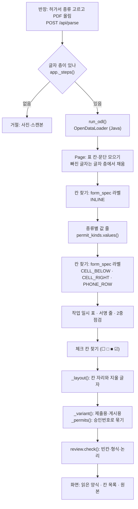
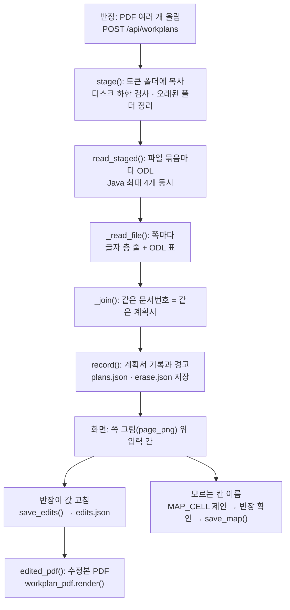

# 04c. PDF 판독 — 허가서와 작업계획서를 데이터로 읽는 법

반장이 올린 PDF를 croScan이 칸 단위 데이터로 바꾸는 방법을 적은 문서입니다. 허가서는 [`server/extract.py`](../server/extract.py)가, 작업계획서는 [`server/workplan.py`](../server/workplan.py)가 읽습니다. 두 곳 모두 올린 원본 PDF는 바꾸지 않습니다.

**이 문서에서 알 수 있는 것**
- 허가서 PDF가 표 칸 → 양식 칸(`fields`)으로 바뀌는 순서와, 칸마다 남는 정보(값, 원래 값, 자리)
- 같은 허가서의 사본과 서로 다른 허가서를 가르는 법, 승인번호·작업표준 번호의 형식 규칙
- `review.check()`가 찾아 주는 빈칸·형식·논리 문제와 화면에 보이는 모습
- 작업계획서 여러 개를 한 번에 받아 문서번호로 묶고, 고친 값을 저장하고, 수정본 PDF를 만드는 법
- 판독이 못 하는 것, 해 볼 샘플, 시험 도구(어느 것이 Java를 쓰는지)

## 목차
1. [무엇을](#1-무엇을)
2. [왜](#2-왜)
3. [어떻게: 전체 흐름](#3-어떻게-전체-흐름)
4. [허가서: 받기와 거절](#4-허가서-받기와-거절)
5. [허가서: 표 읽기](#5-허가서-표-읽기)
6. [허가서: 칸 찾기](#6-허가서-칸-찾기)
7. [허가서: 칸 모델](#7-허가서-칸-모델)
8. [허가서: 쪽 구분과 승인번호](#8-허가서-쪽-구분과-승인번호)
9. [허가서: 형식 검사와 화면](#9-허가서-형식-검사와-화면)
10. [원본 불변](#10-원본-불변)
11. [작업계획서: 받기](#11-작업계획서-받기)
12. [작업계획서: 칸 읽기](#12-작업계획서-칸-읽기)
13. [작업계획서: 계획서로 묶기](#13-작업계획서-계획서로-묶기)
14. [작업계획서: 쪽 그림, 고친 값, 칸 연결](#14-작업계획서-쪽-그림-고친-값-칸-연결)
15. [작업계획서: 보관과 정리](#15-작업계획서-보관과-정리)
16. [작업계획서: 수정본 PDF](#16-작업계획서-수정본-pdf)
17. [코드 어디](#17-코드-어디)
18. [시험과 샘플](#18-시험과-샘플)
19. [한계](#19-한계)

---

## 1. 무엇을

croScan은 PDF 두 가지를 읽습니다.

| 문서 | 누가 올리나 | 읽는 곳 | 결과 |
|---|---|---|---|
| 위험작업 허가서(화기·밀폐·고소·중량물인양·정전/LOTO) | 반장, 한 번에 파일 1개 | [`extract.py`](../server/extract.py) `build()` | 쪽마다 양식 칸 모델(`pages`, `fields`, `permits`) |
| 작업계획서(그날 할 일을 적은 서류) | 반장, 한 번에 여러 파일 | [`workplan.py`](../server/workplan.py) `stage()` → `read_staged()` | 계획서 한 건마다 기록(`plans`)과 편집용 칸 모델(`doc`) |

- **판독**은 PDF의 표 칸과 글을 읽어 「이 칸은 승인번호, 값은 이것」처럼 칸 데이터로 바꾸는 일입니다.
- 읽은 값은 화면에서 반장이 고칠 수 있습니다. croScan은 처음 읽은 값(`original`)을 따로 남깁니다.
- croScan은 판독 결과로 작업을 승인하거나 막지 않습니다. 판독은 질문과 검토의 재료일 뿐입니다.

## 2. 왜

- **전산 PDF에는 글자 층이 있습니다.** 글자 층은 PDF 안에 들어 있는 글자 데이터입니다. 회사 전산에서 뽑은 허가서·계획서는 글자 층이 있어서, 사진을 글자로 바꾸는 OCR 없이 정확히 읽을 수 있습니다. 그래서 글자 층이 없는 스캔본은 받지 않습니다. 글자를 짐작해 읽지 않기 위해서입니다.
- **표 구조가 뜻을 정합니다.** 허가서는 「작업장소(LOCATION) :」 옆이나 아래 칸에 값을 적는 표 양식입니다. 그래서 칸의 행·열·병합 정보를 주는 한컴 **OpenDataLoader**(ODL, PDF 표를 읽는 Java 프로그램)를 씁니다. ODL은 서버 안에서 로컬 모드로 돕니다. ODL이 빠뜨린 글자만 PyMuPDF(파이썬 PDF 라이브러리)로 글자 층에서 채웁니다.
- **인쇄된 양식 글자만 씁니다.** 칸을 찾는 기준은 양식에 인쇄된 라벨·항목 이름·단위뿐입니다. 채워진 허가서에서 값을 베껴 규칙을 만들지 않았습니다([`form_spec.py`](../server/form_spec.py) 머리말).
- **종류는 반장이 고릅니다.** 다섯 종류 허가서는 제목과 「추가정보」 칸만 다릅니다. croScan은 종류를 PDF에서 짐작하지 않습니다([`permit_kinds.py`](../server/permit_kinds.py) 머리말).
- **원본은 공식 서류입니다.** 그래서 croScan은 올린 파일을 한 글자도 바꾸지 않습니다. 화면 그림과 반영본은 모두 사본 위에 그립니다([10절](#10-원본-불변)).
- **작업계획서는 묶음으로 옵니다.** 업체마다 하루에 여러 건을 냅니다. 한 파일에 여러 건이 있거나, 한 건이 여러 파일로 나뉘기도 합니다. 그래서 파일 단위가 아니라 쪽마다 찍힌 문서번호로 계획서를 묶습니다.

## 3. 어떻게: 전체 흐름

### 3.1 허가서

### 3.2 작업계획서

---

## 4. 허가서: 받기와 거절

`POST /api/parse`는 PDF 파일과 종류(`kind`)를 받습니다([04b §2](04b_API.md#2-문서-업로드판독)).

1. 종류가 `permit_kinds.KINDS`의 5개(`confined`·`hot`·`height`·`lifting`·`loto`) 가운데 하나가 아니면 400으로 거절합니다.
2. 파일을 임시 폴더에 쓰고 `app._steps()`가 읽습니다. 읽기가 끝나면 임시 폴더는 지워집니다.
3. `_steps()`는 진행 상황을 한 줄씩 보냅니다(NDJSON, 한 줄에 JSON 하나). 화면의 불러오기 화면이 이 줄을 그대로 보여 줍니다.

| 단계(`step`) | 하는 일 | 화면 문구 예 |
|---|---|---|
| `open` | PyMuPDF로 열고 모든 쪽의 글자 수를 셈 | `PDF 1쪽 확인 (글자 층 있음)` |
| `error` | 글자가 0자면 멈춤 | `글자 층이 없는 PDF입니다(사진·스캔본). 전산 허가서 PDF를 올려 주세요.` |
| `odl` | `run_odl()` 실행, 표 칸 수를 셈 | `한컴 OpenDataLoader: 표 칸 N개 읽음` |
| `map` | `build()`로 칸 모델을 만듦 | `1쪽 밀폐(제출용) → 허가서 1건 · 값 X/Y칸, 체크 항목 Z개` |
| `review` | `review.check()` | `규칙 검사: 확인할 곳 N건` |
| `done` | 칸 모델 전체(`doc`)를 보냄 | — |

- 어느 단계에서든 예외가 나면 `읽기 실패: …` 줄을 보내고 멈춥니다. 화면은 깨진 쪽 대신 이 문구를 보여 줍니다.
- `map` 줄은 결과를 셉니다. 승인번호가 여럿이면 「서로 다른 허가서 N건」, 한 번호가 여러 쪽이면 「같은 허가서의 사본 N장」입니다.

## 5. 허가서: 표 읽기

### 5.1 run_odl()

`run_odl(pdf_path)`는 `opendataloader_pdf.convert(..., format="json")`을 임시 폴더에서 부르고, 나온 JSON 하나를 돌려줍니다. ODL JSON은 나무 모양입니다. 마디(`kids`, `rows`, `cells`, `list items`)마다 `type`, `page number`, `bounding box`(PDF 좌표의 [왼, 아래, 오른, 위])가 있습니다.

| ODL 마디 `type` | croScan이 쓰는 값 |
|---|---|
| `table` | `number of rows` (한 쪽에 표가 여럿이면 행 번호를 이어 붙이는 데 씀) |
| `table cell` | `row number`, `column number`, `row span`, `column span`, `bounding box`, 안의 `kids` |
| `paragraph` · `heading` · `caption` · `list item` · `text block` (`TEXT_TYPES`) | `content` (글) |
| `image` | `bounding box` (손글씨·서명 그림 자리) |

`_walk()`가 이 나무를 모두 돌며 마디와 쪽 번호를 하나씩 내줍니다.

### 5.2 Page: 쪽 하나의 칸 목록

`Page(no, page, odl_json)`는 한 쪽의 표 칸을 모읍니다.

- 칸 하나는 `{"id", "r", "c", "rs", "cs", "box", "paras", "images", "src"}`입니다. `r`·`c`는 행·열, `rs`·`cs`는 병합 크기입니다.
- `box`는 `_box()`가 위가 0인 좌표(화면 좌표, 단위 pt)로 뒤집은 [x0, y0, x1, y1]입니다.
- `paras`는 칸 안의 문단 글, `images`는 칸 안 그림의 자리, `src`는 문단마다 어디서 읽었는지(`odl` 또는 `pdf`)입니다.
- 한 쪽에 표가 둘 이상이면 앞 표의 행 수(`roff`)를 더해 행 번호가 겹치지 않게 합니다.
- 표 밖의 글은 `outside`에 따로 모읍니다. 쪽 머리글(제출용·게시용)을 볼 때 씁니다.

**빠진 글자 채우기** `_fill_from_text_layer()`: ODL이 칸 글을 빠뜨릴 때가 있습니다. 그래서 글자 층의 글자를 한 글자씩 봅니다. 글자 가운데가 칸 안에 있으면 그 칸의 글자로 칩니다. 두 칸의 글이 한 줄로 이어져 있어도 칸 경계에서 잘립니다. 칸 글(빈칸 제거)에 아직 없는 글만 새 문단으로 더하고 `src`에 `pdf`를 적습니다.

### 5.3 칸 사이 관계

| 함수 | 뜻 |
|---|---|
| `at(r, col)` | 행 r, 열 col을 덮는 칸(병합 포함) |
| `below(c)` | 칸 c 바로 아래 칸 = `at(r + rs, c)` |
| `right(c)` | 칸 c 바로 오른쪽 칸 = `at(r, c + cs)` |
| `find(pattern)` | 정규식이 맞는 첫 칸과 문단 번호 |

라벨을 `find()`로 찾고, 값 칸은 `below()`·`right()`로 갑니다. 그래서 칸 크기나 위치가 조금 달라도 표 구조만 같으면 읽힙니다.

## 6. 허가서: 칸 찾기

`build(pdf_path, kind, odl=None)`가 쪽마다 아래 순서로 칸을 만듭니다. 처음에는 모든 문단이 평범한 글(`{"t": "text"}`)입니다. 칸을 찾을 때마다 그 부분을 칸 조각(`{"t": "field"}`, `{"t": "check"}`)으로 바꿉니다. 이 조각 목록(`segs`)이 나중에 칸 자리 계산(`_layout()`)의 재료가 됩니다.

### 6.1 칸 찾는 규칙

| 순서 | 규칙 (form_spec 이름) | 개수 | 찾는 법 | 예 |
|---|---|---|---|---|
| 1 | `INLINE` | 8 | 한 문단 안에서 라벨 뒤의 글이 값 | `승인번호(PERMIT NO.) : AC00-…` |
| 2 | `permit_kinds.values(kind)` | 종류마다 3 | 인쇄된 라벨과 단위 사이의 글이 값(`number`) | `- 테스트압력(TEST PRESSURE): ___ BAR/KG` |
| 3 | `CELL_BELOW` | 4 | 라벨 칸 바로 아래 칸 전체가 값 | 작업장소(상세), 작업내용(상세), 유해위험요소, 병행여부 |
| 4 | `CELL_RIGHT` | 2 | 라벨 칸 바로 오른쪽 칸 전체가 값 | 작업부서, 허가구분 |
| 5 | `PHONE_ROW` | 2 | 라벨 오른쪽 칸에서 `연락처: … / TRS: …`의 가운데 | 작업책임자·관리자 연락처 |
| 6 | 작업 일시 표 | 최대 7행 × 3 | 아래 6.2 | `date_1`·`from_1`·`to_1` |
| 7 | `SIGN_ROWS` | 3줄 × 3 | 아래 6.3 | 허가신청, 전산승인, 안전대면허가 |
| 8 | `DOUBLE_CHECK` | 1 | `2중점검 대상 :` 뒤의 글 | `Y` |
| 9 | `EXTRA_MEASURES` | 1 | 라벨 아래 칸 전체(그림 칸) | 추가조치 요청사항(안전요원) |
| 10 | `CHECKS` + `permit_kinds.checks(kind)` | 10 + 종류마다 16 | 아래 6.4 | `■주간`, `☐환기(VENTILATION)` |

- 라벨 정규식은 띄어쓰기를 너그럽게 봅니다(`\s*`). 예: `작업장소\s*\(LOCATION\)\s*:`.
- `INLINE_TAIL`: 작업인원 값 뒤의 `명`은 값이 아니라 인쇄된 글로 남깁니다.
- 작업내용(`job`)과 작업장소(`location`)는 값이 길어 다음 줄로 넘어가면, 같은 칸의 다음 문단까지 값에 붙입니다.
- 종류마다 꼭 적어야 하는 값 줄이 다릅니다(`KINDS[kind]["required"]`). 고소는 `work_height`, 중량물인양은 `load_weight`·`crane_swl`, 정전·LOTO는 `rated_voltage`입니다. 밀폐·화기는 없습니다.

### 6.2 작업 일시 표

1. `일(DATE)`, `시작(FROM)`, `종료(TO)` 머리 칸 세 개를 찾습니다. 하나라도 없으면 이 표는 건너뜁니다.
2. 세 칸에서 동시에 한 칸씩 아래로 내려갑니다. 최대 `DATE_ROWS` = 7행입니다.
3. 아래 칸이 없거나, 칸 글에 `유해위험요소`가 나오면(다음 구역) 멈춥니다.
4. i번째 행은 `date_i`(`date`), `from_i`(`time`), `to_i`(`time`) 칸이 됩니다. 이름은 「i일차 작업일/시작/종료」입니다.

빈 행도 7행까지 칸으로 만듭니다. 그래야 반장이 화면에서 빈 행에 값을 적을 수 있습니다.

### 6.3 서명 줄

`허가신청`·`전산승인`·`안전대면허가` 라벨 칸에서 오른쪽으로 다섯 칸을 차례로 갑니다: 이름 칸 → 「일시」 라벨 → 일시 칸 → 「서명」 라벨 → 서명 칸. 이름·일시·서명 세 칸이 값입니다(예: `req_name`, `req_date`, `req_sign`). 칸에 그림만 있고 글이 없으면 `image` 칸이 됩니다.

### 6.4 체크 칸

- 체크 글리프(글자 모양)는 네 가지만 봅니다(`GLYPHS`): `☐`·`□`는 빈칸, `■`·`☑`는 체크입니다.
- 항목마다 「글리프 + 항목 이름」 정규식을 만듭니다. 항목 이름 글자 사이의 띄어쓰기는 너그럽게 봅니다.
- 한 문단에 체크 칸이 여럿 있어도 됩니다. 맞은 자리를 앞에서부터 정렬하고, 앞 칸과 겹치는 자리는 건너뜁니다.
- 이미 칸이 된 부분(예: 같은 줄의 값 칸)은 다시 보지 않습니다. 같은 항목은 쪽마다 처음 맞은 것 하나만 씁니다.
- 체크 칸은 `type: "check"`, 값은 `True`/`False`입니다. `group`은 「작업 일시」·「현장 안전조치」·「추가정보」 가운데 하나입니다.
- 「현장 안전조치」·「추가정보」 묶음(`DAY_OF_WORK_GROUPS`)은 작업 당일에 적는 칸입니다(사전 작성금지). 그래서 신청 때 비어 있는 것이 정상입니다.

### 6.5 값, 체크, 그림

| 칸 종류 | 값 | 화면 | 반영본 |
|---|---|---|---|
| 값 칸(`code`·`text`·`name`·`phone`·`count`·`number`·`date`·`time`·`yn`) | 글자 | 입력 칸 | 빈칸 채우기·고치기 가능([08](08_반영본과_별지.md)) |
| 체크 칸(`check`) | 참/거짓 | 체크 상자 | croScan이 쓰지 않음 |
| 그림 칸(`image`) | 실제 그림이 있으면 빈 글자와 그림 자리(`image`). 그림이 없으면 칸 안 글자 | 그림 그대로 | croScan이 쓰지 않음 |

`put_cell()`은 칸에 그림이 있고 그 칸의 형이 `image`일 때만 그림 칸으로 만듭니다. 그림으로 된 손글씨·서명은 글자로 읽지 않고 그림 자리만 남깁니다. 서명 칸에 글자가 있으면 글자로 읽습니다. 그림 칸도 실제 그림이 없으면 칸 안 글자가 값으로 남을 수 있습니다.

### 6.6 값 다듬기

`_cast()`가 형마다 값을 정리합니다. `check`는 참/거짓, `count`는 처음 나오는 숫자만, `yn`은 `Y`·`N`이면 대문자로 바꿉니다. 나머지는 앞뒤 빈칸만 지웁니다. 정리한 값이 `value`이자 `original`이 됩니다.

## 7. 허가서: 칸 모델

`build()`의 결과는 `{"file", "pages", "fields", "permits"}`입니다. 서버가 여기에 `findings`(규칙 검사 결과)를 더해 화면으로 보냅니다.

### 7.1 칸(fields)

열쇠는 `p{쪽}.{key}`입니다(예: `p1.permit_no`, `p2.from_3`).

| 이름 | 뜻 |
|---|---|
| `page` | 쪽 번호 |
| `key` | 칸 이름(쪽 번호 없이). 공통 칸 27개는 [`form_spec.FIELDS`](../server/form_spec.py) |
| `name` | 한국어 칸 이름(「승인번호」, 「2일차 시작」 …) |
| `type` | 형 11가지: `code`·`text`·`name`·`phone`·`count`·`number`·`date`·`time`·`yn`·`check`·`image` |
| `required` | 꼭 적어야 하는 칸인지. 공통 칸 27개 가운데 16개 + 종류별 값 줄 |
| `value` | 지금 값. 화면에서 고치면 바뀜 |
| `original` | 처음 읽은 값. 바뀌지 않음 |
| `kind` | 반장이 고른 허가서 종류 |
| `group` | 체크 칸의 묶음 |
| `image` | 그림 칸의 그림 자리 |
| `layout` | 쪽 위에서 값이 놓인 자리(아래 7.2). 그림 칸과 `double_check`에는 없음 |

양식이 모두 찾히면 한 쪽에 칸이 77개입니다: 체크가 아닌 칸 51개(공통 27 + 작업 일시 21 + 종류별 값 줄 3)와 체크 칸 26개(공통 10 + 추가정보 16)입니다. 체크가 아닌 칸 51개에는 그림 칸 4개가 들어 있습니다. `samples/시연/0612_밀폐.pdf`로 세어 확인했습니다.

### 7.2 칸 자리(layout)

`_layout()`은 칸마다 쪽 위의 자리를 계산합니다. 화면은 이 자리에 입력 칸을 겹쳐 그리고, 반영본([`reflect.py`](../server/reflect.py))은 이 자리에 파란 글씨를 씁니다.

1. 표 칸마다 글자 층 글자(`_page_chars()`: 글자, 상자, 크기, 글꼴, 굵기, 줄)를 모아 줄 → 왼쪽 순서로 놓습니다.
2. 그 칸의 조각(인쇄 글 → 값 → 체크 글리프)을 차례로 따라가며 글자 수만큼 글자를 짝짓습니다.
3. 값 글자와 글자 층 글자가 다르면 그 조각은 짝이 없는 것으로 칩니다. 값은 그대로 두고, 지울 글자만 없습니다.
4. 체크 칸은 글리프 상자가 자리입니다.
5. 칸 전체가 값이면 칸 안쪽(1pt 안)이 자리입니다. 글자가 칸 가운데에 있으면 가운데 정렬로 둡니다. `text` 칸에서 글이 여러 줄이거나 칸이 글자 크기의 2.6배보다 높으면 여러 줄 칸(`multi`)입니다.
6. 라벨 뒤 값이면 값 첫 글자(없으면 라벨 끝 + 2pt)부터 같은 줄의 다음 인쇄 글(없으면 칸 끝 - 2pt)까지가 자리입니다. 최소 너비는 24pt입니다.

`layout`에 남는 값은 `box`, `size`, `font`, `bold`, `align`, `pad`, `multi`, 그리고 여러 줄이면 `top`·`lh`(줄 간격)·`indent`입니다. 값 글자를 찾았으면 그 글자 상자들이 `glyphs`에 남습니다. 반영본이 값을 바꿀 때 지우는 글자가 바로 이것입니다.

- `READONLY` = `double_check`: QR 코드 옆에 시스템이 찍는 값이라 자리를 만들지 않고 인쇄된 그대로 보여 줍니다.
- 그림 칸이 있는 표 칸은 자리를 만들지 않습니다.

### 7.3 쪽(pages)

| 이름 | 뜻 |
|---|---|
| `no` | 쪽 번호 |
| `variant`, `variant_label`, `variant_how` | 제출용·게시용과 그렇게 본 이유([8절](#8-허가서-쪽-구분과-승인번호)) |
| `kind`, `kind_label`, `kind_title` | 고른 종류, 짧은 이름, 양식 제목 |
| `permit_no` | 그 쪽의 승인번호 |
| `width`, `height` | 쪽 크기(pt) |
| `image` | 원본 쪽 그림(PNG, 3배 = 216dpi, `SCALE`) |
| `background` | 편집 가능한 값 글자를 지운 쪽 그림. 입력 칸이 그 자리에 놓임 |

`background`는 그림에서만 글자를 지웁니다. `_pixmap()`이 지울 상자 둘레 픽셀에서 가장 많은 색(종이 색)으로 상자를 칠합니다. PDF는 고치지 않습니다.

## 8. 허가서: 쪽 구분과 승인번호

### 8.1 제출용과 게시용

같은 허가서를 「안전부서 제출용」과 「현장 게시용」 두 장으로 뽑기도 합니다. `_variant()`가 쪽마다 정합니다.

1. 쪽 글자(표 밖 글 포함)에 `[현장 게시용]` 머리글이 있으면 게시용, `[안전부서 제출용]`이 있으면 제출용입니다.
2. 머리글이 없으면 「안전대면허가」 줄로 정합니다. 이 줄은 제출용에만 인쇄되기 때문입니다.
3. 머리글과 칸 구성이 서로 맞지 않으면(게시용 머리글인데 안전대면허가 줄이 있음 등) 이유 끝에 「확인 필요」를 붙입니다.

이유는 `variant_how`에 글로 남습니다. 예: `머리글 [안전부서 제출용]`, `머리글 없음 → 안전대면허가 칸이 있어 제출용으로 판단`.

### 8.2 사본인가, 다른 허가서인가

`_permits()`는 쪽을 승인번호(앞뒤 빈칸 제거, 대문자)로 묶습니다.
- 같은 번호의 여러 쪽 = **한 허가서의 사본**입니다. `copies`에 쪽마다 제출용·게시용이 적힙니다.
- 번호가 다르면 **다른 허가서**입니다.
- 번호가 없는 쪽은 `(번호 없음 N쪽)`으로 따로 둡니다.

화면의 쪽 단추는 `1쪽 · 제출용 (사본 1/2)`처럼 보입니다. 사본끼리는 값이 같아야 합니다. 다르면 `review.check()`가 알려 줍니다(9.2).

### 8.3 번호 형식

서버의 `code` 형식은 「영문 대문자·숫자 구간을 하이픈으로 이음」(`[A-Z0-9]+(?:-[A-Z0-9]+)*`)뿐입니다. 화면([`web/app.js`](../web/app.js) `CODE_RULES`, `codeProblem()`)은 세 칸에 더 자세한 규칙을 씁니다. 코드 주석에 적힌 대로 실제 번호가 다양한 곳은 일부러 느슨하게 둔 시연용 도움입니다. 회사의 전체 번호 기준은 아닙니다.

| 칸 | 예 | 화면 규칙 |
|---|---|---|
| 승인번호 `permit_no` | `AC00-IH-20261014-0400` | 하이픈으로 나눈 4구간. ① 영문 대문자 2 + 숫자 2 ② 영문 대문자 2 ③ 숫자 8자리, 실제 있는 날짜(연월일) ④ 숫자 4자리(앞 0 포함) |
| 호선/공사 `hull_no` | `3612-B21S` | 첫 구간 숫자 4자리(호선), 뒤에 하이픈과 구간이 하나 이상 |
| 작업표준(JSP) `jsp_no` | `HHIS-CW-A0001190-012-001` | 첫 구간 `HHIS`, 뒤에 하이픈과 구간이 하나 이상 |

세 칸 모두 영문 대문자·숫자·하이픈만 쓰고, 하이픈 사이가 비면 안 됩니다. 형식이 맞으면 화면이 「형식 확인 (번호 형식만 맞음 · 원본·실제 번호 대조는 아님)」이라고 보여 줍니다. croScan은 번호를 회사 전산과 대조하지 않습니다.

## 9. 허가서: 형식 검사와 화면

### 9.1 형식(valid)

[`review.py`](../server/review.py) `valid(ftype, v)`와 화면 `valid()`가 같은 형식표를 씁니다. 빈 값, `text`·`check`·`image`는 언제나 통과입니다.

| 형 | 형식 | 더 보는 것 |
|---|---|---|
| `code` | `A1-B2`처럼 대문자·숫자 구간을 하이픈으로 이음 | 화면은 세 칸에 8.3의 규칙 |
| `phone` | `0` + 1~2자리 - 3~4자리 - 4자리. `X`(가린 숫자) 허용 | — |
| `count` | 숫자 1~3자리 | — |
| `number` | 소수 허용 숫자 | — |
| `date` | `YYYY-MM-DD` | 서버는 실제 있는 날짜인지도 봄 |
| `time` | `HH:MM` | 00:00~23:59 |
| `yn` | `Y` 또는 `N` | — |
| `name` | 한글·영문 1~10자(`최XX` 같은 가린 이름 허용) | — |

화면은 입력할 때 형마다 글자를 다듬습니다(`CLEAN`). 예: `code`는 대문자로, `date`는 숫자 8개를 `2026-10-27`처럼, `time`은 숫자 4개를 `09:30`처럼 바꿉니다.

### 9.2 review.check()가 찾는 것

결과 하나는 `{"page", "keys", "kind", "msg"}`입니다. `kind`는 `blank`(빈칸)·`format`(형식)·`logic`(앞뒤가 안 맞음)·`question`(확인 필요) 가운데 하나입니다. 일부에는 `level`이 붙습니다. `page` 0은 여러 쪽에 걸친 결과입니다.

| 묶음 | 찾는 것 | kind |
|---|---|---|
| 종류 | 고른 종류의 추가정보 항목을 이 쪽에서 하나도 못 찾음 → 종류를 다시 확인 | `question`(high) |
| 칸 | 꼭 적을 칸이 빔 | `blank` |
| 칸 | 값이 형식에 안 맞음 | `format` |
| 작업 일시 | 행이 하나도 없음 / 한 행의 날짜·시작·종료 중 빈칸 | `blank` |
| 작업 일시 | 행의 날짜·시각 형식 오류 | `format` |
| 작업 일시 | 종료가 시작보다 늦지 않음 / 다음 날짜가 앞 날짜보다 앞이거나 같음 | `logic` |
| 신청·승인일 | 신청일·전산승인일이 첫 작업일보다 늦음 / 승인일이 신청일보다 빠름 | `logic` |
| 주간·야간 | 둘 다 체크 | `logic` |
| 주간·야간 | 둘 다 빔 | `blank` |
| 주간·야간 | 주간 체크인데 어떤 날 시간이 모두 22:00~다음 날 06:00 사이(근로기준법 야간) / 야간 체크인데 모든 날이 정오를 지나는 낮 시간 | `logic` |
| 추가정보 | 고소작업 체크인데 작업높이 없음 / 압력사용 체크인데 테스트압력·파이프직경 없음 | `blank` |
| 추가정보 | 인양물 중량이 크레인 정격하중을 넘음 | `logic` |
| 장소 | 작업장소에 BAY·칼럼·구역 같은 세부 위치가 없음(`PRECISE_PLACE`) | `question` |
| 병행 | 병행여부가 빔 | `question` |
| 사본 | 같은 승인번호 사본끼리 값이 다름(그림 칸 제외) | `logic` |

- 작업 일시 행과 체크 칸·그림 칸은 「꼭 적을 칸」 검사에서 뺍니다. 일시 행은 따로 봅니다.
- `check(fields, cross=True)`이면 허가서끼리의 쌍 판정 결과도 더합니다([06](06_쌍작업_판정.md)). 지금 코드에서 `cross=True`로 부르는 곳은 없습니다.
- 이 결과는 질문이 아니라 표시입니다. 질문은 [05](05_멀티턴_질문.md)의 `augment`가 만듭니다.

### 9.3 화면에 보이는 것

허가서 검토 화면에는 보기가 네 가지 있습니다: 「읽은 양식」·「칸 목록」·「원본」·「추가검토서」.

- **읽은 양식**: `background` 그림 위 `layout.box` 자리에 입력 칸과 체크 상자를 겹칩니다. 원본과 같은 모양에서 값을 고칩니다.
- **원본**: `image` 그림을 그대로 보여 줍니다.
- **칸 목록**: 칸을 줄로 늘어놓습니다.
- 고친 칸에는 「원래 값: ~~이전 값~~ 되돌리기」가 붙습니다(`original`과 비교).
- 형식이 틀린 값은 칸을 떠난 뒤 빨간 물결 밑줄과 이유 글이 붙습니다. 처음 입력하는 동안에는 보이지 않습니다. 한 번 붙은 칸은 다시 적는 중에도 계속 검사합니다.
- `review.check()` 결과가 걸린 칸은 표시(`flag`)가 붙고, 선택한 칸 카드와 칸 목록에 문구가 나옵니다. 형식 문구는 화면 자체 문구(`badMsg()`)로 보여 줍니다.
- 값을 고치면 400ms 뒤 `POST /api/review`로 다시 검사합니다.

## 10. 원본 불변

croScan은 올린 PDF를 바꾸지 않습니다. 코드에서 이 원칙이 지켜지는 곳입니다.

| 장면 | 하는 일 | 원본은 |
|---|---|---|
| 판독 | 임시 폴더에 쓴 사본을 읽고 폴더를 지움 | 반장 브라우저에만 남음 |
| 화면 그림 | `_pixmap()`이 그림 위에서만 글자를 지움 | 그대로 |
| 반영본 미리 보기 | `reflect.apply()`가 메모리에서 연 문서에 씀 (`/api/reflect/preview`) | 그대로 |
| 제출 | `addendum.pdf()`가 원본 바이트로 새 문서를 열어 반영본 + 별지를 만듦. 원본 바이트는 `original`로 따로 보관 | 그대로 |
| 작업계획서 쪽 그림 | `page_png()`가 메모리에서 연 문서에 가림(redaction)을 하고 그림만 저장 | 캐시 폴더에 그대로 |
| 작업계획서 수정본 | `workplan_pdf.render()`가 새 PDF를 그림 | 캐시 폴더에 그대로 |

반영본이 값을 바꿀 때는 그 칸의 옛 값 글자(`layout.glyphs`)만 지웁니다. 선, 로고, 인쇄된 라벨은 남습니다. 자세한 것은 [08 §4.3](08_반영본과_별지.md#43-pdf에-쓰는-법)과 [08 §10](08_반영본과_별지.md#10-양식-훼손-점검)에 있습니다.

---

## 11. 작업계획서: 받기

`POST /api/workplans`는 파일 여러 개를 받습니다. 앱 코드에는 파일 개수와 크기 제한이 없습니다. 남은 디스크만 지킵니다. 파일은 메모리에 통째로 두지 않고 디스크로 바로 흘려 씁니다.

**stage(files)**
1. 먼저 `_clean_cache()`로 오래된 업로드 폴더를 지웁니다([15절](#15-작업계획서-보관과-정리)).
2. 새 토큰(`uuid4().hex`, 16진수 32자)을 만들고 `data/workplans/{토큰}/` 폴더를 만듭니다.
3. 파일마다 `wp0000.pdf`, `wp0001.pdf` …라는 단순한 이름으로 저장합니다. 이름이 겹치거나 이상한 글자가 있어도 문제가 없습니다. 원래 파일 이름은 따로 기억합니다.
4. 저장은 `qa.copy_with_floor()`가 1MB씩 합니다. 시작할 때와 64MB마다 남은 디스크를 봅니다. `CROSCAN_DISK_FLOOR_GB`(기본 2GB)보다 적으면 멈춥니다. 서버는 507 「서버에 저장하지 못했습니다」를 돌려줍니다.
5. 중간에 실패하면 반쯤 올라간 폴더를 통째로 지웁니다.

**read_staged(token, staged)**
1. 동시에 도는 Java 수 = `WORKERS`(4), CPU 수, 파일 수 가운데 가장 작은 값입니다.
2. 한 번의 ODL 실행에 넣는 파일 수 = `BATCH`(10)와 「파일 수 ÷ 동시 수」(올림) 가운데 작은 값입니다.
3. `_odl_batch()`는 머리글·꼬리말을 포함하고(`include_header_footer=True`) 그림은 뽑지 않습니다(`image_output="off"`).
4. 묶음이 실패하면 `_odl_safe()`가 파일 하나씩 다시 읽습니다. 나쁜 PDF 하나가 나머지를 막지 않습니다. 끝내 못 읽은 파일은 「PDF를 읽지 못함」입니다.
5. 파일 하나를 읽을 때마다 `{"step": "wp_file", "i", "n", "name", "plans", "error"}` 줄을 보냅니다. 화면은 `파일 3/12 · 계획서 5건 · 못 읽은 파일 1개`처럼 보여 줍니다.
6. 모두 읽으면 **올린 순서대로** 계획서를 묶고(13절), `erase.json`(지울 글자 자리)과 `plans.json`(계획서 기록)을 저장합니다.
7. 마지막 줄은 `{"step": "wp_done", "token", "plans", "files"}`입니다. `files`에는 파일마다 쪽 수, 계획서 수, 오류가 있습니다.

## 12. 작업계획서: 칸 읽기

`_read_file()`이 파일 하나를 쪽마다 읽습니다. 표는 ODL로, 표 밖의 줄(머리글, 작업명, 공정 단계, 꼬리말)과 구역 제목은 글자 층에서 자리로 읽습니다.

### 12.1 글자 층 줄

`_lines()`가 글자 층 낱말을 세로 가운데 높이로 묶어 줄을 만듭니다(높이의 0.35배 안이면 같은 줄). 값이 따로 쓰인 글 조각이어도 라벨과 같은 줄에 들어옵니다. 각 줄에서 아래를 찾습니다.

| 찾는 것 | 규칙 | 결과 |
|---|---|---|
| 계획서 쪽인가 | 40자보다 짧은 줄에 `작업계획서`가 있음, 또는 머리글이 있음 | `is_plan` |
| 꼬리말 | `문서 n / m쪽` (`FOOT`) | `foot = (n, m)`. 그 앞 문장은 `notice` |
| 머리글 | 줄에 `문서번호` 또는 `작성·발행`이 있음 | `HEAD` 6개: 문서번호, 작업번호, 개정, 작성·발행, 계획일, 도면 배치 기준 |
| 구역 제목 | 끝의 `[…]` 메모를 뗀 줄이 `SECTIONS` 10개 가운데 하나 | 아래 표들의 구역 |
| 한 줄 항목 | 줄이 `작업명`·`공정단계`·`분류근거`(`INLINE`)로 시작 | 라벨과 값 |

`_head_fields()`는 머리글 줄을 라벨 사이로 자릅니다. 예: `문서번호: WP-1029-01 / 작업번호: D01 / 개정 R0` → `doc_no`, `work_no`, `rev`.

### 12.2 표

ODL 표마다, 표 위쪽에 가장 가까운 구역 제목이 그 표의 구역입니다. 행마다 칸 수로 나눕니다.

- **칸 2개**: 「라벨 | 값」 행입니다. ODL이 값 칸을 비워 두면 그 칸 상자 안의 글자 층 낱말로 채웁니다(`_words_in()`, `src = "text"`).
- **칸 3개 이상, 처음**: 확인 기록 표의 머리 행입니다. 열 이름이 됩니다(예: 확인 항목 | 확인값 | 확인시각 | 유효범위).
- **칸 3개 이상, 그다음**: 확인 기록 표의 행입니다.

표에 같은 라벨이 있으면 표 칸이 이깁니다. 작업명·공정 단계가 표로 그려진 양식에서도 칸의 여러 줄이 모두 들어옵니다. 쪽의 행 순서는 작업명 → 표 행 → 나머지 한 줄 항목입니다.

글자 `・`는 `·`로 바꿉니다. 같은 글꼴에서 같은 모양이고, 양식은 `·`를 뜻하기 때문입니다.

### 12.3 라벨과 열쇠

`KEYS`는 인쇄된 라벨 36개를 열쇠로 바꿉니다. 예: `작업명`→`title`, `수행업체`→`company`, `시작일시`→`start`, `작업위치`→`location`, `대상ID`→`target`, `혼재작업`→`simops`. `1단계`·`2단계`처럼 `N단계` 라벨은 `stepN`이 됩니다.

- 뒤 단계(연결·분석)가 계산에 쓰는 라벨만 열쇠가 있습니다.
- **모르는 라벨도 버리지 않습니다.** 열쇠 없이 자기 이름 그대로 남습니다. 그래서 양식이 바뀌거나 길어져도 값은 들어옵니다.
- 모르는 라벨이 어느 항목인지는 언어 모델이 **제안만** 합니다(MAP_CELL). 반장이 「연결」을 눌러야 연결됩니다(14.3). 모델이 무엇을 받고 무엇을 내는지는 [05c 라온이 하는 일](05c_라온이_하는_일.md)에 있습니다.

### 12.4 칸 자리

허가서와 같은 쪽 모델을 씁니다. 값마다 입력 칸 자리를 만듭니다.

- `_lay(rect, chars, ref)`: 값 영역의 글자로 크기·글꼴·들여쓰기·줄 간격을 정합니다. 빈 값은 라벨 글자를 따릅니다(기본 9pt).
- 지울 자리는 글자 상자 전체가 아니라 **값 줄 가운데를 지나는 얇은 띠**입니다(글자 높이의 ±12%). `page_png()`가 이 띠에 걸린 글자만 지웁니다. 선과 라벨은 남습니다.
- 머리글 값(`_head_layout()`)은 라벨 끝부터 다음 라벨(또는 그 앞 `/`)까지가 자리입니다.
- 한 줄 항목(`_inline_layout()`)은 라벨 뒤 첫 세로선부터 양식 오른쪽 끝(`_frame()`이 쪽의 선에서 잼)까지가 자리입니다.

## 13. 작업계획서: 계획서로 묶기

`_join()`이 쪽을 계획서로 묶습니다. 계획서 쪽(`is_plan`)만 봅니다.

1. 쪽에 문서번호가 있고 이미 그 번호의 계획서가 있으면, 그 계획서에 붙입니다. **다른 파일이어도 붙습니다.**
2. 문서번호가 새것이면 새 계획서를 시작합니다.
3. 문서번호가 없으면: 꼬리말이 `문서 1 / n쪽`이거나, 같은 파일 안에 앞 계획서가 없을 때(그 파일의 첫 계획서 쪽) 새 계획서를 시작합니다. 아니면 같은 파일 안의 바로 앞 계획서에 이어 붙입니다. `_join()`은 파일마다 따로 부릅니다.
4. 같은 쪽(꼬리말 n/m이 같음)이 또 들어오면 빼고, 「같은 쪽(n/m)이 또 들어와 뺌」을 경고로 남깁니다.

계획서 안에서 `_Plan.put()`이 항목을 모읍니다.
- 같은 라벨이 다른 쪽에 또 있으면(작업명, 공정 단계) 항목은 하나로 둡니다. 쪽마다 읽은 값은 `raw`에 모두 남깁니다.
- 먼저 읽은 값이 비었으면 나중 값을 씁니다. 두 값이 다르면 「'라벨' 값이 쪽마다 다름」 경고를 남깁니다.
- 확인 기록 표는 한 쪽에서 여러 개를 찾으면 마지막에 읽은 표가 남습니다. 계획서에는 표가 있는 첫 쪽의 표를 씁니다.

`record()`가 계획서 기록을 만듭니다. `files`, `pages`, 머리글 6개, `notice`, `title`, `company`(` / ` 앞부분), `start`, `end`, `location`, `target`, `steps`, `items`, `grid`, `warnings`, 그리고 편집용 `doc`이 들어갑니다.

- `start`·`end`는 `_iso()`가 `YYYY-MM-DD HH:MM`을 읽어 `2026-10-29T13:30` 꼴로 바꿉니다. 시각이 없으면 날짜만 둡니다.
- 경고: 채워진 칸이 하나도 없음(「빈 양식」), 시작·종료일시 형식을 못 읽음, 종료가 시작보다 빠름.
- 파일에 계획서 쪽이 하나도 없으면 「작업계획서 양식을 찾지 못함 (허가서나 다른 문서인지 확인)」 오류가 됩니다.

`doc()`의 칸 열쇠는 세 가지입니다. 머리글 `p{쪽}.h_{key}`, 표·한 줄 항목 `p{쪽}.r{i}`, 확인 기록 표 `p{쪽}.g{행}_{열}`. 칸은 모두 `type: "text"`입니다. 쪽마다 찍힌 같은 값(머리글, 두 번 나온 작업명)은 `same`으로 서로 이어집니다. 한 칸을 고치면 이어진 칸도 같은 값으로 읽힙니다.

`samples/시연_하루/작업계획서/WP-1029-01_동성화인텍.pdf`는 2쪽 계획서 1건, 항목 39개, 확인 기록 표 5행, 편집 칸 69개로 읽힙니다(시연 자료 기준).

## 14. 작업계획서: 쪽 그림, 고친 값, 칸 연결

### 14.1 쪽 그림(page_png)

`GET /api/workplans/{token}/{fi}/{page}.png`는 쪽을 열 때 그 쪽 그림을 그립니다.
- `bg=1`이면 `erase.json`의 띠에 가림 주석을 달고 글자만 지운 뒤 그립니다. 그림·선은 지우지 않습니다. 이 작업은 메모리에서 연 문서에만 합니다.
- 한 번 그린 그림은 토큰 폴더에 `wp0000_1.png`·`wp0000_1_bg.png`로 남겨 다시 씁니다. 임시 파일에 쓴 뒤 이름을 바꿔서, 다른 요청이 반쯤 쓴 파일을 읽지 않습니다.
- 브라우저 캐시는 12시간(`max-age=43200`)입니다.

### 14.2 고친 값(save_edits)

- 화면에서 값을 고치면 800ms 뒤 `POST /api/workplans/{token}/edits`로 **고친 값 전체**를 보냅니다. 저장은 한 번에 하나씩 차례로 나갑니다.
- `save_edits()`는 그 업로드에 있는 계획서 번호와 칸만 받습니다. 없는 번호나 칸이 하나라도 있으면 400이고, 저장된 값은 그대로입니다.
- `edits.json`은 임시 파일에 쓰고 이름을 바꿔 통째로 바꿉니다. 반쯤 쓴 파일이 생기지 않습니다.
- `edited(rec, edits)`는 고친 값을 반영한 계획서 기록을 만듭니다. 연결·분석·가져오기 등 뒤 단계는 처음 읽은 값이 아니라 이 값을 읽습니다. 고친 시각을 못 읽으면 그 시각은 비워 둡니다.
- `plan_digest()`는 계획서의 지금 값으로 만든 짧은 지문(sha256 앞 16자)입니다. 값이 바뀌면 지문이 바뀌고, 그 계획서로 만든 결과(연결 등)는 만료됩니다.

### 14.3 칸 연결(save_map)

1. `unknown_labels()`가 열쇠 없는 라벨 가운데 값이 있는 것을 고릅니다(`N단계`는 뺌).
2. `mapcell`이 「이 라벨은 그 항목인가」를 제안합니다. 화면에 「AI 제안 · 읽지 못한 칸 N개의 뜻」 상자가 나옵니다.
3. 반장이 「연결」 또는 「아님」을 누르면 `save_map()`이 `maps.json`에 `confirmed` 또는 `refused`와 시각을 적습니다. 그 계획서에 실제로 있는 열쇠 없는 라벨과 `TARGETS`(열쇠 36개)만 받습니다.
4. `load_plans()`는 `mapped()`로 확인된 연결을 적용합니다. 그 항목이 자기 라벨로 이미 값을 읽었으면 연결해도 바꾸지 않습니다. 인쇄된 라벨 아래의 값이 언제나 이깁니다.

연결은 값을 바꾸지 않습니다. 「croScan이 이 칸을 어느 항목으로 읽을지」만 바꿉니다. 그래서 고친 값(`edits.json`)과 따로 저장합니다.

## 15. 작업계획서: 보관과 정리

| 파일 (토큰 폴더 안) | 내용 |
|---|---|
| `wp0000.pdf` … | 올린 원본 |
| `plans.json` | 처음 읽은 계획서 기록 |
| `erase.json` | 쪽마다 지울 띠 |
| `edits.json` | 반장이 고친 값 |
| `maps.json` | 반장이 확인한 칸 연결 |
| `wp0000_1.png`, `wp0000_1_bg.png` … | 그린 쪽 그림 |

- **_touch(token)**: 토큰을 쓰는 요청(쪽 그림, 고친 값·연결 읽고 쓰기, 수정본, 계획서 불러오기)이 올 때마다 폴더 시각을 지금으로 바꿉니다. 토큰이 16진수 32자가 아니면 바로 거절합니다.
- **_clean_cache()**: 마지막 접근 뒤 `KEEP_H` = 168시간(7일)이 지난 폴더를 지웁니다. **새 업로드 때(`stage()`) 돕니다.** 그래서 7일이 지나도 새 업로드가 없으면 폴더는 남아 있습니다.
- 두 함수는 같은 잠금(`_tok_lock`)을 씁니다. 방금 접근한 폴더를 정리가 지우는 일은 없습니다.
- 지워진 토큰으로 요청하면 끝점마다 답이 다릅니다. 대부분은 404 「작업계획서가 만료됐습니다. 다시 올려 주세요.」입니다. 쪽 그림은 404 「작업계획서 원본이 만료됐습니다…」입니다. 고친 값 조회(`GET /edits`)는 200과 빈 객체를 돌려줍니다.
- 전체 보관 기간 표는 [12 §8](12_배포와_운영.md#8-남는-데이터)에 있습니다.

## 16. 작업계획서: 수정본 PDF

`GET /api/workplans/{token}/plan/{i}.pdf`(한 건)와 `all.pdf`(모두)가 **수정본**을 내려 줍니다. 제출할 때도 그때의 수정본을 함께 보관합니다. 이때는 반장이 고른 계획서만이 아니라 그 업로드의 계획서 전부(`edited_pdf(token)`)를 그립니다.

`edited_pdf(token, which)`:
1. `plans.json`과 `edits.json`을 읽습니다.
2. 계획서마다 첫 쪽 위쪽(120pt 안)의 첫 그림을 회사 로고로 가져옵니다(`_logo()`). 투명 마스크와 CMYK도 처리합니다.
3. 원래 값과 다른 칸 수를 셉니다(`_edit_count()`, `same`으로 이어진 칸은 한 번). 고친 것이 있으면 꼬리에 `수정본 2026-11-02 10:30 · 화면 수정 N건`을 씁니다.
4. `workplan_pdf.render()`가 새 PDF를 그립니다. 파일 이름은 `작업계획서_{작업번호}_{업체}_수정본.pdf` 또는 `작업계획서_N건_수정본.pdf`입니다.

[`workplan_pdf.py`](../server/workplan_pdf.py) `render()`는 원본 위에 덧쓰지 않습니다. 같은 양식(항목, 순서, 구역, 머리글, 로고, 꼬리말)을 **새로 깔끔하게 그립니다**.
- A4(595 × 842pt), 틀 너비 하나, 라벨 열 끝 108.3pt. 글꼴은 나눔고딕, 없으면 맑은 고딕입니다.
- 값이 한 줄에 들어가면 9.2pt, 넘치면 8.4pt로 낱말 사이에서 줄을 바꾸고 행을 높입니다. 한 줄보다 긴 낱말은 글자 단위로 자릅니다.
- 구역 제목은 회색 막대, 확인 기록 표는 4열 표로 그립니다. 792pt를 넘으면 새 쪽에 머리를 다시 그립니다.
- 머리글 빈 값은 나중에 적을 자리를 비워 둡니다.
- 꼬리말: 원본의 꼬리말 문장(`notice`, 없으면 기본 문구)과 `문서 n / m쪽`.
- `fix_tounicode()`: 나눔고딕은 `·`와 `・`, 빈칸과 줄바꿈 없는 빈칸을 같은 글리프로 그립니다. 그래서 복사·검색할 때 쓴 글자가 그대로 나오도록 글자 대응표를 고칩니다.
- `workplan.py`가 수정본을 다시 읽으면 같은 값이 나옵니다. `tools/stress_workplan.py`가 이것을 확인합니다.

원본 파일은 토큰 폴더에 그대로 있습니다. 수정본은 원본을 대신하지 않는 새 문서입니다.

---

## 17. 코드 어디

| 파일 | 함수·이름 | 하는 일 |
|---|---|---|
| [`server/app.py`](../server/app.py) | `_steps()`, `parse()` | 허가서 받기, 글자 층 검사, 진행 줄 |
| | `workplans()`, `workplan_save()`, `workplan_map()`, `workplan_page()`, `workplan_pdf_one()`, `workplan_pdf_all()` | 작업계획서 끝점 |
| | `do_review()` | `POST /api/review` → `review.check()` |
| [`server/extract.py`](../server/extract.py) | `run_odl()`, `_walk()`, `Page`, `build()`, `_cast()` | 허가서 판독 |
| | `_layout()`, `_page_chars()`, `_pixmap()`, `_png()` | 칸 자리, 쪽 그림 |
| | `_variant()`, `_permits()` | 제출용·게시용, 승인번호 묶기 |
| [`server/form_spec.py`](../server/form_spec.py) | `FIELDS`, `INLINE`, `CELL_BELOW`, `CELL_RIGHT`, `PHONE_ROW`, `SIGN_ROWS`, `CHECKS`, `DATE_ROWS` | 공통 양식 규칙 |
| [`server/permit_kinds.py`](../server/permit_kinds.py) | `KINDS`, `checks()`, `values()` | 종류 5개의 제목과 추가정보 |
| [`server/review.py`](../server/review.py) | `FORMATS`, `valid()`, `check()` | 형식·빈칸·논리 검사 |
| [`web/app.js`](../web/app.js) | `FORMATS`, `CODE_RULES`, `codeProblem()`, `valid()`, `CLEAN`, `scheduleReview()` | 화면 형식 검사, 입력 다듬기 |
| [`server/workplan.py`](../server/workplan.py) | `stage()`, `read_staged()`, `_odl_safe()`, `_read_file()`, `_join()`, `_Plan` | 작업계획서 판독 |
| | `page_png()`, `save_edits()`, `edited()`, `save_map()`, `mapped()`, `load_plans()`, `plan_digest()` | 쪽 그림, 고친 값, 칸 연결 |
| | `_touch()`, `_clean_cache()`, `KEEP_H`, `edited_pdf()` | 보관, 수정본 |
| [`server/workplan_pdf.py`](../server/workplan_pdf.py) | `render()`, `fix_tounicode()` | 수정본 그리기 |
| [`server/qa.py`](../server/qa.py) | `copy_with_floor()`, `FLOOR` | 디스크 하한 |
| [`server/mapcell.py`](../server/mapcell.py) | `prepare()` | 모르는 칸 연결 제안([05c](05c_라온이_하는_일.md)) |

**고칠 때 메모**
- 허가서 양식에 칸이 늘면 `form_spec.py`에 라벨 규칙과 `FIELDS` 한 줄을 더합니다. 종류마다 다른 칸은 `permit_kinds.py`에 둡니다. 양식 생성기([`tools/make_form.py`](../tools/make_form.py))도 같은 파일을 씁니다.
- 작업계획서에 계산에 쓸 라벨이 늘면 `workplan.KEYS`에 더합니다. 더하지 않아도 값은 자기 이름으로 들어옵니다.

## 18. 시험과 샘플

### 18.1 시험

| 도구 | 보는 것 | Java(ODL) | 언어 모델 |
|---|---|---|---|
| [`tools/check_extract.py`](../tools/check_extract.py) | 샘플 PDF를 정답표 `samples/_truth.json`(18파일·27쪽)대로 읽는지: 종류, 공통 값, 작업 일시 행, 값 줄, 체크 칸. 인자 `시연`·`보관`으로 일부만 | 필요 | 아니오 |
| [`tools/stress_extract.py`](../tools/stress_extract.py) | 무작위 값으로 새 허가서를 그려 읽기. 5종, 제출용·게시용, 파일마다 1~6건. 기본 40건 seed 1 | 필요 | 아니오 |
| [`tools/check_form_intact.py`](../tools/check_form_intact.py) | 제출본이 양식 칸과 위 여백(24pt) 밖에서 원본과 같은 픽셀인지. 인자 `<원본.pdf> <제출본.pdf> <종류>` | 필요(원본을 다시 판독) | 아니오 |
| [`tools/check_render.py`](../tools/check_render.py) | 별지·게시물 종이 출력의 쪽 나눔 | 필요 없음 | 아니오 |
| [`tools/stress_workplan.py`](../tools/stress_workplan.py) | 빈 양식에 무작위 값을 채워 7가지 방식으로 읽기: 한 파일에 한 건 / 10건 묶음 / 쪽마다 따로 섞어서 / 수정본 다시 읽기 / 같은 파일 두 번 / 빈 양식 / 허가서를 잘못 넣음. 기본 30건 seed 1 | 필요 | 아니오 |
| [`tools/probe_analyze.py`](../tools/probe_analyze.py), [`probe_load.py`](../tools/probe_load.py), [`probe_timing.py`](../tools/probe_timing.py) | 시연 하루 허가서를 판독한 뒤 모델 시간 측정 | 필요 | 필요(`probe_load`는 `--fake`로 대체 가능) |

- `check_extract.py`는 틀려도 종료 코드가 0입니다. 마지막 줄 `all: 맞음/전체`를 읽어야 합니다.
- `stress_workplan.py`는 임시 데이터 폴더(`CROSCAN_DATA`)를 써서 7일 보관 폴더가 쌓이지 않게 합니다.
- 전체 시험 목록과 돌리는 법은 [11 §4](11_시험과_평가.md#4-시험-34종)·[11 §6](11_시험과_평가.md#6-평가-도구)에 있습니다.

### 18.2 해 볼 샘플

| 폴더 | 무엇 | 올리는 곳 |
|---|---|---|
| [`samples/반장_테스트/`](../samples/반장_테스트/) | 종류별 2건씩 10건(A형: 실물 작성 습관, B형: 꼼꼼하게 씀). 모두 제출용 낱장 | 허가서 |
| [`samples/시연/`](../samples/시연/) | 대조립 합성 허가 5건(0611~0615) | 허가서 |
| [`samples/시연_하루/`](../samples/시연_하루/) | 허가서 10건, 작업계획서 40건 | 둘 다 |
| [`samples/작업계획서/`](../samples/작업계획서/) | 합성 계획서 12건 원본(24쪽 한 파일), 낱건 12개, 정리본, 빈 양식 | 작업계획서 |
| [`samples/보관/`](../samples/보관/) | 멘토 출력물 2건 복원(1쪽 제출용·2쪽 게시용) 허가서, 5건 묶음, 빈 양식 5종 | 허가서(쪽 구분·여러 건 확인용) |

- 제출용·게시용 구분을 보려면 `samples/보관/위험작업신고서_양식.pdf`(밀폐)를 올립니다. 두 쪽의 승인번호가 달라서 「서로 다른 허가서 2건」으로 읽힙니다.
- 같은 승인번호가 두 쪽에 있는 파일(한 허가서의 사본)은 `samples/`에 없습니다(`_truth.json` 18파일 기준). 빈 양식 5종은 번호가 없어 쪽마다 `(번호 없음 N쪽)`으로 따로 묶입니다.
- 여러 파일 묶기를 보려면 `samples/작업계획서/낱건_12건/`의 파일을 한꺼번에 올립니다.
- 폴더 설명 전체는 [`samples/README.md`](../samples/README.md)와 [12 §11](12_배포와_운영.md#11-samples-폴더-지도)에 있습니다.

## 19. 한계

**허가서**
- 글자 층이 없는 스캔본·사진은 읽지 않습니다. OCR은 없습니다.
- 종류를 짐작하지 않습니다. 반장이 종류를 잘못 고르면 추가정보 칸을 못 찾고, 「허가서 종류를 다시 확인하세요」만 알려 줍니다.
- 인쇄된 라벨이 `form_spec.py`와 다른 양식은 그 칸을 만들지 않습니다. 허가서에는 작업계획서의 칸 연결(MAP_CELL) 같은 우회로가 없습니다.
- 체크 글리프는 `☐`·`□`·`■`·`☑`만 압니다. `✔`나 `V` 같은 표시는 체크 칸으로 읽지 않습니다.
- 그림으로 된 손글씨·서명·안전대면허가 칸은 그림 자리만 남기고 글자로 읽지 않습니다. 글자로 적힌 서명은 읽습니다.
- 값 글자와 글자 층이 맞지 않는 칸은 옛 글자 자리(`glyphs`)가 없습니다. 반영본은 그런 칸의 값을 바꾸지 않고, 「원본 글자 위치를 몰라 반영본에 넣지 못함」으로 따로 적습니다([08](08_반영본과_별지.md#4-어떻게-어느-칸에-무엇을)).
- 같은 승인번호 사본끼리 값을 비교하는 검사(9.2)를 직접 돌려 볼 샘플 파일이 없습니다(18.2).
- 작업 일시 표는 7행까지만 읽습니다. 자정을 넘는 행(예: 22:00~02:00)은 「종료가 시작보다 늦지 않음」으로 표시됩니다.
- 번호 형식 검사는 형식만 봅니다. 회사 전산의 실제 번호와 대조하지 않습니다.
- 허가서 판독 요청에는 디스크 하한 검사와 크기 제한이 없습니다. 파일 전체를 메모리로 받습니다.

**작업계획서**
- 글자 층 검사가 따로 없습니다. 스캔본은 「작업계획서 양식을 찾지 못함 (허가서나 다른 문서인지 확인)」으로 나옵니다.
- 모든 칸이 `text`입니다. 형식 검사는 시작·종료일시를 읽을 수 있는지와 앞뒤 순서만 봅니다.
- 문서번호가 없는 쪽은 꼬리말 `문서 1 / n쪽`에 기대어 묶습니다. 둘 다 없으면 같은 파일 안의 바로 앞 계획서에 붙습니다. 그 파일의 첫 계획서 쪽이면 새 계획서가 됩니다.
- 확인 기록 표는 계획서마다 하나만 씁니다(표가 있는 첫 쪽의 것).
- 수정본은 croScan이 다시 그린 양식입니다. 원본과 픽셀이 같은 문서가 아닙니다.
- 올린 파일은 마지막 접근 뒤 7일까지만 보장합니다. 실제로 지우는 때는 다음 업로드 때입니다.

**코드에서 본 어긋남** (2026-11-02 코드 기준)
- `review.check()`의 `cross=True` 갈래(허가서끼리 쌍)는 부르는 곳이 없습니다. 그 안에서 만드는 `clash`도 쓰이지 않습니다.
- 승인번호·호선·작업표준의 자세한 규칙(`CODE_RULES`)은 화면에만 있습니다. 서버 `valid()`는 일반 `code` 형식만 봅니다. 그래서 `AB-1` 같은 값은 화면에서는 틀림, `review.check()`에서는 통과입니다.
- 날짜가 실제로 있는지는 서버만 봅니다(화면 `FORMATS.date`는 모양만 봄). 원본 값이 `2026-02-30`이면 칸에 표시는 붙지만, 화면 문구는 서버 형식 문구를 빼고 보여 주므로 이유 글이 나오지 않습니다.
- `review.work_days()`는 7행을 숫자로 적어 두었습니다(`range(1, 8)`). `form_spec.DATE_ROWS`를 바꾸면 함께 바꿔야 합니다.
