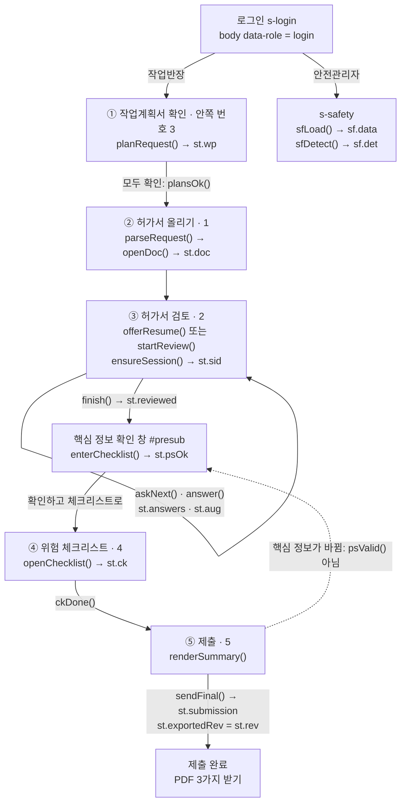
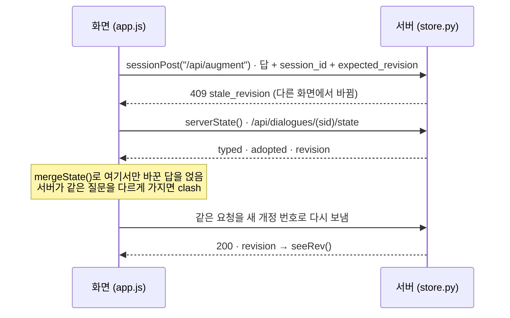

# 04d 화면 코드 구조

croScan 화면은 빌드 도구 없이 쓴 HTML·CSS·JavaScript 파일 다섯 개입니다. 이 문서는 그 파일들이 안에서 어떻게 짜여 있는지 적습니다. 화면 모양은 [02](02_화면시연_반장.md)·[03](03_화면시연_안전관리자.md)이, 서버 주소는 [04b API](04b_API.md)가 다룹니다. 여기서는 그 사이의 코드를 설명합니다.

**이 문서에서 알 수 있는 것**
- [`web/app.js`](../web/app.js) 6,091줄이 어떤 순서의 구역으로 나뉘는지, 상태 객체 `st`·`sf`·`pick`·`qa`에 무엇이 들어 있는지
- 화면의 5단계 번호와 코드 안쪽 번호가 왜 다른지(`goStep(2)`가 화면의 ③ 허가서 검토)
- 검토 대화, 핵심 정보 확인 창, 체크리스트, 제출, 안전관리자 화면이 각각 어떤 함수로 그려지는지
- 서버와 개정 번호를 맞추는 법, 브라우저에 남기는 임시저장과 그 열쇠(키) 목록
- 보기 설정·좁은 화면·접근성·알림·판 번호(`?v=`)·[`web/style.css`](../web/style.css) 구조의 약속

## 목차
1. [무엇을: 화면 파일 다섯 개](#1-무엇을-화면-파일-다섯-개)
2. [왜: 빌드 없이 파일 그대로](#2-왜-빌드-없이-파일-그대로)
3. [어떻게: app.js의 구역 순서](#3-어떻게-appjs의-구역-순서)
4. [어떻게: 상태 객체](#4-어떻게-상태-객체)
5. [어떻게: 화면 전환과 5단계 번호](#5-어떻게-화면-전환과-5단계-번호)
6. [어떻게: 핵심 정보 확인 창](#6-어떻게-핵심-정보-확인-창)
7. [어떻게: 검토 대화 그리기](#7-어떻게-검토-대화-그리기)
8. [어떻게: 서버와 개정 번호 맞추기](#8-어떻게-서버와-개정-번호-맞추기)
9. [어떻게: 임시저장과 이어서 하기](#9-어떻게-임시저장과-이어서-하기)
10. [어떻게: 문서 보기](#10-어떻게-문서-보기)
11. [어떻게: 작업계획서 목록](#11-어떻게-작업계획서-목록)
12. [어떻게: 위험 체크리스트 화면](#12-어떻게-위험-체크리스트-화면)
13. [어떻게: 제출 화면과 PDF](#13-어떻게-제출-화면과-pdf)
14. [어떻게: 안전관리자 화면](#14-어떻게-안전관리자-화면)
15. [어떻게: 근거 지도 페이지](#15-어떻게-근거-지도-페이지)
16. [어떻게: 보기 설정](#16-어떻게-보기-설정)
17. [어떻게: 휴대폰과 좁은 화면](#17-어떻게-휴대폰과-좁은-화면)
18. [어떻게: 접근성](#18-어떻게-접근성)
19. [어떻게: 알림과 의견 보내기](#19-어떻게-알림과-의견-보내기)
20. [어떻게: 파일 판 번호 규칙](#20-어떻게-파일-판-번호-규칙)
21. [어떻게: style.css 구조](#21-어떻게-stylecss-구조)
22. [코드 어디](#22-코드-어디)
23. [시험](#23-시험)
24. [한계](#24-한계)

> 이 문서의 줄 수·숫자·이름은 2026-11-02 코드 기준입니다. 줄 번호는 코드를 고치면 바뀝니다. 이름으로 찾는 편이 안전합니다(`grep -n "function goStep" web/app.js`).

---

## 1. 무엇을: 화면 파일 다섯 개

| 파일 | 줄 수 | 하는 일 |
|---|---|---|
| [`web/index.html`](../web/index.html) | 557 | 화면의 뼈대입니다. 모든 화면(`section.screen`)과 대화상자, 아이콘 그림 31개(`<symbol id="i-…">`)가 이 한 파일에 있습니다. |
| [`web/app.js`](../web/app.js) | 6,091 | 화면의 동작 전부입니다. 반장 5단계, 안전관리자 화면, 보기 설정, 대화상자를 모두 이 파일이 맡습니다. 최상위 `function` 선언만 343개입니다. 화살표 함수는 따로 있습니다. |
| [`web/style.css`](../web/style.css) | 2,074 | 모양입니다. 색·글꼴·크기 값(토큰)과 화면별 규칙이 있습니다. |
| [`web/evidence.html`](../web/evidence.html) | 68 | 「근거 지도」 전체 화면입니다. 자기 `<style>`을 조금 더 씁니다. |
| [`web/evidence.js`](../web/evidence.js) | 44 | 근거 지도 표를 그립니다. 읽기만 합니다. |

서버는 `/`에 `index.html`을, `/static/…`에 `web/` 폴더 파일을 그대로 줍니다([04b §8](04b_API.md#8-qa운영)). 글꼴(`web/fonts/`)과 로고 그림도 같은 폴더에 있습니다. 색과 글꼴을 고른 까닭은 [DESIGN.md §2 색](../DESIGN.md#2-색)과 [§3 글꼴과 글자 크기](../DESIGN.md#3-글꼴과-글자-크기)에 있습니다. 이 문서는 그 값을 되풀이하지 않습니다.

`index.html`의 큰 틀은 다음 순서입니다.

| 순서 | 무엇 | 요소 |
|---|---|---|
| 1 | `<head>`: 글꼴 미리 받기, `style.css?v=…`, 그리고 첫 그림 전에 보기 설정을 입히는 짧은 스크립트 | `localStorage`의 `croscan.view`를 읽어 `<html>`에 `data-*`를 붙임 |
| 2 | 「본문으로 건너뛰기」 링크와 아이콘 묶음 | `.skip`, `<svg style="display:none">` |
| 3 | 위쪽 막대: 로고, 단계 표시, 도구 버튼(글자 크기·보기 설정·도움말·의견 보내기) | `header.appbar`, `#stepper`, `.appbar-tools` |
| 4 | 화면들 | `#main` 안의 `s-login` `s-upload` `s-safety` `s-load` `s-edit` `s-plans` `s-check` `s-submit` |
| 5 | 대화상자 넷 | `#viewset`(보기 설정) `#help`(도움말) `#qa`(의견 보내기) `#presub`(핵심 정보 확인 창) |
| 6 | 알림 한 줄과 스크립트 | `#toast`, `app.js?v=…` |

> 낯선 말: **DOM**은 브라우저가 HTML을 읽어 만든 화면 요소의 나무입니다. **상태(state)**는 지금 화면이 기억하는 값입니다. **localStorage**는 브라우저가 이 기기에만 남기는 작은 저장 공간입니다.

---

## 2. 왜: 빌드 없이 파일 그대로

- **한 사람이 열어 바로 고칩니다.** React 같은 틀이나 묶음 도구(빌드)를 쓰지 않습니다. 파일을 고치고 새로 고침하면 바로 보입니다. 스테이징 서버도 `web/` 폴더를 그대로 붙여 씁니다([12 §6](12_배포와_운영.md#6-스테이징과-운영)).
- **판정은 서버가 합니다.** 화면은 서버가 준 질문·체크리스트·쌍 판정을 보여 주고, 반장과 안전관리자의 선택을 모아 보냅니다. 그래서 화면 코드에는 위험 판정 규칙이 없습니다. 화면이 스스로 정하는 것은 보여 주는 순서와 확인 표시 정도입니다.
- **현장에서 씁니다.** 40~60대 반장이 장갑을 끼고, 햇빛 아래에서, 휴대폰으로도 씁니다. 그래서 글자 크기·고대비·큰 버튼(장갑 모드)·좁은 화면 처리가 코드 곳곳에 있습니다([DESIGN.md §5](../DESIGN.md#5-사람을-배려하는-기능)).
- **고친 이력이 남습니다.** 화면은 QA(사람이 써 보고 고칠 점을 적은 것)를 여러 차례 거쳤습니다. 번호는 #108까지 있습니다. 코드와 CSS의 `QA #번호` 주석이 그 이력입니다. 주석을 지우지 않고 남겨 두었습니다.

---

## 3. 어떻게: app.js의 구역 순서

### 3.1 구역

`app.js`는 `// ------…` 줄로 구역을 나눕니다. 위에서 아래로 읽으면 반장의 일 순서와 거의 같습니다.

| 줄(대략) | 구역 | 대표 이름 |
|---|---|---|
| 1–93 | 공용 도구: 상태 `st`, 값 형식 검사, 번호 규칙, 알림 | `st` `bump` `FORMATS` `CODE_RULES` `codeProblem()` `toast()` |
| 94–230 | 화면 전환, 5단계 표시, 로그인, 위쪽 막대 맞추기 | `SCREENS` `show()` `STEP_ORDER` `POS` `canGo()` `paintStepper()` `goStep()` `setRole()` `showLogin()` `fitAppbar()` |
| 231–278 | 읽는 중 화면: 서버가 단계마다 보내는 진행 줄 | `PERMIT_STEPS` `PLAN_STEPS` `resetSteps()` `streamLines()` |
| 279–428 | ② 허가서 올리기: 종류 고르기, PDF 1개, 서버로 보내기 | `pick` `openFile()` `fileHash()` `parseRequest()` `openDoc()` |
| 429–570 | ① 작업계획서 올리기와 다시 읽은 계획서 합치기 | `addPlans()` `planRequest()` `mergePlans()` `applyDraftPlans()` `openPane()` `phonePane()` |
| 571–648 | 문서 도구 막대: 문서·쪽·보기 바꾸기 | `D()` `showDoc()` `stepPage()` `renderTabs()` `setView()` |
| 649–754 | 쪽 보기: 확대·축소와 끌어 옮기기 | `setZoom()` `stepZoom()` `fit()` |
| 755–1202 | 양식 그리기: 칸 입력, 칸 목록, 표시 색 | `render()` `renderFieldList()` `renderFieldSplit()` `bigControl()` `fieldInput()` `decorate()` `reflectPreview()` |
| 1203–1291 | 고른 칸 카드, 고친 칸 세기, 고친 값 다시 검사 | `openInspector()` `editCount()` `scheduleReview()` `scheduleDelta()` |
| 1292–2103 | ③ 확인 질문 대화 | `bubble()` `ensureSession()` `serverState()` `mergeState()` `sessionRead()` `sessionPost()` `refreshAug()` `askNext()` `choicesFor()` `answer()` `readCard()` `editAnswer()` |
| 2104–2306 | 칸 고치기: 채팅 입력칸으로 양식 칸을 고침 | `selectField()` `editField()` `applyEdit()` `exitEdit()` `relinkPermit()` |
| 2307–2597 | 임시저장·이어서 하기, AI 분석, 계획서 연결 제안, 대화 시작, 입력칸 보내기 | `saveDraft()` `offerResume()` `startAnalyze()` `suggestLinks()` `startReview()` |
| 2598–2775 | ① 작업계획서 목록: 하나씩 보고 「확인」 | `renderPlanList()` `wpPrepare()` `syncPlan()` `savePlans()` |
| 2776–2853 | ⑤ 제출 전 요약 | `renderSummary()` |
| 2854–3215 | 핵심 정보 확인 창과 제출 | `preSubmitView()` `psKey` `psValid()` `enterChecklist()` `openPreSubmit()` `sendFinal()` `sendFinalOnce()` |
| 3216–3659 | ④ 위험 체크리스트 | `ckPending()` `ckGo()` `openChecklist()` `ckMerge()` `renderCkBar()` `ckItem()` `ckAiLoad()` |
| 3660–3825 | 대화상자: 보기 설정, 도움말, 의견 보내기 | `openDialog()` `closeDialogs()` `viewGet()` `viewSet()` `HELP` `qaContext()` |
| 3826–5954 | 안전관리자 화면 | `sf` `sfLoad()` `sfRefresh()` `sfDetect()` `sfOpenPair()` `sfOpen()` `postRender()` |
| 5955–5962 | 첫 화면 열기와 주소(`#safety…`) 따라가기 | `hashchange` |
| 5964–6035 | 사용자 시험 모드(`?usertest=1`), 시연 모드 표시 | `usertest()`, `/api/health` |
| 6037–6091 | AI 상태 줄(입력칸 위 한 줄) | `aiLine()` `aiTick()` |

### 3.2 코드 곳곳의 약속

새 코드를 넣을 때도 이 약속을 지킵니다.

- **작은 도구.** `$(선택자)`는 요소 하나를 찾습니다. `el(태그, 클래스, 글)`은 요소를 만듭니다. `icon("i-check")`는 `index.html`의 아이콘을 씁니다.
- **글은 반드시 `esc()`로 감쌉니다.** `innerHTML`로 그릴 때 서버나 사람이 쓴 글이 HTML로 해석되지 않게 합니다. `textContent`로 넣을 때는 필요 없습니다.
- **클릭은 `data-*`로 한곳에서 받습니다.** 버튼에 `data-open`, `data-pair`, `data-ptab`처럼 표시를 붙입니다. 그리고 상위 요소 하나가 클릭을 받아 `closest()`로 갈라 처리합니다(예: `$("#s-safety").addEventListener("click", …)`). 화면을 다시 그려도 연결이 끊기지 않습니다.
- **늦게 온 답은 버립니다.** 같은 요청이 겹칠 수 있습니다. 그래서 요청마다 번호를 매기고, 가장 새 번호의 답만 씁니다. `augSent`/`augShown`(질문 갱신), `ckSeq`(체크리스트), `pvSeq`(반영본 미리 보기), `askSeq`(다음 질문), `sf.req`(안전관리자 패널), `mgNoteSeq`(협의할 점)가 그 번호입니다. 검토를 새로 시작하면 `st.gen`이 1 올라, 앞 검토의 답이 끼어들지 않습니다.
- **바뀌면 `bump()`.** 제출본 내용이 바뀌는 일(답, 칸 고치기, 계획서 확인, 체크리스트 선택)은 모두 `bump()`를 부릅니다. `st.rev`가 1 오르고, 임시저장이 쓰이고, 양식 칸 표시가 다시 칠해집니다.

---

## 4. 어떻게: 상태 객체

화면이 기억하는 값은 몇 개의 객체에 모여 있습니다. 화면을 그리는 함수는 이 객체를 읽어 DOM을 처음부터 다시 그립니다. DOM 자체에 값을 숨겨 두지 않는 것이 원칙입니다.

### 4.1 큰 흐름



### 4.2 `st`: 작업반장 화면

`st`는 파일 맨 앞부분에서 만들고, 뒤에서 필드를 더합니다(`st.aug`·`st.fedit`·`st.phrased` 등).

| 필드 | 뜻 | 주로 바꾸는 곳 |
|---|---|---|
| `step` | 지금 단계의 **안쪽 번호**(1~5). 처음 값은 3(작업계획서) | `goStep()` |
| `loading` | PDF를 서버가 읽는 중 | `parseRequest()` `planRequest()` |
| `src` | 검토 중인 허가서 `{file, kind, hash}` | `openDoc()` |
| `doc` | 읽은 허가서: `fields`(칸), `pages`(쪽 그림), `permits`, `findings` | `openDoc()` |
| `docs`, `di` | 보이는 문서 목록 `[허가서, 계획서…]`과 지금 문서 번호(0이 허가서) | `openDoc()` `mergePlans()` `showDoc()` |
| `page`, `zoom`, `fitMode`, `view` | 쪽 번호, 확대 배율, 폭 맞춤 여부, 보기(`form` `list` `orig` `sheet`) | `goPage()` `setZoom()` `fit()` `setView()` |
| `sel`, `fedit`, `fdrafts`, `qdraft` | 고른 칸, 채팅 입력칸으로 고치는 칸, 칸마다 적다 만 값, 질문에 적던 글 | `openInspector()` `editField()` `exitEdit()` |
| `findings` | 서버 형식 검사(`/api/review`) 결과 | `scheduleReview()` |
| `wp`, `checked`, `planOpen` | 읽은 작업계획서 묶음(`token`·`plans`·`files`), 확인한 계획서 번호 모음 | `mergePlans()` `renderPlanList()` |
| `answers` | 반장의 답 `[{qid, choice, value, q, at}]`. `pid`·`by`가 붙은 답은 확인한 AI 읽기 | `answer()` `takeAdopted()` `serverState()` |
| `aug` | `/api/augment` 결과: 남은 질문 `questions`, 한도 `budget`, 반영 계획 `reflect`, 추가검토서 `sheets`, 확인 기다리는 제안 `proposals`, 고치지 않는 칸 `protected` | `refreshAug()` |
| `asked`, `askBox`, `cur`, `pairQ` | 화면에 떠 있는 질문, 그 버튼 묶음, 글을 적어야 하는 보기, 함께 묻는 둘째 질문 | `askNext()` `choicesFor()` |
| `closing`, `reviewed`, `reviewPending`, `busy` | 마무리 줄을 보이는 중, 검토 마침, 고친 값을 다시 살펴보는 중, 서버 갱신 중 | `closing()` `finish()` `edited()` `chatRefresh()` |
| `sid`, `srev`, `sent`, `gen`, `live` | 세션 id, 마지막으로 본 개정 번호, 서버가 가진 답의 요약, 검토 세대 번호, 임시저장 켜짐 | `ensureSession()` `seeRev()` `startReview()` |
| `props`, `refused`, `fails`, `draftQ`, `waitClose` | 확인을 기다리는 AI 제안, 서버가 거절한 질문, 다시 묻기 횟수, 입력칸 글이 어느 질문 것인지, 읽기가 끝나길 기다리는 마무리 | `takeDerived()` `askNext()` `afterAnswer()` |
| `rev`, `exportedRev` | 제출본 내용의 판 번호, 제출한 판 번호. 둘이 같아야 「제출함」 | `bump()` `sendFinalOnce()` |
| `psOk`, `psSeen`, `psMode` | 확인 창에서 확인한 내용의 열쇠, 창이 마지막으로 보여 준 내용, 창의 쓰임(`check`·`submit`) | `openPreSubmit()` `#ps-ok` |
| `ck`, `ckBasis`, `ckLoading`, `ckError`, `ckAi`, `ckAttn`, `ckListOpen` | 체크리스트, 그것을 만든 근거, 다시 만드는 중, 오류, AI 후보, 마지막으로 데려간 항목, 미완료 목록 펼침 | `openChecklist()` `ckGo()` `ckAiLoad()` |
| `draftPlans`, `draftCk` | 임시저장에서 되살린 계획서·체크리스트 몫 | `offerResume()` |
| `fromSummary` | 제출 요약의 「바꾸기」로 들어왔는지 | `renderSummary()` |
| `submitting`, `submission` | 제출 중, 제출 결과 `{id, at, summary}` | `sendFinal()` |
| `wpSaved`, `wpSaving`, `editVer` | 계획서 고친 값의 서버 저장 상태 | `scheduleSave()` `saveNow()` |

### 4.3 `sf`: 안전관리자 화면

| 필드 | 뜻 |
|---|---|
| `data`, `docs` | `/api/safety/overview` 결과(`date` `factory` `permits` `plans` `bays` `cols`), 허가서와 계획서를 합친 목록 |
| `tab`, `q`, `f`, `sort` | 문서 종류 탭(`all` `permit` `plan`), 검색어, 필터 `{묶음: Set}`, 정렬(`bay` `time` `todo`) |
| `t`, `view`, `side` | 고른 시각(분, 450~1260 = 07:30~21:00), 배치도·하루 일정(`map` `day`), 현장 확인 일정 탭(`face` `iso`) |
| `mode` | 가운데 보기: `pairs`(위험 쌍) `map`(계획 배치도) `docs`(문서 목록) `post`(현장 게시) |
| `det`, `ptab`, `pkind` | 쌍 판정 결과(`/api/safety/detect`), 순위 탭(`all` `1` `2` `3` `near` `ai`), 작업 조합(`all` `RN` `NN`) |
| `pair`, `openPair`, `lastPair`, `nearKey`, `pairOnMap` | 고른 쌍, 열린 쌍, 마지막에 본 쌍, 고른 인접 작업, 배치도에 쌍을 칠할지 |
| `open`, `part`, `loaded`, `req`, `pick`, `docPick` | 열린 문서, 그 문서의 몫(허가서·추가검토서·체크리스트), 다 받은 문서, 요청 번호, 배치도에서 고른 작업, 요약 칸에 보이는 문서 |
| `seen`, `stored`, `last` | 「자료 확인」 표시, 저장이 되는 브라우저인지, 직전 확인(되돌리기용) |
| `subs`, `summ` | 반장 제출본 목록, 문서 요약(「먼저 볼 것」) |
| `post`, `pstep`, `coordKey`, `sheetDoc`, `mgEdit`, `outOpen` | 현장 게시 기록, 지금 단계(`coord` `issue`), 열린 문자 창, 열린 게시 서류, 문자 직접 수정 중, 펼친 줄 |
| `fold`, `dsOpen`, `dsDays`, `navOpen`, `restoreKey` | 접은 BAY, 펼친 요약 칸, 작업일 펼침, 왼쪽 메뉴 순위 펼침, 다시 열 쌍 |
| `rv`, `aiPrev` | 「AI 검토 권장」 목록, 그 탭에 들어가기 전 자리 |

### 4.4 그 밖의 객체

| 이름 | 뜻 |
|---|---|
| `pick` | ② 허가서 올리기에서 고른 것: `{kind, file, plans}`. `plans`는 ①에서 넣은 계획서 파일 목록입니다 |
| `qa` | 의견 보내기에 붙인 파일 `{files}` |
| `errUi` | 형식 오류를 언제 보일지: `{shown, typing}`. 처음 적는 중인 틀린 값은 칸을 떠난 뒤에 표시합니다. 한 번 표시된 칸은 다시 적는 중에도 계속 검사합니다 |
| `READING` | 지금 AI가 읽고 있는 답: 질문 id → `{said, choice, tok, gen, at}` |
| `AHEAD`, `AI`, `AI_STAGE` | 미리 준비하는 요청(`phrase`·`warm`), AI를 잠시 쉬는 시각 `offUntil`, 읽기 단계 글 |
| `RULE_OF` | 번호 칸 → `CODE_RULES` 규칙(`WeakMap`) |
| `sfCache` | 안전관리자가 연 문서의 내용(판이 같으면 다시 받지 않음) |
| `lastFocus` | 대화상자를 열기 전에 초점이 있던 요소 |

---

## 5. 어떻게: 화면 전환과 5단계 번호

### 5.1 화면 하나만 보이기

`SCREENS`에는 화면 id 8개가 있습니다: `s-login` `s-upload` `s-load` `s-edit` `s-plans` `s-check` `s-submit` `s-safety`. `show(id)`는 그 하나만 `hidden`을 풀고 나머지를 숨깁니다. 그리고 `body`에 `data-screen`을 붙입니다. CSS는 이 값을 보고 로그인 화면에서 단계 표시를 숨깁니다.

`body`의 `data-role`은 누가 보는지입니다(`login` `foreman` `safety`). `setRole()`이 바꿉니다. 안전관리자일 때는 단계 표시를 숨깁니다. 반장 화면으로 돌아오면 검토하던 단계로 갑니다(`goStep(canGo(st.step) ? st.step : 3)`). 로고(`.brand`)를 누르면 `showLogin()`으로 첫 화면에 갑니다. 이때 검토 내용은 그대로 둡니다.

로그인은 시연용입니다. 아무것도 검사하지 않습니다. 비밀번호는 저장하지도 보내지도 않고 바로 지웁니다. 「ID 저장」을 켰을 때만 ID를 `croscan.loginId`에 남깁니다.

### 5.2 화면 번호와 안쪽 번호

반장 화면은 작업계획서를 먼저 봅니다(QA #33·#54). 처음 설계는 허가서가 먼저였습니다([DESIGN.md §1](../DESIGN.md#1-흐름-5단계)). 순서를 바꿀 때 코드 안의 번호와 화면 id는 그대로 두었습니다. 그래서 **화면에 보이는 단계 번호와 코드의 번호가 다릅니다.** 이것은 의도입니다. 근거는 `app.js`의 `STEP_ORDER` 주석(「QA #33: the stepper shows the screens in this order …; POS is a screen's place」)과 `index.html`의 `s-plans` 주석(「QA #33, screen id kept」)입니다.

| 화면 단계 | 이름 | 안쪽 번호 (`st.step`, `li[data-step]`, `goStep(n)`) | 보이는 화면 |
|---|---|---|---|
| ① | 작업계획서 확인 | **3** | 계획서가 없으면 `s-plans`, 있으면 `s-edit` + 계획서 목록(`#p-plans`) |
| ② | 허가서 올리기 | **1** | `s-upload` |
| ③ | 허가서 검토 | **2** | `s-edit` + 질문(`#p-chat`) |
| ④ | 위험 체크리스트 | **4** | `s-check` |
| ⑤ | 제출 | **5** | `s-submit` |

- `STEP_ORDER = [3, 1, 2, 4, 5]`가 화면 순서입니다. `POS(n)`은 안쪽 번호 `n`이 화면의 몇 번째인지 돌려줍니다. `POS(2)`는 3입니다.
- 그래서 화면의 ③ 허가서 검토로 가는 코드는 `goStep(2)`입니다. 화면의 ①로 가는 코드는 `goStep(3)`입니다.
- 도움말 `HELP`, 「바꾸기」 버튼, 임시저장의 `step`도 모두 안쪽 번호를 씁니다.
- 읽는 중 화면 제목은 화면 번호를 씁니다(「1단계 · 작업계획서 읽는 중」, 「2단계 · 허가서 읽는 중」).

### 5.3 갈 수 있는가: `canGo(n)`

| 안쪽 번호 | 갈 수 있는 조건 (모두 `!st.loading`일 때) |
|---|---|
| 3 (① 계획서) | 언제나 |
| 1 (② 허가서 올리기) | `plansOk()`: 계획서를 1건 이상 읽고 모두 「확인」 |
| 2 (③ 허가서 검토) | 위 조건 + 읽은 허가서가 있고, 지금 고른 파일·종류와 같음(`sameSource()`) |
| 4 (④ 체크리스트) | 위 조건 + 계획서 묶음(`st.wp`)과 세션(`st.sid`)이 있음 |
| 5 (⑤ 제출) | 위 조건 + `ckDone()`: 지금 내용으로 만든 체크리스트를 모두 확인 |

`goStep(n)`은 먼저 `canGo(n)`을 봅니다. 그리고 반장 화면에서 4나 5로 갈 때, 핵심 정보 확인이 지금 내용과 맞지 않으면(`!psValid()`) `enterChecklist(true)`로 확인 창을 먼저 엽니다(QA #106). 단계 표시를 눌러도, 「바꾸기」로 돌아와도 같은 길을 지납니다.

### 5.4 단계 표시: `paintStepper()`

`#stepper`의 `li`마다 클래스를 붙입니다.
- `current`: 지금 단계. 버튼에 `aria-current="step"`도 붙습니다.
- `done`: **지금** 참인 것만 「마침」입니다. 지나왔다고 마침이 아닙니다. ②는 허가서를 읽었을 때, ③은 `st.reviewed`이고 다시 살펴보는 중이 아닐 때, ①은 계획서를 모두 확인했을 때, ④는 `ckDone()`, ⑤는 `exported()`일 때입니다.
- `partial`: ①이나 ④를 지나왔지만 덜 끝났을 때입니다(QA #13). 버튼 `title`에 「위험 체크리스트 확인 필요 N개 남음」처럼 남은 것을 적습니다.
- 갈 수 없거나 지금 단계인 버튼은 `disabled`입니다. 읽기 프로그램용 이름(`aria-label`)은 「3단계 허가서 검토, 지금 단계」 꼴입니다.

좁은 화면에서 단계 표시가 옆으로 넘치면 지금 단계를 가운데로 옮깁니다. 위쪽 막대가 한 줄에 다 들어가지 않으면 `fitAppbar()`가 먼저 도구 버튼의 글자를 숨기고(`.compact`), 그래도 넘치면 단계 표시를 둘째 줄로 내립니다(`.stack`).

---

## 6. 어떻게: 핵심 정보 확인 창

반장이 ③ 허가서 검토를 마치고 「다음: 위험 체크리스트」를 누르면 화면 가운데에 `#presub` 창이 뜹니다. 시간·위치처럼 틀리기 쉬운 값만 모아 한 번 더 보여 줍니다. 창이 무엇을 보여 주는지는 [08 §8](08_반영본과_별지.md#8-어떻게-핵심-정보-확인-창)에 있습니다. 여기서는 코드 흐름만 적습니다.

| 이름 | 하는 일 |
|---|---|
| `preSubmitView(aug, fields, answers, ckLeft, pending)` | 창 내용을 만듭니다. 허가서마다 행을 만듭니다: 작업일·작업시간, 인양 이동 단계, 잔불·잔류 확인 끝, 작업 위치, 작업 내용, 작업 범위, 작업 인원, 병행작업, 그리고 종류별 행(`PS_EXTRA`)과 공통 행(`PS_COMMON`). 「모름」·답하지 않음·빈칸은 맨 위 `open` 목록에 모읍니다 |
| `psPrint(v)` | 창이 보여 준 내용을 글 하나로 만듭니다. 체크리스트 남은 수 줄은 뺍니다 |
| `psKey(v)` | 「무엇을 확인했나」의 열쇠입니다. 세션 id, 파일(종류와 해시), `psPrint` 셋을 묶습니다 |
| `psValid()` | 확인한 열쇠(`st.psOk`)가 지금 내용의 열쇠와 같고, 고친 값을 다시 살펴보는 중이 아닐 때만 참 |
| `enterChecklist(always)` | 체크리스트로 들어가는 문입니다. `always`가 아니고 이미 확인했으면 바로 `goStep(4)`. 아니면 ③으로 돌아가 창을 엽니다(`psMode = "check"`) |
| `openPreSubmit(changed)` | 창을 그립니다. 다시 그렸는데 내용이 달라졌으면 「내용이 바뀌어 확인 창을 다시 보여드립니다」를 알립니다 |

**누르는 순간 다시 봅니다.** 「확인하고 체크리스트로」(`#ps-ok`)를 누르면 내용을 다시 만듭니다. 창이 보여 준 것(`st.psSeen`)과 다르거나, 고친 값을 다시 살펴보는 중이면, 확인으로 치지 않고 창을 새 내용으로 다시 그립니다. 같을 때만 `st.psOk = psKey(v)`를 적고 ④로 갑니다. 이 버튼은 아무것도 제출하지 않습니다.

**확인은 메모리에만 있습니다.** `st.psOk`는 임시저장에 넣지 않습니다. 새로 고침하면 다시 묻습니다(답은 남습니다). 체크리스트를 고르거나 메모를 적는 것은 열쇠에 들어가지 않습니다. 그래서 체크리스트를 만지는 동안 창이 다시 뜨지 않습니다.

**제출 때 한 번 더.** 「안전팀에 제출」(`#sendfinal`)은 `psValid()`가 아니면 「핵심 정보가 바뀌었거나 아직 확인하지 않았습니다」를 알리고 ③으로 돌려보냅니다. 제출 직전 `refreshAug()` 뒤에도 다시 봅니다([13장](#13-어떻게-제출-화면과-pdf)).

---

## 7. 어떻게: 검토 대화 그리기

③ 허가서 검토의 오른쪽은 대화창(`#p-chat`)입니다. 질문 내용과 순서 규칙은 [05](05_멀티턴_질문.md), AI 읽기 규칙은 [05b](05b_AI_판독.md)에 있습니다. 여기서는 화면 조각이 어떻게 생기는지 적습니다.

### 7.1 조각들

| 조각 | 만드는 함수 | 모양 |
|---|---|---|
| 말풍선 | `bubble(role, text, sig)` | `.msgrow.ai > .msg.ai`(croScan) 또는 `.msgrow.user > .msg.user`(반장). `sig`는 아래 작은 줄(예: 「관측: …」) |
| 안내 말풍선 | `bubble(…).classList.add("note")` | 옅은 바탕. 질문이 아닌 croScan의 안내입니다 |
| 반장의 답 | `answerBubble(qid, text)` | 답 말풍선 + 「답 고치기」(글로 덧붙인 말은 「이 말 지우기」). 누르면 `editAnswer()` |
| 답 버튼 | `choicesFor(q)` | `.choices`(역할 `group`). 보기마다 버튼 하나. 「모름」은 `.soft`. 고른 버튼은 `.picked`. 답한 묶음은 `aria-disabled="true"`로 다시 눌리지 않음 |
| 질문 | `askNext()` | 질문 말풍선 + 「왜 묻나요?」(`.why-box`, 모델 호출 없음) + 「허가서에서 이 칸 보기」(`showField()`). 허가서가 둘 이상이면 앞에 `[누구]`를 붙임 |
| 함께 묻는 질문 | `askNext()`의 `mate` | 같은 말풍선 안 「함께 여쭙니다」와 둘째 버튼 묶음(`.choices2`) |
| AI 읽기 카드 | `readCard(q)` | `.ai-card`. 「이 답을 이렇게 읽었습니다」 |
| 마무리 | `closing()` | 「추가로 말씀하실 것이 있나요?」와 「없음 · 검토 마치기」 |
| 바뀜 알림 | `expiryNote()` `clashNote()` `markDropped()` | 답이 바뀌어 다시 확인해야 할 때. 지운 답은 줄을 긋습니다(`.msgrow.undone`) |
| AI 분석 줄 | `startAnalyze()` | 「AI가 허가서를 읽는 중입니다」 → 결과 한 줄 |
| 계획서 연결 제안 | `suggestLinks()` `checkLinks()` | 「같은 작업으로 연결 / 아님」 카드 |
| AI 상태 줄 | `aiLine()` `aiTick()` | 입력칸 바로 위 한 줄(`#ai-line`) |

### 7.2 질문 하나의 흐름

1. `askNext()`가 남은 질문(`st.aug.questions`)에서 하나를 고릅니다. AI가 앞 답을 읽는 중이면, 그 답의 말에 보기 이름이 보이는 질문은 뒤로 미룹니다(`mayCover()`). 남은 한도 안에 다 들어갈 때만 미룹니다.
2. 보이기 전에 `issueAsk("question", q)`로 서버에 셉니다(`/api/dialogues/<sid>/ask`). 서버가 `clarify`·`reserved`로 거절하면 다음 질문으로, `budget`(한도 12회)이면 더 묻지 않습니다. 네트워크가 끊기면 「다시 시도」 버튼만 남깁니다(`askRetry()`). 세기 전에는 화면에 보이지 않습니다.
3. 질문을 그리고 `st.asked`에 둡니다. 그 질문이 가리키는 양식 칸에 주황 테두리를 칠합니다(`markAsk()`).
4. 반장이 버튼을 누르면 `answer()`, 글을 적어야 하는 보기면 `st.cur`에 두고 입력칸을 엽니다. 입력칸 위에 「적을 내용 · …」 줄(`#input-hint`)이 남습니다(QA #3·#12).
5. `afterAnswer()`가 `chatRefresh()` → `refreshAug()`로 서버에 답을 보내고 새 질문 목록을 받습니다. 서버가 그 답을 못 읽었다고 하면 한 번 더 묻고(`issueAsk("retry")`), 두 번째에는 적은 말을 둔 채 「모름」으로 남깁니다.
6. 「모름」이 아닌 답은 `READING`에 넣고 `readCard()`를 부릅니다. AI는 8자 이상 적은 답만 읽습니다. 읽을 것도, 규칙이 찾은 것도 없으면 카드는 생기지 않습니다. 카드를 기다리지 않고 바로 `askNext()`로 다음 질문을 냅니다.

### 7.3 입력칸 하나로 세 가지

`#composer` 폼의 `submit`은 상황에 따라 다르게 처리합니다.
- **칸 고치기 중**(`st.fedit`): 답이 아니라 칸 값입니다. `applyEdit()`로 갑니다(「없음」「끝」도 칸 값).
- **마무리 중**(`st.closing`): 「없어요」「제출」처럼 더 없다는 말(`NO_MORE`)이면 `finish()`. 그 밖의 글은 `freeAnswer()`가 `FREE:n` 답으로 원문 그대로 남깁니다. 「네」만 적으면 무엇을 더 말할지 다시 묻습니다.
- **질문 중**: 짧은 「모름」「없어요」「네」(`DONT_KNOW` `NO_ONLY` `YES_ONLY`)는 그 버튼을 누른 것으로 봅니다. 긴 글은 고른 보기, 또는 글을 받는 보기가 하나뿐일 때 그 보기에 넣습니다. 글을 받는 보기가 둘이면 고르지 않고 버튼을 먼저 고르라고 합니다.

입력칸의 글은 적기 시작할 때의 질문에 묶입니다(`st.draftQ`, `draftOwner()`). 그 사이 다른 길로 질문이 답해지면 「입력칸의 내용은 ○○ 질문에 적던 것입니다」라고 알리고, 한 번 더 눌러야 보냅니다. `Enter`는 보내기, `Shift`+`Enter`는 줄 바꿈입니다.

### 7.4 AI 읽기 카드의 상태

`readCard()` 안에는 상태 값이 셋 있습니다.

| 값 | 뜻 |
|---|---|
| `ai` | `reading`(읽는 중) · `done`(다 읽음) · `fail`(실패) · `down`(AI를 쓸 수 없음, 60초 쉼 `AI.offUntil`) · `off`·`stopped`(그만 읽음) |
| `card` | 확인 버튼을 보여도 되는지 서버에 셌는지: `null` → `wait` → `ok` 또는 `no`(한도에 닿음) |
| `used`, `dropped` | 반장이 확인했는지, 원래 답이 바뀌어 이 카드를 쓰지 않는지 |

- 읽는 중에는 「답을 받았습니다 · 대기 중 / 답 해석 중 / 결과 검사 중」을 보입니다. 단계 글은 서버의 `/api/dialogues/<sid>/stage`에서 받습니다(`aiTick()`).
- 30초가 지나면 「평소보다 오래 걸립니다」와 「기다리지 않고 다음 질문」을 보입니다. 65초가 되면 요청을 끊습니다.
- 줄마다 칩을 붙입니다. 글은 `AI_CHIP`에 모았습니다: 「AI 읽음」, 「확인함 → 반영본에 기입」, 「AI 제안」, 「AI 초안」, 「문안 채택」, 「AI 결과를 준비하지 못함」. 퍼센트나 「AI가 판단」은 쓰지 않습니다.
- 줄마다 원문 인용(「← 『…』」)과 들어갈 곳(`destLine()`)이 있습니다. 「항목 고치기」를 누르면 반장이 직접 쓴 값이 그 질문의 답이 됩니다(`fixRow()` `saveFix()`).
- 「확인 (N건)」은 `decide()`로 `/confirm`에 보냅니다. 화면이 보여 준 줄의 지문 `displayed_digest`(`shownDigest()`, 서버와 같은 FNV-1a 계산)와 `expected_revision`을 함께 보냅니다. 서버는 보여 준 것과 다르면 받지 않습니다.
- 카드가 화면 밖에 있을 때 새 제안이 오면, AI 상태 줄이 「새 AI 제안 N건 · 보기」를 띄웁니다. 늦게 온 결과는 읽던 줄이나 초점을 옮기지 않습니다.

---

## 8. 어떻게: 서버와 개정 번호 맞추기

반장의 답은 서버의 **검토 세션**에 쌓입니다. 세션에는 **개정 번호(revision)**가 있습니다. 답이 바뀔 때마다 서버가 1씩 올리는 번호입니다. 다른 탭이나 늦은 요청이 같은 세션을 바꿀 수 있습니다. 그래서 화면은 바꾸는 요청마다 「내가 마지막으로 본 번호」(`expected_revision`)를 함께 보냅니다. 오류 코드 표는 [04b §1.2](04b_API.md#12-개정-번호와-오류-모양)에 있습니다.

| 이름 | 하는 일 |
|---|---|
| `ensureSession()` | 세션이 없으면 `POST /api/dialogues`로 만듭니다. `st.sid`, `st.srev = 0`, `st.sent = {}` |
| `seeRev(sid, rev)` | 이 세션의 답에 실린 번호만 받습니다. 번호는 내려가지 않습니다(`Math.max`) |
| `typedAnswers()` | 보낼 답: 반장이 직접 한 답만. AI 읽기나 거기서 나온 답(`by`·`ai`)은 보내지 않습니다 |
| `sessionPost(url, body)` | 바꾸는 요청. 최대 3번 시도합니다. 404 `session_missing`이면 세션을 새로 만들고 다시 보냅니다(앞 세션에서 확인한 읽기는 사라짐). 409 `stale_revision`이면 `serverState()`로 맞추고 「다른 화면에서 바뀐 내용으로 맞췄습니다」를 알린 뒤 다시 보냅니다. 428은 다시 보내지 않습니다 |
| `sessionRead(make)` | 읽는 요청(체크리스트, 반영본 미리 보기, AI 분석, 체크리스트 AI 후보). 409·428(`stale_revision`·`revision_required`)이면 `serverState()` 뒤 한 번만 다시 보냅니다. `make()`는 매번 새 본문을 만듭니다 |
| `serverState()` | `POST /api/dialogues/<sid>/state`로 서버가 가진 답(`typed`·`adopted`·`revision`·`proposals`·`dropped`)을 받아 `mergeState()`로 합칩니다 |
| `mergeState(typed, adopted, local, sent)` | 서버 답을 바탕으로 둡니다. 여기서 지웠고 서버에서 그대로인 답은 뺍니다. 여기서만 바꾼 답은 얹습니다. 같은 질문을 서버가 **다르게** 갖고 있으면 덮지 않고 `clash`로 돌려줍니다 |
| `clashNote(list)` | 덮지 않은 답을 알립니다. 입력칸이 비어 있으면 반장이 적었던 말을 입력칸에 돌려놓습니다 |

`st.sent`는 「서버가 이 질문에 대해 마지막으로 가진 답」의 요약입니다(`saidKey()`: 보기와 값). 이것과 비교해야 「여기서 바꿨다」와 「저쪽에서 바뀌었다」를 가릅니다.



제출(`/api/submissions`)은 `sessionPost`를 쓰지 않고 따로 처리합니다. 409·428이면 `serverState()`와 `refreshAug()`로 맞춘 뒤 `psValid()`를 다시 봅니다. 핵심 정보가 그대로면 「다른 화면의 변경을 받아 왔습니다. 다시 제출해 주세요」, 바뀌었으면 확인 창으로 돌려보냅니다. 409 `checklist_…`이면 체크리스트를 다시 열고 남은 항목으로 데려갑니다.

---

## 9. 어떻게: 임시저장과 이어서 하기

### 9.1 브라우저에 남기는 것 전체

croScan 화면이 `localStorage`에 쓰는 열쇠는 아래 10가지가 전부입니다. 모든 읽기·쓰기는 `try … catch`로 감쌉니다. 저장이 막힌 브라우저에서도 화면은 돌고, 그 방문 동안만 기억합니다.

| 열쇠 | 무엇 | 쓰는 곳 |
|---|---|---|
| `croscan.loginId` | 「ID 저장」을 켰을 때의 ID. 비밀번호는 남기지 않음 | `showLogin()`, `#login-form` |
| `croscan.draft.v2.<종류>.<파일 해시>` | 반장 검토 임시저장(아래 9.2) | `saveDraft()` `loadDraft()` `dropDraft()` `openFile()` |
| `croscan.view` | 보기 설정 5가지 | `viewGet()` `viewSet()`, `index.html` 머리 스크립트 |
| `croscan.qa.author` | 의견 보내기의 「보낸 사람」 | `#qa-open`, `#qa-form` |
| `croscan.safety.checked` | 안전관리자의 「자료 확인」 표시 | `sfSaveMark()` `sfReadSeen()` |
| `croscan.safety.view` | 문서 목록 정렬 | `sfSaveView()` `sfLoadView()` |
| `croscan.safety.view.<작업일>` | 그 작업일의 화면 자리(탭·검색·필터·시각·보기·열린 문서·쌍 …) | `sfSaveView()` `sfLoadView()` |
| `croscan.safety.post2.<작업일>.<문서 해시>` | 현장 게시 기록(문자 복사 기록, 발행본, 고친 칸 …) | `postLoad()` `postSave()` |
| `croscan.safety.sender` | 협조 문자의 보내는 사람 이름·번호 | `senderGet()` `senderSet()` |
| `croscan-usertest` | 사용자 시험 모드(`?usertest=1`) 기록 | `usertest()` |

### 9.2 반장 임시저장

**어느 파일의 것인가.** 열쇠는 허가서 종류와 PDF 내용의 해시로 만듭니다(`draftKey()`). 해시는 `fileHash()`가 파일 바이트 전체로 계산한 FNV-1a 값입니다(`<바이트 수>-<16진수>`). 그래서 이름이 같은 다른 파일은 다른 임시저장입니다. 판 번호 `DRAFT_V = 2`가 열쇠에 들어 있어, 모양이 바뀌면 옛 저장을 읽지 않습니다.

**언제 쓰나.** `bump()`가 부를 때마다 `saveDraft()`가 씁니다. 다만 `st.live`가 참일 때만입니다. 같은 허가서를 다시 올렸을 때 「이어서 하기 / 새로 시작」을 고르기 전에는 옛 저장을 덮지 않습니다. 대화창 머리의 `#autosave`가 「· 이 기기에 저장됨 HH:MM」 또는 「저장 못 함 (저장 공간)」을 보입니다.

| 남기는 것 | 남기지 않는 것 |
|---|---|
| `answers`(직접 한 답과 확인한 AI 읽기), `fails`(다시 묻기 횟수) | PDF 파일 자체. 같은 파일을 다시 올려야 합니다 |
| `sid`, `sent`(세션 id와 서버가 가진 답 요약) | 질문 목록 `st.aug`. 서버에서 다시 받습니다 |
| `edits`(허가서에서 고친 칸만) | 확인 전 AI 제안(`st.props`). 서버 세션에서 다시 받습니다. 확인한 AI 읽기도 서버 세션이 남아 있을 때만 되살아납니다 |
| `reviewed`, `page`, `step` | 핵심 정보 확인(`st.psOk`). 새로 고침하면 다시 묻습니다 |
| `plans`: 계획서별 `{checked, edits}` (`planId()`로 같은 계획서를 알아봄) | 읽는 중이던 AI 읽기(`READING`), 칸에 적다 만 값(`st.fdrafts`) |
| `ck`: 체크리스트에서 반장이 고른 것(`ckPayload(true)`: 선택·메모·조치 id. croScan 문장은 빼고) | 체크리스트 AI 후보, 제출 결과(`st.submission`), 대화 말풍선 |

**이어서 하기.** `openDoc()`이 `offerResume()`을 부릅니다. 남은 답·고친 칸·계획서·체크리스트가 하나도 없으면 바로 `startReview()`입니다. 있으면 「…를 검토하던 내용이 이 기기에 남아 있습니다. 이어서 할까요?」와 두 버튼을 보입니다.
- 「이어서 하기」: 고친 칸을 다시 넣고, 답 말풍선을 다시 그립니다. 세션이 서버에 남아 있으면 `serverState()`로 맞춥니다(없으면 직접 친 답만 남김). 확인했던 AI 카드를 다시 그리고, 확인 전 제안은 다시 묻습니다. 검토를 마쳤고 남은 질문이 없으면 `finish()`, 아니면 `askNext()`입니다.
- 「새로 시작」: 그 임시저장을 지우고 `startReview()`입니다.
- 계획서 몫(`st.draftPlans`)은 같은 계획서를 다시 읽을 때 `mergePlans()`·`applyDraftPlans()`가 되살립니다. 체크리스트 몫(`st.draftCk`)은 체크리스트를 처음 열 때 `ckMerge()`가 되살립니다.
- 저장한 `step`은 지금 읽는 곳이 없습니다. 이어서 하면 `openDoc()`이 `goStep(2)`를 부르므로 언제나 ③ 허가서 검토에서 다시 시작합니다. 왜 `step`을 적기만 하는지는 설계 기록에서 찾지 못했습니다(설계 근거 미기록, [24장](#24-한계)).

②에서 파일을 고르면 `openFile()`이 해시를 계산해, 이 기기에 저장이 있으면 「이 기기에 검토하던 내용이 있습니다」를 미리 알려 줍니다. 제출본을 아직 받지 않은 검토가 열려 있거나 계획서만 열려 있을 때 창을 닫으려 하면 브라우저가 묻습니다(`beforeunload`). 이 기기에 임시저장했는지와는 따로 정합니다.

---

## 10. 어떻게: 문서 보기

`s-edit` 왼쪽이 문서입니다. 허가서와 작업계획서가 같은 보기를 씁니다. `st.docs[0]`이 허가서, 1부터가 계획서입니다. `D()`가 지금 문서를 돌려줍니다.

### 10.1 쪽과 확대

- **쪽.** `renderTabs()`가 쪽 단추를 만듭니다. 허가서는 쪽 번호 뒤에 양식 이름의 끝말을 붙이고, 같은 승인번호의 사본이면 「(사본 1/2)」를 붙입니다. ‹ › 버튼(`stepPage()`)은 허가서에서는 쪽을, 계획서에서는 앞뒤 계획서를 넘깁니다(QA #16). `Alt`+`←`/`→`도 같습니다.
- **크기.** 100%일 때 PDF 1포인트를 1.55px로 그립니다(`BASE`). 배율은 0.25~4배(`ZMIN` `ZMAX`)이고, 버튼은 `STEPS`의 칸(0.25 … 4)으로 오르내립니다. `fit()`은 화면 폭에 맞춥니다. 창 크기가 바뀌면 폭 맞춤 상태일 때만 다시 맞춥니다.
- **조작.** `Ctrl`+휠은 커서 자리를 기준으로 확대합니다(휠만 굴리면 위아래로 넘깁니다). 두 손가락 벌리기도 됩니다. 문서를 끌면 옮겨집니다. 손가락으로 칸 위에서 끌면 10px 넘게 움직였을 때만 옮기고, 그냥 누르면 칸을 고릅니다. 확대는 칸을 다시 만들지 않고 크기만 바꿉니다. 그래서 적던 칸의 초점과 커서가 그대로입니다.

### 10.2 보기 네 가지 (`#view`, `st.view`)

| 보기 | 값 | 그리는 함수 | 무엇 |
|---|---|---|---|
| 읽은 양식 | `form` | `render()` | 값을 지운 쪽 그림(`p.background`) 위에, 값이 있던 자리마다 입력칸 `.fi`(체크칸은 `.fc`)를 원래 글꼴·크기로 올립니다(`fieldInput()` `checkInput()` `pdfFont()`) |
| 칸 목록 | `list` | `renderFieldList()` | 모든 칸을 큰 입력칸으로 세웁니다. 장갑·화면 읽기 프로그램에 맞습니다. 문서 칸이 1080px(`SPLIT_W`) 이상이면 `renderFieldSplit()`: 왼쪽 원본 그림 + 오른쪽 짧은 칸 목록(QA #36). 목록에서 `↑`·`↓`로 칸을 옮깁니다 |
| 원본 | `orig` | `render()` | 올린 PDF 그대로의 그림(`p.image`). 「원본에서 보기」로 왔으면 그 칸 자리에 테두리(`.orig-mark`)를 그립니다(`showInOriginal()`) |
| 추가검토서 | `sheet` | `render()` + `reflectPreview()` | 허가서에서만 보입니다. 서버가 그린 반영본 쪽(`/api/reflect/preview`)과 별지 HTML(`st.aug.sheets`). 계획서로 가면 `form`으로 돌아갑니다 |

### 10.3 칸 표시 색

`decorate(node, f, flags)`가 칸마다 클래스를 붙입니다. 색 값은 `style.css`의 `.fi.…` 규칙에 있습니다.

| 클래스 | 뜻 |
|---|---|
| `changed` | 원래 값과 다름(초록, 왼쪽 띠) |
| `bad` | 형식이 틀림(빨강 물결 밑줄). 처음 적는 중에는 붙이지 않고, 칸을 떠난 뒤부터 붙입니다. 한 번 붙은 칸은 다시 적는 중에도 따라갑니다(`errUi`, `badShown()`) |
| `flag` | 서버 검사(`st.findings`)가 짚은 칸(주황 바탕) |
| `ask` | 지금 질문이 가리키는 칸(주황 테두리, 두 번 깜빡임). `markAsk()` |
| `answered` | 반영본이 이 칸에 무엇을 쓸 칸(파란 점선). 빈칸이면 자리 글(placeholder)에 「① 값」을 보입니다 |
| `sel` | 고른 칸 |
| `just` | 방금 값이 들어간 칸(잠깐 빛남). `flash()` |
| `pickable` | 채팅 입력칸으로 고치는 칸(커서 대신 손가락) |

### 10.4 칸 고치기와 검사

칸을 고치는 길은 화면 폭과 문서에 따라 셋입니다. `chatEdit()`는 「허가서이고, 화면 폭이 860px보다 넓을 때」 참입니다.

| 길 | 언제 | 함수 |
|---|---|---|
| 채팅 입력칸으로 고치기 | `chatEdit()`가 참(넓은 화면의 허가서) | 칸을 누르면 `selectField()` → `editField()`. 입력칸 위에 「수정할 칸: ○○」 카드(`#fedit`). `Enter`나 「적용」은 `applyEdit()` |
| 문서 위에서 바로 고치기 | 계획서, 또는 좁은 화면 | `fieldInput()`의 `input` 이벤트 |
| 큰 입력칸 | 칸 목록, 「선택한 칸」 카드(`#inspector`) | `bigControl()` |

- `applyEdit()`는 값을 다듬고(`CLEAN`), 형식을 봅니다. 틀리면 넣지 않고 그 자리에 까닭을 적습니다. 맞으면 넣고, 위에서 아래로 다음 빈칸으로 갑니다(`nextBlank()`, `formOrder()`: 쪽 → 위 → 왼쪽). 입력칸 위 `#fillbar`는 「채울 빈칸 N개 · 위에서부터 채우기」입니다.
- 고치는 동안 질문은 기다립니다. 적던 답은 `st.qdraft`에 두었다가 「질문으로 돌아가기」로 돌려놓습니다. 고친 값으로 질문이 답해지면 「고친 칸으로 이 질문은 답이 되었습니다」를 알립니다(`moveOn()`).
- croScan이 채팅으로 고치지 않는 칸(체크칸, 그림, 서버가 준 `st.aug.protected`: 전산·당일·서명·승인 칸)은 채팅 수정 대상에서 뺍니다(`isProtected()`). 체크칸은 문서에서 눌러 바꿀 수 있습니다. 이런 칸은 고친 값이 있어도 반영본에는 넣지 않습니다(`server/reflect.py`).
- 「되돌리기」는 원래 값으로 돌립니다(`revertField()`).

**형식 검사.** 칸 종류마다 정규식이 있습니다(`FORMATS`: 코드·전화·인원·숫자·날짜·시각·Y/N·이름). 적는 순간 칸 종류에 맞게 글자를 일부 다듬습니다(`CLEAN`: 대문자로, 날짜에 `-` 넣기, 시각에 `:` 넣기 등). 뜻이 분명하지 않은 입력은 지우지 않고 남깁니다. 틀린 값은 형식 검사가 따로 알립니다. 번호 칸 셋은 따로 규칙이 있습니다(`CODE_RULES`, QA #35).

| 칸 | 예 | 규칙(`codeProblem()`) |
|---|---|---|
| `permit_no` 승인번호 | `AC00-IH-20261014-0400` | 하이픈으로 4구간: 영문 2+숫자 2 / 영문 2 / 실제 있는 날짜 8자리 / 숫자 4 |
| `hull_no` 호선 | `3612-B21S` | 숫자 4자리 호선 뒤에 하이픈과 블록·공사 구간 |
| `jsp_no` 작업표준 | `HHIS-CW-A0001190-012-001` | `HHIS`로 시작하고 하이픈 뒤 구간이 있음 |

`tagRules()`가 문서를 열 때 이 규칙을 칸에 묶습니다(`RULE_OF`). 틀리면 어느 구간이 틀렸는지 말로 알립니다. 맞으면 「형식 확인 (번호 형식만 맞음 · 원본·실제 번호 대조는 아님)」을 보입니다. 칸 아래에는 「예:」 줄과 「형식 보기」「원본에서 보기」가 붙습니다(`fmtLine()`). 실제 번호 체계 전체를 검사하지는 않습니다([10 §9](10_근거와_자료.md#9-작업표준jsp-번호-형식만-본다)).

**고친 뒤.** `edited()`가 같은 값이 찍힌 다른 쪽 칸(`f.same`)도 맞춥니다. 승인번호를 고치면 지금까지 답의 질문 id도 새 번호로 바꿉니다(`relinkPermit()`). 허가서면 `bump()` 뒤 0.4초 뒤 `scheduleReview()`(`/api/review` → 표시 색, `refreshAug()`)와 4초 뒤 `scheduleDelta()`(`/api/analyze/delta`, AI가 고친 칸만 다시 읽음)를 엽니다. 계획서면 그 계획서의 「확인」을 풀고 0.8초 뒤 서버에 저장합니다(`scheduleSave()`).

---

## 11. 어떻게: 작업계획서 목록

① 작업계획서 확인은 두 화면입니다. 올리기는 `s-plans`, 확인은 `s-edit`의 오른쪽 `#p-plans`입니다.

- **올리기.** 여러 파일·묶음 PDF·폴더를 받습니다(`addPlans()`, 폴더는 `droppedFiles()`가 안까지 엽니다). 이름·크기·수정 시각이 같으면 한 번만 넣습니다. 「작업계획서 읽기」는 한 요청(`/api/workplans`)으로 보내고, 서버가 파일마다 보내는 진행 줄을 읽는 중 화면에 그립니다(`streamLines()`: 줄마다 JSON 하나).
- **다시 읽기.** 「더 올리기」는 모든 파일을 다시 읽습니다. 같은 파일의 같은 쪽에서 나온 계획서(`planId()`)는 「확인」과 고친 값을 지킵니다(`mergePlans()`).
- **목록.** `renderPlanList()`가 번호·작업명·업체·시간·위치·경고·고친 칸 수를 그립니다. 검색칸(`#plan-q`)으로 좁힙니다. 「확인」을 누르면 아직 확인하지 않은 다음 계획서를 엽니다. 모두 확인해야 다음 단계 버튼(`#go-submit`, 「다음: 허가서 올리기」 또는 「다음: 허가서 검토」)이 켜집니다(QA #54). 계획서를 고치면 그 계획서의 「확인」이 풀립니다.
- **AI 칸 연결.** 서버가 미리 읽어 뜻을 모르는 칸이 있으면, 목록에 「읽지 못한 칸 N개의 뜻」(`wpMapBox()`)과 「연결 / 아님」이 나옵니다. 값은 바꾸지 않고 읽는 방법만 정합니다.
- **저장.** 고친 값은 `savePlans()`가 `/api/workplans/<token>/edits`에 저장합니다. 요청을 줄 세워(`saveChain`) 늦은 옛 저장이 새 저장을 덮지 않게 합니다. 도구 막대의 `#wpsave`가 「저장됨 HH:MM」 또는 「눌러서 다시 저장」을 보입니다.

---

## 12. 어떻게: 위험 체크리스트 화면

④ `s-check`입니다. 항목 규칙과 만료 규칙은 [07](07_위험체크리스트.md)에 있습니다.

| 이름 | 하는 일 |
|---|---|
| `openChecklist(quiet)` | `sessionRead()`로 `/api/checklist`를 부릅니다. 본문은 `ckBasis()`(허가서 칸, 답, 세션 id, 개정 번호)입니다. 계획서는 근거에 넣지 않습니다. 받은 초안에 반장 선택을 `ckMerge()`로 옮깁니다 |
| `ckMerge(fresh, old)` | 반장이 고른 항목(`touched`)은 그대로 둡니다. 다만 croScan 제안(`auto`)이나 근거(`basis`)가 바뀌었으면 확인을 풀고 까닭(`changed`)을 적습니다. 이때 예·아니오 판단도 새 제안 값으로 돌아갑니다. 조치 근거(`basis_ctl`)만 바뀌면 조치 확인만 풉니다. 반장이 직접 넣은 항목(`U…`)과 채택한 AI 항목(`A:…`)은 다시 붙입니다 |
| `ckDone()` | 지금 내용으로 만든 체크리스트이고(`st.ckBasis === ckBasis()`), 다시 만드는 중·오류가 아니며, 남은 항목이 0일 때만 참 |
| `ckPending()` | 남은 항목 목록. 까닭은 셋: `state`(해당 여부 미확인), `controls`(「해당」인데 조치 미확인), `recheck`(채택한 AI 항목을 다시 볼 것). 화면 순서(허가서별 자기 항목 → 공통)대로 |
| `ckCount()` | 해당·해당 없음·안전팀 확인 수와 남은 수. 남은 수는 `ckPending()`과 같은 계산입니다(QA #105) |
| `renderCkBar()` | 위에 붙는 현황 줄 `#ck-bar`: 「N / M 확인 완료」, 세 가지 수, 진행 막대, 「미완료 N개 · 다음 미완료로 이동 · 미완료 목록」. 체크리스트가 지금 내용과 다르면 「다시 불러오기」 |
| `ckGo(e)` / `ckGoNext()` | 그 항목으로 옮기고, 빠진 버튼에 초점을 줍니다. 위 현황 줄과 아래 버튼 줄 사이 띠에 맞춰 스크롤합니다. 움직임 줄이기 설정이면 부드러운 스크롤을 쓰지 않습니다 |
| `ckItem(P, it, no)` | 항목 하나: 번호 「01」, 제목, 「위험한 이유 보기」(`xWhyBtn()`), 해당 여부 세 버튼(라디오 묶음), 「그대로 확인」 체크(QA #22·#61), 준비할 안전조치 체크 묶음, 「준비할 안전조치 그대로 확인」, 메모 |

- 해당 여부 세 버튼은 색과 아이콘이 다릅니다: 해당(경고 세모), 해당 없음(체크), 안전팀 확인(물음표 사람)(QA #58).
- **AI 후보.** 검토를 마칠 때 `ckAiAhead()`가 미리 만들게 해 둡니다. 체크리스트를 열면 `ckAiLoad()`가 `/api/checklist/ai-suggest`를 부릅니다. 묻는 사이 답이 바뀌면 두 번까지 다시 묻습니다. 후보는 그 종류 묶음 끝에 「AI 제안 · 채택 / 제외」 줄로 붙습니다(`ckCandRows()`). AI가 기본 항목에 근거를 찾으면 그 항목에 한 줄을 붙입니다(`ckMark()` `ckMarkText()`). 반장이 「해당 없음」을 골랐는데 해당 근거가 나오면 확인을 풀고 다시 고르게 합니다(`ckTakeAi()`). 상태 자체는 AI가 바꾸지 않습니다.
- 「위험요인 직접 추가」는 허가서 1건에 40개(`CK_MAX`, 서버 `MAX_ITEMS`와 같음)까지입니다. 「체크리스트 PDF 미리 보기」는 `/api/checklist/pdf`를 새 탭에 엽니다.
- 「다음: 제출 확인」(`#ck-next`)은 남은 항목이 있어도 눌립니다. 넘어가지 않고 첫 미완료 항목으로 데려갑니다.

---

## 13. 어떻게: 제출 화면과 PDF

⑤ `s-submit`입니다.

**요약.** `renderSummary()`가 단계 순서대로 줄을 만듭니다: 작업계획서, 읽지 못한 파일, 작업계획서에서 고친 칸, 허가서, 확인 질문(모름·답하지 않음·해석 확인 전·AI 미완료 수), 허가서에서 고친 칸, 형식이 맞지 않는 칸, 위험 체크리스트. 남은 것이 있는 줄은 경고 표시(`warn`)를 하고 자세한 목록을 펼쳐 둡니다. 5줄이 넘으면 3줄만 보이고 「N건 모두 보기」를 붙입니다. 줄마다 「바꾸기」는 `st.fromSummary = true`로 그 단계에 갑니다. 그러면 ①·③ 화면에는 「제출 확인으로 돌아가기」(`#back-sum`)가 보이고, ④에서는 「다음」 버튼이 같은 글로 바뀝니다.

**제출.** 「안전팀에 제출」 → `psValid()` 확인 → `sendFinal()`입니다. `st.submitting`으로 두 번 눌러도 한 번만 보냅니다. `sendFinalOnce()`는 순서대로 다시 확인합니다.
1. 체크리스트를 지금 내용으로 다시 만듭니다(`openChecklist(true)`). 못 만들면 보내지 않습니다.
2. 근거가 바뀐 항목, 남은 항목이 있으면 ④로 데려갑니다.
3. 계획서 고친 값을 먼저 저장합니다(`savePlans()`). 계획서 PDF가 그 값으로 그려지기 때문입니다.
4. `refreshAug()` 뒤 `psValid()`를 한 번 더 봅니다.
5. `POST /api/submissions`에 `submitForm()`을 보냅니다: 허가서 파일, 칸 값, 세션 id, 개정 번호, `ckPayload()`, 계획서 묶음(`token`·확인한 번호).

**PDF 셋.** 성공하면 `st.exportedRev = st.rev`로 「제출함」이 됩니다. `#doc-list`에 서류 3가지를 그립니다: 허가서(원본+추가검토서) `permit.pdf`, 작업계획서 `plans.pdf`, 위험 체크리스트 `checklist.pdf`. 모두 `/api/submissions/<id>/…`에서 받습니다. 서버가 제출 순간의 스냅숏으로 그리므로 뒤에 세션이 바뀌어도 같은 파일입니다. 파일 이름은 원본 이름 뒤에 `_추가검토`·`_작업계획서`·`_위험체크리스트`를 붙입니다(`saveBlob()`). `subWhere()`는 서버가 알려 준 대로 안전관리자 화면의 어느 작업 목록에 이어졌는지 적습니다.

제출한 뒤 무엇이든 바뀌면(`bump()`) `exported()`가 거짓이 됩니다. 요약에 「제출한 뒤에 바뀐 내용이 있습니다. 다시 제출해 주세요.」가 뜹니다. 「새 허가서 검토」(`#newpdf`)는 계획서 저장을 마친 뒤 모든 상태를 비우고 ①로 갑니다. 이 화면은 시연판이라 전산·결재로 보내지 않습니다.

---

## 14. 어떻게: 안전관리자 화면

`s-safety` 한 화면입니다. 화면 기능은 [03](03_화면시연_안전관리자.md), 쌍 판정 규칙은 [06](06_쌍작업_판정.md), 담당별 확인은 [06b](06b_보류질문_holdq.md)에 있습니다.

### 14.1 배치

| 자리 | 요소 | 내용 |
|---|---|---|
| 왼쪽 메뉴(넓은 화면) | `#sf-nav`, `sfNav()` | 작업 전날 날짜, 현재 시각(1분마다 갱신), 인사, 작업 수, 「위험 쌍」(1·2·3순위, 검토 통과 인접 작업, AI 검토 권장), 계획 배치도, 문서 목록, 현장 게시 서류 |
| 머리 | `.sf-head` | 작업일 제목, 「위험 쌍 찾기 / 다시 찾기」(`#sf-detect`) |
| 지난번 자리 | `#sf-resume` | 「지난번에 보던 곳 · 이어서 보기」 |
| 구역 탭 | `#sf-jump` | 위험 쌍 · 계획 배치도 · 문서 목록 |
| 현황 | `#sf-res` | 순위별 도넛(`sfDonut()`, SVG), 「검토 과정 보기」의 4단계(`sfResults()`), 입력 보강 전후(`sfHybridHow()`) |
| 본문 | `#sf-body[data-mode]` | `sf.mode`에 따라 문서 목록·쌍 목록·쌍 상세·현장 게시·배치도 중 무엇이 보일지 CSS가 정합니다 |
| 옆 패널 | `#sf-panel[data-mode]` | 문서(`doc`), 쌍(`pair`), 인접 작업(`near`), 문자 창(`coord`), 게시 서류(`sheet`), 근거 지도(`emap`) |

### 14.2 불러오기와 주소

`setRole("safety")` → `sfLoad()`입니다. `sfSubs()`(`/api/safety/submissions`)와 `sfSumLoad()`(`/api/safety/doc-summaries`)는 열 때마다 새로 받습니다. 그래서 그사이 들어온 제출이 보입니다. `/api/safety/overview`는 처음 한 번 받아 `sf.data`에 둡니다. 쌍 판정(`sfDetect(true)`)은 이 처음 불러오기 때 돌립니다. 같은 화면에서 다시 들어오면 제출과 문서 요약만 새로 받습니다.

주소의 `#` 뒤가 지금 보는 것을 담습니다. 새로 고침이나 즐겨찾기로 같은 곳이 열립니다.

| 주소 | 뜻 |
|---|---|
| `#safety` | 안전관리자 화면 |
| `#safety/<작업일>/<문서 id>` | 그 문서를 연 상태(`sfOpen()`) |
| `#safety/<작업일>/P<번호>` | 그 위험 쌍을 연 상태(`sfOpenPair()`) |

파일 끝의 `if (location.hash.startsWith("#safety")) setRole("safety"); else showLogin();`이 첫 화면을 정합니다. `hashchange`를 들어, 주소만 바뀌어도 따라갑니다. 쌍 번호(P번호)는 판정을 다시 돌리면 바뀔 수 있습니다. 그래서 새로 고침 때는 저장한 쌍의 **열쇠**(`pair.key`)로 찾고, 주소의 P번호는 다른 사람이 보낸 링크일 때만 씁니다.

### 14.3 문서 목록·필터·요약 타일

- **필터** `SF_FACETS` 9묶음: 허가서 종류, BAY, 시간대, 자료 확인, PTW 2중점검, 신청, 허가 구분, 검토 포인트, 부서·협력사. 같은 묶음 안은 「또는」, 묶음끼리는 「그리고」입니다(`sfMatch()`). 단추마다 「그것을 더하면 몇 건」을 보입니다(`sfFilterPanel()`).
- **요약 타일** 6개(`sfTiles()`): 허가서, 작업계획서, 아침 대면허가, 미확인 답변, 안전팀 확인 항목, 정전·격리. 하루 전체 수라 필터로 줄지 않습니다. 누르면 그 조건 하나만 겁니다.
- **검색·정렬.** `/` 키로 검색칸에 갑니다. 정렬은 BAY별·시작 시각·확인 전 먼저(`sfVisible()`). BAY별일 때 BAY 머리를 눌러 접습니다.
- **요약 칸.** 넓은 화면은 목록 옆에 고른 문서의 요약(`sfDocSummary()`)을 보입니다(QA #45). 요약을 보는 것만으로 「자료 확인」이 되지는 않습니다.
- **자료 확인.** 문서를 열면(`sfOpen()`) 허가서는 허가서·추가검토서·위험 체크리스트 세 몫, 계획서는 한 몫입니다(`SF_PARTS`). 「허가서 확인하고 추가검토서로」 꼴의 버튼(`#sf-p-go`)이 표시를 남기고 다음 몫이나 다음 문서로 갑니다. 다 받기 전에는 눌리지 않습니다. 표시는 작업일·문서 id별로, 그때의 내용 판(`rev`)과 반장 제출본 id를 함께 남깁니다(`sfMark()`). 둘 중 하나가 바뀌면 「변경됨」이 됩니다(`markHolds()`, `sfState()`: `todo` `part` `done` `changed`). 다른 창에서 표시하면 `storage` 이벤트로 이 창도 따라 바뀝니다. 이 표시는 이 브라우저의 개인 기록이며 승인이 아닙니다.

### 14.4 쌍 목록과 쌍 상세

- `sfPairVisible()`이 순위 탭(`sf.ptab`)과 작업 조합(`sf.pkind`: 일상×비일상 `RN`, 비일상끼리 `NN`)으로 쌍을 고릅니다. 줄 하나는 「순위 · P번호 · 위험 조합 · 두 문서 번호」입니다(QA #69). 정보가 모자란 쌍은 「정보 부족」을 붙입니다. `PRI`가 순위 글입니다: 1순위 즉시 조정, 2순위 조건부 병행, 3순위 확인 필요.
- `sfOpenPair(id)`: 화면이 1181px 이상이고 위험 쌍 보기면(`sfInline()`) 목록 옆 `#sf-pdetail`에, 아니면 옆 패널에 그립니다. 배치도 시각을 두 작업이 만나는 시각으로 옮기고, 주소를 `#safety/<작업일>/P…`로 바꿉니다.
- `sfPairHead()`·`sfPairBody()`가 카드를 그립니다: 위치·관계, 시간, 「왜 위험한가요?」(위험을 주는 작업 → 받는 작업, 사고), 「확인 필요」, 서류상 선후 계획(`sfSeqPlan()`), 담당별 확인, 「필요한 조치」. 판정 근거·원문(`sfJudgement()`), 입력 보강 전후, 유사사고·기준, 추가 위험은 접어 둡니다. 맨 아래 「배치도에서 확인」(`sfPairToMap()`)과 「작업 조정 문자 작성」이 있습니다.
- **검토 통과 인접 작업**(`SF_NEAR`): 가깝지만 규칙이 경보를 내지 않은 쌍입니다. 「안전 확인이나 작업 승인을 뜻하지 않습니다」를 늘 붙입니다. 여기서 「AI 검토 요청」(`sfReview()`, `/api/safety/pair-review`, 최대 60초)을 하면 결과를 따로 보이고, 순위·점수에는 넣지 않습니다. 「AI 검토 권장」 탭(`sfAiList()`)이 그 목록입니다.

### 14.5 배치도와 하루 일정

- 하루는 07:30~21:00(`T0 = 450`, `T1 = 1260`, 분)입니다. 고른 시각은 `sf.t`입니다. 슬라이더, 시각 입력칸(「13:40」이나 「1340」), ‹ ›(15분씩), 바쁜 시간 막대(15분마다 작업 수, `sfProfile()`) 클릭으로 바꿉니다(`sfSetTime()`).
- 배치도(`sfMap()`): BAY마다 칼럼 축 위에 그 시각에 계획된 작업 막대를 놓습니다. 겹치면 줄을 나눌 뿐 색으로 판정하지 않습니다. 칼럼이 없으면 「상세 위치 미지정」 줄에 둡니다. 이동 경로 작업은 이동하는 시간에는 「이동 경로 개략」, 그 밖에는 「이동 HH:MM–HH:MM」으로 적습니다.
- 하루 일정(`sfDay()`): BAY마다 07:30~21:00 가로축에 작업 막대를 놓고, 고른 시각에 세로선을 긋습니다.
- 쌍을 배치도에서 보면 위험을 주는 작업(`pa`)과 받는 작업(`pb`)을 칠하고 나머지는 흐리게 합니다. 「시연용 배치도입니다. 실제 거리와 작업 점유 범위를 나타내지는 않습니다」를 범례에 늘 적습니다.
- 현장 확인 일정(`sfSched()`): 「대면허가」(PTW 2중점검 Y)와 「정전·격리」 두 탭, 시작 시각순입니다.

### 14.6 담당별 확인(판정보류 질문)

확인할 까닭(노출 E=1)이 있는 쌍에는 「담당별 확인」 칸이 붙습니다(`sfHoldInline()`). 칸이 그려지면 `sfHoldAuto()` → `sfHoldLoad()`가 `/api/safety/hold-questions`를 받아 `sfHoldRender()`로 반장마다 카드를 그립니다(QA #108).
- 카드에는 이 쌍의 질문만, 지금 물을 것부터 나옵니다. 「질문 복사」(`sfHqCopy()`)는 `sfHqText()`가 만든 한 질문만 복사합니다: 「[작업 정보 확인 요청] / 대상 / 질문 원문」.
- 「전달·답변 기록 보기」에 상태 버튼이 있습니다. 서버 상태 `미전달` `전달함` `응답 받음`을 화면은 `HQ_KO`로 「미전달 · 답변 대기 · 답변 받음」이라 씁니다. 「전달함 표시」「답변 받음 표시」「되돌리기」는 사람이 누릅니다(`sfHoldMark()`). 복사만으로 상태가 바뀌지 않습니다.
- croScan은 메시지를 보내지 않습니다. 「답변 받음」은 받았다는 기록일 뿐, 위험이 풀렸다는 뜻이 아닙니다.

### 14.7 현장 게시 흐름

「현장 게시 서류 준비」(`#sf-post-btn`)를 누르면 `sf.mode = "post"`가 됩니다. 단계는 둘입니다(`POST_STEPS`).

| 단계 | 하는 일 | 함수 |
|---|---|---|
| ① 작업 조정 | 쌍마다 반장 한 명이 받을 「일정 조율 협조 메시지」를 씁니다. 받는 사람과 협의 상대를 바꿀 수 있습니다. 보내는 사람 이름·번호는 이 기기에 기억합니다. 반장 확인 답에서 「협의할 점」 한 문장을 제안하고(`/api/safety/coord-note`), 「문자에 넣기」를 눌러야 들어갑니다. 「문자 복사」는 복사하고 「복사·기록 완료」를 남깁니다 | `postCoordList()` `postCoordOpen()` `mgModel()` `mgNote()` `mgSend()` |
| ② 서류 발행 | 그날 모든 문서를 출력 목록에 둡니다. 허가서는 현장 게시용 별지, 계획서는 일상작업반 전달문을 편집해 발행합니다. 한 칸은 2,000자까지(`CELL_MAX`)입니다. 새 판을 발행하면 옛 판은 「효력 없음」이 되고 회수를 기록합니다. 판 번호는 허가서 `S-<id>/R<n>`, 계획서 `N-…/R<n>` 꼴(`sheetNo()`)입니다 | `postIssueList()` `postSheetOpen()` `postIssue()` `postPdf()` |

- **출력 문.** 「최종 서류 출력」은 그 문서의 자료 확인이 「확인」일 때만 켜집니다(`outGate()`, QA #99). 누르면 서버에서 지금 문서와 제출본을 다시 받아(`outNow()`), 작업일·내용 판·제출본 id가 확인한 때와 같은지 봅니다(`outVerdict()`). PDF를 다 받은 뒤에도 한 번 더 봅니다. 다르면 저장하지 않고 까닭(`OUT_WHY`)을 알립니다.
- **기록은 저장되어야 셉니다.** `postCommit(change)`는 바꾼 뒤 `postSave()`가 실패하면 원래대로 돌립니다. 문자 복사 기록, 발행, 회수, 전달 기록이 모두 이 길을 지납니다.
- 이 기록은 이 브라우저에만 있습니다. 문자는 보내지 않습니다. 일정은 반장들이 협의해 정합니다. 이것은 의도입니다: 설계서가 「현재 문자·발행·전달·회수 기록은 기기 저장(`post2`)」이라 정했고, croScan은 조정 확정·당일 확인을 하지 않는다고 정했습니다([설계서 「현행 기준」과 §2.1](reference/AI도입계획_설계서.md), `app.js`의 QA #87·#91·#98 주석).

### 14.8 화면 자리 되살리기

`sfSaveView()`는 작업일마다 탭·검색·필터·시각·보기·현장 확인 탭·열린 문서와 그 몫·판정을 돌렸는지·가운데 보기·순위 탭·작업 조합·고른 쌍 열쇠·메뉴 펼침·인접 작업 열쇠를 남깁니다. 정렬만은 작업일과 상관없이 남깁니다. `sfLoadView()`가 값마다 허용된 값인지 보고 되살립니다. 열린 문서가 있었으면 바로 열지 않고 「지난번에 보던 곳」 카드로 묻습니다.

---

## 15. 어떻게: 근거 지도 페이지

근거 지도는 두 곳에서 봅니다.
- **옆 패널.** 안전관리자 화면의 「검토 과정 보기 → 근거 지도 보기」(`data-emap`)는 `sfEvidence()`입니다. 짧은 표와 「구축 과정」을 보입니다. 맨 아래 「근거 지도 전체 화면(구절 보기)」 링크가 `/static/evidence.html`을 새 탭에 엽니다.
- **전체 화면.** [`web/evidence.html`](../web/evidence.html) + [`web/evidence.js`](../web/evidence.js)입니다. `app.js`를 쓰지 않는 따로 선 페이지입니다. `style.css`의 색 토큰을 쓰고, 표 모양만 자기 `<style>`에 둡니다.

`evidence.js`는 `/api/knowledge/map`을 한 번 받아 `M`에 둡니다. 「구축 과정」 건수(`#flow`), 표(`#rows`), 자료 출처(`#src`)를 그립니다. 표의 열은 항목 · 법령 · 공공 · 조선사 · 팀 · 예시입니다. 「보기」(`#only`: 전체, 근거 보강 필요만, 쌍 규칙만, 체크리스트만)와 검색(`#q`)으로 좁힙니다(`draw()`). 법령·공공·조선사 열의 빈칸은 빗금과 「—」로 그립니다(`td.nil`). 팀 후보와 예시가 없으면 「후보 없음」「없음」이라고 적습니다. 「—」는 연결이 없다는 뜻이지 법령이 적용되지 않는다는 뜻이 아닙니다. [법령] 칸은 적합성 검수가 「맞음」이고 원문을 모은 조문만 「확인된 근거」로 적고, 나머지는 「인용만(확인된 근거 아님)」으로 적습니다. 이 페이지는 판정에 쓰이지 않습니다. 자료 쪽 설명은 [10 §6](10_근거와_자료.md#6-근거-지도-화면)에 있습니다.

---

## 16. 어떻게: 보기 설정

위쪽 막대의 「보기 설정」은 `#viewset` 대화상자입니다. 값 다섯 가지를 `<html>`의 `data-*`로 붙이면, 나머지는 `style.css`가 합니다.

| 설정 | `data-*` | 값(기본값 굵게) | CSS가 하는 일 |
|---|---|---|---|
| 글자 크기 | `data-text` | `s` · **`m`** · `l` · `xl` | `--scale`을 0.9 · 1 · 1.15 · 1.35로. 루트 글자 크기가 `62.5% × --scale`이라 rem으로 잰 글자·여백·버튼이 함께 커집니다 |
| 화면 대비 | `data-contrast` | **`normal`** · `high` | 고대비: 흰 바탕 검정 글자, 굵은 테두리, 노란 초점 테두리 |
| 화면 밝기 | `data-theme` → `data-mode` | **`auto`** · `light` · `dark` | `auto`면 `viewSet()`이 기기 설정을 읽어 `data-mode`를 `light`·`dark`로 정합니다. CSS는 `data-mode`만 봅니다 |
| 버튼 크기 | `data-target` | **`normal`** · `glove` | 장갑 모드: 누르는 대상의 크기 값을 64px 이상, 사이 간격 값을 12px 이상으로 키움(고정 간격이나 문서 위 칸에는 이 하한이 적용되지 않음) |
| 움직임 | `data-motion` | **`auto`** · `reduce` | 줄이기: CSS 전환·애니메이션과 CSS의 부드러운 스크롤을 끔(일부 JavaScript 스크롤은 이 설정을 보지 않음). `auto`면 기기의 「동작 줄이기」를 따릅니다 |

- `VIEW_DEFAULT`가 기본값입니다. `viewGet()`은 `croscan.view`를 읽어 기본값 위에 얹습니다. `viewSet(v)`는 `data-*`를 붙이고 저장한 뒤, 문서 폭 맞춤·위쪽 막대·대화창 스크롤을 다시 맞춥니다.
- 기기의 밝게·어둡게가 바뀌면(`darkQ`의 `change`) 다시 입힙니다.
- `index.html` 머리의 짧은 스크립트가 같은 값을 **첫 그림 전에** 붙입니다. 그래서 큰 글씨나 어두운 화면을 쓰는 사람이 처음에 잘못된 크기·색을 잠깐 보는 일이 없습니다.
- 위쪽 막대의 「글자 크기」 버튼은 같은 설정을 슬라이더로 바꾸는 작은 창(`#textpop`, `textTo()`)입니다(QA #14).

---

## 17. 어떻게: 휴대폰과 좁은 화면

| 폭 | 바뀌는 것 | 코드 |
|---|---|---|
| 860px 이하 | `s-edit`이 한 번에 한 칸(문서 또는 질문)만 보입니다. 아래 `.pane-switch`의 「문서 / 질문(또는 작업계획서 목록)」 탭으로 바꿉니다 | `phonePane()`이 `#s-edit[data-pane]`을 `doc`·`side`로. CSS `@media (max-width: 860px)` |
| 860px 이하 | 허가서 칸을 채팅 입력칸이 아니라 문서 위에서 바로 고칩니다 | `NARROW = matchMedia("(max-width: 860px)")`, `chatEdit()` |
| 860px 이하 | 대화상자가 화면 아래에서 올라오는 시트가 됩니다. 핵심 정보 확인 창만 가운데에 남습니다(팀장 요청) | CSS `.sheet-modal`, `#presub.sheet-modal` |
| 980px 이하 | 위쪽 도구 버튼이 글자 없이 아이콘만 보입니다(읽기 프로그램용 이름은 남음) | CSS, `fitAppbar()`의 `.compact` |
| 600px 이하 | 단계 표시에 지금 단계 이름만 보입니다 | CSS `.stepper span` |
| 1180px 이하 | 안전관리자: 쌍 상세와 문서는 목록 옆이 아니라 옆 패널(화면 위)로 엽니다. 문서 요약 칸은 숨깁니다 | `SF_WIDE = matchMedia("(min-width: 1181px)")`, `sfInline()` `sfDocSplit()` |
| 700px 이하 | 배치도를 옆으로 밀어 봅니다. BAY 이름은 남고, 「← 좌우로 밀어 … →」 줄이 보입니다 | CSS, `.sf-swipe` |

- 질문의 「허가서에서 이 칸 보기」나 형식 오류로 칸을 찾아갈 때는 `phonePane("doc")`로 문서 탭을 먼저 엽니다.
- 화면 폭이 860px 경계를 넘으면(`NARROW`의 `change`) 칸 고치기를 닫고 문서를 다시 그립니다.
- 일반 입력칸 글자는 16px 이상으로 설계했습니다. iOS가 초점을 줄 때 화면을 확대하지 않게 하려는 것입니다([DESIGN.md §3](../DESIGN.md#3-글꼴과-글자-크기)). 문서 위 칸은 PDF 배율을 따르고, 글자 크기 설정에 따라 일부 입력칸은 더 작아질 수 있습니다. 폭별 설계 원칙은 [DESIGN.md §6](../DESIGN.md#6-반응형)에 있습니다.

---

## 18. 어떻게: 접근성

> 낯선 말: **초점(포커스)**은 키보드 입력을 받는 요소입니다. **aria-live**는 그 영역의 글이 바뀌면 화면 읽기 프로그램이 읽어 주라는 표시입니다.

**대화상자.** `#viewset` `#help` `#qa` `#presub`는 모두 `.sheet-modal`이고, 안에 `role="dialog"`·`aria-modal="true"`·제목 연결이 있습니다.
- `openDialog(id)`는 지금 초점을 `lastFocus`에 두고, 창 안의 첫 알맞은 요소(`[autofocus]`, 눌린 설정 단추, 글칸, 버튼)에 초점을 줍니다.
- `closeDialogs()`는 열린 창을 닫고 `lastFocus`로 초점을 돌려줍니다. 바깥을 누르거나 `[data-close]` 버튼, `Esc`로 닫힙니다.
- **초점 가두기.** 창 안에서 `Tab`·`Shift`+`Tab`은 처음과 끝에서 돌아 들어옵니다. 안전관리자 옆 패널도 화면을 다 덮을 때(좁은 화면) 같은 방식으로 가둡니다. 패널을 닫으면(`sfClose()`) 그 패널을 연 줄·막대로 초점을 돌려줍니다.

**알려 주는 영역.** 대화 목록 `#msgs`는 `role="log"`와 `aria-live="polite"`입니다. 새 말풍선만 읽습니다(`aria-relevant="additions"`). 그 밖에 `#toast` `#steps`(읽는 중 단계) `#start-hint` `#inspector` `#fedit` `#input-hint` `#ck-list` `#ck-bar` `#ck-need` `#sub-msg` `#autosave` `#sf-now` `#sf-doc-sum`이 바뀌면 읽힙니다. AI 상태 줄, AI 분석 줄, 만료 알림, 체크리스트에서 데려간 항목의 까닭 줄도 `role="status"`입니다.

**버튼의 뜻.** 켜고 끄는 단추는 `aria-pressed`, 펼치는 단추는 `aria-expanded`·`aria-controls`, 단계 표시는 `aria-current="step"`, 고르는 묶음(허가서 종류, 로그인 역할, 체크리스트 해당 여부)은 `role="radiogroup"`과 `role="radio"`·`aria-checked`를 씁니다. 아이콘만 있는 버튼에는 `aria-label`이 있습니다. 형식이 틀린 칸은 `aria-invalid`, 칸 아래 예시 줄은 `aria-describedby`로 묶습니다.

**키보드.**

| 키 | 하는 일 | 어디서 |
|---|---|---|
| `Tab` 첫 번째 | 「본문으로 건너뛰기」 | 모든 화면(`.skip` → `#main`) |
| `←` `→` `↑` `↓` | 고르기 묶음 안에서 다음 보기 | 허가서 종류, 로그인 역할 |
| `↑` `↓` | 칸 목록에서 앞뒤 칸 | 칸 목록(원본과 나란히 볼 때) |
| `Ctrl` + 휠 · 두 손가락 | 문서 확대·축소 | 문서 |
| `Alt` + `←` `→` | 앞뒤 쪽(계획서는 앞뒤 계획서) | 문서 |
| `Enter` / `Shift`+`Enter` | 답 보내기·칸 적용 / 줄 바꿈 | 입력칸 |
| `Enter` · `Space` | 칸 고르기, 체크칸 바꾸기, 로고로 첫 화면 | 문서, 위쪽 막대 |
| `Esc` | 창 닫기 → 칸 고치기 닫기 → 고른 칸 풀기 | 반장 화면 |
| `Esc` | 옆 패널 닫기 → 필터 닫기 | 안전관리자 화면 |
| `/` | 검색칸으로 | 안전관리자 화면(글을 적는 중이 아닐 때) |

도움말 창(`#help`)의 「단축키」 표가 사용자에게 보이는 같은 목록입니다. 단계를 옮기면 `goStep()`이 `#main`에 초점을 주고 맨 위로 올립니다.

---

## 19. 어떻게: 알림과 의견 보내기

**알림(토스트).** 화면 알림은 `#toast` 하나(`role="status"`)를 다시 씁니다. `toast(text)`는 글을 넣고 3.2초 뒤 숨깁니다. 새 알림이 오면 앞 알림을 바로 바꿉니다. `toast(text, { above: 요소 })`는 그 요소 바로 위에 띄웁니다. 「모두 확인했습니다. ○○ 버튼을 눌러 주세요」가 그 버튼을 가리지 않게 하려는 것입니다(QA #103). 넓은 화면에서는 오른쪽 위에, 700px 이하에서는 화면 폭에 맞춰 띄웁니다. 목록과 문서를 읽는 가운데를 가리지 않으려는 것입니다(`style.css`의 디자인 검수 d1 11번). 알림은 지나가는 말입니다. 꼭 남겨야 할 오류는 그 화면의 `role="status"` 줄(`#sub-msg`, `#ck-msg` 등)에 씁니다.

**의견 보내기.** 위쪽 막대의 「의견 보내기」(`#qa-open`)는 `#qa` 창을 엽니다. 캡처·파일을 붙여넣거나 끌어 놓고, 설명과 보낸 사람(선택)을 적어 `POST /api/qa`로 보냅니다. 이때 `qaContext()`가 지금 화면 정보(주소, 단계, 화면, 파일 이름, 허가서 종류, 보기, 쪽, 창 크기, 브라우저 정보, 판 번호, 보기 설정, 칸 값, 답, 남은 질문)를 함께 보냅니다. 창 안에도 화면 정보와 입력값이 함께 저장된다고 적혀 있습니다. 로그인 화면에서도 이 버튼만은 보입니다.

---

## 20. 어떻게: 파일 판 번호 규칙

`index.html`은 `style.css?v=20261102c`와 `app.js?v=20261102c`를, `evidence.html`은 `style.css?v=20261102c`와 `evidence.js?v=20261102c`를 부릅니다. 주소 뒤의 `?v=…`가 **판 번호**입니다. 브라우저는 같은 주소의 파일을 캐시(전에 받아 둔 사본)에서 꺼내 씁니다. 판 번호가 바뀌면 다른 주소로 보고 새로 받습니다.

- `web/`의 CSS·JS를 고치면 그 파일을 부르는 HTML의 `?v=`를 올립니다. 지금은 날짜 + 글자(`20261102c`) 꼴입니다. 네 곳 모두 같은 값으로 맞춰 두는 것이 지금 관례입니다.
- 올리지 않으면 반장 기기가 옛 `app.js`와 새 `index.html`을 섞어 쓸 수 있습니다. 그러면 없는 요소를 찾다 멈춥니다.
- 의견 보내기는 `app.js`의 판 번호를 함께 보냅니다(`qaContext()`의 `assets`). 신고가 어느 판에서 난 것인지 알 수 있습니다.
- 운영 쪽 설명은 [12 §6](12_배포와_운영.md#6-스테이징과-운영)에 있습니다.

---

## 21. 어떻게: style.css 구조

### 21.1 위에서 아래로

| 순서 | 구역 | 내용 |
|---|---|---|
| 1 | 머리 주석 | 색·글꼴·크기를 정한 까닭 요약(자세한 것은 [DESIGN.md](../DESIGN.md)) |
| 2 | `@font-face` | HD현대체 500·700, Pretendard 400·500·700·800(`web/fonts/`) |
| 3 | `:root` 토큰 | 브랜드 색, 역할 색(`--ground` `--surface` `--ink` `--primary` `--ok` `--warn` `--bad` `--ask` …), 글꼴(`--font` `--font-head`), `--scale`, 누르는 대상(`--tap` `--tap-sm` `--tap-lg` `--tap-xl` `--gap-tap`), 둥글기(`--r-…`), 그림자(`--e1`~`--e3`), 전환 시간(`--t`) |
| 4 | 설정별 덮어쓰기 | `:root[data-text]`, `:root[data-target="glove"]`, `:root[data-mode="dark"]:not([data-contrast="high"])`, `:root[data-contrast="high"]`, `:root[data-motion="reduce"]`와 `prefers-reduced-motion` |
| 5 | 바탕 | `html` 글자 크기(`62.5% × --scale`, 1rem = 10px), `body`, 제목, `.sr`(눈에는 숨기고 읽기 프로그램에는 보임), `:focus-visible`, `.skip` |
| 6 | 공용 부품 | 아이콘 `.ic`, 버튼 `.btn`(`primary` `ghost` `small` `lg` `xl` `icon`), 위쪽 막대, 단계 표시 |
| 7 | 화면별 | 화면과 카드, 읽는 중, 편집 화면(문서·질문·계획서), 제출 확인, 대화상자, 추가검토서, 반응형, 인쇄 |
| 8 | 안전관리자 | 수집 문서 검토, 쌍작업 위험탐지 결과(여기부터 색이 판정 뜻: 1순위 빨강·2순위 호박색·3순위 회청), 현장 게시용 서류 |
| 9 | 이력 블록 | 「안전관리자 v2」, 「디자인 검수 d1 (Codex, 2026-10-29)」, 「QA #19–#25 (2026-10-29 저녁)」부터 「QA #108」·「QA #105」까지 덧붙인 블록과 설계 §19 블록 |

### 21.2 토큰으로만 색을 씁니다

화면 규칙은 색을 직접 적지 않고 `var(--ink)`, `var(--primary)`처럼 역할 토큰을 씁니다. 그래서 어둡게·고대비는 `:root`의 토큰 값을 바꿔 대부분 따라 바뀝니다. 어두운 값과 고대비 값은 위 4번 블록에 모여 있고, 일부 화면 블록에 따로 보정한 값도 있습니다. 고정 색도 있습니다. 문서 위 칸 표시(`.fi.changed` 등)는 종이 그림 위에 그리므로 밝은 고정 색을 씁니다. 체크리스트 선택·건수 표시에도 직접 적은 색이 있습니다. 새 색이 필요하면 먼저 [DESIGN.md §2](../DESIGN.md#2-색)의 역할 표에 맞는 토큰이 있는지 봅니다.

### 21.3 번호 주석은 설계 이력입니다

뒤쪽 블록은 QA 회차마다 덧붙인 것입니다. 예를 들어 `/* 22. 확인 전 → 확인 완료 */`는 QA #22, `/* ---------- QA #36: 칸 목록 beside the original page */`는 QA #36에서 고친 규칙입니다. `style.css`에서 `QA #`가 들어간 줄은 32줄입니다.
- 같은 선택자를 뒤 블록이 다시 정하면 뒤 것이 이깁니다(CSS는 같은 세기면 뒤에 쓴 규칙을 따릅니다). 그래서 어떤 모양을 고칠 때는 그 선택자를 파일 전체에서 찾아 **가장 뒤 블록**을 봅니다.
- 번호는 `app.js` 주석의 `QA #번호`와 같은 일을 가리킵니다. 왜 이런 모양인지 궁금하면 두 파일에서 같은 번호를 찾습니다.

---

## 22. 코드 어디

| 고칠 것 | 파일 · 이름 |
|---|---|
| 화면 요소 추가 | [`web/index.html`](../web/index.html) 해당 `section.screen`. id 앞말: 화면 `s-`, 안전관리자 `sf-`, 체크리스트 `ck-`, 작업계획서 `wp-`, 확인 창 `ps-` |
| 화면 전환·단계 규칙 | [`web/app.js`](../web/app.js) `SCREENS` `show()` `STEP_ORDER` `POS` `canGo()` `goStep()` `paintStepper()` |
| 핵심 정보 확인 창 | `PS_KIND` `PS_EXTRA` `PS_COMMON` `preSubmitView()` `psPrint` `psKey` `psValid()` `enterChecklist()` `openPreSubmit()` |
| 대화 모양과 흐름 | `bubble()` `answerBubble()` `choicesFor()` `askNext()` `answer()` `afterAnswer()` `closing()` `finish()`, 입력칸 `#composer`의 `submit` |
| AI 읽기 카드 | `readCard()` `AI_CHIP` `AI_STAGE` `aiTick()` `shownDigest()` |
| 세션·개정 번호 | `ensureSession()` `sessionPost()` `sessionRead()` `serverState()` `mergeState()` `clashNote()` |
| 임시저장 | `DRAFT_V` `draftKey()` `saveDraft()` `offerResume()` `fileHash()` |
| 문서 보기·칸 | `render()` `renderFieldList()` `renderFieldSplit()` `decorate()` `setZoom()` `fit()` |
| 칸 검사 | `FORMATS` `TYPE_KO` `CLEAN` `CODE_RULES` `codeProblem()` `tagRules()` `fmtLine()` |
| 칸 고치기 | `chatEdit()` `selectField()` `editField()` `applyEdit()` `exitEdit()` `isProtected()` `blanks()` |
| 작업계획서 | `planRequest()` `mergePlans()` `renderPlanList()` `wpMapBox()` `savePlans()` |
| 체크리스트 | `openChecklist()` `ckMerge()` `ckPending()` `ckCount()` `ckGo()` `renderCkBar()` `ckItem()` `ckAiLoad()` `ckTakeAi()` `ckCandRows()` |
| 제출 | `renderSummary()` `sendFinal()` `sendFinalOnce()` `submitForm()` `permitPdf()` `checklistPdf()` |
| 안전관리자 목록 | `sfLoad()` `sfRefresh()` `SF_FACETS` `sfTiles()` `sfRows()` `sfDocSummary()` `sfOpen()` `sfMark()` |
| 쌍 | `sfDetect()` `sfPairsView()` `sfOpenPair()` `sfPairBody()` `sfNearBody()` `sfReview()` |
| 배치도 | `sfSetTime()` `sfMapView()` `sfMap()` `sfDay()` `sfSched()` |
| 담당별 확인 | `sfHoldLoad()` `sfHoldRender()` `sfHqText()` `sfHqCopy()` `sfHoldMark()` |
| 현장 게시 | `POST_STEPS` `postLoad()` `postCommit()` `postCoordOpen()` `mgSend()` `postIssue()` `outGate()` `outVerdict()` `outPrint()` |
| 화면 자리 저장 | `sfSaveView()` `sfLoadView()`, 주소 `hashchange` |
| 근거 지도 | `sfEvidence()`, [`web/evidence.html`](../web/evidence.html), [`web/evidence.js`](../web/evidence.js) `draw()` |
| 보기 설정 | `VIEW_DEFAULT` `viewGet()` `viewSet()` `textTo()`, `index.html` 머리 스크립트, [`web/style.css`](../web/style.css) `:root[data-…]` |
| 대화상자·초점 | `openDialog()` `closeDialogs()`, `.sheet-modal`의 `keydown` |
| 알림 | `toast()`, `#toast` |
| 색·글꼴 값 | [`web/style.css`](../web/style.css) `:root`, 까닭은 [DESIGN.md](../DESIGN.md) |
| 판 번호 | `index.html`·`evidence.html`의 `?v=` |

화면이 부르는 서버 주소와 권한은 [04b API](04b_API.md), 서버 모듈 지도는 [04 §7](04_아키텍처.md#7-코드-어디-모듈-지도)에 있습니다. 화면 글자 찾는 법은 [13 §9](13_용어집.md#9-코드-이름-찾는-법)에 있습니다.

---

## 23. 시험

화면 코드는 브라우저가 있어야 도는 부분이 많습니다. 그래서 자동 시험은 DOM 없이 돌릴 수 있는 **순수 함수**만 꺼내 봅니다. 시험 전체 목록은 [11 §4](11_시험과_평가.md#4-시험-34종)에 있습니다.

| 시험 | 무엇을 보나 |
|---|---|
| [`tools/check_ui_state.py`](../tools/check_ui_state.py) | `app.js`에서 함수를 글자 그대로 잘라 node로 돌립니다(`part()`). `mergeState`(409 뒤 보내지 않은 답이 남고 충돌은 `clash`로), `staleReadings`·`pruneReadings`·`resumeClose`(지운 답의 읽기가 끝남), `ckSig`·`ckTakeAi`(늦은 빈 AI 결과가 체크리스트를 바꾸지 않음), `aheadSignal`·`aheadCap`, `preSubmitView`와 확인 열쇠, `ckPending`·`ckCount`, `sfHqText`, 출력 문(`outGate` `outFiles` `outVerdict`). 2026-11-02에 돌려 83/83 통과(node 필요) |
| [`tools/check_dialogue_api.py`](../tools/check_dialogue_api.py) | 화면의 `fnv`·`shownDigest()`가 서버 `store.digest()`와 같은 값을 내는지(한글 포함). node가 없으면 건너뜁니다 |
| [`tools/check_docs_ai.py`](../tools/check_docs_ai.py) | 근거 지도 화면 글: [법령] 열 제목, 「인용만(확인된 근거 아님)」, 관리자 패널이 인용 수를 확인 수로 세지 않는지 |
| [`tools/check_pairreview.py`](../tools/check_pairreview.py) | 화면의 「최대 60초」가 서버 기한과 같은지 |

```bash
python tools/check_ui_state.py
```

Windows에서는 `PYTHONIOENCODING=utf-8`을 붙입니다. 입력칸 초안이 다른 질문으로 가지 않는 흐름(`draftQ`), 초점 이동, 좁은 화면, 보기 설정은 DOM이 있어야 해서 브라우저에서 손으로 확인합니다(`check_ui_state.py` 머리 주석). 고친 뒤에는 넓은 화면·860px 이하·고대비·어둡게·장갑 모드에서 한 번씩 봅니다.

---

## 24. 한계

코드가 어긋나 보이는 곳은 먼저 까닭을 찾았습니다. 찾은 것은 「의도」로, 찾지 못한 것은 「설계 근거 미기록」으로 나눠 적습니다. 설계가 밝힌 뜻과 실제 동작이 분명히 다른 곳(「확인 필요」)은 이번에 찾지 못했습니다.

**구조에서 오는 한계**
- **한 파일이 큽니다.** `app.js` 6,091줄에 반장 화면과 안전관리자 화면이 함께 있습니다. 모듈로 나누지 않아 전역 이름이 많습니다(`st`, `sf`, `msgs`, `input`, `sheet` …). 새 이름을 만들 때 겹치지 않게 먼저 찾아봅니다. 빌드 없이 파일 그대로 쓰는 방식([2장](#2-왜-빌드-없이-파일-그대로))의 값입니다.
- **자동 시험은 순수 함수만 봅니다.** 화면을 실제로 누르는 시험(브라우저 자동화)은 없습니다. 그리는 코드와 초점 이동은 손으로 확인합니다(`check_ui_state.py` 머리 주석이 이렇게 정함).

**의도: 어긋나 보이지만 까닭이 기록된 것**
- **화면 ③이 `goStep(2)`입니다.** 의도: 작업계획서를 앞으로 옮길 때 안쪽 번호와 화면 id를 그대로 두었습니다 — 근거: `app.js` `STEP_ORDER` 주석(QA #33), `index.html` `s-plans` 주석(「QA #33, screen id kept」). 번호를 바꾸면 임시저장·도움말·「바꾸기」를 함께 고쳐야 합니다.
- **현장 게시가 두 단계입니다.** `style.css`의 현장 게시 주석은 「① 조정 확정 ② 서류 발행(편집) ③ 당일 확인 ④ 변경 대응」 넷을 적지만 코드는 둘(`POST_STEPS`)입니다. 의도: croScan은 일정 변경·조정 확정·당일 확인을 하지 않기로 했습니다 — 근거: `app.js`의 QA #87·#91·#98 주석(2026-10-31), [설계서](reference/AI도입계획_설계서.md) 「현행 기준 (2026-10-31, QA #79~#98 이후)」. CSS 주석은 그 전 설계를 적은 채 남은 이력입니다.
- **기록이 이 브라우저에만 있습니다.** 안전관리자의 자료 확인, 현장 게시 기록, 문자 복사 기록은 `localStorage`에만 있습니다. 다른 기기나 다른 안전관리자와 나누지 않고, 브라우저 자료를 지우면 사라집니다. 의도: 자료 확인은 「이 브라우저에만 남는 개인 표시이며 승인이 아님」으로 화면에 적혀 있고, 현장 게시 기록은 기기 저장(`post2`)으로 정했습니다 — 근거: `app.js` `sfReadSeen` 위 주석과 `#sf-foot` 글, [설계서](reference/AI도입계획_설계서.md) §2.1 데이터 구조.
- **로그인은 아무것도 검사하지 않습니다.** 의도: 시연판은 계정 없이 쓰고 비밀번호를 남기거나 보내지 않습니다 — 근거: `index.html` `s-login` 주석(QA #25). 실제 접근 통제는 서버 앞 사내 로그인 프록시가 맡습니다([12 §7](12_배포와_운영.md#7-사내-로그인sso-뒤에-두기)).
- **`app.js` 첫 줄 주석의 순서가 지금과 다릅니다.** 첫 줄은 처음 순서(허가서 올리기 → 검토 → 작업계획서 → 제출)를, 구역 주석은 「4-step stepper」를 적고 있습니다. 지금 순서는 QA #33·#54로 바뀐 것입니다(위 첫째 항목). 주석과 코드가 다르면 코드를 믿습니다.

**설계 근거 미기록: 까닭을 찾지 못했고, 설계와 부딪친다는 근거도 없는 것**
- **임시저장의 `step`.** `saveDraft()`는 `step`을 적지만 읽는 곳이 없습니다. 이어서 하면 늘 ③에서 시작합니다. 코드 주석, [설계서](reference/AI도입계획_설계서.md), [진행정리](reference/진행정리.md), [위험체크리스트_설계](reference/위험체크리스트_설계.md)의 임시저장 설명에서 「같은 단계로 돌아간다」는 약속도, `step`을 적는 까닭도 찾지 못했습니다.
- **근거 지도 페이지의 보기 설정.** `evidence.html`에는 `croscan.view`를 읽는 머리 스크립트가 없습니다. 그래서 늘 밝은 화면, 보통 글자 크기입니다. 이 페이지가 보기 설정을 따라야 하는지 적은 기록을 찾지 못했습니다.
