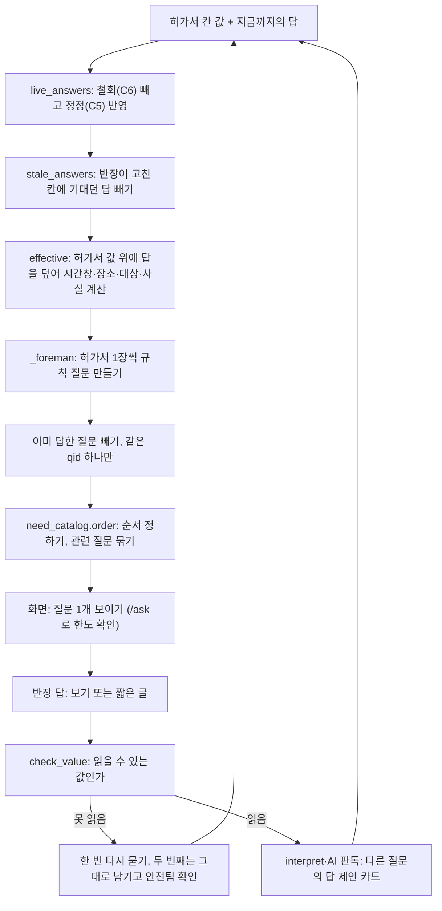
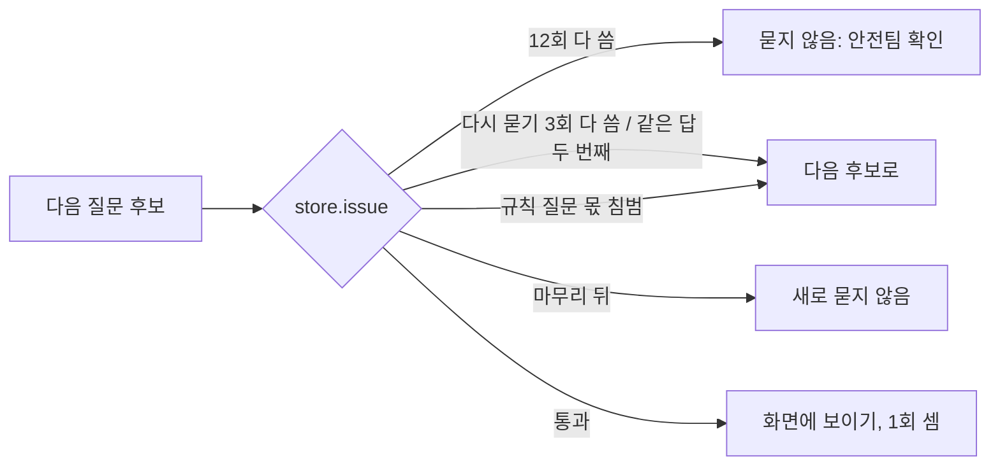
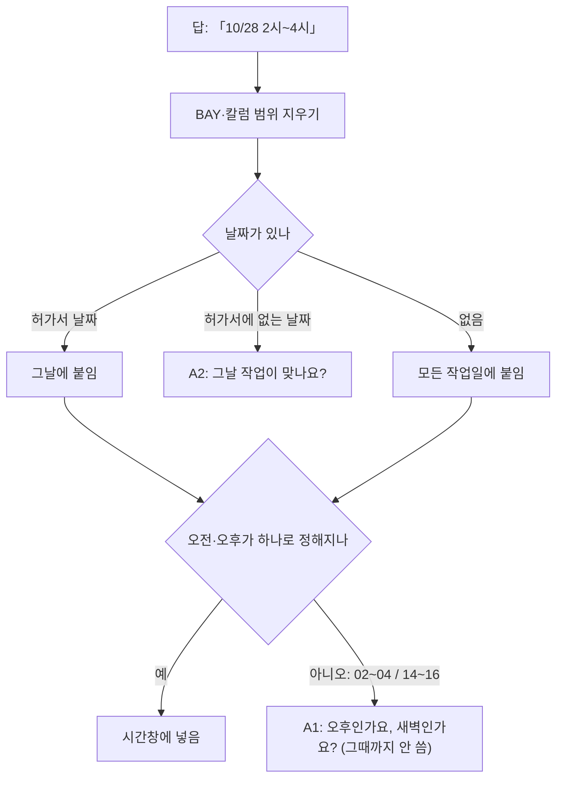
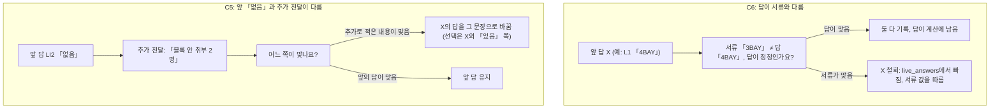

# 05. 멀티턴 질문 — 작업반장에게 묻는 규칙 질문

작업반장은 현장에서 작업 팀을 이끄는 반장입니다. 반장이 허가서를 내기 전에, croScan은 허가서에서 빠졌거나 서로 맞지 않는 값을 짧은 질문으로 묻습니다. 이 문서는 이 규칙 질문을 설명합니다. 질문이 언제 생기는지, 어떤 순서로 몇 번까지 묻는지, 답이 무엇을 바꾸는지 다룹니다.

**이 문서에서 알 수 있는 것**
- 반장에게 묻는 질문 항목 전체(T·L·B·C·D·H·CF·HT·LI·LO·A·U·X)와 각 항목의 조건·보기·효과
- 질문 순서와 한도(검토 1건에 12회, 다시 묻기 3회)
- 「모름」, 시간 답(「2시~4시」), 「미정·확인 필요」 같은 말을 어떻게 다루는지
- 반장이 서류를 고친 뒤 예전 답, 철회(C6)와 정정(C5), 글로 쓴 「없음」을 어떻게 다루는지
- 고칠 때 볼 코드 위치와 시험

**목차**
1. [무엇을](#1-무엇을)
2. [왜](#2-왜)
3. [어떻게: 전체 흐름](#3-어떻게-전체-흐름)
4. [질문 항목 전체 표](#4-질문-항목-전체-표)
5. [순서와 한도](#5-순서와-한도)
6. [「모름」 처리](#6-모름-처리)
7. [시간 답 읽기](#7-시간-답-읽기)
8. [T5·T7·T8·T4 시간 규칙](#8-t5t7t8t4-시간-규칙)
9. [「미정·확인 필요」 규칙(OPEN)](#9-미정확인-필요-규칙open)
10. [반장이 서류를 고친 뒤의 답](#10-반장이-서류를-고친-뒤의-답)
11. [철회(C6)와 정정(C5)](#11-철회c6와-정정c5)
12. [글로 쓴 「없음」](#12-글로-쓴-없음)
13. [코드 어디](#13-코드-어디)
14. [시험](#14-시험)
15. [한계](#15-한계)

---

## 1. 무엇을

- 반장이 허가서 파일을 올리면 croScan이 칸 값을 읽습니다.
- 규칙이 그 값을 봅니다. 「이 값이 비었다」, 「이 값은 두 가지로 읽힌다」, 「체크와 시간이 안 맞는다」 같은 곳이 보이면 질문을 만듭니다.
- 반장은 보기 버튼을 누르거나 짧게 적어 답합니다. 「모름」도 답입니다.
- 답은 출처(「신청자 답변」)와 함께 기록됩니다. croScan은 올린 파일을 바꾸지 않습니다. 대신 「반영본」과 「별지」를 따로 만듭니다. 반영본은 답을 맞는 칸에 넣은 것이고, 별지는 나머지를 적은 것입니다([`server/reflect.py`](../server/reflect.py)).
- croScan은 작업을 승인하거나 막지 않습니다. 질문은 값을 미리 채우려고 합니다. 안전관리자는 그날 허가서들을 비교할 때 이 값을 씁니다. 판단은 사람이 합니다.

## 2. 왜

- 안전관리자는 하루치 허가서를 모아 「같은 시간·같은 곳에서 서로 위험을 주는 작업 쌍」을 찾습니다. 그러려면 시간·장소·대상·공유 설비 값이 비교할 수 있을 만큼 정확해야 합니다.
- 조사 자료(대조립 비일상 작업 5종 조사서 2.5~2.8절)는 이렇게 정합니다.
  - 지금 필요한데 빠졌거나, 애매하거나, 서로 다르거나, 조건이 맞는 참고 모델과 설명 없는 차이가 있을 때만 묻습니다.
  - 허가서와 앞 답이 이미 말한 것은 다시 묻지 않습니다.
  - 작업 당일 칸(현장 안전조치, 추가정보 「작업당일 작업시작 전 체크」), 정밀 값(좌표·질량·풍량), 아직 때가 안 된 조치의 증빙은 묻지 않습니다.
- 비화기 작업의 야간 자체는 묻지 않습니다(조사서 N4-MT15). 확인된 현장 근무시간이 없을 때, 08~18시를 근무시간으로 가정해 묻지 않습니다.
- 근거 문서: [`docs/reference/멀티턴_v2_설계.md`](reference/멀티턴_v2_설계.md), [`docs/reference/AI도입계획_설계서.md`](reference/AI도입계획_설계서.md) §3, §21, §22. 문서와 코드가 다르면 코드가 맞습니다.

## 3. 어떻게: 전체 흐름

반장이 답할 때마다 서버는 허가서 값과 지금까지의 답 전부로 처음부터 다시 계산합니다. 질문 목록은 저장하지 않고 매번 새로 만듭니다.

- 질문 하나는 `_q()`가 만듭니다. 질문 번호(qid)는 `항목:승인번호`입니다(예: `T5.2:AC00-IH-20261029-0731`). 다른 허가서와 짝인 질문은 `>상대 승인번호`가 붙습니다.
- 질문 하나에는 「관측」(signal: 무엇이 비었거나 안 맞는지), 질문 글, 보기, 순위(prio), 등급(tier: core/extra), 원래 값(original), 의존 칸 지문(fp, 10장)이 들어 있습니다.
- 등급의 `core`는 비교에 필요한 기본 질문입니다. `extra`는 기본 질문 뒤에 묻는 보충 질문입니다. 이 등급은 필수·선택 구분과 다른 것입니다.
- 보기에는 상태가 붙습니다: 확인됨 / 정정 / 해당없음 / 미확인 / 보강. 값을 적는 보기에는 `ask`(입력 예시)가 있습니다.
- 「왜 묻나요?」에는 답을 어디에 쓰는지 한 줄로 보입니다. 이 글은 [`server/need_catalog.py`](../server/need_catalog.py)의 `NEED`에 있습니다. 법 조문은 두 조건이 맞을 때만 보입니다. 그 답을 실제로 읽는 쌍 규칙이 있어야 하고, 현행 조문과 대조한 기록이 있어야 합니다.

## 4. 질문 항목 전체 표

### 4.1 반장 화면(작업반장 보기)에서 묻는 항목

`questions(manager=False)` → `_foreman()`이 만듭니다. 허가서 1장씩, 그 허가서만 보고 묻습니다(다른 허가서에서 오는 질문 없음).

- **W**: 위험 가중치(1~5). 이 값을 모를 때 쌍·체크리스트 판단이 얼마나 틀리는지를 나타냅니다. `need_catalog.W`에 있고, 없으면 2.
- **필수**: 쌍 규칙·체크리스트·서류 완성이 읽는 항목(`need_catalog.REQUIRED`). 필수가 선택보다 먼저입니다.
- **닫힘**: 답이 오면 그 질문은 다시 묻지 않습니다(「모름」도 닫힘). 아래 「안 묻는 조건」은 허가서가 이미 말해 질문이 생기지 않는 경우입니다.
- **반영**: 반영본 칸(`reflect._facts`). 표에 없는 답은 별지에 「항목명: 답」으로 적힙니다.

#### 시간(T)

| 항목 | 묻는 것 | 언제 묻나 | 안 묻는 조건 | 보기 | 답이 바꾸는 것 | W·필수 |
|---|---|---|---|---|---|---|
| T0.행 | 빈 작업일시 행의 날짜·시작·종료 | 작업일시가 통째로 비었거나, 쓴 행에 날짜·시작·종료 중 빈 것이 있을 때. 행마다 하나씩(답한 행 다음 행) | 모든 쓴 행이 다 찼음 | 날짜·시간 입력 / 모름 | 시간창(`windows`, 출처 「신청자 답변」). 반영본은 빈 행에 날짜·시각을 씀. 행에 이미 적힌 값과 다르면 그 행은 그대로 두고 「확인 필요」 | 5·필수 |
| T5 / T5.행 | 종료가 시작보다 빠르거나 같음: 다음 날 끝나나, 잘못 적었나 | 종료 ≤ 시작인 행. 행마다 따로(1행은 `T5`, 나머지는 `T5.행`) | — | 다음 날 끝남 / 잘못 적음(시간 입력) / 모름 | 「다음 날」: 그 행이 다음 날 아침까지 이어짐, 반영본 상세 「다음 날 아침 종료(신청자 확인)」. 「잘못 적음」: 그날 시간창을 답으로 바꿈, 반영본 그 행 시각 | 2·선택 |
| T1 | 하루 거의 전체 시간이거나 3일 이상 같은 시간: 실제로 그 시간 내내 하나 | 어느 행이 09:00 이전에 시작해 16:00 이후에 끝남(경계 포함), 또는 3행 이상이 같은 시각 | — | 내내 함 / 실제 시간대 입력 / 모름 | 「실제」: 시간창을 답으로(날짜 붙은 답은 그날만). 인양은 「블록이 움직이는 구간」으로 따로 보관(`windows_stage.move`), 전체 창은 줄이지 않음. 반영본 상세 「실제 작업 예정 …」. 요청 창 밖이면 C6.T1 | 5·필수 |
| T7 | 체크한 주간·야간과 적힌 시간이 맞나 | 8장 참조(법정 야간 22~06 기준) | 주간·야간 둘 다 체크했거나 둘 다 비었음 | 적힌 시간이 맞음(체크를 고쳐야 함) / 체크가 맞음(시간 입력) / 둘 다 맞음(현장 분류) / 모름 | 「시간이 맞음」: 반영본 「체크 정정 필요」(체크 칸은 croScan이 쓰지 않음), T8 판단에서 주야 뒤집음. 「체크가 맞음」: 그 행 시간만 바꿈. 「둘 다」: 별지 기록 | 3·선택 |
| T8 | 야간·교대 시간의 조명·감시·구조 지원과 인계 | 화기 작업이 야간에 걸치고, 서류에 교대·인계·지원 말이 있을 때(8장) | 지원과 인계가 둘 다 확정으로 적힘 | 같은 조가 끝까지·지원 갖춤 / 지원·인계 입력 / 모름 | 사실 `facts.T8`, 별지. 지금 체크리스트 규칙과 쌍 규칙(제출 답을 쌍 판정에 넣는 규칙 포함)에는 T8을 읽는 항목이 없음 | 3·선택 |
| T9 | 멈추거나 교대하는 동안 차단·받침·통제 유지, 재개 시각 | 서류·T6 답에 대기·중단·교대·재진입 말이 있거나 하루 시간창이 둘 이상으로 나뉨(인양 제외) | 유지 상태와 재개 시각이 둘 다 확정(밀폐는 재측정과 환기·차단 유지) | 종류별(유지 / 상태 입력 / 고소는 「자르기 전 상태로 둠」 / 밀폐는 「한 번 들어가 끝까지」) / 모름 | 사실 `facts.T9`, 별지 | 3·선택 |
| T6 | 적힌 작업시간이 참고 작업시간보다 길거나 짧음 | 하루짜리 작업, 시간의 뜻 확인됨, 조건이 맞는 참고 모델이 있을 때(`time_fit`). 모든 질문 중 마지막 쪽 | 여러 날·대기 시간 미정·모델 조건 미상이면 비교 보류 | 길 때: 포함된 것 입력 / 실제 시간 다시 입력 / 모름. 짧을 때: 끝까지 전체 시간 맞음 / 특정 단계만 적음(전체 시간 입력) / 모름 | 「다시 입력」: 시간창을 바꿈. 「특정 단계만」: 창을 전체 시간까지 넓힘(줄이지 않음), 적힌 부분은 `windows_stage.written`, `full_end` 기록. 반영본 상세 | 2·선택 |
| T4 | 적힌 종료가 절단·용접 끝인가, 잔불 확인까지인가 | 화기, 또는 가스·플라즈마로 러그를 자르는 고소 작업. 시간 질문(T1·T5·T6·T7)이 다 닫힌 뒤. **extra** | 서류에 잔불 확인 끝이 확정으로 적힘, 화기 T6 「전체 시간 맞음」 | 잔불 확인까지 포함 / 그 뒤 끝: 시각 입력 / 모름 | 그날의 잔불 감시 종료 예정 시각(`residual`)을 기록. 지금의 안전관리자 판정은 작업 시간창을 늘리지 않음. 대신 잔류위험 설명에 이 시각을 덧붙임. 잔류 위험이 사라졌다는 근거로는 쓰지 않음. 사실 `facts.T4` | 3·선택 |

#### 다시 묻기(A·U)

반장 답이 두 가지로 읽히거나 알아듣지 못하면, croScan은 한 번만 되묻습니다. 되묻기는 허가서 1장에 3번까지입니다(`ASK_BACK`). 3번을 넘으면 묻지 않고, 별지 「안전팀 확인」에 원문을 남깁니다.

| 항목 | 묻는 것 | 언제 묻나 | 보기 | 답이 바꾸는 것 |
|---|---|---|---|---|
| A1.원답[.k] | 「2시~4시」는 오후인가 새벽인가 | 답의 시간 범위가 오전·오후 둘 다로 읽힘(7장). 답 안의 애매한 범위마다 질문 후보를 만듦. 다만 같은 원답에는 되묻기를 한 번만 허용함. 그래서 두 번째 범위는 묻지 못할 수 있음 | 오후 hh~hh / 새벽·오전 hh~hh / 모름 | 원래 답의 그 범위를 고른 쪽으로 읽음. 자기 값은 반영본에 쓰지 않음 |
| A2.원답[.k] | 그 시간이 며칠인가 | 여러 날 허가서에 「내일」 같은 말, 또는 허가서에 없는 날짜 | 날짜들 / 날마다 같음 / (없는 날짜면) 그날 맞음·허가서 날짜 / 모름 | 원래 답의 날짜를 정함 |
| A3.F번호 | 추가 전달의 숫자 없는 시간(「오후에」)은 몇 시~몇 시 | 마지막 자유 답에 시각 없는 시간 말이 있고, 다른 시간을 못 읽음 | 시간 입력 / 신청한 시간 그대로 / 모름 | 시간창(출처 「추가 전달」), 반영본 상세 |
| A4.cols | 거꾸로 적힌 칼럼 범위(「14-12 칼럼」)는 12~14인가 | 작업장소 칼럼 범위가 큰 수부터 | 맞음 / 다른 위치 입력 / 모름 | 「다른 위치」: 장소의 칼럼을 바꿈 |
| A5.T4 | 잔불 확인 끝이 작업 끝보다 이름: 다음 날인가 | T4 시각에 날짜가 없고 그날 작업 끝보다 이름 | 다음 날 hh:mm / 다시 입력 / 모름 | 잔류 끝을 다음 날로 또는 새 시각으로 |
| U1.F번호 | 알아듣지 못한 추가 전달은 무엇에 대한 말인가 | 마지막 자유 답에서 규칙이 아무 값도 못 읽음 | 작업 시간 / 작업 장소 / 다른 팀 작업 / 안전팀 참고로만 / 모름 | 시간: 시간창. 장소: 장소(BAY가 있으면 통째로, 없으면 덧붙임). 다른 팀: 별지(이 허가서 값으로 읽지 않음) |

#### 장소(L)·대상(D)

| 항목 | 묻는 것 | 언제 묻나 | 안 묻는 조건 | 보기 | 답이 바꾸는 것 | W·필수 |
|---|---|---|---|---|---|---|
| L1 | 실제 작업 위치(BAY·칼럼, 블록 번호) | 작업장소가 비었음(모든 종류). 인양이 아니면: 장소가 팀 이름처럼 보이거나 BAY가 없음, 또는 BAY만 있고 블록 번호도 없음. 정전 작업은 설비 번호를 물음. 정전인데 설비·대상 번호가 하나도 없으면 「설비 번호」로 따로 | 크레인 번호가 있는 정전, 「공장 전체」 답 | 위치 입력 / 정말 공장 전체 / 모름 | 장소 수준(L0~L4)·BAY·칼럼 다시 계산. 「공장 전체」는 같은 공장 비교. 반영본: 빈 칸이나 팀 이름 칸에 장소. BAY가 서류와 다르면 C6.L1 | 5·필수 |
| L3 | 블록 위·옆·아래·안, 높이 | 화기: 작업내용에 높이(m)나 「고소 화기」 체크가 있는데 상하 표시 없음. 고소: 상하 표시나 높이가 없음 | — | 위치·높이 입력 / 모름 | 상하(layer)·BAY 추가, 장소 수준 4. 반영본 장소 상세. 높이가 서류와 1m 이상 다르면 C6.L3 | 4·필수 |
| L4 | 여러 블록을 동시에·순서대로? 블록별 날짜 | 작업내용에 블록 2개 이상, 작업일 2일 이상 | — | 순서·날짜 입력 / 날마다 함께 / 모름 | 별지 | 2·선택 |
| L5 | 인양 이동 경로(출발·지나는 BAY·도착) | 인양인데 경로 표시(→, 경유, 통로, 「…에서 …로 옮김」)가 없음. 넓은 칼럼·반전·차량이 적혔으면 그 위치도 함께 | — | 경로 입력 / 모름 | BAY·상하 추가, 참고 모델(긴 경로) 판단. 반영본 경로 | 4·필수 |
| L6 | 작업 중 출입을 막는 범위 | 화기·고소·인양에서 통제 범위(반경 m, 하부·통로 통제)가 확정으로 안 적힘. **extra** | 통제 범위 확정 | 범위 입력 / 모름 | 별지 메모 「작업 중 통제 범위」, 반영본 장소 상세 「통제 예정 범위」 | 3·선택 |
| L7 | 칼럼 범위가 실제 작업 위치인가, 이동·접근 경로까지인가 | 칼럼 폭 3칸 이상이고 국부 작업(고소·정전·밀폐, 교체 아닌 화기), 대상이 하나(고소는 여러 러그도) | — | 그 범위에서 작업 / 실제 위치는 좁음(입력) / 정전은 시험 구간·케이블 점검 구간 포함 / 모름 | 「좁음」: 칼럼을 답으로 바꿈. 반영본 장소 상세 「실제 작업 위치」 | 4·필수 |
| D1 | 어느 블록·배관·구획인가 | 화기·밀폐·고소이고 장소는 됐는데 블록 번호가 없음 | — | 번호 입력 / 특정 대상 없음 / 모름 | 대상 번호(targets)에 더함. 반영본 상세 「대상 …」 | 2·필수 |
| D6 | 수전구역의 통전·시운전 설비와 차단 확인자 | 밀폐 허가서에 수전구역 체크, 「설비 없음」이나 「누가 차단 확인」이 안 적힘 | 서류가 확정으로 말함 | 있음(설비·확인자) / 없음 / 모름 | 사실 `facts.D6`, 별지 | 4·선택 |
| D7 | 압력시험 매체와 가압·감압 시각 | 밀폐 허가서에 압력사용 체크, 매체·가압·감압 중 빠진 것 | 셋 다 확정 | 매체·시각 입력 / 모름 | 사실 `facts.D7`(질소면 불활성가스로 쌍 규칙이 읽음), 별지 | 3·선택 |

#### 화기(H)

| 항목 | 묻는 것 | 언제 묻나 | 안 묻는 조건 | 보기 | 답이 바꾸는 것 | W·필수 |
|---|---|---|---|---|---|---|
| H1 | 용접부만 보수인가, 부재 교체인가, 몇 군데 | 보수 범위가 서류·답에 없음 | 재용접만·제거만·교체·국부 보수가 적힘 | 용접부만 보수(개수) / 부재 교체(개수) / 모름 | 보수 범위·개수 → 참고 모델(T6). 반영본 작업내용 | 3·필수 |
| H2 | 절단·용접 방법과 가스 | 방법이 없고 가우징 체크도 없음. 또는 방법은 있는데 가스가 없음(그때는 가스만 물음) | 방법·가스가 확정 | 방법·가스 입력 / 가스 안 씀(전기 용접만) / 모름 | 반영본 상세. 「가스 안 씀」인데 서류에 가스절단·산소 등이 있으면 「확인 필요」 | 3·필수 |
| H3 | 떼거나 깊게 파내는 부재가 다른 것을 받치나, 무엇으로 받쳐 어디로 내리나 | 부재 교체, 또는 「깊은」 국부 파내기이고 받침·지지 말이 없음 | 받침·지지 확정 | 교체: 지지·회수 입력 / 모름. 파내기: 받치는 것 없음 / 받침 계획 입력 / 모름 | 반영본 상세 「분리물 지지·회수 계획」 | 4·필수 |

#### 밀폐(CF)

| 항목 | 묻는 것 | 언제 묻나 | 안 묻는 조건 | 보기 | 답이 바꾸는 것 | W·필수 |
|---|---|---|---|---|---|---|
| CF1 | 안에서 무엇을 하나(검사·청소·회수·보수), 몇 곳·몇 번, 머리만인가 몸 전체인가 | 목적이 없음. 또는 목적은 있는데 진입 방식(머리·상체/전신)이 없음 | — | 목적 보기들 / 머리·상체만 / 몸 전체 / 기타 / 모름 | 범위 → 참고 모델. 「보수·용접」은 밀폐 안 화기(SPARK)로 쌍 규칙이 읽음. 반영본 작업내용 | 5·필수 |
| CF2 | 연결 계통(가스·공기)과 진입 중 차단, 다른 팀 공급·시험 | 아르곤·질소·배관 말이나 아르곤 체크가 있는데 「차단·진입 중 유지·복구/다른 팀」 세 가지 중 빠진 것 | 셋 다 확정 | 연결 계통 없음 / 있음(입력) / 모름 | 반영본 유해위험요소 「연결 계통·차단 계획」. 「없음」인데 서류에 아르곤 등이 있으면 「확인 필요」 | 5·필수 |
| CF3 | 환기팬·송기·조명의 전원(분전반·발전기) | 전원 이름(분전반 번호, 발전기, 자연환기)이 확정으로 없음 | 확정 | 전원 입력 / 자연환기 / 모름 | 사실 `facts.CF3`(자기 문장의 분전반 번호를 `sources`로) | 4·선택 |
| CF4 | 안에서 화기를 하나, 방법·가스·별도 화기 허가서 | 화기 말이 있거나 CF1 「보수·용접」인데 방법이 없음 | — | 함(입력) / 안에서 화기 없음 / 모름 | 사실 `facts.CF4`. 「함」은 쌍 규칙의 SPARK | 4·선택 |
| CF5 | 도장·세정할 구획의 화기가 끝났다고 들었나 | 작업이 도장·세정·코팅이고 「화기 완료」 말이 없음 | — | 끝났다고 들음 / 남은 화기 있음 / 모름 | 사실 `facts.CF5`, 별지 | 3·선택 |

#### 고소(HT)

| 항목 | 묻는 것 | 언제 묻나 | 안 묻는 조건 | 보기 | 답이 바꾸는 것 | W·필수 |
|---|---|---|---|---|---|---|
| HT1 | 러그(임시 인양고리) 몇 개를 어떤 방법으로 떼나 | 개수나 절단 방법이 없음. 서류에 러그·절단 말이 아예 없으면 「떼는 러그 없음」을 맨 앞에 | — | 가스절단 / 플라즈마 / 그라인더·기계절단 / (개수만 없으면) 개수 입력 / 떼는 러그 없음 / 모름 | 방법·개수 → 참고 모델, 가스·플라즈마면 T4. 반영본 작업내용 「러그 N개 가스절단」. 「없음」인데 서류에 러그가 있으면 「확인 필요」 | 3·필수 |
| HT2 | 떼어낸 러그를 무엇으로 받아 어디에 내리나 | 러그 없음이 확인되지 않았고, 회수 수단·내릴 곳이 행위로 안 적힘. 러그가 있다는 말이 없어도 물을 수 있음 | HT1 「떼는 러그 없음」 답, 또는 서류가 러그 없음을 말함 | 회수 방법 입력 / 해당 없음 / 모름 | 반영본 상세 「러그 회수 계획」. 「해당 없음」은 「확인 필요」 | 4·필수 |

#### 인양(LI)·중량(C4)

| 항목 | 묻는 것 | 언제 묻나 | 안 묻는 조건 | 보기 | 답이 바꾸는 것 | W·필수 |
|---|---|---|---|---|---|---|
| LI1 | 어느 크레인, 공동인양·반전·차량 인계, 블록 번호·개수 | 크레인 번호가 없음. 또는 크레인은 있는데 블록 번호·개수가 없음 | — | 크레인·방법 입력 / 블록·방법 입력 / 모름 | 크레인 번호(cranes) → LI3 조건, 쌍 규칙(같은 크레인). 반영본 작업내용 | 4·필수 |
| LI2 | 옮기기 전 블록 안·위 작업, 붙어 있는 배관·발판·전선 | 서류에 그런 말이 없음 | — | 없음 / 있음(입력) / 모름 | 「없음」: 반영본 유해위험요소 「블록 안·위 작업·부착물 없음(신청 시점)」. 「있음」: 다른 작업이라 별지 | 4·필수 |
| LI3 | 그 크레인 정비, 같은 주행로의 다른 크레인 운행을 들었나 | 크레인 번호가 있고 서류·B3 답에 레일·주행로 말이 확정으로 없음 | 확정 | 들은 것 없음 / 있음(입력) / 모름 | 사실 `facts.LI3` | 4·선택 |
| C4 | 인양물 중량이 정격하중보다 큼: 어느 값이 맞나 | 중량 > 크레인 정격하중 | — | 맞는 값 입력 / 모름 | 별지 「중량·정격하중(신청자 정정)」 | 2·필수 |

#### 정전(LO)

| 항목 | 묻는 것 | 언제 묻나 | 안 묻는 조건 | 보기 | 답이 바꾸는 것 | W·필수 |
|---|---|---|---|---|---|---|
| LO1 | 원인 찾는 점검인가, 확인된 수리·교체·증설인가 | 범위가 없음 | — | 점검 / 부품 교체 / 정해진 수리 / 설치·증설 / 모름 | 범위 → 참고 모델, 「점검」이면 LO5. 반영본 작업내용 | 3·필수 |
| LO3 | 차단·복구 시각(필수), 중간 복구, 시험운전, 함께 멈추는 설비, 다른 팀 잠금, 종료의 뜻 | 차단 시각과 복구 시각 중 빠진 것 | 둘 다 확정 | 시각·설비 입력 / 모름. 글 답은 차단·복구가 둘 다 있어야 받음 | 반영본 상세 「차단·복구·시험 예정 …」 | 4·필수 |
| LO4 | 제어반 앞에서만인가, 거더·상부에도 올라가나 | 접근 위치 말이 없고, 크레인 번호가 있거나 대상 번호가 없음 | — | 제어반 앞에서만 / 거더·상부(입력) / 모름 | 반영본 장소 상세 | 3·필수 |
| LO5 | 원인 찾는 동안 전원이 들어간 상태로 측정하나 | LO1이 「점검」이고 활선·통전 말이 없음 | — | 정전 상태로만 / 있음(무엇·몇 시) / 모름 | 사실 `facts.LO5` | 4·선택 |
| LO6 | 같은 주행로 다른 크레인 운행, 복구 전 확인할 다른 팀 작업 | 크레인 번호가 있고 레일·주행로 말이 확정으로 없음 | 확정 | 들은 것 없음 / 있음(입력) / 모름 | 사실 `facts.LO6` | 4·선택 |

#### 빈칸(B)·상충(C)·인원(W)

| 항목 | 묻는 것 | 언제 묻나 | 보기 | 답이 바꾸는 것 | W·필수 |
|---|---|---|---|---|---|
| B1.칸 | 필수 머리 칸이 비었음 | 필수, 체크·그림 아님, 빈 칸. 단 장소·작업일시·서명·작업 당일 칸·허가구분·2중점검은 묻지 않음 | 값 입력 / 해당 없음 / 모름 | 그 칸의 값으로 계산·반영본에 씀. 「해당 없음」은 「확인 필요」. 칸 형식(숫자 등)과 칸 이름 자체는 거름 | 작업인원(`B1.workers`) 3·필수, 그 밖의 B1 2·필수 |
| B3 | 병행여부 빈칸: 같은 시간·장소의 알고 있는 다른 작업 | 병행여부가 비었음 | 있음(입력) / 없음 / 모름 | 병행여부 Y/N(계산·반영본 칸). 「있음」 내용은 별지 「알고 있는 병행작업」. 이 허가서의 장소·번호로 읽지 않음 | 4·필수 |
| B4 | 호선/공사 | 반장 화면에서는 **묻지 않음**. 설비 작업이면 「호선 무관으로 추정」(규칙 추정), 아니면 별지 「안전팀 확인」 | — | — | 1 |
| C5.항목 | 앞 「없음」 답과 추가 전달이 다름 | LI2 「없음」, CF2 「없음」, B3 「없음」, LO4 「제어반 앞만」 답 뒤에 마지막 자유 답이 그 반대를 말함(「아마 있을걸요」도) | 추가로 적은 내용이 맞음(입력) / 앞의 답이 맞음 / 모름 | 11장 | 2·필수 |
| C5.concurrent | 병행여부 N인데 추가 전달에 다른 작업 | 병행 N이고 자유 답에 다른 작업(「병행 작업 금지」 문장은 뺌) | 같은 시간·장소임(입력) / 다름 / 모름 | 「같음」: 병행여부 Y, 별지 「병행작업」 | 2·필수 |
| C6.항목 | 답이 서류와 다름: 답이 정정인가 | 아래 `doc_conflicts` 4가지. 다시 묻기 한도를 같이 씀 | 답이 맞음(정정) / 서류가 맞음 / 모름 | 11장 | 2·필수 |
| W1 | (질문 아님) 감시·입회 인원 | 긴 답에 「감시인 1명」이 있으면 규칙이 읽어 제안 | — | 별지에만. 작업인원에 더하지 않음 | 2 |

`C6`이 생기는 4가지(`doc_conflicts()`):
- T1 「실제 시간」이 그날 요청 창 밖으로 나감
- H1·CF1·HT1·LO1의 범위 답과, 그 뒤 고친 서류의 범위가 다름
- L1 장소 답의 BAY가 서류 BAY와 겹치지 않음
- L3 높이 답이 서류 작업높이와 1m 이상 다름

### 4.2 안전관리자 보기 분기(지금 앱에서 부르지 않음)

`questions(manager=True)`는 하루치 허가서를 서로 비교해 묻는 옛 분기입니다. 지금 앱 요청 경로에서는 이것을 부르지 않습니다. 시험([`tools/check_questions.py`](../tools/check_questions.py))만 부릅니다. 안전관리자 쪽 판정보류 질문은 [`server/holdq.py`](../server/holdq.py)가 만듭니다(설계서 §22 표).

| 항목 | 묻는 것 | 조건 |
|---|---|---|
| T1 / T2 | 근무시간 거의 전체 / 3일 이상 같은 시간 | 반장 쪽과 비슷, 보기 「일부 시간만」·「날마다 다름」 |
| T3 | 위험 순간 시각(인양은 단계 시각) | 인양은 extra로 항상, 그 밖은 다른 허가서와 1·2순위로 시간이 겹칠 때 |
| T4 | 잔불 확인 끝 | 화기, 가스·플라즈마 고소. extra |
| L1 / L2 / L3 / L4 / L5 / L6 | 장소·실제 작업점·상하·블록 순서·경로·통제 범위 | 장소 수준이 낮을 때, 칼럼 범위만 있고 2순위 쌍이 있을 때 등 |
| B1.칸 / B2.칸 / B2.work_height | 빈칸(종류별 필수는 B2) | 필수 빈칸, 밀폐인데 고소 체크·높이 빈칸 |
| B3 / C3 | 병행여부 빈칸 / N인데 겹치는 작업 있음 | C3은 다른 허가서가 있어야 함 |
| B4 | 호선/공사 빈칸 | 설비 작업이 아닐 때. extra |
| C1 / C2 / C2h | 유해위험요소에 주 위험 없음 / 높이 있는데 고소 체크 없음 / 추가정보 분류 체크 없음 | 서류 내용 |
| D1~D5 | 대상 번호, 크레인 번호, 가스 공급 방식(extra), 함께 멈추는 설비(extra), 진입 구획 공급 계통(extra) | 종류별 |
| X1~X6 | 다른 허가서와 짝 질문: 크레인 번호, 가스 연결, 퇴실 확인자, 절단 부재 지지, 차단 전원 연결, 협의 시간대 | 두 허가서 시간이 겹치는 1·2순위 쌍 |

## 5. 순서와 한도

### 5.1 순서

질문 순서는 규칙 순위(prio) 하나로만 정하지 않습니다. [`need_catalog.order()`](../server/need_catalog.py)가 아래 순서로 정렬합니다.

1. extra 등급(T4·L6)은 맨 뒤
2. 다시 묻기·상충 확인(A1~A5, U1, C5, C6)이 먼저
3. 규칙 질문이 AI가 찾은 질문보다 먼저
4. 필수(`REQUIRED`)가 선택보다 먼저
5. 점수 S가 큰 것 먼저: **S = W × M × A − B**
   - W: 위험 가중치
   - M: 빠진 정도. 1(모름·상충), 0.5(일부만 앎: H2 가스만, CF1 진입 방식만, HT1 개수나 방법만, LO3 일부)
   - A: 반장이 답할 수 있는 정도. 1(자기 계획), 0.5(다른 작업에 대해 들은 것: B3·LI2·LI3·LO6·CF5)
   - B: 수고. 0.2(누르기만 하는 보기가 있음), 0.5(적어야 함)
6. 그다음 규칙 순위(prio), 쪽, qid

**묶어 묻기(MERGE).** 같은 허가서·같은 등급의 관련 질문 둘은 한 말풍선에 묻습니다: (HT1, HT2), (H2, H3), (LO3, LO4), (LI1, L5), (CF1, CF2), (L1, L3). 둘째 질문은 「함께 여쭙니다」로 붙습니다. 보기는 질문마다 따로 있습니다. 「예」 하나가 둘을 닫지 않습니다. 둘째도 질문 1회로 셉니다.

**화면 쪽 순서 조정.** AI가 앞 답을 읽는 동안에는, 그 답의 말에 보기·항목 이름이 보이는 질문을 뒤로 미룹니다(`mayCover` in [`web/app.js`](../web/app.js)). 남은 질문이 남은 한도 안에 다 들어갈 때만 미룹니다.

### 5.2 한도

| 한도 | 값 | 어디 | 설명 |
|---|---|---|---|
| 묻기(ask) | 검토 1건에 12회 | `store.ASKS` | 질문, 다시 묻기, 확인 카드, 마무리 요청이 각각 1회. 같은 것을 다시 보이면(새로고침 등) 세지 않음 |
| 다시 묻기 | 검토 1건에 3회, 같은 답에 1회 | `store.CLARIFY`, `clarify_base()` | A1~A5, U1, C5, C6, 값을 못 읽어 다시 묻기(retry) |
| 허가서별 되묻기 | 허가서 1장에 3회 | `augment.ASK_BACK` | 넘으면 질문을 만들지 않고 별지 「확인 못 한 말」 |
| 규칙 질문 몫 | 남은 일반 규칙 질문 수 | `app._reserve()` | 카드·다시 묻기·AI 질문·연결 카드는 아직 안 물은 일반(비-extra, 비-확인) 규칙 질문의 몫을 쓰지 못함(409 reserved) |
| 마무리 | 1회 | `store.issue(kind="close")` | 마무리 뒤에는 새 질문 없음. 새 정보는 답 고치기(이벤트)로만 |

- 12회를 다 쓰면, 남은 질문에 「질문 한도로 묻지 않음」 표시가 붙습니다. 이 질문들은 별지 「안전팀 확인 필요」로 갑니다(`app._budget()`).
- extra 질문은 남아도 「담당 확인」 목록에 넣지 않습니다.

## 6. 「모름」 처리

- 모든 질문의 마지막 보기는 「모름」(상태 「미확인」)입니다. 누르면 그 질문은 닫힙니다. 다시 묻지 않습니다.
- 별지 기록에는 「모름」을 그냥 빈칸으로 두지 않습니다. 함께 적은 말을 보고 네 가지로 나눕니다(`unknown_kind()`):
  - 미정: 「상황 봐서」, 「알아서」, 「나중에 정함」
  - 확인 예정: 「담당자에게 확인 중」, 「물어보고 있음」
  - 불확실: 「아마」, 「것 같아요」
  - 모름: 그 밖
- 「모름」 답은 계산에 값으로 들어가지 않습니다. 대상·개수·장소·메모·사실(`facts`) 어디에도 읽지 않습니다.
- 반영본은 「모름」을 어느 칸에도 쓰지 않습니다. 「작업 날짜·시작·종료 시각 확인 필요」처럼 확인할 것을 적습니다(`reflect.CHECK`).
- 값으로 「모름」, 「미정」, 「-」, 「?」만 적은 것도 값이 아닙니다(`NOT_A_VALUE`).
- 시간 질문의 답이 「모름」이면, 시간의 뜻이 아직 열려 있다고 봅니다(`_open()`). T7·T5가 열려 있으면 T8을 묻지 않습니다. T1·T5·T6·T7 중 하나라도 열려 있으면 T4를 묻지 않습니다.
- 글로 적은 값을 읽지 못하면 한 번 다시 묻습니다(retry, 다시 묻기 1회로 셈). 두 번째도 못 읽으면, 적은 말을 그대로 둔 채 「모름」으로 남깁니다. 그리고 안전팀 확인으로 넘깁니다([`web/app.js`](../web/app.js) `afterAnswer`). 읽을 수 있어야 하는 값은 `augment.READABLE`이 정합니다(시간·장소·번호·크레인·개수·높이·시각).

## 7. 시간 답 읽기

모든 시간 답은 파서(글을 값으로 바꾸는 코드) 하나로 읽습니다: `time_ranges()` → `_parse_windows()`. 원칙은 「짐작하지 않는다」입니다. 답이 두 가지로 읽히면 그 읽기를 버리고 되묻습니다.

**시각 하나(`_clocks`)**
- 「오전·아침·새벽」, 「오후·저녁·밤」이 붙거나 24시간 표기(「14시」, 「09:00」)면 하나로 읽습니다.
- 붙지 않은 「7시」~「12시」는 주간으로 읽습니다.
- 붙지 않은 「1시」~「6시」는 새벽과 오후 둘 다 될 수 있습니다.

**범위 하나(`_readings`)**
- 끝은 시작 뒤에 오는 첫 시각입니다. 「11시~1시」는 13시에 끝납니다.
- 「새벽 2시~4시」처럼 오전 표시가 앞에만 붙을 때가 있습니다. 끝 시각이 더 크면 끝에도 같은 표시를 붙여 읽습니다.
- 읽는 법이 둘 이상이면(「2시~4시」 = 02~04 또는 14~16) 그 범위는 쓰지 않고 **A1**(오전·오후)로 묻습니다. 한 답 안의 애매한 범위마다 A1.원답, A1.원답.2 …로 질문 후보를 만듭니다. 다만 같은 원답에는 되묻기를 한 번만 허용합니다(`store.clarify_base()`). 그래서 같은 답의 두 번째 범위는 질문 후보가 있어도 한도로 묻지 못할 수 있습니다.
- 「3BAY 12-14」 같은 BAY·칼럼 범위는 먼저 지웁니다(`PLACE_SPAN`). 뒤에 칼럼·m·개·명·톤 같은 단위가 붙은 숫자 범위도 시간이 아닙니다.

**날짜(`_parse_windows`)**
- 쉼표·세미콜론·줄바꿈·「그리고」·「및」으로 나눈 조각마다 날짜를 봅니다(「10/27」, 「2026-10-27」, 「10월 27」).
- 날짜가 있으면 그날에만 붙입니다. 날짜가 없으면 허가서의 모든 날에 붙입니다.
- 허가서에 없는 날짜면 버리지도 옮기지도 않고 **A2**로 한 번 묻습니다(「그날 작업이 맞나요?」).
- 여러 날 허가서에 「내일」, 「둘째 날」 같은 말이면 **A2**로 며칠인지 묻습니다(「날마다 같음」 보기 있음).
- 하루짜리 허가서의 「다음 날 00:00~02:00」은 다음 날짜로 읽습니다.

**T0의 날짜(`t0_dates`, `t0_row`)**
- 답에 적힌 날짜를 씁니다. 없으면 그 행의 날짜, 그것도 없으면 승인번호 안의 날짜(AC00-IH-YYYYMMDD-NNNN)를 씁니다.
- 여러 날 답은 빈 행에 차례로 놓습니다. 행에 이미 적힌 값과 다르면 그 행은 그대로 두고 반영본이 「확인 필요」로 적습니다.

**자유 답의 시간(`work_windows`)**
- 마지막 자유 답에서는 「작업 시간은…」, 「실제…」, 「진입…」처럼 작업 시간을 말하는 문장만 봅니다. 조건·불확실·부정·다른 팀·다른 종류 작업 문장은 뺍니다.
- 자유 답에 분명한 시간이 있어도 바로 쓰지 않습니다. 제안 카드로 보입니다(05b 문서). 반장이 A1·A2로 확인한 시간은 반장의 확정 답으로 씁니다.

## 8. T5·T7·T8·T4 시간 규칙

### T5 — 끝이 시작보다 이른 행
- 행마다 따로 묻습니다. 1행은 `T5`, 나머지는 `T5.행번호`.
- 「다음 날 끝남」: 그 행은 다음 날 아침까지 하나의 창이 됩니다.
- 「잘못 적음」: 적은 시간을 그날 창으로 씁니다. 반영본은 그 행 시각만 고칩니다.
- 답이 없거나 「모름」이면 그 행에는 시간창이 없습니다. T7·T8·T4는 기다립니다.

### T7 — 주간·야간 체크와 적힌 시간
- 현장의 확인된 주간 근무시간(환경변수 `CROSCAN_SITE_SHIFT`, 예 `08:00-18:00`)이 있으면 그 값과 비교합니다. **지금은 알려진 값이 없습니다.**
- 그 값이 없을 때 08~18시를 가정하지 않습니다. 대신 근로기준법 제56조 제3항의 야간(22:00~다음 날 06:00, `review.LEGAL_NIGHT`) 한 줄만 기준으로 삼아, 명백한 경우만 묻습니다.
  - 「주간」 체크인데 어느 행이 통째로 그 야간 안(`legal_night_only`)
  - 「야간」 체크인데 모든 행이 정해졌고, 모든 행이 야간에 1분도 안 걸치고 정오를 지남(`plain_day`)
- 저녁 연장(18~21시), 22시에 걸친 행은 묻지 않습니다.
- 이 법 조항은 임금을 더 주는 야간을 정한 것입니다. 허가서 체크의 뜻을 정하지는 않습니다. 그래서 「둘 다 맞음(현장 분류)」 보기가 있습니다.
- T5·T0이 먼저입니다. 끝이 시작보다 이른데 T5 「다음 날」 답이 없는 행이 있으면 「야간」 쪽 비교는 하지 않습니다.
- 묻는 행과 체크를 `original`에 남깁니다. 서류나 T0·T5 답이 바뀌면 질문이 다른 행을 가리킬 수 있습니다. 그때는 예전 T7 답을 쓰지 않고 다시 묻습니다(`t7_stale`).

### T8 — 화기의 야간·교대 지원과 인계
- 화기만 묻습니다. 비화기 야간은 묻지 않습니다(조사서 N4-MT15).
- T7이 열려 있거나, T5가 열려 있거나 「모름」이면 기다립니다.
- 「야간」으로 보는 경우: T7이 「적힌 시간이 맞음」·「둘 다 맞음」이라 한 주간 행, 자정을 넘는 창, 다음 날 끝나는 T5, 야간만 체크.
- **서류·답에 교대·인계·야간조·다음 조·넘겨·이어서 작업·화재감시·조명·투광등·작업등·지원 말이 있을 때만 묻습니다.** 야간 체크나 다음 날 종료만으로는 묻지 않습니다(설계서 §22 최종 회차).
- 지원과 인계가 둘 다 확정으로 적혔으면 묻지 않습니다.
- 야간 자체를 잘못이라고 하지 않습니다. 답은 기록만 합니다.

### T4 — 잔불 확인 끝
- 화기, 또는 가스·플라즈마로 러그를 자르는 고소 작업.
- 시간 뜻 질문(T1·T5·T6·T7)이 열려 있으면 묻지 않습니다.
- 답의 시각은 날짜와 오전·오후를 같은 파서로 읽습니다(`clock_read`). 「4시 반」, 「오전 12시 30분」은 애매해서 다시 적게 합니다.
- 날짜 없이 적으면 모든 작업일에 적용합니다. 날짜와 함께 적으면 그날에만 적용합니다.
- 날짜 없이 그날 작업 끝보다 이르면 **A5.T4**로 「다음 날인가요?」를 묻습니다.
- T4는 잔불 감시 종료 예정 시각을 기록합니다. 지금의 안전관리자 판정에서는 작업 시간창을 늘리지 않습니다([`safety.py`](../server/safety.py)).
- 쌍 판정은 잔류위험 설명에 이 시각을 덧붙입니다([`pairs.py`](../server/pairs.py)). 잔류 위험이 끝났다는 근거로 쓰지 않습니다.
- 예전 비교 함수 `augment.overlap()`(`_span()`)은 마지막 창을 이 시각까지 늘립니다. 지금의 안전관리자 판정은 이 함수를 쓰지 않습니다.

## 9. 「미정·확인 필요」 규칙(OPEN)

반장이나 서류가 어떤 것을 말했는지 볼 때, 「미정」이 붙은 말은 말하지 않은 것으로 봅니다.

- `said()`는 문장을 조각(쉼표·마침표·「그리고」·「지만」)으로 나눠 그 말을 찾습니다. 결과는 셋입니다: 그렇다 / 아닙니다(「가스는 안 씀」) / 말 안 함.
- 찾은 말 바로 뒤 20자 안에 아래 말이 있으면 **말 안 함**입니다(`OPEN`).
  - 미정, 확인 필요(「확인 필요 없음」은 제외), 확인 예정, 모름, 모르겠, 협의 중, 정해지지 않, 정하지 않
  - 예: 「가우징 가스 미정」은 가스를 말한 것이 아닙니다. H2가 열린 채 남습니다.
- 조건(「다른 작업 없으면」), 불확실(「아마」, 「것 같아요」, 「…인지 확인 중」) 조각도 말 안 함입니다(`COND`, `HEDGE`).
- 질문을 닫는 「확정」 판단(`confirmed()`, `need_catalog.atoms()`)도 같습니다. 어떤 조각에 「미정·확인 필요·확인 중·여부·불가·모름·아마·협의 중」이 있으면 그 조각을 세지 않습니다(`UNSURE`).
- 그래서 한 단어로 질문이 닫히지 않습니다. 필요한 원자(atom, 질문이 묻는 작은 사실 하나하나)가 모두 확정일 때만 닫힙니다. 예: CF2는 차단·진입 중 유지·복구/다른 팀 세 가지, LO3는 차단·복구 둘(필수).
- 설계서 §22: 전에는 이 규칙이 일부 항목에만 있었습니다. 그래서 H2·H3·L5·LI2·LO4·LO5가 「미정」에도 닫혔습니다. 지금은 이 규칙이 `said()` 안에 있어 모든 항목에 똑같이 쓰입니다.

## 10. 반장이 서류를 고친 뒤의 답

반장은 대화 중에 화면에서 허가서 칸을 고칠 수 있습니다. 그러면 croScan은 그 칸에 기대던 답을 더 쓰지 않고 다시 묻습니다.

- 질문을 만들 때 `_q()`가 의존 칸 목록(`fp_keys`)과 그 칸 값들의 해시(`fp`, 값을 짧게 줄인 지문)를 질문에 넣습니다. 답을 저장할 때 질문도 함께 저장합니다.
- `fp_keys`는 질문이 직접 가리키는 칸(`keys`)에 아래 공통 의존 칸을 더한 목록입니다(`_deps()`). 예를 들어 D6는 자기 칸(수전구역 체크, `commissioning`)과 작업내용 관련 칸을 함께 봅니다.
- 공통 의존 칸:
  - 시간 질문(T*): 모든 작업일시 행 + 주간·야간 체크
  - 장소 질문(L*, LI*·LO* 제외): 작업장소, 장소 상세
  - 그 밖: 작업내용, 상세, 유해위험요소, 장소 상세
  - 확인 질문(A·U1·C5·C6)과 빈칸(B1·B2): 자기 칸만
- `stale_answers()`는 지금 칸 값으로 해시를 다시 냅니다. 해시가 다르면 그 답을 「낡음」으로 봅니다. B1·B2(그 칸의 값 자체)와 fp가 없는 예전 답은 제외합니다.
- 낡은 답을 빼는 자리는 여럿입니다. 모두 「철회를 뺀 답(`live_answers`) − 낡은 답」을 읽습니다. 다만 쓰는 함수는 서로 다릅니다.
  - `answers_now()`: 제출 답을 쌍 판정에 넣을 때 씁니다(`safety.hybrid_inputs()`).
  - `effective()`: 철회와 칸 지문을 직접 검사합니다.
  - 질문·별지·반영본: `effective()` 결과에 더해 `drop_stale()`도 씁니다.
  - 체크리스트: `standing()`의 답에서 `P.stale`에 있는 답을 뺍니다.
- 낡은 답은 `summary()`의 `stale_answers`로 나갑니다. 서버(`app._augment`)는 여기에 저장소가 버린 답을 합쳐 `dropped`로 보냅니다. 저장소가 버린 답은 바탕이 바뀐 확인 답과, 바뀐 계획서에서 가져온 값입니다.
- 화면은 `markDropped()`로 그 답을 지우고 말풍선을 흐리게 합니다. 그 질문은 다시 열리고, croScan이 다시 묻습니다.

## 11. 철회(C6)와 정정(C5)

**C6 「서류가 맞음」 → 철회**
- `withdrawn()`이 `C6.X~지문:승인번호` 답 가운데 「서류가 맞음」을 찾습니다. 그리고 `X:승인번호`를 철회 목록에 넣습니다.
- `live_answers()`가 철회된 답을 뺍니다. 체크리스트(`checklist.standing`), 쌍 규칙(`pairs.confirmed_facts` → `pairs.standing`), 반영본, AI 판독 호출부가 모두 이것을 씁니다.
- 철회된 질문은 다시 묻지 않습니다(답한 질문 목록에는 남음). 별지 기록에는 「철회(서류가 맞음)」로 남습니다.
- 같은 불일치는 한 번만 묻습니다. 질문 번호에는 서류 말과 답 말의 짧은 해시가 붙습니다. 그래서 새 불일치만 다시 묻습니다.

**C5 「추가로 적은 내용이 맞음」 → 정정**
- LI2·CF2·LO4·B3(`C5_POSITIVE`)이면 `live_answers()`가 X의 앞 답을 C5에 적은 문장으로 바꿉니다. 이때 선택은 X의 「있음」 쪽(B3 yes, LI2·CF2·LO4 text)이 되고, `corrected` 표시가 붙습니다.
- `checklist.standing()`, `pairs.standing()`도 C5 답을 그 항목의 답으로 읽습니다.
- 반영본은 별지에 「상충 확인: … 추가로 적은 내용이 맞음(앞 답 철회)」을 적고, 바뀐 답대로 칸을 채웁니다.
- C5.concurrent 「같은 시간·장소임」은 병행여부를 Y로 합니다.

## 12. 글로 쓴 「없음」

반장이 보기를 누르지 않고 「가스·공기 배관 연결 없음」, 「전기 용접만」처럼 글로 적을 때가 있습니다. 그 글이 그 항목을 분명히 부정하면, 「없음」 보기를 누른 것과 같게 봅니다(`negated()`, `eff_choice()`).

- 대상은 다섯 항목뿐입니다: CF2 → 「연결 계통 없음」, H2 → 「가스 안 씀」, LI2 → 「없음」, HT1 → 「떼는 러그 없음」, B3 → 「없음」.
- 같게 보는 조건(모두 맞아야 함):
  - 모든 조각이 평서문: 조건·불확실·미정·다른 팀 말이 없음
  - 정정(「없는 줄 알았는데」), 이중 부정(「없지 않아요」), 필요(「없이는 못 해요」)가 없음
  - 어디에도 긍정(「…있음」, 「퍼지」, 「공급함」)·예정·전해 들은 말(「투입 예정」, 「없다고 들었어요」)이 없음
  - 조각마다 항목의 대상 말이 부정어보다 앞에 있고 부정이 한 번
  - 또는 답 전체가 「없음」, 「해당 없음」, 「아니요」 한 마디
  - H2는 다른 가스 말 없이 「전기 용접만」이어도 됨
- 쓰이는 곳: C5 상충 판단, 반영본의 「문서와 다름」 확인(`reflect.NOT_THERE`), 쌍 규칙의 확정 사실(부정이면 사실을 더하지 않음), 체크리스트.
- 반장의 원문은 그대로 남습니다. 바뀌는 것은 계산에서의 선택뿐입니다.

## 13. 코드 어디

| 하고 싶은 일 | 파일·함수 |
|---|---|
| 반장 질문 추가·조건 고치기 | [`server/augment.py`](../server/augment.py) `_foreman()`, 시간대 `_time_of_day()`, 대기 `_wait_state()` |
| 질문 하나의 모양·지문 | `_q()`, `_deps()`, `_fp()` |
| 계산 값(시간창·장소·대상·사실) | `effective()`, `doc_facts()`, `FACT_ITEMS`, `SAID_SCOPE` |
| 시간 파서 | `_clocks()`, `_readings()`, `time_ranges()`, `_parse_windows()`, `clock_read()`, `work_windows()` |
| T7 기준 | `t7_rows()`, `t7_target()`, `t7_stale()`, [`server/review.py`](../server/review.py) `legal_night_only()`, `plain_day()` |
| 말했나/미정인가 | `said()`, `OPEN`, `HEDGE`, `COND`, `confirmed()`, [`need_catalog.atoms()`](../server/need_catalog.py) |
| 답 값 검사 | `check_value()`, `readable()`, `READABLE` |
| 긴 답에서 다른 질문 읽기(규칙) | `interpret()`, `_clauses()`, `_place_value()`, `_time_value()` |
| 철회·정정·낡은 답 | `withdrawn()`, `live_answers()`, `stale_answers()`, `answers_now()`, `drop_stale()` |
| 글로 쓴 「없음」 | `negated()`, `eff_choice()`, `NEG_CHOICE` |
| 참고 작업시간(T6) | `time_model()`, `time_fit()` |
| 화면·별지로 가는 묶음 | `summary()`, `records()`, `unknown_kind()` |
| 순서·점수·묶기·「왜 묻나요?」 | [`server/need_catalog.py`](../server/need_catalog.py) `order()`, `score()`, `MERGE`, `W`, `REQUIRED`, `NEED`, `why()` |
| 한도 | [`server/store.py`](../server/store.py) `ASKS`, `CLARIFY`, `issue()`, `budget()`; [`server/app.py`](../server/app.py) `_reserve()`, `_budget()`, `/api/dialogues/{sid}/ask` |
| 반영본 칸 | [`server/reflect.py`](../server/reflect.py) `_facts()`, `CHECK`, `NOT_THERE` |
| 화면의 질문 진행 | [`web/app.js`](../web/app.js) `askNext()`, `choicesFor()`, `answer()`, `afterAnswer()`, `closing()`, `markDropped()` |

## 14. 시험

| 시험 | 보는 것 | 2026-11-01 로컬 결과 |
|---|---|---|
| [`tools/check_questions.py`](../tools/check_questions.py) | 시험 허가서별 반장 질문, (옛) 쌍 순위 | 179/179 |
| [`tools/check_questions_material.py`](../tools/check_questions_material.py) | 자료 보강 질문의 트리거·비트리거, 순서·12회 한도, 시간창 보존, 참고 모델 조건, 글로 쓴 「없음」 | 245/245 |
| [`tools/check_interpret.py`](../tools/check_interpret.py) | 긴 답 하나가 장소·시간·인원을 함께 답할 때 | 서버(ODL 판독기)에서 실행 |
| [`tools/check_dialogue_api.py`](../tools/check_dialogue_api.py), [`tools/check_store.py`](../tools/check_store.py) | 저장소, 한도, 확인, 낡은 답 | 이번에 실행하지 않음 |

실행: `python tools/check_questions_material.py`. Windows 콘솔에서는 먼저 `PYTHONIOENCODING=utf-8`을 둡니다. 그러지 않으면 글자를 출력하다가 멈춥니다.

## 15. 한계

- 현장 주간 근무시간(`CROSCAN_SITE_SHIFT`)이 정해지지 않았습니다. 그래서 T7은 법정 야간 한 줄로 명백한 경우만 묻습니다.
- 칼럼 사이 거리는 잰 값이 없습니다. 「가깝다」는 2칸 이내로 정한 임시값입니다(`NEAR_COLS`).
- 참고 작업시간(T6)은 조사서 2.6절 작성자가 추정한 값입니다. 현장 평균이 아닙니다. 차이가 있으면 한 번 묻기만 합니다. 오류·위험으로 보지 않습니다.
- 「없음」 보기 하나가 복합 질문의 원자를 모두 닫습니다(예: CF2 「연결 계통 없음」). 설계서 §22에 남은 문제로 적혀 있습니다.
- 종료가 시작보다 이르거나 같은 행은 T5로 확인하기 전까지 시간창에서 뺍니다.
- 거꾸로 적힌 칼럼 범위는 작은 번호부터 큰 번호까지로 읽고 A4로 확인합니다.
- 안전관리자 보기 분기(`questions(manager=True)`, X1~X6 등)는 지금 앱에서 부르지 않습니다.
- 규칙은 정해진 말 목록으로 읽습니다. 목록에 없는 표현은 놓칠 수 있습니다. 그 부분은 AI 판독 제안이 돕습니다. 다만 반장이 확인해야 답이 됩니다([05b](05b_AI_판독.md)).
