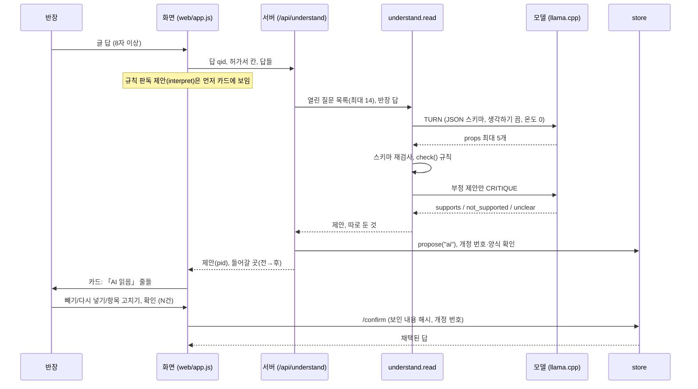
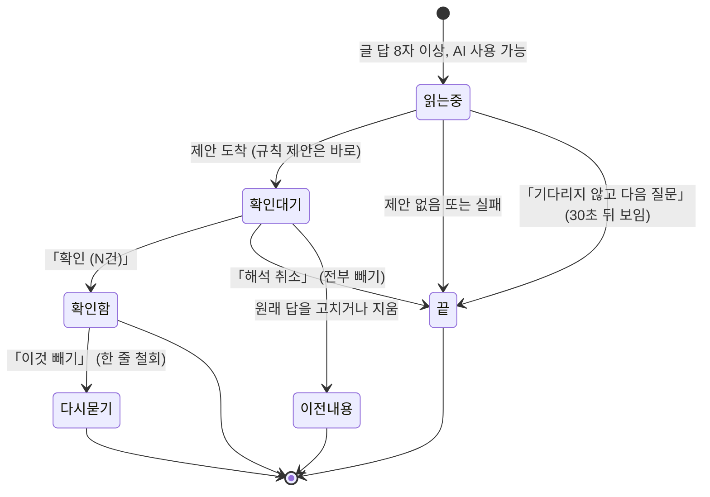

# 05b. AI 판독 — 반장의 글 답을 모델이 읽는 방법

반장이 질문에 길게 적은 답에는 다른 질문의 답이 자주 섞여 있습니다. croScan은 사내(온프레미스) 언어 모델 하나로 그 말을 읽습니다. 그리고 「이 말은 저 질문의 답 같다」고 **제안**만 합니다. 서버가 제안을 규칙으로 다시 검사합니다. 반장이 카드에서 확인한 것만 답이 됩니다.

**이 문서에서 알 수 있는 것**
- 반장 답 하나가 모델에 어떻게 들어가고(TURN), 무엇이 돌아오는지
- 서버가 모델 제안을 버리거나 따로 두는 규칙(`understand.check()`)
- 반장이 확인하는 카드(유지, 「이것 빼기」, 「다시 넣기」, 「항목 고치기」)와 저장 방식
- 모델 호출 한도, 실패·시간 초과 때 규칙 질문으로만 가는 방식
- 모델 서버(라온-1 미니, llama.cpp, CPU)의 구성

**목차**
1. [무엇을](#1-무엇을)
2. [왜](#2-왜)
3. [어떻게: 흐름](#3-어떻게-흐름)
4. [모델에 주는 것(TURN 프롬프트)](#4-모델에-주는-것turn-프롬프트)
5. [서버 검사 check()](#5-서버-검사-check)
6. [부정 답 한 번 더 보기(CRITIQUE)](#6-부정-답-한-번-더-보기critique)
7. [확인 카드](#7-확인-카드)
8. [제안 저장](#8-제안-저장)
9. [NORMALIZE·PHRASE·미리 읽기](#9-normalizephrase미리-읽기)
10. [한도](#10-한도)
11. [실패·시간 초과](#11-실패시간-초과)
12. [모델 서버](#12-모델-서버)
13. [코드 어디](#13-코드-어디)
14. [시험](#14-시험)
15. [한계](#15-한계)

---

## 1. 무엇을

- 반장이 어떤 질문에 8자 이상 글로 답하면, 모델이 그 글을 읽습니다. 모델은 같은 허가서의 **아직 열린 규칙 질문** 가운데 그 글이 이미 답한 것을 고릅니다.
- 모델은 질문 번호, 그 질문의 보기 하나, 짧은 값, 누구 이야기인지(우리/다른 팀), 예정인지 했다는 말인지, 그리고 **근거가 된 원문 구절**을 냅니다.
- 서버가 검사해 통과한 것만 카드에 「AI 읽음」으로 보입니다. 반장이 「확인」을 눌러야 그 질문의 답이 됩니다.
- 모델은 질문을 새로 만들거나, 칸을 쓰거나, 판정을 하지 않습니다. 「AI가 판단」하지 않습니다.

## 2. 왜

- 반장은 「13시부터 15시까지요, 러그는 가스로 6개 떼요, 옆에서 도장팀이 터치업한다고 들었어요」처럼 한 번에 여러 가지를 말합니다. 규칙 판독(정해진 말 목록)만으로는 놓치는 것이 많습니다.
- 그렇다고 모델 말을 그대로 쓰면, 다른 팀 작업이 우리 작업으로 들어갈 수 있습니다. 「아마」나 「4명이 아니라 6명」 같은 말이 확정 값이 될 수도 있습니다.
- 그래서 세 겹으로 막습니다: 모델은 정해진 모양(JSON 스키마)으로 고르기만 하고 → 서버가 원문과 대조하고 → 반장이 확인합니다.
- 근거 설계: [`docs/reference/AI도입계획_설계서.md`](reference/AI도입계획_설계서.md) §1.4, §4, §9, §10, §19, §22. 문서와 코드가 다르면 코드가 맞습니다.

## 3. 어떻게: 흐름

- 규칙 판독(`augment.interpret()`)이 먼저 돕니다. 장소(L1·L7), 시간(T0·T1), 작업인원, 러그 방법·개수(HT1), 러그 회수(HT2), 감시 인원(W1)을 정해진 방식으로 읽습니다. 이 결과도 바로 답이 되지 않습니다. 같은 카드에 「확인 대기 제안」으로 올라갑니다.
- 규칙이 이미 읽은 제안은 모델에 다시 묻지 않습니다(`do_understand`가 그 제안을 답 목록에 넣어 넘김).

## 4. 모델에 주는 것(TURN 프롬프트)

TURN은 반장 답 하나를 읽는 모델 호출입니다. 이 프롬프트는 [`server/understand.py`](../server/understand.py) `read()`가 만듭니다.

**대상 질문(`candidates`)**
- 같은 허가서, 아직 답 없음, 원래 질문 자신이 아님
- extra 등급 아님, 「모름」 말고 보기가 있음. 등급의 `core`는 비교에 필요한 기본 질문이고, `extra`는 기본 질문 뒤에 묻는 보충 질문입니다. 이 등급은 필수·선택 구분과 다른 것입니다.
- 다시 묻기·상충 확인(A1~A5, U1, C5, C6)은 제외: 반장 본인이 답해야 함
- 규칙 순위대로 최대 14개(`MAX_Q`). CPU에서 프롬프트를 짧게 하려고 둔 상한입니다.

**메시지 순서**
1. system: 규칙 5개
   - 답에서 이어진 한 구절을 그대로 quote로 붙입니다. 여러 곳을 이어 붙이지 않습니다. 구절이 없으면 고르지 않습니다.
   - 보기는 그 질문의 보기 id에서만. 「(값)」 표시 보기만 v에 값을 씁니다. 개수·인원은 숫자만.
   - 다른 팀·다른 작업 이야기는 who=other.
   - 앞으로 할 일은 when=plan, 했다고 말한 것은 done, 아니면 none.
   - 말하지 않은 값은 만들지 않습니다. 모름은 고르지 않습니다. 애매하면 고르지 않습니다.
2. 예시 1~2개(`examples`): 열린 질문이 가장 많이 속한 묶음(시간·장소·높이·회수·방법·설비·전원·다른 작업·계통·인원)의 예시와 일반 예시. 모두 검토한 합성 예시입니다. 공개된 사례 예시가 있으면 그것을 먼저 씁니다(`cases.example`).
3. user: 「남은 질문: Q1 … 보기: id=라벨(값) …」 + 「질문: (원래 질문)」
4. assistant: 고정 문장 「알겠습니다. 반장의 답을 주세요.」
5. user: 「반장의 답: …」

질문 목록과 반장 말은 다른 메시지로 나눴습니다. 모델 서버의 프롬프트 캐시(앞서 읽은 부분을 기억해 두는 곳)가 마지막 메시지 앞까지만 남기 때문입니다(코드 주석, 2026-10-31 측정). 앞부분은 미리 읽어 둘 수 있습니다(9장).

**답의 모양(`_schema`)**
- `props`: 최대 5개. 각 `{q, c, v, who, when, quote}`
- q는 Q1~Qn, c는 보기 id, who는 self/other/unknown, when은 plan/done/none (모두 정해진 값만)
- v 최대 40자, quote 최대 40자
- `next`: 다음에 물을 만한 질문 번호(다음 문구 준비에 씀)
- croScan은 모델 서버가 스키마를 지킨다고 믿지 않습니다. 그래서 서버가 같은 조건으로 다시 검사합니다(`_valid`). 어기면 실패(schema)로 봅니다.

## 5. 서버 검사 check()

서버는 모델 제안을 하나씩 아래 순서로 봅니다. 결과는 셋입니다: 카드에 보임 / 따로 남김(apart) / 버림(dropped, 이유와 함께 기록).

| 순서 | 검사 | 걸리면 |
|---|---|---|
| 1 | 그 질문 번호가 목록에 있나 | 버림 「없는 질문」 |
| 2 | quote가 반장 답 안에 있나(띄어쓰기·문장부호 무시) | 버림 「구절이 답에 없음」 |
| 3 | quote가 **문장 하나** 안에 드나(마침표·물음표·느낌표·줄바꿈 기준) | 버림 「인용이 문장 하나에 들지 않음」 |
| 4 | 그 문장이 스스로 고치는 말인가(「아니라」, 「아니고」, 「정정」, 「잘못 적/썼/말」) | 버림 「정정이 섞인 문장(따로 확인)」 |
| 5 | 불확실한 말(「아마」, 「것 같아요」, 「…인지 확인 중」) | 버림 「확실하지 않은 말」 |
| 6 | 미정·조건(「배정 보고 정할 거예요」, 「바람 세면」) | 버림 「미정·조건이 붙은 말」. 「측면·단면·도면」 같은 명사의 「면」은 조건이 아님 |
| 7 | 원래 질문의 답 전체를 다른 질문의 답으로 씀(자유 답은 제외) | 버림 |
| 8 | 모델이 「우리」라 했는데 문장에 다른 팀이 나옴 | 누구인지 「불분명」으로 바꿈 |
| 9 | 우리 작업 이야기가 아님 | **따로 남김** 「다른 팀·다른 작업 이야기」 또는 「누구 이야기인지 불분명」. 예외: 다른 작업을 묻는 질문(B3 등 `ABOUT_OTHERS`)에 「있음(yes)」이고, 다른 팀이고, 지금 일일 때만 제안으로 둠 |
| 10 | 지난 일(「어제」, 「끝냈」, 「마쳤」)인데 모델이 done이라 하지 않음 | 버림 「지난 일을 말한 문장」 |
| 11 | 다른 작업 질문에 있음/없음인데 문장에 다른 팀·병행 말이 없음 | 버림 |
| 12 | 그 질문의 보기가 아님, 같은 질문 두 번 | 버림 |
| 13 | 「없음·안 함·해당 없음」 보기인데 문장에 부정 말이 없음 | 버림 「없다는 말이 문장에 없음」 |
| 14 | 값을 적는 보기인데 값이 없음 | 버림 |
| 15 | 값의 숫자·번호가 그 문장에 있나(`_supported`): 인원은 「명」, 개수는 「군데·개·곳」, 시간은 「오후 n시」를 n+12로도 인정, 「1.5m」를 「15m」로 바꾸지 못함, 한글 수(「네 명」=4)도 셈 | 숫자가 안 맞으면, quote 원문이 그대로 값 검사를 통과할 때만 원문을 값으로 씀(「원문 그대로」 표시). 아니면 버림 「값이 문장과 다름」 |
| 16 | 반장이 직접 적은 답과 같은 값 검사(`augment.check_value`) | 버림(그 이유) |
| 17 | 같은 구절이 여러 질문의 답으로 쓰임 | 값에 숫자·번호가 있을 때만 남김(「작업자 4명, 감시인 1명」). 아니면 버림 |

**약한 표시(weak).** HT2(러그 회수), LO3(차단·복구), B3(다른 작업), T6(시간 차이 이유)는 그 질문의 핵심 말이 문장에 보여야 합니다(`ITEM_NEEDS`). 이 검사는 부정 보기(`no`, `none`, `na`)를 뺀 제안에만 합니다. 핵심 말이 안 보여도 버리지 않습니다. 대신 「질문 내용이 문장에 직접 보이지 않음: 맞으면 「다시 넣기」」 표시를 붙입니다. 위 표의 다른 검사를 모두 통과한 제안만 **체크 해제 상태로** 카드에 보입니다. 다른 검사에 걸린 제안은 약한 표시가 있어도 통과하지 못합니다. 넣을지는 반장이 정합니다(설계서 §22: 「예열 2시간 포함입니다」가 T6에서 버려지던 문제).

**미확인 원자.** 제안이 그 질문의 일부만 말하면(예: 가스절단은 말했지만 러그 개수는 없음) 빠진 것을 `unread`로 붙입니다. 카드에 「미확인: 러그 개수」로 보입니다.

## 6. 부정 답 한 번 더 보기(CRITIQUE)

[`server/critique.py`](../server/critique.py) `review()`.

- 「없음·안 함·해당 없음」 제안(원문 그대로 값이 아닌 것)은 안전 신호를 낮출 수 있습니다. 그래서 확인 카드에 올리기 전에 모델에 한 번 더 묻습니다.
- 서버가 「질문 → 보기(값)」 주장을 틀로 만듭니다. 모델은 supports / not_supported / unclear 중 하나만 고릅니다. 화면에 보이는 글은 모델이 쓰지 않습니다.
- supports면 카드에 그대로 보입니다(반장이 여전히 확인).
- 그 밖(not_supported, unclear, 실패, 시간 부족 3초 미만)이면 **따로 남김** 「뜻 확인 필요 — 따로 묻기」. 그 질문은 열린 채로 남고, 규칙 질문으로 다시 묻습니다.
- 이 검사는 원래 읽기와 같은 기한(한 요청 60초) 안에서 합니다. 남은 시간이 없으면, 검사 없이 제안을 넘기지 않습니다. 붙잡아 둡니다.

## 7. 확인 카드

[`web/app.js`](../web/app.js) `readCard()`. 답 하나에 카드 하나입니다(「이 답을 이렇게 읽었습니다」).

**한 줄에 보이는 것**
- 항목 이름: 값(보기 라벨과 값을 같이, 예 「가스절단 · 6개」)
- 「AI 읽음」 표시(확인 뒤 「확인함 → 반영본에 기입」)
- 미확인 원자, 시점(「예정」, 「했다고 답함」, 「시점 미확인」), 다른 작업이면 「다른 작업 ·」
- 「원문 그대로」(5장 15번), 약한 표시
- ← 「근거 구절」
- 들어갈 곳: 반영본 칸의 전→후 값, 또는 별지(`reflect.destination`)

**누를 수 있는 것(확인 전)**
- **유지**: 기본은 체크된 상태. 약한 표시 줄만 처음부터 해제 상태입니다.
- **「이것 빼기」 / 「다시 넣기」**: 그 줄을 이번 확인에서 빼거나 다시 넣습니다.
- **「항목 고치기」**: 입력칸이 열립니다. 반장이 적은 값은 그 질문에 대한 **반장 본인의 답**이 됩니다(같은 보기, 고친 값). 그 줄은 카드에서 빠집니다. 값을 적는 보기가 아니면 받지 않습니다. 서버 값 검사에 걸리면 받지 않습니다.
- **「확인 (N건)」**: 체크된 줄만 채택, 나머지는 거절. 0건이면 누를 수 없습니다.
- **「해석 취소」**: 전부 거절.

**확인 뒤**
- 채택한 줄마다 「이것 빼기」가 있습니다. 누르면 그 답을 철회하고 그 질문을 다시 묻습니다.

**따로 남김 목록.** 카드 아래에는 「따로 남김 · 우리 작업 답에 넣지 않음」 목록이 있습니다. 여기에 다른 팀 이야기, 누구 이야기인지 모를 말, CRITIQUE가 붙잡은 부정 답이 보입니다. 줄마다 원문 구절과 이유가 함께 나옵니다.

**카드도 묻기 1회입니다.** 처음 확인할 것이 생길 때 `issueAsk("card")`로 한도를 받습니다. 한도를 받지 못하면(한도·마무리 뒤·규칙 질문 몫) 화면에 「이 읽기는 확인하지 않습니다. 적으신 말은 원문 그대로 남고 안전팀 확인으로 넘어갑니다」라고 보입니다. 그리고 AI 읽기를 멈춥니다.

**보인 것 = 확인한 것.** 확인 요청에는 카드가 보인 제안들의 해시(FNV-1a, `shownDigest` = `store.digest`)와 그때의 개정 번호를 붙입니다. 그 사이 제안이나 답이 바뀌었으면 서버가 거절합니다(409). 그러면 카드에 「이 카드는 쓰지 않습니다」가 뜹니다. 예외가 하나 있습니다. 그 뒤의 개정이 모두 제안 추가(`propose`)로만 생겼다면 개정 번호가 달라도 확인을 받습니다(`store._only_readings()`). 이때도 보인 제안의 해시·원답·양식·상태 검사는 그대로 합니다. 같은 확인을 두 번 보내도 한 번만 처리합니다(`action_id`).

## 8. 제안 저장

[`server/store.py`](../server/store.py) `propose()`, `pending()`, `decide()`.

- 제안은 `proposals` 표에 「proposed」로 저장합니다. 출처(rule/ai), 원래 답의 키와 해시, 그 쪽 양식 값의 해시, 값(선택·값·구절·시점·누구), 사실 속성(부정 여부, 단정 여부, 예정/했음), 판 번호를 함께 둡니다.
- 읽는 동안 개정이 바뀌었으면 거절합니다. 다른 답만 늘었고 양식이 그대로면 받습니다. 원래 답이 바뀌었으면(또는 바뀌었다가 같은 말로 돌아왔으면) 거절합니다.
- 이미 반장이 직접 답했거나 채택된 읽기가 있는 질문에는 제안을 만들지 않습니다.
- 같은 말에서 같은 읽기는 두 번 저장하지 않습니다. 거절·철회된 읽기는 같은 말에서 다시 내지 않습니다.
- `decide()`는 전부 처리하거나, 하나도 처리하지 않습니다. 채택된 제안은 반장 답(`pid` 붙음)으로 계산에 들어갑니다.
- 서버는 클라이언트가 「읽었다」고 보낸 값을 믿지 않습니다. 계산은 반장이 직접 적은 답과 서버에 저장된 채택 제안만 씁니다(`store.typed_of`, `app._calc_answers`).

## 9. NORMALIZE·PHRASE·미리 읽기

**NORMALIZE(정정 문장 다시 읽기)** — `understand.normalize()`
- 서버가 「4개가 아니라 6개」처럼 스스로 고치는 문장을 「아니라」 앞뒤로 나눕니다. 모델은 어느 쪽이 지금 맞는지(after/before/none), 보기, 값만 고릅니다. 값은 고른 쪽 문장에 있어야 합니다.
- 다른 작업을 묻는 질문에는 하지 않습니다.
- **지금 앱 경로에서는 꺼져 있습니다.** `read(normalize_on=False)`가 기본입니다. [`server/app.py`](../server/app.py)도 이것을 켜지 않습니다. 그래서 정정이 섞인 문장은 5장 4번 검사에서 버려집니다. 그 질문은 규칙 질문으로 다시 묻습니다.

**PHRASE(다음 질문 문구 고르기)** — `understand.phrase()`, `/api/understand/phrase`
- 다음에 물을 질문 1~2개의 문구를 배경에서 준비합니다. 앞 판독이 정한 `next`를 먼저 봅니다.
- 모델은 세 가지 중 고르기만 합니다: 그대로(keep) / 짧게(short: `need_catalog.FALLBACK` 문장) / 앞 답 하나를 짚고 짧게(ref). 새 문장을 쓰지 않습니다.
- ref는 앞 답과 질문에 같은 낱말이 실제로 있을 때만 씁니다. 그때 문구는 「앞에서 「…」라고 하셨습니다. (짧은 질문)」이 됩니다.
- 다시 묻기·상충 확인 질문은 제외. 검토 1건에 8회(`PHRASE_MAX`). 준비가 안 됐거나 질문 글이 바뀌었으면 규칙 문구 그대로 보입니다.

**미리 읽기(warm)** — `understand.warm()`, `/api/understand/warm`
- 값을 적는 보기가 있는 질문이 화면에 뜨면, croScan은 질문 목록을 모델 캐시에 미리 읽힙니다. 그 답이 함께 답할 수 있는 질문들의 목록입니다(`llm.prefill`, 출력 1토큰, 쓰지 않음).
- 나중에 판독할 때 목록이 그대로면 반장 말만 새로 읽습니다. 목록이 바뀌었으면 새 목록으로 읽습니다.
- 검토 1건에 16회(`store.WARM_CALLS`), 판독 한도와 따로 셉니다.

## 10. 한도

| 한도 | 값 | 어디 |
|---|---|---|
| 모델 호출 | 검토 1건에 30회(TURN, CRITIQUE, NORMALIZE, PHRASE 등) | `store.LLM_CALLS`, 호출 전에 `charge_llm()` |
| 미리 읽기 | 검토 1건에 16회 | `store.WARM_CALLS` |
| 문구 고르기 | 검토 1건에 8회 | `understand.PHRASE_MAX` |
| 판독 한 번의 질문 수·제안 수 | 질문 14, 제안 5, 값·구절 40자 | `MAX_Q`, `MAX_PROPS`, `MAX_V`, `MAX_QUOTE` |
| 판독 기한 | 요청당 60초(판독 + CRITIQUE 합쳐), 생각하기 끔 | `app.do_understand`. 측정 모드(`CROSCAN_MEASURE=1`)만 10~180초, 생각 0~256 |
| 화면 쪽 기다림 | 30초에 「평소보다 오래 걸립니다」와 「기다리지 않고 다음 질문」, 65초에 끊음 | `readCard()` 타이머 |
| 확인 카드 | 묻기 12회 안의 1회, 규칙 질문 몫은 못 씀 | [05 문서 5장](05_멀티턴_질문.md#5-순서와-한도) |
| AI 질문(분석이 찾은 필요) | 분석 호출 한 번에 최대 2개를 더함. 허가서 수정 뒤 변경 분석까지 합쳐 검토 1건에 누적 최대 8개 저장. 실제로 묻는 것은 규칙 질문 몫을 뺀 남은 묻기(12회 안)만 | `analyze.MAX_NEEDS`, `store.MAX_NEEDS`·`NEEDS_PER_CALL`, `need_catalog.order()`, `app._reserve()` |

**모델 자리 순서(`llm._Slot`).** CPU 서버의 자리 하나를 필요 순서로 나눕니다: 0 반장 답 판독(FG) → 1 사람이 지금 요청한 것(ASKED) → 2 미리 해 두는 일(PREPARED: 업로드 분석 등) → 3 미리 읽기(WARM). 급한 호출이 오면 2·3번 호출은 끊습니다. 사람의 호출은 다른 호출 때문에 끊지 않습니다.

## 11. 실패·시간 초과

모델이 안 되면 **규칙 질문만으로** 검토가 이어집니다. 추측으로 채우지 않습니다.

| 상황 | 코드 | 결과 |
|---|---|---|
| 모델 호출 한도 넘음 | `budget` | 판독 없음 |
| 자리가 안 나 기한 안에 시작 못 함 | `busy` | 판독 없음 |
| 기한 넘음, 남은 시간 3초 미만 | `timeout` | 요청을 닫아 모델 자리를 풉니다 |
| 모델 서버 연결 안 됨 | `down` | 화면이 60초 동안 AI 판독을 끔 |
| HTTP 오류, 답이 잘림, JSON 아님, 스키마 어김 | `http`, `length`, `json`, `schema` | 판독 없음 |
| 화면이 끊음(다른 질문으로 감, 65초) | `cancelled` | 모델 호출 취소 |
| 읽는 동안 답·개정이 바뀜 | `stale_revision`, `stale_answer` | 제안 저장 거절 |

- 카드에는 「AI 결과를 준비하지 못함 · 적으신 말은 그대로 남겼습니다」(연결 안 됨이면 「규칙으로만 읽었습니다」)가 보입니다. 화면 위 알림에서 「다시 시도」할 수 있습니다.
- 읽지 못한 질문은 그대로 열려 있어 규칙 질문으로 묻습니다. 부정 제안이 검사를 못 받으면 넘기지 않고 붙잡습니다(6장).
- 업로드 때 돌던 AI 분석이 실패하면 별지에 「AI 분석을 마치지 못함(규칙 질문으로만 확인)」이 남습니다(`app._budget`).

## 12. 모델 서버

**모델**: 크래프톤의 라온-1 미니 프리뷰(Raon-1 mini preview, Apache 2.0). 기본 구성은 croScan과 같은 서버의 llama.cpp를 씁니다(온프레미스). 실제 요청 주소는 환경 변수 `LLM_URL`로 바꿀 수 있습니다. 코드가 외부 주소를 막지는 않습니다.

**[`llm/Dockerfile`](../llm/Dockerfile)**
- llama.cpp의 OpenAI 호환 서버(`llama-server`)를 크래프톤 llama.cpp 브랜치의 **고정 커밋**으로 빌드합니다(원래 llama.cpp 저장소에는 이 모델 지원이 아직 들어가지 않았음).
- CPU 범용 빌드: CPU 종류(SSE4~AVX-512)마다 백엔드를 따로 만듭니다. 서버가 시작할 때 그 CPU에 맞는 것을 고릅니다. 그래서 다른 CPU 서버로 옮겨도 다시 빌드하지 않습니다.
- 기반 이미지는 ubuntu 24.04를 해시로 고정했습니다. 실행은 일반 사용자 계정으로 합니다. 포트 8000, `/health` 상태 검사(첫 시작은 모델을 읽느라 오래 걸려서 10분 여유를 둠).
- **모델 파일은 이미지에 넣지 않습니다.** 서버의 모델 폴더를 읽기 전용으로 붙입니다(파일 위치·받는 법은 `DOCKER.md`).
- [`docker-compose.yml`](../docker-compose.yml)의 `llm` 서비스는 `--profile ai`로만 뜹니다. 문맥 16K, 동시 1개, 포트는 서버 자기 자신(127.0.0.1)에게만 엽니다.

**[`server/llm.py`](../server/llm.py)** — 모델 호출을 모은 곳
- 일반 분석·판독은 `llm.call_json()`을 씁니다. 미리 읽기는 `llm.prefill()`을 씁니다. 옛 `/api/chat`은 기본으로 꺼져 있습니다. 이것을 켜면 이 공통 경로를 거치지 않고 모델 서버를 직접 부릅니다.
- `call_json(kind, …)`: 호출마다 종류(TURN·CRITIQUE·NORMALIZE·PHRASE 등)가 붙은 작업입니다. JSON 스키마는 `response_format`으로 보냅니다. 돌아온 JSON은 각 호출부가 다시 검사합니다.
- 온도 0(같은 요청에 같은 출력, 이 빌드 기준. 맞는 읽기라는 보장은 아님). 생각하기는 판독에서 끕니다(`enable_thinking: false`). 캐시 사용(`cache_prompt`).
- 기한은 자리를 잡으려고 기다린 시간부터 셉니다. 기한을 넘으면 요청을 닫습니다. 그러면 llama.cpp가 자리를 풉니다.
- 실패는 `LlmFail(code)`로 올립니다. 부르는 쪽은 규칙으로 돌아갑니다.
- `prefill()`: 캐시만 채우고 출력은 쓰지 않음. `status()`: `/health` 확인.
- 주소·모델 이름은 환경변수 `LLM_URL`, `LLM_MODEL`.

## 13. 코드 어디

| 하고 싶은 일 | 파일·함수 |
|---|---|
| 프롬프트 규칙·예시 | [`server/understand.py`](../server/understand.py) `SYSTEM`, `BANK`, `GROUP`, `examples()`, `_head()`, `_msgs()` |
| 판독 대상 질문 | `candidates()`, `MAX_Q` |
| 서버 검사 규칙 | `check()`, `_supported()`, `_sentence()`, `ITEM_NEEDS`, `CORRECTION`, `PAST`, `OTHER_TEAM`, `UNDECIDED` |
| 부정 답 재검사 | [`server/critique.py`](../server/critique.py) `review()`, `needs_check()`, `verdict()` |
| 정정 문장·문구·미리 읽기 | `normalize()`, `phrase()`, `phrase_text()`, `warm()` |
| 요청 경로 | [`server/app.py`](../server/app.py) `/api/understand`(`do_understand`), `/api/understand/phrase`, `/api/understand/warm`, `/api/dialogues/{sid}/confirm`·`decide` |
| 규칙 판독(카드의 규칙 줄) | [`server/augment.py`](../server/augment.py) `interpret()`, `app._normalize()` |
| 제안 저장·확인 | [`server/store.py`](../server/store.py) `propose()`, `pending()`, `decide()`, `digest()`, `charge_llm()`, `warm()` |
| 카드 화면 | [`web/app.js`](../web/app.js) `readCard()`, `fixRow()`, `saveFix()`, `shownDigest()`, `phraseAhead()`, `warmAsk()` |
| 모델 호출 | [`server/llm.py`](../server/llm.py) `call_json()`, `prefill()`, `_Slot` |
| 모델 서버 빌드 | [`llm/Dockerfile`](../llm/Dockerfile), [`docker-compose.yml`](../docker-compose.yml) `llm` |

## 14. 시험

| 시험 | 보는 것 | 2026-11-01 로컬 결과 |
|---|---|---|
| [`tools/check_understand.py`](../tools/check_understand.py) | `check()` 규칙(구절·문장·숫자·다른 팀·지난 일·정정·부정), NORMALIZE·PHRASE 서버 쪽. 모델 대신 만든 답을 씀 | 53/53 |
| [`tools/check_critique_link.py`](../tools/check_critique_link.py) | CRITIQUE와 계획서 연결 제안의 서버 쪽. 모델 대신 만든 답 | 41/41 |
| [`tools/check_dialogue_api.py`](../tools/check_dialogue_api.py) | 확인 해시·개정, 작업·이벤트, 제안이 들어갈 곳 | 이번에 실행하지 않음 |
| [`tools/eval_turn.py`](../tools/eval_turn.py) | 실제 모델로 TURN 판독(맞음·틀림·놓침, 다른 팀을 우리로 넣은 수, 호출 시간) | 모델이 있는 서버에서만 |

실행: `python tools/check_understand.py`. Windows 콘솔에서는 `PYTHONIOENCODING=utf-8`을 먼저 둡니다.

## 15. 한계

- 모델 제안은 반장이 확인해야 답이 됩니다. 반장이 틀린 제안을 확인하면 그대로 들어갑니다. croScan은 원문 구절과 들어갈 곳을 함께 보여 줄 뿐입니다.
- 서버 검사는 정해진 말 목록으로 합니다. 목록에 없는 조건·불확실 표현은 지나갈 수 있습니다.
- 정정이 섞인 문장은 지금 읽지 않습니다(NORMALIZE 꺼짐). 그 질문은 규칙으로 다시 묻습니다.
- CPU 서버라 느립니다. 기한 60초 안에 못 끝나면 그 답은 규칙으로만 읽힙니다.
- 같은 레일 크레인(LI3)·복구 전 다른 팀 작업(LO6) 질문은 다른 팀 이야기를 묻습니다. 그런데 보기가 「있음(text)」입니다. 그래서 모델이 다른 팀 말로 읽은 것은 모두 「따로 남김」으로 갑니다. 반장이 그 질문에 직접 답해야 합니다.
- 자연어 평가 1,200건은 §21 보강 전 코드로 돌린 결과입니다. 그 뒤 코드를 바꾼 다음에는 다시 돌리지 않았습니다(설계서 §21·§22).
