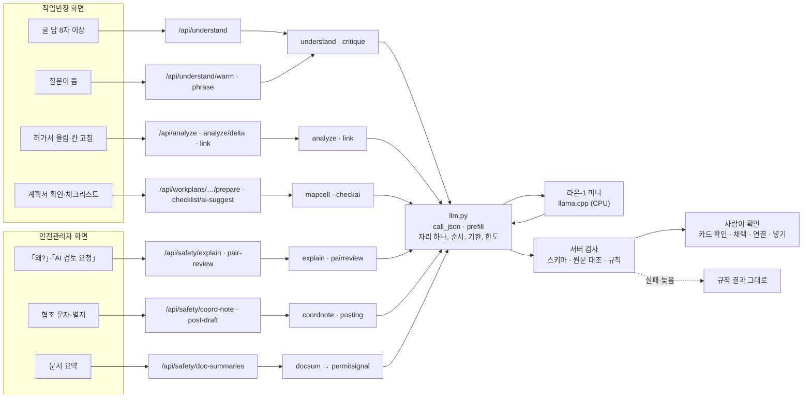

# 05c. 라온이 하는 일 — 백엔드가 언어 모델에 맡기는 작업 전부

croScan 서버는 사내 언어 모델 하나(크래프톤 라온-1 미니 프리뷰, llama.cpp)에 열네 가지 작업을 맡깁니다. 모든 작업은 [`server/llm.py`](../server/llm.py) 한 곳을 거칩니다. 모델은 정해진 목록에서 **고르기만** 합니다. 서버가 그 답을 다시 검사합니다. 사람이 확인해야 결과가 쓰입니다. 이 문서는 그 작업들과 둘레의 로직을 한곳에 모았습니다.

**이 문서에서 알 수 있는 것**
- 모델이 하는 작업 열네 가지: 언제 부르고, 무엇을 넣고, 무엇을 받고, 서버가 무엇을 버리는지
- 「모델은 제안만 한다」 같은 공통 원칙과, 그것을 지키는 코드
- 모델 자리 하나를 나눠 쓰는 순서(FG·ASKED·PREPARED·WARM), 끊기, 기한, 호출 한도
- 모델이 없거나 늦을 때 화면이 무엇을 보이고 무엇이 그대로 되는지
- 어느 시험이 어느 작업을 지키는지, 아직 남은 한계

**목차**
1. [한눈에](#1-한눈에)
2. [왜 고르기만 맡기나](#2-왜-고르기만-맡기나)
3. [모델은 어디에 있나](#3-모델은-어디에-있나)
4. [공통 원칙과 지키는 코드](#4-공통-원칙과-지키는-코드)
5. [모델로 가는 문 llm.py](#5-모델로-가는-문-llmpy)
6. [작업별 로직](#6-작업별-로직)
7. [안전관리자 문서 요약](#7-안전관리자-문서-요약)
8. [모델 자리와 우선순위](#8-모델-자리와-우선순위)
9. [모델이 없을 때](#9-모델이-없을-때)
10. [코드 어디](#10-코드-어디)
11. [시험](#11-시험)
12. [한계](#12-한계)

---

## 1. 한눈에

먼저 낱말 몇 개를 풉니다.
- **작업 이름**: 코드가 모델 호출마다 붙이는 이름입니다(`call_json`의 첫 인자). 로그와 측정에서 이 이름으로 셉니다.
- **JSON 스키마**: 모델 답의 모양을 정한 틀입니다. 어떤 칸이 있고, 각 칸에 어떤 값만 올 수 있는지 정합니다.
- **끝점(endpoint)**: 화면이 서버에 요청을 보내는 주소입니다(예: `POST /api/understand`).
- **검토 한도**: 반장 검토 1건(세션)에 쓸 수 있는 모델 호출 수입니다. 30회입니다(8장).

| 작업 이름 | 쉬운 이름 | 언제 부르나 | 넣는 것 | 받는 것 | 서버 검사(버리는 것) | 결과가 가는 곳 | 못 바꾸는 것 | 실패·시간 초과 때 |
|---|---|---|---|---|---|---|---|---|
| `TURN` | 반장 말 읽기 | 반장이 질문에 8자 이상 글로 답할 때 · `POST /api/understand` | 열린 질문 최대 14개(Q1…), 반장 답, 예시 1~2개 | `props` 최대 5개 `{q,c,v,who,when,quote}`, `next` | 구절이 답에 있나, 한 문장인가, 숫자가 문장에 있나, 다른 팀·정정·불확실·지난 일 등 17가지 | 확인 카드 「AI 읽음」 → 반장이 확인하면 답 | 반장이 직접 적은 답, 질문 목록, 쌍 판정 | 판독 없음. 규칙 질문으로 계속 |
| `TURN_WARM` | 질문 미리 읽히기 | 값을 적는 질문이 화면에 뜰 때 · `POST /api/understand/warm` | TURN과 같은 앞부분(질문 목록) | 없음(출력 1토큰, 버림) | 없음 | 모델 서버의 캐시만 | 모든 것 | 다음 TURN이 목록부터 다시 읽음 |
| `NORMALIZE` | 정정 문장 다시 읽기 | **지금 꺼져 있음** | 질문, 보기, 「아니라」 앞부분·뒷부분 | `{part, c, v}` | 고른 쪽에 값이 있나, 다른 팀·불확실 말, 값 검사 | 확인 카드 | 다른 작업을 묻는 질문 | 제안 없음 |
| `PHRASE` | 다음 질문 문구 고르기 | 질문을 보일 때, 다음 1~2개 · `POST /api/understand/phrase` | 다음 질문 1~2개, 반장의 앞 답 최대 6개 | `out[{t, v, r}]`, v는 keep·short·ref | 번호가 목록 안인가, ref는 같은 낱말이 있을 때만 | 화면의 질문 문구 | 질문 내용·보기 | 규칙 문구 그대로 |
| `CRITIQUE` | 뜻 한 번 더 대조 | TURN의 부정 제안 직후, LINK·PAIR_REVIEW의 관계 | 문장(또는 두 행)과 서버가 쓴 주장 한 줄 | `{v}`: supports·not_supported·unclear | 값이 셋 중 하나인가 | supports만 통과 | 주장 문장 | 붙잡음(따로 남김·연결 안 함·보류) |
| `UPLOAD_ANALYZE` | 업로드 분석 | 검토 시작 때 한 번, 뒤에서 · `POST /api/analyze` | 허가서 칸(F…), 함께 읽을 계획서 칸(W…), 규칙이 이미 묻는 칸, 참고 자료 2~3개 | `needs` 최대 2개 `{t,f,q,f2,q2}` | 구절이 칸에 있나, 규칙 질문과 겹치나, 종류에 맞는 말이 있나 | AI 질문(AI1…) → 답은 별지 | 서류 칸, 규칙 질문 | 「AI 미분석 · 규칙 질문으로 진행합니다.」 |
| `DISCOVER_DELTA` | 고친 칸 다시 읽기 | 허가서 칸을 고치고 4초 뒤 · `POST /api/analyze/delta` | 바뀐 칸과 계획서 칸 | 위와 같음 | 위와 같음 + 바뀐 칸만 | AI 질문 추가 | 위와 같음 | 질문 그대로 |
| `CHECKLIST` | 체크리스트 AI 제안 | 대화를 마칠 때 미리, 체크리스트 단계 · `POST /api/checklist/ai-suggest` | 작업 사실 줄, 후보 C…(최대 24), 기본 항목 B… | `picks` 최대 3, `marks` 최대 6 | 구절이 작업 사실에 있나, 부정·다른 팀이 아닌가, 종류·항목의 말이 있나 | 「AI 제안」 줄 → 반장 「채택」 | 기본 항목의 상태·근거 | 「AI 결과를 준비하지 못함 · 체크리스트는 그대로입니다.」 |
| `MAP_CELL` | 모르는 칸 이름 짝짓기 | 작업계획서 확인 단계에서 미리 · `POST /api/workplans/{token}/prepare` | 모르는 칸 이름과 값 최대 12개, 알려진 항목 36개 | `maps[{l, k}]` | 값의 꼴이 맞나, 그 항목이 이미 읽혔나 | 「AI 제안」 → 「연결」·「아님」 | 계획서의 값 | 제안 없음 |
| `LINK` | 계획서 연결 제안 | 업로드 분석 뒤 · `POST /api/dialogues/{sid}/link` | 허가서 칸 최대 12, 후보 계획서 최대 3개(칸 각 12) | `links[{p, r, f, w}]` | 연결 관계인가, 두 행이 있나, 공통 낱말, CRITIQUE | 연결 카드 → 「같은 작업으로 연결」·「아님」 | 위험 쌍 목록, 가져올 값 표 | 연결 없음 |
| `PERMIT_SIGNAL` | 허가 검토 신호 판별 | 안전관리자가 문서 요약을 처음 불러올 때, 뒤에서 · `GET /api/safety/doc-summaries` | 규칙이 못 정한 계획서 구절 최대 8개 | `k[{c, t}]` | 허가 5종 중 하나인가, 검사·금지 말이 아닌가 | 문서 요약의 「AI 제안」 신호 | 쌍·순위·서류 | 규칙 신호만 |
| `PAIR_REVIEW` | 규칙 밖 AI 검토 권장 | 안전관리자의 「AI 검토 요청」 · `POST /api/safety/pair-review`, 제출 뒤 앞 20쌍 미리 | 두 작업의 사실 행 각 최대 10 | `{rel, a, b, ask}` | 사전 거르기, 양쪽 행, 질문 보기, CRITIQUE | 「AI 검토 권장 · 규칙 판정 아님」 | 규칙 쌍·순위·점수 | 「AI 검토를 마치지 못했습니다. 규칙 판정은 그대로입니다.」 |
| `EXPLAIN` | 「왜?」 자유 질문 | 안전관리자가 「이 판정에 대해 묻기」에 직접 적을 때 · `POST /api/safety/explain` | 고를 수 있는 의도, 사실 주장 F… | `{intent, facts}`(facts 최대 6) | id가 주어진 것인가, 설명 검증기 7가지 | 「왜?」 답의 틀 | 판단 문장, 아직 확인할 것 | 「쓴 서류 값」 설명 |
| `WRITE` (협조 문자) | 협의할 점 고르기 | 협조 문자 창을 열 때 · `POST /api/safety/coord-note`, 제출 뒤 1순위 5쌍 미리 | 확인된 반장 사실 F…, 확인할 것 C… | `{f, c}` | 번호가 목록 안인가 | 문자 아래 제안 → 「문자에 넣기」 | 문장 틀 | 첫 사실·첫 항목으로 서버가 문장을 씀 |
| `WRITE` (게시 문안) | 게시 별지 초안 고르기 | 별지의 「AI 문안 보충 보기」 · `POST /api/safety/post-draft` | 할 일 A…, 확인된 답 F…, 착수조건 C… | `{a, f, c}` | 번호가 목록 안인가 | 별지 초안 → 「문안 채택」 | 문장 틀, 발행된 별지 | 「AI 결과를 준비하지 못함 · 규칙 문안 그대로 씁니다」 |

- 작업 이름 `WRITE`는 두 모듈([`coordnote.py`](../server/coordnote.py), [`posting.py`](../server/posting.py))이 같이 씁니다. 그래서 위 표는 열네 줄이 아니라 열다섯 줄입니다.
- 모델이 **자유 글자**를 쓰는 칸은 넷뿐입니다: TURN의 `v`·`quote`(각 40자), NORMALIZE의 `v`(40자), UPLOAD_ANALYZE·DISCOVER_DELTA의 `q`·`q2`(각 60자), CHECKLIST의 `quote`(60자). 이 글자는 모두 원문에 있는지 서버가 대조합니다. 나머지 답은 모두 정해진 id나 정해진 낱말(enum)입니다.
- 옛 자유 대화 `POST /api/chat`은 기본으로 꺼져 있습니다(5.8절).

## 2. 왜 고르기만 맡기나

- 반장은 한 번에 여러 사실을 말합니다. 서류에는 「그 크레인」처럼 가리키는 대상이 흐린 말도 있습니다. 정해진 말 목록(규칙)만으로는 놓치는 것이 있습니다. 그래서 모델에게 읽기를 돕게 합니다.
- 그런데 모델이 자유 문장을 쓰면 틀린 사실이 섞일 수 있습니다. 검토 기록에는 「4개」가 「4시」가 되거나, 「15분」이 「15시」가 되거나, 이름이 들어간 일이 있습니다(코드 주석, 2026-10-31 Codex 검토).
- 다른 팀 작업이 우리 작업으로 들어가거나, 「없음」 한마디로 안전 신호가 낮아질 수도 있습니다.
- 그래서 croScan은 세 겹으로 막습니다. ① 모델은 서버가 준 번호·보기에서 고릅니다. ② 서버가 원문과 규칙으로 다시 검사합니다. ③ 사람(작업반장·안전관리자)이 확인합니다.
- 판정은 사람이 합니다. croScan은 승인·일정·작업 차단을 하지 않습니다. 「AI가 판단」하지 않습니다.
- 근거 설계: [AI도입계획_설계서](reference/AI도입계획_설계서.md) §1.4(작업 종류), §9(검사), §10(속도·자리). 설계서와 코드가 다르면 코드를 믿습니다.

## 3. 모델은 어디에 있나

- 화살표 끝의 「서버 검사」는 각 모듈 안에 있습니다. `llm.py`는 JSON을 받아 오기만 합니다. 모양과 뜻은 부르는 쪽이 다시 봅니다.
- PDF에서 글자를 꺼내는 일(판독)은 모델을 쓰지 않습니다. 그 부분은 [04c PDF 판독](04c_PDF_판독.md)에 있습니다.

## 4. 공통 원칙과 지키는 코드

| 원칙 | 무슨 뜻 | 지키는 코드 |
|---|---|---|
| 모델은 제안만 함 | 모델 답은 칸에 바로 쓰이지 않습니다. 제안 → 검사 → 사람 확인을 거칩니다 | `store.propose()`가 「proposed」로만 저장, `store.decide()`가 확인 때 채택 ([05b §8](05b_AI_판독.md#8-제안-저장)). 체크리스트 AI 항목은 `checkai.item_of()`가 상태 「안전팀 확인」으로 만들고 반장이 「채택」해야 들어감 |
| 정하는 것은 규칙 | 쌍 점수·순위, 체크리스트 기본 상태, 질문 목록과 순서는 규칙이 정합니다 | [`pairs.py`](../server/pairs.py)는 모델을 부르지 않음. [`checklist.py`](../server/checklist.py) `draft()`, [`augment.py`](../server/augment.py) `questions()`도 모델 없음. CHECKLIST의 `marks`는 상태를 바꾸지 않음 |
| 답은 JSON 스키마, 허락된 id만 | 각 호출이 그때 줄 수 있는 번호(Q1…, F1…, C1…)와 보기만 스키마의 `enum`에 넣습니다 | 각 모듈의 `_schema()`. 모델 서버가 스키마를 지킨다고 믿지 않고 `_valid()`·`judge()`·`set(data) == {...}` 같은 검사를 다시 함 |
| 구절은 원문에 있어야 함 | 모델이 옮긴 글자는 원문에 그대로 있어야 합니다 | TURN `understand.check()`(답 안·한 문장 안), UPLOAD_ANALYZE `analyze.check()`(`_norm(q) in _norm(value)`), CHECKLIST `checkai._clause()`, NORMALIZE는 서버가 자른 앞뒤 부분만 씀 |
| 문장은 서버가 씀 | 화면에 보이는 문장은 서버의 틀입니다 | `critique.claim()`, `analyze.KINDS` 질문 틀, `pairreview.judge()`, `explain.fixed()`, `coordnote.sentence()`, `posting.compose()`, `understand.phrase_text()` |
| 사람이 확인 | 반장 카드 「확인 (N건)」, 「채택」, 「연결」, 「같은 작업으로 연결」, 안전관리자 「문자에 넣기」, 「문안 채택」 | 확인 해시·개정 번호 대조(`store.digest`, 409). 링크는 `/api/dialogues/{sid}/link/confirm`, 읽기 연결은 `/api/workplans/{token}/maps` |
| 경보는 모델 때문에 낮아지지 않음 | 「없음」 제안은 한 번 더 대조합니다. 답이 쌍 경보를 지우거나 낮추지 못합니다 | `critique.review()`가 부정 제안을 supports일 때만 넘김. `pairs.floor()`([06 §10.3](06_쌍작업_판정.md#103-floor-경보는-답으로-내려가지-않는다)). PAIR_REVIEW·PERMIT_SIGNAL은 쌍을 만들거나 바꾸지 않음. 체크리스트는 모델이 말하지 않은 항목을 「해당 없음」으로 만들지 않음. `explain.verify()` ④가 「안전합니다」「완료됐」 같은 바꿔 말하기를 막음 |
| 문서 속 지시는 따르지 않음 | 서류 글에 「무시하고 …」가 적혀 있어도 읽을 자료일 뿐입니다 | ANALYZE·CRITIQUE·MAP_CELL·LINK의 `SYSTEM` 문장에 같은 규칙. 어차피 답은 id로만 받음 |
| 모델이 없어도 앱은 돎 | 실패는 「실패」로 알리고 규칙 결과로 갑니다. 추측으로 채우지 않습니다 | `llm.LlmFail`을 부르는 쪽이 받아 빈 결과를 돌려줌. 9장 표 |

## 5. 모델로 가는 문 llm.py

[`server/llm.py`](../server/llm.py)는 182줄입니다. 일반 작업은 `call_json()`, 미리 읽기는 `prefill()`, 상태 확인은 `status()`를 씁니다.

### 5.1 한 번의 호출 call_json()

`call_json(kind, messages, schema, think=128, out_tokens=256, deadline=60.0, temperature=0.0, sid=None, background=False, pri=None)` → `(data, meta)`.

1. **순서 정하기.** `pri`가 없으면 `background=True`는 PREPARED, 아니면 FG입니다(8장).
2. **한도 세기.** `sid`(검토 세션)가 있으면 먼저 `store.charge_llm(sid)`로 한 번을 셉니다. 30회를 넘으면 `LlmFail("budget")`입니다. 셈은 호출 **전에** 합니다.
3. **요청 만들기**(`_payload`).
   - `response_format`: `json_schema`로 스키마를 함께 보냅니다.
   - `temperature` 0, `top_p` 0.95. 같은 요청에는 같은 답이 나옵니다(이 빌드 기준). 맞는 답이라는 뜻은 아닙니다.
   - `cache_prompt: true`: 모델 서버가 앞서 읽은 앞부분을 기억해 둡니다.
   - `think`가 0이면 생각하기를 끕니다(`enable_thinking: false`). 0이 아니면 `reasoning_budget`으로 생각 길이를 묶습니다. `max_tokens`는 `think + out_tokens`입니다.
   - 지금 앱의 모든 호출은 `think=0`입니다. 측정 모드(`CROSCAN_MEASURE=1`)의 TURN만 0~256을 받습니다. 코드 주석에 따르면 생각 길이 제한이 긴 답에서 지켜지지 않았습니다(608토큰, 2026-10-31).
4. **자리 잡기.** `_SLOT.acquire(pri)`를 `deadline - 1`초(최소 0.1초)까지 기다립니다. 못 잡으면 `busy`입니다.
5. **보내기.** 기다린 시간을 뺀 남은 시간이 3초보다 적으면 `timeout`입니다. 남은 시간만큼만 기다립니다. 넘으면 요청을 닫습니다. 그러면 llama.cpp가 자리를 풉니다.
6. **받기.** HTTP 400 이상은 `http`, `finish_reason`이 `length`이거나 빈 답이면 `length`, JSON이 아니거나 객체가 아니면 `json`입니다. 연결이 안 되면 `down`입니다.
7. **돌려주기.** `meta`에 작업 이름, 걸린 시간(`ms`), 기다린 시간(`waited_ms`), 읽은·쓴 토큰 수, 캐시로 건너뛴 토큰 수(`cache_n`)를 담습니다. 자리는 `finally`에서 늘 풉니다.

실패 코드와 화면 결과는 [05b §11](05b_AI_판독.md#11-실패시간-초과)에 표로 있습니다. 부르는 쪽은 스키마 재검사에 걸리면 `schema`를 더합니다.

### 5.2 캐시만 채우기 prefill()

- `prefill(kind, messages, deadline=60.0, pri=ASKED)`는 메시지를 모델 서버의 캐시에 읽히기만 합니다. `max_tokens`가 1이고 생각하기는 끕니다.
- 답은 검사하지도 저장하지도 않습니다. 지금은 TURN_WARM 하나만 이것을 씁니다(`pri=WARM`).
- 검토 한도 30회에 세지 않습니다. 대신 `store.warm()`이 따로 16회까지 셉니다.

### 5.3 자리 하나 _Slot

- CPU 서버에서 모델은 한 번에 한 요청만 처리합니다(`docker-compose.yml`의 `llm` 서비스: 동시 1개, 문맥 16K, [12 §5](12_배포와_운영.md#5-언어-모델-컨테이너-llmdockerfile)).
- 그래서 `_Slot`이 요청을 줄 세웁니다. llama.cpp 안에 요청이 쌓이지 않게 하려는 것입니다.
- 줄은 (순서 번호, 도착 순) 차례입니다. 자리가 비면 다음 사람에게 바로 넘깁니다(`release()`).
- 더 급한 호출이 오면, 자리를 잡고 있는 PREPARED·WARM 호출의 작업(asyncio task)을 취소합니다. FG·ASKED 호출은 다른 호출 때문에 취소되지 않습니다. 줄에서 기다리는 호출도 취소하지 않고 순서만 바뀝니다.
- `stats()`는 지금 누가 자리를 쥐었는지와 기다리는 순서를 돌려줍니다. `app.do_understand`는 `_HOLDER`를 보고 화면 단계를 「대기 중」에서 「답 해석 중」으로 바꿉니다.

### 5.4 기한

| 작업 | 기한 | 출력 토큰(`out_tokens`) |
|---|---|---|
| TURN | 60초(TURN과 그 CRITIQUE를 합쳐) | 480 |
| TURN_WARM | 60초 | 1 |
| NORMALIZE | 30초 | 60 |
| PHRASE | 40초 | 60 |
| CRITIQUE | 남은 시간과 40초 중 작은 값(3초 미만이면 부르지 않음) | 16 |
| UPLOAD_ANALYZE | 60초 | 320 |
| DISCOVER_DELTA | 60초 | 320 |
| CHECKLIST | 120초 | 360 |
| MAP_CELL | 90초 | 칸 수 × 24 + 16 |
| LINK | 90초 | 160 |
| PERMIT_SIGNAL | 60초 | 구절 수 × 20 + 16 |
| PAIR_REVIEW | 60초(검토와 그 CRITIQUE를 합쳐) | 48 |
| EXPLAIN | 30초 | 120 |
| WRITE(협조 문자) | 30초 | 40 |
| WRITE(게시 문안) | 45초 | 40 |

기한은 자리를 기다린 시간부터 셉니다. 그래서 줄이 길면 모델이 읽기도 전에 `busy`나 `timeout`이 날 수 있습니다.

### 5.5 검토 한도

[`server/store.py`](../server/store.py)의 값입니다.

| 한도 | 값 | 무엇을 셈 |
|---|---|---|
| `LLM_CALLS` | 검토 1건에 30회 | `sid`를 넘긴 `call_json` 전부: TURN, NORMALIZE, PHRASE, CRITIQUE(TURN·LINK 안), UPLOAD_ANALYZE, DISCOVER_DELTA, CHECKLIST, MAP_CELL(세션이 있을 때), LINK |
| `WARM_CALLS` | 검토 1건에 16회 | TURN_WARM(`/api/understand/warm`이 셈) |
| `PHRASE_MAX` | 검토 1건에 8회 | PHRASE(서버 메모리의 셈, 30회 안에도 들어감) |
| `MAX_NEEDS`·`NEEDS_PER_CALL` | 검토 1건에 8개, 한 번에 2개 | 업로드 분석·변경 분석이 더하는 AI 질문 |

- 안전관리자 쪽 작업(PAIR_REVIEW, EXPLAIN, WRITE 둘, PERMIT_SIGNAL)과 PAIR_REVIEW 안의 CRITIQUE는 검토 세션이 없습니다. 그래서 이 한도에 세지 않습니다. 대신 결과를 메모리에 보관해 같은 요청은 다시 부르지 않습니다(각 절).
- 셈은 호출 전에 합니다. 실패하거나 끊긴 호출도 1회로 남습니다.
- 서버가 다시 켜지면 `store.recover()`가 끊긴 작업(`running`)을 「interrupted」로 바꿉니다. 그 작업에 센 호출은 돌려줍니다. 업로드 분석(`analyze`)과 판독(`turn:…`)처럼 `store.JOB`에 작업이 걸린 호출만 이렇게 돌려받습니다.

### 5.6 결과 보관(캐시)

| 작업 | 보관 | 열쇠 | 크기 |
|---|---|---|---|
| CRITIQUE | 메모리 `critique._CACHE` | (종류, 문장, 주장). 실패는 보관 안 함 | 2000개 넘으면 비움 |
| PHRASE | 메모리 `understand._PHRASED` | (세션, 질문 글·보기, 앞 답 6개) | 2000 |
| TURN_WARM | 메모리 `understand._WARM` | (세션, 질문) → 읽힌 목록 | 2000 |
| UPLOAD_ANALYZE | DB `jobs` 표 `analyze`, 찾은 것은 `needs` 표 | 검토 1건에 한 번 | — |
| CHECKLIST | DB `jobs` 표 `checkai:<해시>` | 명세 판·카탈로그·고르는 방식·허가 종류·작업 사실 | — |
| MAP_CELL | 메모리 `mapcell._CACHE` | (계획서 해시, 모르는 칸 이름들) | 500 |
| PERMIT_SIGNAL | 메모리 `permitsignal._AI` | (계획서 id, 개정, 구절들) | 500 |
| PAIR_REVIEW | 메모리 `pairreview._CACHE` | (날짜, 두 작업, 두 문서 행의 해시). 실패·「시간 안에 확인 못 함」은 보관 안 함 | 500 |
| EXPLAIN | 메모리 `app._EXPLAINED` | (쌍, 질문, 주장 전체). 실패는 보관 안 함 | 500 |
| WRITE(협조 문자) | 메모리 `app._NOTES` | (쌍, 날짜, 모델에 넣은 것 전체) | 500 |
| WRITE(게시 문안) | 메모리 `posting._DRAFTS` | (쌍, 문서, 후보들, 시간창) | 500 |

- TURN·NORMALIZE·LINK·DISCOVER_DELTA는 결과를 따로 보관하지 않습니다. TURN 제안은 `proposals` 표에 「proposed」로 저장됩니다.
- 메모리 보관은 서버를 다시 켜면 사라집니다. 정해진 크기를 넘으면 한꺼번에 비웁니다.
- 이와 별도로 모델 서버 자체의 프롬프트 캐시가 있습니다(`cache_prompt`). TURN은 이 캐시를 쓰려고 메시지를 나눠 보냅니다([05b §4](05b_AI_판독.md#4-모델에-주는-것turn-프롬프트)).

### 5.7 모델 서버 상태

- `llm.status()`와 `GET /api/llm`이 모델 서버의 `/health`를 봅니다. 화면은 이 끝점을 부르지 않습니다([04b](04b_API.md)).
- 화면은 TURN이 `down`으로 실패하면 60초 동안 AI 판독을 끕니다(`AI.offUntil`). 그동안 PHRASE·TURN_WARM 요청도 보내지 않습니다.
- 주소와 모델 이름은 환경 변수 `LLM_URL`, `LLM_MODEL`로 정합니다. 모델 서버 구성은 [05b §12](05b_AI_판독.md#12-모델-서버)에 있습니다.

### 5.8 옛 자유 대화 /api/chat

- `POST /api/chat`은 예전에 쓰던 자유 대화입니다. 기본으로 꺼져 있습니다. 부르면 410 「자유 대화 기능은 꺼져 있습니다」가 돌아옵니다.
- 환경 변수 `CROSCAN_LEGACY_CHAT=1`일 때만 켜집니다. 켜면 `llm.py`를 거치지 않고 모델 서버를 바로 부릅니다. 스키마·자리 순서·기한·한도·서버 검사가 모두 없습니다. 온도도 1.0입니다.
- 설계서 §1.4는 「모든 모델 호출은 종류가 정해지고 한도가 있는 작업」이라고 정했습니다. 그래서 운영에서는 켜지 않습니다.

## 6. 작업별 로직

각 절은 같은 순서입니다: 언제 → 무엇을 넣나 → 무엇을 받나 → 서버 검사 → 결과와 저장 → 실패 때.

### 6.1 TURN·TURN_WARM: 반장 말 읽기

자세한 내용은 [05b AI 판독](05b_AI_판독.md)에 있습니다. 여기서는 짧게 적습니다.

- **언제.** 반장이 글로 8자 이상 답하면 화면이 `POST /api/understand`를 부릅니다. 「모름」 답, 철회된 답은 읽지 않습니다.
- **넣는 것.** 같은 허가서의 열린 질문 최대 14개(`MAX_Q`), 예시 1~2개, 반장 답([05b §4](05b_AI_판독.md#4-모델에-주는-것turn-프롬프트)). 규칙이 이미 읽어 카드에 올린 제안은 답 목록에 넣어 다시 묻지 않습니다.
- **받는 것.** `props` 최대 5개(`MAX_PROPS`), 값·구절 각 40자, `next`.
- **서버 검사.** `understand.check()`의 17가지 검사([05b §5](05b_AI_판독.md#5-서버-검사-check)). 부정 제안은 CRITIQUE로 한 번 더 봅니다(6.4).
- **결과.** 통과한 제안은 `store.propose("ai")`로 저장되고 확인 카드에 「AI 읽음」으로 보입니다([05b §7](05b_AI_판독.md#7-확인-카드)). 읽는 동안 답이나 개정이 바뀌었으면 저장하지 않습니다.
- **자리·기한.** FG(가장 급함), 기한 60초(CRITIQUE 포함), 출력 480토큰, 생각하기 끔. 화면은 `/api/dialogues/{sid}/stage`로 「대기 중 → 답 해석 중 → 결과 검사 중」을 보입니다.
- **TURN_WARM.** 값을 적는 보기가 있는 질문이 화면에 뜨면 `POST /api/understand/warm`이 그 질문의 목록을 미리 캐시에 읽힙니다(`llm.prefill`, WARM). 나중에 TURN은 반장 말만 새로 읽습니다. 질문 하나에 한 번, 검토 1건에 16회입니다.

### 6.2 NORMALIZE: 정정 문장 다시 읽기

- **지금은 꺼져 있습니다.** `understand.read(normalize_on=False)`가 기본이고, [`app.py`](../server/app.py)도 켜지 않습니다. 그래서 「4개가 아니라 6개」 같은 문장은 TURN 검사에서 버려지고, 그 질문은 규칙으로 다시 묻습니다.
- 켜면 이렇게 돕니다. 서버가 그 문장을 「아니라·아니고·잘못 적/썼/말·정정·바꿔 주/말」(`NORM_SPLIT`)에서 한 번 자릅니다. 모델은 지금 맞는 쪽(`part`: after·before·none), 보기(`c`), 값(`v`, 40자)만 고릅니다.
- 서버는 고른 쪽 글에 그 값의 숫자·번호가 있는지, 다른 팀·불확실 말이 없는지, 부정 보기면 부정 말이 있는지 봅니다. 그리고 반장이 적은 답과 같은 값 검사(`augment.check_value`)를 합니다.
- 다른 작업을 묻는 질문(`augment.ABOUT_OTHERS`: B3, C3, C5.B3, C5.concurrent, LI3, LO6)에는 하지 않습니다.
- FG, 기한 30초, 출력 60토큰, 검토 한도에 셈. 실패하면 제안이 없습니다.

### 6.3 PHRASE: 다음 질문 문구 고르기

- **언제.** 질문이 화면에 뜨면 화면이 `POST /api/understand/phrase`로 다음 질문 1~2개의 문구를 미리 준비합니다. 앞 판독이 정한 `next` 질문을 먼저 봅니다. 다시 묻기·상충 확인 질문(A1~A5, U1, C5, C6)은 빼고 고릅니다.
- **넣는 것.** 다음 질문 T1·T2(각 120자까지), 반장의 앞 답 R1…(4자 이상인 답, 최대 6개, 각 60자까지).
- **받는 것.** 질문마다 `v`: keep(그대로)·short(짧게)·ref(앞 답 하나를 짚고 짧게), 그리고 `r`(짚을 앞 답 번호).
- **서버가 문장을 고릅니다**(`phrase_text()`).
  - short: `need_catalog.FALLBACK`의 짧은 문장
  - ref: 앞 답과 질문에 같은 낱말(2글자 이상)이 실제로 있을 때만 「앞에서 「…」라고 하셨습니다. (짧은 질문)」
  - 그 밖: 규칙 질문 그대로
- **보관.** `_PHRASED`에 보관합니다. 질문 글·보기나 앞 답이 바뀌면 열쇠가 달라집니다.
- **자리·한도.** WARM(가장 늦음), 기한 40초, 출력 60토큰, 검토 1건에 8회(`PHRASE_MAX`)이고 30회 한도에도 셉니다.
- **실패 때.** `{}`를 돌려줍니다. 화면은 규칙 문구를 그대로 보입니다.

### 6.4 CRITIQUE: 뜻 한 번 더 대조

[`server/critique.py`](../server/critique.py). 모델은 서버가 쓴 주장 한 줄이 맞는지 셋 중 하나만 고릅니다(`supports`·`not_supported`·`unclear`). 화면에 보일 글은 쓰지 않습니다.

| 쓰는 곳 | 문장 | 주장 | 자리 | supports가 아니면 |
|---|---|---|---|---|
| TURN의 부정 제안(`review`) | 근거 구절이 든 반장 문장 | 「질문 → 보기 (값)」(`claim()`) | FG, 검토 한도에 셈 | 따로 남김 「뜻 확인 필요 — 따로 묻기」, 그 질문은 다시 물음 |
| LINK(`relation`) | 「허가서 칸: 값 / 계획서 칸: 값」(400자까지) | 「허가서와 계획서가 (관계)」 | PREPARED, 검토 한도에 셈 | 연결 제안 안 함(`held`) |
| PAIR_REVIEW(`relation`) | 두 작업의 근거 행 | 관계 설명 한 줄 | 검토와 같은 순서(ASKED 또는 WARM) | 「근거 부족으로 보류」 |

- **부정 제안**은 보기 id가 `no`·`none`·`na`인 제안입니다. 다만 원문 그대로를 값으로 쓴 제안은 빼고 봅니다(`needs_check()`).
- **기한.** 원래 요청의 남은 시간 안에서 합니다. 남은 시간이 3초(`MIN_LEFT`)보다 적으면 부르지 않고 「late」로 둡니다. late도 통과가 아니라 붙잡힙니다. 검사 없이 넘기는 일은 없습니다.
- **실패.** 모델이 실패하거나 답이 셋 중 하나가 아니면 「fail」입니다. fail도 통과가 아닙니다. fail은 보관하지 않아 다음에 다시 묻습니다.

### 6.5 UPLOAD_ANALYZE: 업로드 분석

[`server/analyze.py`](../server/analyze.py) `analyze()`, 끝점 `POST /api/analyze`.

**언제.** 반장 검토가 시작되면 화면이 한 번 부릅니다(`startAnalyze()`). 화면에는 「AI가 허가서(와 작업계획서)를 읽는 중입니다. 질문은 그대로 이어집니다.」가 보입니다. 서버는 `store.start_job(sid, "analyze")`로 검토 1건에 한 번만 돌립니다.

**넣는 것.**
1. 파일에 허가서가 **한 건**일 때만 읽습니다(`inputs()`).
2. 허가서 칸: 그 쪽의 글 칸 가운데 2글자 이상인 것. 값은 100자까지 자릅니다. id는 F1, F2…
3. 빼는 칸(`HIDDEN`, `HIDDEN_NAME`): 이름·연락처·서명·승인·결재, 허가구분·2중점검, 날짜·시간, 문서 번호. 이름과 전화는 물을 것이 없고, 허가구분과 2중점검은 croScan이 판단하지 않으며, 날짜·시간은 규칙이 묻기 때문입니다.
4. 함께 읽을 작업계획서 칸 W1…(최대 30, `MAX_ROWS`). 계획서는 반장이 연결을 확인한 것이 먼저이고, 없으면 같은 블록·설비 번호를 가장 많이 나누는 확정 계획서입니다(`app._plan_for`, `related_plan()`). 반장이 1단계에서 고친 값을 씁니다.
5. 「규칙 질문이 이미 묻는 칸」 목록.
6. 참고 자료 R1… 2~3개(`retrieval.for_analysis`, 허가 종류로 거름). 「판단 근거 아님 · 칸이 아니므로 고르지 않음」이라고 붙입니다. 근거 등급은 [10 근거와 자료](10_근거와_자료.md)에 있습니다.
7. 검토한 합성 예시 1개(「그 크레인으로 반출」, 08칼럼과 10칼럼이 다른 두 문서).

**받는 것.** `needs` 최대 2개(`MAX_NEEDS`). 각 `{t, f, q, f2, q2}`입니다. `t`는 넷 중 하나입니다.

| 종류 `t` | 뜻 | 서버가 요구하는 말 | 이미 묻는 규칙 질문(겹치면 버림) | 질문 틀 |
|---|---|---|---|---|
| `referent` | 무엇을 가리키는지 흐림 | 「그·이·저·동 + 낱말」, 「해당」, 「상기」, 「안쪽·옆·근처·일부·등」(`VAGUE`) | L1, L2, L7, D1, D2, LI1, B1, B2 | 「{문서}의 「{구절}」이 가리키는 것이 무엇인가요? 번호나 위치로 알려 주세요.」 |
| `act_scope` | 여러 작업 중 이번에 어디까지 | 서로 다른 작업 말 2개 이상(`ACTS`: 용접·절단·도장·인양 …) | H1, H2, HT1, LO1, CF1, C2, C2h | 「{문서}의 「{구절}」 가운데 이번에 실제로 하는 작업은 무엇인가요?」 |
| `dependency` | 멈추는 설비가 다른 설비와 이어짐 | 설비 말(`EQUIP`)과 멈춤 말(`STOPS`)이 함께 | LO3, D3, D4, D5, CF2, X2, X5 | 「{문서}의 「{구절}」 때문에 함께 멈추거나 영향을 받는 설비가 있나요?」 |
| `doc_mismatch` | 두 칸이 같은 것을 다르게 적음 | 다른 칸의 다른 구절(띄어쓰기·기호만 다르면 같은 말로 봄) | C4, C5, B4, 그리고 두 칸 중 하나라도 규칙이 묻는 칸이면 버림 | 「{문서}에는 「{구절}」, {문서2}에는 「{구절2}」로 적혀 있습니다. 어느 쪽이 맞나요?」 |

**서버 검사**(`_valid()` → `check()`).
1. 모양: 키가 `needs`뿐, 2개 이하, 칸 id가 준 것, 구절 60자 이하. 어기면 실패(`schema`).
2. 구절이 그 칸 글에 있어야 합니다(띄어쓰기·따옴표·마침표 등을 지우고 대조).
3. 위 표의 「이미 묻는 규칙 질문」과 겹치면 버립니다.
4. 종류에 맞는 말이 구절에 있어야 합니다.
5. 같은 뜻 열쇠(`mkey`: 허가 번호·종류·칸·구절)는 한 번만 둡니다.
버린 것은 이유와 함께 `meta.dropped`에 남습니다.

**결과와 저장.**
- 읽는 동안 허가서가 바뀌었으면 쓰지 않습니다(`stale`).
- `store.add_needs()`가 저장합니다. 한 번에 2개, 검토 1건에 8개까지입니다. 같은 `mkey`는 다시 넣지 않습니다. 검토가 끝났으면 넣지 않습니다(`late`).
- 저장된 것은 `analyze.question()`이 질문 `AI{n}:{허가번호}`로 만듭니다. 순위는 규칙 질문 뒤(`prio (5, n)`)이고, 규칙 질문 몫을 뺀 남은 묻기 안에서만 묻습니다(`app._reserve()`, [05 §5](05_멀티턴_질문.md#5-순서와-한도)).
- 보기는 정해진 틀입니다(적어서 답하기, 없음, 모름 등). 답은 칸에 쓰지 않고 추가검토서 별지에 원문 그대로 갑니다([08 §7](08_반영본과_별지.md#7-어떻게-별지)).
- 나중에 그 칸 글이 바뀌어 구절이 없어지거나, 반장이 그 계획서를 「아님」이라 했으면 묻지 않습니다(`app._with_ai()`).
- 같은 결과의 요약(상태, 찾은 수, 함께 읽은 계획서, 해시, 참고 자료)은 `jobs` 표의 `analyze`에 남습니다.

**자리·기한.** PREPARED, 기한 60초, 출력 320토큰, 검토 한도에 셈.

**실패 때.** 화면 줄이 「AI 미분석 · 규칙 질문으로 진행합니다.」로 바뀝니다. 대화 요약에는 「AI 미완료 1」이 붙고, 별지와 「안전팀 확인 필요」 목록에는 「AI 분석을 마치지 못함(규칙 질문으로만 확인)」이 남습니다(`app._budget`). 「AI가 아무것도 못 찾음」과 구분합니다.

### 6.6 DISCOVER_DELTA: 고친 칸만 다시 읽기

`analyze.delta()`, 끝점 `POST /api/analyze/delta`.

- **언제.** 반장이 허가서 칸을 고치면, 화면이 4초 기다렸다가 부릅니다(`scheduleDelta()`). 첫 분석이 끝나지 않았으면 「첫 분석 전」으로 돌아갑니다. 한 검토에 한 번에 하나만 돕니다(`_DELTA`).
- **무엇이 바뀌었나.** 첫 분석이 읽은 허가서 칸마다 글의 해시(`rowhash`)를 남겨 둡니다. 지금 해시와 다른 칸만 「바뀐 칸」입니다. 바뀐 칸이 없으면 모델을 부르지 않습니다.
- **넣는 것.** 바뀐 허가서 칸 + 계획서 칸(서로 다른 것을 찾으려고). 「바뀐 칸(이 칸들만 고른다)」이라고 적어 줍니다. 참고 자료는 넣지 않습니다.
- **서버 검사.** 6.5와 같습니다. 그리고 바뀌지 않은 칸을 가리키면 버립니다(「바뀌지 않은 칸」).
- **결과.** 같은 `store.add_needs()` 한도 안에서 AI 질문으로 더합니다. 찾으면 화면에 「고친 칸을 AI가 다시 읽어 확인할 것 n건을 질문에 더했습니다.」가 뜹니다. `analyze` 작업에 새 해시와 변경 분석 횟수(`delta`)를 남깁니다.
- **자리·기한.** PREPARED, 기한 60초, 출력 320토큰, 검토 한도에 셈. 실패하면 질문은 그대로입니다.

### 6.7 CHECKLIST: 체크리스트 AI 제안

[`server/checkai.py`](../server/checkai.py), 끝점 `POST /api/checklist/ai-suggest`. 화면과 표는 [07 §7](07_위험체크리스트.md#7-어떻게-ai-제안checkai)에도 있습니다.

**언제.** 대화가 끝날 때 화면이 미리 한 번 부릅니다(`ckAiAhead()`). 체크리스트 단계에서 다시 부르면 보관한 결과를 돌려줍니다. 허가서가 한 건이고 체크리스트가 다루는 종류일 때만 돕니다.

**넣는 것.**
- 작업 사실 줄(`facts()`): 작업명·작업 상세·작업장소·상세 위치·유해위험요소·추가정보, 그리고 반장 답 가운데 자기 작업 이야기(다른 팀, 모름, 다시 묻기·상충 확인 답은 뺌).
- 후보 위험요인 C1…: 다른 작업 종류의 카탈로그 항목 가운데 이 허가서 목록에 없는 것. 작업 사실과 두 글자 묶음이 많이 겹치는 것부터, 종류를 번갈아 최대 24개(`MAX_CANDIDATES`).
- 기본 항목 B1…: 규칙이 만든 목록. 각 항목의 croScan 제안 상태와 조치 id를 붙입니다.

**받는 것.**
- `picks` 최대 3개(`MAX_PICKS`): `{c, quote}`
- `marks` 최대 6개(`MAX_MARKS`): `{b, m, quote, k}`. `m`은 `support`(위험이 있다는 말이 있음)·`conflict`(하지 않는다는 말이 있음), `k`는 그 항목의 조치 id 최대 3개.
- 구절은 60자까지(`MAX_QUOTE`).

**서버 검사.**
- picks(`why_not()`): 후보 id인가, 같은 항목 두 번이 아닌가, 구절이 작업 사실의 한 마디(쉼표·마침표 등으로 나눈 조각)에 있나, 그 마디가 부정문(`SAYS_NO`)·다른 팀 이야기(`OTHER_TEAM`)가 아닌가, 그 작업 종류의 말(`KIND_WORDS`)이 있나.
- marks(`check_marks()`): 기본 목록의 항목인가, 구절이 작업 사실에 있나, 다른 팀 이야기가 아닌가(다른 팀 작업 자체를 다루는 `common_mixed`는 예외), support는 긍정문·conflict는 부정문인가, 항목의 말과 두 글자 묶음이 겹치나, 조치가 그 항목의 것인가.

**결과와 저장.**
- picks는 「AI 추가 후보」 항목(id `A:<항목 id>`, 상태 「안전팀 확인」)이 됩니다. 반장이 「채택」해야 목록에 들어갑니다.
- marks는 기본 항목의 상태를 바꾸지 않습니다. 화면에 한 줄만 보입니다. 「해당 없음」을 고른 항목에 support가 붙으면, 반장은 그 읽기를 본 뒤 다시 골라야 합니다. 제출 때 `marks_cached()`로 확인합니다.
- 결과는 `jobs` 표에 `checkai:<해시>`로 보관합니다. 열쇠는 명세 판·카탈로그 해시·고르는 방식(`POLICY`)·허가 종류·작업 사실입니다. 같은 사실이면 모델을 다시 부르지 않습니다. 같은 요청이 동시에 오면 한 번만 돌리고 결과를 나눕니다.
- 보관한 결과도 보여 주기 전에 지금 작업 사실로 다시 검사합니다(`_now()`). 이미 채택한 항목은 새 결과가 빼지 않습니다. 맞지 않게 되면 「재확인 필요」가 되고, 제출 때 맞지 않으면 409입니다(`attach()`).

**자리·기한.** PREPARED, 기한 120초, 출력 360토큰, 검토 한도에 셈.

**실패 때.** 아무것도 더하지 않습니다. 화면에는 「AI 결과를 준비하지 못함 · 체크리스트는 그대로입니다.」가 보입니다. 자리를 빼앗긴 경우(`preempted`)는 보관하지 않습니다.

### 6.8 MAP_CELL: 모르는 칸 이름 짝짓기

[`server/mapcell.py`](../server/mapcell.py), 끝점 `POST /api/workplans/{token}/prepare`. PDF에서 칸 이름을 읽는 과정은 [04c PDF 판독](04c_PDF_판독.md)에 있습니다.

- **언제.** 반장이 작업계획서를 확인하는 단계에서 화면이 미리 부릅니다(`wpPrepare()`). 다른 회사 양식이나 바뀐 양식에는 croScan이 모르는 칸 이름이 있습니다.
- **넣는 것.** 알려진 항목 36개(`workplan.TARGETS`, 예: start=시작일시, workers=작업인원)와 모르는 칸 이름·값 L1…(최대 12개, 값 80자까지).
- **받는 것.** 칸마다 알려진 항목 하나 또는 `none`. 모델은 좌표를 만들지 않고 값을 쓰지 않습니다.
- **서버 검사**(`check()`).
  - 알려진 항목인가
  - 그 항목이 이미 제 이름의 칸에서 읽혔으면 버림
  - 값의 꼴(`FITS`): 시작·종료 일시는 `YYYY-MM-DD`가 있어야, 인원·높이는 숫자가 있어야, 호선·대상은 영문자나 숫자가 있어야 함
  - 한 항목에 두 칸이 오면 뒤의 것은 버림
- **결과.** 계획서 목록에 「AI 제안 · 읽지 못한 칸 n개의 뜻」 상자가 뜹니다. 반장이 「연결」·「아님」을 누르면 `/api/workplans/{token}/maps`가 저장합니다(`workplan.save_map`). 계획서의 값은 바꾸지 않습니다. croScan이 그 칸을 어느 항목으로 읽을지만 정합니다. 이미 답한 칸은 다시 내지 않습니다.
- **보관.** 계획서 해시와 칸 이름들로 `_CACHE`에 보관합니다. 같은 계획서는 두 번 읽지 않습니다. 같은 때에 관련 근거 구절도 찾아 둡니다(`retrieval.related`, 모델 아님).
- **자리·기한.** PREPARED, 기한 90초, 출력 「칸 수 × 24 + 16」토큰. 화면이 세션 id를 보냈을 때만 검토 한도에 셉니다.
- **실패 때.** 제안이 없습니다. 자리를 빼앗기면 끝점이 `why: "preempted"`로 빈 결과를 돌려줍니다.

### 6.9 LINK: 계획서 연결 제안

[`server/link.py`](../server/link.py), 끝점 `POST /api/dialogues/{sid}/link`.

**언제.** 업로드 분석이 끝난 뒤, 반장이 확정한 계획서가 있으면 화면이 부릅니다(`suggestLinks()`).

**모델 없이 먼저 후보를 고릅니다**(`candidates()`).
- 반장이 확정한 계획서 가운데 허가서와 블록·설비 번호를 함께 쓰는 것
- 허가서 작업일이 아닌 날의 계획서는 뺌
- 번호를 많이 나누는 순서로 최대 3개(`MAX_CAND`)

**넣는 것.** 허가서 칸(6.5와 같은 거름, 최대 12, `MAX_ROWS`)과 후보 계획서 P1… 의 칸 P1.W1…(각 최대 12, 값 100자). 이름·연락처·서명·승인은 넣지 않습니다(`analyze._hidden`).

**받는 것.** 후보마다 관계 `r` 하나와 근거 행 두 개(`f`: 허가서 칸, `w`: 그 계획서 칸).

| 관계 | 뜻 | 연결 제안 |
|---|---|---|
| `same_work` | 같은 작업 | 함 |
| `contains` | 이 허가 작업을 포함하는 더 큰 작업 | 함 |
| `phase_of` | 이 허가 작업의 한 단계 | 함 |
| `related` | 관련된 다른 작업 | 함(가져올 값은 없음) |
| `different` · `unknown` | 다른 작업 · 판단할 수 없음 | 안 함 |

**서버 검사.**
1. 연결하는 관계인가, 두 근거 행이 모두 있나, `w`가 그 후보 계획서의 행인가
2. 두 행에 같은 낱말이나 번호가 있나(`_words`)
3. CRITIQUE가 그 관계를 두 행으로 대조해 supports라고 하나(6.4). 아니면 `held`로 남기고 제안하지 않습니다.

**가져올 값은 서버가 정합니다**(`imports()`, 표 `IMPORTS`). 모델은 관여하지 않습니다.
- 작업시간(T1): same_work는 계획서의 전체 예정 시간, phase_of는 그 단계 시간. 계획서 날짜가 허가서 작업일에 없으면 가져오지 않고 이유를 적습니다.
- 작업장소(L1·L7): 작업점. 인원(B1·B2.workers): same_work일 때 팀 전체 인원. 높이(L3): same_work일 때.
- 각 값은 반장이 적은 답과 같은 값 검사를 거칩니다. 들어갈 칸과 지금 값(전→후)도 함께 보냅니다.

**결과.** 화면이 묻기 1회를 받은 뒤 연결 카드를 띄웁니다(`issueAsk("link")`). 카드에는 두 근거 행, 계획서 범위, 가져올 값이 보입니다. 반장이 「같은 작업으로 연결」·「아님」을 누르면 `/api/dialogues/{sid}/link/confirm`이 계획서 해시와 함께 저장합니다. 반장이 체크한 값만 그의 답이 됩니다. 나중에 계획서가 고쳐지면 그 연결과 가져온 값은 다시 확인할 때까지 세지 않습니다(`app._unlinked`). 연결은 위험 쌍을 안전팀 목록에서 빼지 않습니다.

**자리·기한.** LINK와 그 CRITIQUE 모두 PREPARED, LINK 기한 90초, 출력 160토큰, 둘 다 검토 한도에 셈. 결과는 보관하지 않습니다.

**실패 때.** 연결 제안이 없습니다(「실패 시 연결하지 않음」).

### 6.10 PERMIT_SIGNAL: 허가 검토 신호 판별

[`server/permitsignal.py`](../server/permitsignal.py). 신호는 「이 계획서는 허가가 필요한 단계를 한다고 적었는데, 오늘 croScan이 본 허가서 가운데 같은 곳·겹치는 시간의 같은 종류 허가서를 찾지 못했다」는 뜻입니다. 「허가서가 없다」고 말하지 않습니다.

**먼저 규칙이 읽습니다**(`phrases()`).
- 계획서의 작업 줄(작업명·작업범위·작업사양·작업장비·「n단계」)을 쉼표·가운뎃점 등으로 나눕니다.
- 5종 말(`RULES`): 화기(용접·용단·절단·가우징·그라인딩·토치·예열 …), 밀폐, 고소, 중량물인양, 정전·LOTO.
- 「검사·점검·확인·금지·UT·RT·용접기·완료 …」(`NOT_DOING`)가 있으면 그 작업을 하는 줄로 보지 않습니다.
- 도장·유기용제, 방사선 투과검사, 압력·기밀시험은 「지원 범위 밖」 신호입니다.

**규칙이 못 정한 구절만 모델에 줍니다**(`suggest_ai()`).
- 4글자 이상이고 작업 동사(작업·설치·해체·제거·교체·이동·진입·조립·취부)가 있는 구절, 계획서마다 최대 8개.
- 모델은 구절마다 hot·confined·height·lifting·loto·none 가운데 하나를 고릅니다. 애매하면 none입니다.
- 서버는 5종이 아니거나 `NOT_DOING` 말이 있는 구절을 버립니다.

**신호 만들기**(`signals()`).
- 계획서마다 종류별로 한 번만 냅니다.
- 같은 종류 허가서 가운데 같은 블록·설비 번호이거나 같은 BAY에 칼럼이 겹치는 것, 그리고 시간이 겹치는 것이 있으면 신호를 내지 않습니다.
- 문구는 서버 틀입니다: 「대응 허가서를 확인해 주세요」 → 계획서 구절 → 조회 범위(「이 화면의 허가서 n건 중 ○○ 허가서 n건 · 같은 블록·설비 번호 또는 같은 BAY·칼럼 · 시간 겹침」) → 「이 범위에서 찾지 못함」.
- 모델이 고른 구절에서 나온 신호는 라벨이 「AI 제안」입니다.

**언제·자리.** 안전관리자 화면이 `GET /api/safety/doc-summaries`를 부르면, 그날 처음 한 번 그날 계획서 전부를 뒤에서 읽힙니다(`app._warm_signals`, WARM). 지금 요청은 기다리지 않습니다. 이미 고른 결과만 씁니다. 그래서 「AI 제안」 신호는 다음 요약부터 보입니다. 기한 60초, 출력 「구절 수 × 20 + 16」토큰. 검토 세션이 없어 한도에 세지 않습니다.

**실패 때.** 그 계획서는 규칙 신호만 보입니다. 신호는 쌍·순위·서류를 바꾸지 않습니다. 확인할 한 줄일 뿐입니다.

### 6.11 PAIR_REVIEW: 규칙 밖 AI 검토 권장

[`server/pairreview.py`](../server/pairreview.py), 끝점 `POST /api/safety/pair-review`.

**언제.** 규칙이 경보를 내지 않은 가까운 두 작업(「경보 없음」 쌍)의 화면에서, 안전관리자가 「AI 검토 요청」을 누를 때입니다(ASKED). 반장 제출이 들어오면 `app._warm_manager()`가 앞 20쌍(`BATCH`)을 미리 검토합니다(WARM). 실패한 것은 끝에 한 번 더 해 봅니다. 20은 한 번에 할 개수이고, 나머지를 빼는 기준이 아닙니다. 나머지는 「미분석」으로 남고 요청할 수 있습니다.

**사전 거르기**(`prefilter()`, 모델 없음). 다음이면 거절합니다.
- 같은 작업이거나 그날 문서가 아님, 그날 하지 않는 허가 작업
- 이미 규칙 경보가 있는 쌍(「규칙 판정을 보세요」)
- 가깝지 않음. 가까움은 시간이 겹치거나 앞 작업이 끝나고 60분(`ADJACENT_MIN`) 안에 다음이 시작, 같은 BAY, 같은 블록, 같은 설비·계통 번호, 또는 시간·칼럼을 모름입니다.

**넣는 것.** 두 작업의 사실 행(작업명, 필드, 시간, 위치; 각 최대 10, 값 80자), 관계 보기 6개, 질문 보기 5개.

**받는 것.** `rel`(shared_equipment·same_path·sequence_residual·overhead·shared_air·none), `a`(A쪽 행), `b`(B쪽 행), `ask`(Q_EQUIP·Q_PATH·Q_RESIDUAL·Q_OVERHEAD·Q_AIR).

**서버 검사**(`judge()`).
1. `none`이면 「AI가 규칙 밖 관계를 찾지 못함 (찾지 못한 것이 관계가 없다는 뜻은 아님)」
2. 양쪽 행이 각자 자기 쪽에 있어야 함. 아니면 「양쪽 근거 행이 없어 쓰지 않음」
3. 질문이 그 관계에 맞지 않으면 관계의 기본 질문으로 바꿈(`REL_ASK`)
4. CRITIQUE로 관계를 두 행에 대조. 남은 시간이 3초 미만이면 「시간 안에 확인하지 못해 보류」(보관 안 함, 상태 「실패」), supports가 아니면 「근거 부족으로 보류」, CRITIQUE 실패면 「실패」
5. 문장은 서버 틀: 「(문서) (칸) 「값」와 (문서) (칸) 「값」 사이에 (관계)가 있을 수 있습니다. 규칙 판정이 아니며, 확인할 것: (질문).」

**결과.** 따로 된 목록 「AI 검토 권장 · 규칙 판정 아님」입니다. 규칙 쌍·순위·점수를 만들거나 바꾸지 않습니다. 채택해도 규칙이 되지 않습니다. 쌍마다 상태가 있습니다: 미분석 · 대기 중 · 처리 중 · 실패 · 검토 완료(`states()`, `GET /api/safety/pair-reviews`). 문서가 바뀌면 그 결과는 목록에서 빠집니다.

**자리·기한.** 요청은 ASKED, 미리 하기는 WARM. 기한 60초(`DEADLINE`, 검토와 CRITIQUE를 합쳐), 출력 48토큰. 검토 세션이 없어 한도에 세지 않습니다. 화면에는 「모두 합쳐 최대 60초」가 보입니다.

### 6.12 EXPLAIN: 「왜?」 자유 질문

[`server/explain.py`](../server/explain.py) `ask()`, 끝점 `POST /api/safety/explain`.

- 고정 질문 세 개(「겹치지 않는데 왜 확인이 필요한가요?」, 「어떤 서류 값·반장 답을 썼나요?」, 「무엇이 부족해 판정보류인가요?」)는 **모델 없이** 서버가 바로 답합니다.
- 안전관리자가 「이 판정에 대해 묻기」에 직접 적은 질문(200자까지)만 모델에 갑니다.
- 시간을 옮기거나 바꾸거나 멈추면 어떻게 되냐는 질문(`WHAT_IF`: 만약·옮기·미루·취소·중단·몇 시로 …)은 모델에 보내지 않습니다. 「croScan은 작업 시간을 옮기거나 바꾸거나 멈추는 경우를 계산하지 않습니다. …」로 답합니다.
- **넣는 것.** 이 쌍에서 고를 수 있는 의도(seq·used·defer 중 맞는 것 + none), 사실 주장 F1…, 질문.
- **받는 것.** `intent` 하나와 먼저 보일 사실 id `facts`(최대 6).
- **서버.** `none`이면 「croScan의 「왜?」는 … 세 가지를 설명합니다.」 그 밖이면 서버의 고정 답 틀을 쓰고, 모델이 고른 사실을 앞에 놓습니다. 빠지는 사실은 없습니다.
- **설명 검증기**(`verify()`, 7가지): ① 준 주장만 썼나 ② 서류 값이 지금 서류에 있나 ③ 점수·시각·설비·작업이 규칙 결과와 같나 ④ 「모름→없음」, 「예정→완료」, 「경보 없음→안전」 바꿔 말하기가 없나 ⑤ 아직 확인할 것을 모두 보였나 ⑥ 판(개정)이 같나 ⑦ 글로만 보이나. 하나라도 어기면 근거 표 자체로 바꿉니다.
- **보관.** `app._EXPLAINED`(쌍, 질문, 주장 전체). 같은 쌍의 같은 질문은 다시 부르지 않습니다.
- **자리·기한.** ASKED, 기한 30초, 출력 120토큰. 화면에 「최대 30초」가 보입니다.
- **실패 때.** 「쓴 서류 값」 고정 설명을 보이고 「AI가 질문을 읽지 못해 「쓴 서류 값」 설명을 보여 드립니다.」를 붙입니다.

### 6.13 WRITE(협조 문자): 협의할 점 고르기

[`server/coordnote.py`](../server/coordnote.py), 끝점 `POST /api/safety/coord-note`. 둘레의 흐름은 [06b §11](06b_보류질문_holdq.md#11-답-다음-협조-문자와-별지)에 있습니다.

- **언제.** 안전관리자가 쌍의 협조 문자 창을 열면 화면이 바로 부릅니다(`mgNote()`). 반장 제출이 들어오면 그날 1순위 쌍 앞 5개(`WARM_NOTES`)를 미리 만듭니다(WARM).
- **재료.** 그 쌍의 근거 가운데 반장이 확인한 사실(「작업반장 답변 · 반장 답변 확인」 행)과, 맨 앞 이유의 「확인할 것」을 쉼표·슬래시·「및」으로 나눈 항목.
- **모델을 부르지 않는 경우.** 확인된 사실이 없으면 만들지 않습니다(`none`). 사실과 항목이 하나씩이면 바로 만듭니다(`fixed`).
- **받는 것.** `{f, c}`: 사실 번호 하나, 항목 번호 하나.
- **문장은 서버 틀.** 「{문서} 반장 확인 답 「{사실}」에 맞춰 {확인할 것}을 서로 확인해 주세요.」
- **자리·기한.** 창을 열 때 ASKED, 미리 하기 WARM. 기한 30초, 출력 40토큰. 검토 한도에 세지 않습니다.
- **실패 때.** 첫 사실·첫 항목으로 서버가 문장을 만듭니다(`fixed`). 안전관리자가 「문자에 넣기」를 눌러야 문자에 들어갑니다.

### 6.14 WRITE(게시 문안): 게시 별지 초안 고르기

[`server/posting.py`](../server/posting.py) `draft()`, 끝점 `POST /api/safety/post-draft`. 별지 자체는 [06b §11](06b_보류질문_holdq.md#11-답-다음-협조-문자와-별지)에 있습니다.

- **언제.** 안전관리자가 아직 발행하지 않은 별지에서 「AI 문안 보충 보기」를 누를 때입니다.
- **재료.** 할 일 A…(규칙 `post`의 이쪽 문구 + 규칙의 `measures`), 이 작업의 확인된 반장 답 F…(최신 제출본), 착수조건 C…(`post.start`, 「{확인할 것}을(를) 확인한 뒤 착수」).
- **모델을 부르지 않는 경우.** 할 일·착수조건이 하나씩이고 확인된 답이 없으면 바로 만듭니다(`fixed`).
- **받는 것.** `{a, f, c}`: 할 일 하나, 확인된 답 하나(없으면 none), 착수조건 하나.
- **문장은 서버 틀**(`compose()`).
  - 「우리 반은 {시간} {위치} ({사실})에 {할 일}.」
  - 「착수조건: {조건}.」
  - 「중지·변경 시: 시간·위치·공법이 바뀌거나 멈추면 상대 반장과 안전관리자에게 바로 연락합니다.」
- 같은 고름으로 추가조치 초안 세 줄과 TBM 전달 초안도 만듭니다.
- **결과.** 초안은 제안입니다. 안전관리자가 「문안 채택」을 눌러야 미발행 별지에 들어갑니다. 채택한 별지를 인쇄하면 끝에 한 번 「croScan AI 문안 보조 · 문안 상태: … · 개정 …」이 붙습니다.
- **자리·기한.** ASKED, 기한 45초, 출력 40토큰. 검토 한도에 세지 않습니다.
- **실패 때.** 초안을 만들지 않습니다. 화면에 「AI 결과를 준비하지 못함 · 규칙 문안 그대로 씁니다」가 보입니다.

## 7. 안전관리자 문서 요약

[`server/docsum.py`](../server/docsum.py), 끝점 `GET /api/safety/doc-summaries`. 이 모듈은 모델을 부르지 않습니다. 대신 각 문서에 AI가 무엇을 했는지 한곳에 모아 보여 줍니다.

**무엇을.** 그날 문서(허가서·작업계획서)마다 안전관리자가 먼저 읽을 일곱 줄(`ORDER`)과 「AI 읽기 결과」, 허가 검토 신호를 만듭니다. 결과는 `{문서 id: {rows, ai, signals}}`입니다.

**왜.** 안전관리자는 문서를 열기 전에 시간·장소·모르는 것부터 봅니다. 그리고 그 문서의 어느 부분을 반장이 확인했고, 어느 부분이 AI 읽기에 기대고, 어느 부분이 아직 비었는지 알아야 합니다.

**먼저 볼 것**(`rows()`). 각 줄은 (이름, 내용, 표시)입니다. 모르거나 상충하면 표시가 `warn`이고 화면에서 강조됩니다.

| 줄 | 내용 | warn일 때 |
|---|---|---|
| 시간 | 시간창(「다음 날」 표시, 실제 이동 시간) | 「시간 없음」 |
| 장소 | 서류의 장소 | BAY·칼럼을 못 읽으면 「· BAY·칼럼 미확인」 |
| 대상 | 블록 번호(계획서는 대상 ID도) | 「대상 번호 없음」 |
| 공유 설비 | 크레인, 크레인 정전, 전원, 전원 차단, 계통 번호(`pairs.profile`) | 없음(「적힌 설비 번호 없음」) |
| 단계 | 계획서는 「n단계」 값을 →로 이음. 허가서는 차단·복구, 이동 경로 | 없음 |
| 상충 | 서류에 병행·혼재 「없음」이라 적었는데 규칙 위험 쌍이 있으면 「서류의 병행·혼재 「…」 · 규칙 위험 쌍 n쌍」 | 상충이 있을 때 |
| 미확인 | 허가서: 미확인 답변 n건, 답하지 않은 질문 n건, 체크리스트 안전팀 확인 n개. 공통: 작업 시간, BAY·칼럼 | 하나라도 있을 때 |

**AI 읽기 결과**(`ai_reading()`).
- 작업계획서: 「읽지 못한 칸 n개: (앞 4개 이름)」. croScan이 칸 이름을 몰라 읽지 못한 칸입니다(6.8, [04c](04c_PDF_판독.md)).
- 제출본이 없는 허가서: 「croScan 제출본 없음 · AI 읽기 결과 없음」.
- 제출본이 있는 허가서(최신 제출본에서 읽음):
  - 「작업반장 답 n건 · 확인한 읽기 n건(AI 읽음 n건)」: 반장이 직접 적은 답, 반장이 확인한 읽기(규칙·AI), 그 가운데 AI 읽기
  - 「위험 쌍 입력에 더한 확인 사실: …」(앞 4개, `pairs.confirmed_facts`)
  - 「업로드 분석: 완료 / AI 결과를 준비하지 못함 / 대화가 끝난 뒤 끝나 묻지 않음 / 허가서가 바뀌어 쓰지 않음 · 찾은 확인할 것 n건」
  - 「안전팀 확인 필요 n건」

**허가 검토 신호.** `permitsignal.signals()`의 결과를 계획서마다 붙입니다(6.10). 모델이 이미 고른 구절(`permitsignal._AI`)만 씁니다. 이 요청 안에서 모델을 기다리지 않습니다.

**화면.** 안전관리자 화면에서 문서를 고르면 목록 옆 요약 카드(`#sf-doc-sum`, `sfDocSummary()`)가 열립니다. 접힌 구역 「먼저 볼 것」(계획서는 「먼저 볼 것·허가 검토 신호」) 안에 위 표가 보입니다(`sfSumHtml()`). 그 아래 「AI 읽기 결과」 표시와 함께 줄들이 「 · 」로 이어 보입니다. 신호는 상자마다 제목, 「AI 제안」 표시(모델이 고른 것만), 계획서 구절, 조회 범위, 「이 범위에서 찾지 못함」이 보입니다(`sfSignalHtml()`). 화면은 `sfSumLoad()`로 이 끝점을 부릅니다.

**바꾸지 않는 것.** 요약은 서류, 제출본, 규칙만으로 만듭니다. 서류에 아무것도 쓰지 않고, 쌍을 바꾸지 않습니다.

## 8. 모델 자리와 우선순위

**순서 네 단계**(`llm.py`).

| 번호 | 이름 | 뜻 | 쓰는 작업 | 다른 호출에 끊기나 |
|---|---|---|---|---|
| 0 | `FG` | 반장이 기다리며 일하는 중 | TURN, NORMALIZE, TURN 안의 CRITIQUE | 끊기지 않음 |
| 1 | `ASKED` | 사람이 지금 요청함 | EXPLAIN, PAIR_REVIEW 요청(과 그 CRITIQUE), WRITE 협조 문자(창 열 때), WRITE 게시 문안 | 끊기지 않음 |
| 2 | `PREPARED` | 미리 해 두는 일 | UPLOAD_ANALYZE, DISCOVER_DELTA, CHECKLIST, MAP_CELL, LINK(과 그 CRITIQUE) | 0·1번이 오면 끊김 |
| 3 | `WARM` | 아무도 아직 요청하지 않은 준비 | TURN_WARM, PHRASE, PERMIT_SIGNAL, PAIR_REVIEW 미리 20쌍(과 그 CRITIQUE), WRITE 협조 문자 미리 5쌍 | 0·1·2번이 오면 끊김 |

- 반장 쪽과 안전관리자 쪽이 **같은 자리 하나**를 씁니다. 안전관리자의 ASKED 호출이 자리를 쥐고 있으면, 반장의 TURN은 끊지 못하고 기다립니다. 그 기다림도 TURN의 60초 안에 듭니다.
- 끊긴 쪽이 어떻게 되는지는 부르는 곳마다 다릅니다.

| 끊긴 작업 | 결과 |
|---|---|
| UPLOAD_ANALYZE | `fail`, `why: "preempted"`. 검토 1건에 한 번뿐이라 그 검토에서는 다시 하지 않음(12장) |
| DISCOVER_DELTA, MAP_CELL, LINK | `why: "preempted"`로 빈 결과. 다음 요청 때 다시 함 |
| CHECKLIST | `fail`, `preempted`. 보관하지 않아 다시 부르면 새로 함 |
| PAIR_REVIEW 미리 하기 | 「실패」로 세고 끝에 한 번 더 함 |
| TURN_WARM, PHRASE | 그 요청이 취소됨. 화면은 이 둘의 실패를 무시하고 규칙 문구·전체 읽기로 감 |
| PERMIT_SIGNAL·WRITE 미리 하기 | 뒤에서 돌던 작업이 멈춤(12장) |

**화면이 보이는 「아직 안 됨」 상태.**

| 화면 | 표시 | 뜻 |
|---|---|---|
| 반장 확인 카드 | 「대기 중」 → 「답 해석 중」 → 「결과 검사 중」 | 자리를 기다림 → 모델이 읽음 → CRITIQUE 중(`/api/dialogues/{sid}/stage`) |
| 반장 확인 카드 | 30초 뒤 「기다리지 않고 다음 질문」, 65초에 끊음 | [05b §10](05b_AI_판독.md#10-한도) |
| 반장 대화 | 「AI가 허가서를 읽는 중입니다. 질문은 그대로 이어집니다.」 → 결과 줄 | 업로드 분석 |
| 반장 대화 요약 | 「AI 미완료 1」 | 업로드 분석이 대화가 끝날 때 아직 돌거나, 실패·늦음·허가서 바뀜 |
| 추가검토서 별지·안전팀 확인 목록 | 「AI 분석이 끝나기 전에 대화를 마침」, 「AI 분석을 마치지 못함(규칙 질문으로만 확인)」, 「대화를 마친 뒤 끝난 AI 분석은 묻지 않음」, 「분석 중 허가서가 바뀌어 쓰지 않음」 | `app._budget()`의 `analysis_note` |
| 반장 체크리스트 | 「AI가 다른 작업 종류의 위험요인 중 이 작업과 맞는 것을 찾는 중입니다. …」 | CHECKLIST 대기 |
| 안전관리자 근접 쌍 | 미분석 · 대기 중 · 처리 중 · 실패 · 검토 완료 | PAIR_REVIEW 상태 |
| 안전관리자 문서 요약 | 「croScan 제출본 없음 · AI 읽기 결과 없음」 | 반장 제출 전 |

## 9. 모델이 없을 때

모델 서버가 꺼져 있어도 croScan의 규칙 부분은 그대로 돕니다.

| 기능 | 모델 없이 되는 것 | 모델이 없어 빠지는 것 |
|---|---|---|
| 반장 질문 | 규칙 질문, 규칙 판독(장소·시간·인원·러그 등, `augment.interpret`), 확인 카드의 규칙 줄 | 글 답에서 다른 질문의 답 찾기(TURN), 문구 다듬기(PHRASE). 화면은 `down`이면 60초 동안 AI 판독을 끔 |
| 업로드 분석 | 규칙 질문 | AI 질문(AI1…). 「AI 미분석」으로 표시 |
| 작업계획서 | 알려진 칸 읽기, 반장의 값 고치기 | 모르는 칸 이름 짝짓기 제안, 계획서 연결 제안 |
| 위험 체크리스트 | 86항목 규칙 초안, 반장 확인, 제출 | 다른 종류 항목 추가 제안, 기본 항목 읽기 줄 |
| 반영본·별지 | 그대로 | AI 질문의 답이 없음 |
| 쌍작업 판정 | 규칙 36개 판정, floor, 판정보류 질문(holdq) | 규칙 밖 AI 검토 권장 |
| 「왜?」 | 고정 질문 셋과 설명 검증기, 질문·체크리스트·변경·개정 설명 | 자유 질문 읽기(고정 설명으로 대신) |
| 협조 문자·별지 | 서버 틀 문장(첫 사실·첫 항목), 규칙 문안 | 여러 후보 가운데 고르기 |
| 문서 요약 | 일곱 줄, AI 읽기 결과 줄, 규칙 신호 | 「AI 제안」 신호 |

실패한 것은 「실패」로 남깁니다. 「AI가 아무것도 찾지 못함」과 섞지 않습니다.

## 10. 코드 어디

| 하고 싶은 일 | 파일·함수 |
|---|---|
| 모델 호출 방식, 자리, 순서, 기한 | [`server/llm.py`](../server/llm.py) `call_json()`, `prefill()`, `_payload()`, `_Slot`, `FG`·`ASKED`·`PREPARED`·`WARM` |
| 검토 한도 | [`server/store.py`](../server/store.py) `LLM_CALLS`, `WARM_CALLS`, `MAX_NEEDS`, `NEEDS_PER_CALL`, `charge_llm()`, `warm()`, `recover()`, `add_needs()` |
| TURN·NORMALIZE·PHRASE·TURN_WARM | [`server/understand.py`](../server/understand.py) `read()`, `check()`, `normalize()`, `phrase()`, `phrase_text()`, `warm()` |
| CRITIQUE | [`server/critique.py`](../server/critique.py) `verdict()`, `review()`, `relation()`, `claim()` |
| 업로드 분석·변경 분석 | [`server/analyze.py`](../server/analyze.py) `analyze()`, `delta()`, `inputs()`, `check()`, `KINDS`, `question()` |
| 체크리스트 AI | [`server/checkai.py`](../server/checkai.py) `suggest()`, `candidates()`, `facts()`, `check()`, `check_marks()`, `attach()` |
| 읽기 연결 | [`server/mapcell.py`](../server/mapcell.py) `suggest()`, `check()`, `FITS`, `prepare()` |
| 계획서 연결 | [`server/link.py`](../server/link.py) `candidates()`, `suggest()`, `imports()`, `IMPORTS` |
| 허가 검토 신호 | [`server/permitsignal.py`](../server/permitsignal.py) `phrases()`, `suggest_ai()`, `signals()` |
| 규칙 밖 AI 검토 | [`server/pairreview.py`](../server/pairreview.py) `prefilter()`, `review()`, `judge()`, `batch()`, `states()` |
| 「왜?」 | [`server/explain.py`](../server/explain.py) `claims()`, `fixed()`, `ask()`, `verify()` |
| 협조 문자·게시 문안 | [`server/coordnote.py`](../server/coordnote.py) `note()`, [`server/posting.py`](../server/posting.py) `draft()`, `compose()` |
| 문서 요약 | [`server/docsum.py`](../server/docsum.py) `rows()`, `ai_reading()`, `build()` |
| 끝점과 뒤에서 도는 일 | [`server/app.py`](../server/app.py) `do_understand`, `do_analyze`, `analyze_delta`, `dialogue_link`, `workplan_prepare`, `checklist_ai`, `safety_explain`, `safety_pair_review`, `safety_coord_note`, `safety_post_draft`, `safety_doc_summaries`, `_warm_manager()`, `_warm_signals()`, `_budget()`, `chat` |
| 화면 쪽 부르기 | [`web/app.js`](../web/app.js) `readCard()`, `warmAsk()`, `phraseAhead()`, `startAnalyze()`, `scheduleDelta()`, `suggestLinks()`, `wpPrepare()`, `ckAiAhead()`, `sfWhyAsk()`, `sfReview()`, `mgNote()`, `postAiGo()`, `sfSumLoad()` |

## 11. 시험

아래 `check_*` 시험은 모두 **진짜 모델 없이** 돕니다. `llm.call_json`을 정해진 답을 내는 가짜로 바꿔 서버 쪽 검사만 봅니다. 시험 전체 목록과 실행 기록은 [11 시험과 평가](11_시험과_평가.md)에 있습니다.

| 시험 | 지키는 작업 | 보는 것 |
|---|---|---|
| [`check_understand.py`](../tools/check_understand.py) | TURN, NORMALIZE, PHRASE | `check()` 규칙, 정정 다시 읽기, 문구 고르기의 서버 쪽 |
| [`check_dialogue_api.py`](../tools/check_dialogue_api.py) | TURN 둘레 | 확인 해시·개정, 작업 기록, 다시 켤 때 호출 수 돌려주기(`charge_llm`·`recover`), 단계 |
| [`check_store.py`](../tools/check_store.py) | 검토 한도 | `charge_llm` 셈과 한도 |
| [`check_critique_link.py`](../tools/check_critique_link.py) | CRITIQUE, LINK | 판정 셋, 실패·이상한 답은 통과 안 함, 후보·근거 행·가져올 값, 순서 PREPARED |
| [`check_analyze.py`](../tools/check_analyze.py) | UPLOAD_ANALYZE, DISCOVER_DELTA | 구절·종류·규칙 겹침 검사, 바뀐 칸만, 순서 PREPARED |
| [`check_delta_api.py`](../tools/check_delta_api.py) | DISCOVER_DELTA 끝점 | 첫 분석 전엔 안 읽음, 바뀐 칸 없으면 호출 없음, 검토 끝나면 안 더함 |
| [`check_checkai.py`](../tools/check_checkai.py) | CHECKLIST | 카탈로그 항목만, 구절 대조, 기본 목록 그대로, 실패 때 아무것도 안 더함, 순서 PREPARED |
| [`check_docs_ai.py`](../tools/check_docs_ai.py) | MAP_CELL, PERMIT_SIGNAL, WRITE(게시), 문서 요약 | 읽기 연결 꼴 검사, 신호 판별(순서 WARM), 서버가 쓰는 문안, 요약 |
| [`check_pairreview.py`](../tools/check_pairreview.py) | PAIR_REVIEW | 사전 거르기, CRITIQUE, 기한, 보관, 상태, 요청 ASKED·미리 하기 WARM, 자리를 빼앗긴 경우 |
| [`check_explain.py`](../tools/check_explain.py) | EXPLAIN | 주장, 고정 답, 범위 밖 질문, 설명 검증기 |
| [`check_coordnote.py`](../tools/check_coordnote.py) | WRITE(협조 문자) | 확인된 사실에서만, 모델이 문장을 써 와도 서버 틀만 씀 |

**진짜 모델이 있어야 하는 도구**(모델 서버가 있는 곳에서 `LLM_URL`을 두고 돌림).
- [`eval_turn.py`](../tools/eval_turn.py), [`eval_phase1.py`](../tools/eval_phase1.py) `turn`: TURN 판독의 맞음·틀림·놓침, 시간
- [`probe_timing.py`](../tools/probe_timing.py): TURN 시간이 어디에 쓰이는지, 캐시가 얼마나 남는지
- [`probe_load.py`](../tools/probe_load.py): TURN 부하, 업로드 분석 중의 TURN(분석이 자리를 내주는지), 동시 반장. `--fake`로 가짜 모델도 씀
- [`probe_analyze.py`](../tools/probe_analyze.py): 업로드 분석의 시간·출력·서버가 남긴 것

`_Slot`의 순서와 끊기만 따로 보는 `check_*` 시험은 없습니다. `check_pairreview.py`가 「자리를 빼앗겨 취소된 호출」을 흉내 내고, `probe_load.py background`가 진짜 모델로 확인합니다.

## 12. 한계

- **모델 제안은 사람이 확인해야 쓰입니다.** 사람이 틀린 제안을 확인하면 그대로 들어갑니다. croScan은 원문 구절과 들어갈 곳을 함께 보여 줄 뿐입니다.
- **서버 검사는 정해진 말 목록입니다.** 목록에 없는 표현은 지나가거나 버려질 수 있습니다.
- **CPU 서버의 자리 하나를 모두가 나눠 씁니다.** 안전관리자의 요청이 자리를 쥐면 반장의 판독이 기다립니다. 60초를 넘으면 그 답은 규칙으로만 읽힙니다.
- **업로드 분석은 검토 1건에 한 번입니다.** 반장의 판독(FG)이 분석(PREPARED)을 끊으면 `fail`(`preempted`)로 끝납니다. `store.start_job()`은 「interrupted」만 다시 시작하므로, 그 검토에서는 다시 분석하지 않습니다. 반장이 첫 질문에 바로 길게 답하면 이런 일이 생길 수 있습니다(`probe_load.py background`가 이 경우를 잽니다).
- **뒤에서 도는 일이 끊기면 그날은 다시 하지 않는 경우가 있습니다.**
  - `_warm_signals()`는 그날 처음 한 번만 시작합니다(`_SIG_WARM`). 더 급한 호출이 PERMIT_SIGNAL을 끊으면 남은 계획서는 서버를 다시 켤 때까지 읽지 않습니다. 이미 읽은 계획서의 결과는 남습니다.
  - `_warm_manager()`에서 협조 문자 미리 쓰기(WARM)가 끊기면, 취소가 함수 밖으로 나가 뒤이은 PAIR_REVIEW 미리 20쌍이 돌지 않습니다. 이 둘은 다음 제출 때 다시 시작합니다.
- **TURN_WARM·PHRASE 끝점은 취소를 받지 않습니다.** 끊기면 그 요청이 오류로 끝납니다. 화면은 이 실패를 무시하므로 사용자에게는 보이지 않습니다. 서버 기록에 오류 줄이 남을 수 있습니다(확인 필요).
- **안전관리자 쪽 호출은 한도가 없습니다.** PAIR_REVIEW 요청, EXPLAIN, WRITE 둘, PERMIT_SIGNAL은 검토 세션이 없어 30회 한도에 세지 않습니다. 같은 요청을 보관해 다시 부르지 않을 뿐입니다. 미리 하는 PAIR_REVIEW는 20쌍, 협조 문자는 5쌍으로 묶여 있습니다.
- **셈은 호출 전에 합니다.** 실패하거나 끊긴 호출도 30회에 들어갑니다. 서버를 다시 켤 때만 끊긴 작업의 셈을 돌려받습니다.
- **메모리 보관은 다시 켜면 사라집니다.** PHRASE 8회 셈(`_PHRASE_N`)도 메모리라 다시 켜면 처음부터 셉니다.
- **NORMALIZE는 꺼져 있습니다.** 정정이 섞인 문장은 규칙으로 다시 묻습니다.
- **변경 분석에는 참고 자료가 없습니다.** 첫 분석은 법·지침 구절 2~3개를 함께 주지만, DISCOVER_DELTA는 주지 않습니다.
- **`/api/chat`을 켜면 이 문서의 원칙이 모두 빠집니다.** 운영에서는 켜지 않습니다.
- **평가는 한정적입니다.** 진짜 모델로 잰 결과는 TURN과 업로드 분석 위주입니다. CHECKLIST·LINK·PAIR_REVIEW 등은 가짜 모델로 서버 쪽만 시험했습니다.
