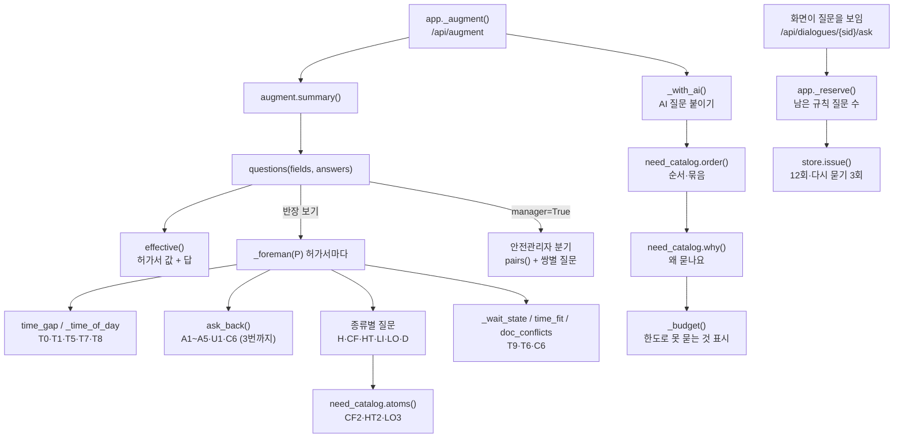

# 05d. 질문 규칙 전부 — `_foreman()`·`questions()`·질문 카탈로그

croScan이 작업반장에게 묻는 규칙 질문을 항목 하나하나까지 적은 문서입니다. 질문이 언제 생기고 언제 생기지 않는지, 문구와 보기, 답이 어디에 쓰이는지, 몇 번까지 어떤 순서로 묻는지를 코드 그대로 옮겼습니다.

**이 문서에서 알 수 있는 것**
- 반장 화면에서 생기는 질문 항목 46종(T0·T1·T4~T9, L1·L3~L7, D1·D6·D7, H1~H3, CF1~CF5, HT1·HT2, LI1~LI3, C4, LO1·LO3~LO6, B1·B3, C5·C6, A1~A5, U1)의 조건·문구·보기·핵심 칸
- 답 보기 하나하나가 시간·장소·체크리스트·쌍 판정·반영본에서 하는 일
- 안전관리자 보기(`questions(manager=True)`)에서만 생기는 질문(T2·T3·L2·B2·B4·C1~C3·D2~D5·X1~X6)
- 질문 카탈로그(`need_catalog.py`)의 모든 행: 위험 무게 W, 필수 여부, 답할 수 있음 A, 원자 슬롯, 점수 S = W × M × A − B
- 질문 한도(검토 1건 12회, 다시 묻기 3회, 허가서마다 되묻기 3회)와 순서(확인 질문 → 필수 → 점수 → 선택 보강)

**목차**
1. [질문 항목 전체 표](#1-질문-항목-전체-표)
2. [답 보기별 쓰임](#2-답-보기별-쓰임)
3. [함수 지도](#3-함수-지도)
4. [호출 흐름](#4-호출-흐름)
5. [질문 한도와 순서](#5-질문-한도와-순서)
6. [augment.py의 질문 함수](#6-augmentpy의-질문-함수)
7. [need_catalog.py — 질문 카탈로그](#7-need_catalogpy--질문-카탈로그)
8. [한계와 알려진 문제](#8-한계와-알려진-문제)

큰 흐름(질문이 왜 필요한지, 「모름」·시간 답 읽기, 철회·정정)은 [05. 멀티턴 질문](05_멀티턴_질문.md)에 있습니다. 이 문서는 함수 단위의 세부를 빠짐없이 적는 것이 목적입니다. 상수와 정규식 원문 전체는 [17. 규칙과 설정값 전체](17_규칙과_설정값_전체.md)에 있습니다.

**용어 몇 가지**
- 항목(item): 질문의 종류 이름입니다. 예: `HT1`(러그 수량·절단 방법). 질문 하나의 이름(qid)은 `항목:허가번호`입니다.
- core(기본 질문)와 extra(선택 보강 질문): extra는 core가 다 끝난 뒤 맨 뒤에 묻고, 12회 예산을 미리 잡아 두지 않습니다.
- prio(우선순위): 코드가 붙인 `(큰 순서, 작은 순서)` 짝입니다. `_q()`가 core는 그대로, extra는 큰 순서에 10을 더해 저장합니다. 예: L6의 `(8, 2)`는 저장될 때 `(18, 2)`가 됩니다.
- keys: 질문이 가리키는 서류 칸입니다. 저장될 때 `p쪽번호.칸이름`이 됩니다(예: `p1.job`).
- fp_keys: 질문을 낸 뒤 이 칸들이 바뀌면 예전 답을 다시 검토하게 하는 칸 목록입니다(`stale_answers()`). 칸의 값을 직접 채우는 B1·B2 답은 제외합니다. 아래 표에서는 묶음 기호로 적습니다.
  - ⓣ = keys + 작업일시 21칸(`date_1~7`, `from_1~7`, `to_1~7`) + `day`·`night` (항목 이름이 T로 시작)
  - ⓟ = keys + `location`·`location_detail` (L로 시작하되 LI·LO가 아닌 항목)
  - ⓦ = keys + `job`·`job_detail`·`hazards`·`location_detail` (그 밖의 항목)
  - ⓚ = keys만 (A1~A5·U1·C5·C6·B1·B2로 시작하는 항목)
- 판정 말 `said()`: 글이 그 말을 「한다(True)」「안 한다(False)」「말하지 않음·조건부·불확실·미정(None)」 셋 중 무엇으로 말하는지 돌려줍니다. `confirmed()`: 미정·확인 필요·불확실이 없는 마디에서 그 말이 나온 마디를 돌려줍니다(없으면 빈 글).
- `t`(허가서 글): `P["text"]` = 호선·작업장소·장소 상세·작업내용·작업 상세·유해위험요소 + 「작업 내용을 말하는 답」(`P["said"]`)입니다.

---

## 1. 질문 항목 전체 표

반장 화면(`questions(manager=False)` → `_foreman()`)에서 생기는 항목입니다. 줄 순서는 `_foreman()` 안에서 만드는 순서입니다. 실제로 묻는 순서는 [5장](#5-질문-한도와-순서)의 `order()`가 다시 정합니다. W·필수·A는 [7장 카탈로그](#7-need_catalogpy--질문-카탈로그) 값입니다.

| 항목 | 묻는 때(트리거) | 묻지 않는 때 | 보기 id | 단계·prio | keys | fp | W·필수·A |
|---|---|---|---|---|---|---|---|
| [T5](#t5-거꾸로-적힌-행) (2행부터 `T5.i`) | 작업일시 i행의 종료 ≤ 시작 | 그 행 T5에 이미 답함, 시각을 읽을 수 없음. 한 번에 맨 앞 행 하나만 | overnight, fix, unknown | core (0,0) | from_i, to_i | ⓣ | 2·—·1 |
| [T0](#t0-빈-작업일시-행) (`T0.i`) | 작업일시 칸이 다 비었거나(1행), 쓴 행에 날짜·시작·종료 중 빈 것 | 양식에 작업일시 칸이 없음, 그 행 T0에 답함 | value, unknown | core (0,0) | date_i, from_i, to_i | ⓣ | 5·필수·1 |
| [T1](#t1-하루-전체이거나-복사된-시간) | 어느 행이 09:00 이전 시작·16:00 이후 종료, 또는 3행 이상이 모두 같은 시간 | 둘 다 아님 | yes, partial, unknown | core (1,0) | from_1, to_1 | ⓣ | 5·필수·1 |
| [T7](#t7과-t8-주간야간과-야간교대) | 주간·야간 체크와 한 행의 시간이 법정 야간선 기준으로 어긋남(`t7_target`) | 어긋나지 않음 | time, check, both, unknown | core (1,1) | day, night, date_i, from_i, to_i | ⓣ | 3·—·1 |
| [T8](#t7과-t8-주간야간과-야간교대) | 화기 + 야간·자정 넘김 + 교대·인계·지원 말이 적혀 있는데 지원·인계 둘 다는 없음 | 화기 아님, T7·T5 미정, 야간 아님, 교대·지원 말 자체가 없음 | same, text, unknown | core (5,2) | night, from_r, to_r | ⓣ | 3·—·1 |
| [A1](#a1-오전오후-되묻기) | 답 속 시간이 오전·오후 둘 다로 읽힘 | 한쪽으로만 읽힘, 되묻기 3회 다 씀 | pm, am, unknown | core (0,1) | from_1, to_1 | ⓚ | 2·—·1 |
| [A2](#a2-날짜-되묻기) | 답 속 날짜가 허가서에 없거나 「내일」 같은 상대 날짜 | 되묻기 3회 다 씀 | 날짜들, all, unknown | core (0,1) | date_1 | ⓚ | 2·—·1 |
| [A3](#a3-숫자-없는-시간) | 마지막 추가 전달에 「오후에」처럼 숫자 없는 시간 | 그 전달에서 시간을 이미 읽음, 작업 없음·조건·다른 작업 말, 되묻기 다 씀 | time, same, unknown | core (0,2) | from_1, to_1 | ⓚ | 2·—·1 |
| [U1](#u1-알아듣지-못한-말) | 추가 전달에서 아무 값도 못 읽음 | 무엇이든 읽음, 되묻기 다 씀 | time, place, other, note, unknown | core (0,3) | 없음 | ⓚ | 2·—·1 |
| [L1](#l1-작업장소) (장소) | 장소 빈칸, 또는 BAY 없음·팀 이름·BAY만(블록 번호도 없음) | 장소가 빈칸이 아닐 때만: 인양, 「공장 전체」 답, 정전의 크레인 번호가 있음. 장소가 빈칸이면 종류와 관계없이 묻습니다 | place, whole, unknown | core (2,0) | location, location_detail | ⓟ | 5·필수·1 |
| [D1](#d1-블록배관-번호) | 화기·밀폐·고소이고 장소는 됐는데 블록 번호 없음 | L1을 물음, 블록 번호 있음 | text, na, unknown | core (2,1) | job, location_detail | ⓦ | 2·필수·1 |
| [L1](#l1-작업장소) (설비 번호) | 정전에서 크레인·설비 번호가 하나도 없음 | 장소 L1을 물음 | place, unknown | core (2,0) | job | ⓟ | 5·필수·1 |
| [H1](#h1-보수-범위) | 화기, 보수 범위(국부/교체)를 알 수 없음 | 글이나 답에 범위가 있음 | local, replace, unknown | core (3,1) | job | ⓦ | 3·필수·1 |
| [H2](#h2-방법과-가스) | 화기, 방법이 없음(또는 방법만 있고 가스가 없음) | 방법·가스 다 있음. 가우징 체크가 있어도 가스가 없으면 가스만 묻습니다 | text, na, unknown | core (4,0) | job | ⓦ | 3·필수·1 |
| [H3](#h3-떼는-부재가-받치는-것) | 교체이거나 깊은 국부 파내기인데 받침·지지 말이 없음 | 그 밖 | text, unknown / none, text, unknown | core (5,0) | job | ⓦ | 4·필수·1 |
| [L3](#l3-높이와-위아래) (화기) | 높이(m)나 「고소 화기작업」 체크가 있는데 상부·하부·내부 표시 없음 | 위치 층이 적혀 있음 | text, unknown | core (4,1) | location_detail | ⓟ | 4·필수·1 |
| [CF1](#cf1-안에서-하는-일과-진입-방식) | 밀폐, 목적 없음 / 목적은 있는데 진입 방식 없음 | 둘 다 있음, CF1에 답함 | inspect, clean, repair, text / head, full + unknown | core (3,1) | job | ⓦ | 5·필수·1 |
| [CF2](#cf2-연결-계통과-차단) | 밀폐 허가서에서 아르곤·질소·퍼지·배관 말이나 아르곤 체크가 있는데, 서류에 차단·유지·복구 셋이 다 있지는 않음 | 연결 말 없음, 셋 다 있음 | none, text, unknown | core (5,0) | hazards | ⓦ | 5·필수·1 |
| [CF4](#cf4-밀폐-안-화기) | 밀폐 허가서에서 화기 말(또는 CF1 「보수·용접」)이 있는데 화기 방법 없음 | 방법 있음 | yes, no, unknown | core (4,1) | hazards, job | ⓦ | 4·—·1 |
| [CF5](#cf5-도장세정-구획의-화기-완료) | 밀폐 허가서에서 도장·세정 진입인데 「화기 완료」 말 없음 | 그 밖 | done, left, unknown | core (5,2) | job | ⓦ | 3·—·0.5 |
| [D6](#d6-수전구역) | 밀폐 허가서에서 수전구역 체크 + 통전 설비 「없음」도 확인자도 없음 | 체크 없음 | text, none, unknown | core (5,2) | commissioning | ⓦ | 4·—·1 |
| [D7](#d7-압력시험) | 밀폐 허가서에서 압력사용 체크 + 매체·가압·감압 시각 셋 중 빠짐 | 셋 다 있음 | text, unknown | core (5,2) | pressure_use | ⓦ | 3·—·1 |
| [CF3](#cf3-환기조명-전원) | 밀폐, 환기·조명 전원(분전반 번호·발전기·자연환기) 말 없음 | 전원 말 있음 | text, na, unknown | core (5,1) | job_detail | ⓦ | 4·—·1 |
| [HT1](#ht1-러그-수량과-절단-방법) | 고소, 러그 개수나 절단 방법이 없음 | 둘 다 있음 | gas, plasma, mech (또는 text) + na + unknown | core (3,1) | job, job_detail | ⓦ | 3·필수·1 |
| [L3](#l3-높이와-위아래) (고소) | 상하 표시나 높이 숫자가 없음 | 둘 다 있음 | text, unknown | core (4,1) | location_detail, work_height | ⓟ | 4·필수·1 |
| [HT2](#ht2-러그-회수) | 러그를 떼는데 회수 수단·내릴 곳 둘 중 빠짐 | 러그 없음(HT1 「없음」, 「러그 없음」) | text, na, unknown | core (5,0) | job_detail | ⓦ | 4·필수·1 |
| [LI1](#li1-크레인과-블록) | 인양, 크레인 번호 없음 / 블록 번호·개수 없음 | 둘 다 있음 | text 또는 blocks, unknown | core (2,2) | job | ⓦ | 4·필수·1 |
| [L5](#l5-이동-경로) | 인양, 경로 말(→, 경유, 통로, 「~에서 ~로 옮김」) 없음 | 경로 있음 | text, unknown | core (3,0) | location | ⓟ | 4·필수·1 |
| [LI3](#li3과-lo6-같은-주행로) | 인양, 크레인 번호가 있는데 같은 레일·정비 말 없음 | 크레인 번호 없음, 말 있음 | none, text, unknown | core (7,1) | job | ⓦ | 4·—·0.5 |
| [LI2](#li2-블록-안위-작업) | 인양, 블록 안·위 작업·부착물 말 없음 | 말 있음 | none, text, unknown | core (5,0) | job | ⓦ | 4·필수·0.5 |
| [C4](#c4-중량과-정격하중) | 인양물 중량 > 크레인 정격하중 | 그 밖 | text, unknown | core (6,0) | load_weight, crane_swl | ⓦ | 2·필수·1 |
| [LO1](#lo1-정비-범위) | 정전, 점검/교체/수리/증설 범위 없음 | 범위 있음 | diag, module, repair, install, unknown | core (3,1) | job | ⓦ | 3·필수·1 |
| [LO3](#lo3-차단복구-시각) | 정전, 차단 시각·복구 시각 중 빠짐 | 둘 다 있음 | text, unknown | core (5,0) | job_detail | ⓦ | 4·필수·1 |
| [LO4](#lo4-접근-위치) | 정전, 제어반 앞/거더·상부 말 없음, 크레인이거나 대상 번호 없음 | 다른 설비 번호만 있음 | front, text, unknown | core (5,0) | location_detail | ⓦ | 3·필수·1 |
| [LO5](#lo5-통전-측정) | 범위가 「원인 찾는 점검」인데 통전·정전 측정 말 없음 | 다른 범위 | dead, live, unknown | core (4,2) | job_detail | ⓦ | 4·—·1 |
| [LO6](#li3과-lo6-같은-주행로) | 정전, 크레인 번호가 있는데 같은 레일 말 없음 | 그 밖 | none, text, unknown | core (7,1) | job | ⓦ | 4·—·0.5 |
| [T9](#t9-멈추는-동안의-상태) | 화기·밀폐·고소·정전, 대기·중단·교대 말이나 하루 두 시간대 | 유지 상태와 재개(밀폐는 재측정·유지)가 다 적힘 | 종류별 + unknown | core (6,1) | job_detail | ⓣ | 3·—·1 |
| [L4](#l4-여러-블록-여러-날) | 블록 2개 이상 + 작업일 2일 이상 | 그 밖 | text, same, unknown | core (6,2) | job | ⓟ | 2·—·1 |
| [L6](#l6-통제-범위) | 화기·고소·인양, 반경·통제 범위 말 없음 | 말 있음 | text, unknown | **extra** (8,2) | location_detail | ⓟ | 3·—·1 |
| [L7](#l7-넓은-칼럼-범위) | 칼럼 범위가 3칸 이상인데 국부 작업 하나(고소는 러그 여러 개도) | 대상 여러 개(고소 제외), 교체 화기, 인양 | yes, place (+정전 test, cable), unknown | core (4,2) | location | ⓟ | 4·필수·1 |
| [A4](#a4-거꾸로-적힌-칼럼) (`A4.cols`) | 칼럼 범위가 「14-12 칼럼」처럼 거꾸로 | 되묻기 다 씀 | yes, place, unknown | core (0,2) | location | ⓚ | 2·—·1 |
| [B1](#b1-필수-빈칸) (`B1.칸`) | 필수 칸이 빔 | 체크·그림 칸, 장소, 당일 확인 칸, 허가구분·2중점검, 작업일시, 서명 | value, na, unknown | core (6,1) | 그 칸 | ⓚ | 2·필수·1 |
| [B3](#b3-병행여부) | 병행여부 빈칸(답으로도 안 채움) | 칸에 Y/N, B3 답, C5 「추가 내용이 맞음」 | yes, no, unknown | core (7,0) | concurrent | ⓦ | 4·필수·0.5 |
| [C5](#c5-앞-답과-추가-전달의-상충) (`C5.항목`, `C5.concurrent`) | 「없음」 답(LI2·CF2·B3·LO4) 뒤 추가 전달이 반대말 / 병행 N인데 추가 전달에 다른 작업 | 그 밖 | free, before, unknown | core (6,0) | 앞 질문 칸 / concurrent | ⓚ | 2·필수·1 |
| [C6](#c6-서류와-답의-상충) (`C6.항목`) | 답이 서류와 다름(T1 시간 밖, 범위, BAY, 높이 1m 이상) | 같은 차이를 이미 물음, 되묻기 다 씀 | answer, doc, unknown | core (6,0) | 차이 난 칸 | ⓚ | 2·필수·1 |
| [T6](#t6-참고-작업시간과-차이) | 하루 작업시간이 참고 작업시간보다 길거나 짧음(`time_fit`) | 맞음·보류 | text, retime, unknown / yes, stage, unknown | core (8,0) | from_1, to_1 | ⓣ | 2·—·1 |
| [T4](#t4-잔불-확인-끝) | 화기(또는 가스·플라즈마 러그 절단), 잔불 확인 끝 말 없음 | 시간 질문 미정, T6 「잔불까지 전체」, 시간 없음 | incl, time, unknown | **extra** (8,1) | to_1 | ⓣ | 3·—·1 |
| [A5](#a5-잔불-끝이-작업-끝보다-이름) (`A5.T4`) | T4 답 시각이 작업 끝보다 이르고 날짜가 없음 | 되묻기 다 씀 | next, fix, unknown | core (0,1) | to_1 | ⓚ | 2·—·1 |

**묻지 않고 2쪽에 남기는 것**(`_foreman()` 끝): 호선/공사가 비었을 때 설비 작업이면 「호선 무관으로 추정」(`assumed`, 항목 B4), 아니면 「안전팀 확인」(`deferred`)으로 남깁니다. 유해위험요소에 종류별 주된 위험 말(`HAZ_WORDS`)이 없으면 「규칙 보강 제안」으로 `deferred`에 남깁니다.

**다른 곳에서 만드는 질문**: `W1`(감시·입회 인원)은 `interpret()`이 추가 전달에서 감시 인원을 읽었을 때 만듭니다([`augment.py`](../server/augment.py) 2683행 근처). `AI1…`(AI 질문)은 `app._with_ai()`가 AI 분석 결과로 붙입니다. 둘 다 이 문서 범위 밖이지만, 카탈로그·순서 규칙은 같이 받습니다.

---

## 2. 답 보기별 쓰임

답은 저장된 뒤 다음 계산에서 다시 읽힙니다. 읽는 곳은 넷입니다: `effective()`(시간·장소·대상 계산), `reflect._facts()`(반영본·별지에 쓰는 글), 체크리스트 명세(`checklist_spec.json`의 `"answer"`·`facts.`), 쌍 판정(`pairs.py`). 「모름」(unknown)은 모든 항목에서 「안전팀 확인」(별지의 확인 필요)으로 갑니다.

| 항목 | 보기 → 하는 일 |
|---|---|
| T0 | value → 그 행의 시간창으로 읽음(`effective`, 애매하면 A1·A2), 반영본 작업일시 행에 씀 |
| T1 | yes → 시간의 뜻 「실제」, partial → 그 시간대로 시간창을 바꿈(인양은 「블록이 움직이는 구간」만 따로 보관), 서류 시간 밖이면 C6.T1. 반영본 작업내용(상세)에 「실제 작업 예정」 |
| T4 | time → 잔불 확인 끝(`residual`), 매칭용 시간창을 늘림(작업 시간은 그대로). 작업 끝보다 이르면 A5. incl·time → `facts.T4` |
| T5 | overnight → 그 행이 다음 날 아침에 끝남. fix → 그 행 시간을 고침. unknown → T4·T8을 미룸 |
| T6 | retime → 시간창을 고침. stage → 적힌 시간은 「한 단계」로 따로 두고 전체 끝까지 늘림. text → 작업내용(상세) 「작업시간에 포함」. 화기 yes → T4를 묻지 않음 |
| T7 | check → 그 행 시간을 고침. time → 「체크 정정 필요」(체크 칸은 croScan이 고치지 않음). both → 별지에 「둘 다 맞음」. T8 판단에도 씀 |
| T8·T9 | `facts`에 기록만 함(쌍을 정하지 않음) |
| A1·A2 | 원래 답의 애매한 부분을 한쪽으로 정함(`_force`) |
| A3·U1 | time → 시간창. U1 place → 장소, other → 다른 팀 작업으로 별지, note → 안전팀 참고 |
| A4·L7 | place → 장소의 칼럼 범위를 바꿈(`_replace_cols`) |
| A5 | next → 잔불 끝을 다음 날로, fix → 다시 적은 시각 |
| L1 | place → 장소를 그 답으로 바꿈, whole → 「공장 전체」(장소 단계 1 이하일 때). BAY가 서류와 다르면 C6.L1. 정전 설비 번호 질문의 답은 BAY가 있으면 장소 상세, 없으면 작업 상세 |
| L3 | 장소의 상하 층, 단계 4로 올림. 높이를 읽음. 서류 높이와 1m 이상 다르면 C6.L3. 체크리스트 6항목(추락·낙하·하부), 쌍 높이 |
| L4·L6 | L6은 2쪽 메모·장소 상세 「통제 예정 범위」. L4는 별지 |
| L5 | 장소에 BAY 추가, 반영본 이동 경로, 체크리스트 `lifting_egress` |
| D1 | 대상 번호로 읽음(`targets`), 작업 상세 「대상 …」 / na → 「특정 대상 없음」 |
| D6·D7 | `facts`, 체크리스트 `facts.D6`·`facts.D7`. D7의 질소 → 쌍의 불활성가스 표시 |
| H1 | 작업 범위(`_scope`): 참고시간 비교, 범위가 서류와 다르면 C6.H1, replace → 체크리스트 `hot_piece`. 반영본 작업내용 |
| H2 | 체크리스트 13항목(불티·흄·가스 등), 아르곤·질소 → 쌍 불활성가스, na → 「용접용 가스 사용 없음」(서류에 가스절단 말이 있으면 확인 필요) |
| H3 | 체크리스트 `hot_support`, 작업 상세 「분리물 지지·회수 계획」 |
| CF1 | 작업 범위, repair → CF4 질문·쌍 SPARK, 체크리스트 직접 12항목과 화기 9항목(교차 포함 조건) |
| CF2 | none/text → 유해위험요소 칸, 체크리스트 3항목, 쌍 불활성가스. 뒤에 반대말이 오면 C5.CF2 |
| CF3 | `facts.CF3`(전원 번호 `sources`), 쌍 `dep_panel` |
| CF4 | `facts.CF4`(체크리스트 8곳), yes → 쌍 SPARK |
| CF5·LO5·LI3·LO6 | `facts`. LO5는 체크리스트 `facts.LO5`, LO6은 `loto_other_crane` |
| HT1 | gas·plasma·mech → 작업 범위·T4 조건·쌍 SPARK, 숫자는 러그 개수, na → HT2를 묻지 않음. 체크리스트 12항목 |
| HT2 | 작업 상세 「러그 회수 계획」, 체크리스트 `height_recovery`. na → 확인 필요 |
| LI1 | 크레인 번호로 읽음(쌍 `crane_use`), 체크리스트 `lifting_cranes` |
| LI2 | none → 유해위험요소 「블록 안·위 작업·부착물 없음」, text → 별지(인양 전 철수 확인), 체크리스트 4항목 |
| C4 | 별지 「중량·정격하중(신청자 정정)」 |
| LO1 | 작업 범위, diag → LO5 질문, 체크리스트 직접 4항목과 화기 5항목(교차 포함 조건) |
| LO3 | 쌍의 「함께 멈추는 설비」·시험운전 판단, 체크리스트 3항목. 차단·복구가 빠진 글은 한 번 다시 받음(`check_value`) |
| LO4 | 쌍 「거더」 판단, 체크리스트 3항목. front 뒤 반대말 → C5.LO4 |
| B1 | value → 그 칸의 값으로 계산·반영본에 씀. `B1.workers`는 체크리스트 작업인원 |
| B3 | yes → 병행여부 Y(+별지), no → N. 체크리스트 4항목. 글은 LI3·LO6 「레일」 판단에도 읽힘 |
| C5 | free → 앞 「없음」 답을 그 문장(양의 답)으로 바꿈(`live_answers`), C5.concurrent·C5.B3 → 병행여부 Y |
| C6 | doc → 원래 답을 모든 계산에서 뺌(철회, `withdrawn`). answer → 답을 그대로 씀 |

---

## 3. 함수 지도

맡은 범위의 함수는 13개입니다(`augment.py` 3개, `need_catalog.py` 10개). 함수 안의 짧은 lambda(`get`, `add`, `where`, `others`)는 각 절에서 함께 설명합니다.

| 함수 | 줄 | 한 줄 요약 | 부르는 곳 |
|---|---|---|---|
| [`_foreman()`](#_foreman) | augment.py 1640 | 허가서 1장을 보고 반장에게 물을 질문을 모두 만듭니다 | `questions()` |
| [`ask_back()`](#ask_back) | augment.py 1696 (`_foreman` 안) | 되묻기 질문을 허가서마다 3번까지만 냅니다 | `_foreman()` |
| [`questions()`](#questions) | augment.py 2086 | 열린 질문 목록을 만듭니다(반장 보기 / 안전관리자 보기) | `summary()`, `interpret()`, `app._reserve()` 등, `analyze`, `understand` |
| [`_type()`](#_type) | need_catalog.py 140 | 항목 이름으로 타입(시간·장소 …)을 정합니다 | `row()` |
| [`row()`](#row) | need_catalog.py 145 | 항목의 카탈로그 행을 만듭니다 | `catalog()`, `order()`, 시험 |
| [`catalog()`](#catalog) | need_catalog.py 156 | 모든 행을 돌려줍니다 | 시험 |
| [`atoms()`](#atoms) | need_catalog.py 194 | 답(또는 서류 글)에서 원자 사실이 있는지 나눕니다 | `_foreman()`, `check_value()`, `understand`, `doc_facts()` |
| [`score()`](#score) | need_catalog.py 216 | 점수 S = W × M × A − B | `order()` |
| [`order()`](#order) | need_catalog.py 232 | 묻는 순서를 정하고 관련 질문 둘을 묶습니다 | `app._augment()` |
| [`articles()`](#articles) | need_catalog.py 262 | 법령 글에서 조문 목록을 뽑습니다 | `basis_of()` |
| [`basis_of()`](#basis_of) | need_catalog.py 273 | 쌍 규칙들의 확인된 법령 근거를 모읍니다 | `why()` |
| [`key_of()`](#key_of) | need_catalog.py 290 | 항목 이름을 카탈로그 키로 바꿉니다 | 거의 모든 카탈로그 함수, `understand` |
| [`why()`](#why) | need_catalog.py 303 | 「왜 묻나요?」(관측·필요·근거)를 만듭니다 | `app._augment()`, `app` 1487행 |

---

## 4. 호출 흐름

---

## 5. 질문 한도와 순서

### 5.1 세 가지 한도

| 한도 | 값 | 어디 | 무엇을 세나 |
|---|---|---|---|
| 검토 1건 질문 한도 | `ASKS = 12` | [`store.py`](../server/store.py) 602행 | 반장에게 보이는 요청 하나하나(질문·다시 묻기·확인 카드·연결 카드·마무리 요청). 같은 질문을 다시 보이면 세지 않습니다(`again`) |
| 검토 1건 다시 묻기 한도 | `CLARIFY = 3` | 같은 곳 | `CHECKING` 항목(A1~A5·U1·C5·C6)과 「다시 시도」. 같은 답(`clarify_base`)에는 한 번만 |
| 허가서마다 되묻기 한도 | `ASK_BACK = 3` | [`augment.py`](../server/augment.py) 1128행 | `_foreman()`이 만드는 A1~A5·U1·C6. 남은 횟수는 답한 A1~A5·U1로 셉니다. C6도 같은 예산이라고 주석에 적혀 있지만, 답한 C6은 세지 않습니다. 넘으면 질문을 만들지 않고 「확인 못 한 말」로 2쪽에 남깁니다 |
| 모델 호출 | `LLM_CALLS = 30` | store.py 602행 | 이 문서 범위 밖 |

설계 근거: 검토 회차당 시스템 응답 요청 최대 12회, 전체 명확화 최대 3회, 마무리 요청 1회입니다(설계서 §3.5).

### 5.2 `store.issue()`의 판단 순서

1. 종류가 question·clarify·card·close가 아니면 422 `bad_kind`.
2. 같은 키를 이미 보였으면 그대로 돌려줌(`again: true`, 세지 않음).
3. 마무리 요청이 두 번째면 409 `close_once`. 마무리 뒤의 새 질문은 409 `closed`(설계서 §3.6).
4. `used >= 12`이면 409 `budget`.
5. `reserve`가 있고 `used + 1 + reserve > 12`이면 409 `reserved`(남은 규칙 질문 몫을 남김).
6. 다시 묻기인데 `clar >= 3`이거나 같은 base를 이미 다시 물었으면 409 `clarify`.
7. 기록하고 `used + 1`을 돌려줌.

### 5.3 남은 규칙 질문 몫(`app._reserve()`)

화면이 질문을 보이기 전에 `/api/dialogues/{sid}/ask`를 부릅니다. `_reserve()`는 지금 열린 질문 가운데 **core이고, CHECKING이 아니고, 아직 보이지 않았고, 지금 보이려는 것이 아닌** 규칙 질문 수를 셉니다. 서식 값이 없으면 셀 수 없으니 12를 돌려줍니다(규칙 질문 말고는 아무것도 못 지나감).

| 보이려는 것 | `issue` 호출 | 예약 적용 |
|---|---|---|
| 규칙 질문(CHECKING·AI 아님) | `issue(k, "question")` | 없음(규칙 질문은 자기 몫을 씀) |
| CHECKING 항목(A1~A5·U1·C5·C6) | `issue(k, "clarify", clarify_base(k), reserve)` | 있음 |
| AI 질문(`AI…`) | `issue(k, "question", reserve)` | 있음 |
| 확인 카드·연결 카드·다시 시도 | `card`/`clarify`, reserve | 있음 |

설계 근거: 「카드·다시 묻기·AI 질문·연결 카드는 남은 규칙 질문 수만큼 남기고 씀」(설계서 §3.5, Codex 2026-10-31). T4 같은 extra와 되묻기 질문은 예약 수에서 뺍니다(설계서 부록 표).

`app._budget()`은 이미 보인 질문이 아니면서 12회를 다 썼으면 `unasked: "질문 한도로 묻지 않음"`, CHECKING인데 다시 묻기 한도를 넘었으면 `"다시 묻기 한도로 묻지 않음"`을 붙입니다. core 질문 중 답이 없는 것은 「안전팀 확인」 목록으로 넘깁니다.

### 5.4 순서

`questions()`의 반장 분기는 `(prio, page)`로 정렬해 돌려줍니다. 화면에 보내기 직전 `app._augment()`가 AI 질문을 붙이고 [`order()`](#order)로 다시 정렬합니다. `order()`의 정렬 키는 다음 순서입니다.

1. extra가 아님(core가 먼저)
2. CHECKING 항목(A1~A5·U1·C5·C6)이 먼저 — 상충·주체·범위 확인을 먼저(설계서 §3.2)
3. AI 질문이 아님(규칙 질문이 먼저)
4. 필수(`REQUIRED`)가 먼저
5. 점수 S가 큰 것
6. 코드의 prio
7. 쪽 번호
8. qid(같으면 이름순으로 안정)

그다음 관련 질문 둘을 한 말풍선으로 묶습니다(`MERGE`). 실제 예는 [`order()`](#order) 절에 있습니다.

---

## 6. augment.py의 질문 함수

### `_foreman()`

**한 줄 요약**: 허가서 1장(`P`)을 보고, 반장이 답할 수 있는 빠진 값·어긋난 값을 질문으로 만듭니다.

**입력**
- `P`: `effective()`가 만든 허가서 하나. 쓰는 필드: `p`(칸들), `kind`(hot·confined·height·lifting·loto), `permit_no`, `text`, `place`(`parse_place` 결과: `text`, `level` 0~4, `bays`, `cols`, `colrange`, `layer`, `org`, `whole`), `targets`, `cranes`, `count`, `height`, `windows`, `amb`, `frees`, `free`, `said`, `concurrent`, `t5`, `t7`, `residual_ask`, `windows_req`.
- `ans`: 지금 살아 있는 답 `{qid: 답}`(철회한 답은 빠지고, C5로 고친 답은 바뀐 상태).
- `qs`: 질문을 덧붙일 목록(호출한 쪽 것).
- `assumed`, `deferred`: 2쪽에 남길 「추정」·「안전팀 확인」 목록.

**출력**: 돌려주는 값은 없습니다. `qs`, `assumed`, `deferred`에 덧붙이고, `P["fit"]`(참고 작업시간 비교 결과)을 적습니다.

**안의 lambda**
- `get(item)` = `ans.get(f"{item}:{pid}")` — 이 허가서의 그 항목 답.
- `add(*a, **k)` = `qs.append(_q(*a, **k))` — 질문 하나를 만듭니다. `_q()`가 qid·prio·fp_keys를 붙입니다.
- `where(src)` — 되묻기 문구 앞말. src가 `F`로 시작하면 「추가로 적으신 내용의」, 아니면 「앞에서 답하신」.

**앞에서 계산하는 값**
- `jt` = 작업내용 + 작업 상세 + 장소 상세.
- `equip` = `EQUIP` 정규식(크레인·설비·제어반·배전·분전·공용·전기 …)이 `jt + 작업장소`에 있거나 종류가 정전. 호선 빈칸 처리에만 씁니다.
- `blocks` = `P["targets"]`에서 크레인 번호(`CRANE`)를 뺀 것.

아래는 만드는 순서대로 적은 항목별 세부입니다. 문구는 코드 그대로입니다. `{…}`는 값이 들어가는 자리입니다.

#### T5 거꾸로 적힌 행

- 조건: 1~7행마다 `_m(from_i)`·`_m(to_i)`가 둘 다 읽히고 `to <= from`이고, 그 행의 T5(`t5_item(i)`: 1행은 `T5`, 나머지는 `T5.i`)에 답이 없음. 여러 행이면 **맨 앞 행 하나만** 이번에 묻습니다(행마다 따로 묻기, QA #12).
- signal: `{i}일차 종료 {b} ≤ 시작 {a}`
- 문구: `{날짜 또는 i일차} 종료({b})가 시작({a})` + (같으면 「과 같습니다. 」, 빠르면 「보다 빠릅니다. 」) + 「다음 날 아침에 끝나는 작업인가요, 시각을 잘못 적었나요?」
- 보기: `overnight` 「다음 날 끝남」(확인됨) / `fix` 「잘못 적음」(정정, 입력 안내 「맞는 시간대 예: 13:00~15:30」) / `unknown` 「모름」(미확인)
- prio (0,0), original `{a}~{b}`.

#### T0 빈 작업일시 행

- `time_gap(p, done)`이 고른 행 하나. `done`은 이 허가서에 `T0.<숫자>` 답이 있는 행 번호입니다.
- `time_gap` 규칙: 양식에 `date_1`·`from_1`·`to_1`이 없으면 묻지 않음. 아무 행도 안 썼으면 1행(날짜·시작·종료 모두 빔). 아니면 쓴 행 가운데 빈 부분이 있고 아직 답하지 않은 첫 행.
- 항목 이름은 1행도 `T0.1`입니다.
- 문구 ① 1행이 통째로 빔: 「허가 신청에 적을 작업일시(날짜·시작·종료)가 비어 있습니다. 작업 날짜와 시작~종료 시각을 알려 주세요.」
- 문구 ② 그 밖: 「작업일시 {i}행의 {빈 것들}이(가) 비어 있습니다 (적힌 값: 날짜 …, 시작 …). 이 날의 날짜와 시작~종료 시각을 알려 주세요.」
- 보기: `value` 「날짜·시간 입력」(정정, 안내 `예: {그 행 날짜 또는 허가번호의 날 또는 2026-10-29} {시작 또는 13:00}~{종료 또는 15:00}`, 행 전체가 비면 「 / 여러 날이면 날마다 날짜를 적어 10/29 09~11; 10/30 13~15」를 덧붙임) / `unknown`
- prio (0,0).

#### T1 하루 전체이거나 복사된 시간

- `rows` = `_windows(p)`의 모든 (날짜, 시작, 끝). `whole` = 시작 ≤ 09:00(`DAY_START = 540`)이고 끝 ≥ 16:00(`DAY_END = 960`)인 행. `copied` = 행이 3개 이상이고 시간이 모두 같음(MT01).
- 날짜 표시 `ds`: 행이 여럿이면 `첫날~마지막날(월-일)`.
- 문구 ① 인양: 「작업일시가 {ds} {시작}~{끝}로 적혀 있습니다. 준비부터 안착·줄걸이 해제까지 이 시간 내내 하나요? 블록이 실제로 움직이는 시간대를 알려 주세요.」
- 문구 ② 하루 전체: 「작업일시가 {ds} {시작}~{끝}로 적혀 있습니다. 하루 신청 시간인가요, 실제로 {VERB} 하는 시간인가요? 나눠서 하거나 기다리는 시간이 있으면 실제 시간대를 알려 주세요.」 `VERB`: 화기 「절단·용접을」, 밀폐 「안에 들어가 작업을」, 고소 「러그 절단·회수를」, 정전 「전원을 끊고 수리를」.
- 문구 ③ 복사만: 「{n}일 동안 매일 {시작}~{끝}로 같습니다. 날마다 같은 작업을 이 시간에 하나요?」
- signal: `{n}일, {시작}~{끝} (근무시간 거의 전체)` 또는 `(같은 시간 반복)`.
- 보기: `yes` 「이 시간 내내 함」(하루 전체) 또는 「매일 같음」(복사) / `partial` 「실제 시간대 입력」(정정, 안내 「예: 09:00~11:00, 14:00~16:00 / 날마다 다르면 10/27 09~11; 10/28 14~16」) / `unknown`
- prio (1,0). 반장 보기에는 T2가 따로 없습니다. 복사된 시간도 T1이 묻습니다.

#### T7과 T8 주간야간과 야간교대

`_time_of_day(P, ans, add, qs)`가 만듭니다(함수 자체 설명은 [05 §8](05_멀티턴_질문.md#8-t5t7t8t4-시간-규칙)).
- T7 문구: 「작업일시에 「{체크}」을 체크했는데, {날짜} 적힌 시간 {시작}~{끝}은 {설명}. 체크와 적힌 시간이 서로 맞나요?」 확인된 근무시간(`CROSCAN_SITE_SHIFT`)이 없으면 설명은 법정 야간(22:00~다음 날 06:00, 근로기준법 제56조 제3항) 기준입니다.
- T7 보기: `time` 「적힌 시간이 맞음(체크를 고쳐야 함)」(정정) / `check` 「「{체크}」 체크가 맞음(이 날 시간을 고침)」(정정, 안내 시간 예) / `both` 「둘 다 맞음(현장에서 이 시간을 {체크}으로 봄)」(확인됨) / `unknown`. prio (1,1).
- T8 조건: 화기이고, T7·T5가 정해졌고, 야간(다음 날로 넘어감·야간 체크·T7 답)이며, 글에 교대·인계·야간조·화재감시·조명·지원 같은 말이 있는데 지원(`NIGHT_SUPPORT`)과 인계(`NIGHT_HANDOVER`)가 둘 다 확인되지는 않음. 야간 그 자체로는 묻지 않습니다(MT14 p247, N4-MT15 p315).
- T8 보기: `same` 「같은 조가 끝까지 하고 지원 갖춤」(확인됨) / `text` 「지원·인계 입력」(보강) / `unknown`. prio (5,2).

#### ask_back이 쓰는 남은 횟수

T7 다음에 `left = [ASK_BACK - (이 허가서에서 답한 A1·A2·A3·A4·A5·U1 질문 수)]`를 정합니다. 이후 되묻기는 모두 [`ask_back()`](#ask_back)을 거칩니다.

#### A1 오전오후 되묻기

- `P["amb"]`(답에서 두 가지로 읽히는 시간·날짜)를 `(kind, src, k)`로 중복 없이 돕니다.
- `kind == "ampm"`: `time_ranges(raw, "am")`와 `"pm"`이 둘 다 있을 때만 묻습니다.
- 항목: `ask_item("ampm", src, k)` = `A1.{src}`(두 번째 애매한 부분부터 `.2`, `.3` …).
- 문구: 「{앞에서 답하신 / 추가로 적으신 내용의} 「{raw}」는 오후인가요, 새벽(오전)인가요?」
- 보기: `pm` 「오후 {시작}~{끝}」 / `am` 「새벽·오전 {시작}~{끝}」(둘 다 확인됨) / `unknown`. prio (0,1).

#### A2 날짜 되묻기

- 허가서 날짜 목록 `days` = `date_1~7` 중 ISO 형식인 것.
- 허가서에 없는 날짜(`x["new"]`, QA #5): 「… 「{raw}」의 {M}월 {D}일은 허가서 작업일에 없습니다. 그날 작업이 맞나요?」 보기: `{새 날짜}` 「M월 D일에 함(새 날짜)」(확인됨) + 허가서 날짜마다 「M월 D일(허가서 날짜)」(정정) + `unknown`.
- 상대 날짜(「내일」 등, `REL_DAY`): 「… 「{raw}」에서 「{말}」는 며칠인가요?」 보기: 허가서 날짜마다 「M월 D일」(확인됨) + `all` 「날마다 같음」(확인됨) + `unknown`.
- keys `date_1`, prio (0,1).

#### A3 숫자 없는 시간

- 마지막 추가 전달 `P["frees"]`(허가서가 1장일 때만 있음)를 하나씩 봅니다.
- `vague`: 마디(`CLAUSE`로 나눔) 가운데 `VAGUE_TIME`(오전·오후·아침·점심·저녁·밤에·새벽·퇴근·출근·종일·반나절)이 있고, `NO_WORK_TIME`(「오전 작업은 안 합니다」)·`COND`(조건 「~면」 「경우」 「때」)·숫자·`CONC`(다른 작업·병행)가 없고, 다른 종류 작업 말이 없는 첫 마디.
- `got` = `found_in(ft, dates, kind)`에서 「'아마」로 시작하는 것을 뺀 읽은 값들.
- `vague`가 있고 `got`에 「시간」으로 시작하는 것이 없으면 A3: 「추가로 적으신 「{vague}」는 몇 시부터 몇 시까지인가요?」
- 보기: `time` 「시간 입력」(정정, 「시작~끝 예: 13:00~16:00」) / `same` 「신청한 시간 그대로」(확인됨) / `unknown`. prio (0,2).

#### U1 알아듣지 못한 말

- A3가 아니고 `got`이 비었으면 U1: 「추가로 적으신 「{앞 40자}{…}」는 croScan이 어느 내용인지 알아듣지 못했습니다. 무엇에 대한 말인가요?」
- 보기: `time` 「작업 시간」(정정) / `place` 「작업 장소」(정정, 「BAY·칼럼·블록 번호 예: 3BAY 12-14 칼럼 E41P」) / `other` 「다른 팀 작업」(보강) / `note` 「안전팀 참고로만 남김」(확인됨) / `unknown`. keys 없음, prio (0,3), original은 앞 60자.

#### L1 작업장소

- `crane_pins` = 정전이고 크레인 번호가 있음.
- `blank_place` = `location`과 `location_detail`이 둘 다 빔.
- `need_place` = `blank_place` 또는 (인양 아님 · 「공장 전체」 답 없음 · `crane_pins` 아님 · (장소 단계 ≤ 1 또는 (단계 2이고 블록 번호 없음))). 빈 장소는 종류와 상관없이 묻습니다(인양 경로나 크레인 번호가 장소를 채우지 않음).
- 장소 단계(`parse_place`): 0 = 팀·부서 이름이거나 빈칸, 1 = BAY 없음, 2 = BAY만, 3 = BAY+칼럼, 4 = 3에 블록 번호나 상하 층까지.
- 문구 ① 정전: 「작업장소에 '{장소}'만 적혀 있습니다. 어느 설비(크레인 제어반·배전반 등)에서 하나요? 설비 번호와 위치(BAY)를 알려 주세요.」 안내 「예: 21공장 3BAY 천장크레인 OH-21-03 제어반 CP-01 / 4BAY 10칼럼 배전반 MCC-4」
- 문구 ② 단계 2: 「작업장소에 '{장소}'처럼 BAY까지만 적혀 있습니다. 칼럼 범위(기둥 번호)나 블록 번호를 알려 주시겠어요?」 안내 「예: 3BAY 12-14 칼럼 E41P 블록」
- 문구 ③ 그 밖: 「작업장소에 '{장소}'만 적혀 있습니다. 실제 작업 위치를 BAY·칼럼까지 알려 주시겠어요?」(+ 블록 번호가 없으면 「 블록 번호도 함께 알려 주세요.」) 안내 「예: 대조립21공장 3BAY 12-14 칼럼 E41P 블록 / 여러 곳이면 쉼표로 / 공정번호가 있으면 함께」
- signal: 「장소가 팀·부서 이름처럼 보임」 / 「장소가 BAY까지만 있음」 / 「장소에 BAY·칼럼이 없음」 + `: '{장소}'`.
- 보기: `place` 「위치 입력」(정정) / `whole` 「정말 공장 전체를 오가며 함」(확인됨) / `unknown`. prio (2,0).

**정전 설비 번호 L1**: 정전이고 크레인 번호도 대상 번호도 없고 `need_place`가 아니면, 같은 항목 L1로 「어느 설비(크레인 제어반·배전반 등)인가요? 번호를 알려 주세요.」를 묻습니다. keys `job`, 보기 `place` 「번호 입력」(보강, 「예: OH-21-03 제어반 CP-01 / 배전반 MCC-4」) / `unknown`. 장소 L1과 동시에 생기지 않습니다(`not need_place`).

#### D1 블록배관 번호

- 조건: `need_place`가 아니고, 화기·밀폐·고소이고, 블록 번호가 없음.
- 문구: 「어느 블록(또는 배관·구획)에서 하는 작업인가요? 번호를 알려 주세요.」
- 보기: `text` 「번호 입력」(보강, 「예: E41P 블록 / P-07 배관」) / `na` 「특정 대상 없음」(해당없음) / `unknown`. prio (2,1).

#### 작업 범위 sc

`sc = _scope(P, ans)`: 종류별 범위 질문(화기 H1, 밀폐 CF1, 고소 HT1, 정전 LO1)의 답이 있고 그 답이 unknown·text·full이 아니면 그 답(CF1 `head`는 `partial`). 없으면 글에서 찾습니다. 화기 `reweld → remove → replace → local`, 밀폐 `partial → inspect → clean → recover → repair`, 고소 `plasma → mech → gas`, 정전 `module → diag → repair → install` 순서로 먼저 맞는 것입니다. 못 찾으면 `None`.

#### H1 보수 범위

- 화기이고 `sc is None`.
- 문구: 「불량부는 용접부만 파내는 보수인가요, 부재를 떼어 교체하나요? 몇 군데인가요?」
- 보기: `local` 「용접부만 보수」(보강, 「몇 군데인가요? 예: 3군데」) / `replace` 「부재를 떼어 교체」(보강, 「몇 개인가요? 예: 판재 1장」) / `unknown`. prio (3,1).

#### H2 방법과 가스

- ① 방법 없음: `said(t, RX["hot_method"])`가 True가 아니고(「가스절단은 안 함」만 있으면 여전히 모름), 「가우징」 체크도 없음. 문구 「절단·가우징·용접은 어떤 방법으로 하고, 어떤 가스(산소·LPG·CO2·아르곤 등)를 쓰나요?」 보기 `text` 「방법·가스 입력」(보강, 「예: 아크 가우징, CO2 용접 / 산소·LPG 절단」) / `na` 「가스 안 씀(전기 용접만)」(해당없음) / `unknown`.
- ② 방법은 있고 가스가 없음(`said(t, HOT_GAS) is None`): 문구 「적으신 방법에 쓰는 가스(산소·LPG·CO2·아르곤·압축공기 등)는 무엇인가요? 가스를 쓰지 않으면 「가스 안 씀」을 눌러 주세요.」 보기 `text` 「가스 입력」 / `na` / `unknown`. 이때 `m = 0.5`(방법은 앎, 설계서 §3.2 M). 근거: 방법·가스·전원은 따로 다룹니다(MT10, p205).
- prio (4,0).

#### H3 떼는 부재가 받치는 것

- `deep` = `sc == "local"`이고 「깊은/심한」이 있음. `(sc == "replace" or deep)`이고 `said(t, HOLDS) is None`(받치·지지·받침·하중). 회수 말(「내려」 「크레인」)은 받치는지에 답하지 않습니다(MT08, p205; p200 「국부 파내기: 완전 분리 없어도 지지 영향 가능」).
- 교체: 「떼어내는 부재가 다른 구조나 발판을 받치고 있나요? 떼어낸 부재는 무엇으로 받쳐 어디로 내리나요?」 보기 `text` 「지지·회수 입력」(보강) / `unknown`.
- 깊은 파내기: 「깊게 파내는 부재가 다른 구조나 발판을 받치고 있나요? 파내는 동안 따로 받쳐 두나요?」 보기 `none` 「받치는 것 없음」(확인됨) / `text` 「받치고 있음(받침 계획)」(보강) / `unknown`.
- prio (5,0).

#### L3 높이와 위아래

- 화기: 작업내용에 높이(m)가 있거나 「고소 화기작업」 체크가 있고, 장소에 층(상부·내부·하부)이 없음. 문구 「(작업내용에 높이 {h}m가 있습니다. )블록 위(상부)·옆·아래(하부)·안(내부) 중 어디서 하나요?」 keys `location_detail`, 보기 `text` 「위치 입력」(보강, 「예: 블록 상부 발판 위 2.5m」) / `unknown`. prio (4,1).
- 고소: 층이 없거나 높이 숫자(`P["height"]`)가 없음. 층이 없으면 「블록 위(상부)에서 하시나요? 바닥에서 대략 몇 m 높이인가요?」, 층만 있으면 「바닥에서 대략 몇 m 높이에서 작업하나요?」. keys `location_detail`, `work_height`. 보기 `text` 「높이 입력」(보강, 「예: 블록 상부 4.8m」) / `unknown`. prio (4,1).

#### CF1 안에서 하는 일과 진입 방식

- ① `sc is None`: 「안에 들어가서 무엇을 하나요? (검사·청소·회수·보수 등) 몇 곳, 몇 번 들어가나요?」 + (`CF_MODE`가 없으면) 「 머리·상체만 넣는지, 몸 전체가 들어가 이동하는지도 알려 주세요.」 보기 `inspect` 「검사·점검」 / `clean` 「청소·잔재 정리」 / `repair` 「보수·용접」 / `text` 「기타 입력」(모두 보강, 횟수 안내) / `unknown`.
- ② 목적은 있는데 진입 방식이 없음(작업내용·상세·장소 상세·답에 `CF_MODE` 없음, CF1 답 없음): 「머리·상체만 넣나요, 몸 전체가 들어가 안에서 이동하나요?」 보기 `head` 「머리·상체만 넣음」 / `full` 「몸 전체가 들어가 이동함」(안내 「들어가는 곳·대략 깊이 예: 맨홀 M-2, 안쪽 10m (배관이면 직경·굽은 곳도)」) / `unknown`. `m = 0.5`. 근거: 적힌 목적이 있어도 진입 방식은 따로 묻습니다(N2 MT04, p246).
- prio (3,1).

#### CF2 연결 계통과 차단

- 조건: 밀폐 허가서에서 (`RX["cf_link"]`(아르곤·질소·퍼지·배관·파이프·가스 공급…)이 있거나 아르곤 체크) 그리고 `atoms("CF2", "text", doc_text(P))["missing"]`이 비지 않음. 서류 글만 봅니다(답은 넣지 않음).
- 원자 셋(모두 충족 조건): 차단·격리 / 진입 중 유지 / 복구·다른 팀 공급·시험. 「밸브 잠금」 하나로는 다 말하지 않습니다(N2 MT07, p246).
- 문구: 「들어가는 배관·구획에 가스(아르곤 등)나 공기를 넣는 연결 계통이 있나요? 있으면 진입 중에는 차단해 두나요? 다른 팀의 가스 공급·압력시험·복구가 진입 시간에 예정돼 있나요?」
- 보기: `none` 「연결 계통 없음」(확인됨) / `text` 「있음(계통·차단·다른 팀 예정)」(보강) / `unknown`. prio (5,0).

#### CF4 밀폐 안 화기

- 조건: 밀폐 허가서에서 (`HOT_INSIDE`(화기·용접(상태·부·검사 제외)·용단·절단·가우징·그라인딩)이 있거나 CF1 답이 `repair`) 그리고 화기 방법이 True가 아님. 근거: 실물 위험작업신고서 p2, 유해위험요소에만 「화기작업시 …, 병행 작업 금지」.
- 문구: 「안에서 용접·절단·그라인딩 같은 화기를 하나요? 하면 어떤 방법·가스로 하고, 별도 화기작업 허가서가 있나요(번호)?」
- 보기: `yes` 「함: 방법·가스·허가서 입력」(보강) / `no` 「안에서 화기 없음」(확인됨) / `unknown`. prio (4,1).

#### CF5 도장세정 구획의 화기 완료

- 조건: 밀폐 허가서에서 작업내용·상세·답에 도장|스프레이|세정|세척|페인트|코팅, 그리고 「화기 완료/종료/끝」이 말해지지 않음. 근거: 인터뷰 p33 「화기가 남은 탱크에 도장」.
- 문구: 「들어가 도장·세정할 구획에서 용접·절단 같은 화기가 모두 끝났다고 들었나요?」
- 보기: `done` 「끝났다고 들음」(확인됨, 「누구에게 들었나요? 예: 용접2팀 반장」) / `left` 「남은 화기 있음」(보강) / `unknown`. prio (5,2).

#### D6 수전구역

- 조건: 밀폐 허가서에서 「수전구역(COMMISSIONING AREA)」 체크 + `LIVE_NONE`도 `LIVE_WHO`도 확인되지 않음(신고서양식 p1·2).
- 문구: 「작업 구간에 통전·시운전 중인 설비가 있나요? 있으면 차단·잠금은 누가 확인하나요?」
- 보기: `text` 「있음(설비·확인자)」(보강) / `none` 「없음」(확인됨) / `unknown`. prio (5,2).

#### D7 압력시험

- 조건: 밀폐 허가서에서 「압력사용」 체크 + 매체(`TEST_MEDIUM`)·가압 시각(`TEST_START`)·감압 시각(`TEST_END`)이 다 확인되지는 않음. 시험압력 값 자체는 당일 값이라 묻지 않습니다.
- 문구: 「압력(기밀)시험의 매체는 무엇(공기·질소·물)이고, 가압 시작·감압 완료는 몇 시인가요?」
- 보기: `text` 「매체·시각 입력」(보강) / `unknown`. prio (5,2).

#### CF3 환기조명 전원

- 조건: 밀폐이고 `confirmed(t, POWER_SRC)`가 비어 있음. `POWER_SRC`는 분전반·배전반·MCC·DB·PNL 번호, 발전기, 자연환기, 「환기·조명 전원 없음」입니다. 「전원」이라는 낱말만으로는 닫히지 않습니다(N2 MT08, p247).
- 문구: 「안에서 쓰는 환기팬·송기·조명은 어느 전원(분전반·발전기)에 물려 있나요? 진입 중 그 전원을 끊는 다른 작업이 있다고 들었나요?」
- 보기: `text` 「전원 입력」(보강) / `na` 「전원 쓰는 환기·조명 없음(자연환기)」(해당없음) / `unknown`. prio (5,1).

#### HT1 러그 수량과 절단 방법

- `n = P["count"]`, `need_m = sc is None`. `n is None` 또는 `need_m`이면 묻습니다.
- `lugless` = 러그·인양 고리·피스·절단·제거가 전혀 말해지지 않음.
- 문구 넷: (러그 말도 없고 둘 다 없음) 「떼어 낼 러그(임시 인양고리)가 있나요? 있으면 몇 개를 어떤 방법(가스절단·플라즈마·그라인더)으로 떼나요?」 / (둘 다 없음) 「어느 블록의 러그 몇 개를 어떤 방법(…)으로 떼나요?」 / (방법만 없음) 「러그 {n}개는 어떤 방법(…)으로 떼나요?」 / (개수만 없음) 「러그는 몇 개를 떼나요?」
- 보기: 방법이 없으면 `gas` 「가스절단」·`plasma` 「플라즈마」·`mech` 「그라인더·기계절단」(개수도 모르면 「러그 개수 예: 6개」 같은 입력 안내, 개수를 알면 안내 없이 누름). 방법을 알면 `text` 「개수 입력」. 그다음 `na` 「떼는 러그 없음」(해당없음), `unknown`. `lugless`이면 `na`를 **맨 앞**에 둡니다(그런 허가서에서 가장 그럴듯한 답).
- 개수·방법 중 하나만 모르면 `m = 0.5`. prio (3,1).

#### HT2 러그 회수

- `no_lug` = HT1 답이 `na`이거나 「러그」가 부정됨.
- `jt_said` = 작업내용 + 작업 상세 + 답(장소는 넣지 않음). `atoms("HT2", "text", jt_said)["missing"]`이 비지 않으면 묻습니다. 원자: 회수 수단(로프·체인블록·호이스트·크레인 … 「으로 내려/받아」), 내릴 곳(하부·바닥·적치장·수거함 … 「에 적치/안착」). 「로프」 한 낱말은 둘 다 말하지 않습니다(N3 MT09, p274).
- 문구: 「떼어낸 러그는 무엇으로 받아 어디에 내리나요? 그 아래나 옮기는 길에 다른 작업·통행이 있나요? 러그 1개 무게와, 지금 러그에 하중이 걸려 있지 않은지도 알려 주세요.」
- 보기: `text` 「회수 방법 입력」(보강) / `na` 「해당 없음」 / `unknown`. prio (5,0).

#### LI1 크레인과 블록

- `nblocks = P["count"] or len(blocks)`.
- ① 크레인 번호 없음: 「어느 크레인(번호)으로 옮기나요? 공동인양·뒤집기(반전)·차량 인계도 하나요?」(+ 블록 수를 모르면 「 옮기는 블록 번호(또는 개수)도 알려 주세요.」). 보기 `text` 「크레인·방법 입력」(안내 「예: OH-21-01 한 대, 반전 없음 … (매다는 무게는 줄걸이·빔 포함)」) / `unknown`.
- ② 크레인은 있고 블록 수 없음(N4-MT01·MT02, p314): 「몇 개 블록(번호)을 옮기나요? 공동인양·회전·반전·차량 인계가 있나요?」 보기 `blocks` 「블록·방법 입력」 / `unknown`.
- prio (2,2).

#### L5 이동 경로

- 조건: 인양이고 `said(t, RX["route"]) is None`.
- 문구: 「블록을 어디에서 어디로 옮기나요? 지나가는 BAY·통로도 알려 주세요.」 + 허가서가 말할 때만 덧붙임(N4-MT05·MT07·MT14, p314): 칼럼 범위가 3칸 이상이면 「 적힌 '{cols}'는 출발 위치인가요, 지나가는 길인가요?」, 반전·회전 말이 있으면 「 회전·반전하는 위치(칼럼)도 알려 주세요.」, 차량 말이 있으면 「 차량에 싣는 곳·내리는 곳도 알려 주세요.」
- 보기: `text` 「경로 입력」(보강) / `unknown`. prio (3,0).

#### LI3과 LO6 같은 주행로

- LI3(인양, N4-MT11 p314): 크레인 번호가 있고, 글 + B3 답 글에 `RAIL_SAID`(같은 레일·주행로 운행/정비 없음·있음, 다른 크레인 …)가 확인되지 않음. 문구 「옮기는 동안 그 크레인({번호들})의 정비나, 같은 주행로(레일)에서 다른 크레인 운행·정비가 있다고 들었나요?」
- LO6(정전, N5 MT11 p355): 같은 조건. 문구 「수리하는 동안 같은 주행로(레일)에서 다른 크레인 운행이나 이 크레인을 쓰려는 작업이 있다고 들었나요? 복구 전에 확인할 다른 팀 작업이 있나요?」
- 보기: `none` 「들은 것 없음」(확인됨) / `text` 「있음(…)」(보강) / `unknown`. prio (7,1). 둘 다 다른 팀 이야기라 A = 0.5이고, 답 글은 이 작업의 대상·장소로 읽지 않습니다(`ABOUT_OTHERS`).

#### LI2 블록 안위 작업

- 조건: 인양이고 `said(t, RX["li_inside"]) is None`.
- 문구: 「옮기기 전에 그 블록 안이나 위에서 하는 작업, 붙어 있는 배관·발판·전선이 있나요?」
- 보기: `none` 「없음」(확인됨) / `text` 「있음」(보강) / `unknown`. prio (5,0).

#### C4 중량과 정격하중

- 조건: 인양물 중량과 크레인 정격하중이 둘 다 숫자이고 중량 > 정격.
- 문구: 「인양물 중량 {lw}톤이 크레인 정격하중 {swl}톤보다 큽니다. 어느 값이 맞나요?」
- 보기: `text` 「맞는 값 입력」(정정) / `unknown`. prio (6,0). 정밀 질량을 다시 요구하지 않고 불일치를 기록합니다(설계서 §3.1).

#### LO1 정비 범위

- 정전이고 `sc is None`. 문구 「원인을 찾는 점검인가요, 원인이 확인된 수리·부품 교체인가요?」
- 보기: `diag` 「원인 찾는 점검」 / `module` 「부품 교체」 / `repair` 「정해진 수리」 / `install` 「설치·증설」(보강) / `unknown`. prio (3,1).

#### LO3 차단복구 시각

- 조건: `atoms("LO3", "text", t)["required_missing"]`이 비지 않음(차단 시각·복구 시각 중 하나라도 없음). 원자 7개 가운데 충족 조건은 차단·복구 둘뿐입니다(N5 MT05·MT06·MT12, p355).
- 문구: 「전원은 언제 끊고 언제 복구하나요? 중간에 복구했다 다시 끊으면 그 시각도, 복구 뒤 시험운전(주행·권상)이 있으면 그 시각·구간과, 함께 멈추는 설비(환기팬·조명 등)와 같은 전원에 다른 팀 잠금이 있는지도 알려 주세요. 적으신 종료는 수리 완료인가요, 시험·운전 인계까지인가요?」
- 보기: `text` 「시각·설비 입력」(보강) / `unknown`. 원자 중 하나라도 이미 있으면 `m = 0.5`. prio (5,0).

#### LO4 접근 위치

- 조건: `said(t, RX["lo_access"]) is None` 그리고 (크레인 번호가 있거나 대상 번호가 없음). 거더·상부는 크레인의 것이라, 다른 설비 번호만 있으면 묻지 않습니다.
- 문구: 「제어반 앞에서만 작업하나요, 크레인 거더·상부에도 올라가나요?」
- 보기: `front` 「제어반 앞에서만」(확인됨) / `text` 「거더·상부에도 올라감」(보강) / `unknown`. prio (5,0).

#### LO5 통전 측정

- 조건: `sc == "diag"`이고 `said(t, LIVE) is None`(ACC-E14 p372, 유의점 4-5 p378).
- 문구: 「원인을 찾는 동안 전원이 들어간 상태로 측정·확인하는 단계가 있나요?」
- 보기: `dead` 「정전 상태로만 함」(확인됨) / `live` 「있음: 무엇을·몇 시」(보강) / `unknown`. prio (4,2).

#### T9 멈추는 동안의 상태

`_wait_state(P, ans, add)`가 만듭니다. 화기·밀폐·고소·정전만(`WAIT_Q`). 글(+T6 글 답)에 대기·중단·교대 말(`WAIT_RX`)이 있거나 하루가 두 시간대로 나뉘면 묻습니다. 밀폐는 재측정과 「환기·차단·격리·공급 유지」가 둘 다, 나머지는 유지 상태(`WAIT_STATE`)와 재개 시각(`WAIT_RESUME`)이 둘 다 적혀 있으면 묻지 않습니다. 문구·보기는 종류별(`WAIT_Q`, N1 MT07·N2 MT09·N3 MT11·N5 MT07)이며 끝에 `unknown`을 붙입니다. prio (6,1).

#### L4 여러 블록 여러 날

- 조건: 작업내용·상세의 블록 번호(`blocks_in`)가 2개 이상, 시간이 있는 날이 2일 이상(실물 1305: 블록 9개·4일).
- 문구: 「여러 블록을 동시에 하나요, 순서대로 하나요? 블록별 작업 날짜를 알려 주세요.」
- 보기: `text` 「순서·날짜 입력」(보강) / `same` 「날마다 모든 블록을 함께 함」(확인됨) / `unknown`. prio (6,2), core.

#### L6 통제 범위

- 조건: 화기·고소·인양이고 `confirmed(t, CONTROL_RANGE)`가 비어 있음(반경 숫자 m, 또는 하부·통로·BAY·칼럼·구역 + 통제·출입 금지). 근거: 인터뷰 p41 「오늘 여기서 여기까지」.
- 문구: 「작업하는 동안 출입을 막는 범위(불티·낙하물·인양 반경)는 어디까지인가요?」
- 보기: `text` 「범위 입력」(보강) / `unknown`. **extra**, prio (8,2) → 저장 (18,2).

#### L7 넓은 칼럼 범위

- `listed` = 작업내용·상세의 번호(크레인 제외). `many` = 번호 2개 이상이거나 개수 > 1(「여러」라는 낱말은 세지 않음). `local` = 고소·정전·밀폐이거나 교체가 아닌 화기.
- 조건: 칼럼 범위 폭(`colrange[1] - colrange[0]`) ≥ 3, `local`, (`many`가 아니거나 고소).
- 고소 + 여러 러그(N3 MT07, p274): 「작업장소의 '{cols}'는 여러 러그의 위치인가요, 접근·회수 경로까지 포함한 범위인가요?」, `yes` 「러그 위치들의 범위임」.
- 그 밖: 「작업장소의 '{cols}'는 실제로 작업하는 위치인가요, 이동·회수·접근 경로까지 포함한 범위인가요?」, `yes` 「그 범위에서 작업함」.
- 보기: `yes`(확인됨) / `place` 「실제 작업 위치는 좁음」(정정) / 정전이면 `test` 「주행·권상 시험 구간 포함」·`cable` 「케이블 점검 구간 포함」(보강, N5 MT14 p355) / `unknown`. prio (4,2).

#### A4 거꾸로 적힌 칼럼

- 정규식 `(\d{1,2})\s*[-~]\s*(\d{1,2})\s*(?:칼럼|축)`이 장소 글에 있고 앞 숫자 > 뒤 숫자(F01 p392: 입력 실수를 몰래 12~14로 읽지 않음).
- 항목 `A4.cols`, 문구 「작업장소의 「{원문}」은 {작은}~{큰} 칼럼인가요?」
- 보기: `yes` 「{작은}~{큰} 칼럼이 맞음」(확인됨) / `place` 「다른 위치」(정정) / `unknown`. prio (0,2).

#### B1 필수 빈칸

- 허가서 칸마다: 필수이고, 체크·그림 칸이 아니고, 비어 있고, 다음이 아니면 묻습니다 — `location`·`location_detail`, 당일 확인 칸(`DAY_OF_VALUES`), 허가구분·2중점검(`NOT_FOREMAN`, 누가 정하는지 모름, 조사 process p16), `date_`/`from_`/`to_` 칸, `_sign`으로 끝나는 칸.
- 문구: 「'{칸 이름}' 칸이 비어 있습니다. 값을 알려 주세요.」
- 보기: `value` 「값 입력」(정정, 안내는 칸 이름 + 숫자 칸이면 「 (숫자)」) / `na` 「해당 없음」 / `unknown`. prio (6,1). 반장 보기는 B2를 쓰지 않습니다.

#### B3 병행여부

- 조건: `P["concurrent"]`가 빔. 이 값은 칸 값, 없으면 B3 답(yes→Y, no→N), C5 「추가 내용이 맞음」이면 Y입니다. 다른 답의 「없음」은 이 답이 아닙니다(확인할 제안일 뿐).
- 문구: 「병행여부가 비어 있습니다. 같은 시간·장소에 알고 있는 다른 작업이 있나요?」
- 보기: `yes` 「있음」(보강, 「어떤 작업을 언제·어디서? 예: 같은 BAY 14-16 칼럼 도장, 오후」) / `no` 「없음」(확인됨) / `unknown`. prio (7,0).

#### C5 앞 답과 추가 전달의 상충

- `CONFLICT` 표: `(LI2, none, 블록 안·위 작업)`, `(CF2, none, 가스·배관 연결)`, `(B3, no, 다른 작업)`, `(LO4, front, 거더·상부 접근)`.
- 조건: 그 항목 답이 「없음」(글로 쓴 「없음」도 `eff_choice`로 같게 봄)이고, 추가 전달 `P["free"]`가 그 말을 함(`said(…, hedged=True)`: 「아마 있을걸요」도 셈).
- `said0`: 보기를 눌렀으면 그 보기 이름, 글로 썼으면 그 글 앞 40자.
- 문구: 「앞에서 {무엇}에 대해 「{said0}」이라고 답하셨는데, 추가로 적으신 내용에는 {무엇}이 있습니다. 어느 쪽이 맞나요?」
- 보기: `free` 「추가로 적은 내용이 맞음」(정정) / `before` 「앞의 답이 맞음」(확인됨) / `unknown`. keys는 앞 질문의 것. prio (6,0).
- **C5.concurrent**: 병행여부가 N이고, 「병행 작업 금지」 같은 말을 지운 추가 전달에 다른 작업 말이 있음(조사 p18 Q6). 문구 「병행여부를 N(없음)으로 적으셨는데, 추가로 적으신 내용에 다른 작업이 있습니다. 같은 시간·같은 장소에서 하는 작업인가요?」 보기 `free` 「같은 시간·장소임」 / `before` 「시간이나 장소가 다름」 / `unknown`.

#### C6 서류와 답의 상충

- `doc_conflicts(P, ans)`의 각 차이: T1 답 시간이 그날 신청 시간 밖, 범위 답(H1·CF1·HT1·LO1)이 지금 서류 글의 범위와 다름, L1 답 BAY가 서류 BAY와 겹치지 않음, L3 답 높이가 서류 높이와 1m 이상 다름.
- 항목은 `C6.{항목}`, qid는 `C6.{항목}~{지문}:{허가번호}`입니다. 지문은 `sha1("{서류}|{답}")` 앞 6자리라, 같은 차이는 한 번만, 새 차이는 다시 묻습니다(설계서 §3.5 「문서와 답이 상충」).
- `ask_back()`으로 만듭니다(되묻기 몫을 같이 씀).
- 문구: 「서류에는 「{서류}」로 적혀 있는데, 답은 「{답}」입니다. 답이 맞아 서류를 고치는 것(정정)인가요?」
- 보기: `answer` 「답이 맞음(서류 정정)」(정정) / `doc` 「서류가 맞음」(확인됨) / `unknown`. prio (6,0).

#### T6 참고 작업시간과 차이

- `fit = time_fit(P, ans, whole or copied)`를 `P["fit"]`에 둡니다. 상태가 long·short일 때만 묻습니다. 문구에 모델 코드는 넣지 않습니다(QA #19).
- long: 「적힌 작업시간 {분}분은 참고 작업시간 {lo}~{hi}분보다 깁니다. {LONG_Q 또는 「대기·검사·반복이나 추가 범위」}가 포함됐나요?」 보기 `text` 「포함된 것 입력」(확인됨) / `retime` 「실제 시간 다시 입력」(정정) / `unknown`.
- short: 「적힌 작업시간 {분}분은 참고 작업시간 {lo}~{hi}분보다 짧습니다. {END_Q[종류]}」 보기 `yes` 「{END_Q_ALL[종류]}까지 전체 시간이 맞음」(확인됨) / `stage` 「특정 단계만 적음」(보강) / `unknown`. 근거: 적힌 끝의 뜻(N1 MT13, N2 MT12, N3 MT12, N4-MT13, N5 MT12).
- prio (8,0), core.

#### T4 잔불 확인 끝

- `open_time`: 이번에 만든 질문 중 이 허가서의 T1·T5·T6·T7이 답이 없거나 「모름」, 또는 T5 답에 unknown이 있음.
- `t6_all`: 화기이고 T6 답이 `yes`(「잔불 확인까지 전체 시간이 맞음」).
- 조건: (화기 또는 (고소이고 `sc`가 gas·plasma)) · 시간이 있음 · `open_time` 아님 · `t6_all` 아님 · `EMBER_SAID`가 확인되지 않음. 「잔불」 한 낱말이나 「화재감시자 1명」으로는 닫히지 않습니다.
- 문구: 「적으신 종료 {가장 늦은 끝}은 {용접·절단 / 러그 절단}이 끝나는 시각인가요, 잔불 확인·정리까지 끝나는 시각인가요? 잔불 확인이 그 뒤에 끝나면 그 시각을 알려 주세요.」
- 보기: `incl` 「잔불 확인·정리까지 포함」(확인됨) / `time` 「그 뒤 잔불 확인 끝: 시각 입력」(보강, 「예: 16:00」) / `unknown`. **extra**, prio (8,1). 근거: N1 MT13 p205, N3 MT12 p275, LU15-FIRE p266. 쌍 규칙은 답과 상관없이 잔류 위험을 남깁니다.

#### A5 잔불 끝이 작업 끝보다 이름

- `P["residual_ask"] = (날짜, 분)`이 있고 그날 시간이 있으면(`effective()`가 T4 답에 날짜가 없고 작업 끝보다 이를 때 정함) 묻습니다.
- 항목 `A5.T4`, 문구 「잔불 확인 끝을 {r}로 적으셨는데 작업 끝({end})보다 이릅니다. 다음 날 {r}인가요?」
- 보기: `next` 「다음 날 {r}」(확인됨) / `fix` 「시각을 다시 입력」(정정, 「예: 23:30, 다음날 01:00」) / `unknown`. prio (0,1).

#### 묻지 않는 것

- 호선 빈칸: `equip`이면 `assumed`에 `{"item": "B4", "value": "호선 무관으로 추정 (설비·공용 작업)", "why": "작업내용·장소가 설비 작업이라 호선이 없는 것이 보통임"}`. 아니면 `deferred`에 「빈칸 (반장에게 묻지 않음, 필요하면 안전팀 확인)」.
- 유해위험요소에 `HAZ_WORDS[종류]`가 없으면 `deferred`에 「'{앞 30자}'에 {위험} 언급 없음 → 규칙 보강 제안: {위험}」.

**예시**(실제로 돌린 결과, `tools/foreman_permits.py`의 반장_테스트 10건, 답 없음). `order()`를 거친 순서입니다.

| 허가서 | 종류 | 나온 항목(순서) | 2쪽에 남김 |
|---|---|---|---|
| 4012 | 화기 | T1, L1, H2, H1, B3, L4, L6(extra) | 호선·유해위험요소 |
| 4403 | 화기 | H2(m 0.5), T4(extra), L6(extra) | — |
| 4676 | 밀폐 | T1, L1, CF1+CF2(묶음), B3, CF3 | 호선 |
| 5067 | 밀폐 | CF3 | — |
| 5151 | 고소 | T1, L1+L3(묶음), HT1+HT2(묶음), B3, L6(extra) | 유해위험요소 |
| 5325 | 고소 | L7, HT1(m 0.5)+HT2 | — |
| 5388 | 인양 | T1, LI1+L5(묶음), LI2, B3, L6(extra) | 유해위험요소 |
| 5435 | 인양 | LI3, T6, L6(extra) | — |
| 5488 | 정전 | T1, L1, LO3+LO4(묶음), LO5 | 호선 추정(B4) |
| 6623 | 정전 | LO3(m 0.5), LO6, T6 | 호선 추정(B4) |

5151에서 HT1에 `gas`, 값 「6」을 답하면 다음 목록은 `T1, L1, L3, HT2, B3, L6`이 되고 `P["count"]`가 6이 됩니다(HT1 답의 숫자에 「개」를 붙여 읽음).

**호출 관계**: `questions()`(반장 분기)만 부릅니다. 이 함수가 부르는 것: `_q()`, `t5_item()`, `time_gap()`, `_windows()`, `_time_of_day()`, `ask_item()`, `time_ranges()`, `found_in()`, `other_work()`, `_scope()`, `said()`, `confirmed()`, `height_in()`, `need_catalog.atoms()`, `doc_text()`, `_num()`, `_wait_state()`, `blocks_in()`, `ids()`, `eff_choice()`, `doc_conflicts()`, `time_fit()`, `_open()`, `hm()`.

**시험**: [`tools/check_questions.py`](../tools/check_questions.py)(반장_테스트 10건마다 기대 질문, `MATERIAL` 표의 추가 항목, C6.T1), [`tools/check_questions_material.py`](../tools/check_questions_material.py)(T4·T7·T8·T9·CF3~CF5·D6·D7·L4·L6·L7·LI3·LO5·LO6, 모든 「모름」에도 core 12문 안), [`tools/check_dialogue_api.py`](../tools/check_dialogue_api.py)(4676 발급 ≤ 12, 필수 먼저, CF3 포함). `_foreman`을 직접 부르는 시험은 없고 모두 `summary()`·`questions()`를 거칩니다.

### `ask_back()`

**한 줄 요약**: 되묻기 질문(A1~A5·U1·C6)은 허가서마다 `ASK_BACK = 3`번을 한도로 만들고(남은 횟수는 답한 A1~A5·U1로 셈), 넘치면 2쪽 「확인 못 한 말」로 남깁니다.

**입력과 출력**: `item`(항목 이름), `raw`(문제의 원문), 나머지는 `add()`에 그대로 넘기는 인자. 돌려주는 값은 없습니다.

**판정 단계**
1. `"{item}:{pid}"`에 이미 답이 있으면 아무것도 하지 않습니다(한 번만 묻기).
2. 남은 횟수 `left[0] <= 0`이면 `deferred`에 `{"name": "확인 못 한 말", "text": "'{raw}' (다시 묻기는 3번까지라 묻지 않음)"}`을 넣고 끝냅니다.
3. 아니면 `left[0]`을 1 줄이고 `add()`로 질문을 만듭니다.

`left`는 `_foreman()` 안에서 「3 − 이 허가서에서 답한 A1~A5·U1 질문 수」로 시작하는 1칸짜리 목록입니다(중첩 함수가 값을 바꿀 수 있게). 이번 호출에서 답이 없는 되묻기는 다시 만들 때마다 1을 씁니다.

**예시**(실제 실행): 4403에 알아듣기 어려운 추가 전달 4개(「오후에 할게요」「블라블라 모르는 말」「저녁에 마무리」「아무개 이야기」)를 주면 `A3.F1`, `U1.F2`, `A3.F3`가 생기고, 넷째는 「'아무개 이야기' (다시 묻기는 3번까지라 묻지 않음)」으로 2쪽에 갑니다.

**호출 관계**: `_foreman()` 안에서 A1·A2(시간·날짜 애매), A3·U1(추가 전달), A4.cols, C6, A5.T4가 부릅니다. `add()`만 부릅니다.

**시험**: [`tools/check_questions.py`](../tools/check_questions.py) 345행 `stubborn()` — 애매한 답만 계속해도 끝나고 되묻기가 `ASK_BACK`을 넘지 않으며 같은 질문이 반복되지 않습니다.

### `questions()`

**한 줄 요약**: 지금 열린(답하지 않은) 질문 목록을 만듭니다. 반장 보기와 안전관리자 보기 둘로 나뉩니다.

**입력**: `fields`(읽은 서류 칸), `answers`(지금까지의 답 목록), `manager`(기본 False).
**출력**: `(열린 질문, 허가서 목록 perms, 쌍 목록, 추정·보류 목록)`. 반장 보기의 쌍 목록은 항상 `[]`이고, 넷째에는 `deferred`가 `item: "DEFER"`를 달고 함께 들어갑니다.

**공통 앞부분**
1. `perms = effective(fields, answers)` — 서류 값 위에 답을 얹은 허가서들.
2. `answers = drop_stale(perms, answers)` — 다른 행 이야기가 된 T7 답, 질문 뒤 서류 값이 바뀐 답을 뺍니다(그 질문은 다시 열림).
3. `done` = 남은 답의 qid 집합. 철회한 답도 여기 있어 다시 묻지 않습니다.

**반장 보기(`manager=False`)**
1. `ans` = `live_answers(answers)`를 qid로 찾을 수 있게 만든 것.
2. 허가서마다 `_foreman(P, ans, qs, assumed, deferred)`.
3. qid가 같은 질문은 처음 것만 남깁니다.
4. `done`에 없는 것만 `(prio, page)` 순서로 돌려줍니다. 한도를 두지 않습니다(docstring 「No cap」). 한도는 `store.issue()`가 화면에 보일 때 셉니다.

**안전관리자 보기(`manager=True`)**: 하루치 허가서를 서로 비교하는 옛 분기입니다. 지금 앱 요청 경로는 부르지 않고 [`tools/check_questions.py`](../tools/check_questions.py)만 부릅니다([05 §4.2](05_멀티턴_질문.md#42-안전관리자-보기-분기지금-앱에서-부르지-않음)). `_foreman()`을 부르지 않고 질문을 따로 만듭니다.
- `prs = pairs(perms)`. 쌍 단계 1~3에 든 허가서별 쌍 목록 `involved`. `mine` = 이 허가서의 쌍들, `others()` = 상대 이름들.

| 항목 | 조건 | 문구(요지) | 보기 | 단계·prio |
|---|---|---|---|---|
| T1 | 하루 전체 행이 있음 | 「{날짜} {시간}로 적혀 있습니다. 이 시간 내내 {WORK} 하시나요?」 | yes 「내내 함」, partial 「일부 시간만」, unknown | core (1, −쌍 수) |
| T2 | 하루 전체는 아니고 3행 이상 같은 시간 | 「{n}일 동안 매일 같은 시간({…})입니다. 날마다 같은 작업인가요?」 | yes, partial 「날마다 다름」, unknown | core (3,0) |
| L1 | 장소 단계 ≤ 2, 「공장 전체」 아님, 인양 아님 | BAY만 / BAY·칼럼 없음 문구(+대상 번호가 없으면 「블록·설비 번호도」) | place, whole(「BAY 전체를 오가며 함」/「정말 공장 전체」), unknown | 대상 번호와 설비면 extra, 아니면 core (1, −쌍 수) |
| D1 | L1이 아니고 대상 번호 없음 | 「어느 블록·설비에서 하는 작업인가요?」 | text, na, unknown | core (2,0) |
| L5 | 인양이고 장소에 →·경유·통로·-> 없음 | 「블록이 출발해서 지나가는 BAY·통로와 도착 위치, 통과 예정 시각을 …」 | text, unknown | core (1,0) |
| L3 | 층 없음 + (고소, 또는 화기이면서 높이 m이나 고소 화기 체크) | 「블록 위(상부) / 옆·지상 / 아래(하부) / 안(내부) 중 …」 | text, unknown | core (2,0) |
| B1·B2 | 필수 빈칸(체크·그림·장소 제외). 종류별 필수 칸이면 B2 | 「'{칸}' 칸이 비어 있습니다. …」 | value, na, unknown | core (2,0) |
| B2.work_height | 밀폐 + 고소작업 체크 + 작업높이 빔 | 「고소작업에 체크했는데 작업높이가 없습니다. 몇 m인가요?」 | value, unknown | core (2,0) |
| B3 | 병행여부 빈칸 | (+쌍이 있으면 「croScan이 찾은 같은 시간 작업: …」) | yes, no, unknown | core (3, −쌍 수) |
| C3 | 병행 N인데 단계 ≤ 2 쌍 | 「병행작업 없음(N)으로 적었는데 같은 시간에 {…} 작업이 있습니다. 알고 계셨나요?」 | unaware, aware, na | core (3,0) |
| B4 | 호선 빈칸, 설비 작업 아님(설비면 추정) | 「호선/공사가 비어 있습니다. 특정 호선 작업이 아닌가요?」 | na, value, unknown | extra (4,0) |
| C1 | 유해위험요소가 있는데 주된 위험 말 없음(밀폐 아르곤 체크인데 아르곤·가스·산소 말 없음 포함) | 「유해위험요소에 {위험} 관련 내용이 없습니다. …」 | text, na, unknown | core (4,0) |
| C2 | 작업내용 높이 ≥ 2m인데 「고소 화기작업」(화기)·「고소작업」(밀폐) 체크 없음 | 「… 높은 곳에서 하는 작업인가요?」 | yes, na, unknown | core (4,0) |
| C2h | 종류의 추가정보 분류 체크가 하나도 없음 | 「추가정보의 작업 분류(…) 중 체크된 것이 없습니다. …」 | text, unknown | core (4,0) |
| D2 | 크레인 작업(인양, 크레인 정전)인데 크레인 번호 없음(L1이 이미 묻는 경우 제외) | 「인양에 쓰는 / 수리하는 크레인 번호는 …」 | text, unknown | core (2,0) |
| D4 | 정전 | 「이 전원을 끊으면 함께 멈추는 설비 … 복구·시험운전 예정 시각도 …」 | text, none, unknown | extra (1,0) |
| D3 | 화기 | 「용접·절단에 쓰는 가스 …와 공급 방식(용기/배관)은요?」 | text, na, unknown | extra (1,0) |
| T4 | 화기, 또는 고소이면서 범위가 gas·plasma | 「작업 후 잔불 확인·화재감시는 몇 시까지 하나요?」(signal 「종료 후 잔불 (D4)」) | time, none 「바로 끝남」, unknown | extra (2,0) |
| D5 | 밀폐 | 「들어가는 배관·구획에 가스나 공기를 넣는 계통은 무엇이고, 차단은 누가 확인하나요?」 | text, na, unknown | extra (1,0) |
| L6 | 화기·고소·인양 | 「작업하는 동안 출입을 막는 범위는 …」 | text, unknown | **core** (3,0) |
| T3 | 인양(항상) / 다른 종류는 단계 ≤ 2 쌍이 있을 때 | `MOMENT_Q[종류]` | time, unknown | 인양 extra (2,0) / core (1, −쌍 수) |
| L4 | 작업내용에 「B11, F31」처럼 블록 여러 개 | 「여러 블록을 동시에 하나요, 순서대로 하나요? …」 | text, unknown | extra (4,0) |
| L2 | 장소 단계 3이고 가장 높은 쌍 단계가 2 | 「{cols} 중 실제로 작업하는 블록·위치는 어디인가요?」 | text, unknown | core (2,0) |
| X1 | 인양 × 정전 쌍, 크레인 번호가 겹치지 않음 | 「인양에 쓰는 크레인 번호는 …? 같은 시간에 {상대}에서 크레인 정비가 있습니다.」 | text, unknown | core (1,0) |
| X2 | 화기 × 밀폐 쌍, 이쪽이 화기 | 「… 가스 공급이 {상대}의 진입 배관·구획과 이어져 있나요?」 | yes, no, unknown | core (1,0) |
| X3 | 밀폐 × 인양 쌍, 이쪽이 인양 | 「인양 전에 블록 안 인원이 모두 나왔는지는 누가 확인하나요?」 | text, unknown | core (2,0) |
| X4 | 이쪽 화기, 상대가 고소·인양·화기 | 「절단하는 부재가 다른 발판·부재를 받치고 있나요?」 | yes, no, unknown | core (1,0) |
| X5 | 정전 × 밀폐 쌍, 이쪽이 정전 | 「차단하는 전원에 환기팬·조명이 물려 있나요?」 | yes, no, unknown | core (1,0) |
| X6 | 단계 1 쌍이 있음 | 「{상대(시각)} 작업과 시간이 겹칩니다. 해당 반장과 협의한 변경 가능 시간대가 있나요?」 | text, no, unknown | core (2,0) |

X2~X5의 qid는 `항목:이쪽>상대`라 상대마다 따로 생깁니다. X1만 `>상대`를 붙이지 않아(`item != "X1"`), 정전 쌍이 여럿이어도 질문 하나입니다.

마지막에 qid 중복을 없애고, `done`에 없는 것을 `(prio, page)`로 정렬해 `(열린 질문, perms, prs, assumed)`를 돌려줍니다.

**예시**(실제 실행): 4012(화기)을 혼자 `manager=True`로 돌리면 `T1, L1, B3, L6, C1, C2`(core)와 `D3, T4, B4, L4`(extra)가 나옵니다. 같은 허가서가 반장 보기에서는 `T1, L1, H2, H1, B3, L4, L6`입니다.

**호출 관계**: 부르는 곳 — `augment.summary()`(2441행), `augment.interpret()`(2630행), `app._reserve()`(653행), `app` 801·950·987·1011행, `analyze.py` 110행, `understand.py` 271행. 이 함수가 부르는 것 — `effective()`, `drop_stale()`, `live_answers()`, `_foreman()`, `pairs()`, `_windows()`, `_q()`, `_scope()`, `_who()`, `hm()`, `PK.KINDS`.

**시험**: [`tools/check_questions.py`](../tools/check_questions.py)(반장 10건, 안전관리자 보기의 쌍 단계 변화, X5 「예」 → 1순위), [`tools/check_eval_tools.py`](../tools/check_eval_tools.py), [`tools/check_dialogue_api.py`](../tools/check_dialogue_api.py), [`tools/check_questions_material.py`](../tools/check_questions_material.py).

---

## 7. need_catalog.py — 질문 카탈로그

[`server/need_catalog.py`](../server/need_catalog.py)는 질문마다 「무엇에 쓰려고 묻는지」, 위험 무게, 필수 여부, 답할 수 있는 사람, 원자 사실을 한곳에 둡니다(설계서 §3.1·§3.3·§19.2). 질문을 만들지는 않습니다.

### 7.1 표와 상수

- `RULES`: `pair_rules.json`의 쌍 규칙을 id로 찾는 사전.
- `SOURCES`: 법령 원문 기준(2026-10-31 대조). 안전보건규칙(시행 2026.3.2 고용노동부령 제450호), 원자력안전법(시행 2026.5.19), 산업안전보건법(시행 2026.10.27 법률 제22122호)과 국가법령정보센터 주소.
- `ARTICLE`: `(안전보건규칙|원자력안전법|산업안전보건법)?\s*(제\d+조(?:의\d+)?(?:제\d+항)?(?:제\d+호)?)(?:\(([^()]*)\))?`
- `NEED`: 항목 → (쓰임 한 줄, 그 답을 읽는 쌍 규칙들). 쓰임은 코드에서 실제로 쓰는 곳만 적고, 답이 결과를 바꾸는 규칙만 연결했습니다(Codex 검토 2026-10-31).
- `W`: 위험 무게 1~5. 없는 항목은 2로 봅니다. AI 질문은 `AI:referent` 3, `AI:act_scope` 3, `AI:dependency` 4, `AI:doc_mismatch` 4.
- `CHECKING` = `("A1.", "A2.", "A3.", "A4.", "A5.", "U1.", "C5.", "C6.")` — 「한 말을 확인하는」 질문. 순서 맨 앞, 예산에서는 다시 묻기로 셉니다.
- `TYPE`: 앞 글자 → 타입(T 시간, L 장소, B 빈칸, C 상충·설명, D 설비·계통, X 쌍 확인, H·CF·HT 공법, LI 인양, LO 정비, W 인원, A·U 다시 묻기, workers 인원).
- `REQUIRED`: 필수 30개. 쌍 규칙·체크리스트·서류 완성이 읽는 항목이라 예산을 미리 잡고 선택 항목보다 먼저 묻습니다. AI가 낮출 수 없습니다(설계서 §3.1).
- `OWNER`: 들은 정보만 답할 수 있는 항목(B3, C3, LI2, X6, LI3, LO6, CF5) → `self_partial`. 나머지는 `self`.
- `A_VALUE`: self 1.0, self_partial 0.5, other 0.0(타 팀·당일 측정은 묻지 않음).
- `FALLBACK`: 다듬은 문구가 없을 때 쓰는 짧은 문구.
- `ATOMS`: 원자 슬롯(아래 표의 원자 열). 판정 방법은 정규식이거나 「이 보기면 말한 것」인 보기 목록입니다.
- `UNSURE`: 미정·확인 필요·확인 중·확인 예정·가능한지·여부·불가·모름·할지·될지·아마·협의 중 — 이 말이 있는 마디의 원자는 말하지 않은 것으로 봅니다.
- `MERGE`: 한 말풍선에 묶는 짝 — (HT1, HT2), (H2, H3), (LO3, LO4), (LI1, L5), (CF1, CF2), (L1, L3).

### 7.2 카탈로그 전체(66행, 코드에서 생성)

부담 표시는 `row()`가 보여 주는 고정 값입니다(T2·L7·LO4·B3·LI2·CF2만 「선택」). 점수의 부담 B는 이 값이 아니라 질문의 실제 보기로 계산합니다([`score()`](#score)).

| 항목 | 타입 | 필요 이유(`NEED`) | 읽는 쌍 규칙 | 보이는 법령 근거(`basis_of`) | W | 필수 | 담당(A) | 부담 표시 | 원자(★=충족 조건) | 대체 문구 |
|---|---|---|---|---|---|---|---|---|---|---|
| T0 | 시간 | 다른 작업과 시간이 겹치는지 계산하려고 묻습니다 | — | — | 5 | 예 | 본인 1 | 입력 | — | 있음 |
| T1 | 시간 | 신청 시간 전체인지 실제 작업 구간인지 나눠 겹침을 계산하려고 묻습니다 | — | — | 5 | 예 | 본인 1 | 입력 | — | 있음 |
| T2 | 시간 | 날마다 작업하는지 나눠 겹침을 계산하려고 묻습니다 | — | — | 4 | 예 | 본인 1 | 선택 | — | 있음 |
| T3 | 시간 | 위험 단계 시각으로 겹친 쌍의 검토 순서를 정하려고 묻습니다 | — | — | 3 |  | 본인 1 | 입력 | — | — |
| T4 | 시간 | 잔불 감시 종료까지 시간 겹침을 확인하려고 묻습니다 | — | — | 3 |  | 본인 1 | 입력 | — | 있음 |
| T5 | 시간 | 끝나는 시각이 다음 날로 넘어가는지 확인하려고 묻습니다 | — | — | 2 |  | 본인 1 | 입력 | — | 있음 |
| T6 | 시간 | 참고 작업시간과 크게 다른 이유를 확인하려고 묻습니다 | — | — | 2 |  | 본인 1 | 입력 | — | 있음 |
| T7 | 시간 | 서류에 체크한 주간·야간과 적힌 시간이 다른지 확인하려고 묻습니다 | — | — | 3 |  | 본인 1 | 입력 | — | 있음 |
| T8 | 시간 | 야간·교대 시간의 지원(조명·감시·구조)과 인계를 기록하려고 묻습니다 | — | — | 3 |  | 본인 1 | 입력 | — | 있음 |
| T9 | 시간 | 멈추거나 교대하는 동안 차단·받침·통제가 유지되는지 기록하려고 묻습니다 | — | — | 3 |  | 본인 1 | 입력 | — | 있음 |
| L1 | 장소 | 같은 BAY·칼럼의 다른 작업과 겹치는지 보려고 묻습니다 | — | — | 5 | 예 | 본인 1 | 입력 | — | 있음 |
| L2 | 장소 | 실제로 작업하는 지점을 다른 작업과 맞춰 보려고 묻습니다 | — | — | 4 |  | 본인 1 | 입력 | — | — |
| L3 | 장소 | 위아래로 겹치는 작업(떨어짐)을 보려고 묻습니다 | DROP_BELOW | 제14조 | 4 | 예 | 본인 1 | 입력 | — | 있음 |
| L4 | 장소 | 블록별 작업 날짜와 순서를 기록하려고 묻습니다 | — | — | 2 |  | 본인 1 | 입력 | — | — |
| L5 | 장소 | 매단 하물·차량이 지나는 길 아래의 작업을 보려고 묻습니다 | LOAD_OVER, VEHICLE | 제146조제1항제4호, 제172조 | 4 | 예 | 본인 1 | 입력 | — | 있음 |
| L6 | 장소 | 통제 예정 범위를 기록해 출입 위험을 확인하려고 묻습니다 | — | — | 3 |  | 본인 1 | 입력 | — | — |
| L7 | 장소 | 적힌 칼럼 범위가 실제 작업점인지 보려고 묻습니다 | — | — | 4 | 예 | 본인 1 | 선택 | — | 있음 |
| B | 빈칸 | 빈칸을 채워 서류를 완성하려고 묻습니다 | — | — | 2 | 예 | 본인 1 | 입력 | — | 있음 |
| B3 | 빈칸 | 같은 시간·장소의 다른 작업을 알려고 묻습니다 | — | — | 4 | 예 | 들은 정보 0.5 | 선택 | ★다른 작업, 시간·장소 | 있음 |
| C3 | 상충·설명 | 같은 시간·장소의 다른 작업을 알려고 묻습니다 | — | — | 4 |  | 들은 정보 0.5 | 입력 | — | — |
| B4 | 빈칸 | 누락된 호선·공사 정보를 보완하려고 묻습니다 | — | — | 1 |  | 본인 1 | 입력 | — | — |
| C1 | 상충·설명 | 빠진 위험의 관리 설명을 기록하려고 묻습니다 | — | — | 2 |  | 본인 1 | 입력 | — | — |
| C2 | 상충·설명 | 추가정보가 어떤 위험에 해당하는지 나누려고 묻습니다 | — | — | 2 |  | 본인 1 | 입력 | — | — |
| C2h | 상충·설명 | 추가정보의 작업 분류를 채우려고 묻습니다 | — | — | 2 |  | 본인 1 | 입력 | — | — |
| C4 | 상충·설명 | 중량·정격하중의 상충 값을 기록하려고 묻습니다 | — | — | 2 | 예 | 본인 1 | 입력 | — | 있음 |
| C5 | 상충·설명 | 앞 답과 추가 전달이 다른 것을 정리하려고 묻습니다 | — | — | 2(기본값) | 예 | 본인 1 | 입력 | — | 있음 |
| C6 | 상충·설명 | 답과 서류가 다른 것이 정정인지 확인하려고 묻습니다 | — | — | 2(기본값) | 예 | 본인 1 | 입력 | — | 있음 |
| D1 | 설비·계통 | 같은 블록·설비를 쓰는 다른 작업을 찾으려고 묻습니다 | CRANE_LOTO, POWER_LOTO, TARGET_OCCUPIED | 제92조, 제139조, 제319조 | 2(기본값) | 예 | 본인 1 | 입력 | — | 있음 |
| D2 | 설비·계통 | 같은 크레인을 쓰거나 그 크레인이 정비 중인지 보려고 묻습니다 | CRANE_LOTO, CRANE_SHARE, CRANE_CROSS | 제92조, 제139조 | 2(기본값) | 예 | 본인 1 | 입력 | — | — |
| D3 | 설비·계통 | 가스가 사람이 들어간 공간으로 들어가는지 보려고 묻습니다 | CONF_GAS | 제630조, 제618조 | 2(기본값) | 예 | 본인 1 | 입력 | — | — |
| D4 | 설비·계통 | 같은 전원을 쓰는 다른 작업을 보려고 묻습니다 | POWER_LOTO | 제319조 | 2(기본값) | 예 | 본인 1 | 입력 | — | — |
| D5 | 설비·계통 | 진입 구획에 이어진 공급 계통을 보려고 묻습니다 | CONF_GAS | 제630조, 제618조 | 2(기본값) | 예 | 본인 1 | 입력 | — | — |
| X1 | 쌍 확인 | 같은 크레인을 쓰거나 정비 중인지 보려고 묻습니다 | CRANE_LOTO, CRANE_SHARE | 제92조, 제139조 | 2(기본값) |  | 본인 1 | 입력 | — | — |
| X2 | 쌍 확인 | 가스 공급이 다른 작업 공간과 이어지는지 기록하려고 묻습니다 | — | — | 2(기본값) |  | 본인 1 | 입력 | — | — |
| X3 | 쌍 확인 | 인양 전 퇴실 확인 담당자를 기록하려고 묻습니다 | — | — | 2(기본값) |  | 본인 1 | 입력 | — | — |
| X4 | 쌍 확인 | 자르는 부재가 다른 작업을 받치는지 기록하려고 묻습니다 | — | — | 2(기본값) |  | 본인 1 | 입력 | — | — |
| X5 | 쌍 확인 | 끊는 전원을 다른 작업이 쓰는지 기록하려고 묻습니다 | — | — | 2(기본값) |  | 본인 1 | 입력 | — | — |
| X6 | 쌍 확인 | 반장 간 시간 협의에 쓸 후보를 기록하려고 묻습니다 | — | — | 2(기본값) |  | 들은 정보 0.5 | 입력 | — | — |
| H1 | 공법 | 보수 범위·개수로 참고시간과 분리 위험을 확인하려고 묻습니다 | — | — | 3 | 예 | 본인 1 | 입력 | ★보수 범위, 개수 | 있음 |
| H2 | 공법 | 불티·흄·가스가 생기는 방식을 알려고 묻습니다 | — | — | 3 | 예 | 본인 1 | 입력 | — | 있음 |
| H3 | 공법 | 떼어 낸 부재가 떨어지지 않게 받치는지 보려고 묻습니다 | DROP_BELOW | 제14조 | 4 | 예 | 본인 1 | 입력 | — | 있음 |
| CF1 | 공법 | 안에서 하는 일과 진입 방식에 따라 위험을 나누려고 묻습니다 | CONF_HOT | 제619조제2항, 제619조의2, 제629조, 제618조 | 5 | 예 | 본인 1 | 입력 | — | 있음 |
| CF2 | 공법 | 밀폐공간에 이어진 배관·계통이 차단되는지 보려고 묻습니다 | CONF_GAS | 제630조, 제618조 | 5 | 예 | 본인 1 | 선택 | ★차단·격리, ★진입 중 유지, ★복구·다른 팀 공급·시험 | 있음 |
| CF3 | 공법 | 진입 공간의 환기·송기·조명이 어느 전원에 물려 있는지 기록하려고 묻습니다 | — | — | 4 |  | 본인 1 | 입력 | — | 있음 |
| CF4 | 공법 | 밀폐공간 안에서 화기(용접·절단)를 하는지와 그 방법을 알려고 묻습니다 | — | — | 4 |  | 본인 1 | 입력 | — | 있음 |
| CF5 | 공법 | 도장·세정할 구획에 남은 화기가 있는지 들은 것을 기록하려고 묻습니다 | — | — | 3 |  | 들은 정보 0.5 | 입력 | — | 있음 |
| D6 | 설비·계통 | 수전구역의 통전·시운전 설비와 차단 확인자를 기록하려고 묻습니다 | — | — | 4 |  | 본인 1 | 입력 | — | 있음 |
| D7 | 설비·계통 | 압력시험의 매체와 가압·감압 시각을 기록하려고 묻습니다 | — | — | 3 |  | 본인 1 | 입력 | — | 있음 |
| HT1 | 공법 | 러그 수량·공법으로 참고시간과 위험을 확인하려고 묻습니다 | — | — | 3 | 예 | 본인 1 | 입력 | ★절단 방법, 러그 개수 | 있음 |
| HT2 | 공법 | 잘라 낸 러그를 어떻게 내리는지, 아래에 작업이 있는지 보려고 묻습니다 | DROP_BELOW | 제14조 | 4 | 예 | 본인 1 | 입력 | 회수 수단, 내릴 곳 | 있음 |
| LI1 | 인양 | 인양 방법과 경로 아래의 작업을 보려고 묻습니다 | LOAD_OVER, CRANE_SHARE | 제146조제1항제4호 | 4 | 예 | 본인 1 | 입력 | — | 있음 |
| LI2 | 인양 | 들어 옮길 블록 안·위의 작업을 보려고 묻습니다 | — | — | 4 | 예 | 들은 정보 0.5 | 선택 | 블록 안·위 작업, 붙어 있는 것 | 있음 |
| LI3 | 인양 | 같은 크레인 정비나 같은 주행로의 다른 크레인 운행을 알려고 묻습니다 | — | — | 4 |  | 들은 정보 0.5 | 입력 | — | 있음 |
| LO1 | 정비 | 정비 범위에 따른 참고시간과 위험을 확인하려고 묻습니다 | — | — | 3 | 예 | 본인 1 | 입력 | — | 있음 |
| LO3 | 정비 | 차단·복구 계획과 함께 멈추는 설비를 기록하려고 묻습니다 | — | — | 4 | 예 | 본인 1 | 입력 | ★차단 시각, ★복구 시각, 시험운전, 함께 멈추는 설비, 종료의 뜻(수리 완료/인계까지), 중간 복구, 다른 팀 잠금 | 있음 |
| LO4 | 정비 | 정비자의 상부 접근에 따른 추락 위험을 확인하려고 묻습니다 | — | — | 3 | 예 | 본인 1 | 선택 | — | 있음 |
| LO5 | 정비 | 전원이 들어간 상태로 측정하는 단계(아크·감전 노출)가 있는지 확인하려고 묻습니다 | — | — | 4 |  | 본인 1 | 입력 | — | 있음 |
| LO6 | 정비 | 같은 주행로의 다른 크레인 운행이나 복구 전 확인할 다른 팀 작업을 알려고 묻습니다 | — | — | 4 |  | 들은 정보 0.5 | 입력 | — | 있음 |
| W1 | 인원 | 감시·입회 인원을 작업인원과 구분해 기록하려고 묻습니다 | — | — | 2 |  | 본인 1 | 입력 | — | — |
| workers | 인원 | 작업 공간에 있는 사람 수(위험에 노출되는 인원)를 알려고 묻습니다 | — | — | 3 | 예 | 본인 1 | 입력 | — | 있음 |
| A1 | 다시 묻기 | 적으신 시간을 오전·오후 하나로 읽으려고 다시 묻습니다 | — | — | 2(기본값) |  | 본인 1 | 입력 | — | — |
| A2 | 다시 묻기 | 적으신 시간이 어느 날짜인지 정하려고 다시 묻습니다 | — | — | 2(기본값) |  | 본인 1 | 입력 | — | — |
| A3 | 다시 묻기 | 숫자 없는 시간을 시각으로 바꾸려고 다시 묻습니다 | — | — | 2(기본값) |  | 본인 1 | 입력 | — | — |
| A4 | 다시 묻기 | 거꾸로 적힌 칼럼 범위를 한 가지로 읽으려고 다시 묻습니다 | — | — | 2(기본값) |  | 본인 1 | 입력 | — | 있음 |
| A5 | 다시 묻기 | 작업 끝보다 이른 잔불 확인 시각이 다음 날인지 다시 묻습니다 | — | — | 2(기본값) |  | 본인 1 | 입력 | — | — |
| U1 | 다시 묻기 | 적으신 말을 한 가지 뜻으로 읽으려고 다시 묻습니다 | — | — | 2(기본값) |  | 본인 1 | 입력 | — | — |

### `_type()`

**한 줄 요약**: 카탈로그 키의 타입 이름을 돌려줍니다.
**입력·출력**: `key` → 「시간」 같은 글.
**판정**: `TYPE[key]`가 있으면 그것(예: `workers`). 없으면 앞의 대문자 묶음(`[A-Z]+`, 예: `CF1` → `CF`)으로 찾고, 그래도 없으면 「기타」.
**예시**: `_type("HT2")` → 「공법」, `_type("workers")` → 「인원」(코드에서 따라간 예시).
**호출**: `row()`가 부릅니다. **시험**: 카탈로그 행에 `type`이 있는지([`tools/check_questions.py`](../tools/check_questions.py) 417행).

### `row()`

**한 줄 요약**: 항목 하나의 카탈로그 행을 만듭니다(설계서 §3.1의 slot_id·타입·트리거·충족·필수·W·부담·담당·대체 문구).
**입력**: `item`(qid나 항목 이름). **출력**: `{slot_id, type, trigger, met, required, W, burden, owner, fallback, rules, atoms}`.
**판정 단계**
1. `k = key_of(item)`.
2. `trigger` = `NEED[k]`의 쓰임(없으면 빈 글), `rules` = 연결 규칙.
3. `met` = 충족 조건 원자 이름을 「 + 」로 이음. 없으면 「답 또는 「해당 없음」」.
4. `required` = `k in REQUIRED`, `W` = `W.get(k, 2)`.
5. `burden` = T2·L7·LO4·B3·LI2·CF2면 「선택」, 아니면 「입력」.
6. `owner` = `OWNER.get(k, "self")`, `fallback` = `FALLBACK.get(k, "")`, `atoms` = 원자 목록.

**예시**(실제 실행): `row("HT1")` → `type 공법, met 「절단 방법」, required True, W 3, burden 입력, owner self, fallback 「러그 몇 개를 어떤 방법으로 떼나요?」, atoms [절단 방법(필수), 러그 개수]`.
**호출**: `catalog()`, `order()`(필수 판정). 시험과 `check_dialogue_api`도 부릅니다.
**시험**: [`tools/check_questions.py`](../tools/check_questions.py) — LO3 원자 7개, 충족 조건 「차단 시각 + 복구 시각」. [`tools/check_questions_material.py`](../tools/check_questions_material.py) — CF5 담당이 `self_partial`.

### `catalog()`

**한 줄 요약**: `NEED`의 모든 키로 `row()`를 만들어 돌려줍니다(도구와 근거 지도용).
**예시**: 66행(실제 실행). **시험**: [`tools/check_questions.py`](../tools/check_questions.py) — 50행 이상이고 행마다 필드 9개가 있음.

### `atoms()`

**한 줄 요약**: 답 하나(또는 서류 글)를 원자 사실로 나눠, 무엇을 말했고 무엇이 빠졌는지 돌려줍니다.
**입력**: `item`, `choice`, `value`. **출력**: `{"have": [이름], "missing": [이름], "required_missing": [이름]}`.
**판정 단계**
1. `k = key_of(item)`.
2. `choice`가 na·none·no이고 `k`에 원자가 있으면 모든 원자를 `have`로 하고 끝냅니다(「없음」은 질문 전체를 채움).
3. 원자마다: 「모름」이면 말하지 않음. 판정 방법이 보기 목록이면 `choice`가 그 안에 있는지. 정규식이면 `value`를 마디(`[,;\n/]`, 숫자 사이가 아닌 마침표, 「그리고」, 「지만」)로 나눠, 어느 마디에서 정규식이 맞고 그 마디에 `UNSURE`가 없을 때 말한 것.
4. 말했으면 `have`, 아니면 `missing`. 필수 원자가 빠지면 `required_missing`에도 넣습니다.

**예시**(실제 실행)
- `atoms("LO3", "text", "13:00 차단, 복구 미정")` → have [차단 시각], required_missing [복구 시각] (「미정」 마디는 세지 않음).
- `atoms("HT2", "text", "로프로 내려 하부 적치함에 둠")` → have [회수 수단, 내릴 곳].
- `atoms("CF2", "none", "")` → 세 원자 모두 have.
- `atoms("H1", "unknown", "")` → required_missing [보수 범위].

**호출**: `_foreman()`(CF2·HT2·LO3 조건), `augment.check_value()`(LO3 답에 차단·복구가 없으면 다시 받음), `augment.doc_facts()`(서류가 이미 채운 사실), `understand.py` 448행(읽지 못한 원자).
**시험**: [`tools/check_questions.py`](../tools/check_questions.py)(LO3 원자 분해, `check_value`), [`tools/check_understand.py`](../tools/check_understand.py) 228행(HT1 답에서 「러그 개수」만 빠짐).

### `score()`

**한 줄 요약**: 질문의 점수 S = W × M × A − B를 냅니다(설계서 §3.2).
**입력**: 질문 `q`. **출력**: 숫자.
**판정 단계**
1. 키: AI 질문(`ai_kind`)이면 `AI:{ai_kind}`, 아니면 `key_of(item)`.
2. `tap`(누를 수 있음): 입력 안내(`ask`)가 없고 `unknown`이 아닌 보기가 하나라도 있으면 True.
3. M = `q["m"]`(기본 1.0). 일부를 이미 알면 규칙이 0.5로 둡니다(H2 가스만, CF1 진입 방식만, HT1 하나만, LO3 일부).
4. A = AI 질문이면 1.0, 아니면 `A_VALUE[OWNER]`.
5. B = 누름 0.2, 입력 0.5.
6. S = `W.get(key, 2) × M × A − B`.

| 특징 | 값 |
|---|---|
| W 위험 무게 | 1~5, 기본 2 |
| M 빠진 정도 | 1 모름·상충, 0.5 일부 앎 |
| A 답할 수 있음 | 본인 계획 1, 들은 정보 0.5, 타 팀·당일 측정 0 |
| B 부담 | 누름 0.2, 입력 0.5 |

설계서 표의 「자료 조회 1.0」 부담과 「충족 0」 M은 코드에 없습니다. 충족된 항목은 질문 자체가 생기지 않습니다.

**예시**(실제 실행): CF2 입력만 4.5, CF2에 누름 보기가 있으면 4.8, HT1(M 0.5, 입력) 1.0, B3(A 0.5, 누름) 1.8, LI3(A 0.5, 입력) 1.5, W1 1.5, AI dependency 3.5. 반장_테스트 4012의 T1·L1은 4.8, H2 2.8, H1 2.5입니다.
**호출**: `order()`. **시험**: [`tools/check_questions.py`](../tools/check_questions.py) — M 0.5면 낮음, A 0.5면 낮음.

### `order()`

**한 줄 요약**: 묻는 순서를 정하고, 같은 허가서의 관련 규칙 질문 둘을 한 말풍선으로 묶습니다.
**입력**: 질문 목록. **출력**: 정렬된 목록. 묶인 첫 질문에 `with`, 둘째에 `with_of`(상대 qid)가 붙습니다.
**판정 단계**
1. 정렬 키(앞이 먼저): extra 아님 → CHECKING 항목 → AI 아님 → 필수 → 높은 S → prio → 쪽 → qid. AI 질문은 12회 안에서 규칙 질문 자리를 빼앗지 않습니다(2026-10-31 안전 검토: W 4인 AI 질문이 HT1보다 앞서 HT1이 「담당 확인」으로 밀릴 수 있었음).
2. 모든 질문에서 전의 `with`·`with_of`를 지웁니다.
3. 앞에서부터: AI·CHECKING이 아니고 이미 묶이지 않은 질문이면 `MERGE` 짝을 찾습니다. 뒤쪽에서 같은 허가서·같은 tier·AI 아님·묶이지 않은 짝이 있으면 빼 와서 바로 뒤에 둡니다. 둘의 순서는 짝 표의 순서(앞 항목이 먼저)입니다.
4. 묶인 둘은 따로 답합니다. 「예」 하나로 둘을 정하지 않습니다(설계서 §3.2 단계 9).

**예시**(실제 실행)
- 시험 입력 `[HT2, T1, HT1, W1]` → `T1, HT1(with HT2), HT2, W1`.
- `[HT1, AI1(dependency), HT2]` → `HT1, HT2, AI1`(AI는 묶지 않고 규칙 뒤).
- 5151(고소): 정렬만 하면 `T1, L1, HT2, L3, HT1, B3, L6` 순서지만 묶음 뒤에는 `T1, L1, L3, HT1, HT2, B3, L6`입니다. L1이 짝 L3을, HT1이 짝 HT2를 당겨 옵니다.

**호출**: `app._augment()`(452행). **시험**: [`tools/check_questions.py`](../tools/check_questions.py), [`tools/check_analyze.py`](../tools/check_analyze.py)(AI 질문이 HT1을 앞지르지 않음), [`tools/check_questions_material.py`](../tools/check_questions_material.py)(4403: H2 먼저, T4·L6 끝; 모든 「모름」에도 core 12문 안에서 필수가 먼저).

### `articles()`

**한 줄 요약**: 「안전보건규칙 제146조제1항제4호(…)·제139조(…)」 같은 글에서 `(법 이름, 조문, 제목)` 목록을 뽑습니다. 법 이름이 생략되면 앞 조문의 법을 이어받습니다.
**판정**: `ARTICLE.finditer()`로 돌며 법 이름이 있으면 바꾸고, 법 이름을 아는 경우만 넣습니다.
**예시**(실제 실행): `articles("안전보건규칙 제146조제1항제4호(크레인 작업 시의 조치: 어쩌고)·제139조(어떤 조)")` → `[(안전보건규칙, 제146조제1항제4호, 크레인 작업 시의 조치: 어쩌고), (안전보건규칙, 제139조, 어떤 조)]`.
**호출**: `basis_of()`. **시험**: 직접 시험은 없습니다.

### `basis_of()`

**한 줄 요약**: 쌍 규칙들의 법령 근거 가운데 확인된 것만 모읍니다.
**판정 단계**
1. 규칙마다 `law_fit`이 「맞음」이 아니거나 `law_checked`가 없으면 건너뜁니다(약하거나 확인 안 된 근거는 보이지 않음, 설계서 §3.4).
2. `articles(r["law"])`의 조문마다, 이미 넣었거나 `SOURCES`에 없는 법이면 건너뜁니다.
3. `{grade: "법령", ref: "{법} {조}", title, rule: 규칙 이름, rev: "{법 전체 이름} {시행} · {대조일} 대조", url}`를 넣습니다.

**예시**(실제 실행): L3 → 제14조(높은 곳 절단·해체 × 아래 작업). CF2 → 제630조·제618조(불활성가스 공급 × 밀폐 진입). D2 → 제92조·제139조. LI1 → 제146조제1항제4호. T1 → 없음.
**호출**: `why()`. **시험**: 직접 시험은 없습니다.

### `key_of()`

**한 줄 요약**: 항목 이름이나 qid를 카탈로그 키로 바꿉니다.
**판정 단계(순서대로)**: `:` 앞만 씀 → `.workers`로 끝나면 `workers` → `B1.`·`B2.`로 시작하면 `B` → `C5.`면 `C5` → `C6.`면 `C6` → `NEED`에 그대로 있으면 그것 → 아니면 첫 `.` 앞.
**예시**(실제 실행): `T0.2` → T0, `T5.3` → T5, `B1.workers` → workers, `C5.B3` → C5, `C6.T1~ab12cd` → C6, `A1.T1.2` → A1, `U1.F1` → U1, `AI1` → AI1.
**호출**: `row()`, `atoms()`, `score()`, `order()`, `why()`, `understand.py` 519행(대체 문구). **시험**: [`tools/check_understand.py`](../tools/check_understand.py) 221행(HT2 대체 문구). [`tools/check_submissions.py`](../tools/check_submissions.py)의 `key_of`는 `submissions.py`의 다른 함수입니다.

### `why()`

**한 줄 요약**: 「왜 묻나요?」에 보일 `{observe, need, basis}`를 만듭니다(설계서 §3.3).
**판정**: `NEED[key_of(item)]`가 없으면 None(예: AI 질문 — AI 질문은 `app._with_ai()`가 자기 `why`를 붙입니다). 있으면 관측 = 질문의 signal, 필요 = NEED 쓰임, 근거 = `basis_of(rules)`.
**예시**(실제 실행): HT2 → `observe 「떼어낸 러그의 회수 방법·내릴 곳이 없음」, need 「잘라 낸 러그를 어떻게 내리는지, 아래에 작업이 있는지 보려고 묻습니다」, basis [안전보건규칙 제14조(낙하물에 의한 위험의 방지: 출입금지구역 설정)]`.
**호출**: `app._augment()`(질문마다, 이어서 관련 자료 검색 `retrieval.related()`를 `refs`로 붙임), `app` 1487행. **시험**: [`tools/check_dialogue_api.py`](../tools/check_dialogue_api.py) 253행(새 질문에도 「왜 묻나요?」).

---

## 8. 한계와 알려진 문제

코드가 어긋나 보이는 곳을 근거와 함께 셋으로 나눴습니다. 코드는 고치지 않았습니다.

**의도(이유를 찾음)**
- 반장 보기에 T2가 없고, 3일 이상 같은 시간도 T1이 묻습니다. 의도: 「the meaning of a whole-shift or copied time (MT01)」을 한 질문(T1)으로 묻습니다 — 근거: `_foreman()` 1648행 주석.
- 정전의 설비 번호 질문이 장소 질문과 같은 항목 L1입니다. 의도: 둘은 `not need_place`로 함께 생기지 않고, 반영본은 keys에 `job`이 있는지로 둘을 구분해 씁니다 — 근거: `reflect._facts()` 「the LO-TO 크레인·제어반 number question」.
- `questions()`가 `(prio, page)`로 정렬한 목록을 `app`이 `order()`로 다시 정렬합니다. 의도: AI 질문을 붙인 뒤 한 번에 순서를 정합니다(설계서 §3.2 정렬 순서) — 근거: `app._augment()` 448~452행.
- C5·C6이 CHECKING이라 순서 맨 앞에 오고 다시 묻기로 셉니다. 의도: 「상충·주체·범위 확인 → 필수 항목 → 점수」(설계서 §3.2), 「문서와 답이 상충 → 정정인지 한 번 확인」(설계서 §3.5).
- LI2는 필수인데 담당이 「들은 정보 0.5」입니다. 의도: 필수는 체크리스트·쌍이 읽는 항목(체크리스트 4항목이 LI2를 읽음)이고, A는 답할 수 있는 정도라 서로 다른 축입니다 — 근거: `need_catalog.py` `REQUIRED`·`OWNER` 주석, 설계서 §3.2 A 표.
- HT1에서 러그 말이 전혀 없으면 「떼는 러그 없음」을 맨 앞에 둡니다. 의도: 그런 허가서에서 가장 그럴듯한 답 — 근거: 1873행 주석. (설계서 §3.1도 「고소작업에서 러그 제거를 넓게 묻는 조건」을 도메인 검수 대상으로 적었습니다.)
- `order()`에서 extra가 맨 뒤, AI가 규칙 뒤입니다. 의도: 2026-10-31 안전 검토 — 근거: `order()` docstring.
- 안전관리자 보기 T4의 signal 「종료 후 잔불 (D4)」의 D4는 정전 질문 D4가 아니라 설계 문서의 번호 표기로 보입니다. 같은 분기 2161행 주석이 「design 3-3, D1」처럼 설계 번호를 씁니다(같은 번호의 D4 결정은 [`멘토질문_팀결정.md`](reference/멘토질문_팀결정.md)의 「맞닿은 작업의 겹침은 앞 작업의 잔류 위험으로 판정」에 있습니다).

**확인 필요(의도 근거를 찾지 못함)**
- 되묻기 남은 횟수 `left`는 「답한 A1~A5·U1 수」로 셉니다. 답한 C6은 세지 않습니다. C6 주석은 「the ask-back budget is shared」라고 적었습니다. C6도 예산을 같이 쓰려는 뜻으로 읽히지만, 이미 답한 C6은 남은 횟수에서 빼지 않습니다. 실제로 4012에서 C6.T1에 답한 뒤 알아듣지 못한 추가 전달 4개를 주면 U1이 3개 더 생깁니다(허가서 하나에 되묻기 4개). 다만 화면에 보일 때 `store.issue()`가 C6를 다시 묻기(`CLARIFY = 3`)로 세므로, 검토 1건 전체 다시 묻기 3회는 지켜집니다. 그래서 허가서 하나에서 만든 되묻기가 3개를 넘을 수 있습니다.

**설계 근거 미기록**
- 카탈로그 W에 D1~D5, C5, C6, X1~X6, A1~A5, U1이 없어 2로 계산됩니다. 이 가운데 D1~D5·C5·C6은 필수입니다. 필수끼리는 W로 순서가 갈리므로, D1(W 2)은 같은 필수인 H1(W 3)보다 뒤에 옵니다. 일부러 2로 둔 것인지 기록이 없습니다.
- 안전관리자 보기의 X1 qid만 상대 허가서를 붙이지 않습니다(`item != "X1"`). 크레인 번호는 한 가지 사실이라 하나로 묻는 것으로 읽히지만 주석은 없습니다.
- 안전관리자 보기 T4가 `_scope()`에 `live_answers`가 아닌 답 목록을 넘깁니다(철회한 HT1 답도 읽힘). 이 분기는 지금 앱에서 부르지 않습니다.
- `questions()`의 `involved` 계산에 `(prs if manager else [])`가 있으나, 반장 보기는 그 전에 돌아가므로 늘 `prs`입니다. 동작 차이는 없습니다.
- `row()`의 부담 표시(「선택」 6항목)와 `score()`의 부담 B(실제 보기로 계산)가 따로 놉니다. 화면 표시용 값으로 보이지만 기록이 없습니다.

**그 밖의 한계**
- 문구와 조건은 대부분 조사자료(research412 N1~N5 MT 번호)에서 왔고, 현장 검수는 시연 자료 기준입니다. 참고 작업시간(T6)은 조사자의 추정값이며 현장 평균이 아닙니다(`MODEL_SRC` 주석).
- 질문 조건은 정규식이 글을 읽는 방식이라, 표현이 다르면 묻지 않거나 더 물을 수 있습니다. 「미정·확인 필요」(`OPEN`·`UNSURE`)는 말하지 않은 것으로 봅니다.
- croScan은 질문으로 값을 모을 뿐 승인·작업 중지를 정하지 않습니다. 답의 판단은 작업반장·안전관리자가 합니다.
