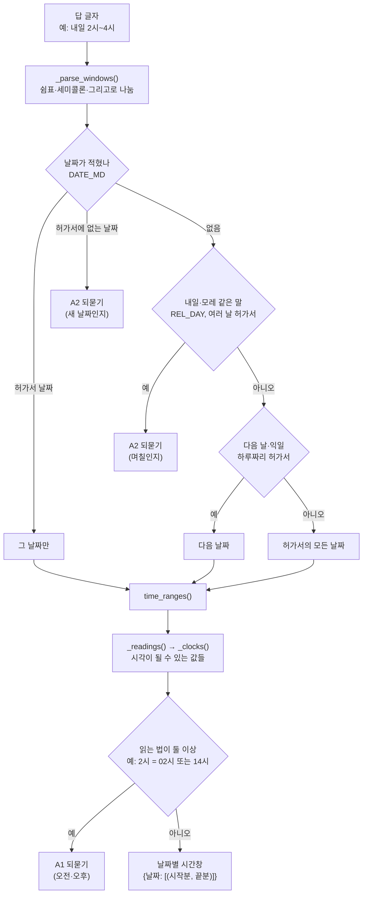
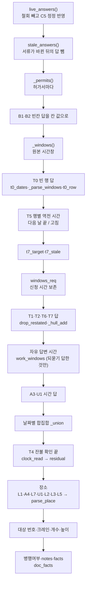

# 05e. 답 해석과 시간·장소 — 함수 단위 세부

작업반장이 준 답과 허가서 값을 croScan이 어떻게 읽는지 함수 하나하나로 적은 문서입니다. 대상은 [`server/augment.py`](../server/augment.py)의 시간 읽기, 장소 읽기, 글 읽기, 답 겹쳐 쓰기(`effective()`), 참고 작업시간 비교, T7·T8·T9 질문 함수 63개입니다.

**이 문서에서 알 수 있는 것**
- 「2시~4시」「내일 9시~11시」「다음 날 00:00~02:00」「10/27 09~11; 10/28 14~16」 같은 시간 답이 어떤 분(minute) 값이 되는지, 언제 되묻는지
- 「3BAY 12-14 칼럼」「2B / 08~12축」「용접3팀」 같은 장소가 어떤 수준(L0~L4)·BAY·칼럼으로 읽히는지
- 허가서 값 위에 답을 겹쳐 쌍작업 판정이 쓰는 값(`effective()`)을 만드는 모든 단계
- 함수마다 쓰는 정규식·상수, 부르는 곳, 지키는 시험(`tools/check_*.py`)
- 코드가 어긋나 보이는 곳을 「의도」「확인 필요」「설계 근거 미기록」으로 나눈 목록

질문 목록과 순서는 [05 멀티턴 질문](05_멀티턴_질문.md), 쌍작업 판정은 [06 쌍작업 판정](06_쌍작업_판정.md), 반영본은 [08 반영본과 별지](08_반영본과_별지.md), 정규식 전체 목록은 [17 규칙과 설정값 전체](17_규칙과_설정값_전체.md)에 있습니다. 이 문서는 그 문서들이 넘긴 **함수 단위 세부**를 다룹니다.

## 목차
1. [함수 지도](#1-함수-지도)
2. [호출 흐름](#2-호출-흐름)
3. [실제로 돌린 예시 모음](#3-실제로-돌린-예시-모음)
4. [근무시간과 시각 기초](#4-근무시간과-시각-기초)
5. [허가서 읽기와 번호](#5-허가서-읽기와-번호)
6. [시간 읽기](#6-시간-읽기)
7. [글이 무엇을 말하는가](#7-글이-무엇을-말하는가)
8. [답 정리](#8-답-정리)
9. [effective — 허가서 값에 답 겹치기](#9-effective--허가서-값에-답-겹치기)
10. [겹친 값 다듬기와 시간 겹침](#10-겹친-값-다듬기와-시간-겹침)
11. [부정 답·작업 범위·참고 작업시간](#11-부정-답작업-범위참고-작업시간)
12. [시각 하나와 T7·T8·T9](#12-시각-하나와-t7t8t9)
13. [한계와 알려진 문제](#13-한계와-알려진-문제)

> 읽는 법: 시간은 모두 **그날 00:00부터 센 분**입니다. 540은 09:00, 1440은 다음 날 00:00, 1560은 「익일 02:00」입니다. 예시 가운데 「실행 결과」라고 쓴 것은 2026-11-02에 이 저장소 코드를 실제로 import해서 돌린 출력입니다. 시연용 허가서 `4012`~`6623`은 `samples/반장_테스트/`의 시험 허가서입니다(시연 자료 기준).

## 1. 함수 지도

줄 번호는 지금 [`server/augment.py`](../server/augment.py) 기준입니다. 「부르는 곳」의 괄호 안 숫자는 부르는 줄입니다.

| 함수 | 줄 | 한 줄 요약 | 부르는 곳 |
|---|---|---|---|
| [`_site_shift()`](#_site_shift) | 77 | 현장이 정한 주간 근무시간(환경변수)을 읽음 | 모듈 상수 `SITE_SHIFT`(82) |
| [`night_part()`](#night_part) | 85 | 시간창이 확인된 주간 근무 밖에 걸치는지 | `t7_target`(1504), `_time_of_day`(1581) |
| [`day_only()`](#day_only) | 95 | 시간창이 확인된 주간 근무 안에만 있는지 | `t7_target`(1506) |
| [`_v()`](#_v) | 103 | 허가서 칸 값 하나를 글자로 | 모듈 곳곳, reflect·checklist·checkai |
| [`_m()`](#_m) | 107 | 「09:00」 한 칸을 분으로 | `_windows`, `effective`, `clock_read`, `t7_rows`, `_foreman` |
| [`hm()`](#hm) | 115 | 분을 「09:00」「익일 01:00」 글자로 | 모듈 곳곳, reflect |
| [`permit_day()`](#permit_day) | 119 | 승인번호에 든 작업일 | `t0_dates`, `_foreman`(1661) |
| [`t0_dates()`](#t0_dates) | 128 | T0 답이 가리키는 날짜들 | `effective`(658) |
| [`t5_item()`](#t5_item) | 143 | 행별 T5 항목 이름(T5, T5.2 …) | `effective`, `_foreman` |
| [`time_gap()`](#time_gap) | 148 | 비어 있는 작업일시 행 찾기(T0) | `_foreman`(1657) |
| [`t0_row()`](#t0_row) | 164 | T0 답을 서식 행에 놓기 | `effective`(659) |
| [`_windows()`](#_windows) | 181 | 허가서 작업일시 행 → 날짜별 시간창 | `effective`, `_foreman`, `questions`, `doc_conflicts`, reflect |
| [`_hull_add()`](#_hull_add) | 190 | 시간창에 다른 창을 날짜별 합집합으로 더함 | `effective`(715, 720, 759) |
| [`parse_place()`](#parse_place) | 199 | 장소 글 → 공장·BAY·칼럼·상하·수준 | `effective`, `_replace_cols`, `time_model`, `readable`, `doc_conflicts`, `found_in`, `interpret`, reflect |
| [`_permits()`](#_permits) | 222 | 필드 묶음 → 허가서 목록 | `effective`(611), checklist |
| [`_who()`](#_who) | 235 | 「3쪽 화기작업(4403)」 같은 이름표 | `_pair`, `_q`, `questions`, `summary`, `interpret`, analyze·checklist |
| [`norm_ids()`](#norm_ids) | 242 | 소문자로 친 번호를 대문자로 | app.py, understand.py |
| [`confirmed()`](#confirmed) | 247 | 정해진 말로 한 절만 돌려줌 | `doc_facts`, `_time_of_day`, `_wait_state`, `_foreman` |
| [`blocks_in()`](#blocks_in) | 257 | 블록 번호만 고름 | `time_model`(1317), `_foreman`(1955) |
| [`ids()`](#ids) | 263 | 블록·설비 번호 고르기(가스·강재 이름 뺌) | `blocks_in`, `effective`, `_foreman`, `readable`, `found_in`, `interpret`, analyze·link·permitsignal |
| [`_clocks()`](#_clocks) | 284 | 적힌 시각 하나가 될 수 있는 분 값들 | `_readings`, `clock_read` |
| [`_readings()`](#_readings) | 297 | 시간 범위 하나가 뜻할 수 있는 (시작, 끝) | `time_ranges`(319) |
| [`time_ranges()`](#time_ranges) | 312 | 글 속 시간 범위 모두 → 분 쌍, 모호하면 빼고 기록 | `_parse_windows`, `_foreman`, `readable`, `_time_value` |
| [`dated()`](#dated) | 334 | 글 속 시간 범위가 모두 날짜와 함께인지 | `effective`(738) |
| [`next_iso()`](#next_iso) | 343 | 다음 날 날짜 | `_parse_windows`, `effective` |
| [`_parse_windows()`](#_parse_windows) | 348 | 시간 답 → 날짜별 시간창, 모호하면 되물음 목록 | `work_windows`, `effective`, `drop_restated`, `doc_conflicts`, reflect |
| [`said()`](#said) | 431 | 글이 rx를 「그렇다/아니다/말 안 함」 중 무엇으로 말하는지 | `_scope`, `time_model`, `time_fit`, `_wait_state`, `_foreman`, `found_in`, checklist |
| [`_plain_number()`](#_plain_number) | 461 | 조건·부정·두 값이 아닌 숫자 하나 | `count_in`, `height_in` |
| [`count_in()`](#count_in) | 479 | 개수 읽기 | `effective`, `readable`, `found_in`, `interpret` |
| [`height_in()`](#height_in) | 486 | 높이 읽기(거리는 뺌) | `effective`, `_foreman`, `readable`, `doc_conflicts`, `found_in` |
| [`other_work()`](#other_work) | 499 | 다른 종류의 작업 이름 찾기 | `own_text`, `work_windows`, `_foreman`, `found_in`, `_plain` |
| [`own_text()`](#own_text) | 514 | 이 작업에 대한 절만 남김 | `effective`(868), `found_in` |
| [`work_windows()`](#work_windows) | 521 | 자유 답변에서 이 작업의 시간창만 | `effective`(754), `found_in` |
| [`ask_item()`](#ask_item) | 537 | 되묻기 질문 이름(A1.T1, A2.T6.3 …) | `_force`, `_foreman` |
| [`_force()`](#_force) | 543 | 되묻기 답을 「몇 번째 모호한 곳 → 답」으로 | `effective`, `doc_conflicts`, reflect |
| [`withdrawn()`](#withdrawn) | 563 | 「서류가 맞음」(C6)으로 철회된 답 | `live_answers`, `records`, app.py |
| [`live_answers()`](#live_answers) | 577 | 계산에 쓰는 답(철회 빼고 C5 정정 반영) | `effective`, `answers_now`, `questions`, app·checklist·pairs·reflect |
| [`_said_scope()`](#_said_scope) | 600 | 답 글을 대상·개수·높이로 읽어도 되는 항목인지 | `effective`(640) |
| [`effective()`](#effective) | 605 | 허가서 값 + 답 → 쌍작업 판정이 쓰는 값 | `questions`(2091), app·checkai·checklist·reflect·review·safety |
| [`doc_facts()`](#doc_facts) | 872 | 서류 글이 이미 정한 사실 | `effective`(866) |
| [`_row_of()`](#_row_of) | 893 | 시간 질문이 묻던 행 번호 | `t7_stale`(1523) |
| [`drop_restated()`](#drop_restated) | 905 | 답이 다시 말한 신청 시간을 뺌 | `effective`(706) |
| [`_union()`](#_union) | 924 | 하루 시간창 합집합 | `_hull_add`, `effective`, `time_fit`, `_wait_state` |
| [`_replace_cols()`](#_replace_cols) | 938 | 장소에서 칼럼만 바꿔 끼움 | `effective`(826) |
| [`_span()`](#_span) | 951 | 그날 시간창 끝을 잔불 확인 끝까지 늘림 | `overlap`, `summary`(2453) |
| [`overlap()`](#overlap) | 960 | 두 허가서 시간이 처음 겹치는 곳 | `pairs`(978) |
| [`negated()`](#negated) | 1207 | 글로 쓴 「없음」이 그 항목의 「없음」 선택인지 | `eff_choice`, reflect |
| [`eff_choice()`](#eff_choice) | 1241 | 답의 선택(글로 쓴 「없음」 반영) | `_foreman`(2006), checklist, pairs |
| [`_scope()`](#_scope) | 1263 | 작업 범위(국부 보수·교체·점검 …) | `time_model`, `_foreman`, `questions`, `doc_conflicts` |
| [`doc_text()`](#doc_text) | 1291 | 허가서 글만(답 없이) | `doc_facts`, `_foreman`, `doc_conflicts` |
| [`_repeats()`](#_repeats) | 1305 | 「2회 진입」「세 번 반복」의 횟수 | `time_model` |
| [`time_model()`](#time_model) | 1313 | 조건이 맞는 참고 작업시간 모델 | `time_fit`(1414) |
| [`time_fit()`](#time_fit) | 1398 | 적힌 시간과 참고 모델 비교 | `_foreman`(2032) |
| [`clock_read()`](#clock_read) | 1439 | 시각 하나 → (분, 모호함, 다음 날) | `effective`, `_clock`, `readable` |
| [`_clock()`](#_clock) | 1454 | 모호하지 않은 시각 하나 | 부르는 곳 없음 |
| [`t7_rows()`](#t7_rows) | 1460 | T7이 견주는 작업일시 행들 | `t7_target`, `_time_of_day` |
| [`t7_target()`](#t7_target) | 1494 | T7이 물을 행(주간·야간 체크와 시간) | `effective`(685) |
| [`t7_original()`](#t7_original) | 1510 | T7이 물은 원래 값 글자 | `t7_stale`, `_time_of_day` |
| [`t7_stale()`](#t7_stale) | 1515 | 예전 T7 답이 다른 행에 대한 것인지 | `effective`(686) |
| [`drop_stale()`](#drop_stale) | 1527 | 낡은 답 빼기 | `questions`(2092), `summary`(2446), reflect |
| [`_open()`](#_open) | 1534 | 시간 질문이 아직 안 정해졌는지 | `_time_of_day`, `_foreman`(2053) |
| [`_time_of_day()`](#_time_of_day) | 1540 | T7·T8 질문 만들기 | `_foreman`(1690) |
| [`_wait_state()`](#_wait_state) | 1615 | T9(대기·중단 중 상태) 질문 만들기 | `_foreman`(1951) |

람다로 만든 중첩 함수도 부모 함수 절에서 다룹니다: `parse_place`의 대시 바꾸기, `norm_ids`의 대문자 바꾸기, `effective`의 `get`·`days_of`, `_time_of_day`·`_wait_state`의 `get`.

## 2. 호출 흐름

시간 답 하나가 시간창이 되는 길입니다.

`effective()`가 허가서 하나의 값을 만드는 순서입니다.

## 3. 실제로 돌린 예시 모음

아래는 모두 실행 결과입니다. 예시 스크립트는 이 저장소의 `server.augment`를 import해서 함수를 직접 불렀습니다.

### 시간 범위 하나 — `time_ranges()`

| 입력 | 결과 | 설명 |
|---|---|---|
| `09:00~11:00` | 09:00~11:00 | 24시간 표기는 하나로 읽음 |
| `9시~11시` | 09:00~11:00 | 맨 7~12시는 주간으로 읽음 |
| `2시~4시` | (안 씀) 모호 목록 `[(0, '2시~4시')]` | 02~04시인지 14~16시인지 몰라 A1로 되물음 |
| `2시~4시` + 답 `pm` | 14:00~16:00 | A1 「오후」 |
| `2시~4시` + 답 `am` | 02:00~04:00 | A1 「새벽·오전」 |
| `오후 2시~4시` | 14:00~16:00 | 앞의 「오후」가 끝에도 붙음 |
| `새벽 2시~4시` | 02:00~04:00 | 앞의 「새벽」이 끝에도 붙음(끝 숫자가 더 클 때만) |
| `오전 9시~1시` | 09:00~13:00 | 끝 1시는 오후로 읽음 |
| `11시~1시` | 11:00~13:00 | 끝이 시작보다 작으면 12시간 뒤 |
| `8시~5시` | 08:00~17:00 | 같은 이유 |
| `9시 30분부터 11시` | 09:30~11:00 | 「부터」도 범위 표시 |
| `13시 반~15시` | 13:30~15:00 | 「반」 = 30분 |
| `22:00~02:00` | (안 읽음) | 자정을 넘는 범위는 스스로 다음 날로 바꾸지 않음(답에서는 시간 읽기 검사가 다시 받고, 서식 행에 적힌 역전은 T5가 물음) |
| `3BAY 12-14 칼럼` | (안 읽음) | BAY 뒤 숫자 범위는 칼럼 |
| `높이 3~4m` | (안 읽음) | 단위가 m |
| `10.5~12` | (안 읽음) | 소수 |
| `1시~3시, 4시~6시` | 모호 둘 `[(0,'1시~3시'), (1,'4시~6시')]` | 하나씩 따로 되물음 |
| 위 + `{1: 'pm'}` | 16:00~18:00 | 두 번째만 답했으므로 그것만 씀 |
| `오후 1시~5시, 7시~9시` | 13:00~17:00, 07:00~09:00 | 「오후」는 첫 범위에만 붙음 |

### 여러 시간창과 날짜 — `_parse_windows()`

허가서 날짜가 `2026-10-27` 하루인 경우를 「하루」, `2026-10-27`·`2026-10-28` 이틀인 경우를 「이틀」로 적습니다.

| 입력 | 허가서 | 결과 |
|---|---|---|
| `09:00~11:00, 14~16` | 하루 | 10-27: 09:00~11:00, 14:00~16:00 |
| `09:00~11:00, 13:00~15:00` | 이틀 | 두 날 모두 09:00~11:00, 13:00~15:00 |
| `10/27 09~11; 10/28 14:00-16:00` | 이틀 | 10-27: 09:00~11:00 / 10-28: 14:00~16:00 |
| `10월 28일 13시~15시` | 이틀 | 10-28: 13:00~15:00 |
| `2026-10-28 08:00~12:00` | 이틀 | 10-28: 08:00~12:00 |
| `10/27 09~11 그리고 14~16` | 이틀 | 10-27: 09~11, 14~16 / 10-28: 14~16(날짜 없는 조각은 모든 날) |
| `내일 9시~11시` | 이틀 | (안 씀) A2 되묻기 `{'kind': 'date', 'k': 0, 'raw': '내일 9시~11시'}` |
| 위 + 답 `2026-10-28` | 이틀 | 10-28: 09:00~11:00 |
| 위 + 답 `all` | 이틀 | 두 날 모두 09:00~11:00 |
| `내일 9시~11시` | 하루 | 10-27: 09:00~11:00(날짜가 하나뿐이라 묻지 않음) |
| `다음 날 00:00~02:00` | 하루 | 10-28: 00:00~02:00 |
| `익일 01:00~03:00` | 하루 | 10-28: 01:00~03:00 |
| `10/30 09~11` | 이틀 | (안 씀) A2 되묻기, `new: '2026-10-30'` |
| 위 + 답 `2026-10-30` | 이틀 | 10-30: 09:00~11:00(새 날짜로 받음) |
| `3BAY 12-14 칼럼에서 09~11시` | 하루 | 10-27: 09:00~11:00(칼럼은 시간이 아님) |
| `10/27 09~11` | 날짜 칸이 `10/27` | `{}`(ISO 날짜가 아니면 견주지 않음, 오류 없음) |

### 장소 — `parse_place()`

| 입력 | 공장 | BAY | 칼럼(범위) | 상하 | 수준 |
|---|---|---|---|---|---|
| `2공장 3BAY 12-14 칼럼 E41P 상부` | 2 | 3 | 12-14 칼럼 (12, 14) | 상부 | L4 |
| `3BAY 12-14` | — | 3 | BAY 12-14 (12, 14) | — | L3 |
| `3BAY 12-14시` | — | 3 | — | — | L2 |
| `F01 / 2B / 08~12축` | — | 2 | 08~12축 (8, 12) | — | L4 |
| `2B-08` | — | 2 | 2B-08 (8, 8) | — | L3 |
| `3BAY` | — | 3 | — | — | L2 |
| `3BAY 12칼럼` | — | 3 | 12칼럼 (12, 12) | — | L3 |
| `3BAY 14-12칼럼` | — | 3 | 14-12칼럼 (12, 14) | — | L3 |
| `3BAY 12～14칼럼` | — | 3 | 12~14칼럼 (12, 14) | — | L3 |
| `3BAY 12-14 칼럼, 4BAY` | — | 3, 4 | 12-14 칼럼 (12, 14) | — | L3 |
| `A2공장 4BAY 지상` | A2 | 4 | — | 하부 | L2 |
| `5BAY 내부` | — | 5 | — | 내부 | L2 |
| `E41P 블록 안 진입` | — | — | — | 내부 | L1 |
| `대조립 공장` | — | — | — | — | L1 |
| `의장1팀` | — | — | — | — | L0(팀 이름) |
| (빈 글) | — | — | — | — | L0 |

시연용 허가서의 장소를 `effective()`가 읽은 결과입니다.

| 허가서 | 적힌 장소 | 읽은 값 |
|---|---|---|
| 4012 화기 | `대조립1부 용접3팀` | L0(팀 이름), BAY 없음. 상하 「상부」는 작업 상세 「발판 위」에서 읽음 |
| 4403 화기 | `대조립21공장 3BAY 14-16 칼럼` / `E33S 블록 하부 종통재` | 공장 21, BAY 3, 칼럼 (14, 16), 하부, L4, 대상 E33S |
| 5067 밀폐 | `대조립22공장 1BAY 8-10 칼럼` / `F12C 블록 이중저 내부` | 공장 22, BAY 1, 칼럼 (8, 10), 내부, L4 |
| 5325 고소 | `대조립21공장 3BAY 17-20 칼럼` / `E42P 블록 상부 동측, 작업발판 WP-02` | BAY 3, 칼럼 (17, 20), 상부, L4, 대상 E42P·WP-02, 개수 6, 높이 4.8 |
| 5435 인양 | `대조립21공장 2BAY 5-8 칼럼 → 1BAY 반출장` | BAY 1·2, 칼럼 (5, 8), L3, 대상 E25S·OH-21-01 |
| 6623 정전 | `대조립21공장 3BAY 천장크레인 OH-21-03` / `크레인 거더 상부 제어반 CP-01` | BAY 3, 칼럼 없음, 상부, L2, 대상 CP-01·OH-21-03 |

### 답으로 바뀐 시간 — `effective()`

| 상황 | 답 | 결과 |
|---|---|---|
| 4403 작업일시 4행 모두 비움 → T0.1 | `10/27 09~11, 10/28 13~15` | 1행 10-27 09:00~11:00, 2행 10-28 13:00~15:00에 놓음. 출처 「신청자 답변」 |
| 같은 T0.1 | `2시~4시` | 쓰지 않음, A1 되묻기(`src: T0.1`) |
| 4403 22:00~02:00 → T5 | 「다음 날 끝남」(`overnight`) | 10-27: 22:00~익일 02:00 |
| 같은 T5 | 「잘못 적음」 `13:00~15:00` | 10-27: 13:00~15:00, `windows_req`도 같이 바뀜 |
| 4012 4일 08:00~16:59 → T1 「일부」 | `08:00~16:59는 하루 허가 신청 시간입니다. 실제 절단·용접은 09:00~11:30, 13:00~15:00` | 네 날 모두 09:00~11:30, 13:00~15:00. 신청 시간은 빠짐(QA #106) |
| 같은 T1 | `10/28 09~11` | 10-28만 09:00~11:00, 다른 날은 08:00~16:59 그대로 |
| 같은 T1 | `내일 2시~4시` → A2 `2026-10-28` → A1 `pm` | 10-28: 14:00~16:00 하나만 남음(시험 `check_questions.py` 215줄이 기대하는 동작) |
| 5388 인양 2일 → T1 「일부」 | `10/27 10:30~11:30` | 전체 창 08:00~16:59 유지, `windows_stage.move` 10-27 10:30~11:30, 의미 `stage` |
| 5435 인양 40분 → T6 | 「단계만」 `10:00~15:00` | 창 10:00~15:00, `windows_stage.written` 11:00~11:40, `full_end` 15:00, 의미 `full` |
| 같은 T6 | 「다시 입력」 `13:00~16:00` | 창 13:00~16:00 |
| 4403 13:00~16:00 → T4 | `16:30` / `오후 4시 반` | 잔불 확인 끝 16:30, 비교 창 13:00~16:30 |
| 같은 T4 | `15:00` | 작업 끝보다 일러 A5.T4로 되물음(`residual_ask`) |
| 같은 T4 | `4시 반` | 쓰지 않음(모호. 답 받을 때 `readable()`이 다시 적게 함) |
| 같은 T4 | `10/28 01:00` 또는 `다음날 01:00` | 10-27의 끝을 익일 01:00으로 |
| 4403 자유 답변 | `실제 작업 시간은 2시~4시입니다` → A1.F1 `pm` | 14:00~16:00. 출처 「신청자 답변(추가 전달, 시간 확인함)」 |
| 4403 자유 답변 | `실제 작업 시간은 14:00~16:00입니다` | 쓰지 않음(제안만, 반장이 확인해야 반영) |

### 참고 작업시간 비교 — `time_model()`·`time_fit()`

| 허가서(바꾼 값) | 모델 | 비교 |
|---|---|---|
| 4403 `E33S 블록 균열부 가우징 1군데` | T01 국부 보수 1개 115~230분 | 150분, `fit` |
| 4403 `… 가우징 3군데` | T04 국부 보수 3개 265~530분 | — |
| 4403 `… 깊은 균열부 가우징 1군데` | 없음: 「깊은 불량: 제거 범위 조건 미확인」 | 보류 |
| 4403 원본(개수 없음) | 없음: 「보수 개수 미상」 | 보류 |
| 5067 `진입 2명, 3곳 점검` | R-I 내부 검사 3곳 1회 진입 110~220분 | — |
| 5067 `2곳 점검, 2회 진입 반복` | R-N 내부 검사 2곳 2회 진입 155~310분 | — |
| 5325 `러그 6EA 가스절단 후 회수` | R-G 가스절단 러그 6개 340~680분 | 120분, `short` |
| 5325 `… 두께 50mm` | 없음: 「참고 조건(두께·절단 길이)과 다름」 | 보류 |
| 5435 원본 | N4-EST-B 긴 경로·통행 조정 180~390분 | 40분, `short` → T6 |
| 6623 원본 | EST-C 모듈·부품 교체 150~360분 | 120분, `short` → T6 |
| 6623 `인버터 교체 후 시험 2회 반복` | EST-D 수리·시험 2회 반복 300~720분 | — |
| 4403 1군데 + `검사 대기 후 재용접` | — | 보류: 「대기 시간 미정」 |
| 4403 1군데 + `검사 대기 30분 후 재용접` | T01 | `fit` |
| 4012·4676·5151·5388·5488(여러 날) | — | 보류: 「여러 날 작업이라 하루 단위 참고와 비교하지 않음」 |

참고 작업시간은 조사자료 2.6의 저자 추정치입니다. 현장 평균이 아니며, 설명 없는 차이를 한 번 묻는 데만 씁니다(코드 주석 1177줄).

## 4. 근무시간과 시각 기초

### _site_shift()
- **요약:** 현장이 확인해 준 주간 근무시간을 읽습니다. 지금은 확인된 값이 없어서 `None`입니다.
- **입력·출력:** `v`(글자, 없으면 환경변수 `CROSCAN_SITE_SHIFT`) → `(시작분, 끝분)` 또는 `None`.
- **판정 단계:**
  1. 정규식 `\s*(\d{1,2}):(\d{2})\s*-\s*(\d{1,2}):(\d{2})\s*`로 전체가 맞는지 봅니다(`fullmatch`).
  2. 맞으면 `(시*60+분, 시*60+분)`, 아니면 `None`.
  3. 모듈을 읽을 때 한 번 불러 상수 `SITE_SHIFT`에 둡니다(82줄).
- **예시(실행 결과):** `'08:00-18:00'` → `(480, 1080)` / `'8-18'` → `None` / 지금 `SITE_SHIFT` → `None`.
- **호출 관계:** 부르는 곳은 82줄뿐입니다. `SITE_SHIFT`는 `night_part`·`day_only`·`t7_target`·`_time_of_day`가 씁니다.
- **시험:** `check_questions_material.py` 79줄(`SITE_SHIFT is None`), 81~92줄(값을 08~18로 넣고 T7을 시험한 뒤 되돌림).
- **근거:** 조사자료의 08~18 / 18~익일 08 구분은 저자의 시나리오이며 「야간 자체/08~18 가정만으로 질문·오류 금지」입니다(N4-MT15 p315; N2~N5 MT14 p247·275·355). 확인된 근무시간이 없으면 주간·야간 체크는 법정 야간(`review.LEGAL_NIGHT`, 근로기준법 제56조 제3항)으로만 견줍니다(코드 주석 70~76줄).

### night_part()
- **요약:** 시간창이 확인된 주간 근무 밖에 조금이라도 걸치는지 봅니다.
- **입력·출력:** `a`, `b`(분, `b`는 자정을 넘을 수 있음), `shift`(없으면 `SITE_SHIFT`) → `True`/`False`.
- **판정 단계:** 근무시간이 없으면 `False`. 있으면 `a < 시작 또는 b > 끝`.
- **예시(실행 결과):** `night_part(360, 600, (480, 1080))` → `True`(06:00~10:00은 08~18 밖에 걸침) / `night_part(360, 600)` → `False`(근무시간 없음).
- **호출 관계:** `t7_target`(1504), `_time_of_day`(1581).
- **시험:** `check_questions_material.py` 80줄.

### day_only()
- **요약:** 시간창이 확인된 주간 근무 안에만 있는지 봅니다.
- **입력·출력:** `a`, `b`, `shift` → `True`/`False`. 근무시간이 없으면 `False`.
- **판정 단계:** `bool(shift) and a >= 시작 and b <= 끝`.
- **예시(실행 결과):** `day_only(540, 660, (480, 1080))` → `True` / `day_only(540, 660)` → `False`.
- **호출 관계:** `t7_target`(1506, 「야간」 체크인데 모든 행이 주간인지).
- **시험:** 직접 시험은 없습니다. `check_questions_material.py` 81~92줄의 T7 시험이 지나갑니다.

### _v()
- **요약:** 허가서 칸 하나의 값을 앞뒤 공백 없는 글자로 꺼냅니다.
- **입력·출력:** `p`(한 쪽의 칸 사전), `k`(칸 이름, 예: `from_1`) → 글자. 칸이 없거나 값이 비면 `""`.
- **판정 단계:** `str(p.get(k, {}).get("value", "") or "").strip()`.
- **호출 관계:** 이 모듈의 거의 모든 함수(`permit_day`, `time_gap`, `effective` …)와 [`server/reflect.py`](../server/reflect.py), [`server/checklist.py`](../server/checklist.py), [`server/checkai.py`](../server/checkai.py).
- **시험:** 직접 시험은 없습니다. 값을 읽는 모든 시험이 지나갑니다.

### _m()
- **요약:** 「09:00」 같은 시각 한 칸을 분으로 바꿉니다.
- **입력·출력:** `t`(글자) → 분 또는 `None`.
- **판정 단계:**
  1. 정규식 `\s*(\d{1,2}):?(\d{2})?\s*` 전체가 맞아야 합니다. 쌍점은 없어도 됩니다.
  2. `0 ≤ 시 < 24`이고 `0 ≤ 분 < 60`이면 `시*60+분`.
  3. 예외로 `24:00`만 1440(하루 끝)으로 받습니다. 그 밖은 `None`.
- **예시(실행 결과):** `'09:00'` → 540 / `'9'` → 540 / `'0930'` → 570 / `'24:00'` → 1440 / `'24:30'` → `None` / `'25:00'` → `None` / `'9시'` → `None`.
- **호출 관계:** `_windows`(184), `effective`(671), `clock_read`(1446), `t7_rows`(1478), `_foreman`(1650, 1655), [`server/pairs.py`](../server/pairs.py)·[`server/permitsignal.py`](../server/permitsignal.py)에는 같은 이름의 자기 함수가 따로 있습니다.
- **시험:** `check_questions_material.py` 125줄(「24:00만 하루 끝으로 읽고 24:30은 시각이 아님」).

### hm()
- **요약:** 분을 「09:00」으로, 1440 이상이면 「익일 01:00」으로 씁니다.
- **입력·출력:** `x`(분) → 글자.
- **판정 단계:** `x >= 1440`이면 `"익일 " + hm(x - 1440)`(자기를 다시 부름), 아니면 `HH:MM`.
- **예시(실행 결과):** 540 → `'09:00'` / 1439 → `'23:59'` / 1500 → `'익일 01:00'` / 2940 → `'익일 익일 01:00'`.
- **호출 관계:** 질문 글, 반영본, 요약 화면 곳곳(`t0_row`, `t7_original`, `_time_of_day`, `_foreman`, `questions`, `summary`, `found_in` …)과 [`server/reflect.py`](../server/reflect.py).
- **시험:** `check_questions.py` 170줄(시간 읽기 결과를 글자로 견줌).

## 5. 허가서 읽기와 번호

### permit_day()
- **요약:** 승인번호(예: `BS22-IV-20261027-4403`)에 든 작업일을 꺼냅니다. T0 답의 기본 날짜가 됩니다.
- **입력·출력:** `p` → `'YYYY-MM-DD'` 또는 `""`.
- **판정 단계:**
  1. `permit_no`에서 `-(20\d{2})(\d{2})(\d{2})-\d{3,4}\b`를 찾으면 그 날짜.
  2. 없으면 `date_1`이 ISO 날짜(`\d{4}-\d{2}-\d{2}`)일 때 그 값.
  3. 둘 다 아니면 `""`.
- **예시(실행 결과):** 승인번호 `BS22-IV-20261027-4403` → `'2026-10-27'` / 번호가 `X`이고 `date_1`이 `2026-10-28` → `'2026-10-28'`.
- **호출 관계:** `t0_dates`(132), `_foreman`(1661).
- **시험:** 직접 시험은 없습니다. T0 시험(`check_questions_material.py` 150~200줄)이 지나갑니다.

### t0_dates()
- **요약:** T0(빈 작업일시) 답이 가리키는 날짜들을 정합니다.
- **입력·출력:** `p`, `text`(답), `row`(행 번호, 기본 1) → ISO 날짜 목록.
- **판정 단계:**
  1. 기본 날짜: 그 행의 날짜가 ISO면 그것, 아니면 `permit_day(p)`.
  2. 기본 날짜의 연도를 둡니다.
  3. `DATE_MD`로 답 속 날짜를 모두 찾습니다. `2026-10-29` 꼴은 그대로, `10/29`·`10.29`·`10월 29일` 꼴은 연도를 붙입니다(월 1~12, 일 1~31일 때만).
  4. 찾은 날짜가 있으면 그것들을 정렬해 돌려주고, 없으면 `[기본 날짜]`, 기본 날짜도 없으면 `[]`.
- **쓰는 정규식:** `DATE_MD` = `(\d{4})-(\d{2})-(\d{2})|(?<![\d.])(\d{1,2})\s*[/.월]\s*(\d{1,2})(?!\d|\s*(?:m(?![a-z])|미터|시|:))` (대소문자 무시). 뒤에 m·미터·시·쌍점이 오면 날짜가 아닙니다(예: `4.8m`).
- **예시(실행 결과):** 승인번호 날짜 10-27, 1행 빈칸에서 `'10/29 09~11'` → `['2026-10-29']` / `'09~11'` → `['2026-10-27']` / `'2026-11-02 08~10, 11/3 08~10'` → `['2026-11-02', '2026-11-03']`.
- **호출 관계:** `effective`(658).
- **시험:** 직접 시험은 없습니다. `check_questions_material.py` 150~200줄(T0)이 지나갑니다.

### t5_item()
- **요약:** 행별 T5(끝이 시작보다 이른 시간) 질문의 항목 이름을 만듭니다.
- **입력·출력:** `i` → 1행은 `'T5'`, 나머지는 `'T5.<i>'`.
- **예시(실행 결과):** `t5_item(1)` → `'T5'` / `t5_item(3)` → `'T5.3'`.
- **호출 관계:** `effective`(670, 679, 681), `_foreman`(1651, 1654).
- **시험:** `check_questions_material.py` 581~590줄(「#12 T5는 행마다」).
- **근거:** 1행은 예전 이름을 그대로 둡니다(코드 주석 144줄).

### time_gap()
- **요약:** 날짜·시작·종료 중 빈 곳이 있는 작업일시 행을 찾습니다. T0.<행> 질문이 이 행을 묻습니다.
- **입력·출력:** `p`, `done`(이미 답한 행 번호들) → `(행, 빠진 부분 이름 목록)` 또는 `None`.
- **판정 단계:**
  1. 서식에 `date_1`·`from_1`·`to_1` 칸이 없으면 `None`(작업일시 표가 없는 서식).
  2. 값이 하나라도 있는 행을 「쓴 행」으로 모읍니다(1~7행).
  3. 쓴 행이 없으면 `(1, ['날짜', '시작', '종료'])`. 단 1행을 이미 답했으면 `None`.
  4. 쓴 행을 차례로 보며, 빈 부분이 있고 아직 답하지 않은 첫 행을 돌려줍니다.
  5. 그런 행이 없으면 `None`.
- **예시(실행 결과):** 빈 표 → `(1, ['날짜', '시작', '종료'])` / 빈 표, `done={1}` → `None` / 1행 날짜만 → `(1, ['시작', '종료'])` / 1행이 차 있고 2행 시작만 빔 → `(2, ['시작'])` / 칸 없음 → `None`.
- **호출 관계:** `_foreman`(1657).
- **시험:** `check_questions_material.py` 150~200줄(T0 질문이 생기는지).

### t0_row()
- **요약:** T0 답의 날짜·시간을 서식의 행에 놓는 방법을 정합니다. 반영본이 이대로 씁니다.
- **입력·출력:** `p`, `ws`(날짜별 창), `row`(물은 행) → `{행: (날짜, 시작, 끝)}` 또는 `None`.
- **판정 단계:**
  1. 놓을 수 있는 행: 물은 행, 그리고 그 뒤의 **완전히 빈** 행들(서식에 `date_<i>` 칸이 있는 것만).
  2. 한 날에 창이 둘 이상이거나, 날짜가 놓을 행보다 많으면 `None`(행 하나에 한 구간만 적을 수 있음).
  3. 날짜 순서대로 행에 놓습니다. 끝은 `b % 1440`으로 적습니다(자정을 넘으면 「02:00」처럼).
  4. 그 행에 이미 적힌 값이 답과 다르면 `None`(행을 적힌 대로 둠).
- **예시(실행 결과):** 빈 표, `{10-27: 09~11, 10-28: 13~15}` → `{1: ('2026-10-27','09:00','11:00'), 2: ('2026-10-28','13:00','15:00')}` / 한 날 두 구간 → `None` / 1행 시작이 08:00인데 답 09~11 → `None` / 22:00~익일 02:00 → `{1: ('2026-10-27','22:00','02:00')}`.
- **호출 관계:** `effective`(659).
- **시험:** `check_questions_material.py` 150~200줄.
- **근거:** 「행의 적힌 값이 다르게 말하면 그 행은 적힌 대로, 대조 시간도 그대로」(코드 주석 165~166줄, 648~649줄. reflect.py가 확인 목록에 올림).

### _windows()
- **요약:** 허가서 작업일시 1~7행을 날짜별 시간창으로 바꿉니다.
- **입력·출력:** `p` → `{날짜: [(시작분, 끝분)]}`.
- **판정 단계:** 각 행에서 날짜가 ISO이고, 시작·끝을 `_m()`으로 읽을 수 있고, **끝 > 시작**일 때만 넣습니다. 끝이 시작보다 이르거나 같은 행은 넣지 않습니다(T5가 먼저 묻습니다).
- **예시(실행 결과):** 1행 10-27 08:00~12:00, 2행 10-27 13:00~17:00, 3행 10-28 22:00~02:00 → `{'2026-10-27': [08:00~12:00, 13:00~17:00]}`(3행은 빠짐).
- **호출 관계:** `effective`(629), `_foreman`(1672), `questions`(2122), `doc_conflicts`(2382), [`server/reflect.py`](../server/reflect.py) 81·386·387줄.
- **시험:** 직접 시험은 없습니다. 원본 시간창을 보는 모든 시험이 지나갑니다.

### _hull_add()
- **요약:** 시간창에 다른 창을 날짜별로 더합니다. 겹치는 부분은 한 번만 셉니다.
- **입력·출력:** `wins`, `more`(둘 다 날짜별 창) → 새 사전(원본은 바꾸지 않음).
- **판정 단계:** `more`의 날짜마다 `_union(기존 + 더할 것)`. 다른 날로 옮기거나 신청 창에 맞춰 자르지 않습니다.
- **예시(실행 결과):** `{10-27: 08~12}` + `{10-27: 11~13, 10-28: 09~10}` → `{10-27: 08:00~13:00, 10-28: 09:00~10:00}`.
- **호출 관계:** `effective`(715 인양 T1, 720 T6 단계, 759 인양 자유 답변).
- **시험:** `check_questions_material.py` 284~306줄(T6 단계·인양 T1).

### parse_place()
- **요약:** 장소 글에서 공장, BAY, 칼럼, 상하(상부·내부·하부), 장소 수준 L0~L4를 읽습니다(설계 3-2).
- **입력·출력:** `text` → `{"text", "factory", "bays", "cols", "colrange", "layer", "level", "org"}`.
- **판정 단계(순서대로):**
  1. 대시 정리(중첩 람다): `[–—～∼〜]`에서 물결꼴(`～∼〜`)은 `~`로, 긴 대시(`–—`)는 `-`로 바꿉니다.
  2. 공장: `([A-Za-z]*\d+)\s*공장` → 대문자로. 숫자가 없는 「대조립 공장」은 공장 번호가 없습니다.
  3. BAY: `(\d+)\s*BAY`(대소문자 무시)와, 대조립 배치 모델(F01)의 축 표기 `(?<![A-Za-z0-9])(\d{1,2})B(?![A-Za-z0-9])`(예: `2B`)를 합칩니다.
  4. 칼럼: 아래 넷 중 **처음 맞는 것** 하나를 씁니다. 순서가 중요합니다. 「칼럼·축」이 붙은 범위를 먼저 보고, 「BAY 바로 뒤 숫자 범위」는 시간이 아닐 때만 칼럼으로 봅니다.
     - `(\d+)\s*[-~]\s*(\d+)\s*(?:칼럼|축)`
     - `(?<![A-Za-z0-9])\d{1,2}B-(\d{1,2})(?![0-9])` (예: `2B-08`)
     - `BAY\s*(\d{1,2})\s*[-~]\s*(\d{1,2})(?!\s*(?:시|:|분|\d))` (예: `3BAY 12-14`, QA #39)
     - `(\d+)\s*(?:칼럼|축)` (칼럼 하나)
  5. 상하: `상부|위\b|상단|거더` → 「상부」, 아니면 `내부|안\b|진입` → 「내부」, 아니면 `하부|아래|지상` → 「하부」, 모두 아니면 `""`. 순서대로 먼저 맞는 것을 씁니다.
  6. 팀 이름: BAY가 없고 `[가-힣A-Za-z0-9]+(팀|과|부|반)(?=\s|$|,)`가 있으면 `org=True`.
  7. 수준: 팀 이름이거나 빈 글 → 0, BAY 없음 → 1, 칼럼 있음 → 3, 그 밖 → 2. 수준이 3 이상이고 대상 번호(`TARGET`)나 상하가 있으면 4.
  8. 칼럼 범위: 칼럼에서 찾은 숫자들의 `(최솟값, 최댓값)`. 거꾸로 적어도(`14-12`) `(12, 14)`가 됩니다.
- **예시:** [3장 장소 표](#장소--parse_place)를 보세요(실행 결과).
- **호출 관계:** `effective`(830, 831, 836, 842), `_replace_cols`(941), `time_model`(1380, 인양 경로의 BAY 수), `readable`(2352, 2372), `doc_conflicts`(2405, 2406), `found_in`(2501), `_place_value`(2587), `interpret`(2643), [`server/reflect.py`](../server/reflect.py) 205·342·405줄.
- **시험:** `check_questions.py` 372줄(`F01 / 2B / 08~12축` → BAY 2, 칼럼 (8, 12)), `check_questions_material.py` 397~406줄(A4·L7이 칼럼을 바꿈).
- **근거:** BAY 뒤 숫자 범위는 칼럼이지 시간이 아님(QA #39). 거꾸로 적힌 칼럼은 넓게 읽고 한 번 묻습니다(A4.cols, 설계서 「끝이 시작보다 이른 시간·큰 번호부터 적힌 칼럼은 보수적으로 넓게 읽고」).

### _permits()
- **요약:** 업로드한 필드 묶음을 허가서 목록으로 나눕니다. 승인번호마다 첫 쪽 하나입니다.
- **입력·출력:** `fields` → `[{"no", "permit_no", "kind", "label", "p"}]`(쪽 순서).
- **판정 단계:**
  1. `review._pages(fields)`로 쪽별로 묶습니다.
  2. 쪽 번호 순서로 보며, 승인번호(대문자)가 없으면 `#<쪽>`을 씁니다.
  3. 이미 본 승인번호는 건너뜁니다(같은 허가서의 2쪽 이후).
  4. 종류(`kind`)는 그 쪽 칸 가운데 처음 `kind`가 있는 칸에서 가져옵니다. 이름표는 `PK.KINDS[kind]["label"]`, 모르면 `?`.
- **호출 관계:** `effective`(611), [`server/checklist.py`](../server/checklist.py) 520줄.
- **시험:** `check_checklist.py` 127·169줄, `check_checklist_material.py` 108·270·341·375·393줄.

### _who()
- **요약:** 질문·요약에 쓰는 이름표 「3쪽 화기작업(4403)」를 만듭니다.
- **입력·출력:** `P` → `f"{쪽}쪽 {이름}({승인번호 끝 4자리})"`.
- **호출 관계:** `_pair`(1035), `_q`(1080), `questions`(2256~2272), `summary`(2452), `interpret`(2687), [`server/analyze.py`](../server/analyze.py) 199줄, [`server/checklist.py`](../server/checklist.py) 441줄.
- **시험:** 직접 시험은 없습니다.

### norm_ids()
- **요약:** 반장이 소문자로 친 번호(`oh-21-01`, `e41p`)를 대문자로 바꿉니다. 나머지 글은 그대로 둡니다.
- **입력·출력:** `text` → 글자.
- **판정 단계:** `TARGET` 정규식을 대소문자 무시로 만든 `_ID_ANY_CASE`로 번호꼴을 찾고, 대문자로 바꿉니다(중첩 람다). 단 `[ckm]?m[23]`(예: `m3` 단위)은 그대로 둡니다.
- **예시(실행 결과):** `'oh-21-01, 3 m3, co2, e41p'` → `'OH-21-01, 3 m3, CO2, E41P'`.
- **호출 관계:** 이 모듈 안에서는 부르지 않습니다. [`server/app.py`](../server/app.py) 300·869줄, [`server/understand.py`](../server/understand.py) 328·336·337·491줄.
- **시험:** `check_pairs_cases.py` 120줄.

### confirmed()
- **요약:** 글에서 rx를 **정해진 말로** 한 절을 돌려줍니다. 미정·확인 필요·불확실이면 빈 글입니다.
- **입력·출력:** `text`, `rx` → 그 절(앞뒤 공백 없음) 또는 `""`.
- **판정 단계:**
  1. 절 나누기: `[,;\n/]|(?<!\d)\.(?!\d)|그리고|지만`(소수점은 나누지 않음).
  2. 절마다 rx가 있고, `need_catalog.UNSURE`도 `HEDGE`도 없으면 그 절을 돌려줍니다(처음 맞는 절).
- **쓰는 정규식:** `UNSURE` = `미정|확인\s*필요|확인\s*중|확인\s*예정|가능한지|여부|불가|모름|모르|할지|될지|인지\s*(?:확인|모름|모르)|아마|협의\s*중` ([`server/need_catalog.py`](../server/need_catalog.py)). `HEDGE`는 [7장 said()](#said)에 적었습니다.
- **예시(실행 결과):** `('DB-2 차단, 담당 미정', 'DB-?\d')` → `'DB-2 차단'` / `('DB-2인지 확인 필요', …)` → `''` / `('환기 유지, DB-2에서 전원', …)` → `'DB-2에서 전원'`.
- **호출 관계:** `doc_facts`(887), `_time_of_day`(1584), `_wait_state`(1630, 1632), `_foreman`(1844, 1849, 1855, 1909, 1946, 1960, 2057).
- **시험:** `check_questions_material.py` 532~541줄(「#4 확정된 원자만 생략」).

### blocks_in()
- **요약:** 번호 가운데 **블록 번호만** 고릅니다. 크레인, 분전반(`DB-2`), 배관(`P-01`), 밸브(`V-12`)는 뺍니다.
- **입력·출력:** `text` → 집합.
- **판정 단계:** `ids(text)` 가운데 `CRANE`이 아니고, 다음 중 하나인 것.
  - `[A-Z]\d{2,3}[A-Z]?(?:\([A-Z]\))?` (예: `E41P`, `B11`, `E170(A)`)
  - `[A-Z]-\d{2,3}`이면서 첫 글자가 P·V가 아님(예: `B-01`)
- **예시(실행 결과):** `'DB-2 차단, P-01 배관, V-12 밸브, E41P'` → `{'E41P'}` / `'E170(A), B-01, B11, E52, F31'` → 다섯 모두.
- **호출 관계:** `time_model`(1317, 블록이 여럿인지), `_foreman`(1955).
- **시험:** 직접 시험은 없습니다. `check_questions_material.py` 470~489줄(참고 모델 「다른 블록 여러 개: T04 보류」)이 지나갑니다.

### ids()
- **요약:** 글 속 블록·설비 번호를 모읍니다. 가스·강재 이름은 뺍니다.
- **입력·출력:** `text` → 집합.
- **판정 단계:** `TARGET.findall`로 찾고, 숫자만인 것과 `NOT_ID`에 전체가 맞는 것을 뺍니다.
- **쓰는 정규식:**
  - `TARGET` = `(?<![A-Za-z0-9])[A-Z]{1,3}-?\d{1,3}[A-Z]?(?:-\d{1,3})*(?:\([A-Z]\))?(?![A-Za-z0-9])` — 실물 서식의 `E170(A)`처럼 괄호 부분 글자를 남깁니다(E170(A)와 E170(B)는 다른 블록).
  - `NOT_ID` = `CO2|O2|N2|H2S?|SF6|CH4|NO2|SO2|(?:AH|DH|EH|FH)(?:32|36|40)|SUS\d{3}L?|SS\d{3}|SM\d{3}[A-C]?|(?:C|M|K)?M[23]` (대소문자 무시).
  - `CRANE` = `(?<![A-Za-z0-9])(?:OH|MC|GC|JC|TC|CR)-?\d{1,3}[A-Z]?(?:-\d{1,3})*(?![A-Za-z0-9])`.
- **예시(실행 결과):** `'CO2 용접, AH36 판재 교체, N2 퍼지, E41P 블록, OH-21-03'` → `{'E41P', 'OH-21-03'}` / `'3 M3 CO2 E41P'` → `{'E41P'}` / `'DB-2 차단, P-01 배관, V-12 밸브, E41P'` → 넷 모두 / `'E41P-12~14'` → `{'E41P-12'}`.
- **호출 관계:** `blocks_in`(259), `effective`(844, 868), `_foreman`(1966), `readable`(2353~2365), `found_in`(2504), `interpret`(2643), [`server/analyze.py`](../server/analyze.py) 93·100줄, [`server/link.py`](../server/link.py), [`server/permitsignal.py`](../server/permitsignal.py) 67줄.
- **시험:** `check_questions.py` 184줄, `check_questions_material.py` 407줄, `check_pairs_cases.py` 121줄.

## 6. 시간 읽기

이 장의 함수들이 쓰는 상수입니다.

- `_T`(시각 하나) = `(?:(오전|아침|새벽|오후|저녁|밤)\s*)?(\d{1,2})(?:\s*:\s*(\d{2})|\s*시(?:\s*(\d{1,2})\s*분|\s*(반))?)?`
- `TIME_RANGE`(범위) = 앞 경계 `(?<![\d.:A-Za-z-])` + `_T` + `\s*(?:[~\-–—～∼〜]|부터)+\s*` + `_T` + 뒤 경계 `(?!\d|[.:]\d|\s*(?:칼럼|축|BAY|번|m(?![a-z])|미터|개|명|톤|t(?![a-z])|일|%|kg|mm|cm))` (대소문자 무시). 뒤에 단위가 오면 시간이 아닙니다.
- `PLACE_SPAN` = `(?:\d+\s*공장\s*)?\d+\s*BAY(?:\s*\d{1,2}\s*[-~–]\s*\d{1,2}(?!\d)(?!\s*(?:시|:|분))(?:\s*(?:칼럼|축))?)?` — BAY와 그 뒤 칼럼 범위. 시간을 읽기 전에 지웁니다(QA #39).
- `DATE_MD` — [t0_dates()](#t0_dates)에 적었습니다.
- `AM` = (오전, 아침, 새벽), `PM` = (오후, 저녁, 밤).
- `REL_DAY` = `오늘|내일|모레|글피|다음\s*날|이튿날|첫\s*날|둘째\s*날|셋째\s*날|마지막\s*날|하루\s*뒤|이틀\s*뒤` — 그 말만으로는 날짜가 정해지지 않는 말.
- `NEXT_DAY` = `다음\s*날|익일|이튿날`.
- `ISO` = `\d{4}-\d{2}-\d{2}`.

### _clocks()
- **요약:** 적힌 시각 하나가 될 수 있는 분 값을 모두 돌려줍니다.
- **입력·출력:** `mark`(오전·오후 같은 말), `h`, `mi`, `half`(「반」), `raw`(적힌 시 글자) → 분 목록.
- **판정 단계:**
  1. 분 = `mi` + (「반」이면 30).
  2. 시가 24를 넘거나 분이 60 이상이면 `[]`.
  3. `PM` 말이면 하나: 12시 미만은 +12시간(12시는 그대로 12:00).
  4. `AM` 말이거나, 시가 「0」으로 시작(`09`)하거나, 0시이거나, **7시 이상**이면 하나: 그대로.
  5. 나머지(맨 1~6시)는 둘: 새벽과 오후 `[h*60, (h+12)*60]`.
- **예시(실행 결과):** `(None,'2')` → `[120, 840]` / `('오후','2')` → `[840]` / `(None,'9','30')` → `[570]` / `(None,'02')` → `[120]` / `(None,'7',반)` → `[450]` / `(None,'14')` → `[840]` / `(None,'25')` → `[]` / `('오전','12')` → `[720]` / `('밤','12')` → `[720]`.
- **호출 관계:** `_readings`(301, 305), `clock_read`(1449).
- **시험:** `check_questions.py` 170~176줄(「6시~8시」는 모호, 「9시~11시」는 주간).
- **근거:** 맨 7~12시는 주간 근무의 시각, 맨 1~6시는 새벽일 수도 오후일 수도 있어서 둘 다 둡니다(함수 설명 285~286줄). 「2시면 2시인지 14시인지 모르니까」(사용자 요청 2026-10-27, `check_questions.py` 197줄 주석).

### _readings()
- **요약:** 시간 범위 하나가 뜻할 수 있는 (시작, 끝)을 모두 만듭니다.
- **입력·출력:** `m`(`TIME_RANGE`의 맞은 결과) → `[(a, b)]`.
- **판정 단계:**
  1. 앞 시각의 말이 `AM`이고 끝 숫자가 시작 숫자보다 크면, 그 말을 끝에도 붙입니다(`새벽 2시~4시`). `오전 9시~1시`처럼 끝이 작으면 붙이지 않습니다.
  2. 끝 후보 = `_clocks(끝의 말 또는 이어받은 말, …)`.
  3. 끝에 말이 없고, 「0」으로 시작하지 않고, 12 미만이면 끝 후보에 +12시간 값도 넣습니다(`11시~1시` → 13:00).
  4. 시작 후보마다, 시작보다 큰 첫 끝 후보를 짝으로 고릅니다. 끝이 1440(24:00)을 넘으면 버립니다.
  5. 같은 짝은 한 번만 넣습니다.
- **예시:** [3장 시간 범위 표](#시간-범위-하나--time_ranges)(실행 결과). `22:00~02:00`은 끝 후보가 모두 시작보다 작거나 24:00을 넘어서 짝이 없습니다.
- **호출 관계:** `time_ranges`(319).
- **시험:** `check_questions.py` 170~176줄, `check_questions_material.py` 320줄(「T1 '22:00~02:00'은 읽지 않고 다시 받음(자동 익일 없음)」).
- **근거:** 끝이 시작보다 이른 시간은 확인 없이 다음 날로 바꾸지 않습니다(MT04, `check_questions_material.py` 319줄 제목).

### time_ranges()
- **요약:** 글 속의 시간 범위를 모두 분 쌍으로 읽습니다. 두 가지로 읽히는 범위는 짐작하지 않고 따로 적어 둡니다.
- **입력·출력:** `text`, `ampm`(`'am'`/`'pm'` 하나, 또는 `{k: 'am'|'pm'}`), `amb`(모호한 것을 담을 목록), `seen`(여러 번 부를 때 모호한 범위 번호를 이어 세는 `[0]`) → `[(a, b)]`.
- **판정 단계:**
  1. `PLACE_SPAN`을 공백으로 지웁니다(칼럼 범위를 시간으로 읽지 않게).
  2. `TIME_RANGE`로 범위를 하나씩 찾고 `_readings()`로 뜻을 만듭니다.
  3. 뜻이 둘 이상이면 이 범위에 번호 `k`를 매기고(`seen[0]`을 하나 늘림), `ampm`에서 답을 찾습니다. `am`이면 첫 뜻, `pm`이면 마지막 뜻을 씁니다.
  4. 답이 없으면 `amb`에 `(k, 범위 글자)`를 넣고 이 범위는 쓰지 않습니다.
  5. 뜻이 하나면 그대로 씁니다.
- **예시:** [3장 시간 범위 표](#시간-범위-하나--time_ranges)(실행 결과).
- **호출 관계:** `_parse_windows`(389), `_foreman`(1708, A1 질문의 보기 만들기), `readable`(2349, 시간 답을 읽을 수 있는지), `_time_value`(2605).
- **시험:** `check_questions.py` 170~176줄(15가지 입력), 198줄(`pm`/`am` 답), 203~210줄(A1.T1), `check_questions_material.py` 320줄.

### dated()
- **요약:** 글 속 시간 범위가 **모두** 날짜와 함께 적혔는지 봅니다. 그렇다면 그 답은 다른 날에 대해 아무 말도 하지 않은 것입니다.
- **입력·출력:** `text` → `True`/`False`.
- **판정 단계:** `[,;\n]|그리고|및`로 나눈 조각 가운데 시간 범위가 있는 조각만 모읍니다. 그런 조각이 있고, 모두 `DATE_MD`가 있으면 `True`.
- **예시(실행 결과):** `'10/27 09~11; 10/28 14~16'` → `True` / `'10/27 09~11, 14~16'` → `False` / `'09~11'` → `False`.
- **호출 관계:** `effective`(738).
- **시험:** 직접 시험은 없습니다. `check_questions_material.py` 308~317줄(날짜별 대조)이 지나갑니다.

### next_iso()
- **요약:** ISO 날짜의 다음 날을 돌려줍니다.
- **예시(실행 결과):** `'2026-12-31'` → `'2027-01-01'`.
- **호출 관계:** `_parse_windows`(387), `effective`(793, T4 날짜).
- **시험:** 직접 시험은 없습니다. `check_questions_material.py` 550~560줄, 591~606줄이 지나갑니다.

### _parse_windows()
- **요약:** 시간 답을 날짜별 시간창으로 바꿉니다. 짐작해야 읽히는 부분은 쓰지 않고 되묻기 목록에 넣습니다.
- **입력·출력:** `text`, `dates`(허가서의 ISO 날짜), `force`(되묻기 답 `{"ampm": {k: am|pm}, "date": {k: 날짜|"all"}}`), `amb`(되묻기 목록), `count`(한 답의 여러 문장이 같이 쓰는 번호 `{"ampm": [0], "date": [0]}`) → `{날짜: [(a, b)]}`.
- **판정 단계:**
  1. `dates`에서 ISO가 아닌 것은 뺍니다(화면에서 `10/27`로 고친 날짜는 견줄 수 없음).
  2. 글을 `[,;\n]|그리고|및`로 조각냅니다. 조각마다 아래를 합니다.
  3. **날짜가 적힌 조각**(`DATE_MD`): 월·일이 맞는 값이면
     - 그 월·일의 허가서 날짜만 대상으로 하고, 날짜 뒤 글만 남깁니다.
     - 허가서에 없는 날짜인데 뒤에 시간이 있으면: 새 날짜(ISO 표기는 원문 그대로, 월·일만 적었으면 연도는 허가서 첫 날짜의 연도)를 만들고 `force["date"][k]`를 봅니다. 답이 그 새 날짜나 허가서 날짜면 그 날로, 아니면 `{"kind": "date", "k", "raw", "new"}`를 `amb`에 넣고 이 조각은 건너뜁니다. 버리거나 다른 날로 옮기지 않습니다(#5).
  4. **날짜 없이 「내일」 같은 말**(`REL_DAY`)이 있고 허가서가 여러 날이며 시간이 있으면: `force["date"][k]`가 `all`이면 모든 날, 허가서 날짜면 그 날. 답이 없으면 `{"kind": "date", "k", "raw"}`를 `amb`에 넣고 건너뜁니다.
  5. **하루짜리 허가서에 「다음 날·익일」**(`NEXT_DAY`)과 시간이 있으면: 대상은 다음 날짜입니다.
  6. 위 셋이 아니면 대상은 허가서의 모든 날짜입니다.
  7. `time_ranges(조각, force["ampm"], found, seen)`으로 시간을 읽고, 오전·오후가 모호한 것은 `{"kind": "ampm", "k", "raw"}`로 `amb`에 넣습니다.
  8. 읽은 시간을 대상 날짜마다 넣습니다.
- **순서가 중요한 이유:** 날짜가 적혀 있으면 그것이 「내일」보다 앞섭니다. 되묻기 번호 `k`는 한 답 안에서 나타난 순서이므로 `count`를 문장끼리 나눠 씁니다. 그래서 `A1.T1`, `A1.T1.2`가 각각 몇 번째 모호한 곳인지 맞습니다.
- **예시:** [3장 여러 시간창과 날짜 표](#여러-시간창과-날짜--_parse_windows)(실행 결과).
- **호출 관계:** `work_windows`(532), `effective`(658 T0, 679 T5, 704 T1·T2·T6·T7, 771 A3·U1), `drop_restated`(914), `doc_conflicts`(2387), [`server/reflect.py`](../server/reflect.py) 388·453줄.
- **시험:** `check_questions.py` 177줄(ISO가 아닌 날짜 칸), 211~216줄(「내일 9시~11시」 → A2 → 그날만), `check_questions_material.py` 308~317줄, 550~560줄(「#5 허가서에 없는 날짜는 확인 질문」).
- **근거:** 「애매하면 넘어가지 않고 다시 묻기」(사용자 요청 2026-10-27). 허가서에 없는 날짜는 한 번 묻고 버리지 않음(#5, 코드 주석 367줄).

## 7. 글이 무엇을 말하는가

이 장의 함수들이 쓰는 상수입니다. 모두 [`server/augment.py`](../server/augment.py) 399~496줄에 있습니다.

- `CLAUSE`(절 나누기) = `[,;\n/·]|(?<!\d)\.(?!\d)|그리고|지만` — `4.8m`의 소수점은 나누지 않습니다.
- `COND`(조건) = `면(?:\s|$)|경우|때(?:는|에)?(?:\s|$)`
- `NEG`(부정) = `안\s*(?:씀|써|쓰|씁|함|합|해|했|하|할|들어)|없|미사용|사용\s*안|않|아님|아니`
- `PRENEG`(앞에 붙은 부정) = `(?:안|못)\s*(?:쓰는|쓸|하는|할|들어가는)\s*$|(?:없는|않는|않을)\s*$` — 「안 쓰는 가스」.
- `HEDGE`(확실하지 않음) = `아마|[가-힣]\s*수도\s*있|것\s*같|듯\s*(?:해|합|하|요|싶)|글쎄|모르겠|확실(?:하지|치)\s*않|확실히\s*모르|(?:있|없)을\s*(?:걸|거(?:예요|에요|야|같))|짐작|추정|미확인|(?:여부|는지|인지|할지|될지)[^,.;\n]{0,20}?(?:확인|파악|알아보|문의|물어보)\S*\s*(?:중|있)` — 「약·대략·쯤」은 대략의 숫자일 뿐이라 넣지 않았습니다(주석 408~409줄).
- `OPEN`(열어 둠) = `미정|확인\s*필요(?!\s*(?:없|X))|확인\s*예정|모름|모르겠|협의\s*중|정해지지\s*않|정하지\s*않` — 근거: 최종 검토 2026-11-01, H2·H3·L5·LI2·LO4·LO5가 이런 말로 닫히던 문제(Codex final #4는 지적한 항목만 고쳤음, 주석 426~427줄).
- `WORKTIME` = `작업\s*시간|실제|시간대|작업은|작업할|일하는|하는\s*시간|진입|움직이는|들어가는\s*시간`
- `COUNT` = `(\d{1,3})\s*(?:개소|개|EA|ea|군데|곳|부위|장)(?!월|년|소|씩|면|님)`
- `HEIGHT` = `(\d+(?:\.\d+)?)\s*(?:m|M|미터)(?![A-Za-z가-힣])`
- `TWO_VALUES`(두 후보 값) = `(?<![\d.A-Za-z-])\d+(?:\.\d+)?\s*{_UNIT}?\s*(?:[~\-–～]|또는|아니면|혹은|이나|나\s)\s*\d+(?:\.\d+)?\s*{_UNIT}`, `_UNIT` = `(?:개소|개|EA|ea|군데|곳|부위|장|m|M|미터)`
- `DISTANCE` = `반경|거리|이격|떨어|간격|폭|길이|범위|주변|둘레|통로`
- `CONC`(다른 작업·팀) = `다른\s*(?:작업|팀)|병행|동시\s*작업|옆\s*(?:\d*\s*BAY|칼럼|블록|팀)|타\s*(?:팀|부서|업체)`
- `OWN`(종류별 자기 작업 말): 화기 `용접|절단|가우징|보수|취부|검사|사상|그라인딩`, 밀폐 `진입|검사|청소|회수|보수|용접|점검`, 고소 `러그|절단|회수|사상|그라인딩`, 인양 `인양|반출|이동|운반|옮|반전`, 정전 `정전|차단|복구|수리|교체|점검|시험|검사`
- `WORKS`(작업 이름) = `도장|족장|비계|사상|그라인딩|청소|취부|인양|반출|용접|절단|가우징|정전|진입|검사|러그`

### said()
- **요약:** 글이 어떤 것(rx)을 「그렇다(`True`)」「아니다(`False`)」「말하지 않음(`None`)」 가운데 무엇으로 말하는지 절마다 봅니다.
- **입력·출력:** `text`, `rx`, `hedged`(기본 `False`) → `True`/`False`/`None`.
- **판정 단계(절마다):**
  1. `HEDGE`가 있는 절은 건너뜁니다. 단 `hedged=True`이고 rx가 있으면 `True`로 셉니다(모순을 알아채는 데만 쓰고 값을 채우지는 않음).
  2. rx가 맞는 곳마다, 뒤 12글자를 봅니다. 그 안에 rx가 또 나오면 거기까지만 봅니다.
  3. 뒤 글이나 앞 글에 `COND`가 있으면 건너뜁니다(「다른 작업 없으면」).
  4. 뒤 20글자에 `OPEN`이 있으면 건너뜁니다(「가스 사용 여부 미정」).
  5. 뒤 글에 `NEG`가 있거나 앞 10글자 끝에 `PRENEG`가 있으면 `False`, 아니면 `True`.
  6. 결과를 모읍니다. 한 번이라도 `True`면 `True`가 이깁니다.
- **예시(실행 결과):**
  - `('가스는 안 쓰고 용접만 합니다', '가스')` → `False`, 같은 글에 `'용접'` → `True`
  - `('안 쓰는 가스입니다', '가스')` → `False`
  - `('다른 작업 없으면 진행', '다른\s*작업')` → `None`
  - `('가스 사용 여부 미정', '가스')` → `None`
  - `('가스절단 완료 여부 확인 필요 없음', '가스\s*절단')` → `True`(「확인 필요 없음」은 미정이 아님)
  - `('블록 안 작업은 아마 없을 거예요', li_inside)` → `None`, `'… 아마 있을 걸요'`에 `hedged=True` → `True`
- **호출 관계:** `_scope`(1274~1286), `time_model`(1320~1390), `time_fit`(1410), `_wait_state`(1626), `_foreman`(1785~2016의 19곳), `found_in`(2510~2522), [`server/checklist.py`](../server/checklist.py) 179·181줄.
- **시험:** `check_questions.py` 133~136줄, 226줄, `check_questions_material.py` 618~620줄, `check_checklist_material.py` 366줄.

### _plain_number()
- **요약:** 평범한 절에서 rx로 찾은 마지막 숫자 하나를 돌려줍니다. 조건 속 숫자, 부정된 숫자, 두 후보 값은 쓰지 않습니다.
- **입력·출력:** `text`, `rx`(숫자를 잡는 정규식), `cast`(`int`/`float`), `not_after`(이 말 바로 뒤 숫자는 뺌) → 숫자 또는 `None`.
- **판정 단계(절마다):**
  1. `COND`나 `HEDGE`가 있는 절은 건너뜁니다.
  2. `TWO_VALUES`가 덮는 자리의 숫자는 건너뜁니다(「2~3개」「3개나 4개」).
  3. 숫자 뒤 6글자에 `NEG`가 있으면(「6개 아님」), 앞 8글자에 `not_after`가 있으면(「반경 5m」), 바로 앞이 `\d\s*(?:[~\-–～]|에서)\s*$`이면 건너뜁니다.
  4. 남은 숫자 가운데 **마지막** 것을 씁니다.
- **호출 관계:** `count_in`(480), `height_in`(487).
- **시험:** `count_in`·`height_in` 시험이 지킵니다.

### count_in()
- **요약:** 개수를 읽습니다. `_plain_number(text, COUNT, int)`.
- **예시(실행 결과):** `'러그 6개 있으면 높이 4.8m 에서 절단'` → `None` / `'러그 6개 아님, 2개'` → 2 / `'러그 2~3개'` → `None` / `'3개입니다'` → 3 / `'러그는 아마 6개'` → `None` / `'3개나 4개'` → `None`.
- **호출 관계:** `effective`(846), `readable`(2365, 2370), `found_in`(2506), `interpret`(2674).
- **시험:** `check_questions.py` 137~138줄, 226줄, 255줄, 278줄, 293줄.

### height_in()
- **요약:** 높이를 읽습니다. `_plain_number(text, HEIGHT, float, DISTANCE)` — 반경·거리 뒤의 m는 높이가 아닙니다.
- **예시(실행 결과):** `'하부 반경 5m 통행 통제'` → `None` / `'블록 상부 4.8m, 하부 반경 5m 통제'` → 4.8 / `'높이 3~4m'` → `None` / `'높이 3m~4m'` → `None`.
- **호출 관계:** `effective`(847), `_foreman`(1807, 1809), `readable`(2372), `doc_conflicts`(2411), `found_in`(2508).
- **시험:** `check_questions.py` 137줄, 188줄, 255줄, 278줄.

### other_work()
- **요약:** 평범한 절에서 **다른 종류의 작업** 이름을 찾습니다(화기 허가서의 「도장 작업 시간은 14~16시」).
- **입력·출력:** `text`, `kind` → 작업 이름 집합.
- **판정 단계:**
  1. `CLAUSE`로 나누고, `COND`가 있는 절은 건너뜁니다.
  2. `WORKS` 낱말마다, 그 뒤에서 이어지는 말 `(?:이며|이고|하며|하고|며|고|지만|는데)\s`까지를 그 낱말의 부분으로 봅니다(「…14~16시이며 가스 사용은 없음」의 부정은 다음 말의 것).
  3. 낱말이 이 종류의 `OWN`에 맞으면 자기 작업이라 넣지 않습니다. 그 부분에 `NEG`가 있어도 넣지 않습니다.
- **예시(실행 결과):** `('도장 작업 시간은 14~16시', 'hot')` → `{'도장'}` / `('재용접·검사 후 마감', 'hot')` → 빈 집합 / `('도장 작업은 오늘 진행하지 않습니다', 'hot')` → 빈 집합.
- **호출 관계:** `own_text`(518), `work_windows`(530), `_foreman`(1736, 2016), `found_in`(2516), `_plain`(2550).
- **시험:** `check_questions.py` 155~165줄(C5.concurrent: 「화기 작업의 재용접·검사는 다른 작업이 아님」, 「도장 작업은 오늘 진행하지 않습니다 → 부정이라 C5 없음」).

### own_text()
- **요약:** 자유 답변에서 **이 작업에 대한 절만** 남깁니다. 다른 팀·다른 종류 작업·확실하지 않은 절은 이 허가서의 장소·번호·개수·높이를 말하지 않습니다.
- **판정 단계:** `CLAUSE`로 나눈 절 가운데 `CONC`도, `other_work()`도, `HEDGE`도 없는 절을 이어 붙입니다.
- **예시(실행 결과):** `('E41P 상부 용접, 옆 5BAY에서 도장 작업 있음', 'hot')` → `'E41P 상부 용접'`.
- **호출 관계:** `effective`(868, CF3 전원 번호), `found_in`(2500).
- **시험:** `check_questions_material.py` 349~350줄(CF3 답의 `DB-2`만 전원으로, 다른 팀 `DB-3`은 아님, Codex #10), `check_questions.py` 192줄.

### work_windows()
- **요약:** 자유 답변에서 **이 작업의 시간**을 말한 평범한 문장만 골라 시간창을 만듭니다.
- **입력·출력:** `text`, `dates`, `kind`, `force`, `amb` → `{날짜: [(a, b)]}`.
- **판정 단계:**
  1. 문장 나누기: `[;\n]|(?<!\d)\.|\.(?!\d)` — `10.27 09~11`은 한 문장으로 남습니다.
  2. `WORKTIME`이 없거나, `COND`·`HEDGE`·`아닙|아님|아니|않`·`CONC`가 있는 문장은 건너뜁니다.
  3. `other_work()`가 있는 문장도 건너뜁니다.
  4. 남은 문장마다 `_parse_windows()`를 부르고 결과를 날짜별로 이어 붙입니다. 되묻기 번호(`count`)는 문장끼리 나눠 씁니다.
- **예시(실행 결과, 허가서 10-27 하루, 화기):** `'실제 작업 시간은 09:00~13:00'` → 09:00~13:00 / `'옆 BAY 도장 작업 시간은 14~16시'` → `{}` / `'실제 작업 시간은 09:00~13:00이 아닙니다'` → `{}` / `'14:30 복구'` → `{}` / `'비 오면 작업은 13~15시'` → `{}`.
- **호출 관계:** `effective`(754), `found_in`(2490).
- **시험:** `check_questions.py` 194~197줄(「오후 1시부터 2시 반까지 → 13:00~14:30으로 읽되 확인 전에는 쓰지 않음」), 216~218줄(자유 답변 「2시~4시」 → A1.F1).

## 8. 답 정리

### ask_item()
- **요약:** 되묻기 질문의 항목 이름을 만듭니다. 오전·오후는 A1, 날짜는 A2입니다.
- **입력·출력:** `kind`(`ampm`/`date`), `src`(답의 출처 항목, 예: `T1`, `F1`), `k`(몇 번째 모호한 곳, 0부터) → `'A1.T1'`, 두 번째부터 `'A1.T1.2'`.
- **예시(실행 결과):** `('ampm','T1',0)` → `'A1.T1'` / `('date','T6',2)` → `'A2.T6.3'`.
- **호출 관계:** `_force`(545), `_foreman`(1711, 1719, 1726).
- **시험:** `check_questions.py` 203~216줄, 250줄(`A1.T1` 여러 개).

### _force()
- **요약:** 한 답에 대한 되묻기 답을 「모호한 곳 번호 → 답」으로 모읍니다. `_parse_windows()`의 `force`가 됩니다.
- **입력·출력:** `get`(항목 → 답), `src` → `{"ampm": {k: 선택}, "date": {k: 선택}}`.
- **판정 단계:** `k`를 0부터 8까지(`range(9)`) 보며 `get(ask_item(kind, src, k))`가 있으면 그 `choice`를 넣습니다. 오전·오후 모호함(`ampm`)과 날짜 모호함(`date`)을 각각 아홉 개까지 받습니다.
- **예시(실행 결과):** `A1.T1=pm`, `A1.T1.2=am`, `A2.T1=2026-10-28` → `{'ampm': {0: 'pm', 1: 'am'}, 'date': {0: '2026-10-28'}}`.
- **호출 관계:** `effective`(658, 679, 704, 753, 771), `doc_conflicts`(2387), [`server/reflect.py`](../server/reflect.py) 453줄.
- **시험:** A1·A2 시험(`check_questions.py` 203~216줄)이 지나갑니다.

### withdrawn()
- **요약:** 반장이 C6(「서류가 지금 다르게 말함」) 질문에 「서류가 맞음」이라고 해서 **철회한 답**을 찾습니다.
- **입력·출력:** `answers` → `{"X:승인번호"}`.
- **판정 단계:** `qid`가 `C6.`로 시작하고 선택이 `doc`이며 `:`가 있으면, `C6.` 뒤 항목 이름(`~` 앞까지)과 승인번호로 `X:승인번호`를 만듭니다.
- **예시(실행 결과):** `C6.T1:P1`에 `doc` → `{'T1:P1'}`.
- **호출 관계:** `live_answers`(582), `records`(2309), [`server/app.py`](../server/app.py) 350·464·902줄.
- **시험:** `check_questions_material.py` 435~462줄(「C6 「서류가 맞음」은 앞 답을 철회」, Codex #3).

### live_answers()
- **요약:** **계산에 쓰는 답**을 돌려줍니다. 철회한 답을 빼고, C5 정정으로 바뀐 「없음」을 정정 문장으로 바꿉니다. 이력 화면은 원래 답을 그대로 보여 줍니다.
- **입력·출력:** `answers` → 답 목록.
- **판정 단계:**
  1. `withdrawn()`에 든 답을 뺍니다.
  2. `C5.X:승인번호` 답 가운데 선택이 `free`이고 X가 `C5_POSITIVE`에 있는 것을 모읍니다. `C5_POSITIVE` = `{"B3": "yes", "LI2": "text", "CF2": "text", "LO4": "text"}`.
  3. 그런 정정이 있고 그 값이 비지 않았으면, 원래 X 답의 `read`를 지우고 `choice`를 긍정 선택으로, `value`를 정정 문장으로 바꾸며 `by`(정정 질문)와 `corrected=True`를 붙입니다.
- **예시(실행 결과):** `CF2:P1=none`, `C5.CF2:P1=free '아르곤 퍼지 라인 V-12 연결 있음'`, `T1:P1`, `C6.T1:P1=doc` → `CF2:P1`이 `{'choice': 'text', 'value': '아르곤 퍼지 라인 V-12 연결 있음', 'by': 'C5.CF2:P1', 'corrected': True}`가 되고 `T1:P1`은 빠집니다.
- **호출 관계:** `effective`(607), `answers_now`(1112), `questions`(2095), [`server/app.py`](../server/app.py) 349·903줄, [`server/checklist.py`](../server/checklist.py) 193줄, [`server/pairs.py`](../server/pairs.py) 888줄, [`server/reflect.py`](../server/reflect.py) 293줄.
- **시험:** `check_questions_material.py` 521~531줄(「#3 live_answers: C5 정정은 앞 답을 철회하고 정정 문장을 그 항목의 답으로」), `check_pairs_material.py`, `check_checklist_material.py` 392줄.
- **근거:** 이름은 고정입니다. `checklist.standing()`, `pairs.confirmed_facts`, understand 쪽이 같이 씁니다(함수 설명 578~581줄).

### _said_scope()
- **요약:** 이 항목의 답 글을 허가서의 대상 번호·크레인·개수·높이로 읽어도 되는지 봅니다.
- **판정 단계:** 항목의 앞부분(`.` 앞)이 `SAID_SCOPE`에 있거나 `B1.`·`B2.`로 시작하면 `True`.
- **쓰는 상수:** `SAID_SCOPE` = D1~D5, X1~X5, H1~H3, CF1, CF2, HT1, HT2, LI1, LI2, LO1, LO3, LO4, L2, L3, L5, L6, C1, C2, C4, B4, W1. 시간·장소·병행·되묻기 답은 자기 값으로만 읽고, 자유 답변은 계산에 넣지 않습니다(주석 553~555줄). 반대로 `FACT_ITEMS` = CF3, CF4, CF5, D6, D7, LO5, LO6, LI3, T8, T9, T4는 이름 붙은 사실로만 둡니다(CF3의 분전반은 전원이지 블록이 아님, 주석 558~559줄).
- **예시(실행 결과):** `'H1'` → `True` / `'B1.location'` → `True` / `'T1'` → `False` / `'HT1.2'` → `True`.
- **호출 관계:** `effective`(640).
- **시험:** 직접 시험은 없습니다. `check_questions.py` 192줄, 264줄(다른 팀 작업의 블록은 대상이 아님)이 지나갑니다.

## 9. effective — 허가서 값에 답 겹치기

### effective()
- **요약:** 허가서마다 「허가서 값 + 반장 답」을 겹쳐 쌍작업 판정·체크리스트·반영본이 쓰는 값을 만듭니다. 업로드 파일의 필드 객체는 바꾸지 않습니다(복사본을 고침).
- **입력·출력:** `fields`, `answers` → 허가서 목록. 각 허가서 `P`에 아래 필드가 붙습니다.

| 필드 | 뜻 |
|---|---|
| `no`, `permit_no`, `kind`, `label`, `p` | `_permits()`가 준 기본값. `p`는 B1·B2 답이 채워진 칸 사전 |
| `form` | 지금 서식에 적힌 값 `{칸: 글자}` |
| `stale` | 서류가 바뀐 뒤라 쓰지 않은 이 허가서의 답 |
| `windows`, `windows_src` | 쌍작업 판정이 쓰는 날짜별 시간창과 그 출처(「원본」「신청자 답변」 …) |
| `windows_req` | T0·T5까지 고친 **신청 시간창**(그 뒤 답이 좁히거나 넓혀도 그대로) |
| `windows_stage` | 단계 창: `move`(인양 T1의 움직이는 구간), `written`(T6 「단계만」일 때 적혀 있던 창) |
| `full_end` | T6 「단계만」 답의 날짜별 전체 작업 끝 |
| `said_windows` | 반영본이 답의 시간으로 쓰는 T1·T6 창 |
| `time_meaning` | 시간의 뜻: `actual`(실제), `stage`(단계), `full`(전체), `None` |
| `t0`, `t5`, `t7`, `t7_stale`, `t7_fixed` | 작업일시 질문 T0·T5·T7의 상태 |
| `amb` | 되묻기가 필요한 시간(오전·오후, 날짜) |
| `said`, `text`, `free`, `frees` | 답 글, 허가서 글 + 답 글, 자유 답변 |
| `residual`, `residual_ask` | T4 잔불 확인 끝(날짜별 분), 되물을 값 |
| `moments` | T3 단계 시각(분) |
| `place` | `parse_place()` 결과 + `whole`(「공장 전체」 답) |
| `targets`, `cranes`, `count`, `height` | 대상 번호, 크레인 번호, 개수, 높이 |
| `links` | X2·X4·X5 답 `{(항목, 상대 승인번호): 선택}` |
| `concurrent` | 병행여부 Y/N |
| `notes` | 2쪽에 적는 추가 값 `{이름: 답}` |
| `facts` | 이 작업의 이름 붙은 사실 `{항목: {choice, value, src}}` |

- **판정 단계(순서대로):**
  1. **답 고르기.** `live_answers()`로 철회·정정을 반영하고, `stale_answers()`(서류 값이 질문 때와 달라진 답)를 뺍니다. `FREE:<n>` 답을 자유 답변 목록으로 모읍니다.
  2. **허가서마다** 아래를 합니다. `get(item)`(중첩 람다)은 `item:승인번호` 답을 꺼냅니다.
  3. **빈 필수 칸 답(B1·B2).** 이 허가서의 `B1.<칸>`·`B2.<칸>` 답이 선택 `value`이고, 값(`read` 또는 `value`)이 있으며 `NOT_A_VALUE`(`^\s*(?:모름|몰라요?|미정|미상|확인\s*중|나중에|-|—|\?+)\s*$`)가 아니고, 그 칸이 비어 있으면 그 칸의 값으로 씁니다. 반영본과 같습니다(QA #37).
  4. **원본 시간창.** `windows = _windows(p)`, 출처 「원본」.
  5. **답 글 모으기(`said`).** 이 허가서 답 가운데 값이 있고, 「모름」이 아니고, `ABOUT_OTHERS`(B3, C3, C5.B3, C5.concurrent, LI3, LO6 — 다른 팀 이야기)가 아니고, U1 「기타」가 아니며, `_said_scope()`가 참인 답의 값을 이어 붙입니다. HT1·H1에 숫자만 답하면 「개」를 붙입니다(`6` → `6개`). `text`는 호선·장소·장소 상세·작업·작업 상세·유해위험요소를 ` / `로 잇고 답 글을 붙인 것입니다.
  6. **T0(빈 작업일시 행).** 선택이 `value`인 `T0.<행>` 답마다: 답의 값(`read`가 있으면 그것, QA #39)을 `_parse_windows(값, t0_dates(…), _force(get, 항목), amb)`로 읽습니다. 모호하면 `amb`에 넣습니다. 아니면 `t0_row()`로 행에 놓고, 놓였거나 그 행이 비어 있었으면 `windows`에 날짜별로 덮어씁니다. 출처 「신청자 답변」.
  7. **T5(끝이 시작보다 이른 행, 행마다 #12).** 1~7행에서 시작·끝을 읽을 수 있고 끝 ≤ 시작인 행만 봅니다. 「다음 날 끝남」(`overnight`)이고 날짜가 ISO면 `(시작, 1440+끝)` 창을 더합니다. 「잘못 적음」(`fix`)이면 답을 그 행 날짜(없으면 `days_of()`)로 읽어 덮어씁니다. 다른 역전 행은 물을 때까지 창이 없습니다.
  8. **T7 대상.** `t7 = t7_target(P)`, `t7_stale = t7_stale(P, ans)`. 낡은 T7 답은 이 함수 안에서 뺍니다.
  9. **신청 시간창 보존.** `windows_req` = 지금 `windows`의 날짜별 합집합. 근거: 조사자료 N4-MT03, N5 2.5 「원문 시간창 보존」.
  10. **시간 답 T1·T2·T6·T7.** 차례는 (T1 일부) → (T2 일부) → (T6 다시 입력) → (T7 체크가 맞음) → (T6 단계만)입니다. 답이 그 선택일 때만 봅니다.
      - 날짜는 `days_of()`(창이 있는 날, 없으면 적힌 날짜). T7은 물은 행의 날짜만.
      - `_parse_windows()`로 읽습니다. T1·T6(단계 아님)은 `drop_restated()`로 다시 말한 신청 시간을 빼고, 모호하지 않으면 `said_windows[항목]`에 둡니다.
      - 모호함 → `amb`.
      - **인양 T1:** 움직이는 구간이므로 `windows_stage.move`에 두고, 전체 창은 유지하되 밖에 있는 부분은 `_hull_add()`로 더합니다(자르지 않음, C6.T1로 한 번 확인). 근거: N4-MT03.
      - **T6 「단계만」:** 적혀 있던 창을 `windows_stage.written`에 두고, 답(전체 작업)을 `_hull_add()`로 더해 창을 넓힙니다(줄이지 않음). `full_end` = 날짜별 답의 끝, 출처 「신청자 답변(전체 작업 시간)」. 근거: N1 MT13, N3 MT12, N5 MT12.
      - **T7 「체크가 맞음(시간을 고침)」:** 답이 물은 날짜 하나, 구간 하나일 때만 그 행의 창 하나를 바꿉니다(같은 날 다른 행의 창은 같은 값이어도 남김). 다른 날이나 여러 구간이면 놓지 않습니다(반영본이 확인 목록에 올림). `t7_fixed=True`.
      - **그 밖(T1 일반, T2, T6 다시 입력):** 답이 모든 시간을 날짜와 함께 말했으면(`dated()`) 그 날만 바꾸고 다른 날은 적힌 대로 둡니다. 날짜 없이 말했으면 창 전체를 답으로 바꿉니다. T7도 그 날만 바꿉니다.
  11. **시간의 뜻.** T1 답이 `yes`·`partial`이면 `actual`, 인양의 `partial`이면 `stage`. `full_end`가 있으면 `full`.
  12. **자유 답변.** 허가서가 하나일 때만 `free`·`frees`를 둡니다(여럿이면 어느 허가서 말인지 정할 수 없음). 자유 답변 시간은 `work_windows()`로 읽되, 모호해서 A1·A2로 되물었고 반장이 그 확인에 답했을 때만 씁니다(`any(force.values())`). 인양이고 「움직」이 있으면 단계(`move`), 아니면 창 전체를 바꾸고 출처 「신청자 답변(추가 전달, 시간 확인함)」. 분명한 시간은 여기서 쓰지 않습니다. `interpret`가 제안하고 반장이 확인하면 반영됩니다(설계 §2·§4.2).
  13. **A3·U1 시간 답.** 자유 답변을 되물은 A3.F<n>·U1.F<n>에 선택 `time`으로 답하면 다른 시간 답처럼 씁니다. 출처 「신청자 답변(추가 전달)」.
  14. **합집합.** 날짜별 창을 `_union()`으로 합칩니다(같은 분을 두 번 세지 않음).
  15. **T4 잔불 확인 끝(#13).** 선택 `time`이면 `clock_read()`로 시각을 읽습니다(날짜·BAY 글은 지우고 읽음).
      - 날짜가 없으면 창이 있는 **모든 작업일**의 끝으로 봅니다(매일 하는 화기의 감시는 날마다 끝남).
      - 날짜가 있으면: 그 날짜가 작업일이면 그날, 작업일의 다음 날이면 전날 + 1440분, 둘 다 아니면 마지막 작업일로 두되 확실하지 않음으로 표시합니다.
      - A5.T4 답이 「다음 날」이면 +1440, 「고침」이면 새 값.
      - 확실하지 않거나, 날짜·「다음 날」 없이 작업 끝보다 이른 시각이면 `residual_ask`로 되묻습니다(다음 날인지, 잘못 적었는지).
      - 그 밖이면 `residual[날짜] = 분`. 이 값은 시간창을 늘리는 데만 쓰고, 잔류위험이 끝났다는 근거로 쓰지 않습니다(주석 780줄).
  16. **T3 단계 시각.** 선택 `time`이면 `(\d{1,2})(?::(\d{2}))`로 시각들을 읽어 `moments`에 둡니다.
  17. **장소.** 장소와 장소 상세를 잇습니다(상세가 장소 안에 이미 있으면 장소만). 그다음 차례로:
      - L1 「위치 입력」 답이 있으면 그 값이 장소입니다.
      - A4.cols(거꾸로 적힌 칼럼)·L7(칼럼 범위의 뜻) 「위치 입력」 답은 `_replace_cols()`로 칼럼을 바꿉니다.
      - U1.F<n> 「장소」 답은 BAY가 있으면 장소 전체, 없으면 뒤에 붙입니다.
      - `parse_place()`로 읽고, L1 「공장 전체」 답이고 수준이 L1 이하면 `whole=True`.
      - L2·L3·L5 답(「모름」 아님)의 BAY를 더하고 상하를 덮어씁니다. L3에 상하가 있으면 수준을 4 이상으로 올립니다.
      - 상하가 비었고 인양이 아니면, 작업·작업 상세·답 글에서 상하를 읽습니다(「E42P 블록 상부」).
  18. **번호·개수·높이.** `targets = ids(호선·장소·장소 상세·작업·작업 상세 + 답 글)`, `cranes = CRANE.findall(같은 글)`, `count = count_in(작업·작업 상세 + 답 글)`, `height = 작업높이 칸 숫자(review._num) 또는 height_in(장소 상세·작업·작업 상세 + 답 글)`.
  19. **연결(`links`).** `X2`·`X4`·`X5` 답 가운데 `A>B` 꼴이고 A가 이 허가서인 것.
  20. **병행여부.** 서식 값(대문자). 비었고 B3 답이 `yes`/`no`면 Y/N. C5.concurrent나 C5.B3에 「추가로 적은 내용이 맞음」(`free`)이면 Y(QA #37).
  21. **notes.** `NOTE_ITEMS`의 22개 항목(L5 이동 경로, L6 작업 중 통제 범위, D2 크레인 …) 가운데 값이 있고 「모름」이 아닌 답.
  22. **facts.** `FACT_ITEMS` 답 가운데 선택이 없거나 「모름」인 것을 빼고 `{choice, value, src: "answer"}`로 둡니다. 답하지 않은 항목은 `doc_facts()`가 서류에서 찾은 것으로 채웁니다. CF3이 있으면 `own_text()`의 번호를 `sources`(전원 번호)로 붙입니다(Codex #10).
- **순서가 중요한 이유:** `windows_req`는 T0·T5 정정 **뒤**, T1·T6 답 **앞**에 찍어야 신청 시간과 실제 시간이 따로 남습니다(`check_questions_material.py` 589줄). T4는 합집합 뒤에 해야 「작업 끝」이 맞습니다. 장소는 L1 → A4·L7 → U1 → L2·L3·L5 순서라서, 칼럼 정정이 L1 답 위에 얹힙니다.
- **예시:** [3장 답으로 바뀐 시간 표](#답으로-바뀐-시간--effective)와 장소 표(실행 결과). 원본 4403: `windows` 10-27 13:00~15:30(원본), `place` 공장 21·BAY 3·칼럼 (14, 16)·하부·L4, `targets` {E33S}, `count` None, `concurrent` N, `t7` None.
- **호출 관계:** `questions`(2091). 밖에서: [`server/app.py`](../server/app.py) 364줄, [`server/checkai.py`](../server/checkai.py) 290줄, [`server/checklist.py`](../server/checklist.py) 412줄, [`server/reflect.py`](../server/reflect.py) 294줄, [`server/review.py`](../server/review.py) 194줄, [`server/safety.py`](../server/safety.py) 302줄. 부르는 함수: `live_answers`, `stale_answers`, `owner`, `_permits`, `_v`, `_windows`, `_said_scope`, `_parse_windows`, `t0_dates`, `_force`, `t0_row`, `t5_item`, `_m`, `t7_target`, `t7_stale`, `_union`, `drop_restated`, `_hull_add`, `dated`, `work_windows`, `clock_read`, `next_iso`, `_replace_cols`, `parse_place`, `ids`, `count_in`, `height_in`, `doc_facts`, `own_text`.
- **시험:** `check_questions_material.py` 150~200줄(T0), 246~283줄(T4), 284~306줄(T6·인양 T1), 308~317줄(날짜별), 581~606줄(#12·#13), 349~367줄(facts), 397~406줄(A4·L7), `check_questions.py` 192줄·204~218줄·258줄·264줄·283줄·369줄·407줄, `check_checkai.py` 42줄, `check_checklist.py` 191~204줄, `check_checklist_material.py` 343·378줄.

## 10. 겹친 값 다듬기와 시간 겹침

### doc_facts()
- **요약:** 서류 글이 이미 정해 둔 사실을 찾습니다. 그래서 묻지 않은 질문을 제출 전 카드에 보여 줄 수 있습니다.
- **입력·출력:** `P` → `{항목: {"choice": "doc", "value": 절들, "src": "doc"}}`.
- **판정 단계:**
  1. 글은 `doc_text(P)`(답 없는 서류 글)입니다.
  2. 종류별로 볼 항목과, 그 항목을 닫는 데 **모두** 필요한 원자(정규식)들입니다.
     - 밀폐: CF3 `[POWER_SRC]`, D6 `[LIVE_NONE|LIVE_WHO]`, D7 `[TEST_MEDIUM, TEST_START, TEST_END]`, CF2 `need_catalog.ATOMS["CF2"]`의 정규식들
     - 화기: T4 `[EMBER_SAID]`, T8 `[NIGHT_SUPPORT, NIGHT_HANDOVER]`, L6 `[CONTROL_RANGE]`
     - 고소: T4, L6, HT2 `ATOMS["HT2"]`
     - 인양: L6, LI3 `[RAIL_SAID]`
     - 정전: LO6 `[RAIL_SAID]`, LO3 `ATOMS["LO3"]` 가운데 넷째 값이 참인 것
  3. D6은 시운전(`commissioning`) 칸이, D7은 압력 사용(`pressure_use`) 칸이 비면 건너뜁니다.
  4. 원자마다 `confirmed(글, rx)`를 구하고, 모두 있으면 절들을 ` / `로 이어 값으로 둡니다.
- **쓰는 정규식(일부):** `EMBER_SAID` = `(?:잔불|불씨|화재\s*감시)[^,.;\n]{0,15}(?:\d{1,2}\s*(?::\d{2}|시)|\d+\s*분)|\d{1,2}\s*(?::\d{2}|시)[^,.;\n]{0,8}까지\s*(?:잔불|불씨|화재\s*감시)|잔불\s*확인\s*(?:후|까지)\s*(?:종료|끝)`, `CONTROL_RANGE` = `(?:반경|주변)\s*\d+(?:\.\d+)?\s*m|\d+(?:\.\d+)?\s*m\s*(?:이내|반경)|(?:하부|아래|통로|BAY|칼럼|구역)[^,.;\n]{0,10}(?:통제|출입\s*금지|접근\s*금지)|(?:통제|출입\s*금지)[^,.;\n]{0,6}(?:하부|BAY|칼럼|통로)`. 나머지(`POWER_SRC`, `LIVE_NONE`, `LIVE_WHO`, `TEST_*`, `RAIL_SAID`, `NIGHT_*`)는 1159~1175줄과 [12장](#_time_of_day)에 있습니다.
- **예시(실행 결과):** 4403 원본 → `{}` / 4403 작업 상세를 `반경 5m 하부 출입 금지, 화재감시 16시까지`로 바꾸면 → T4 `'화재감시 16시까지 …'`, L6 `'… 반경 5m 하부 출입 금지'`.
- **호출 관계:** `effective`(866).
- **시험:** `check_questions_material.py` 542~549줄(「서류가 이미 답한 사실 (facts src doc)」).

### _row_of()
- **요약:** 시간 질문이 묻던 작업일시 행 번호를 찾습니다.
- **판정 단계:** 답에 붙은 질문의 `keys`에서 `(?:date|from|to)_(\d)$`를 찾으면 그 숫자(글자), 없으면 `"1"`.
- **예시(실행 결과):** `keys=['p1.date_3', 'p1.from_3']` → `'3'` / `{}` → `'1'`.
- **호출 관계:** `t7_stale`(1523).
- **시험:** T7 시험(`check_questions_material.py` 123~207줄)이 지나갑니다.

### drop_restated()
- **요약:** 실제 시간을 주면서 먼저 신청 시간을 다시 말한 답에서, 그 신청 시간을 뺍니다.
- **입력·출력:** `w`(답의 창), `req`(`windows_req`), `text`(답 글), `dates` → 날짜별 창.
- **판정 단계:**
  1. 답을 `(?<=[.!?。])\s+|\n|(?:이고|이며|인데|이지만|지만)\s`로 나눕니다.
  2. `REQ_SAID`(`신청|허가\s*(?:받은|낸)?\s*시간|하루\s*허가|서류(?:상|에)|적힌|적은`)가 있고 「실제」가 없는 조각의 시간을 「신청을 말한 시간」으로 모읍니다.
  3. 날짜마다, 그 시간이 **그날 신청 창과 같을 때만** 뺍니다.
  4. 빼고 나서 남는 것이 없으면 원래 답을 그대로 둡니다(그날 다른 창이 있을 때만 뺌).
- **예시(실행 결과):** `'08:00~16:59는 신청 시간이고 실제는 09:00~11:00'` → 09:00~11:00만 / `'08:00~16:59, 17:30~18:30'` → 둘 다 남음.
- **호출 관계:** `effective`(706).
- **시험:** `check_questions_material.py` 629~650줄(QA #106).
- **근거:** QA #106. 신청과 우연히 같은 시간은 남깁니다(Codex final #1, 함수 설명 906~910줄).

### _union()
- **요약:** 하루 시간창을 합집합으로 만듭니다. 겹치거나 맞닿은 창은 하나로 합칩니다.
- **판정 단계:** 정렬한 뒤, 다음 창의 시작이 앞 창의 끝 이하(`a <= 끝`)면 합칩니다.
- **예시(실행 결과):** `[(600,720), (540,660), (720,780), (900,960)]` → 09:00~13:00, 15:00~16:00.
- **호출 관계:** `_hull_add`(195), `effective`(691, 714, 719, 732, 759, 778), `time_fit`(1409), `_wait_state`(1625).
- **시험:** `check_questions_material.py` 284~289줄(「구간은 합집합」).

### _replace_cols()
- **요약:** 답의 장소를 구조에 맞게 끼워 넣습니다. 칼럼만 말한 답은 적힌 칼럼을 **바꿉니다**(뒤에 붙이면 첫 범위를 다시 읽기 때문).
- **판정 단계:**
  1. 답에 BAY가 있으면 답이 장소 전체입니다.
  2. 답과 장소 모두 `COLS_RX`(`\d{1,2}\s*[-~]\s*\d{1,2}\s*(?:칼럼|축)|\d{1,2}\s*(?:칼럼|축)`)가 있으면, 장소의 첫 칼럼을 답의 칼럼으로 바꾸고 답의 나머지 글(「E41P 동측」)을 뒤에 붙입니다.
  3. 그 밖에는 장소 뒤에 답을 붙입니다.
- **예시(실행 결과):** `('3BAY 12-14칼럼', '15-16칼럼')` → `'3BAY 15-16칼럼'` / `('3BAY 12-14칼럼', '4BAY 1-2칼럼')` → `'4BAY 1-2칼럼'` / `('3BAY 12-14칼럼', 'E41P 동측')` → `'3BAY 12-14칼럼 E41P 동측'` / `('3BAY 12-14칼럼', '15칼럼 E41P 동측')` → `'3BAY 15칼럼 E41P 동측'` / `('3BAY', '12칼럼')` → `'3BAY 12칼럼'`.
- **호출 관계:** `effective`(826).
- **시험:** `check_questions_material.py` 397~406줄(Codex #2).

### _span()
- **요약:** 그날 시간창의 마지막 창 끝을 그날의 잔불 확인 끝까지 늘립니다(설계 T4, D4).
- **판정 단계:** 그날 창을 정렬하고, `residual[날짜]`가 마지막 창 끝보다 늦으면 마지막 창 끝을 그 값으로 바꿉니다. 그 날짜의 값만 씁니다.
- **예시(실행 결과):** 창 09~11, 13~15, 잔불 끝 16:00 → 09:00~11:00, 13:00~16:00.
- **호출 관계:** `overlap`(962, 963), `summary`(2453).
- **시험:** `check_questions_material.py` 256줄(잔불 16:30 → 창 13:00~16:30), 601줄.

### overlap()
- **요약:** 두 허가서의 시간이 처음 겹치는 날과 구간을 찾습니다.
- **판정 단계:** 두 허가서에 모두 있는 날짜를 차례로, `_span()`한 창끼리 `max(시작) < min(끝)`이면 `(날짜, 겹침 시작, 겹침 끝)`을 돌려줍니다. 없으면 `None`.
- **예시(실행 결과):** P(09~11, 13~15, 잔불 16:00) · Q(15:20~16:40) → `('2026-10-27', 920, 960)` / 잔불이 없으면 → `None` / P 10-27 22:00~익일 02:00 · Q 10-28 01:00~03:00 → `None`.
- **호출 관계:** `pairs`(978). `pairs()`는 안전관리자 보기 `questions()`와 [`server/review.py`](../server/review.py) 194줄이 부릅니다. 안전관리자 화면의 날짜별 겹침은 [`server/safety.py`](../server/safety.py)의 `_day_wins()`가 따로 계산합니다([06 쌍작업 판정](06_쌍작업_판정.md)).
- **시험:** 직접 시험은 없습니다.

## 11. 부정 답·작업 범위·참고 작업시간

### negated()
- **요약:** 반장이 글로 쓴 「없음」이 그 항목의 「없음」 선택과 같은 뜻인지 봅니다. 하나의 조건 없는 부정만 받습니다.
- **입력·출력:** `item`, `a`(답) → `NEG_CHOICE`의 선택 id 또는 `None`.
- **쓰는 상수:**
  - `NEG_CHOICE` = `{"CF2": "none", "H2": "na", "LI2": "none", "HT1": "na", "B3": "no"}`
  - `NEG_SUBJECT`: CF2 `RX["cf_link"]|연결|계통|공기|배관|라인`, H2 `가스|산소|LPG|아세틸렌|프로판|CO2|아르곤|질소`, LI2 `RX["li_inside"]|작업|붙|배관|발판|전선|부착`, HT1 `러그|인양\s*고리|떼`, B3 `CONC|작업`
  - `BARE_NO` = `\s*(?:없(?:음|습니다|어요|다)?|해당\s*없(?:음|습니다)|아니(?:요|오)|안\s*(?:함|합니다|해요))\s*[.!]?\s*`
  - `NEG_NOT_PLAIN`(정정·이중 부정·필요) = `줄\s*알았|알고\s*보니|사실은|아니라|아니고|정정|잘못|대신|그런데|는데|없지\s*않|않지\s*않|아니지\s*않|없는\s*(?:게|것은?|건)\s*아니|없이는|없으면|없어서는|없어도|필요|해야`
  - `NEG_AFFIRM`(어딘가 긍정) = `(?<!안\s)(?<!안)(?<!못\s)(?<!못)(?:있|씀|써요|씁니다|쓰고|쓰는|사용함|사용합|사용하고|사용해|퍼지|공급(?:함|합|하고|해)|연결(?:함|됨|돼|되어))`
  - `NEG_PLANNED`(예정·전해 들음) = `예정|계획|할\s*(?:거|것|게)|하겠|투입|넣을|들었|한대|했대|라고|래요|대요|다고`
  - `NEG_WORD` = `없|않|아니|말고|무관|안\s*(?:함|합|해|하|씀|써|쓰|들어|나)|못\s*(?:함|합|해|하)|미사용`
  - `ELECTRIC_ONLY` = `전기\s*용접만|피복\s*아크\s*용접만|SMAW\s*만|(?:용접|가스)[^,.;\n]{0,6}(?:가스\s*(?:는\s*)?)?(?:안\s*씀|안\s*써|미사용|쓰지\s*않)`
- **판정 단계:**
  1. 항목 이름의 앞부분만 씁니다(`CF2:…`, `CF2.x` → `CF2`). `NEG_CHOICE`에 없으면 `None`.
  2. 이미 그 「없음」 선택이면 그대로 돌려줍니다.
  3. 선택이 없거나 `unknown`·`yes`·`free`이거나 글이 비면 `None`.
  4. 절(`CLAUSE`)마다 `COND`, `understand._conditional`, `HEDGE`, `UNDECIDED`, `understand.UNDECIDED`, `understand._other`(다른 팀)가 하나라도 있으면 `None`.
  5. 글 전체가 `BARE_NO`(「없음」「해당 없음」「아니요」)면 「없음」.
  6. `NEG_NOT_PLAIN`·`NEG_AFFIRM`·`NEG_PLANNED`가 있으면 `None`.
  7. H2에서 가스 이름이 나오는데 그 가스를 부정하지 않았으면 `None`.
  8. 글을 `[,;\n/]|(?<!\d)\.(?!\d)|그리고|지만|(?<=[가-힣])(?:고|며|는데)\s`로 나눈 **모든 부분**이 「주어(`NEG_SUBJECT`)가 부정어보다 앞이고, 부정어가 딱 하나」여야 합니다. H2는 `ELECTRIC_ONLY` 부분도 됩니다.
  9. 모두 맞으면 「없음」, 아니면 `None`.
- **예시(실행 결과):** CF2 `'가스·공기 배관 연결 없음'` → `'none'` / CF2 `'없음'` → `'none'` / CF2 `'가스 연결 없음. 질소 투입 예정'` → `None` / H2 `'전기 용접만'` → `'na'` / H2 `'산소 절단'` → `None` / CF2 선택 `none` → `'none'` / CF2 `'아마 없을 거예요'` → `None` / T1 `'없음'` → `None`(대상 항목 아님) / B3 `'다른 작업 없음'` → `None`.
- **호출 관계:** `eff_choice`(1243), [`server/reflect.py`](../server/reflect.py) 196·197줄. `understand`를 함수 안에서 늦게 import합니다(understand가 이 모듈을 import하므로).
- **시험:** `check_questions_material.py` 415~434줄(CF2 12개, H2 6개 입력), 514~520줄.
- **근거:** Codex trace 2026-10-31 §B, #5. 답의 글·인용은 그대로 두고, C5 모순 확인과 반영본의 「문서와 다름」에만 씁니다(주석 1184~1187줄).

### eff_choice()
- **요약:** 답의 선택을 돌려주되, 글이 그 항목을 분명히 부정하면 「없음」 선택으로 봅니다. `negated(item, a) or a["choice"]`.
- **예시(실행 결과):** CF2 글 `'없음'` → `'none'` / CF2 글 `'질소 퍼지'` → `'text'`.
- **호출 관계:** `_foreman`(2006), [`server/checklist.py`](../server/checklist.py) 276줄, [`server/pairs.py`](../server/pairs.py) 912줄.
- **시험:** `check_questions_material.py` 519줄.

### _scope()
- **요약:** 작업 범위(국부 보수, 교체, 점검, 절단 방법 …)를 답과 서류 글에서 읽습니다.
- **입력·출력:** `P`, `ans` → 범위 이름 또는 `None`.
- **판정 단계:**
  1. 종류별 범위 질문(`SCOPE_Q` = 화기 H1, 밀폐 CF1, 고소 HT1, 정전 LO1)의 답이 있고 선택이 `None`·`unknown`·`text`·`full`이 아니면 그 선택. `head`는 `partial`로 바꿉니다. CF1 「몸 전체 진입」(`full`)은 「어떻게」이지 「무엇」이 아니어서 글을 더 읽습니다.
  2. 글(`P["text"]`)을 `said()`로 차례대로 봅니다. 먼저 맞는 것이 이깁니다.
     - 화기: reweld `재용접만|용접만` → remove `제거만|파내기만` → replace `교체|떼어|완전\s*분리|판재|부재\s*분리` → local `가우징|파내|국부|균열|기공|크랙|용접부\s*보수`
     - 밀폐: partial `머리|상체|들여다` → inspect `검사|점검|확인|측정|조사` → clean `청소|잔재|이물` → recover `회수|꺼내` → repair `용접|보수|취부|그라인|사상|절단`
     - 고소: plasma `플라즈마` → mech `그라인더|기계\s*절단|커터|톱` → gas `가스\s*절단|산소|LPG|아세틸렌|프로판|가스로`
     - 정전: module `교체|인버터|모듈|부품` → diag `점검|진단|원인|고장\s*확인|이상\s*확인` → repair `수리|정비|보수` → install `증설|신설|설치|이설`
  3. 인양은 범위를 읽지 않습니다(`None`).
- **순서가 중요한 이유:** 「재용접만」은 「용접부 보수」보다 좁은 뜻이라 먼저 봅니다. 「인버터 교체」는 「점검」 말이 함께 있어도 부품 교체로 봅니다.
- **예시(실행 결과):** 4403(`균열부 가우징·재용접`) → `'local'`.
- **호출 관계:** `time_model`(1316), `_foreman`(1778), `questions`(2229), `doc_conflicts`(2399).
- **시험:** `check_questions_material.py` 338~339줄(「CF1 「몸 전체」 답은 목적(점검)을 지우지 않음」), 448줄.

### doc_text()
- **요약:** 허가서 자기 글만(답 없이) 잇습니다. 호선·장소·장소 상세·작업·작업 상세·유해위험요소를 공백으로 잇습니다.
- **호출 관계:** `doc_facts`(876), `_foreman`(1824), `doc_conflicts`(2399).
- **시험:** `doc_facts` 시험이 지나갑니다.

### _repeats()
- **요약:** 「2회 진입」「세 번 반복」의 횟수를 읽습니다.
- **판정 단계:** `REPEAT_N` = `(\d)\s*(?:회|번)\s*(?:진입|들어|반복|시험|교체)|(?<![가-힣])(두|세|네)\s*번\s*(?:진입|들어|반복|시험|교체)`. 숫자면 그대로, 두·세·네면 2·3·4.
- **예시(실행 결과):** `'2회 진입'` → 2 / `'세 번 반복'` → 3 / `'두번 진입'` → 2 / `'진입 2명'` → `None` / `'열두 번 반복'` → `None`.
- **호출 관계:** `time_model`(1339, 1389).
- **시험:** `check_questions_material.py` 478~479줄(R-N 2회 진입).

### time_model()
- **요약:** 허가서 조건이 맞는 참고 작업시간 모델을 고릅니다. 한 낱말만으로 모델을 고르지 않습니다. 조건을 모르면 비교를 미룹니다.
- **입력·출력:** `P`, `ans` → `(모델 이름, 최소분, 최대분)` 또는 `(None, 미루는 이유)`.
- **판정 단계:** `n = P["count"]`, `sc = _scope()`, `job_ids = blocks_in(작업 + 작업 상세)`.
  - **화기**
    - local: `SAME_AGAIN`(같은 불량 재작업)이 말해지고 개수가 없거나 1 → T07 같은 불량 재작업 1회 추가 200~400.
    - local: 개수 없음 → 「보수 개수 미상」. 「깊은·심한」 → 「깊은 불량: 제거 범위 조건 미확인」(T02는 실제 깊이·길이·WPS가 필요, p203·p214 A07). 개수 2 이상이고 블록 2개 이상 → 「여러 블록: 공통 준비 공유 미확인」.
    - local: 1개 → T01 국부 보수 1개 115~230. n개 → T04 `40+75n` ~ `80+150n`.
    - replace: 1개 → T03 판재 분리·교체 1개 230~460, 그 밖은 미상·「여러 개 교체 모델 없음」.
    - reweld: 1개 → T06 재용접·검사만 85~170. remove: 1개 → T05 제거·정리만 70~140. 개수를 모르면 1로 대입하지 않습니다(p215 A11 「미정 개수는 1로 대입하지 않음」).
    - 범위 없음 → 「보수 범위 미상」.
  - **밀폐**
    - 반복 진입(`RX["cf_repeat"]` 또는 횟수 2 이상): 점검이고 지점 수가 있고 횟수 2~4 → R-N, 최소 `65 + 회수×(10+5n+10+10) + (회수−1)×10`, 최대 `130 + 회수×(20+10n+20+20) + (회수−1)×20`(p245, p259 B12). 아니면 「반복 진입·교대 횟수 미상」.
    - 점검: 지점 수가 있으면 R-I `95+5n` ~ `190+10n`(p244, p258 B06), 없으면 「검사 지점 수 미상」.
    - clean R-C 125~250, recover R-R 100~200, repair R-W 145~290, partial R-P 85~170, 그 밖 「내부 작업 목적 미상」.
  - **고소**
    - 개수 없음 → 「러그 개수 미상」. 블록 2개 이상 → 「여러 블록: 블록별 준비 공유 미확인」(R-MULTIBLOCK p273).
    - 두께(`THICK`)가 20~30mm 밖이거나 절단 길이(`CUTLEN`)가 0.3~0.5m 밖 → 「참고 조건(두께·절단 길이)과 다름」(R-G2는 숫자만으로 적용하지 않음, p272~273).
    - gas → R-G `40+50n` ~ `80+100n`. plasma → 1개 R-P1 85~175, n개 `40+45n` ~ `80+95n`. mech → 1개 R-M1 100~200, n개 `40+60n` ~ `80+120n`.
    - 그 밖 → 「절단 방법 미상」 또는 「여러 개 모델 없음」.
  - **인양**
    - 블록 수 = 개수, 없으면 블록 번호 수. 없으면 「블록 수 미상」.
    - 방법 표시: tandem `공동\s*인양|탠덤|크레인\s*2대|두\s*대`(또는 `tandem` 칸), turn `반전|뒤집|턴오버`, rotate `회전|방향\s*전환`, vehicle `차량|트레일러|트랜스포터`. 둘 이상이면 「복합 방법(단계별로 나눠 봐야 함)」.
    - 1블록: 방법 표시가 없고 경로(장소·장소 상세·L5 답)에 BAY가 둘 이상이거나 `우회|통행\s*조정`이면 N4-EST-B 180~390(p312~313, p336). 아니면 A 단일 크레인 120~240, C 공동인양 180~360, D 수평 회전 150~300, E 반전 240~480, F 차량 인계 240~480.
    - 2~3블록이고 방법 표시 없음 → 같은 계획 블록 `15+105b` ~ `30+210b`. 그 밖 「여러 블록·방법 모델 없음」.
  - **정전**
    - `반복|재시험|여러\s*대` 또는 횟수 2 이상: 횟수가 2·3이면 EST-D `150×회수` ~ `360×회수`(p353, p376), 아니면 「반복 횟수 미상」.
    - module EST-C 150~360, diag EST-B 180~480, repair EST-A 120~240, 그 밖 「작업 범위 미상」.
  - 다른 종류 → 「모델 없음」.
- **쓰는 정규식:** `SAME_AGAIN` = `(?:같은|동일)\s*(?:불량|부위|곳|자리)[^,.;\n]{0,12}(?:재작업|재보수|다시)|재작업\s*1\s*회|(?:두|2)\s*번\s*(?:보수|작업)`, `THICK` = `(?:두께|t)\s*(\d{2,3})\s*mm|(\d{2,3})\s*mm\s*(?:두께|판|러그)`(대소문자 무시), `CUTLEN` = `절단\s*(?:선|길이)\s*(?:총\s*)?(\d+(?:\.\d+)?)\s*m(?![a-z])`.
- **예시:** [3장 참고 작업시간 표](#참고-작업시간-비교--time_modeltime_fit)(실행 결과).
- **호출 관계:** `time_fit`(1414). 부르는 함수: `_scope`, `blocks_in`, `said`, `_repeats`, `parse_place`, `_v`.
- **시험:** `check_questions_material.py` 470~489줄.
- **근거:** 참고 시간은 조사자료 2.6의 저자 추정치이고, 조건이 맞을 때 설명 없는 차이를 한 번 묻는 데만 씁니다. 오류나 위험으로 보지 않습니다(주석 1177~1178줄, 1296~1297줄). 출처 이름은 `MODEL_SRC`(hot.txt 2.6 T01~T06, confined.txt 2.6 R-I~R-P, height.txt 2.6 R-G1~R-M1, heavy.txt 2.6 N4-EST, loto.txt 2.6 EST-A~C).

### time_fit()
- **요약:** 적힌 작업 분을 맞는 참고 모델과 견줍니다(조사 MT05).
- **입력·출력:** `P`, `ans`, `whole_asked`(시간 뜻 질문 T1을 물었는지) → `{"state": "fit"|"long"|"short"|"defer", …}`.
- **판정 단계(순서대로, 먼저 걸리면 끝):**
  1. 되묻는 중인 시간(`amb`)이 있으면 `defer`(「작업 시간을 다시 확인하는 중」).
  2. 창이 있는 날이 딱 하루가 아니면 `defer`(여러 날 또는 시간 없음).
  3. 시간 뜻이 `stage`(인양의 움직이는 구간)면 `defer`.
  4. T1을 물었는데 시간 뜻이 아직 없으면 `defer`.
  5. 분 = 그날 창의 합집합 길이 합.
  6. 「대기」가 말해졌는데 대기 길이 숫자가 없으면(`대기[^,.;\n]{0,8}\d|\d\s*(?:분|시간)[^,.;\n]{0,6}대기`가 없음) `defer`(「대기 시간 미정」, p203 T08, p215 A13). 대기는 T9가 따로 묻습니다.
  7. `time_model()`이 `None`이면 그 이유로 `defer`.
  8. 최소 ≤ 분 ≤ 최대면 `fit`, 크면 `long`, 작으면 `short`.
- **쓰는 정규식:** `WAIT_OPEN` = `대기|기다리|검사\s*대기|장비\s*대기`.
- **예시:** [3장 참고 작업시간 표](#참고-작업시간-비교--time_modeltime_fit)(실행 결과).
- **호출 관계:** `_foreman`(2032, T6 질문의 근거).
- **시험:** `check_questions.py` 113~125줄(5325·인양 T6), `check_questions_material.py` 470~489줄.

## 12. 시각 하나와 T7·T8·T9

### clock_read()
- **요약:** 답 속의 시각 하나를 읽습니다. 다른 시간 읽기와 같은 규칙(`_clocks`)을 씁니다.
- **입력·출력:** `v` → `(분 또는 None, 모호함, 다음 날)`.
- **판정 단계:**
  1. `CLOCK` = `(오전|아침|새벽|오후|저녁|밤)?\s*(\d{1,2})\s*(?::\s*(\d{2})|시(?:\s*(\d{1,2})\s*분|\s*(반))?)`로 찾습니다.
  2. 못 찾으면 `_m(v)`로 읽고(예: `1600`), 다음 날은 `NEXT_DAY`로 봅니다. 모호함은 `False`.
  3. 찾으면 `_clocks()`로 후보를 만듭니다. 후보가 하나가 아니거나, 오전 계열 말에 12시면 모호합니다(자정인지 정오인지).
  4. 분은 후보가 하나일 때 그 값, 아니면 `None`. 다음 날은 `NEXT_DAY` 또는 `내일\s*(?:새벽|아침)`.
- **예시(실행 결과):** `'16:00'` → `(960, False, False)` / `'오후 4시 30분'` → `(990, False, False)` / `'4시 반'` → `(None, True, False)` / `'오전 12시 30분'` → `(750, True, False)` / `'다음날 01:00'` → `(60, False, True)` / `'내일 새벽 1시'` → `(60, False, True)` / `'9시'` → `(540, False, False)` / `'1600'` → `(960, False, False)` / `'모름'` → `(None, False, False)`.
- **호출 관계:** `effective`(787, 803, T4·A5.T4), `_clock`(1456), `readable`(2360, 「clock」 답 확인).
- **시험:** `check_questions_material.py` 246~283줄(T4), 591~606줄(#13).

### _clock()
- **요약:** 모호하지 않은 시각 하나를 분으로 돌려줍니다. 모호하면 `None`.
- **예시(실행 결과):** `'4시 반'` → `None` / `'16:30'` → 990.
- **호출 관계:** 저장소 안에서 부르는 곳이 없습니다.
- **시험:** 없습니다.

### t7_rows()
- **요약:** T7이 견주는 작업일시 행들을 분으로 만듭니다. 아직 정해지지 않은 행이 있는지도 알려 줍니다.
- **입력·출력:** `P` → `([(행, 날짜, 시작, 끝)], 미정 행 있음)`. 다음 날 아침에 끝나면 끝은 1440을 넘습니다.
- **판정 단계:**
  1. T0 답이 행에 놓였고 그날 창이 하나면 그 값을 그 행으로 씁니다.
  2. 다른 행은 서식 값을 읽습니다. 빈 행은 건너뜁니다.
  3. 날짜가 ISO가 아니거나 시각을 못 읽으면 「미정」으로 표시하고 건너뜁니다.
  4. 끝 ≤ 시작이면: T5 답이 「다음 날 끝남」일 때만 끝에 1440을 더하고, 아니면 「미정」.
  5. 그래도 끝 ≤ 시작이면(24:00~00:00 같은 경우) 「미정」.
- **예시(실행 결과):** 4012 → 네 행 모두 `(480, 1019)`, 미정 없음 / 4403를 22:00~02:00으로 바꾸고 T5 없음 → `([], True)`.
- **호출 관계:** `t7_target`(1500), `_time_of_day`(1561, 다른 날 시간도 같은지).
- **시험:** `check_questions_material.py` 94~207줄.

### t7_target()
- **요약:** T7이 물을 행을 고릅니다. 주간·야간 체크와 그 행의 시간이 서로 어긋나 보이는 경우만 고릅니다.
- **입력·출력:** `P` → `(행, 날짜, 시작, 끝, "주간"|"야간")` 또는 `None`.
- **판정 단계:**
  1. 주간 체크(`day`)와 야간 체크(`night`)를 읽습니다. 행이 없거나, 둘 다 체크했거나 둘 다 비었으면 `None`.
  2. **주간 체크:** 확인된 근무시간이 있으면 `night_part()`가 참인 첫 행, 없으면 `review.legal_night_only()`(행 전체가 22:00~다음 날 06:00 안)가 참인 첫 행.
  3. **야간 체크:** 미정 행이 없고, 모든 행이 `day_only()`(근무시간이 있을 때) 또는 `review.plain_day()`(정오를 지나고 법정 야간에 한 분도 걸치지 않음)일 때 첫 행.
- **예시(실행 결과, 근무시간 없음, 주간 체크):** 22:30~23:30 → `(1, '2026-10-27', 1350, 1410, '주간')` / 20:00~23:00 → `None`(통째로 야간 안이 아님) / 01:00~04:00 → 대상. 근무시간을 08~18로 넣으면 06:00~10:00 → 대상, 09:00~11:00 → 대상 아님.
- **호출 관계:** `effective`(685).
- **시험:** `check_questions_material.py` 78~207줄(T7 Codex #12, 법정 야간, Codex 검토 재현).
- **근거:** 설계서 T7 항목 「저녁 연장(18~21시)·22시에 걸친 행은 묻지 않는다」, 법 조항은 임금 가산의 야간 정의이지 체크의 뜻이 아니어서 보기에 「둘 다 맞음」을 둡니다([AI도입계획 설계서](reference/AI도입계획_설계서.md)).

### t7_original()
- **요약:** T7이 물은 원래 값을 글자로 만듭니다. `"주간 / 2026-10-27 01:00~04:00"`.
- **호출 관계:** `t7_stale`(1524), `_time_of_day`(1566, 질문의 `original`).
- **시험:** T7 시험이 지나갑니다.

### t7_stale()
- **요약:** 예전 T7 답이 지금 묻는 행·체크와 다른 것에 대한 답인지 봅니다. 그렇다면 그 답은 어디에도 쓰지 않고 T7을 다시 묻습니다(Codex T7 #1).
- **판정 단계:** T7 답이 없으면 `False`. 지금 대상이 없거나, 답이 기억한 `original`이 지금 값과 다르거나, 답이 묻던 행(`_row_of`)이 지금 행과 다르면 `True`.
- **호출 관계:** `effective`(686).
- **시험:** `check_questions_material.py` 123~207줄.

### drop_stale()
- **요약:** 낡은 답을 뺍니다. 다른 행에 대한 T7 답과, 서류 값이 바뀐 뒤의 답(`P["stale"]`)입니다.
- **판정 단계:** 뺄 것이 없으면 원래 목록을 그대로 돌려줍니다.
- **호출 관계:** `questions`(2092), `summary`(2446), [`server/reflect.py`](../server/reflect.py) 297줄.
- **시험:** `check_questions_material.py` 607~616줄(서류를 고친 뒤의 답은 다시 물음).

### _open()
- **요약:** 물은 시간 질문이 아직 정해지지 않았는지 봅니다. 답이 없거나 「모름」이면 `True`.
- **호출 관계:** `_time_of_day`(1567), `_foreman`(2053).
- **시험:** `check_questions_material.py` 117줄(「T7이 열려 있으면 T8은 기다림」).

### _time_of_day()
- **요약:** T7(주간·야간 체크와 시간)과 T8(야간·교대 지원과 인계) 질문을 만듭니다. 야간 작업 자체를 잘못으로 보지 않습니다. T7의 「체크가 맞음」 답은 그 행의 시간을 고쳐 읽습니다. T8 답은 지원·인계 사실로 기록합니다.
- **입력·출력:** `P`, `ans`, `add`(질문을 넣는 함수, `_q()`로 만듦), `qs`(지금까지 만든 질문) → 없음(질문을 `add`로 넣음).
- **판정 단계 — T7:**
  1. `P["t7"]`가 있으면 묻습니다.
  2. 설명 글: 확인된 근무시간이 있으면 「확인된 주간 근무(08:00~18:00) 밖에 걸칩니다 / 안에 있습니다」. 없으면 「모두 22:00~다음 날 06:00(근로기준법 제56조 제3항이 야간근로로 정한 시간) 사이입니다」(주간) 또는 「낮 12시를 지나고 …에는 걸치지 않습니다」(야간, 행이 여럿이면 「다른 날 시간도 모두 그렇습니다」).
  3. 질문: 「작업일시에 「주간」을 체크했는데, 2026-10-27 적힌 시간 01:00~04:00은 … 체크와 적힌 시간이 서로 맞나요?」
  4. 보기: `time` 적힌 시간이 맞음(체크를 고쳐야 함), `check` 체크가 맞음(이 날 시간을 고침, 예시 09:00~11:00 또는 20:00~23:00), `both` 둘 다 맞음(현장에서 이 시간을 그렇게 봄), `unknown` 모름. 칸 `day`, `night`, 그 행의 날짜·시작·종료. 우선순위 (1, 1).
- **판정 단계 — T8:**
  1. 화기가 아니면, T7이 열려 있으면, 이 허가서의 T5 질문이 열려 있으면, T5 답에 「모름」이 있으면 끝(시간대가 아직 정해지지 않음).
  2. T7 답을 읽습니다. 주간 체크에 `time`·`both`면 그 행이 법정 야간에 실제로 일하는 행(`dark`)입니다. `time`이면 체크를 거꾸로 봅니다.
  3. 야간 여부: `dark`, 또는 끝이 1440을 넘는 창, 또는(근무시간이 있을 때) 근무 밖에 걸치는 창. T5 「다음 날 끝남」(T7 「시간을 고침」으로 바뀐 행은 뺌), 또는 야간만 체크.
  4. 야간이 아니면 끝.
  5. 지원(`NIGHT_SUPPORT`)과 인계(`NIGHT_HANDOVER`)가 둘 다 `confirmed()`면 끝.
  6. 서류·답에 `교대|인계|야간조|다음\s*조|넘겨|이어서\s*(?:작업|함)|화재\s*감시|조명|투광등|작업등|지원`이 하나도 없으면 끝. 야간 자체로는 묻지 않습니다.
  7. 묻습니다: 「적으신 작업 시간 …은 야간·교대 시간에 걸칩니다 … 야간 작업 자체를 문제로 보지 않습니다. 그 시간의 조명·접근·화재감시·구조 지원은 어떻게 되고, 다음 조로 넘기는 인계가 있나요?」 보기 `same`, `text`(예: 투광등 2대, 화재감시 1명 23시까지 …), `unknown`. 우선순위 (5, 2).
- **쓰는 정규식:** `NIGHT_SUPPORT` = `투광|조명\s*(?:설치|확보|\d)|화재\s*감시[^,.;\n]{0,10}(?:\d|까지|명)|구조\s*(?:대기|인원|팀)`, `NIGHT_HANDOVER` = `인계|같은\s*조가?\s*(?:끝까지|마무리)|교대\s*(?:없|안\s*함)`.
- **예시(실행 결과, 4403):**
  - 01:00~04:00 주간 체크 → T7. 보기 id `['time', 'check', 'both', 'unknown']`, `original` `'주간 / 2026-10-27 01:00~04:00'`.
  - T7 `time` → 창 01:00~04:00, T8 있음(원래 작업 상세 「화재감시자 1명 배치」: 지원은 말했고 인계는 없음).
  - T7 `both` → T8 있음. T7 `check` `09:00~11:00` → 창 09:00~11:00, T8 없음.
  - 작업 상세 「화재감시자 1명 배치, 야간조에 인계」 + T7 `time` → T8 없음(지원·인계 둘 다 말함).
  - 22:00~02:00 + T5 「다음 날 끝남」 + 「화재감시자 1명, 다음 조에 인계」 → T8 없음.
- **호출 관계:** `_foreman`(1690). 부르는 함수: `hm`, `t7_rows`, `t7_original`, `_open`, `night_part`, `confirmed`.
- **시험:** `check_questions_material.py` 78~227줄(T7·T8).
- **근거:** 조사자료 2.6 S07, 2.7 MT12·MT14, N4-MT15. T8은 교대·인계·야간 지원이 적혀 있고 정해지지 않았을 때만(N1 MT12 p205). 야간 자체로는 묻지 않음(MT14 p247, N4-MT15 p315). 설계서의 T8 최종 회차 변경과 같습니다.

### _wait_state()
- **요약:** 작업이 기다리거나 멈추거나 나뉘거나 교대할 때, 그동안 무엇을 유지하는지 T9로 묻습니다. 기록만 합니다.
- **입력·출력:** `P`, `ans`, `add` → 없음.
- **판정 단계:**
  1. 종류가 `WAIT_Q`(화기, 밀폐, 고소, 정전)에 없으면 끝. 인양은 묻지 않습니다.
  2. 글 = 서류 글과 작업 관련 답을 합친 `P["text"]` + T6 「글로 입력」 답.
  3. 까닭: `WAIT_RX`가 말해졌으면 「대기·중단·교대가 적혀 있음」, 아니면 하루에 합집합 창이 둘 이상이면 「작업 시간이 나뉘어 있음」. 둘 다 아니면 끝(자정을 넘어 이어지는 작업은 대기가 아님).
  4. 이미 말했는지: 밀폐는 재측정(`재측정|다시\s*측정|재평가`)과 유지(`(?:환기|차단|격리|공급)[^,.;\n]{0,10}유지`)가 둘 다 `confirmed()`. 다른 종류는 `WAIT_STATE`와 `WAIT_RESUME`이 둘 다 `confirmed()`. 그렇다면 끝.
  5. 묻습니다: `WAIT_Q[종류]`의 글과 보기 + 「모름」. 칸 `job_detail`, 우선순위 (6, 1).
- **쓰는 정규식:** `WAIT_RX` = `대기|중단|휴식|쉬는\s*동안|쉬었다|교대|재개|이어서|재진입|재절단|나눠서|나누어|다시\s*(?:들어|진입|자르|절단|시작)`, `WAIT_STATE` = `유지|차단|잠금|잠그|받친|받침|통제`, `WAIT_RESUME` = `(?:재개|다시\s*시작|재진입|재절단|다시\s*(?:들어|자르))[^,.;\n]{0,10}\d{1,2}\s*(?::\d{2}|시)|\d{1,2}\s*(?::\d{2}|시)[^,.;\n]{0,8}(?:재개|다시\s*시작|재진입|재절단|다시\s*(?:들어|자르))`.
- **예시(실행 결과):**
  - 5067 `진입 2명, 점심 휴식 후 재진입, 재진입 전 재측정` → T9(「대기·중단·교대가 적혀 있음」, 보기 `once`·`text`·`unknown`)
  - 5067 `… 재진입 전 산소·가스 재측정, 휴식 중 환기 유지` → 없음
  - 4403 `검사 대기 후 재개` → T9(보기 `kept`·`text`·`unknown`)
  - 4403 `검사 대기 중 가스 밸브 잠금 유지, 14:00 재개` → 없음
  - 4403에 2행 10-27 16:00~17:00을 더함 → T9(「작업 시간이 나뉘어 있음」)
- **호출 관계:** `_foreman`(1951).
- **시험:** `check_questions_material.py` 228~245줄.
- **근거:** 조사자료 2.7 N1 MT07, N2 MT09, N3 MT11, N5 MT07(주석 1599~1600줄).

## 13. 한계와 알려진 문제

코드가 어긋나 보이는 곳을 이유부터 찾아 세 가지로 나눴습니다. 코드는 고치지 않았습니다.

### 의도(이유를 찾음)

- **「22:00~02:00」을 시간으로 읽지 않음** (`_readings()`): 끝이 시작보다 이른 범위는 확인 없이 다음 날로 바꾸지 않습니다. 의도: 답으로 받은 역전 범위는 다시 받고, 서식 행에 적힌 역전은 다음 날인지 잘못 적었는지 T5로 묻습니다 — 근거: MT04, `check_questions_material.py` 319~321줄 「자동 익일 없음」.
- **맨 「7시~12시」는 주간, 「1시~6시」는 되물음** (`_clocks()`): 그래서 「오후 1시~5시, 7시~9시」의 두 번째 범위는 07:00~09:00이 됩니다. 「오후」는 그 범위에만 붙습니다. 의도: 맨 7~12시는 주간 근무 시각으로 봄 — 근거: `_clocks()` 설명 285~286줄, 사용자 요청 2026-10-27.
- **T1 「일부」에 「내일 2시~4시」로 답하면 그날 창만 남음** (`effective()` 10단계): 답이 날짜 글자 없이 시간을 주면 창 전체를 답으로 바꿉니다. 의도: 실제 작업 시간 답이 그날만이라는 뜻 — 근거: `check_questions.py` 211~216줄이 「그날만 09:00~11:00」을 기대합니다.
- **하루짜리 허가서의 「내일 9시~11시」는 묻지 않고 그 날짜로 읽음** (`_parse_windows()`): 의도: 날짜가 하나뿐이면 고를 날짜가 없음 — 근거: `REL_DAY` 주석 280줄 「on a permit of several days croScan asks」. 허가서는 작업 전날 내므로 「내일」은 작업일입니다(`tools/foreman_permits.py` 설명 「The filing date is the day before the work」).
- **자유 답변의 분명한 시간은 바로 쓰지 않음** (`effective()` 12단계): 의도: 제안하고 반장이 확인해야 반영 — 근거: 코드 주석 745~751줄, 설계 §2·§4.2, `check_questions.py` 194~196줄.
- **T4 「4시 반」은 값도 되묻기도 남기지 않음** (`effective()` 15단계): 의도: 모호한 시각은 답을 받을 때 `readable()`이 다시 적게 합니다(두 번째는 적은 대로 두고 안전팀 미확인) — 근거: `READABLE[("T4", "time")] = "clock"`, `readable()` 2358~2363줄.
- **거꾸로 적은 칼럼(`14-12`)을 (12, 14)로 넓게 읽음** (`parse_place()`): 의도: 보수적으로 넓게 읽고 A4.cols로 한 번 확인 — 근거: [AI도입계획 설계서](reference/AI도입계획_설계서.md) 「큰 번호부터 적힌 칼럼은 보수적으로 넓게 읽고」.

### 확인 필요(의도 근거를 찾지 못했고 설계와 다르게 보임)

- **「밤 12시」「저녁 12시」를 12:00(정오)으로 읽음** (`_clocks()`, `clock_read()`): `PM` 말이면 12시는 그대로 12시로 둡니다. `clock_read()`는 오전 계열 12시만 모호하다고 봅니다. 그래서 `clock_read('밤 12시')` → `(720, False, False)`이고 `time_ranges('밤 12시~2시')` → 12:00~14:00입니다. 「밤 10시~12시」는 아예 읽지 못합니다(끝 후보 12:00이 시작 22:00보다 이름). 설계서 「날짜·오전/오후·모호함을 한 파서로 읽고」와 견주면 「밤 12시」를 자정이나 모호함으로 다루는 근거를 찾지 못했습니다. 「오전 12시~2시」도 `time_ranges`는 12:00~14:00으로 읽어, `clock_read`의 「오전 12시 = 모호」와 서로 다릅니다.
- **`overlap()`은 자정을 넘은 부분을 다음 날 창과 견주지 않음:** 10-27 22:00~익일 02:00과 10-28 01:00~03:00은 겹침 없음(`None`)입니다. 안전관리자 화면의 [`safety._day_wins()`](../server/safety.py)는 전날 창의 넘어간 부분을 그날 00:00부터 넣습니다(Codex final #7). `augment.pairs()`(안전관리자 보기 질문, `review.py` 194줄)가 쓰는 `overlap()`에 같은 처리를 하지 않은 근거를 찾지 못했습니다.
- **B3에 글로 「다른 작업 없음」이라고 쓰면 「없음」으로 보지 않음** (`negated()`): `NEG_SUBJECT["B3"]`에 `CONC`(다른 작업)를 넣어 두었지만, 앞 단계의 `understand._other()`(`OTHER_TEAM`에 `다른 … 작업`)가 그 절을 「다른 팀 이야기」로 보고 `None`을 돌려줍니다. 실행 결과 `negated('B3', 글 '다른 작업 없음')` → `None`. B3 글 답의 시험은 없습니다.

### 설계 근거 미기록(이유를 못 찾았지만 의도와 부딪힌다는 근거도 없음)

- **`_clock()`을 부르는 곳이 없음:** 저장소 전체에서 쓰지 않습니다.
- **T3 단계 시각은 쌍점이 있어야 읽음** (`effective()` 16단계): 정규식 `(\d{1,2})(?::(\d{2}))`에서 쌍점 부분이 선택이 아니어서 「10시 30분」은 읽지 않습니다. 코드의 `int(mi or 0)`은 분이 없을 때를 대비한 모양이지만 그런 경우는 생기지 않습니다. 실행 결과 `'시험인양 10:30, 안착 11:20'` → `[630, 680]`.
- **L3에 상하가 있으면 BAY가 없어도 장소 수준이 L4가 됨** (`effective()` 17단계): 5151에서 L3 `블록 상부 4.8m` → `{'bays': set(), 'layer': '상부', 'level': 4}`. `parse_place()`의 L4는 BAY와 칼럼이 있을 때만 나오는데, 이 올림에는 주석이 없습니다.
- **`parse_place('3BAY 12-14')`의 `cols` 글자가 `'BAY 12-14'`** : 칼럼 범위 `(12, 14)`는 맞습니다. 칼럼 글자를 쓰는 질문 글(L7 등)에 「BAY 12-14」로 보일 수 있습니다.
- **`hm()`은 2일 넘게 넘으면 「익일 익일 …」로 씀:** 실행 결과 `hm(2940)` → `'익일 익일 01:00'`. 지금 경로에서 2880분을 넘는 값이 생기는 경우는 찾지 못했습니다(T4 「24:xx」 + 다음 날 정도).
- **`clock_read()`의 `h if not mi else h`:** 두 갈래가 같은 값이라 뜻이 없는 조건입니다. 동작에는 영향이 없습니다.
- **`_force()`는 한 답에서 오전·오후 모호함과 날짜 모호함을 각각 9개(`range(9)`)까지 받음:** 그 수의 근거는 적혀 있지 않습니다. 되묻기 자체는 허가서당 `ASK_BACK = 3`번으로 묶여 있습니다.

### 그 밖의 한계
- 장소 수준·칼럼 근접 기준(`NEAR_COLS = 2`)은 실측 칼럼 간격이 없어 잠정값입니다(주석 68줄).
- 참고 작업시간은 저자 추정치이며 현장 평균이 아닙니다. 차이를 한 번 묻는 데만 씁니다.
- croScan은 시간·장소를 읽어 질문을 만들 뿐, 작업을 승인하거나 막지 않습니다. 판단은 작업반장과 안전관리자가 합니다.
