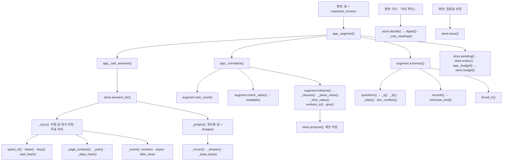
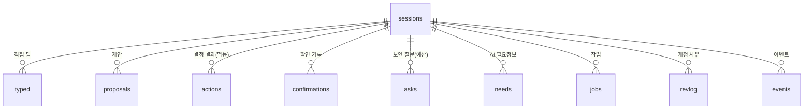
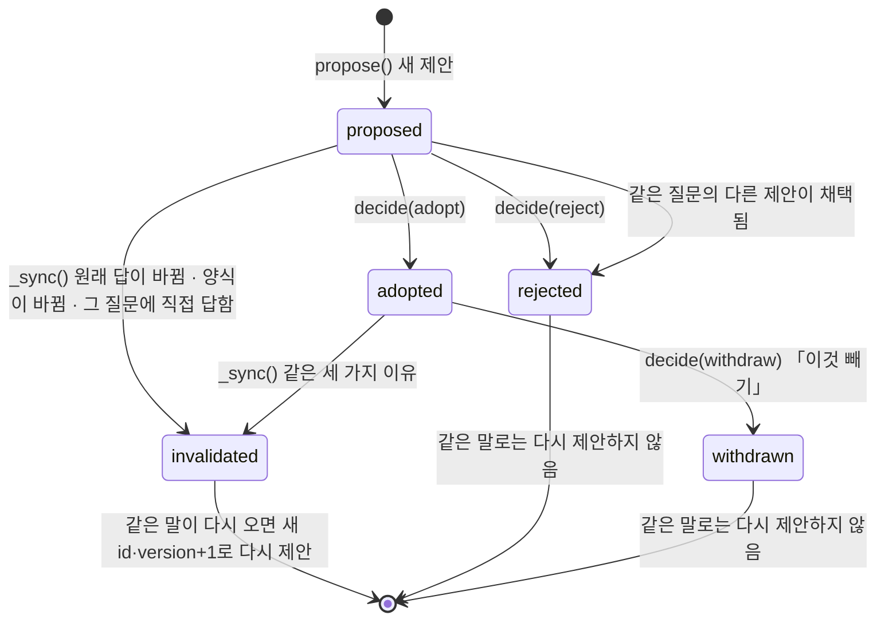
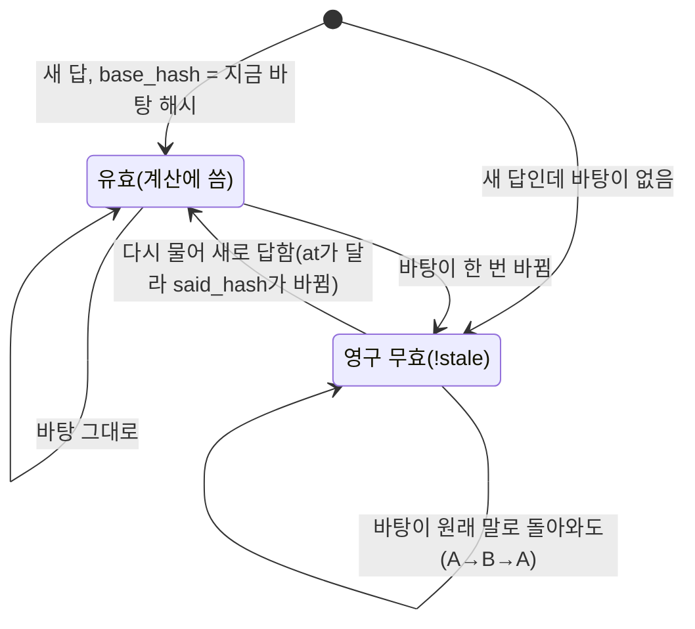
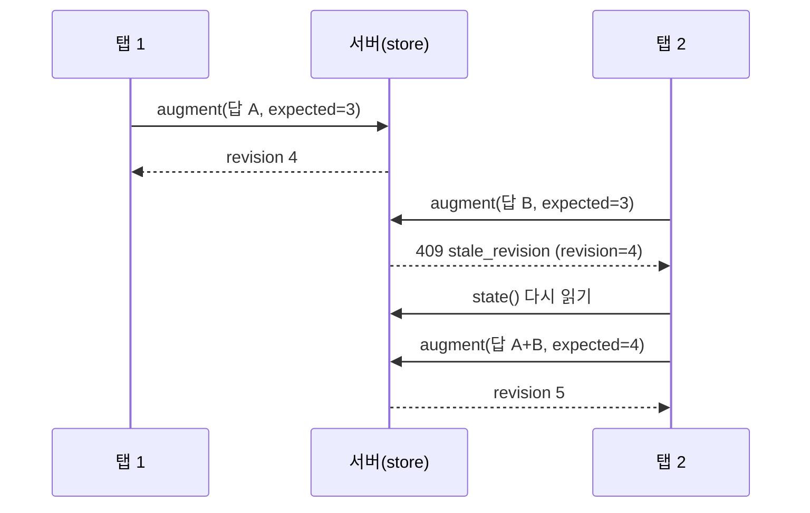

# 05f. 답 상태와 세션 — 서버가 답·제안·개정 번호를 지키는 방법

반장이 친 답과, 그 답에서 읽어 낸 다른 질문의 답(제안)은 서버의 검토 세션에 저장됩니다. 이 문서는 그 저장소([`server/store.py`](../server/store.py)) 함수 63개 전부와, 답을 계산에 넘기기 전에 거르는 [`server/augment.py`](../server/augment.py) 함수 25개를 함수 단위로 설명합니다.

**이 문서에서 알 수 있는 것**
- 세션 데이터베이스(SQLite)의 표 10개와 열 하나하나의 뜻
- 제안이 「대기 → 확인 → 빼기·무효」로 바뀌는 길, 확인 질문 답이 영구히 빠지는 길(상태 그림)
- 개정 번호(revision) 규칙: 언제 오르는지, 언제 428·409로 거절하는지
- 질문 횟수 12회·다시 묻기 3회·모델 30회 같은 예산을 어디서 어떤 순서로 세는지
- 긴 답 하나에서 장소·시간·인원을 읽어 내는 규칙(`interpret()`)과 답 값 검사(`check_value()`)의 단계

**목차**
1. [무엇을](#1-무엇을)
2. [함수 지도](#2-함수-지도)
3. [호출 흐름](#3-호출-흐름)
4. [세션 표 구조](#4-세션-표-구조)
5. [답과 제안의 상태](#5-답과-제안의-상태)
6. [개정 번호와 409·428 규칙](#6-개정-번호와-409428-규칙)
7. [store 기본 함수](#7-store-기본-함수)
8. [store 답 동기화와 읽기](#8-store-답-동기화와-읽기)
9. [store 제안과 확인](#9-store-제안과-확인)
10. [store 예산](#10-store-예산)
11. [store 작업·이벤트·사실](#11-store-작업이벤트사실)
12. [augment 쌍 비교와 질문 지문](#12-augment-쌍-비교와-질문-지문)
13. [augment 기록·값 검사·요약](#13-augment-기록값-검사요약)
14. [augment 긴 답 읽기](#14-augment-긴-답-읽기)
15. [시험](#15-시험)
16. [한계와 알려진 문제](#16-한계와-알려진-문제)

---

## 1. 무엇을

- **검토 세션**은 반장 한 명의 검토 한 건입니다. 세션 id는 아무도 짐작할 수 없는 임의 문자열입니다.
- 세션에는 반장이 **직접 친 답**(typed)과, 그 답에서 읽은 **제안**(proposal)이 따로 저장됩니다. 제안은 규칙(`interpret()`)이나 AI(모델)가 만듭니다.
- 제안은 반장이 카드에서 「N건 확인」을 눌러야 **채택**(adopted)되어 계산에 들어갑니다. 확인 전에는 계산에 쓰지 않습니다(설계서 §2 「2조각」, B6 닫음).
- **개정 번호**(revision)는 세션이 바뀔 때마다 1씩 오르는 숫자입니다. 화면은 마지막으로 본 개정 번호를 함께 보냅니다. 옛 번호로 답을 바꾸려 하면 서버가 거절합니다. 그래서 다른 탭이나 늦게 도착한 요청이 새 답을 덮지 못합니다.
- 질문 키는 승인번호와 무관합니다. 「항목@쪽」(짝 질문은 「항목@쪽>상대 쪽」)으로 저장하고, 돌려줄 때 지금 승인번호를 다시 붙입니다.
- croScan은 답을 승인하거나 작업을 막지 않습니다. 세션은 반장이 말한 것과 확인한 것을 그대로 지키는 기록입니다. 판단은 사람이 합니다.

질문을 만드는 규칙은 [05 멀티턴 질문](05_멀티턴_질문.md), 모델 읽기는 [05b AI 판독](05b_AI_판독.md), API 경로는 [04b API](04b_API.md)에 있습니다. 이 문서는 그 밑의 함수 세부를 다룹니다.

---

## 2. 함수 지도

### store.py (63개 + 예외 클래스 1개)

| 함수 | 줄 | 한 줄 요약 | 부르는 곳 |
|---|---|---|---|
| [`StoreError()`](#storeerror) | 75 | 세션 오류(상태 코드·코드·설명·덧붙일 값) | store 안 곳곳, `app._store_error()` |
| [`_migrate()`](#_migrate) | 81 | 옛 DB에 열 추가, 옛 채택 정리, 「질문당 채택 1개」 색인 | `_db()` |
| [`_db()`](#_db) | 94 | 연결 하나 열고 닫기, 처음 한 번 표 만들기 | DB에 접근하는 store 공개 함수, `cases`·`holdq`·`submissions` |
| [`_hash()`](#_hash) | 114 | 값 묶음의 16자리 해시 | `said_hash`·`page_contexts`·`_pctx`·`_deps_hash`·`_adopted_hashes` |
| [`said_hash()`](#said_hash) | 118 | 한 답에서 「말한 것」의 해시 | `_sync`, `propose`, `app.ask_dialogue` |
| [`skey()`](#skey) | 125 | 승인번호를 뺀 질문 키 | `_sync`, `propose`, `facts`, `app` 여러 곳 |
| [`page_contexts()`](#page_contexts) | 136 | 쪽마다 양식 값 해시 | `_sync`, `_project`, `app.analyze*` |
| [`_pctx()`](#_pctx) | 145 | 한 질문의 양식 기준(쪽 + 상대 쪽) | `_sync`, `_project`, `propose`, `decide` |
| [`permit_numbers()`](#permit_numbers) | 150 | 쪽 → 지금 승인번호 | `_project`, `state`, `pending`, `adopted`, `decide`, `facts` |
| [`_qid_now()`](#_qid_now) | 158 | 항목·쪽으로 지금 qid 만들기 | `_renum`, `_answer` |
| [`_renum()`](#_renum) | 165 | 직접 답에 지금 승인번호 붙이기 | `_project` |
| [`_base_keys()`](#_base_keys) | 176 | 확인 질문 답이 기대는 답의 키 | `_deps_hash`, `_project`, `clarify_base` |
| [`_deps_hash()`](#_deps_hash) | 192 | 확인 질문 답이 기대는 것의 지금 해시 | `_sync` |
| [`_session()`](#_session) | 209 | 세션 행 읽기 + 주인 확인(404) | store 거의 모든 공개 함수 |
| [`owner_of()`](#owner_of) | 219 | 세션 주인 | `app.submitted_file` |
| [`create()`](#create) | 225 | 새 세션 + 30일 지난 세션 정리 | `POST /api/dialogues` |
| [`exists()`](#exists) | 238 | 세션이 있는지 | (부르는 곳 없음) |
| [`clean()`](#clean) | 243 | 직접 답을 저장할 모양으로 깎기 | `typed_of`, `propose` |
| [`typed_of()`](#typed_of) | 252 | 보낸 답 중 직접 친 답만 | `_sync`, `app._calc_answers` |
| [`_adopted_hashes()`](#_adopted_hashes) | 257 | 채택된 제안의 키 → 해시 | `_sync` |
| [`_sync()`](#_sync) | 262 | 직접 답·양식 저장, 무효 처리, 개정 올리기 | `answers_for` |
| [`_said()`](#_said) | 318 | 답을 사람이 읽는 글로(「있음: 도장팀」) | `_sync` |
| [`_event()`](#_event) | 327 | 이벤트 한 줄 쓰기 | `_sync`, `add_event` |
| [`_only_readings()`](#_only_readings) | 334 | 그 사이 개정이 모두 제안 저장뿐이었나 | `_sync`, `decide` |
| [`_answer()`](#_answer) | 342 | 제안 행 → 답 모양 | `_project`, `state`, `pending`, `adopted`, `decide`, `facts` |
| [`_project()`](#_project) | 358 | 계산에 쓸 답 목록과 빠진 답 | `answers_for`, `current`, `state`, `facts` |
| [`answers_for()`](#answers_for) | 382 | 쓰기 경로: 동기화 + 계산용 답 | `app._calc_answers` |
| [`current()`](#current) | 392 | 읽기 경로: 쓰지 않고 계산용 답 | `app._calc_answers` 외 8곳 |
| [`form()`](#form) | 407 | 세션이 본 양식(dict) | `app.analyze_delta`, `app.analyze` |
| [`revision()`](#revision) | 413 | 지금 개정 번호 | `app` 10곳 |
| [`state()`](#state) | 418 | 다시 열기용 전체 상태 | `/state`, `GET /api/dialogues/{sid}`, `app.ask_dialogue` |
| [`form_of()`](#form_of) | 432 | 세션이 본 양식(원문 문자열) | `app.understand` |
| [`propose()`](#propose) | 439 | 제안 저장 | `app._augment`, `app.understand` |
| [`_fact_of()`](#_fact_of) | 497 | 제안의 극성·확신·단계 | `propose` |
| [`pending()`](#pending) | 506 | 기다리는 제안 | `app._augment`, `app.understand` |
| [`adopted()`](#adopted) | 512 | 채택된 제안 | (시험만) |
| [`digest()`](#digest) | 518 | 카드에 보인 제안의 FNV-1a 해시 | `decide`, `app` |
| [`decide()`](#decide) | 528 | 확인·거절·빼기를 한 번에 | `/decide`, `/confirm`, `cases` |
| [`_used()`](#_used) | 607 | 쓴 질문 수·다시 묻기 수 | `budget`, `issue` |
| [`budget()`](#budget) | 612 | 예산 현황 | `app._budget` 외, `holdq` |
| [`clarify_base()`](#clarify_base) | 621 | 다시 묻기가 겨냥한 답 하나 | `app._budget`, `app.ask_dialogue` |
| [`clarified()`](#clarified) | 628 | 이미 다시 물은 바탕 답 | `app._budget` |
| [`closed()`](#closed) | 634 | 검토가 끝났는지 | `_sync`, `budget`, `add_event`, `add_needs` |
| [`close_review()`](#close_review) | 639 | 한도로 끝난 검토를 「끝」으로 기록 | `app.ask_dialogue` |
| [`issue()`](#issue) | 646 | 질문 하나를 보인다고 세기 | `app.ask_dialogue`, `holdq` |
| [`charge_llm()`](#charge_llm) | 680 | 모델 호출 1회 세기 | `llm` |
| [`warm()`](#warm) | 693 | 미리 읽기 1회 세기 | `app`, `llm` |
| [`start_job()`](#start_job) | 704 | 검토당 한 번 하는 작업 시작 | `app.analyze`, `checkai` |
| [`open_job()`](#open_job) | 722 | 요청 하나짜리 작업 기록 | `app.understand` |
| [`recover()`](#recover) | 731 | 재시작 때 끊긴 작업 처리·모델 횟수 돌려주기 | 서버 시작(`app`) |
| [`job_row()`](#job_row) | 746 | 작업 한 줄(전체 열) | `GET /api/jobs/…` |
| [`all_jobs()`](#all_jobs) | 754 | 세션의 작업 전부 | `GET /api/dialogues/{sid}` |
| [`_job()`](#_job) | 760 | 작업 행 → dict | `job_row`, `all_jobs` |
| [`add_event()`](#add_event) | 767 | 반장이 남기는 정정·철회·메모 | `/events` |
| [`events()`](#events) | 786 | 이벤트 목록 | `app` 3곳 |
| [`expiry()`](#expiry) | 794 | 한 개정에서 만료된 것 | `app._augment` |
| [`confirmations()`](#confirmations) | 801 | 확인 기록 | `app` 2곳 |
| [`facts()`](#facts) | 808 | 설계 §2.1 Fact 모양 목록 | `GET /api/dialogues/{sid}` |
| [`finish_job()`](#finish_job) | 844 | 작업 끝 기록 | `app` 2곳, `checkai` |
| [`put_job()`](#put_job) | 850 | 종류별 기록 덮어쓰기(계획서 연결) | `app` 2곳 |
| [`jobs()`](#jobs) | 860 | 앞글자로 작업 모으기 | `app` 4곳 |
| [`job()`](#job) | 866 | 작업 하나(상태 + 결과) | `app`, `checkai` |
| [`add_needs()`](#add_needs) | 872 | AI 필요정보 저장 | `app.analyze*` |
| [`needs()`](#needs) | 897 | 저장된 AI 필요정보 | `app._with_ai` |

### augment.py (맡은 범위 25개)

| 함수 | 줄 | 한 줄 요약 | 부르는 곳 |
|---|---|---|---|
| [`_key()`](#_key) | 969 | 두 작업 종류를 순서 없이 묶기 | `pairs()` |
| [`pairs()`](#pairs) | 973 | 허가서 짝마다 순위(1·2·3·9) | `questions(manager=True)`, `review.check(cross=True)` |
| [`_pair()`](#_pair) | 1033 | 짝 하나의 결과 dict | `pairs()` |
| [`_fp()`](#_fp) | 1054 | 질문이 기댄 양식 값의 10자리 지문 | `_q()`, `stale_answers()` |
| [`_deps()`](#_deps) | 1067 | 질문이 기대는 칸 목록 | `_q()` |
| [`_q()`](#_q) | 1076 | 규칙 질문 한 개의 모양 | `_foreman()`의 람다 1곳, `questions()` 30곳 |
| [`stale_answers()`](#stale_answers) | 1089 | 양식이 바뀐 뒤의 예전 답 | `effective()`, `answers_now()` |
| [`owner()`](#owner) | 1104 | 답이 속한 허가서 번호 | `effective()` |
| [`answers_now()`](#answers_now) | 1110 | 철회·옛 답을 뺀 계산용 답 | `safety.py` |
| [`unknown_kind()`](#unknown_kind) | 2292 | 「모름」 + 말 → 미정·확인 예정·불확실·모름 | `records()` |
| [`records()`](#records) | 2305 | 2쪽(별지) 기록 줄 | `summary()` |
| [`readable()`](#readable) | 2340 | 값을 읽을 수 있는지, 아니면 다시 물을 말 | `check_value()` |
| [`doc_conflicts()`](#doc_conflicts) | 2377 | 서류와 다른 답(C6 재료) | `_foreman()` |
| [`check_value()`](#check_value) | 2417 | 답 값 검사 | `app._normalize`, `give()`, `understand`, `link` |
| [`summary()`](#summary) | 2439 | 대화·2쪽에 필요한 것 전부 | `app._augment` |
| [`found_in()`](#found_in) | 2486 | 자유 답에서 읽은 것을 짧은 줄로 | `summary()`, `_foreman()` |
| [`_asserted()`](#_asserted) | 2544 | 「X가 아니라 Y」에서 Y | `_time_value`, `interpret` |
| [`_plain()`](#_plain) | 2549 | 조건·추측·다른 작업이 없는 구절인가 | `_clauses()` |
| [`_clauses()`](#_clauses) | 2553 | 답의 평서 구절 목록 | `interpret`, `own_count` |
| [`workers_in()`](#workers_in) | 2564 | 「작업자 4명」 → 4 | `interpret`, `own_count` |
| [`_place_value()`](#_place_value) | 2582 | 문장에서 장소 말만 | `interpret` |
| [`_time_value()`](#_time_value) | 2598 | 구절의 시간 한 개 → 「hh:mm~hh:mm」 | `interpret` |
| [`interpret()`](#interpret) | 2619 | 긴 답이 다른 열린 질문에 주는 답 | `app._normalize` |
| [`give()`](#give) | 2646 | (`interpret` 안) 검사를 통과한 답만 담기 | `interpret()` |
| [`own_count()`](#own_count) | 2703 | 작업인원 질문 답에서 숫자만 | `app._normalize` |

맡은 범위 함수 수: store 63개(+ `StoreError` 클래스), augment 25개(중첩 함수 `give()` 포함). 이 문서는 88개를 모두 다룹니다. `pairs()` 안의 람다 `hit`·`near`, `doc_conflicts()` 안의 람다 `get`·`lab`은 각 함수 절에서 설명합니다.

---

## 3. 호출 흐름

반장이 답을 하나 낼 때(`POST /api/augment`)의 흐름입니다.

체크리스트·미리보기·제출은 `store.current()`로 **읽기만** 합니다. 제출 뒤 안전관리자 쪽은 `augment.answers_now()`로 제출 당시 유효했던 답만 씁니다.

---

## 4. 세션 표 구조

세션은 데이터 볼륨의 SQLite 파일 `qa.DATA / "review.sqlite3"`(상수 `DB`)에 있습니다. WAL 모드입니다. 표는 `_SCHEMA`가 만들고, 나중에 더한 열은 `_COLUMNS`를 보고 `_migrate()`가 붙입니다.

| 표 | 열 | 뜻 |
|---|---|---|
| `sessions` | `id` TEXT PK | 세션 id(`secrets.token_urlsafe(18)`, 24자) |
| | `created` REAL | 만든 시각(초) |
| | `used` REAL | 마지막으로 **바뀐** 시각. `_sync`(바뀌지 않아도 갱신)·`propose`(새 제안 있을 때)·`decide`가 씀. 30일 보관 기준 |
| | `revision` INTEGER DEFAULT 0 | 개정 번호 |
| | `ctx` TEXT | 세션이 마지막으로 본 양식: `{"쪽": 해시}` JSON. 처음엔 NULL |
| | `llm_calls` INTEGER DEFAULT 0 | 모델 호출 횟수(한도 30) |
| | `warm_calls` INTEGER DEFAULT 0 | 미리 읽기 횟수(한도 16). 뒤에 더한 열 |
| | `owner` TEXT | 세션을 만든 사람(사내 게이트웨이 사용자). 시연은 NULL. 뒤에 더한 열 |
| `typed` | `session_id`, `skey` (PK 둘) | 질문 키(「T1@1」) |
| | `qid` TEXT | 저장 당시 qid(승인번호 포함) |
| | `hash` TEXT | `said_hash()` |
| | `base_hash` TEXT | 확인 질문 답만: 기대는 답의 해시, 또는 `"!stale"`(상수 `STALE`). 그 밖은 NULL |
| | `data` TEXT | `clean()`한 답 JSON |
| `proposals` | `id` TEXT PK | 제안 번호(`token_urlsafe(9)`, 12자) |
| | `session_id`, `skey` | 제안이 답하는 질문 키 |
| | `origin` TEXT | `rule` 또는 `ai` |
| | `src_skey`, `src_hash` | 읽어 낸 원래 답의 키와 `said_hash` |
| | `ctx` TEXT | 저장 때 그 질문의 양식 기준(`_pctx`) |
| | `payload` TEXT | 보기·값·인용·slot·version·극성 등 JSON |
| | `status` TEXT | `proposed`·`adopted`·`rejected`·`withdrawn`·`invalidated` |
| | `created`, `decided` REAL | 만든 시각, 상태가 바뀐 시각 |
| | 색인 `proposals_session` | (`session_id`, `status`) |
| | 색인 `one_adopted` | UNIQUE (`session_id`, `skey`) WHERE `status='adopted'`: 질문당 채택 1개 |
| `actions` | `session_id`, `action_id` (PK) | 결정 동작 번호 |
| | `kind`, `request`, `result`, `created` | `decide`, 요청 JSON, 처음 결과 JSON(재전송 때 그대로 돌려줌) |
| `asks` | `session_id`, `key` (PK) | 보인 질문 키(「T1@1」, 「RETRY:…」, 「CARD:…」, 「LINK:…」, 「CLOSE」) |
| | `kind` | `question`·`clarify`·`card`·`close` |
| | `base` | 다시 묻기의 바탕 답(`clarify_base`) |
| | `created` | 시각 |
| `needs` | `session_id`, `n` (PK) | AI 필요정보 순번(1~8) |
| | `mkey`, `payload`, `created` | 뜻 키(같은 뜻은 한 번), 내용 JSON |
| `jobs` | `session_id`, `kind` (PK) | `analyze`, `turn:…`, `link:…`, `closed`, checkai 키 등 |
| | `status`, `started`, `finished`, `result` | 상태(`running`·`done`·`interrupted`·`fail`·`late`·`stale`·`confirmed`·`refused` …), 시각, 결과 JSON |
| | `llm` INTEGER DEFAULT 0 | 이 작업이 쓴 모델 호출 수(재시작 때 돌려줌). 뒤에 더한 열 |
| `revlog` | `session_id`, `rev` (PK), `kind` | 그 개정이 무엇 때문에 올랐나. 지금은 `propose`만 씀 |
| `events` | `session_id`, `n` (PK) | 순번 |
| | `kind`, `rev`, `payload`, `actor`, `action_id`, `created` | `answers`·`expiry`·`after_close`(서버) / `correction`·`withdraw`·`note`(화면) |
| `confirmations` | `session_id`, `action_id` (PK) | 결정 동작 번호 |
| | `actor`, `role`, `digest`, `targets`, `scope`, `created` | 누가, 어떤 역할(`foreman`·`manager`), 카드 해시, 대상(pid·skey·version), 범위(adopt·reject·withdraw) |

같은 DB 파일에는 다른 모듈의 표도 있습니다: `submissions`([`submissions.py`](../server/submissions.py), 30일), `cases`·`meta`([`cases.py`](../server/cases.py)), `marks`([`holdq.py`](../server/holdq.py)). 이들은 `store._db()`로 연결만 빌려 씁니다.

**보관.** `KEEP_DAYS = 30`. `create()`가 새 세션을 만들 때마다 `used`가 30일보다 오래된 세션을 지우고, 위 9개 표에서 주인 없는 행을 지웁니다. 따로 도는 정리 작업은 없습니다.

---

## 5. 답과 제안의 상태

### 5.1 제안(proposals.status)

| 상태 | 계산에 쓰나 | 다시 제안되나 |
|---|---|---|
| `proposed` | 아니오(카드에만 보임) | 같은 말이면 같은 id를 다시 돌려줌 |
| `adopted` | 예. 단, 세션 양식과 지금 보낸 양식 둘 다 그대로일 때만(`_project`) | 질문당 1개 |
| `rejected`·`withdrawn` | 아니오 | 같은 원래 답·같은 보기·같은 값이면 다시 만들지 않음 |
| `invalidated` | 아니오 | 같은 말이 돌아오면 **새 번호**로 다시 확인받음 |

### 5.2 확인 질문 답(typed.base_hash)

확인 질문은 A1·A2·A3·U1·C5·C6입니다(상수 `CHECKING = ("A1.", "A2.", "A3.", "U1.", "C5.", "C6.")`). 이 답은 자기가 확인한 답에 묶입니다.

- 영구무효인 답과 그 답을 확인한 답(확인의 확인)은 계산에서 빠지고 `dropped`로 화면에 알려집니다. 화면은 그 답을 지우고 다시 묻습니다(`markDropped()`).
- 같은 말이 돌아와도 되살리지 않는 이유: 바탕이 바뀐 뒤의 확인은 다른 내용을 확인한 것일 수 있기 때문입니다(설계서 2조각 「확인 질문 답」 행, Codex 마지막 회차 「확인 답 의존의 전이·영구 무효」).

---

## 6. 개정 번호와 409·428 규칙

### 6.1 개정 번호가 오르는 때

| 함수 | 조건 | 오르는 양 | revlog |
|---|---|---|---|
| `_sync()` | 직접 답 해시 묶음이 다름, 또는 양식(`ctx`)이 다름, 또는 제안이 하나라도 무효가 됨, 또는 확인 질문 답의 `base_hash`가 바뀜 | +1 | 없음 |
| `propose()` | 새 제안 행을 하나라도 넣음 | +1 | `propose` |
| `decide()` | 새 동작을 처리하면(목록이 비어도). 같은 `action_id`·같은 내용의 재전송은 저장된 결과를 돌려주고 올리지 않음 | +1 | 없음 |

### 6.2 거절 규칙

| 경로 | 428 `revision_required` | 409 `stale_revision` | 예외 허용 |
|---|---|---|---|
| `_sync()` (쓰기: `/api/augment`) | 바뀐 것이 있는데 `expected`가 None | 바뀐 것이 있는데 `expected` ≠ 지금 개정 | 그 사이 개정이 **모두 제안 저장**이면 통과(`_only_readings`) |
| `current()` (읽기: 체크리스트·미리보기·제출·분석) | `expected`가 None | `expected` ≠ 지금 개정 | 없음(정확히 같아야 함) |
| `propose()` | — | `basis` ≠ 지금 개정이고, `form`이 없거나 세션 양식과 다름 | `form`(읽기 시작 때 양식 원문)이 지금과 같으면 통과. 원래 답은 따로 검사 |
| `decide()` | — | `expected` ≠ 지금 개정 (그 사이 `answers` 이벤트의 변경 목록을 `changes`로 돌려줌) | `_only_readings` |

- 바뀐 것이 **없는** `_sync()`는 `expected`가 낡아도 거절하지 않습니다. 쓰기가 없으니 덮어쓸 위험도 없기 때문입니다(모듈 설명 「other answers on an older revision are refused」).
- 새 세션의 첫 요청은 `ctx`가 NULL이라 양식 기준이 늘 「바뀜」입니다. 그래서 첫 요청에도 개정 번호(0)가 꼭 필요합니다. 화면은 `POST /api/dialogues`에서 `revision: 0`을 받습니다.
- `_only_readings` 예외의 이유: 모델이 제안을 저장해 개정이 오른 것은 반장의 답을 바꾸지 않습니다. 이것까지 거절하면 반장이 방금 친 답이 이유 없이 거절됩니다(check_store 「읽기 저장만 있었으면 반장의 다음 답은 거절하지 않음(답 유실 없음)」).

### 6.3 그 밖의 409·404·422

| 코드 | 상태 | 함수 | 뜻 |
|---|---|---|---|
| `session_missing` | 404 | `_session` | 세션 없음, 또는 다른 반장의 세션 |
| `stale_answer` | 409 | `propose` | 읽은 원래 답이 바뀜, 또는 바뀌었다가 같은 말로 돌아옴(`at` 다름) |
| `stale_display` | 409 | `decide` | 카드에 보인 내용(해시)과 지금 내용이 다름 |
| `stale_proposal` | 409 | `decide` | 제안이 이미 처리됐거나 원래 답·양식이 바뀜, 또는 빼려는 것이 채택 상태가 아님 |
| `same_question` | 409 | `decide` | 한 질문에 채택 2개 |
| `action_conflict` | 409 | `decide`, `add_event` | 같은 동작 번호에 다른 내용 |
| `budget`·`clarify`·`close_once`·`closed`·`reserved` | 409 | `issue` | 질문 예산([10장](#10-store-예산)) |
| `llm_budget` / `warm_budget` | 409 | `charge_llm` / `warm` | 모델 30회 / 미리 읽기 16회 |
| `bad_kind` / `bad_event` | 422 | `issue` / `add_event` | 알 수 없는 종류 |

화면 쪽 재시도 규칙(409·428을 받으면 서버 상태로 맞추고 다시 보냄)은 [04b API §1.2](04b_API.md#12-개정-번호와-오류-모양)에 있습니다.

---

## 7. store 기본 함수

### StoreError()

- **요약**: 세션 저장소의 모든 거절을 담는 예외 클래스입니다(줄 75).
- **입력**: `status`(HTTP 상태), `code`(짧은 영문 코드), `detail`(한국어 설명, 기본 ""), `**extra`(덧붙일 값: `revision`, `changes`, `used`).
- **동작**: `__init__()`이 메시지를 `"{code}: {detail}"`로 만들고 네 값을 속성에 둡니다.
- **호출**: store 안 26곳에서 던짐. `app._store_error()`가 `HTTPException(status, {"code", "message", **extra})`로 바꿉니다. `holdq`·`llm`도 잡습니다.
- **시험**: `check_store.py`의 `raises()` 도우미가 `e.code`를 봅니다.

### _migrate()

- **요약**: 옛 DB를 지금 모양으로 맞춥니다(줄 81).
- **입력**: 연결 `c`. **출력**: 없음.
- **단계**:
  1. `_COLUMNS`의 7개 (표, 열, 형) 각각: `PRAGMA table_info`에 그 열이 없으면 `ALTER TABLE … ADD COLUMN`. 7개는 `sessions.ctx`, `typed.base_hash`, `proposals.ctx`, `sessions.llm_calls`, `sessions.warm_calls`, `sessions.owner`, `jobs.llm`입니다.
  2. 양식 기준이 없던(`ctx IS NULL`) `proposed`·`adopted` 제안을 `invalidated`로. 어떤 양식에서 읽었는지 모르면 지킬 수 없기 때문입니다.
  3. 한 질문에 채택이 둘 이상이면 나중 것(`created`가 큰 것)을 `invalidated`로.
  4. 그다음 UNIQUE 색인 `one_adopted`를 만듭니다. 3번을 먼저 해야 색인이 실패하지 않습니다.
- **근거**: 설계서 2조각 「옛 DB」 행.
- **호출**: `_db()`(프로세스에서 처음 한 번). **시험**: check_store 「옛 DB: 열이 더해지고, 양식 기준이 없던 채택은 무효」.

### _db()

- **요약**: 호출 하나에 연결 하나를 열고, 끝나면 닫는 문맥 관리자입니다(줄 94).
- **단계**:
  1. `qa.DATA` 폴더를 만듭니다.
  2. `sqlite3.connect(DB, timeout=5, isolation_level=None)`. 자동 커밋 모드라 트랜잭션은 함수마다 `BEGIN`·`BEGIN IMMEDIATE`로 직접 엽니다.
  3. `row_factory = sqlite3.Row`(열 이름으로 읽음), `PRAGMA busy_timeout=5000`.
  4. 전역 `_READY`가 False면 `journal_mode=WAL`, `_SCHEMA` 실행, `_migrate()`, `_READY = True`.
  5. 끝날 때 트랜잭션이 열려 있으면(오류로 중간에 나감) `rollback()` 뒤 닫습니다.
- **쓰기 잠금**: 쓰는 함수는 `with _LOCK, _db()`로 프로세스 안 `threading.Lock`도 잡습니다. 모델이 도는 동안에는 아무것도 잡지 않습니다(모듈 설명, 설계서 §2.1 「모델 실행 중에는 DB 트랜잭션을 잡지 않고」).
- **호출**: DB에 접근하는 store 공개 함수, `cases.py:63`, `holdq.py:301`, `submissions.py` 4곳.

### _hash()

- **요약**: 값 여러 개를 16자리 16진 해시로 줄입니다(줄 114).
- **식**: `sha256(json.dumps(parts, ensure_ascii=False, sort_keys=True))`의 앞 16자.
- **호출**: `said_hash`, `page_contexts`, `_pctx`, `_deps_hash`, `_adopted_hashes`.

### said_hash()

- **요약**: 한 답에서 「말한 것」의 해시입니다(줄 118).
- **입력**: 답 `a`(`qid`, `choice`, `value`, `at`).
- **단계**: 보기(`choice` 또는 "")와 앞뒤 공백을 뗀 값을 묶습니다. qid가 `CHECKING`으로 시작하면 답한 시각 `at`도 묶고, 아니면 None을 묶습니다.
- **왜 `at`인가**: 확인 질문은 바탕이 바뀐 뒤 다시 물으면, 같은 말이라도 새 답이어야 합니다. `at`이 다르면 해시가 달라져 「새 답」으로 셉니다(5.2).
- **예시(실행)**: 값 `"13~15 "`와 `"13~15"`는 같은 해시. A1 답의 `at` 1과 2는 다른 해시.
- **호출**: `_sync`, `propose`, `app.ask_dialogue`(카드 키).

### skey()

- **요약**: 승인번호를 뺀 질문 키를 만듭니다(줄 125).
- **단계**:
  1. qid가 `FREE:`로 시작하면 그대로(자유 답은 제 번호를 가짐).
  2. `q`에 `page`가 없으면 qid 그대로.
  3. 아니면 `"{항목}@{쪽}"`, `q["other"]`가 있으면 `">{상대 쪽}"`을 붙입니다.
- **예시(실행)**: `skey("T1:P-1", {"page": 1})` → `T1@1`, `skey("X2:P-1>P-2", {"page": 1, "other": 2})` → `X2@1>2`, `skey("FREE:3")` → `FREE:3`.
- **왜**: 반장이 승인번호를 고쳐도 질문·답·예산이 이어져야 합니다(설계서 §2.1 「승인번호 수정으로 이력·확인 대상·질문 예산이 초기화되지 않는다」).
- **호출**: `_sync`, `propose`, `facts`, `app._budget`·`ask_dialogue`·`_reserve`.

### page_contexts()

- **요약**: 쪽마다 양식 값의 해시를 만듭니다(줄 136).
- **단계**: 칸마다 `key`가 `permit_no`가 아니면 `(key, value 문자열)`을 그 쪽 목록에 넣고, 쪽별로 정렬해 `_hash()`. 승인번호를 빼는 이유는 `skey()`와 같습니다.
- **출력**: `{"1": "5652bf1379f70d4f"}` 같은 dict(쪽 번호는 문자열).
- **호출**: `_sync`, `_project`, `app.analyze`·`analyze_delta`(분석 중 양식이 바뀌었는지).

### _pctx()

- **요약**: 질문 하나의 양식 기준입니다(줄 145). 그 쪽 해시와, 짝 질문이면 상대 쪽 해시를 묶어 `_hash()`.
- **호출**: `_sync`, `_project`, `propose`, `decide`. 짝 질문은 두 쪽 중 어느 쪽 양식이 바뀌어도 무효가 됩니다(check_store 「상대 허가서 쪽 양식이 바뀌면 짝 질문의 채택도 무효」).

### permit_numbers()

- **요약**: 쪽 → 지금 승인번호 dict입니다(줄 150).
- **단계**: `permit_no` 칸 값을 앞뒤 공백 제거·대문자로. 비어 있으면 `"#{쪽}"`.
- **예시(실행)**: 값 `"p-77"` → `{1: "P-77"}`, 빈 값 → `{1: "#1"}`.

### _qid_now()

- **요약**: 항목·쪽(·상대 쪽)으로 지금 qid를 만듭니다(줄 158).
- **단계**: 항목이 없거나 쪽이 None이거나 번호표가 비면 None. 아니면 `"{항목}:{번호}"` + 상대가 있으면 `">{상대 번호}"`. 번호가 없으면 `#쪽`.
- **예시(실행)**: `_qid_now("X2", 1, 2, {1: "P-1"})` → `X2:P-1>#2`.

### _renum()

- **요약**: 저장된 직접 답에 지금 승인번호를 붙입니다(줄 165).
- **단계**: 자유 답이 아니고 `_qid_now()`가 값을 주면 `qid`를 바꾸고, `q["qid"]`와 `q["permit_no"]`(첫 `>` 앞 번호)도 바꿉니다.
- **호출**: `_project`. **시험**: check_store 「승인번호만 바꾸면 직접 답·채택 모두 새 번호로(by도)」.

### _base_keys()

- **요약**: 확인 질문 답이 기대는 답의 키 목록입니다(줄 176).
- **입력**: 확인 답의 키 `sk`(「A1.T1@3」), 답 `a`(쓰지 않음).
- **단계**:
  1. `@` 앞을 항목, 뒤를 쪽으로 나눕니다. 바탕 = 항목의 첫 `.` 뒤(「A1.T1」 → 「T1」).
  2. `C5.`이면 `["FREE:*"]`(자유 답 전부) + 바탕이 `concurrent`가 아니면 `"{바탕}@{쪽}"`.
  3. 바탕이 `F\d+`(정규식 `r"F\d+"`, 자유 답 번호)면 `["FREE:{n}"]`.
  4. 아니면 `"{바탕}@{쪽}"`. 바탕이 `\.\d+$`로 끝나면(둘째 불분명 부분 「T1.2」) 번호를 뗀 「T1@쪽」도 더합니다.
- **예시(실행)**: `A1.T1@1` → `['T1@1']`, `A1.T1.2@1` → `['T1.2@1', 'T1@1']`, `A3.F2` → `['FREE:2']`, `C5.B3@1` → `['FREE:*', 'B3@1']`, `C5.concurrent@1` → `['FREE:*']`.
- **호출**: `_deps_hash`, `_project`(확인의 확인 전이), `clarify_base`.

### _deps_hash()

- **요약**: 확인 질문 답이 기대는 것의 지금 해시입니다. 기댈 것이 없으면 None(줄 192).
- **입력**: `sk`, `a`, `typed_h`(지금 직접 답 키 → 해시), `adopted_h`(채택 키 → 해시), `ctx`(양식).
- **단계**:
  1. `_base_keys()`로 키를 얻습니다.
  2. `FREE:*`가 있으면 자유 답 전부의 (키, 해시)를 정렬해 넣습니다.
  3. 나머지 키 중 직접 답이나 채택에 있는 첫 키를 찾습니다. 하나도 없으면 **None**. 있으면 그 해시(직접 답 우선)를 넣습니다.
  4. `C5.concurrent`면 그 쪽의 양식 해시도 넣습니다. 「다른 작업이 있나」는 양식(병행여부 칸)도 말하기 때문입니다.
  5. 전체를 `_hash()`.
- **호출**: `_sync`.

### _session()

- **요약**: 세션 행을 읽고, 주인이 아니면 없는 것처럼 404를 냅니다(줄 209).
- **단계**: 행이 없으면 404 `session_missing`. `OWNER`(요청한 사람)가 있고 안전관리자(`MANAGER`)가 아니며 세션 `owner`가 None도 그 사람도 아니면 역시 404.
- **왜 404인가**: 다른 반장의 세션이 있다는 것조차 알리지 않습니다(코드 주석 「another foreman's review: not there」). `OWNER`·`MANAGER`는 `app`이 `CROSCAN_AUTH=proxy`일 때 요청마다 정합니다. 시연(None)은 확인하지 않습니다.
- **예시(실행)**: 반장 A의 세션을 반장 B가 열면 404, `MANAGER=True`면 열림.

### owner_of()

- **요약**: 세션의 `owner`를 돌려줍니다. 세션이 없으면 None(줄 219). 주인 확인은 하지 않습니다.
- **호출**: `app.submitted_file`(반장은 자기 제출본 PDF만).

### create()

- **요약**: 새 세션을 만들고, 오래된 세션을 지웁니다(줄 225).
- **단계**: `BEGIN IMMEDIATE` → `used < now − 30×86400`인 세션 삭제 → 9개 표에서 주인 없는 행 삭제 → 새 행(`revision 0`, `ctx NULL`, `owner = OWNER`) → `COMMIT`.
- **호출**: `POST /api/dialogues`. 시험 거의 전부가 세션을 만들 때 씁니다.

### exists()

- **요약**: 세션이 있는지 True/False(줄 238). 주인 확인은 하지 않습니다.
- **호출**: 저장소 안에서 부르는 곳이 없습니다(설계 근거 미기록, [16장](#16-한계와-알려진-문제)).

### clean()

- **요약**: 직접 답을 저장할 모양으로 깎습니다(줄 243).
- **출력**: `{"qid", "choice"(없으면 ""), "value"(없으면 ""), "q": Q_KEYS 안의 열쇠만, "at"(있을 때만)}`.
- **`Q_KEYS`**: `qid, item, page, permit_no, who, keys, signal, text, choices, tier, other, original, fp, fp_keys`. 화면이 보낸 `read`·`by`·`ai`·`pid`는 버립니다(설계서 2조각 「공통 정규화」, Codex 1회차 「`read` 위조」).
- **예시(실행)**: `read`, `by`, `q.junk`가 빠지고 `q.fp`는 남습니다.
- **시험**: check_questions_material 「#2 저장·복원(store.clean)해도 질문 지문(fp·fp_keys)이 남음」, check_store 「클라이언트가 보낸 read는 버림」.

### typed_of()

- **요약**: 보낸 답 중 반장이 직접 친 답만 `clean()`해서 돌려줍니다(줄 252). `by`·`ai`·`pid`가 있는 답(다른 답에서 읽은 것)은 뺍니다.
- **호출**: `_sync`, `app._calc_answers`(세션이 없을 때).
- **시험**: check_store 「클라이언트가 보낸 파생 답(by·ai)은 받지 않음」.

### _adopted_hashes()

- **요약**: 채택된 제안의 키 → `_hash(choice, value)`(줄 257). `_deps_hash`가 「확인 질문의 바탕이 채택된 제안일 때」 씁니다.

---

## 8. store 답 동기화와 읽기

### _sync()

- **요약**: 한 트랜잭션 안에서 직접 답과 양식을 저장하고, 더는 맞지 않는 것을 무효로 하고, 개정 번호를 정합니다(줄 262).
- **입력**: 연결, 세션 id, 보낸 답, 양식 `fields`, `expected`. **출력**: 새 개정 번호.
- **단계**:
  1. `_session()`(404 확인).
  2. `typed` = `typed_of(answers)`를 `skey`로 묶음. `old` = 저장된 직접 답. `new` = 키 → `said_hash`. `ctx` = `page_contexts(fields)`.
  3. `changed` = 해시 묶음이 다르거나 양식이 다름.
  4. `changed`인데 `expected`가 None → **428**.
  5. `changed`인데 `expected` ≠ 개정이고 `_only_readings()`도 아니면 → **409 `stale_revision`**(`revision` 덧붙임).
  6. `moved` = 예전에 있던 키 중 해시가 바뀌거나 사라진 것: `{skey, qid, before, after}`(`_said()` 글). 처음 생긴 답은 넣지 않습니다.
  7. `form_moved` = 예전 양식이 있었고 지금과 다름.
  8. **제안 무효**: `proposed`·`adopted` 제안마다, ① 원래 답 해시가 지금과 다름, ② 그 질문에 지금 직접 답이 있음, ③ 양식 기준이 지금 `_pctx`와 다름 — 하나라도 맞으면 `invalidated`, `changed = True`. 방금 처음 직접 답한 질문(`new`에 있고 `old`에 없음)은 「잃은 것」에 넣지 않습니다. 나머지는 `lost`에 `{qid, slot(24자), was, why}`를 넣습니다. `why`는 ①이면 「원래 답이 바뀜」, ②가 아니면 「양식이 바뀜」, 그 밖은 「직접 답함」.
  9. **확인 질문 답**: `CHECKING`인 답마다 `dep = _deps_hash()`.
     - 예전과 같은 말(해시 같음)이면: 예전 `base_hash`가 `STALE`이거나 `dep`과 같으면 그대로, 아니면 `STALE`(「changed once: for good」).
     - 새 말이면: `dep` 또는 바탕이 없으면 `STALE`.
     - 예전 `base_hash`와 달라지면 `changed = True`. `STALE`이 되면 `lost`에 「확인한 답이 바뀜」.
  10. 그 세션의 `typed`를 모두 지우고 다시 넣습니다(준 순서대로 rowid).
  11. `used = now`, `ctx` 저장, `changed`면 개정 +1.
  12. 이벤트: `moved`가 있으면 `answers`, `lost`가 있으면 `expiry`(설계 §19.2 개정 만료: 한 변경의 만료를 한 알림으로), `moved`가 있고 검토가 끝났으면(`closed`) `after_close`(설계 §3.6 「종료 뒤 새 정보 → 수정 이벤트」).
- **예시(실행)**: 새 세션에 `expected=None`으로 보내면 428. `expected=0`이면 개정 1. 다른 답을 더해 다시 `expected=0`으로 보내면 409(`revision: 1`). 양식 날짜를 바꾸면 채택이 무효가 되고 `expiry`에 `{"why": "양식이 바뀜", "was": "adopted"}`가 남습니다.
- **호출**: `answers_for`. **시험**: check_store 「개정 번호 없이 답을 바꾸면 428」, 「늦게 온 옛 요청은 새 답을 덮지 못함(409)」, 「양식만 바뀌어도 개정 번호가 필요」, 「바탕 답이 원래 말로 돌아와도(A→B→A) 그 확인 답은 되살아나지 않음」, 「그 질문에 직접 답하면 직접 답이 이김」. check_dialogue_api가 `expiry` 이벤트를 봅니다.

### _said()

- **요약**: 답을 사람이 읽는 글로 바꿉니다(줄 318).
- **단계**: 보기 라벨(없으면 보기 id)과 값. 둘 다 있고 값이 라벨에 들어 있지 않으면 「라벨: 값」, 아니면 값 또는 라벨.
- **예시(실행)**: 보기 `yes`(있음) + 값 「도장팀」 → `있음: 도장팀`.

### _event()

- **요약**: 이벤트 한 줄을 씁니다(줄 327). 순번 `n` = 그 세션의 최대 n + 1. `actor`는 `OWNER`.
- **호출**: `_sync`, `add_event`.

### _only_readings()

- **요약**: `expected` 뒤의 개정이 모두 제안 저장이었는지 봅니다(줄 334).
- **단계**: `expected`가 정수가 아니거나 지금 개정 이상이면 False. `revlog`에서 `expected < rev ≤ 지금`이고 `kind='propose'`인 줄 수가 `지금 − expected`와 같으면 True.
- **시험**: check_store 「읽기 저장만 있었으면 반장의 다음 답은 거절하지 않음」, 「다른 변경(채택·거절)이 끼었으면 예전 개정은 거절」.

### _answer()

- **요약**: 제안 행을 답 모양으로 바꿉니다(줄 342).
- **단계**: `payload`의 `item`·`page`·`other`로 지금 qid를 만들고(없으면 저장된 qid), `q`의 `qid`·`permit_no`도 바꿉니다. `by`도 자유 답이 아니고 `by_page`가 있으면 지금 번호로 바꿉니다.
- **출력 필드**: `qid, choice, value, q, by, quote, ai(origin=='ai'), who, when, pid, origin, slot, label, verbatim, status`, `weak`(있을 때), `polarity, modality, phase, version`.

### _project()

- **요약**: 계산에 쓸 답 목록과, 빠진 확인 답의 qid를 돌려줍니다(줄 358).
- **단계**:
  1. 양식 목록 `ctxs` = [세션 양식] + (보낸 양식이 있으면 그 양식).
  2. 직접 답을 rowid 순(준 순서)으로 읽습니다.
  3. `bad` = `base_hash`가 `STALE`인 확인 답.
  4. 최대 8번 반복: 바탕 키 중 하나라도 `bad`에 있는 확인 답을 `bad`에 더합니다(확인의 확인). 더할 것이 없으면 멈춥니다.
  5. `bad`가 아닌 직접 답 → `_renum()`해서 출력. `bad`는 지금 qid로 `dropped`.
  6. 채택 제안(만든 순): 그 질문에 남은 직접 답이 없고, **모든** `ctxs`에서 양식 기준이 맞으면 `_answer()`로 더합니다. 보낸 양식까지 보는 이유는 마지막 검토 단계 뒤에 고친 양식도 반영하기 위해서입니다(독스트링 「a form edited since the last review step counts too」).
- **시험**: check_store 「자유 답변을 지우면 그에 걸린 확인 답(A3.F1)과 그 확인의 확인(A1.A3.F1), C5 모두 빠짐」, 「답은 준 순서대로(별지 줄 순서)」.

### answers_for()

- **요약**: 검토 자체의 요청(쓰기). `_sync` + `_project`를 한 트랜잭션에서(줄 382).
- **출력**: `(answers, revision, dropped)`.
- **호출**: `app._calc_answers(write=True)` ← `/api/augment`.

### current()

- **요약**: 체크리스트·미리보기·제출용(읽기). 아무것도 쓰지 않습니다(줄 392).
- **단계**: `expected`가 None → 428. `BEGIN` → `_session` → `expected` ≠ 개정 → 409. → `_project`.
- **호출**: `app._calc_answers(write=False)`, `_reserve`, `analyze`, `analyze_delta` 등 9곳. **시험**: check_store 「체크리스트·미리보기·제출: 개정 번호 없으면 428 / 옛 개정이면 409」.

### form()

- **요약**: 세션이 마지막으로 본 양식(dict) 또는 None(줄 407). `_session` 확인을 거칩니다.
- **호출**: `app.analyze_delta`·`analyze`(분석 중 양식이 또 바뀌었으면 결과를 버림).

### revision()

- **요약**: 지금 개정 번호(줄 413). `_session` 확인을 거치므로 「세션이 있고 내 것인가」 확인에도 씁니다(`/stage`).

### state()

- **요약**: 다시 열기용 상태(줄 418).
- **출력**: `{revision, typed(직접 답), dropped, adopted(채택), proposals(기다리는 제안, 만든 순)}`.
- **호출**: `/api/dialogues/{sid}/state`, `GET /api/dialogues/{sid}`, `ask_dialogue`(카드 키를 원래 답에서 만듦). **시험**: check_store 「다시 열 때: 개정·직접 답·기다리는 제안」.

### form_of()

- **요약**: 세션의 `ctx` **원문 문자열**(줄 432). `_session` 확인은 하지 않습니다.
- **왜 문자열인가**: `propose(form=…)`가 `ses["ctx"]` 원문과 그대로 비교하기 때문입니다.
- **호출**: `app.understand`(모델이 읽기 시작할 때 저장).

---

## 9. store 제안과 확인

### propose()

- **요약**: 직접 답 하나에서 읽은 제안들을 저장합니다(줄 439).
- **입력**: `sid`, `origin`(`rule`·`ai`), `src`(원래 답), `items`(제안), `basis`(읽기 시작 개정), `form`(그때 양식 원문), `src_at`(원래 답의 `at`).
- **출력**: `(저장된 제안들(pid·status·origin 붙음), 이후 개정)`.
- **단계**:
  1. `src`를 `clean()`, `sk = skey`, `h = said_hash`.
  2. `basis`가 있고 개정과 다르며 `form`이 없거나 지금 양식과 다르면 → 409 `stale_revision`(「읽는 동안 답이 바뀌었습니다」).
  3. 저장된 원래 답이 없거나 해시가 다르면 → 409 `stale_answer`.
  4. `src_at`이 있고 저장된 답의 `at`과 다르면 → 409 `stale_answer`(「원래 답이 바뀌었다가 다시 같은 말이 됐습니다」).
  5. 제안마다:
     - 그 질문에 직접 답이나 채택이 있으면 건너뜀.
     - `payload` = `choice, value, quote, slot, label, who, when, verbatim, weak` 중 있는 것 + `_fact_of()` + `version`(그 질문의 제안 수 + 1) + `q`(`Q_KEYS`만), `qid`, `item`, `page`, `other`, `by`(원래 qid), `by_page`, `by_other`.
     - 같은 원래 답·같은 해시·같은 origin·같은 보기·같은 값의 제안(`same`)이 `rejected`·`withdrawn`이면 건너뜀.
     - `proposed`가 있으면 그 id를 다시 돌려줌(새로 넣지 않음).
     - 아니면 새 id로 넣음(`invalidated` 뒤 같은 말도 새 id).
  6. 하나라도 넣었으면 `used`, 개정 +1, `revlog(propose)`.
- **예시(실행)**: 같은 제안을 두 번 저장하면 같은 pid, 개정은 한 번만 오릅니다.
- **호출**: `app._augment`(`rule`, `basis=rev`), `app.understand`(`ai`, `basis`, `form0`, `src_at`). **시험**: check_store 「같은 답의 같은 읽기는 두 번 저장하지 않고 개정도 그대로」, 「뺀 제안은 같은 말로는 다시 제안하지 않음」, 「읽는 동안 개정이 바뀌면 그 제안은 저장하지 않음」, 「바뀐 답에서 온 제안은 저장하지 않음」, 「채택이 있는 질문에는 새 제안을 만들지 않음」.

### _fact_of()

- **요약**: 제안이 사실에 대해 말하는 것(설계 §2.1)(줄 497).
- **규칙**:
  - `polarity`: 보기가 `NEG_CHOICES = ("no", "none", "na")`면 `negative`, 아니면 `positive`.
  - `modality`: 제안이 준 값, 없으면 보기가 `unknown`이면 `unknown`, 아니면 `asserted`. 조건문·추측 문장은 처음부터 제안하지 않으므로 기본이 `asserted`입니다(독스트링).
  - `phase`: `when`이 `plan`→`planned`, `done`→`reported_done`, `ongoing`→`ongoing`, 그 밖 `unspecified`.
- **예시(실행)**: `{"choice": "no"}` → negative·asserted·unspecified. `{"choice": "unknown", "when": "plan"}` → positive·unknown·planned.

### pending()

- **요약**: `proposed` 제안을 만든 순으로, 지금 번호를 붙여 돌려줍니다(줄 506). `_session` 확인은 하지 않습니다.

### adopted()

- **요약**: `adopted` 제안 목록(줄 512). 서버 안에서는 부르지 않고 시험(`check_store`, `eval_phase1`)만 씁니다.

### digest()

- **요약**: 카드가 보여 준 제안의 해시(줄 518).
- **식**: pid 순 정렬 → 줄마다 `pid \x1f choice \x1f value`, 줄 사이 `\x1e` → UTF-8 바이트에 **FNV-1a 32비트**(시작 `0x811c9dc5`, 곱 `0x01000193`) → 16진 8자리.
- **왜 FNV-1a인가**: 브라우저가 평문 http에서 암호 함수를 못 쓰므로 같은 식을 화면에서도 계산합니다(독스트링).
- **예시(실행)**: 두 제안 → `3d931c9c`.

### decide()

- **요약**: 반장의 결정(확인·거절·빼기)을 전부 아니면 전무로 처리합니다(줄 528).
- **입력**: `action_id`, `adopt`, `reject`, `withdraw`, `fields`, `displayed`(카드 해시), `expected`, `role`.
- **단계(순서 그대로)**:
  1. `req` = 세 목록을 정렬한 JSON.
  2. `BEGIN IMMEDIATE`, `_session`.
  3. `actions`에 같은 `action_id`가 있으면: 요청이 다르면 409 `action_conflict`, 같으면 **처음 결과**를 그대로 돌려줌. 이 검사가 개정 검사보다 먼저라서, 응답을 잃고 다시 보내도 처음 결과를 받습니다(설계 §3.6 「중복 클릭·재전송 → 멱등 키」).
  4. 그 세션의 제안 전부를 읽음(다른 세션의 pid는 없음).
  5. `expected`가 있고 개정과 다르며 `_only_readings`도 아니면 → 409 `stale_revision` + `changes`(그 뒤 `answers` 이벤트의 변경 전부).
  6. `displayed`가 있으면 adopt+reject 제안의 `digest()`와 비교. 수가 모자라거나 다르면 → 409 `stale_display` + 지금 내용.
  7. adopt+reject 각각: 없음·`proposed` 아님·원래 답 바뀜·직접 답 있음·양식 기준 다름 → 409 `stale_proposal`.
  8. withdraw 각각: `adopted`가 아니면 → 409 `stale_proposal`(「이미 바뀐 답입니다」).
  9. adopt의 질문 키가 겹치거나, 빼지 않는 기존 채택과 겹치면 → 409 `same_question`.
  10. 적용: withdraw → `withdrawn`; adopt → `adopted`, 같은 질문의 다른 `proposed` → `rejected`; reject → `rejected`.
  11. 개정 +1, `used`.
  12. 결과 `{revision, adopted}`를 `actions`에 저장. `confirmations`에 누가(`OWNER`)·역할(`role` 또는 `manager`/`foreman`)·카드 해시·대상(pid·skey·version)·범위를 기록(설계 §2.1 Confirmation).
- **예시(실행)**: 틀린 해시 → 409 `stale_display`. 맞는 해시 → 개정 3. 같은 `act1`을 다시 → 3. 같은 `act1`에 reject → 409 `action_conflict`.
- **호출**: `/decide`, `/confirm`(해시·개정이 없으면 422 `confirm_contract`), `cases.py:57`. **시험**: check_store 「확인하면 채택되어 계산에 들어감」, 「같은 동작 번호를 다시 보내면 처음 결과」, 「같은 질문에 두 번째 채택은 막음」, 「다른 세션의 제안은 채택할 수 없음」, 「확인한 것도 「이것 빼기」로 철회」, 「이미 뺀 것을 다시 빼면 409」. check_dialogue_api가 `stale_display`와 확인 기록을 봅니다.

---

## 10. store 예산

상수(줄 602~604): `ASKS = 12`(검토당 응답 요청), `CLARIFY = 3`(다시 묻기), `LLM_CALLS = 30`(모델 호출), `WARM_CALLS = 16`(미리 읽기, 설계 §10.7), `MAX_NEEDS = 8`, `NEEDS_PER_CALL = 2`. 근거는 설계서 §3.5·§3.7입니다. 한 번 보인 질문은 새로고침·다른 탭·재전송·같은 질문 재질문이어도 한 번만 셉니다(줄 596~601 주석).

### _used()

- **요약**: `asks`의 줄 수, 그중 `clarify` 수, 줄 목록을 돌려줍니다(줄 607).

### budget()

- **요약**: 예산 현황(줄 612).
- **출력**: `{used, max: 12, clarify, clarify_max: 3, close: closed(), llm, llm_max: 30, asked: [키 …]}`.
- **호출**: `app._budget`, `ask_dialogue`의 `_reserve`, `GET /api/dialogues/{sid}`, `holdq.py:341`.

### clarify_base()

- **요약**: 다시 묻기가 겨냥한 답 하나의 키(줄 621).
- **단계**: `_base_keys()`에서 `FREE:*`를 뺀 첫 키에서 `\.\d+(?=@|$)`(불분명 부분 번호)를 지웁니다. 없으면 키 자신.
- **예시(실행)**: `A1.T1.2@1` → `T1@1`, `A3.F2` → `FREE:2`, `C5.B3@1` → `B3@1`, `C5.concurrent@1` → 자신.
- **시험**: check_store 「둘째 불분명 부분의 다시 묻기도 같은 답(T1)으로 셈」.

### clarified()

- **요약**: 이미 다시 물은 바탕 답들의 집합(줄 628). `app._budget`이 「다시 묻기 한도로 묻지 않음」을 표시할 때 씁니다.

### closed()

- **요약**: 검토가 끝났는지(줄 634). `asks`에 `close`가 있거나 `jobs`에 `closed`가 있으면 True.

### close_review()

- **요약**: 마무리 요청 없이 예산이 다 떨어져 끝난 검토를 기록합니다(줄 639). `jobs`에 `closed`/`done`을 `INSERT OR IGNORE`.
- **왜**: 늦게 끝난 AI 분석이 끝난 검토에 필요정보를 더하지 않게 합니다(독스트링).
- **호출**: `ask_dialogue`(마무리 요청이 409 `budget`일 때).

### issue()

- **요약**: 질문 하나를 「지금 보인다」고 셉니다. 확인과 세기가 한 트랜잭션입니다(줄 646).
- **입력**: `key`, `kind`(`question`·`clarify`·`card`·`close`), `base`, `reserve`(남겨 둘 규칙 질문 수).
- **단계(순서 그대로)**:
  1. 종류가 넷이 아니면 422 `bad_kind`.
  2. 같은 키가 이미 있으면 `again: True`, 세지 않음. 이 검사가 「끝남」 검사보다 먼저라 이미 보인 질문은 끝난 뒤에도 다시 보일 수 있습니다(주석 「an ask already shown is shown again」).
  3. `close`가 두 번째면 409 `close_once`.
  4. 마무리 요청(`close`)이 이미 발급된 검토에 `close`가 아닌 새 요청 → 409 `closed`(설계 §3.6). 질문 한도를 다 써서 `close_review()`로 끝난 검토는 이 검사에 걸리지 않고, 새 요청이 한도를 넘으면 `budget`이 됩니다.
  5. `used ≥ 12` → 409 `budget`.
  6. `reserve`가 있고 `used + 1 + reserve > 12` → 409 `reserved`(설계 §3.5 「규칙 질문 몫 예약」, Codex 2026-10-31).
  7. `clarify`: 이미 3번 → 409 `clarify`; 같은 `base`를 이미 다시 물음 → 409 `clarify`(「같은 내용은 한 번만」).
  8. `asks`에 넣고 `used + 1`을 돌려줌.
- **예시(실행)**: 첫 질문 `used 1`, 같은 키 다시 `again: true`, 같은 바탕의 둘째 다시 묻기 409, `reserve=11` 카드 409 `reserved`, 마무리 뒤 새 질문 409 `closed`.
- **호출**: `ask_dialogue`(키: 질문은 `skey`, 재질문 `RETRY:키`, 카드 `CARD:키:said_hash`, 연결 `LINK:qid`, 마무리 `CLOSE`), `holdq.py:347`. **시험**: check_store 예산 항목 전부, check_pairreview.

### charge_llm()

- **요약**: 모델 호출 1회를 **부르기 전에** 셉니다(줄 680). 30회 이상이면 409 `llm_budget`(규칙만으로 계속). `JOB`이 정해져 있으면 그 `running` 작업의 `llm`도 +1.
- **호출**: `llm.py:104`. **시험**: check_store 「모델 호출은 검토당 30회까지」.

### warm()

- **요약**: 미리 읽기(모델 캐시 데우기) 1회를 셉니다(줄 693). 16회 이상이면 409 `warm_budget`. 미리 읽기는 아무것도 쓰지 않아 모델 30회와 따로 셉니다.
- **호출**: `app`(`/api/understand/warm`, 줄 1018).

---

## 11. store 작업·이벤트·사실

### start_job()

- **요약**: 검토당 한 번 하는 작업(업로드 분석)을 시작합니다(줄 704). 이 호출이 시작했으면 True.
- **단계**: 기존 행이 `interrupted`면 `running`으로 되살리고 `llm=0`, True. 다른 상태로 있으면 False. 없으면 새로 넣고 True.
- **호출**: `app.analyze`(False면 `done_before`), `checkai.py:405`. **시험**: check_store 「업로드 분석은 검토당 한 번」.

### open_job()

- **요약**: 요청 하나짜리 작업(`turn:…`)을 `running`, `llm=0`으로 기록합니다(줄 722). `INSERT OR REPLACE`.

### recover()

- **요약**: 서버 시작 때, 재시작으로 끊긴 `running` 작업을 `interrupted`로 바꾸고, 그 작업이 쓴 모델 횟수를 세션에 돌려줍니다(줄 731). 0 아래로는 내려가지 않습니다(`MAX(0, …)`). 바꾼 수를 돌려줍니다.
- **근거**: 설계 §2.1 「재시작 시 실행 중이던 작업은 미완료로 처리하고 그 작업이 차감한 예산을 복원한다」.
- **예시(실행)**: `running` 분석 하나 → 1, 그 뒤 `start_job`이 다시 True.

### job_row()

- **요약**: 작업 한 줄 전체(`_job` 모양) 또는 None(줄 746). `_session` 확인을 거칩니다. `GET /api/jobs/{sid}~{kind}`가 씁니다.

### all_jobs()

- **요약**: 세션의 작업 전부, 시작 순(줄 754).

### _job()

- **요약**: 작업 행 → `{id: "세션~종류", kind, status, started, finished, llm, result}`(줄 760).

### add_event()

- **요약**: 화면이 남기는 정정·철회·메모를 기록합니다(줄 767).
- **단계**: 종류가 `EVENT_KINDS = ("correction", "withdraw", "note")`가 아니면 422 `bad_event`(나머지 종류는 서버만 씀). 같은 `action_id`가 있으면 종류·내용이 다르면 409 `action_conflict`, 같으면 `{n, again: True}`. 새로 쓰고, 검토가 끝났으면 `after_close`도 씀.
- **호출**: `POST /api/dialogues/{sid}/events`(`app`이 키 12개·값 300자로 자름).

### events()

- **요약**: 이벤트 목록(순번 순), `kinds`가 있으면 그 종류만(줄 786).
- **호출**: `GET /api/dialogues/{sid}`, 제출 스냅숏(`events`, `after_close` 수).

### expiry()

- **요약**: 그 개정에서 만료된 것(가장 마지막 `expiry` 이벤트)(줄 794). 화면의 「다시 확인」 묶음 알림 재료입니다.
- **예시(실행)**: `{"rev": 4, "changes": [], "form": true, "lost": [{"qid": "B3:P-1", "slot": "병행?", "was": "adopted", "why": "양식이 바뀜"}]}`.

### confirmations()

- **요약**: 확인 기록 목록(시각 순)(줄 801). `targets`·`scope`는 JSON을 풀어 돌려줍니다.

### facts()

- **요약**: 설계 §2.1 Fact 모양의 목록(줄 808).
- **직접 답**(`_project` 결과 중 `pid` 없음): `fact_id "T:{skey}"`, `version = 1 + answers 이벤트에서 그 키가 바뀐 횟수`, `polarity`(NEG_CHOICES), `modality`(`unknown` 보기면 unknown), `phase unspecified`, `origin typed`, `acceptance stated`, `status current`, `valid_from = at/1000`.
- **제안**(모든 상태): `fact_id = pid`, `version`, `status`(proposed→proposed, adopted→current, 그 밖→superseded), `acceptance`(adopted면 confirmed), `evidence_ids "answer:{src_skey}#{quote}"`, `depends_on [원래답@해시, form:양식]`, `valid_to`(끝난 상태면 `decided`).
- **호출**: `GET /api/dialogues/{sid}`. **시험**: check_dialogue_api.

### finish_job()

- **요약**: 작업의 상태·끝 시각·결과를 씁니다(줄 844). `_session` 확인은 하지 않습니다.

### put_job()

- **요약**: 종류별 기록을 덮어씁니다(줄 850). 계획서 연결 `link:{token}:{plan}`(`confirmed`·`refused`)에 씁니다.

### jobs()

- **요약**: 종류가 `prefix`로 시작하는 작업들 → `{kind: {status, …result}}`(줄 860).

### job()

- **요약**: 작업 하나 → `{status, …result}` 또는 None(줄 866).

### add_needs()

- **요약**: AI 분석의 필요정보를 저장합니다(줄 872).
- **단계**: 검토가 끝났으면 None(같은 트랜잭션에서 확인). 한 번에 앞 2개만(`NEEDS_PER_CALL`). 검토 전체 8개(`MAX_NEEDS`)를 넘거나 같은 `mkey`가 이미 있으면 건너뜀(답했든 버렸든). 번호는 한 번 쓰면 돌려주지 않습니다.
- **예시(실행)**: `a,b,c` → `a,b`만(1·2). 다음에 `a,d` → `d`(3).
- **시험**: check_store 「AI 필요정보는 한 번에 2개까지」, 「같은 뜻의 필요정보는 다시 넣지 않음」, 「검토당 8개까지」, 「질문 한도로 끝난 검토에는 늦게 온 AI 필요정보를 넣지 않음」.

### needs()

- **요약**: 저장된 필요정보, 번호 순(줄 897). `app._with_ai`가 질문으로 바꿉니다.

---

## 12. augment 쌍 비교와 질문 지문

### _key()

- **요약**: 두 작업 종류를 정렬한 튜플(줄 969). `PAIR` 표가 순서 없이 찾게 합니다.
- **예시(실행)**: `_key("loto", "hot")` → `('hot', 'loto')`.
- **시험**: 같은 이름의 다른 함수(`checkai._key`, `checklist._key`)가 시험에 나오지만, 이 함수는 `pairs()`를 거쳐 check_questions가 봅니다.

### pairs()

- **요약**: 하루 허가서의 모든 짝에 순위를 매깁니다(줄 973). 1 즉시 조정, 2 확인 후 판단, 3 정보 부족, 9 기록만(설계 5).
- **입력**: `effective()`가 만든 허가서 목록(`windows`, `residual`, `targets`, `cranes`, `links`, `place`, `kind`, `moments`). **출력**: `_pair()` dict 목록(정렬됨).
- **단계(짝마다)**:
  1. `ov = overlap(P, Q)`: 같은 날짜의 시간창(마지막 창은 잔류위험 끝까지 늘림, `_span`)이 처음 겹치는 `(날짜, 시작, 끝)`.
  2. `info = PAIR.get(_key(…), ("", "", "U", ""))` → (연결, 위험 모드, 상태, 조치). 표에 없는 조합은 상태 `U`.
  3. `shared` = 대상 교집합, `cranes` = 설비 교집합.
  4. `linked` = 짝 질문 답이 「yes」인 것: X2 「가스계통 연결」, X4 「공통지지」, X5 「공유전원」(어느 쪽 허가서에서 답했든).
  5. `fac_ok` = 두 공장이 모두 알려져 있고 다르면 False.
  6. `whole` = 한쪽이 공장 전체 작업이고 같은 공장.
  7. `same_bay` = `fac_ok`이고 (BAY 교집합 또는 `whole`).
  8. `unknown` = 한쪽 장소 수준이 L1 이하이고 공장 전체 작업이 아님.
  9. `reasons`: 「같은 대상 …」, 대상에 다 들어 있지 않은 설비면 「같은 설비 …」, 그리고 `linked`.
  10. **시간이 안 겹치면**: 대상·설비·같은 BAY 중 하나라도 있으면 9순위(이유 없으면 「같은 BAY」, 왜 「위험시간대가 겹치지 않음」). 없으면 짝을 아예 내지 않습니다.
  11. **겹치고 `reasons`가 있으면**: 1순위, 「연결 확인됨: …」.
  12. **겹치고 같은 BAY면**: 두 칼럼 범위를 알고, 인양이 아니며, 공장 전체가 아니면 `gap = max(시작들) − min(끝들)`. `gap > NEAR_COLS`(2, 「provisional: … no measured column spacing yet」)이면 9순위 「같은 BAY지만 칼럼 N칸 떨어짐」. 아니면 2순위: 「같은 N공장 xBAY」(공장 전체면 「(공장 전체 작업)」) + 「, 칼럼 겹침」 또는 「, 칼럼 N칸 차이」 + 인양이면 「, 인양 경로가 이 BAY를 지남」 + 「, 연결 미확인」.
  13. **겹치고 `unknown`이거나 한쪽 BAY가 없으면**: 3순위 「장소가 넓거나 BAY가 없어 비교 불가」.
  14. **그 밖**: 9순위 「다른 공장」 또는 「다른 BAY」 + 「, 공유 대상 없음」.
  15. 2순위와, 칼럼이 멀어 9순위가 된 짝에 `gap`(숫자)을 남깁니다. 나머지는 None이거나 키가 없습니다.
- **정렬 키**: `(level, not hit, near, -minutes, status != "C")`. 람다 `hit` = 위험 순간(`moments`) 중 하나가 겹침 안에 있음. 람다 `near` = `gap`이 없으면 50, 있으면 `max(gap, 0)`(가까운 칼럼 먼저, 모르는 것은 뒤).
- **근거(주석)**: BAY는 길어서 같은 BAY만으로는 위험 짝이 아님. BAY 크기는 정해져 있지 않음(F01 p389는 합성 배치). 인양은 경로를 따라 움직이므로 시작 칼럼으로 판단하지 않음.
- **예시(실행, 시연 자료 0731~0736)**: 0732×0735 화기×고소 → 1순위 「연결 확인됨: 같은 대상 B21S」 150분. 0731×0733 → 3순위 「장소가 넓거나 BAY가 없어 비교 불가」. 13짝, 순위 {1, 3, 9}.
- **호출**: `questions(manager=True)`, `review.check(cross=True)`. 지금 앱 요청 경로는 둘 다 부르지 않습니다([05 §4.2](05_멀티턴_질문.md#42-안전관리자-보기-분기지금-앱에서-부르지-않음)). 안전관리자 쪽 쌍 판정은 [`server/pairs.py`](../server/pairs.py)([06](06_쌍작업_판정.md))가 합니다.
- **시험**: check_questions 「안전관리자 시점 (나중): 작업쌍 우선순위」 묶음(0611×0612 1순위, 0613×0614 2순위, 칼럼 1칸 차이 2순위, 40-44 칼럼으로 옮기면 9순위, 다른 공장 답 → 9순위, X5 「예」 → 1순위).

### _pair()

- **요약**: 짝 하나의 결과 dict를 만듭니다(줄 1033).
- **출력 필드**: `a, b`(쪽), `a_no, b_no`(승인번호), `a_who, b_who`(`_who()`), `kinds`(「N1×N3」, `N_OF`), `level`, `overlap`, `when`(「날짜 hh:mm~hh:mm」), `minutes`(겹친 분), `reasons`, `why`, `link, modes, status, action`(`PAIR`), `moments`(두 허가서의 위험 순간). `pairs()`가 `gap`을 더합니다.

### _fp()

- **요약**: 질문이 기댄 양식 값들의 짧은 지문(줄 1054).
- **식**: 값마다 문자열·앞뒤 공백 제거 → JSON 목록 → sha256 앞 10자.
- **예시(실행)**: `["13:00", " 15:00 "]`와 `["13:00", "15:00"]`는 같은 지문 `99f105d6ea`.

### _deps()

- **요약**: 질문의 답이 기대는 칸 목록입니다. 가리키는 칸 말고도 더 봅니다(줄 1067, Codex batch-2 #7).
- **단계**:
  1. 항목이 `A1. A2. A3. A4. A5. U1. C5. C6. B1. B2.`로 시작하면 자기 칸만(정렬·중복 제거).
  2. 앞머리가 `T`면 `DEP_TIME`: `date_1~7`, `from_1~7`, `to_1~7`, `day`, `night`(23개).
  3. 앞머리가 `L`이고 `LI1 LI2 LI3 LO1 LO3 LO4 LO5 LO6`이 아니면 `DEP_PLACE`: `location`, `location_detail`.
  4. 그 밖은 `DEP_WORK`: `job`, `job_detail`, `hazards`, `location_detail`.
- **예시(실행)**: `T1` → 23칸, `L1` → 장소 2칸, `LI1` → 작업 4칸(L로 시작하지만 인양 항목), `A1.T1` → 자기 칸만.

### _q()

- **요약**: 규칙 질문 한 개의 모양을 만듭니다(줄 1076).
- **입력**: `item, P, keys, signal, text, choices, prio, other, original, tier`.
- **단계**:
  1. 키 앞의 `p\d+.`를 뗍니다(C5처럼 쪽이 붙어 넘어온 키를 한 번만 붙이려고).
  2. `deps = _deps(item, keys)`.
  3. `qid = "{item}:{승인번호}"`. 상대가 있고 X1이 아니면 `">{상대 승인번호}"`.
  4. `prio = ((core면 0, 아니면 10) + prio[0], prio[1])`. extra 질문은 늘 core 뒤입니다.
  5. `fp_keys` = 쪽을 붙인 `deps`, `fp = _fp(지금 양식 값들)`. 답한 뒤 반장이 그 값을 고치면 다시 묻습니다(`stale_answers`).
- **출력 필드**: `qid, item, page, permit_no, who, keys, signal, text, choices, prio, tier, other, original, fp_keys, fp`.
- **예시(실행, 0731 화기)**: T1 → `prio (1, 0)`, `tier core`, `fp_keys` 23개.
- **호출**: `_foreman()`의 람다 1곳과 `questions()` 30곳. `analyze.question()`이 같은 모양을 따릅니다.

### stale_answers()

- **요약**: 반장이 그 뒤 양식 값을 고친 답들(줄 1089). 질문의 칸 값이 물었을 때와 다르면 그 답의 qid.
- **단계**: 답마다 `q.fp`나 `q.fp_keys`가 없거나(옛 답) B1·B2 답이면 건너뜀(B1·B2는 그 칸의 값 자체라서). 지금 값으로 `_fp`를 다시 계산해 다르면 넣습니다.
- **근거**: 최종 검토 2026-11-01 「관련값이 바뀌면 다시 묻기」(그 전에는 T7만 다시 물었음).
- **예시(실행, 0731)**: T1 답 뒤 `date_1`을 고치면 `{'T1:…0731'}`. `summary()["stale_answers"]`에도 나옵니다.
- **호출**: `effective()`, `answers_now()`. **시험**: check_questions_material 「#2 서류를 고친 뒤의 답은 summary가 알려 줌」, 「#7 H2는 작업 상세도 봄」.

### owner()

- **요약**: 답이 속한 허가서 번호(줄 1104). `q.permit_no`, 없으면 qid의 `:` 뒤 첫 `>` 앞(짝 질문 「A>B」는 A의 것).
- **예시(실행)**: `X2:AC00-1>AC00-2` → `AC00-1`.
- **호출**: `effective()`(그 허가서의 `stale` 목록). **시험**: check_questions_material(줄 621).

### answers_now()

- **요약**: 모든 읽는 쪽이 계산에 쓰는 답(줄 1110). `live_answers()`(C6 철회 빼고 C5 정정 반영) 뒤 `stale_answers()`에 든 답을 뺍니다.
- **호출**: `safety.py:399`(제출된 양식 기준으로 그때 유효했던 답).

---

## 13. augment 기록·값 검사·요약

### unknown_kind()

- **요약**: 「모름」과 함께 적은 말이 무슨 「모름」인지(줄 2292, 조사자료 2.5 미확인 상태: 빈칸 하나가 아님).
- **순서**: `UNDECIDED` → 「미정」, `CHECKING_LATER` → 「확인 예정」, `HEDGE` → 「불확실」, 그 밖 「모름」. 상태는 모두 「미확인」입니다.
- **정규식**: `CHECKING_LATER = 확인\s*(?:중|예정|후)|(?:물어|알아)\s*보(?:고|는)|문의\s*중|담당자?(?:에게|한테)`. `UNDECIDED`·`HEDGE`는 [17 설정값](17_규칙과_설정값_전체.md) augment.py 절에 있습니다.
- **예시(실행)**: 「상황 봐서 정함」→미정, 「담당자에게 확인 중」→확인 예정, 「아마 2명」→불확실, 「잘 몰라요」→모름.
- **시험**: check_questions_material(줄 466).

### records()

- **요약**: 2쪽(별지)용 기록 줄. 답한 순서대로 한 줄씩(줄 2305).
- **단계**:
  1. `gone = withdrawn(answers)`(C6 「서류가 맞음」으로 철회된 답).
  2. 자유 답(`FREE:n`): `item FREE`, `permit_no = one`(허가서가 하나일 때), `signal 「마지막 추가 전달」`, `question = CLOSING`, `answer 「추가 전달」`, `status 「보강」`, 말 그대로.
  3. 그 밖: 고른 보기, 「모름」이면 `unknown_kind`, 철회면 `withdrawn: True`와 상태 「철회(서류가 맞음)」, 아니면 보기의 상태(없으면 「미확인」). 다른 답에서 읽은 것이면 출처에 「(다른 질문에 함께 적은 말)」.
- **출력 필드**: `qid, item, page, permit_no, who, signal, original, question, answer, value, status, source, keys, by, quote`(+ `unknown_kind`, `withdrawn`).
- **예시(실행)**: T1 「모름」 + 「담당자에게 확인 중」 → `unknown_kind 확인 예정`, `status 미확인`.
- **시험**: check_questions_material 「#1 예전 T7 답은 2쪽 기록에도 없음」, 철회 기록(`rec["status"].startswith("철회")`).

### readable()

- **요약**: croScan이 값을 추측 없이 읽을 수 있으면 "", 아니면 다시 물을 말(줄 2340). 한 번만 다시 묻고, 두 번째는 친 그대로 두고 안전팀 「미확인」으로 넘깁니다.
- **검사 순서**:

| 순서 | 조건 | 돌려주는 말(앞부분) |
|---|---|---|
| 1 | `HEDGE` | 「아마」「것 같아요」처럼 확실하지 않은 말… |
| 2 | `UNDECIDED` | 「상황 봐서」「알아서」처럼 정해지지 않은 말… |
| 3 | `[가-힣]{2,}\|\d\|[A-Za-z]{2,}`가 없음 | 무슨 뜻인지 알아듣지 못했습니다… |
| 4 | `time`: `time_ranges()`가 없고 두 뜻 후보도 없음 | 시간을 읽지 못했습니다. 시작~끝으로… |
| 5 | `place`: BAY·칼럼·번호 모두 없음 | 위치를 읽지 못했습니다… |
| 6 | `id`: 번호 없음 | 번호를 읽지 못했습니다… |
| 7 | `crane`: `CRANE`도 번호도 없음 | 크레인 번호를 읽지 못했습니다… |
| 8 | `clock`: `clock_read()`가 두 뜻 / 못 읽음 | 오전·오후(또는 다음 날)를 알 수 없는 시각… / 시각을 읽지 못했습니다… |
| 9 | `block`: 크레인이 아닌 번호도 개수도 없음 | 블록 번호나 개수를 읽지 못했습니다… |
| 10 | `count`: `TWO_VALUES`(「2~3개」) / 개수 못 읽음(숫자만 1~3자리는 통과) | 개수가 두 값입니다… / 개수를 읽지 못했습니다… |
| 11 | `where`: 높이·층·「옆·지상·바닥」 없음 | 위치나 높이를 읽지 못했습니다… |

- 4번에서 두 뜻 후보(「2시~4시」)는 통과시킵니다. 오전·오후는 A1 질문이 따로 묻기 때문입니다.
- **예시(실행)**: `time` 「오후쯤」→시간 다시, `clock` 「4시 30분」→오전·오후 다시, 「16:30」→"", `count` 「2~3개」→두 값.
- **시험**: check_questions 「T1 「오후에 해요」 다시 묻기」 등 `check_value()` 시험이 이 함수를 지납니다.

### doc_conflicts()

- **요약**: 같은 허가서의 서류와 다른 답들 → `[(항목, 키, 서류 말, 답 말)]`(줄 2377). C6 질문(정정인지 한 번 확인)의 재료입니다(설계 §3.5 「문서와 답이 상충 → 양쪽 보존, 정정인지 한 번 확인」).
- **네 가지**:
  1. **T1 일부 시간**: 신청 시간창(`windows_req` 또는 `_windows`)이 있으면, 답 시간을 A1·A2 답대로 읽고(람다 `get`, `_force`) 날마다 **그날의** 신청 창과 비교합니다. 창 밖 부분이 있으면 첫 날짜로 기록. 날짜를 합치지 않는 이유와 「잘라내지 않고 한 번 묻는다」는 주석 근거: N2 MT15, N5 MT13.
  2. **작업 범위(SCOPE_Q: 화기 H1, 밀폐 CF1, 고소 HT1, 정전 LO1)**: 보기가 `unknown, text, full, head, na`가 아니고, 서류에서 읽은 범위(`_scope`)가 답과 다르면(밀폐 서류 `partial` ↔ 답 `inspect`는 예외) 기록. 라벨은 람다 `lab`이 보기에서 찾습니다. 근거: MT17 「확인 후 관련 조건 변경」, p247.
  3. **L1 장소**: 서류 BAY와 답 BAY가 둘 다 있고 겹치지 않으면.
  4. **L3 높이**: 서류 높이와 답 높이 차이가 1m 이상이면.
- **호출**: `_foreman()`(지문 `sha1(서류|답)` 앞 6자를 qid에 붙여 `C6.{항목}~{지문}`). **시험**: check_questions_material 「신청 창 밖 단계 → 잘라내지 않고 보존, 한 번 확인(C6)」, 「10/27은 09~12인데 답이 10/27 13~15 → C6」, 「HT1 플라즈마 6개 → 서류가 '러그 2개 가스절단' → C6.HT1」, check_questions(줄 442~445).

### check_value()

- **요약**: 친 답을 쓰기 전에 검사합니다. 다시 물을 말 또는 ""(줄 2417).
- **단계**:
  1. 값 `v` = `read`(긴 답의 자기 몫) 또는 `value`, 앞뒤 공백 제거.
  2. **B1·B2 빈칸 답**(`value` 보기): 그 칸의 형(`type`)을 찾고, 값이 칸 이름 그대로면(공백 무시) 「칸 이름이 아니라 실제 …을(를) 적어 주세요」. 아니면 `valid(형, 값)`이 거짓이면 「형식이 맞지 않습니다 (형)」.
  3. 값이 없거나 「모름」이거나 C5·C6·A1·A2·FREE면 "".
  4. **LO3 글 답**: `need_catalog.atoms()`가 빠진 필수 원자(차단·복구)를 주면 「…과 …을 함께 알려 주세요」(원자 슬롯: 두 사실이 다 필요).
  5. A3·A4·A5·U1·T0는 첫 `.` 앞을 항목으로.
  6. `READABLE[(항목, 보기)]` 또는 `READABLE[(항목, None)]`의 종류로 `readable()`. 표에 없으면 종류 None으로 1~3번 검사만 합니다.
- **`READABLE`**: T0·T1·T2·T5·T6·T7·A3·U1 → time, L1·L7·U1·A4 place → place, D1 → id, LI1 text → crane, LI1 blocks → block, HT1·H1 → count, L3 → where, T4·A5 → clock.
- **예시(실행, 0731)**: L1 「저쪽 블록 옆」→위치 다시, 「3BAY 12-14 칼럼」→"", B1.workers 「작업인원」→칸 이름, 「네명」→형식(count), 「4」→"".
- **호출**: `app._normalize`(오류는 `errors`), `give()`, `understand.py` 3곳, `link.py:155`. **시험**: check_questions(9곳), check_questions_material.

### summary()

- **요약**: 대화와 2쪽에 필요한 것 전부를 허가서와 지금까지의 답으로 다시 계산합니다(줄 2439).
- **단계**:
  1. `questions(fields, answers, manager)` → 열린 질문, 허가서, 짝, 규칙 추정.
  2. 추정 중 `item == "DEFER"`는 `deferred`로 따로.
  3. `manager`가 아니면 `pairs = []`.
  4. `stale_now` = 각 허가서의 `stale` + `t7_stale`이면 `T7:번호`.
  5. `drop_stale()`로 옛 답을 뺀 뒤 `records()`(허가서가 하나면 그 번호).
  6. `pending` = 상태가 「미확인」인 기록.
  7. `effective` 허가서마다: 시간창(잔류 끝까지 늘린 것 `windows`, 늘리지 않은 `windows_work`), 출처, 잔류 끝, 위험 순간, 장소(L수준·공장·BAY·칼럼·층·전체), 대상, 설비, 메모, 맞춤, 개수, 높이, 신청 창 `windows_req`, 단계 창 `windows_stage`, 전체 끝 `full_end`, 시간 뜻, 사실 `facts`, 아직 때가 아닌 칸 `not_yet_due`(당일 확인 칸 중 빈 것; NOT_YET_DUE, 조사 2.5·MT14).
  8. 자유 답마다 `found_in()` → `free_found`.
  9. `fixed_pending`: 허가구분·2중점검은 croScan이 판정하지 않고 적힌 값만 옮긴다는 고정 문장(현장 정정 D02).
- **출력 필드**: `stale_answers, questions, records, effective, pairs, pending, manager, assumed, deferred, closing, free_found, fixed_pending`.
- **호출**: `app._augment`(늘 `manager=False`). **시험**: check_questions(70여 곳), check_questions_material, check_reflect, check_ui_state, check_critique_link.

### found_in()

- **요약**: 자유 답에서 읽은 것을 대화용 짧은 줄로(「반영했습니다: …」)(줄 2486). 시간은 평서문만 읽고, 조건문·불분명한 말을 값으로 만들지 않습니다. 위치·번호·개수·높이는 다른 팀 말과 불분명한 말(`HEDGE`)만 거르고, 조건문(「~면」)은 따로 거르지 않습니다.
- **단계**:
  1. 날짜가 있으면 `work_windows()`(작업 시간을 말하는 평서문만). 두 뜻(`amb`)이 있으면 「시간 '…'은 뜻이 두 가지라 다시 여쭙니다」, 아니면 「시간 hh:mm~hh:mm」.
  2. 구절마다 `NO_WORK_TIME`이고 숫자가 없으면 「'…'은 일하지 않는 시간으로 그대로 적어 둠」.
  3. `HEDGE`가 있으면 「'아마·것 같아요'처럼 확실하지 않은 말은 확정하지 않았습니다」.
  4. `own_text()`(이 작업에 대한 구절만)에서 위치(공장·BAY·칼럼), 번호, 개수, 높이.
  5. `said()`로 가스(가스 이름들 또는 「사용」 / 「가스 안 씀」), 병행작업(있음/없음), 병행이 아니면 다른 작업 언급, 블록 안·위 작업, 공동인양·반전·거더·상부 접근.
- **예시(실행)**: 「실제 작업 시간은 09:00~13:00 입니다」→`['시간 09:00~13:00']`. 「실제 작업은 2시~4시예요」→두 뜻이라 다시 여쭘. 「오전 작업은 안 합니다」→일하지 않는 시간. 「오후 1시부터 3시까지 3BAY 12-14 칼럼, 가스 안 씀, 다른 작업 없음」→`['위치 3BAY 12-14 칼럼', '가스 안 씀', '병행작업 없음']`(시간은 「작업」 말이 없어 읽지 않음).
- **호출**: `summary()`, `_foreman()`. **시험**: check_questions `free_found` 검사들(줄 121·145·193·195·219·297·308).

---

## 14. augment 긴 답 읽기

긴 답 하나가 질문보다 더 많은 것을 말할 때가 많습니다(QA #39). croScan이 추측 없이 읽을 수 있는 몇 가지(장소 L1·L7, 작업 시간 T0·T1, 작업인원 B1.workers, 감시 인원 W1, 러그 HT1·HT2)만, 그 말이 나온 구절과 함께 **제안**으로 만듭니다. 조건·추측·다른 팀 작업·부정한 값은 받지 않습니다(줄 2528~2533 주석).

쓰는 정규식: `SPILL_SPLIT`(구절 나누기: 마침표·쉼표·「그리고/또」·「이고/하며」·「지만」), `SENTENCE`(문장 나누기, 「4.8m」은 나누지 않음), `SAID_NOT`(부정: `아닙|아님|아니에|아니야|않|안\s*(?:함|합|해|하)|없(?:음|습|어|다)`), `WORKERS`, `WATCHER`, `TIME_IN_PLACE`, `LUG`, `LUG_NONE`, `LUG_METHOD`, `LUG_DOWN`. 원문은 [`server/augment.py`](../server/augment.py) 줄 2534~2616에 있습니다.

### _asserted()

- **요약**: 구절이 실제로 주장하는 부분(줄 2544). `아니라|아니고|대신`으로 나눈 마지막 조각. 그 조각에 `SAID_NOT`이 있으면 "".
- **예시(실행)**: 「9시가 아니라 13시」→「 13시」, 「작업하지 않습니다」→"".

### _plain()

- **요약**: 구절이 비어 있지 않고 조건(`COND`)·추측(`HEDGE`)·병행(`CONC`)·다른 종류 작업(`other_work`)이 없으면 참(줄 2549).
- **예시(실행)**: 「옆 팀이 도장해요」(화기)→거짓, 「작업자 4명」→참.

### _clauses()

- **요약**: 답의 평서 구절 목록(줄 2553).
- **단계**: `SENTENCE`로 문장을 나눕니다. 문장에 조건·「면,」(`면\s*[,，]`)·추측이 있으면 **문장 전체**를 버립니다(조건은 쉼표 너머까지 걸리기 때문: 「비가 오면, 작업자 4명 …」). 남은 문장은 `SPILL_SPLIT`으로 나누고 `_plain()`인 구절만 남깁니다.
- **예시(실행)**: 「비가 오면, 작업자 4명 들어갑니다. 장소는 3BAY」→`['장소는 3BAY']`.

### workers_in()

- **요약**: 구절의 작업인원(줄 2564).
- **단계**: `WORKERS`(작업자·작업 인원·인원·근로자·작업원 + 숫자 + 명)를 찾습니다. 뒤에 「아니라/아니고」가 있으면 그 뒤 숫자(뒤 조각이 부정이면 None). 아니면 바로 뒤 14자에 부정이 있으면 None, 없으면 그 숫자.
- **예시(실행)**: 「작업자 4명」→4, 「작업자 4명이 아니라 6명」→6, 「작업자는 4명이 아닙니다」→None, 「감시인 1명」→None.

### _place_value()

- **요약**: 문장에서 장소 말만 남깁니다(줄 2582).
- **단계**: ① `TIME_IN_PLACE`(같은 구절의 시간: 시·콜론·오전/오후가 있어야 하므로 칼럼 범위 「12-14」는 시간으로 보지 않음) 지우기 → ② 말머리(네·음·아·어·그러니까·말씀드리면·그게·저기) 지우기 → ③ `parse_place()`의 `text` → ④ 「작업 장소는/위치는」 지우기 → ⑤ 끝말(입니다·이에요·예요·이요·이고·이며·「에서 합니다…」·임) 지우기 → ⑥ 끝 「요」 지우기 → ⑦ 장소 뒤의 작업 말(「에서 용접해…」) 지우기(NL eval 2026-10-31) → ⑧ 「BAY 12-14」로 끝나면 「 칼럼」 붙이기.
- **예시(실행)**: 「장소는 3BAY 12–14입니다」→「3BAY 12-14 칼럼」, 「네, 오후 1시부터 3시까지 3BAY 12~14칼럼에서 용접해요」→「3BAY 12~14칼럼」.
- **시험**: check_interpret(줄 159), check_understand.

### _time_value()

- **요약**: 구절이 주는 시간창 하나를 「hh:mm~hh:mm」로, 없으면 ""(줄 2598).
- **단계**: 장소 범위(`PLACE_SPAN`)를 지운 글에서 날짜(`DATE_MD`)를 먼저 잡고 → `_asserted()` → 장소 범위 지우기 → 「숫자 시」나 「숫자:숫자」가 없으면 "" → `time_ranges()`가 두 뜻이 있거나 범위가 하나가 아니면 "" → 날짜가 없으면 상대 날(`REL_DAY`, 「다음 날」 등)을 붙임 → 끝 시각은 24시간으로 나눈 나머지.
- **예시(실행)**: 「기존 9시가 아니라 13시부터 15시까지」→「13:00~15:00」, 「3BAY 12-14 칼럼」→"", 「다음 날 00:00~02:00」→그대로, 「10/27 13시~15시」→「10/27 13:00~15:00」, 「9시~11시, 13시~15시」→""(두 창).

### interpret()

- **요약**: 친 답 `src`가 다른 열린 질문에도 주는 답들과, `src` 자기 몫(`read`)을 돌려줍니다(줄 2619). `give()`로 만드는 답은 `check_value()`를 거칩니다(W1 답은 예외). 이미 답한 질문은 다시 답하지 않습니다.
- **출력**: `([{qid, choice, value, q, by, quote}, …], read 또는 "")`.
- **단계**:
  1. **읽지 않는 경우**: 값이 없음, 「모름」, C5·A1·A2 답, 8자 미만, `ABOUT_OTHERS`(B3·C3·C5.B3·C5.concurrent·LI3·LO6: 다른 팀 작업 이야기), LI2(인양할 블록 안 작업), U1의 `other`.
  2. 이 답을 뺀 답으로 `questions()`를 다시 돌려 열린 질문을 얻습니다.
  3. 대상 허가서: 자유 답이면 허가서가 하나일 때만 그 허가서, 아니면 qid의 번호.
  4. `clauses = _clauses()`, `places` = 주장 부분에 BAY가 있고 칼럼이나 번호도 있는 구절.
  5. 열린 질문마다(같은 허가서, 아직 답 없음, 자기 자신 아님):
     - **L1·L7**(`place` 보기, 키에 `job` 없음): 첫 `places` 구절 → `_place_value(_asserted())`.
     - **T0.n**(`value`) / **T1**(`partial`): `_time_value()`가 있는 구절이 **딱 하나**일 때만(두 창은 여기서 나누지 않고 물음).
     - **B1.workers·B2.workers**(`value`): 첫 `workers_in()` 숫자.
     - **HT1**: 「러그」 + 부정 구절이 있고 `na` 보기가 있으면 `na`. 부정이 없으면 러그·절단 구절에서 `LUG_METHOD`(mech·plasma·gas) 보기를 찾고, 개수를 묻는 보기인데 개수가 없으면 내지 않음.
     - **HT2**(`text`): `LUG_DOWN`과 러그(또는 「자른·떼어 낸·절단한」)가 같은 구절 → 그 구절의 주장 부분(주장 부분이 비면 구절 그대로).
  6. **감시 인원(W1)**: 아직 없으면 `WATCHER`가 있고 뒤 14자가 부정이 아닌 첫 구절 → 「감시인 1명」 같은 값의 W1 답. W1은 칸이 없어 별지에만 적고, 작업인원에 더하지 않습니다. 이 답은 `give()`를 거치지 않습니다.
  7. **자기 몫 `read`**: L1·L7·U1의 `place` → 첫 `places`의 장소. T0 `value`·T1/T6 `partial·retime·stage` → 시간 구절이 하나일 때 그 시간. B1/B2.workers → `own_count()`. `read`가 원래 값과 같으면 "".
- **예시(실행, 0731에서 시간·장소·인원 칸을 비움)**: L1 답 「장소는 3BAY 12–14입니다. 실제 작업은 기존 9시가 아니라 13시부터 15시까지이고, 종일 작업은 아닙니다. 작업자 4명과 감시인 1명이 들어갑니다.」 → `read` 「3BAY 12-14 칼럼」, 제안 T0.1 「13:00~15:00」, B1.workers 「4」, W1 「감시인 1명」(각각 인용 구절과 함께).
- **호출**: `app._normalize`(결과는 `store.propose(origin="rule")`로 제안이 됨). **시험**: check_interpret(「작업자 4명 → 작업인원 4 (감시인은 더하지 않음)」, 「감시인 1명 → 별지 기록」 등), check_questions(줄 87).

### give()

- **요약**: `interpret()` 안의 중첩 함수. 답 하나를 만들어 `check_value()`가 ""일 때만 결과에 넣고, 그 항목의 앞머리를 `used`에 기록합니다(줄 2646).
- **입력**: 질문 `q`, `choice`, `value`, 인용 `quote`. **출력**: 없음(바깥 `out`·`used`를 바꿈).
- **참고**: `used`는 채워지지만 지금 코드에서는 읽는 곳이 없습니다(설계 근거 미기록).

### own_count()

- **요약**: 작업인원 질문의 긴 답에서 숫자만(줄 2703). 평서 구절 중 첫 `workers_in()` 값의 문자열, 없으면 "".
- **예시(실행)**: 「작업자 4명입니다. 장소는 3BAY」→「4」, 「4」→""(「작업자」 말이 없음. 짧은 숫자는 그대로 값으로 씀).
- **호출**: `app._normalize`(긴 답의 `read`), `interpret()`.

---

## 15. 시험

| 시험 | 이 문서의 함수 | 항목 수 |
|---|---|---|
| [`tools/check_store.py`](../tools/check_store.py) | store 거의 전부(개정·409·428·제안·확인·확인 답 의존·예산·필요정보·옛 DB) | 61/61 통과(2026-11-02 실행) |
| [`tools/check_dialogue_api.py`](../tools/check_dialogue_api.py) | `decide`·`digest`·`facts`·`events`·`add_event`·`expiry`·`confirmations`·`job_row`·`all_jobs`·`open_job`·`recover`·`start_job`·`finish_job`·`charge_llm` | — |
| [`tools/check_delta_api.py`](../tools/check_delta_api.py) | `put_job`·`job`·`close_review` | — |
| [`tools/check_pairreview.py`](../tools/check_pairreview.py) | `budget`·`issue`·`close_review` | — |
| [`tools/check_cases.py`](../tools/check_cases.py) | `answers_for`·`propose`·`decide` | — |
| [`tools/check_interpret.py`](../tools/check_interpret.py) | `interpret`·`_place_value`·`_time_value`·`workers_in`·`give`·`decide` | — |
| [`tools/check_questions.py`](../tools/check_questions.py) | `summary`·`check_value`·`readable`·`found_in`·`pairs`·`_pair`·`doc_conflicts`·`interpret` | — |
| [`tools/check_questions_material.py`](../tools/check_questions_material.py) | `stale_answers`·`_fp`·`_deps`·`_q`·`owner`·`unknown_kind`·`records`·`doc_conflicts`·`store.clean` | — |

시험 전체 실행법은 [11 시험과 평가](11_시험과_평가.md)에 있습니다.

---

## 16. 한계와 알려진 문제

코드가 어긋나 보이는 곳을 근거와 함께 세 가지로 나눕니다. 코드는 고치지 않았습니다.

**확인 필요**
- **세션이 있을 때 C6 답이 바로 빠짐.** `store.CHECKING`에 `"C6."`이 들어 있어 C6 답은 확인 질문 답으로 다뤄집니다. 그런데 C6 qid는 지문이 붙은 `C6.HT1~c823cf:…`입니다(`_foreman()` 줄 2026). 그래서 `skey()`가 `C6.HT1~c823cf@1`을 만들고, `_base_keys()`가 바탕을 `HT1~c823cf@1`로 잡습니다. 그런 직접 답은 없으므로 `_deps_hash()`가 None이 되고, 답은 처음부터 `STALE`입니다. 실행해 보면 시연 허가서 0705에서 `app._augment(세션 있음)`가 C6 「서류가 맞음」 답을 `dropped`로 돌려주고, C6.HT1을 다시 묻습니다. HT1 기록은 「철회」가 아니라 「보강」으로 남습니다. 세션 없이 `augment.summary()`만 부르면 「철회(서류가 맞음)」로 남습니다. 설계서 2조각 「확인 질문 답」 행은 A1·A2·A3·U1·C5만 적고 C6은 적지 않습니다. 모듈 설명도 C6을 말하지 않습니다. 의도 근거를 찾지 못했습니다. check_store에는 C6 시험이 없습니다.

**설계 근거 미기록**
- `exists()`와 `adopted()`는 서버 안에서 부르는 곳이 없습니다. `adopted()`는 시험만 씁니다.
- `owner_of`·`form_of`·`pending`·`expiry`·`jobs`·`job`·`needs`·`finish_job`·`close_review`·`clarified`는 `_session()` 주인 확인을 하지 않습니다. 지금 `app.py`는 이 함수들을 같은 요청에서 주인 확인을 거친 호출(`answers_for`·`current`·`budget`·`revision` 등) 뒤에 부르거나, 반환값을 직접 주인과 비교합니다(`submitted_file`). 이 순서가 규칙으로 적힌 곳은 찾지 못했습니다.
- `used`(30일 보관 기준)는 `_sync`·`propose`·`decide`만 갱신합니다. `issue`·`current`·`state` 같은 읽기와 질문 세기는 갱신하지 않습니다.
- 오래된 세션 정리는 `create()` 때만 합니다. 새 세션이 생기지 않으면 30일이 지난 세션도 남아 있습니다.
- `_q()`는 X1 질문에만 상대 번호(`>상대`)를 qid에 붙이지 않습니다. X1은 그 인양 허가서 **자기** 크레인 번호를 묻는 질문이라, 겹치는 정비 허가서가 여럿이어도 한 번만 묻게 한 것으로 읽힙니다(코드에서 읽은 것, 주석 없음).
- `interpret()` 안의 `used` 집합은 채워지지만 읽히지 않습니다.
- `_sync()`의 `answers` 이벤트는 바뀌거나 사라진 답만 적고, 처음 생긴 답은 적지 않습니다. 그래서 `facts()`의 직접 답 `version`은 「1 + 바뀐 횟수」입니다.

**의도(근거 있음)**
- 새 세션의 첫 요청에도 개정 번호가 필요합니다. 의도: 모든 세션 경로에 개정을 요구 — 근거: 설계서 2조각 Codex 마지막 회차 「모든 세션 경로에 개정 필수」.
- `current()`는 `_only_readings` 예외 없이 정확한 개정만 받습니다. 의도: 체크리스트·미리보기·제출은 세션을 읽기만 하고 개정을 맞춘다 — 근거: 설계서 2조각 「개정 번호」 행, 04b §1.2(화면은 409·428이면 서버 상태로 맞추고 다시 보냄).
- `issue()`는 끝난 검토에서도 이미 보인 질문은 다시 보여 줍니다. 의도: 다시 보이는 것은 새 질문이 아님 — 근거: `issue()` 주석(설계 §3.6), check_store 「마무리 전에 보인 질문은 다시 보여도 됨」.
- `pairs()`와 `summary(manager=True)`는 지금 앱 요청 경로에서 부르지 않습니다. 의도: 반장 보기는 허가서 한 장만 보고, 쌍 판정은 `pairs.py`·`holdq.py`가 맡음 — 근거: [05 §4.2](05_멀티턴_질문.md#42-안전관리자-보기-분기지금-앱에서-부르지-않음), `questions()` 독스트링.
- `NEAR_COLS = 2`는 잠정값입니다. 의도: 칼럼 간격 실측이 없어 가까운 칼럼만 2순위로 둠 — 근거: 상수 주석 「provisional: … no measured column spacing yet」, `pairs()` 주석(F01 p389 합성 배치).
- 시연판은 계정이 없어 `OWNER`가 None이면 주인 확인을 하지 않습니다. 근거: 설계서 「한계(배포 전 조건)」, `OWNER` 주석(`CROSCAN_AUTH=proxy`일 때만 확인).
