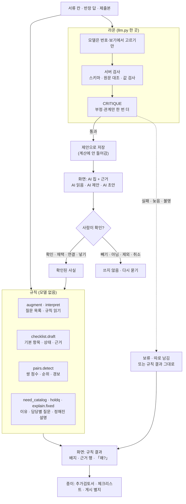
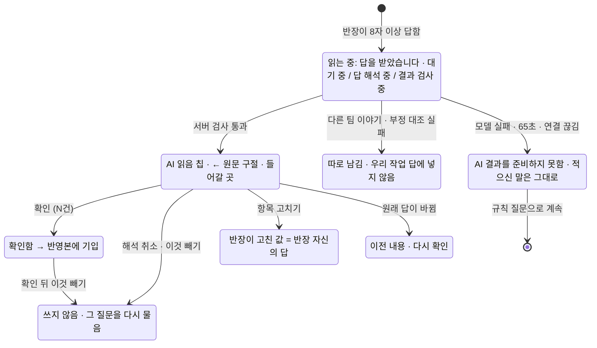
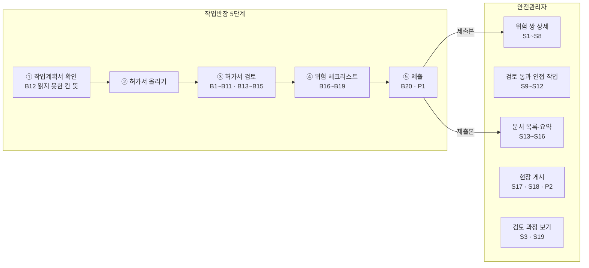

# 05h. 설명 가능성과 AI 출력 배치 — AI가 낸 것과 규칙이 낸 것, 화면 어디에 어떻게

croScan 화면에는 규칙이 낸 결과와 사내 언어 모델(라온)이 낸 제안이 함께 나옵니다. 이 문서는 그 출력 하나하나가 **어디서 만들어지고, 화면 어디에 어떤 표시로 놓이며, 사람이 왜 그런 판단인지 어떻게 확인하고 고치는지**를 빠짐없이 모았습니다.

**이 문서에서 알 수 있는 것**
- 설계서가 정한 설명 가능성(XAI) 원칙과, 그 원칙을 지키는 코드
- 화면에 나오는 AI·규칙 출력 43가지의 자리, 표시, 근거, 실패 때 대신 나오는 것, 사람이 고치는 법(한 표)
- 라온을 부르는 코드 16곳과, 그 결과가 화면에 닿는 곳
- 「AI 읽음」「AI 제안」「AI 초안」 같은 표시 말의 뜻과 색
- 설계와 코드가 어긋나 보이는 곳을 의도·확인 필요·설계 근거 미기록으로 나눈 목록

**목차**
1. [무엇을](#1-무엇을)
2. [원칙: 설계서가 정한 것](#2-원칙-설계서가-정한-것)
3. [흐름 그림](#3-흐름-그림)
4. [AI 출력 목록](#4-ai-출력-목록)
5. [라온 호출 지점과 화면](#5-라온-호출-지점과-화면)
6. [작업반장 화면의 출력](#6-작업반장-화면의-출력)
7. [안전관리자 화면의 출력](#7-안전관리자-화면의-출력)
8. [종이에 남는 AI 표기](#8-종이에-남는-ai-표기)
9. [표시 말과 색 사전](#9-표시-말과-색-사전)
10. [실제 화면 그림](#10-실제-화면-그림)
11. [코드 어디](#11-코드-어디)
12. [시험](#12-시험)
13. [한계와 알려진 문제](#13-한계와-알려진-문제)

---

## 1. 무엇을

먼저 낱말을 풉니다.
- **XAI(설명 가능성)**: 사람이 「왜 이런 결과가 나왔나」를 화면에서 따라갈 수 있게 하는 것입니다. croScan에서는 모델의 숨은 생각을 보여 주는 것이 아닙니다. **나온 결과와 그 근거(원문 구절·서류 칸·규칙·조문)를 짝지어 보여 주는 것**입니다(설계서 §5.1).
- **규칙 출력**: 코드에 적힌 정해진 규칙이 계산한 것입니다. 같은 입력이면 늘 같습니다. 예: 위험 쌍 점수·순위, 체크리스트 기본 상태, 질문 목록.
- **AI 출력**: 라온(사내 언어 모델)이 고른 것을 서버가 검사해 내보낸 것입니다. 모델은 서버가 준 번호·보기에서 **고르기만** 합니다. 화면 문장은 거의 다 서버의 틀입니다([05c §4](05c_라온이_하는_일.md#4-공통-원칙과-지키는-코드)).
- **혼합 출력**: 규칙이 먼저 하고, 규칙이 못 한 부분만 AI가 더하는 것입니다. 예: 반장 답 읽기는 규칙 읽기 → AI 읽기 → 서버 검사 → 부정 답 다시 대조 순서입니다.
- **칩**: 글 앞에 붙는 작은 테두리 표시입니다. AI가 만든 것은 `AI 읽음`·`AI 제안`·`AI 초안` 칩으로 구분합니다.
- **대신 나오는 것(fallback)**: AI가 실패하거나 늦을 때 화면이 보이는 것입니다. 거의 늘 「규칙 결과 그대로」입니다.

croScan은 승인·일정·작업 차단을 하지 않습니다. 판단은 사람(작업반장·안전관리자)이 합니다. 화면의 AI 표시는 「AI가 판단했다」가 아니라 「AI가 이렇게 읽거나 골랐으니 사람이 확인해 달라」는 뜻입니다.

**AI 출력과 규칙 출력은 이렇게 구분됩니다(한 줄 요약).**

| 무엇으로 | AI 출력 | 규칙 출력 |
|---|---|---|
| 칩 | `AI 읽음`, `AI 제안`, `AI 초안` 등 중립 테두리 칩 | 칩 없음. 기존 순위 배지·도넛·체크리스트 색 |
| 상태 | 사람이 확인·채택하기 전에는 제안. 계산·반영본·제출에 안 들어감 | 바로 계산에 쓰임 |
| 근거 | 원문 구절 `← 「…」`, 두 서류 행, 확인 사실 | 서류 칸 값, 규칙 이름·강도×노출, 조문 |
| 실패 때 | 「AI 결과를 준비하지 못함」 등 실패를 실패로 말함 | — |
| 위험 신호 | 경보·기본 항목을 줄이거나 숨기지 못함 | 경보·순위·점수를 정함 |

---

## 2. 원칙: 설계서가 정한 것

출처는 [AI도입계획_설계서](reference/AI도입계획_설계서.md)입니다. 절 번호를 괄호에 적었습니다.

| 원칙 | 무슨 뜻 | 출처 | 지키는 코드 |
|---|---|---|---|
| AI는 제안, 규칙은 강제 | 「AI는 의미를 읽고 제안하며, 규칙은 계산·권한·보호·종료를 강제한다」. 모델에는 DB 수정·파일 쓰기·승인·질문 예산 변경 권한이 없음 | 머리말, §1.2 | 모든 호출이 [`server/llm.py`](../server/llm.py) `call_json()`을 거침. 결과는 각 모듈이 다시 검사 |
| 설명은 출력과 증거의 대응 | 숨은 사고 과정 공개가 아님. 원문 구절 → 읽은 값 → 다른 해석·미확인 → 사람 확인 → 쓰인 곳 | §5.1 | 카드의 `← 「구절」`, `미확인:`, `들어갈 곳:` ([`web/app.js`](../web/app.js) `readCard()`) |
| 확대 해석 금지 | 「가스 안 씁니다」를 「전기 용접만」으로 넓히지 않음. 「가스 미사용 · 공법 미확인」 | §5.1 | `need_catalog.atoms()`가 말하지 않은 원자를 `unread`로 남김 → `미확인:` 칩 |
| 설명 대상 9가지 | 질문, 해석, 체크리스트, 위험 쌍, 인접 작업, AI 추가검토, 문서 변경, 개정, 입력 보강 전후 | §5.2 | 6장·7장의 출력 B5·B7·B19·S2·S9·S11·B15·B11·S3 |
| 판정식은 설명기가 못 바꿈 | 규칙 설명에는 규칙 판·입력 사실·계산값. `_quiet()`의 대표 이유 하나를 전체 결과처럼 키우지 않음 | §5.3 | [`server/explain.py`](../server/explain.py) `claims()`는 규칙 결과에서 주장(J·F·R·U)을 만들기만 함 |
| 설명 검증기 7가지 | 참조 id·구절 존재·숫자 일치·「미상→없음, 계획→완료, 무경보→안전」 금지·필수 미확인 모두 표시·개정 일치·글자로만 | §5.4 | `explain.verify()`. 하나라도 어기면 주장 그대로의 근거 표로 바꿈 |
| 안전 의미는 서버가 | 숫자·점수·순위·금지·완료는 서버가 넣음. AI는 초점·순서만 | §5.4 | EXPLAIN은 의도·사실 순서만 고름(`explain.ask()`) |
| 접어도 남음 | AI 해설을 접어도 규칙 결과와 필수 미확인은 화면에 남음 | §5.4 | 쌍 상세의 「확인 필요」·조치는 접힘 밖(`sfPairBody()`) |
| 「왜?」는 저장된 것부터 | 「왜 묻나요?」는 저장된 이유를 바로 엶. 자유 질문만 EXPLAIN. 1차 질문은 셋. 일정 가정은 계산 안 함 | §5.5 | `askNext()`의 `why-box`, `explain.FIXED`, `explain.WHAT_IF` |
| 「검토 통과 인접 작업」 고정 문구 | 이름은 유지. 목록 위·상세에 고정 문구. 초록 안전 표시 금지. AI 상태는 따로 | §5.6 | `SF_NEAR_NOTE`, `.sf-pc-pill.near`(중립색), `sfAiState()` |
| 새 화면을 만들지 않음 | AI는 QA로 다듬은 기존 자리에 들어감. 새 AI 블록 문형: 결론 한 줄 → 근거 → 할 일. 미확인은 할 일 앞, 출처는 끝, 버튼은 카드 아래 | §19 머리 | 카드·후보 행·요약 줄이 기존 컴포넌트 모양을 씀 |
| 규칙 쌍 상세에 AI 산문 없음 | 「왜 위험한가요?」는 규칙에서 나옴. AI는 확인된 반장 답을 근거 행으로 더하고, 물을 때만 답함 | §19.1 | `sfPairBody()`에 모델 글이 없음 |
| 표시 부호 | 새 색을 만들지 않음. AI 칩은 확인·채택 전에만. 초록은 사람의 확인 동작에만. 미분석을 「문제 없음」으로 바꾸지 않음. AI 실패를 작업 위험과 구분 | §19.3 | `.ai-chip`(중립 테두리), `AI_CHIP` 낱말표 |
| 기다림·실패 | 가짜 % 없음. 30초 「평소보다 오래 걸립니다」. 늦게 온 결과는 상태 줄만 바꾸고 스크롤·포커스를 옮기지 않음 | §19.4 | `aiTick()`, `role="status"` |
| 쳐낼 것 | 내부 id·확률·모델명·토큰·검색 점수를 보이지 않음. 규칙과 AI의 같은 설명 두 벌 금지 | §19.7 | 화면에 % 없음, `HT2` 같은 내부 코드는 `slotOf()`로 낱말로 바꿈 |
| 확인된 답은 경보를 올리기만 | 반장이 확인한 답도 틀릴 수 있음. 서류 경보는 답 때문에 사라지거나 내려가지 않음 | §8.1 개정 | `pairs.floor()`, 「답으로는 해소 · 문서 기준 유지」 칸 |
| 확률은 판정에 없음 | 쌍 매칭·점수·순위에는 확률이 없음. 모델이 놓치면 「규칙만으로 했을 때와 같은 상태」 | 부록 「확률적 요소의 사용처」 | [06 쌍작업 판정](06_쌍작업_판정.md) 전체가 모델을 부르지 않음 |

[AX 아키텍처 설명](reference/AX_아키텍처_설명.md) §1은 같은 구조를 「① 구조화 추출 → ② 출력 가드레일 → ③ 검증 호출 → ④ 인간 감독 → ⑤ 규칙 판정 → ⑥ XAI」로 부릅니다. 이 문서의 표는 그 ④·⑥이 화면에서 어떻게 보이는지에 해당합니다.

---

## 3. 흐름 그림

### 3.1 출력이 화면까지 가는 길

- 확인된 사실은 다시 규칙으로 들어갑니다. 그래서 반장이 확인한 AI 읽기가 반영본·체크리스트·쌍 판정에 쓰입니다. 이때도 점수·순위는 규칙이 냅니다.
- 점선은 실패 길입니다. 실패는 통과로 바뀌지 않습니다.

### 3.2 AI 읽기 하나의 상태

### 3.3 화면 자리 지도

---

## 4. AI 출력 목록

번호 B는 작업반장 화면, S는 안전관리자 화면, P는 종이, X는 화면에 닿지 않는 것입니다. 「AI/규칙」 칸의 화살표는 처리 순서입니다. 「만드는 곳」의 파일은 `server/` 아래, 화면 함수는 [`web/app.js`](../web/app.js)입니다.

| # | 출력 | 만드는 곳 (파일:함수) | AI/규칙 | 화면 자리 | 누가 | 근거를 보여 주는 법 | AI 실패·늦을 때 | 사람이 고치기·거부 |
|---|---|---|---|---|---|---|---|---|
| B1 | 다음 질문 문구 다듬기 | `understand.py:phrase()` → `phrase_text()` | AI가 방식(keep·short·ref)만 고름 → 문장은 서버 | 질문 말풍선 글(`qText()`) | 반장 | ref 방식이면 「앞에서 「…」라고 하셨습니다.」로 앞 답을 짚음 | 규칙 질문 문구 그대로 | 고칠 것 없음(질문 내용·보기는 그대로) |
| B2 | 질문 미리 읽히기 | `understand.py:warm()` (`llm.prefill`) | AI(캐시만) | 화면에 안 보임 | — | — | 다음 읽기가 목록부터 다시 읽음(느려지기만) | — |
| B3 | AI 질문(AIn) | `analyze.py:analyze()` → `check()` → `question()`, `app.py:_with_ai()` | 규칙 질문이 먼저 → AI가 「규칙이 안 묻는 것」 최대 2개 → 서버 검사 → 검수한 질문 틀 | 질문 말풍선(규칙 질문과 같은 모양, 칩 없음). 시작 때 상태 말풍선 | 반장 | `관측: {문서} {칸}: 「구절」` 줄, 「왜 묻나요?」에 필요 이유 | 「AI 미분석 · 규칙 질문으로 진행합니다.」, 요약 「AI 미완료 1」 | 「모름」 등 보기, 답은 별지에만. 인용 칸이 고쳐지면 질문이 빠짐 |
| B4 | 고친 칸 다시 읽기 | `analyze.py:delta()` | AI(바뀐 칸만) → 서버 검사 | 안내 말풍선 + 새 AI 질문 | 반장 | B3과 같음 | 말 없이 질문 그대로 | B3과 같음 |
| B5 | 질문 이유 「왜 묻나요?」 | `need_catalog.py:why()`, `basis_of()`, 관련 자료 `retrieval.py:related()` | 규칙(+ BM25 검색, 모델 아님) | 질문 말풍선의 `관측:` 줄과 「왜 묻나요?」 펼침 | 반장 | 필요 이유 1줄 → `[등급] 출처·조` → 조문 제목·「croScan 규칙 「…」에서 씀」·대조한 현행본. 관련 자료는 「검색 후보(근거 확정 아님)」 | 해당 없음(모델 없음) | — |
| B6 | 규칙 읽기 제안 | `augment` 규칙 읽기 → `store.propose("rule")` | 규칙 | 확인 카드의 줄(칩 없음) | 반장 | `← 「구절」`, 들어갈 곳 | 해당 없음 | B7과 같은 버튼 |
| B7 | AI 읽음 제안 | `understand.py:read()` → `check()` → `critique.review()` → `store.propose("ai")` | 규칙 읽기 → AI 읽기 → 서버 검사 17가지 → 부정 제안만 CRITIQUE | 답 말풍선 바로 뒤 확인 카드, 줄마다 `AI 읽음` 칩 | 반장 | `← 「구절」`, 시점(`예정`·`했다고 답함`·`시점 미확인`), `미확인:`, `원문 그대로`, `들어갈 곳: 칸 「전」 → 「후」` | 「AI 결과를 준비하지 못함 · 적으신 말은 그대로 남겼습니다.」 또는 「… · AI를 지금 쓸 수 없어 규칙으로만 읽었습니다.」 | 「확인 (N건)」, 「이것 빼기」/「다시 넣기」, 「항목 고치기」, 「해석 취소」, 확인 뒤 「이것 빼기」 |
| B8 | 따로 남김 | `understand.check()`의 `apart`, `critique.review()`의 `held` | 규칙 검사 + CRITIQUE | 같은 카드 아래 「따로 남김 · 우리 작업 답에 넣지 않음」 | 반장 | `「구절」 · 이유`(다른 팀·다른 작업 이야기 / 누구 이야기인지 불분명 / 뜻 확인 필요 — 따로 묻기) | 대조 실패·늦음도 따로 남김(통과 아님) | 고칠 것 없음. 그 질문은 다시 물음 |
| B9 | 정정 문장 다시 읽기 | `understand.py:normalize()` | AI → 서버 검사 | **지금 꺼져 있음**(앱이 켜지 않음) | — | — | 정정 문장은 버리고 규칙 질문으로 다시 물음 | — |
| B10 | AI 상태 줄·카드 상태 | `aiTick()`, `aiLine()`, `/api/dialogues/{sid}/stage` | 규칙(화면 상태) | 입력칸 바로 위 한 줄(`role="status"`), 카드 머리 | 반장 | 서버의 실제 단계: 대기 중 / 답 해석 중 / 결과 검사 중 | 30초 「평소보다 오래 걸립니다」+[직접 입력·보기 선택][취소], 실패 뒤 [다시 시도] | 「기다리지 않고 다음 질문」, 「취소」 |
| B11 | 개정 만료 알림 | `expiryNote()`(서버 `store.expiry()`) | 규칙 | 대화의 알림 말풍선 | 반장 | `{바뀐 것} 때문에 다시 확인이 필요합니다` → 전→후 → 영향 N건 → 「변경 내용 보기」 | 해당 없음 | 다시 묻는 질문에 답 |
| B12 | 읽지 못한 칸의 뜻 | `mapcell.py:suggest()`, `prepare()` | AI(알려진 항목 36개 중 고름) → 서버 검사(값 꼴) | ① 작업계획서 목록의 상자 `AI 제안` | 반장 | `{쪽} 「칸이름: 값」`, `연결 전: 알 수 없는 칸 → 연결 후: {항목}` | 상자가 안 나옴 | 「연결」/「아님」. 계획서 값은 안 바뀜 |
| B13 | 계획서 연결 제안 | `link.py:candidates()`(규칙) → `suggest()`(AI) → `critique.relation()` → `imports()`(규칙) | 규칙 후보 → AI 관계 → CRITIQUE → 가져올 값은 규칙 | ③ 대화의 카드 `AI 제안` | 반장 | 허가서 「칸: 값」·계획서 「칸: 값」 두 행, 계획서 작업 범위, 가져올 값(들어갈 곳 · 전 → 후) | 카드가 안 나옴(연결 안 함) | 「같은 작업으로 연결」/「아님」, 가져올 값 체크 해제 |
| B14 | 연결 다시 확인 | `/api/dialogues/{sid}/links/check`, `checkLinks()` | 규칙 | ③ 대화의 카드(칩 없음) | 반장 | `작업계획서 「…」이 바뀌어 다시 확인이 필요합니다`, 가져온 값 목록 | 해당 없음 | 「가져온 값 빼기」/「그대로 둠」 |
| B15 | 반영본 값·출처와 「왜?」 | `reflect.plan()`, `explain.change()`, `/api/explanations/query` | 규칙(확인된 답만 씀) | ③ 칸 설명 영역 `.fl-notes`(넓은 화면 `#fedit`, 선택 칸 카드) | 반장 | `반영본 {번호} ({빈칸에 기입·덧붙임·바꿈}): 값 — 출처` + 「왜?」 → 판단 한 줄·사용한 사실·적용한 기준·아직 확인할 것 | 해당 없음 | 칸 값을 직접 고치거나 「되돌리기」 |
| B16 | 체크리스트 croScan 제안·근거 | `checklist.py:draft()`, `evaluate()` | 규칙 | ④ 항목 아래 `ck-reason` 줄 | 반장 | `croScan 제안 「{상태}」 · 근거: {사유} ({서류·반장 답})` | 해당 없음 | 「해당/해당 없음/안전팀 확인」을 고름(고른 것도 확인) |
| B17 | 체크리스트 AI 읽기 줄 | `checkai.py:_run()` → `check_marks()` → `_now()` | AI → 서버 검사. 상태는 안 바꿈 | ④ 기본 항목 안 `ck-mark` 줄 `AI 제안` | 반장 | `같은 근거 「…」(서류)` / `상충: …` / `해당 근거 「…」가 있습니다` / `하지 않는다는 말 「…」` + `맞는 조치:` | 줄이 안 나옴 | 반장이 상태를 고름. 「해당 없음」 뒤 근거가 오면 다시 고르게 함 |
| B18 | 체크리스트 AI 추가 후보 | `checkai.py:_run()` → `why_not()` → `item_of()`, 제출 때 `attach()` | AI(카탈로그 안에서만) → 서버 검사 | ④ 같은 종류 묶음 끝의 후보 행 `AI 제안` · `채택 전` | 반장 | `근거: 「…」 (서류·반장 답) · 채택하면 다른 항목처럼 해당 여부를 고릅니다` | 「AI 결과를 준비하지 못함 · 체크리스트는 그대로입니다.」 | 「채택」/「제외」. 채택 뒤 근거가 맞지 않으면 「이 항목 빼기」/「반장 항목으로 유지」 |
| B19 | 「위험한 이유 보기」 | `explain.py:checklist()`, `/api/explanations/query` | 규칙 | ④ 기본 항목의 링크 버튼 아래 | 반장 | 판단 한 줄 → 사용한 사실(근거·이 위험이 생기는 때) → 적용한 기준(명세 id·연구 ref·참고 사고 사례·고른 조치) → 아직 확인할 것 | 「설명을 만들지 못했습니다: …」 | — |
| B20 | 제출 전 미해결 | `renderSummary()`, 서버 `app._budget()` | 규칙 | ⑤ 요약의 「확인 질문」 행 | 반장 | `해석 확인 전 N · AI 미완료 1`, 자세히: `해석 확인 전: {항목} ← 「구절」`, `AI 분석: {사유}` | 사유 자체가 실패 표시 | 「바꾸기」로 ③으로 돌아감 |
| B21 | 도움말 「AI가 읽은 내용 확인하기」 | `HELP_AI` | 규칙(고정 글) | 도움말 창 아래 3줄 | 반장 | 「확인은 「이렇게 읽은 것이 맞다」는 뜻이고 작업 승인이 아닙니다」 | — | — |
| P1 | 추가검토서의 AI 표기 | `addendum.py:_tag()`, `_ai_state()`, 블록 4 `analysis_note`, `reflect.py` 별지 「추가 확인 질문」 | 규칙 | 종이(추가검토서 별지) | 반장·안전관리자 | 블록 3 `반장 답변 확인 (AI 읽음) · 예정`, 블록 4 `AI 분석`, 끝 줄 `croScan AI 문안 보조 · 문안 상태 · 개정` | 블록 4에 「AI 분석을 마치지 못함(규칙 질문으로만 확인)」 | 제출 전에 ③에서 고침 |
| S1 | 쌍 판정·순위·「왜 위험한가요?」 | `pairs.py:detect()`, `safety.py` | 규칙 | 쌍 상세 위쪽(위치→시간→위험 설명→확인 필요→조치) | 안전관리자 | 주는 작업 → 받는 작업 도식, 사고 설명, 「확인 필요」 | 해당 없음 | 안전관리자가 검토·판단 |
| S2 | 판정 근거 행 | `pairs.py` reasons의 `evidence`(+ `confirmed_facts()`) | 규칙(확인된 AI 읽기는 입력으로만) | 「판정 근거·원문」 접힘의 「근거 (서류에서 읽은 값·답변)」 | 안전관리자 | `{문서} · {칸} 값`, `{문서} · 작업반장 답변 「…」`, `{문서} · 작업반장 답변 · 반장 답변 확인 「…」` | 해당 없음 | 「문서 열기」로 원문 대조 |
| S3 | 입력 보강 전후 | `pairs.py` hybrid 비교, `floor()` | 규칙 | 쌍 상세 「입력 보강 전후」 접힘, 「검토 과정 보기」 안 | 안전관리자 | 3칸: 새 경보 / 유지·변경 / 답으로는 해소 · 문서 기준 유지. 행마다 `확인 사실: {문서} 「값」 (작업반장 답변 · 반장 답변 확인)` | 해당 없음 | 해제는 안전관리자가 판단 |
| S4 | 서류 기준 유지 안내 | `sfPairBody()`(`reason.floor`) | 규칙 | 쌍 상세의 「확인 필요」 아래 | 안전관리자 | 「작업반장 확인 답만 보면 이 경보가 낮아지거나 없어질 수 있지만, 서류 기준으로 그대로 둡니다.」 | 해당 없음 | — |
| S5 | 「이 판정에 대해 묻기」 정해진 질문 | `explain.py:claims()` → `fixed()` → `verify()` | 규칙 | 「판정 근거·원문」 맨 아래 버튼 | 안전관리자 | 판단 한 줄 → 사용한 사실 → 적용한 규칙 → 아직 확인할 것 → 근거 보기(두 문서 열기) | 해당 없음 | — |
| S6 | 「이 판정에 대해 묻기」 자유 질문 | `explain.py:ask()` → `verify()` | 일정 가정은 규칙이 먼저 거름 → AI가 의도·사실 순서만 → 문장은 서버 → 검증기 | 같은 자리 한 줄 입력 | 안전관리자 | S5와 같은 틀 + `AI가 질문을 이 설명으로 읽음` 칩 | 「AI가 질문을 읽지 못해 「쓴 서류 값」 설명을 보여 드립니다.」 | 다시 묻기, 정해진 질문 버튼 |
| S7 | 담당별 확인(판정보류 질문) | `holdq.py:build()`, `mark()` | 규칙(모델 없음) | 쌍 상세 「확인 필요」 아래 「담당별 확인」 | 안전관리자 | 반장마다 자기 작업 질문, 상태 `미전달/답변 대기/답변 받음` | 해당 없음 | 「질문 복사」, 「전달함 표시」·「답변 받음 표시」·「되돌리기」 |
| S8 | 서류상 선후 계획·남은 확인 | `pairs.py:sequence_plan()`, `annotate()` | 규칙 | 같은 「확인 필요」 영역, 선후 계획이 있는 쌍만 | 안전관리자 | `서류상: {앞 작업} 끝 → N분 뒤 {뒤 작업} 시작`, `{문서} 기재 「…」`, `남은 확인` | 해당 없음 | — (경보·순위를 바꾸지 않음) |
| S9 | 검토 통과 인접 작업의 근거 | `pairs.py:_quiet()` | 규칙 | 「검토 통과 인접 작업」 목록 머리·상세 | 안전관리자 | 「검토 통과 근거」 한 줄 + 고정 문구 | 해당 없음 | — |
| S10 | 인접 작업의 AI 관계 검토 상태 | `pairreview.py:states()` | 규칙(상태 표시) | 인접 작업 상세 「검토 통과 근거」 아래 | 안전관리자 | `AI 관계 검토: 미분석/대기 중/처리 중/실패/검토 완료` | 「실패」를 빨강 글자로 | 「AI 검토 요청」 |
| S11 | AI 검토 권장 결과 | `pairreview.py:prefilter()`(규칙) → `_review()`(AI) → `judge()` → `critique.relation()` | 규칙 거름 → AI 관계·두 행·질문 → 서버 문장 → CRITIQUE | 인접 작업 상세 「AI 검토 권장 규칙 판정 아님」 상자 | 안전관리자 | `AI 제안` + `{관계}를 확인해 주세요`, 두 문서 행, `확인할 것`, `검토 대상이 된 까닭` | 「AI 검토를 마치지 못했습니다. 규칙 판정은 그대로입니다.」, 보류 「근거 부족으로 보류」·「시간 안에 확인하지 못해 보류」 | 다시 요청. 채택해도 새 규칙이 되지 않음 |
| S12 | AI 검토 권장 목록 | `pairreview.py:listing()`, `batch()`, `sfAiList()` | 규칙(목록) + S11 결과 | 위험 쌍 목록 끝의 진입 줄 → 별도 탭 | 안전관리자 | `검토 완료 N / 대상 M · 권장 N건`, 행 `AI 제안 · A × B · {관계}`, 나머지 접힘 | 「아직 AI가 검토한 쌍이 없습니다(미분석).」 | 「규칙 목록으로 돌아가기」 |
| S13 | 문서 요약 「먼저 볼 것」 | `docsum.py:rows()` | 규칙 | 문서 목록 오른쪽 요약(좁은 화면은 문서 본문) | 안전관리자 | 시간·장소·대상·공유 설비·단계·상충·미확인 순서 표, 미확인 줄은 경고색 | 해당 없음 | — |
| S14 | 문서별 AI 읽기 결과 | `docsum.py:ai_reading()` | 규칙(AI가 한 일을 요약) | 「먼저 볼 것」 표 아래 `AI 읽기 결과` 칩 줄 | 안전관리자 | `작업반장 답 N건 · 확인한 읽기 N건(AI 읽음 N건)`, `위험 쌍 입력에 더한 확인 사실`, `업로드 분석: …`, `안전팀 확인 필요 N건` | `croScan 제출본 없음 · AI 읽기 결과 없음` | — |
| S15 | 허가 검토 신호 | `permitsignal.py:phrases()`(규칙) → `suggest_ai()`(AI) → `signals()` | 규칙 먼저 → 규칙이 못 정한 구절만 AI | 계획서의 「먼저 볼 것·허가 검토 신호」 | 안전관리자 | `대응 허가서를 확인해 주세요` → 계획서 “구절” → 조회 범위 → 「이 범위에서 찾지 못함」. AI가 고른 것만 `AI 제안` | 규칙 신호만 보임 | — (허가서 유무를 단정하지 않음) |
| S16 | 제출본 줄 | `sfSubHtml()`, `/api/safety/submissions` | 규칙 | 문서 요약 「추가 답변」 | 안전관리자 | `답변 N건 (+확인한 읽기 N건) · 담당 확인 N건 · 체크리스트 …`, 판정 자료 `서류 기준`/`제출본 반영` | 해당 없음 | 제출본 PDF 열기 |
| S17 | 협조 문자의 「협의할 점」 | `coordnote.py:note()` → `sentence()` | 확인 사실이 있을 때만 → AI가 사실·확인할 것 하나씩 고름 → 문장은 서버 | 작업 조정 문자 창, 보낼 문자 아래 | 안전관리자 | `협의할 점 (제안)` + `AI 초안`(모델이 골랐을 때만) + `출처: {문서} 작업반장 답변 · 반장 답변 확인 「…」` | 첫 사실·첫 항목으로 서버가 문장을 씀. 그마저 없으면 「협의할 점 제안을 만들지 못했습니다. 문자는 그대로 보낼 수 있습니다.」 | 「문자에 넣기」를 누를 때만 들어감 |
| S18 | 게시 별지 AI 문안 보충 | `posting.py:options()` → `draft()` → `compose()` | AI가 할 일·확인 답·착수조건을 고름 → 문장은 서버 | 미발행 게시 별지의 칸 아래 「AI 문안 보충 보기」, TBM 전달 초안, 추가조치 3줄 | 안전관리자 | `AI 초안` 칩, 세 줄(우리 반은 … / 착수조건 / 중지·변경 시), `근거: 규칙 문구 「…」 · 반장 답변 확인 「…」` | 「AI 결과를 준비하지 못함 · 규칙 문안 그대로 씁니다」 | 「문안 채택」 → 미발행 칸에 들어감(발행 전 고칠 수 있음) |
| S19 | 근거 지도 | `evidencemap.py:build()`, `/api/knowledge/map` | 규칙(+ 검색 후보) | 「검토 과정 보기」 → 「근거 지도 보기」 → 옆 패널, `/static/evidence.html` | 안전관리자 | 행 = 체크리스트 항목·쌍 규칙, 열 = 법령·공공·조선사·팀·예시. 「확인된 근거」/「인용만」/「검색 후보」 구분 | 「근거 지도를 불러오지 못했습니다」 | — (판정에 쓰이지 않음) |
| P2 | 게시 별지의 AI 표기 | `posting.py:ai_mark()`, `layout()` | 규칙 | 종이(게시 별지 PDF) 끝 | 안전관리자·현장 | `croScan AI 문안 보조 · 문안 상태: {초안/일부 채택/채택} · 개정 R{n}` 한 번 | — | 새 개정본에서 고침 |
| X1 | 옛 자유 대화 | `app.py:chat()` (`/api/chat`) | AI(자유 문장) | 화면에서 부르지 않음. 기본 꺼짐(410) | — | — | — | — |

이 표는 43줄입니다(B 21, P 2, S 19, X 1).

---

## 5. 라온 호출 지점과 화면

라온을 부르는 코드는 16곳입니다. 15곳은 [`server/llm.py`](../server/llm.py)의 `call_json()`·`prefill()`을 거치고, 1곳(옛 자유 대화)은 거치지 않습니다. 각 호출의 입력·스키마·기한은 [05c 라온이 하는 일](05c_라온이_하는_일.md#1-한눈에)에 있습니다. 여기서는 결과가 화면 어디에 닿는지만 봅니다.

| # | 파일:줄 | 함수 | 작업 이름 | 4장 출력 | 결과가 닿는 화면 |
|---|---|---|---|---|---|
| 1 | [`analyze.py`](../server/analyze.py):248 | `analyze()` | `UPLOAD_ANALYZE` | B3 · P1 · S14 | ③ 질문 말풍선, 상태 말풍선, 요약 「AI 미완료」, 별지, 관리자 「업로드 분석」 줄 |
| 2 | [`analyze.py`](../server/analyze.py):278 | `delta()` | `DISCOVER_DELTA` | B4 | ③ 안내 말풍선과 새 질문 |
| 3 | [`understand.py`](../server/understand.py):398 | `warm()` | `TURN_WARM` (`prefill`) | B2 | 화면 없음(모델 캐시만) |
| 4 | [`understand.py`](../server/understand.py):429 | `read()` | `TURN` | B7 · B8 · B20 · P1 · S2 · S3 · S14 | ③ 확인 카드. 확인 뒤 반영본·체크리스트·관리자 근거 행 |
| 5 | [`understand.py`](../server/understand.py):483 | `normalize()` | `NORMALIZE` | B9 | 지금 없음(꺼짐) |
| 6 | [`understand.py`](../server/understand.py):547 | `phrase()` | `PHRASE` | B1 | ③ 질문 말풍선 글 |
| 7 | [`critique.py`](../server/critique.py):76 | `verdict()` (`review()`·`relation()`이 부름) | `CRITIQUE` | B8 · B13 · S11 | ③ 「따로 남김」, 연결 카드가 나오는지, 관리자 「근거 부족으로 보류」 |
| 8 | [`checkai.py`](../server/checkai.py):334 | `_run()` | `CHECKLIST` | B17 · B18 | ④ `ck-mark` 줄, 후보 행 |
| 9 | [`mapcell.py`](../server/mapcell.py):55 | `suggest()` | `MAP_CELL` | B12 | ① 계획서 목록 상자 |
| 10 | [`link.py`](../server/link.py):200 | `suggest()` | `LINK` | B13 | ③ 연결 카드 |
| 11 | [`permitsignal.py`](../server/permitsignal.py):161 | `suggest_ai()` | `PERMIT_SIGNAL` | S15 | 관리자 문서 요약의 `AI 제안` 신호 |
| 12 | [`pairreview.py`](../server/pairreview.py):168 | `_review()` | `PAIR_REVIEW` | S10 · S11 · S12 | 관리자 인접 작업 상세, AI 검토 권장 탭 |
| 13 | [`explain.py`](../server/explain.py):137 | `ask()` | `EXPLAIN` | S6 | 관리자 「이 판정에 대해 묻기」 답 |
| 14 | [`coordnote.py`](../server/coordnote.py):61 | `note()` | `WRITE` | S17 | 관리자 협조 문자 창 |
| 15 | [`posting.py`](../server/posting.py):134 | `draft()` | `WRITE` | S18 · P2 | 관리자 게시 별지 편집, 종이 끝 줄 |
| 16 | [`app.py`](../server/app.py):1750 | `chat()` | (이름 없음, 직접 스트리밍) | X1 | 화면에서 부르지 않음. `CROSCAN_LEGACY_CHAT=1`일 때만 켜짐 |

- 찾은 호출 지점 16곳을 모두 4장 표에 넣었습니다.
- CRITIQUE는 코드 한 곳(7번)에서 세 쓰임(TURN 부정 제안, LINK 관계, PAIR_REVIEW 관계)으로 불립니다.
- 미리 계산: 제출이 들어오면 `app._warm_manager()`가 1순위 쌍 최대 5개의 협의할 점(14번, WARM 순서)과 인접 쌍 최대 20개의 AI 검토(12번, `pairreview.batch()`)를 미리 만듭니다. 문서 요약을 처음 열면 `app._warm_signals()`가 계획서 구절을 미리 읽힙니다(11번). 미리 만든 결과도 화면 표시는 같습니다.

---

## 6. 작업반장 화면의 출력

각 절은 「근거가 만들어지는 길 → 화면 문구 → 표시 규칙 → 왜 이 자리인가」 순서입니다. 화면 문구는 코드에 적힌 그대로입니다. `{ }`는 값이 들어가는 자리입니다.

### 6.1 B1 질문 문구 다듬기 (PHRASE)

- **근거 길.** 질문이 뜨면 화면이 `/api/understand/phrase`로 다음 질문 1~2개를 보냅니다. 모델은 `keep`(그대로)·`short`(짧게)·`ref`(앞 답 하나를 짚고 짧게)만 고릅니다. 문장은 서버 `phrase_text()`가 씁니다. `short`는 `need_catalog.FALLBACK`의 짧은 문장입니다. `ref`는 앞 답과 질문에 같은 낱말이 실제로 있을 때만 씁니다.
- **화면 문구.** `앞에서 「{앞 답 40자}」라고 하셨습니다. {짧은 질문}`
- **표시 규칙.** 칩이 없습니다. 질문이 그대로일 때만 바뀐 문구를 씁니다(`qText()`가 `p.base === q.text`를 봄).
- **왜.** 질문은 규칙·AI 공통으로 같은 말풍선을 씁니다(설계서 §19.1). 모델이 질문 내용·보기를 바꾸지 못하므로 따로 표시할 AI 판단이 없습니다.

### 6.2 B2 질문 미리 읽히기 (TURN_WARM)

- 값을 적는 보기가 있는 질문이 뜨면 `/api/understand/warm`이 그 질문 목록을 모델 캐시에 읽힙니다. 출력은 1토큰이고 버립니다. 화면에 아무것도 나오지 않습니다.
- 실패하면 다음 읽기(B7)가 목록부터 다시 읽어 조금 느려질 뿐입니다. 자세한 것은 [05b §9](05b_AI_판독.md#9-normalizephrase미리-읽기)에 있습니다.

### 6.3 B3 AI 질문과 B4 고친 칸 다시 읽기 (UPLOAD_ANALYZE · DISCOVER_DELTA)

- **근거 길.**
  1. 검토가 시작되면 `startAnalyze()`가 `/api/analyze`를 한 번 부릅니다. 모델은 `{종류, 칸 id, 구절}`만 냅니다.
  2. 서버 `analyze.check()`가 구절이 그 칸에 있는지, 같은 칸을 이미 묻는 규칙 질문이 있는지, 종류에 맞는 말(지시어·작업 말 2개·설비+멈춤 말·다른 칸의 다른 값)이 있는지 봅니다.
  3. 통과하면 `analyze.question()`이 검수한 틀로 질문 `AI{n}:{허가번호}`를 만듭니다. 질문은 규칙 질문 뒤에 섭니다(`prio (5, n)`).
  4. `app._with_ai()`가 「왜 묻나요?」 자리에 `{"observe": 관측, "need": 필요 이유}`를 넣습니다. 이름·서명·승인·허가구분·날짜 칸은 모델에 주지 않습니다(`HIDDEN`).
- **화면 문구(상태 말풍선).**
  - 시작: `AI가 허가서와 작업계획서를 읽는 중입니다. 질문은 그대로 이어집니다.`
  - 찾음: `AI가 서류에서 확인할 것 {N}건을 찾아 질문에 더했습니다 (작업계획서 「…」 함께 읽음).`
  - 못 찾음: `AI 분석 완료 · 더할 질문 없음.`
  - 늦음: `AI 분석이 대화를 마친 뒤 끝나 묻지 않았습니다.`
  - 서류가 바뀜: `AI가 읽는 동안 허가서가 바뀌어 그 결과는 쓰지 않았습니다.`
  - 실패: `AI 미분석 · 규칙 질문으로 진행합니다.`
  - 고친 칸(B4): `고친 칸을 AI가 다시 읽어 확인할 것 {N}건을 질문에 더했습니다.`
- **질문 문구(틀).** 예: `{문서}의 「{구절}」 가운데 이번에 실제로 하는 작업은 무엇인가요?` 질문 아래 `관측: {문서} {칸}: 「{구절}」` 줄이 붙습니다.
- **표시 규칙.** AI 질문에는 칩이 없습니다. 「미분석」과 「찾지 못함」은 다른 말로 씁니다.
- **왜.** 설계서 §19.1 「질문 (규칙·AI 공통) — 규칙 질문과 같은 모양」, 부록 4조각 「AI 질문 … 규칙 질문과 같은 말풍선(AI 칩 없음)」. 대신 관측 줄이 원문 구절을 보여 주므로 반장은 「서류의 어느 말 때문에 묻는지」를 압니다. 답은 양식 칸에 쓰지 않고 별지 「추가 확인 질문」에만 갑니다(B3 → P1).

### 6.4 B5 질문 이유 「왜 묻나요?」

- **근거 길.** 모델을 부르지 않습니다.
  1. `need_catalog.why(q)`가 항목별 **필요 이유 1줄**(코드가 그 답을 실제로 쓰는 곳 기준)을 줍니다.
  2. `basis_of()`가 그 답을 실제로 읽는 쌍 규칙의 조문 가운데 **현행본 대조를 마치고(`law_checked`) 「맞음」(`law_fit`)인 조문만** 고릅니다.
  3. `retrieval.related()`가 BM25로 관련 구절 2개를 찾습니다. 이것은 「검색 후보」로만 보입니다.
- **화면 문구.**
  - 말풍선 아래: `관측: {질문의 신호}`
  - 펼치면: 필요 이유 → `[법령] 안전보건규칙 제…조…` → 작은 글씨 `{조문 제목} · croScan 규칙 「{규칙}」에서 씀 · {현행본} 대조`
  - 관련 자료: `관련 자료 · 검색 후보(근거 확정 아님)` → `[등급] {출처} · 검수 전`
- **표시 규칙.** 등급 칩은 중립 테두리입니다. `[예시]`만 점선입니다(`.why-grade.eg`). 버튼에 `aria-expanded`·`aria-controls`가 있습니다.
- **왜.** 설계서 §5.5 「기본 「왜 묻나요?」는 저장된 이유·원문·지식을 즉시 연다」, §19.2 질문 이유 틀 「관측 1줄 → 필요 이유 1줄 → [등급] 자료명·절」, §19.3 「등급·확인 상태·위험 순위를 한 배지에 합치지 않는다」. 부록 3조각에서 약한 연결·미검수 조문은 보이지 않게 했습니다.

### 6.5 B6·B7·B8 확인 카드 (규칙 읽기 · AI 읽음 · 따로 남김)

반장이 한 질문에 길게 답하면, 그 답에서 **다른 질문의 답**도 읽어 한 카드에 모읍니다. 카드에는 규칙이 읽은 줄(B6)과 AI가 읽은 줄(B7)이 함께 나옵니다. 자세한 서버 검사는 [05b §5](05b_AI_판독.md#5-서버-검사-check), 카드 상태는 [04d §7.4](04d_화면_코드_구조.md#74-ai-읽기-카드의-상태)에 있습니다.

- **근거 길.**
  1. 규칙 읽기: 서버 `_augment()`가 `store.propose("rule")`로 제안을 저장합니다. 확인 전에는 계산에 넣지 않습니다(부록 2조각 「B6 닫음」).
  2. AI 읽기: 화면 `readCard()`가 `/api/understand`를 부릅니다. 조건은 답이 8자 이상, 「모름」이 아님, 질문 한도가 남음, AI가 꺼지지 않음입니다.
  3. 서버 `understand.check()`가 17가지를 봅니다: 구절이 답에 있나, 한 문장 안인가, 정정·추측·미정·조건이 아닌가, 다른 팀이 아닌가, 지난 일이 아닌가, 숫자·번호가 문장에 있나 등.
  4. `critique.review()`가 부정 제안(`없음`·`해당 없음`)만 한 번 더 대조합니다. `supports`가 아니면 따로 남깁니다.
  5. `need_catalog.atoms()`가 그 질문에서 말하지 않은 것을 `unread`로 남깁니다.
  6. `app._dest()`가 확인하면 들어갈 곳(칸 · 전 → 후, 또는 별지)을 붙입니다.
  7. `store.propose("ai")`가 제안으로 저장합니다. 읽는 동안 답·개정이 바뀌었으면 저장하지 않습니다.
- **화면 문구(카드).**
  - 머리: `우리 작업 정보 {N}건을 확인해 주세요` / 확인 뒤 `확인한 우리 작업 정보` / 확인할 것이 없으면 `이 답을 이렇게 읽었습니다`
  - 줄: `{항목}: {보기 · 값}` + `AI 읽음`(AI 줄만) + `미확인: {…}` + `{다른 작업 · }{예정|했다고 답함|시점 미확인}` + `원문 그대로` + `← 「{구절}」` + `들어갈 곳: {칸} 「{전}」 → 「{후}」`
  - 약한 줄: `질문 내용이 문장에 직접 보이지 않음: 맞으면 「다시 넣기」`(처음부터 빠진 상태)
  - 이미 답에 있는 질문: `이미 답에 있어 따로 묻지 않음`
  - 따로 남김(B8): `따로 남김 · 우리 작업 답에 넣지 않음` → `{항목} 「{구절}」 · {다른 팀·다른 작업 이야기 | 누구 이야기인지 불분명 | 뜻 확인 필요 — 따로 묻기}`
  - 버튼: `확인 ({N}건)`, `해석 취소`, 줄마다 `항목 고치기`·`이것 빼기`/`다시 넣기`. 확인 뒤 줄마다 `이것 빼기`
  - 확인 뒤 안내: `양식 칸에 맞는 것은 반영본에 파란 글씨로, 칸이 없는 것은 별지에 들어갑니다. 적으신 말은 원문 그대로 남습니다.`
  - 한도: `질문 한도({12}회)에 닿았거나 이미 마무리한 검토라 이 읽기는 확인하지 않습니다. 적으신 말은 원문 그대로 남고 안전팀 확인으로 넘어갑니다.`
- **표시 규칙.**
  - 규칙 줄은 칩이 없고, AI 줄만 `AI 읽음` 칩이 붙습니다. 확인하면 칩 글이 `확인함 → 반영본에 기입`으로 바뀝니다(`AI_CHIP`).
  - 확인 버튼은 서버가 확인 요청 1회를 발급한 뒤에만 보입니다(`issueAsk("card")`). 확인은 12회 질문 예산에 셉니다(설계서 §19.1).
  - 보낸 확인에는 「화면에 보인 것」의 지문(`displayed_digest`)과 개정 번호가 붙습니다. 그 사이에 답이 바뀌었으면 서버가 409로 거절하고 화면은 `… 이 카드는 쓰지 않습니다.`를 보입니다.
  - 확인 뒤 「이것 빼기」를 누르면 `「{항목}」은 빼고, 따로 여쭙겠습니다.`가 나오고 그 질문을 다시 묻습니다.
  - 「항목 고치기」로 고친 값은 그 질문에 대한 **반장 자신의 답**이 됩니다(읽기보다 우선).
- **왜.**
  - 설계서 §4.3·§19.1: 「답 말풍선 바로 뒤, `spillCard()`의 모양만 재사용」, 「카드 제목의 N은 확인할 수 있는 우리 작업 사실만 센다. 다른 팀 전언과 모호한 내용은 「따로 남김」」.
  - §5.1: 원문 구절 → 읽은 값 → 미확인 → 사람 확인 → 쓰인 곳을 한 줄에서 따라가게 합니다.
  - §19.3: 작업 시점은 글자만(`예정`·`했다고 답함`·`시점 미확인`). 현장 이행 확인으로 읽히지 않게 합니다.
  - 부록 「확률적 요소의 사용처」: 확인 전에는 답이 아니므로, 모델이 놓쳐도 그 질문을 그대로 묻습니다.

### 6.6 B9 정정 문장 다시 읽기 (NORMALIZE)

- 코드는 있지만 **앱 경로에서 꺼져 있습니다.** `understand.read(normalize_on=False)`가 기본이고 [`app.py`](../server/app.py)가 켜지 않습니다.
- 그래서 「4개가 아니라 6개」처럼 스스로 고치는 문장은 B7 검사에서 `정정이 섞인 문장(따로 확인)`으로 버려지고, 그 질문은 규칙으로 다시 묻습니다. 화면에 따로 나오는 것은 없습니다.

### 6.7 B10 AI 상태 줄과 카드 상태

- **근거 길.** 서버 `do_understand()`가 `_STAGE`에 단계를 적습니다. 모델 자리를 잡으면 「대기 중」에서 「답 해석 중」으로, 검사 단계에서 「결과 검사 중」으로 바뀝니다. 화면 `aiTick()`이 1.5초마다 `/api/dialogues/{sid}/stage`를 읽습니다.
- **화면 문구.**
  - 카드 머리: `AI` 칩 + `답을 받았습니다 · {단계}` + (30초 뒤) ` · 평소보다 오래 걸립니다` + 버튼 `기다리지 않고 다음 질문`
  - 상태 줄: `AI` 칩 + `답을 받았습니다 · {단계} ({N}건)` + (30초 뒤) `평소보다 오래 걸립니다` `직접 입력·보기 선택` `취소`
  - 실패 뒤: `AI 결과를 준비하지 못함` 칩 + `다시 시도`
  - 보이지 않는 카드에 결과가 왔을 때: `새 AI 제안 {N}건 · 보기`
  - 답이 바뀌어 버린 결과: `답이 바뀌어 이 읽기는 쓰지 않았습니다.`
  - 원래 답이 바뀜(만료): `이전 내용` 칩 + `원래 답이 바뀌어 이 읽기는 쓰지 않습니다 · 다시 확인`
- **표시 규칙.** 가짜 %가 없습니다. 상태 줄은 `role="status"`로 글자 변경만 알리고 포커스를 옮기지 않습니다. 카드는 65초에 요청을 끊습니다. 모델 서버가 내려가면(`down`) 60초 동안 AI 읽기를 끕니다(`AI.offUntil`).
- **왜.** 설계서 §19.4 표(보낸 직후·30초·60초·규칙 먼저 AI 나중·늦게 온 결과)와 「화면이 튀지 않게 한다」.

### 6.8 B11 개정 만료 알림

- **근거 길.** 반장이 답이나 서류 칸을 바꾸면 서버 `store.expiry()`가 그 답에 기대던 확인·읽기·가져온 값을 만료시킵니다. 화면 `expiryNote()`가 개정마다 한 번 알립니다.
- **화면 문구.** `{「항목」 답 | 답 N개 | 허가서 내용 | 작업계획서 수정} 때문에 다시 확인이 필요합니다` → `「{전}」 → 「{후}」` → `영향 {N}건 · 관련 결과를 한 번에 다시 확인합니다` → 접힌 `변경 내용 보기`(만료된 것: `확인했던 읽기`·`확인 전 읽기`·`확인 질문의 답`·`작업계획서에서 가져온 값`).
- **왜.** 설계서 §19.2 개정 만료 틀 「{바뀐 것} 때문에 다시 확인이 필요합니다 → 바뀜 전→후 → 영향 N건 → [변경 내용 보기]」, §19.5 「여러 만료는 한 번으로 묶는다」.

### 6.9 B12 읽지 못한 칸의 뜻 (MAP_CELL)

- **근거 길.** ① 작업계획서 확인 단계에서 `wpPrepare()`가 `/api/workplans/{token}/prepare`를 부릅니다. 모델은 모르는 칸마다 알려진 항목 하나나 `none`을 고릅니다. 서버 `mapcell.check()`가 값의 꼴(일시는 날짜, 인원·높이는 숫자)을 봅니다.
- **화면 문구.** `AI 제안` + `읽지 못한 칸 {N}개의 뜻` → `{쪽} 「{칸이름}: {값}」` · `연결 전: 알 수 없는 칸 → 연결 후: {항목}` → `연결`/`아님` → `계획서의 값은 바꾸지 않습니다. croScan이 이 칸을 어느 항목으로 읽을지만 정합니다.`
- **누른 뒤.** `「{칸}」을 {항목}(으)로 읽습니다` / `「{칸}」은 연결하지 않습니다`
- **왜.** 설계서 §6.4 「AI는 기존 노드 사이의 관계만 제안한다. PDF 좌표를 만들지 않는다」, §19.1 「읽기 연결 정정 … 원본 값 수정과 구분」.

### 6.10 B13·B14 계획서 연결 제안과 다시 확인 (LINK)

- **근거 길.**
  1. 규칙 `link.candidates()`가 반장이 확인한 계획서 중 블록·설비 번호를 함께 쓰는 것을 최대 3개 고릅니다.
  2. 모델이 관계(`same_work`·`contains`·`phase_of`·`related`·`different`·`unknown`)와 근거 행 두 개를 고릅니다.
  3. 서버가 두 행에 같은 낱말이 있는지 보고, `critique.relation()`이 그 관계를 두 행으로 대조합니다. `supports`가 아니면 제안하지 않습니다.
  4. 가져올 값(작업시간·장소·인원·높이)은 규칙 `link.imports()`가 정합니다.
- **화면 문구(B13).** `AI 제안` + `작업계획서 「{제목}」이 이 허가서와 {관계}으로 보입니다. 맞나요?` → `허가서 「{칸}: {값}」` · `계획서 「{칸}: {값}」` · `계획서 작업 범위 {시간 · 장소 · 단계 N개}` → `가져올 값 · 고른 것만 반장 답으로 넣습니다`(체크 상자, `들어갈 곳: {칸} · {전} → {후}`) → `같은 작업으로 연결`/`아님` → `연결은 서류를 함께 읽는 데와 고른 값에만 씁니다. 서명·승인·책임자 칸은 옮기지 않습니다.`
- **누른 뒤.** `연결했습니다. 고른 값 {N}개를 답으로 넣었습니다.` / `이 허가서와 따로 둡니다. 이 계획서에서 나온 질문은 묻지 않습니다.` 가져온 값의 답 말풍선에는 `(작업계획서에서 가져옴)`이 붙습니다.
- **화면 문구(B14).** `작업계획서 「{제목}」이 바뀌어 다시 확인이 필요합니다` → `연결한 뒤 계획서가 {고쳐졌습니다 | 보관 기간이 지나 없어졌습니다} · 가져온 값 {N}건` → `가져온 값 빼기`/`그대로 둠`.
- **왜.** 설계서 §6.3 「연결 확인 카드에서 관련 문서인지, 어느 범위인지, 어떤 값을 가져올지를 함께 확인」, 「다른 문서의 책임자·서명·승인정보를 복사하지 않는다」, §19.1 「문서 연결·가져올 값: 같은 확인 카드 형식」.

### 6.11 B15 반영본 값·출처와 「왜?」

- **근거 길.** `reflect.plan()`이 확인된 답·고친 값만 칸에 넣습니다(자세히는 [08 반영본과 별지](08_반영본과_별지.md)). 출처는 `답변 {항목}`이고, 다른 답에서 읽은 값이면 ` · 「{구절 24자}」`가 붙습니다. 「왜?」는 `/api/explanations/query`의 `kind: "change"`로 `explain.change()`가 만듭니다(모델 없음).
- **화면 문구.**
  - 칸 설명: `반영본 {번호} ({빈칸에 기입|덧붙임|바꿈}): {값} — {출처}. 업로드한 원본 파일은 그대로입니다.` + `왜?`
  - 「왜?」 답: `「{칸}」 칸: 「{원래 값|빈칸}」 → 「{새 값}」 ({방식})` → 사용한 사실 `이 값을 쓴 근거: {출처}` → 적용한 기준 `확인한 답·고친 값만 그 칸에 들어갑니다. 업로드한 원본 파일은 바뀌지 않습니다` → 아직 확인할 것 `반영본은 내부 초안이며 승인·발행이 아닙니다`
- **왜.** 설계서 §5.2 「문서 변경: 이전값·이후값·목적지·근거·별지로 간 이유」, §19.1 「반영본에 들어간 값: 기존 파란 글씨·변경 번호. 출처는 넓은 화면은 `#fedit .fl-notes`」.

### 6.12 B16·B17·B18 체크리스트의 규칙 제안과 AI 제안

자세한 판정식은 [07b 체크리스트 판정식](07b_체크리스트_판정식.md), 화면은 [07 §7](07_위험체크리스트.md#7-어떻게-ai-제안checkai)에 있습니다.

- **B16 규칙 제안.** `checklist.draft()`가 기본 항목과 상태를 정합니다. 화면 줄: `croScan 제안 「{해당|해당 없음|안전팀 확인}」 · 근거: {사유} ({서류|반장 답|서류·반장 답})`. 체크리스트 색(해당=빨강, 안전팀 확인=노랑, 해당 없음=연파랑)은 기존 그대로입니다(설계서 §19 머리).
- **B17 AI 읽기 줄(`marks`).** 모델이 기본 항목 중 작업 사실에 근거가 있는 것(`support`)과 하지 않는다는 말이 있는 것(`conflict`)을 고릅니다. 상태는 바꾸지 않습니다. 화면 `ckMarkText()`가 설계서 §7 표대로 씁니다.

  | croScan 제안 | AI 읽기 | 화면 문구 |
  |---|---|---|
  | 해당 | support | `같은 근거 「{구절}」({출처})` |
  | 해당 없음 | support | `상충: croScan 제안은 「해당 없음」이지만 작업 내용 「…」에 해당 근거가 있습니다. 해당 여부를 다시 골라 주세요.` |
  | 안전팀 확인 | support | `해당 근거 「…」가 있습니다. 해당이면 「해당」을 골라 주세요.` |
  | 해당 | conflict | `상충: croScan 제안은 「해당」이지만 「…」는 하지 않는다는 말입니다. 누구의 어떤 작업인지 확인해 판단해 주세요. 「해당」이 기본입니다.` |
  | 그 밖 | conflict | `하지 않는다는 말 「…」이 있습니다. 누구의 어떤 작업인지 확인해 판단해 주세요.` |

  support에는 `맞는 조치: {조치}`가 붙을 수 있습니다. 반장이 이미 「해당 없음」을 고른 항목에 support가 오면 `touched`를 풀고 `작업 내용 「…」(…)에 해당 근거가 있습니다. 「해당 없음」이 맞는지 다시 골라 주세요.`를 보입니다. 알림: `AI가 해당 근거를 찾은 항목 {N}개를 다시 골라야 합니다. 고른 답은 바꾸지 않았습니다.`
- **B18 AI 추가 후보(`picks`).** 모델이 다른 작업 종류의 카탈로그 항목 중 최대 3개를 고릅니다. 서버 `why_not()`이 구절이 작업 사실에 있고, 부정·다른 팀이 아니며, 그 종류의 말이 있는지 봅니다.
  - 불러오는 중: `AI가 다른 작업 종류의 위험요인 중 이 작업과 맞는 것을 찾는 중입니다. 위 항목은 먼저 확인해도 됩니다.`
  - 후보 행: `{제목}` + `AI 제안` + `채택 전` → 설명 → `근거: 「{구절}」 ({출처}) · 채택하면 다른 항목처럼 해당 여부를 고릅니다` → `채택`/`제외`
  - 채택 뒤: 제목 옆 `AI 제안 · 채택함`, 상태는 「안전팀 확인」·확인 전으로 들어갑니다(`item_of()`의 `state: "check"`). 근거 사유는 `AI 추가 후보({종류} 작업 위험요인) · 근거 「…」`입니다.
  - 작업이 바뀌어 근거가 안 맞으면: `근거 「…」가 지금 작업 내용과 맞지 않습니다({이유}). 「이 항목 빼기」 또는 「반장 항목으로 유지」를 골라 주세요.` 모델의 새 결과가 채택한 항목을 빼지 않습니다.
  - 실패: `AI 결과를 준비하지 못함 · 체크리스트는 그대로입니다.`
- **왜.** 설계서 §7 「AI가 언급을 못 찾음 → 해당 없음으로 바꾸지 않음」, §19.1 「AI 추가 위험요인: 해당 유형 묶음 끝, `ckItem()` 행 모양의 후보 행. `AI 제안` 칩과 [채택][제외]」, 「채택 전에는 체크리스트 답·확인 건수에 넣지 않는다」, 「`ckAdd()`의 초기값(해당·확인 완료)을 쓰지 않는다」.

### 6.13 B19 「위험한 이유 보기」

- **근거 길.** 기본 항목 줄의 링크 버튼이 `/api/explanations/query`에 `kind: "checklist"`를 보냅니다. 서버가 `checklist.draft()`로 그 항목을 다시 만들고, `explain.checklist()`가 주장을 만들고, `explain.verify()`가 검사합니다. 모델은 쓰지 않습니다.
- **화면 문구(`xFrame()`).**
  - 판단: `「{제목}」 항목은 croScan 규칙이 「{상태}」으로 제안했습니다.`
  - 사용한 사실: `근거: {사유}`, `이 위험이 생기는 때: {설명}`
  - 적용한 기준: `체크리스트 명세 {id} · 근거 {연구 ref}`, `참고 사고 사례(조선업 중대재해 사례집 {쪽}쪽): {제목}`(최대 3), `고른 조치: …`
  - 아직 확인할 것: `해당 여부를 안전팀이 확인해야 합니다`, `해당인데 고른 조치가 없습니다`, `작업반장이 이 항목을 아직 확인하지 않았습니다`, `조치 이행은 현장에서 따로 확인합니다(체크리스트는 계획입니다)`
  - 검사 실패: `설명 검사를 통과하지 못해 근거 표만 보여 드립니다.`
- **표시 규칙.** AI 추가 항목(`A:`)과 반장이 직접 더한 항목(`U…`)에는 이 버튼이 없습니다.
- **왜.** 설계서 §5.2 「체크리스트: 작업 사실→위험 항목→조치 근거, 상충·미확인」, §19.2 「왜?」 틀. 사고 사례 연결은 §22 「체크 항목별 유사 사고 사례」입니다. 사례 출처는 [07 §8.2](07_위험체크리스트.md#82-사고-사례-위험한-이유-보기)에 있습니다.

### 6.14 B20 제출 전 미해결과 B21 도움말

- **B20.** `renderSummary()`의 「확인 질문」 행: `답 {N}건 · 모름 {N}건 · 답하지 않음 {N}건 · 해석 확인 전 {N} · AI 미완료 1`. 자세히: `해석 확인 전: {항목} ← 「{구절}」`, `AI 분석: {AI 분석이 끝나기 전에 대화를 마침 | AI 분석을 마치지 못함(규칙 질문으로만 확인) | 대화를 마친 뒤 끝난 AI 분석은 묻지 않음 | 분석 중 허가서가 바뀌어 쓰지 않음}`. 서버 `app._budget()`이 화면·별지·제출이 함께 쓰는 미해결 목록을 만듭니다. 근거: 설계서 §19.1 「제출 전 미해결: `renderSummary()`의 「확인 질문」 행에 `해석 확인 전 N · AI 미완료 N` + 「바꾸기」」.
- **B21.** 도움말 창 아래 `AI가 읽은 내용 확인하기` 3줄(`HELP_AI`):
  1. 「AI 읽음」 줄은 적으신 답에서 다른 질문의 답으로 읽은 것입니다. 맞는 줄만 남기고 「확인」을 눌러야 답이 됩니다.
  2. 확인은 「이렇게 읽은 것이 맞다」는 뜻이고 작업 승인이 아닙니다. 「미확인」은 그 질문에서 아직 말하지 않은 것입니다.
  3. 틀린 줄은 「이것 빼기」, 전부 틀리면 「해석 취소」를 누르세요. 빼거나 미확인인 것은 따로 여쭙거나 안전팀 확인으로 넘어갑니다.

  근거: 설계서 §19.5 「첫 안내는 기존 도움말에 3줄만 더한다: `AI가 읽은 내용 확인하기`」.

---

## 7. 안전관리자 화면의 출력

쌍 판정 자체는 [06 쌍작업 판정](06_쌍작업_판정.md)과 [06e 하루 판정과 설명문](06e_하루판정과_설명문.md)에 있습니다. 화면 순서는 [03 화면 시연 안전관리자](03_화면시연_안전관리자.md)를 보세요.

### 7.1 S1·S4 쌍 판정과 「왜 위험한가요?」

- **근거 길.** 모두 규칙입니다. `pairs.detect()`가 강도 S × 노출 E로 점수·순위를 냅니다. 모델을 부르지 않습니다.
- **화면 순서(`sfPairBody()`).** 위치 → 시간 그림 → `판정 자료: …` → `왜 위험한가요?`(주는 작업 → 받는 작업, 사고) → `확인 필요 {ask}` → 서류상 선후 계획(S8) → 담당별 확인(S7) → (해당하면) S4 → `필요한 조치` → 접힘 `판정 근거·원문`(S2·S5·S6) → 접힘 `입력 보강 전후`(S3) → 접힘 `유사사고·기준` → 접힘 `추가 위험 N가지`.
- **S4 문구.** `작업반장 확인 답만 보면 이 경보가 낮아지거나 없어질 수 있지만, 서류 기준으로 그대로 둡니다. 해제는 안전관리자가 판단합니다.`
- **맨 아래 고정 문구.** `croScan 규칙 판정입니다. 안전관리자가 위험을 검토하고, 작업 시간·순서는 각 작업반장이 협의해 정합니다.`
- **왜.** 설계서 §19 머리 「쌍 상세 순서(위치→시간→위험 설명→확인 필요→조치→접힌 근거)」를 그대로 둡니다. §19.1 「규칙 쌍 상세에는 AI 산문을 기본으로 붙이지 않는다」. §8.1 개정 「확인된 답은 경보를 더하거나 올릴 수만 있다」.

### 7.2 S2 판정 근거 행

- **근거 길.** 쌍 이유의 `evidence`에 서류 칸 값이 들어갑니다. 반장이 제출본에서 확인한 답은 `pairs.confirmed_facts()`가 **(질문, 보기) → 사실** 표로만 바꿔 규칙 입력에 더합니다(부록 7조각). 그 근거 행에는 `confirmed`가 붙습니다.
- **화면 문구(`sfJudgement()`).** 점수 줄 `{점수}점 · {순위}` → 결론 한 줄 → `강도 {S} · {뜻} — {사고}` → `노출 {E} · {서류상 겹침 설명}` → `서류 기준 겹침 …` · `문서에 적힌 작업시간 …` → `근거 (서류에서 읽은 값·답변)`:
  - 서류 값: `{문서} · {칸} {값}`
  - 반장 답(확인 기록 없음): `{문서} · 작업반장 답변 「{값}」`
  - 반장이 확인한 답: `{문서} · 작업반장 답변 · 반장 답변 확인 「{값}」`
- **표시 규칙.** 확인 기록이 있을 때만 「반장 답변 확인」을 씁니다. 「평가 기준 보기」 안의 위험도 표(`sfMatrix()`)에는 AI 수치가 없습니다.
- **왜.** 설계서 §19.1 「쌍의 AI 보강 근거: 「판정 근거·원문」 `.sf-jd-ev`에 `문서번호 · 작업반장 답변 · 반장 답변 확인` 행. 확인 기록이 있을 때만 확인 문구」, §19.8 「위험도·순위: AI 수치를 넣지 않음」.

### 7.3 S3 입력 보강 전후

- **근거 길.** 서류만의 판정과 확인 사실을 더한 판정을 (쌍, 규칙, 원인, 노출)로 비교합니다. `pairs.floor()`가 서류 경보를 내리지 못하게 합니다([06 §10.3](06_쌍작업_판정.md#103-floor-경보는-답으로-내려가지-않는다)).
- **화면 문구.**
  - 쌍 상세 접힘: `입력 보강 전후` → `작업반장이 확인한 답(제출본)을 규칙 입력에 더하기 전과 뒤입니다. 점수·순위는 규칙이 냅니다.`
  - 3칸: `새 경보` / `유지·변경` / `답으로는 해소 · 문서 기준 유지`. 행: `{원인} × {노출} {규칙} · {전 순위·점수} → {후} (바뀜)` + `확인 사실: {문서} 「{값}」 (작업반장 답변 · 반장 답변 확인)`
  - 「검토 과정 보기」 안: `작업반장 제출본 {N}건의 확인 사실 {N}개…를 규칙 입력에 더했습니다(제출본 반영). 나머지 문서는 서류 기준입니다.` + 3칸 + `반장 답만으로는 경보를 내리거나 없애지 않습니다. 셋째 칸의 경보도 문서 기준으로 현재 목록에 그대로 있고, 해제는 안전관리자가 판단합니다.`
  - 확인 값이 없을 때: `이 작업일의 작업반장 제출본에 판정에 넣을 확인 값이 아직 없어, 서류 기준으로 판정했습니다.`
- **왜.** 설계서 §5.2 「입력 보강 전후: 실제 확인 사실로 생긴·사라진 경보」, §19.1 「보강 전후 경보: 쌍 상세의 「입력 보강 전후」 접힘. 같은 변경 기록을 `#sf-howd`에서도 연다」, §19.8 「보강 전후: 새 경보 / 유지·변경 / 사라짐 3칸 비교표」. 셋째 칸 이름은 §8.1 개정으로 「답으로는 해소 · 문서 기준 유지」입니다.

### 7.4 S5·S6 「이 판정에 대해 묻기」

- **근거 길.**
  1. `explain.claims()`가 대표 이유에서 주장을 만듭니다: J(판단), F(서류 기준 겹침·선후·미상, 서류 값, 반장 답), R(규칙 강도×노출, 현행본 대조·「맞음」 조문), U(판정기가 모른 것 `gaps`, 잔류위험, `확인할 것`).
  2. 정해진 질문(S5)은 `explain.fixed()`가 주장만으로 답합니다. 쌍에 맞는 질문만 버튼으로 나옵니다(`applicable()`: 선후 쌍만 「겹치지 않는데…」, 판정보류만 「무엇이 부족해…」).
  3. 자유 질문(S6)은 먼저 일정 가정 말(`WHAT_IF`: 옮기·미루·취소·중지·하루 …)을 거릅니다. 걸리면 모델 없이 답합니다. 아니면 모델이 의도(`seq`·`used`·`defer`·`none`)와 사실 id 순서만 고릅니다.
  4. 모든 답은 `explain.verify()` 7가지 검사를 거칩니다. 실패하면 주장 그대로의 근거 표로 바꿉니다.
- **화면 문구.**
  - 버튼: `겹치지 않는데 왜 확인이 필요한가요?`, `어떤 서류 값·반장 답을 썼나요?`, `무엇이 부족해 판정보류인가요?`
  - 입력칸 자리 글: `다른 말로 묻기 (예: 반장 답의 어느 부분을 썼나요?)`
  - 기다림: `AI가 판정 근거에서 답을 고르는 중입니다 (최대 30초)…`
  - 답 틀(`sfWhyFrame()`): 질문 → **판단 한 줄** → `사용한 사실` → `적용한 규칙` → `아직 확인할 것` → 접힌 `근거 보기`(두 문서 열기)
  - 판단 문장(서버가 허락한 것만, `ALLOWED_JUDGE`): `이 판정은 아래 서류 값·작업반장 답변으로 계산했습니다.`, `작업시간은 겹치지 않지만, 앞 작업 뒤 남는 위험이 없어졌다는 확인 기록이 없어 확인이 필요합니다.`, `아래 정보가 서류에 없어 노출을 확정하지 못했습니다(판정보류).` 등
  - S6 성공: 판단 옆 `AI가 질문을 이 설명으로 읽음` 칩
  - S6 실패: `AI가 질문을 읽지 못해 「쓴 서류 값」 설명을 보여 드립니다.`
  - 일정 가정: `croScan은 작업 시간을 옮기거나 바꾸거나 멈추는 경우를 계산하지 않습니다. 시간·순서는 두 작업반장이 협의해 정합니다.` + `일정을 바꾸는 가정은 계산하지 않습니다.`
  - 범위 밖(「안전한가요?」 등): `croScan의 「왜?」는 겹치지 않는데 확인하는 이유, 쓴 서류 값·반장 답, 판정보류의 부족 정보 세 가지를 설명합니다.`
  - 「아직 확인할 것」이 비면: `서류 기준으로 더 확인할 것이 적혀 있지 않습니다. 현장 확인은 별도입니다.`
- **왜.** 설계서 §5.5 세 질문과 「시간 변경·하루 중지 가정 … 제공하지 않는다」, §5.4 검증기, §19.1 「「왜?」 추가 질문: 「판정 근거·원문」 맨 아래 한 줄 입력」, §19.2 「왜?」 틀. 부록 5조각: 자유 한 줄은 「15분」→「15시」, 「예정」→「완료」로 바뀔 수 있어 모델에 문장을 맡기지 않습니다.

### 7.5 S7 담당별 확인과 S8 서류상 선후 계획

- **S7 근거 길.** 판정보류 이유(E1)가 있는 쌍마다 `holdq.build()`가 규칙의 미확인 조건을 **각 반장이 자기 작업으로 답할 수 있는 질문**으로 바꿉니다. 모델을 쓰지 않습니다. 같은 사실은 한 번만 묻습니다. 자세히는 [06b 보류 질문](06b_보류질문_holdq.md)에 있습니다.
- **S7 화면 문구.** `담당별 확인` + `위 「확인 필요」를 각 반장이 답할 수 있는 자기 작업 질문으로 나눴습니다` → `두 반장에게 각각 물어보세요` → 반장마다 첫 질문 + `질문 복사` `복사 후 메신저로 전달` → 접힌 `추가 질문 N개`, `전달·답변 기록 보기 · {미전달|답변 대기|답변 받음}`(「「답변 받음」은 받았다는 기록입니다. 위험이 풀렸다거나 작업 승인이라는 뜻이 아닙니다.」) → 끝 `croScan은 메시지를 보내지 않습니다. 복사해서 보낸 뒤 「전달·답변 기록 보기」에서 「전달함 표시」를 누르세요(복사만으로는 바뀌지 않습니다).`
- **S8 근거 길.** `pairs.sequence_plan()`이 선후 이유가 있거나 서류에 「…완료 후」가 적힌 쌍만 고릅니다. 경보·순위·체크를 바꾸지 않습니다(표시만).
- **S8 화면 문구.** 제목 `서류상 선후 계획 · 남은 확인` → `문서에 선후 계획이 있으나 실제 완료·잔류위험 해제·상대 반장 합의는 확인되지 않았습니다.` → `서류상: {앞 작업} {끝} 끝 → {N}분 뒤 {뒤 작업} {시작} 시작` → `{문서} 기재 「…」` → `남은 확인 …`
- **왜.** 설계서 §8.3·§19.1 「판정보류 담당별 질문: `.sf-pc-ask`의 규칙 확인사항을 유지하고 담당별 질문으로 연결」, 「전달문 복사만으로 상태를 바꾸지 않는다. 「답변 받음」은 해석 확인이 아니다」. §8.4·§19.1 「서류상 선후 계획·남은 확인: 선후 계획이 적힌 쌍에서만 … 있으면 접지 않음」. 설계서 §8.3은 「AI가 담당자별로 나눈다」고 적었지만, §22 표에 따르면 지금은 모델 없이 규칙과 문장 틀로 만듭니다.

### 7.6 S9·S10·S11·S12 검토 통과 인접 작업과 AI 검토 권장

- **S9 근거 길.** 가까워 보이지만 경보가 없는 쌍을 `pairs._quiet()`가 가장 가까운 이유 하나로 설명합니다. 예: `같은 곳이지만 시간이 떨어짐({N}분 간격) · 앞 작업에 잔류위험 규칙이 없음`, `같은 {종류} 번호는 아님(… 정전 · … 사용) — 상위·하위 전원이나 같은 주행로인지는 서류에 없어 미확인`.
- **S9 화면.** 목록 머리와 상세에 고정 문구 `서류의 시간·위치·설비를 규칙으로 검토했을 때 경보 조건에 해당하지 않은 작업쌍입니다. 안전 확인이나 작업 승인을 뜻하지 않습니다.` 상세의 알약은 `경보 없음`(중립색 `--surface-2`·`--ink-2`, 초록 아님) → `검토 통과 근거` 한 줄.
- **S10.** 그 아래 `AI 관계 검토: {미분석|대기 중|처리 중|실패|검토 완료}`. 실패만 `--bad` 글자색입니다. 검토 완료면 `아래에 결과가 있습니다`.
- **S11 근거 길.**
  1. 규칙 `prefilter()`가 먼저 거릅니다. 그 작업일의 두 문서여야 하고, 이미 규칙 경보가 있는 쌍이면 안 됩니다. 그리고 다음 가운데 하나가 있어야 합니다: 시간이 겹침, 앞 작업이 끝나고 60분 안에 이어짐, 같은 BAY, 같은 블록, 같은 설비·계통 번호, 한쪽 시간이나 위치가 없음. 아니면 422로 거절합니다(예: `시간·위치·공유 설비가 이어지지 않아 AI 검토 대상이 아닙니다`).
  2. 모델이 관계(같은 설비·계통 / 같은 통로 / 앞 작업이 남긴 것 / 위아래 / 같은 공기)와 양쪽 행 하나씩, 질문 하나를 고릅니다.
  3. `judge()`가 행이 각자의 쪽에 있는지 보고 문장을 틀로 씁니다. `critique.relation()`이 두 행으로 대조합니다. 검토와 대조가 60초 하나를 나눠 씁니다.
- **S11 화면 문구.**
  - 상자 머리: `AI 검토 권장` `규칙 판정 아님` → `규칙이 다루지 않는 관계가 있는지 AI에게 이 쌍만 한 번 물어봅니다. 결과는 위험 쌍 목록·순위·점수에 들어가지 않습니다.` → `AI 검토 요청`
  - 기다림: `AI가 두 작업의 서류 사실을 읽고 대조하는 중입니다 (모두 합쳐 최대 60초)…`
  - 권장: `AI 제안` + `{관계}를 확인해 주세요` → `AI 검토 권장 · 규칙 판정 아님` → 두 행 `{문서} · {칸} 「{값}」` → `확인할 것 {질문}` → `검토 대상이 된 까닭: … 위험 쌍 목록·순위·점수는 바뀌지 않고, 채택해도 새 규칙이 되지 않습니다.`
  - 보류: `근거 부족으로 보류 · AI가 고른 관계(…)를 두 서류의 행이 분명히 보여 주지 않아 권장하지 않습니다. 규칙 판정은 그대로입니다.` / `시간 안에 확인하지 못해 보류 · 60초 안에 관계를 두 서류의 행과 대조하지 못해 권장하지 않습니다. 다시 요청할 수 있습니다`
  - 없음: `AI가 규칙 밖 관계를 찾지 못함 (찾지 못한 것이 관계가 없다는 뜻은 아님).`, `양쪽 근거 행이 없어 쓰지 않음.`
  - 실패: `AI 검토를 마치지 못했습니다. 규칙 판정은 그대로입니다.`
- **S12 목록 탭.** 위험 쌍 목록 끝 진입 줄 `AI 제안` `AI 검토 권장 · 검토 완료 {N} / 대상 {M}` → 탭 머리 `AI 검토 권장 · 규칙 판정 아님` · `검토 완료 {N} / 대상 {M} · 권장 {N}건` · 설명(`AI가 규칙 밖 관계 가설을 낸 쌍입니다. 위험 쌍 순위·건수에 들어가지 않습니다.` / `검토한 {N}쌍에서 권장할 관계를 찾지 못했습니다(찾지 못한 것이 관계가 없다는 뜻은 아님).` / `아직 AI가 검토한 쌍이 없습니다(미분석).`) → 권장 행 `AI 제안 · {A} × {B} · {관계}` → 접힌 `대기·실패·미분석·관계 없음 {N}쌍` → `규칙 목록으로 돌아가기`.
- **왜.** 설계서 §5.6(이름 유지·고정 문구·초록 금지·AI 상태 따로), §8.2(별도 목록·건수, 점수·순위 생성 없음, 채택만으로 새 규칙이 되지 않음), §19.1 「인접 작업의 AI 상태」, 「AI 검토 권장: … 닫으면 이전 규칙 목록의 필터·선택·스크롤로 복귀」, §19.2 「AI 검토 권장 행·상세 틀. 점수·순위·매트릭스 없음」, 「권장 0건과 미분석은 다른 말로」.

### 7.7 S13·S14·S15·S16 문서 요약

- **S13 「먼저 볼 것」.** `docsum.rows()`가 시간·장소·대상·공유 설비·단계·상충·미확인 순서로 표를 만듭니다. 미확인이 있으면 그 줄이 경고색입니다. 규칙입니다.
- **S14 「문서별 AI 읽기 결과」.** `docsum.ai_reading()`은 모델을 부르지 않습니다. 반장 제출본에서 AI가 한 일을 요약합니다.
  - 허가서: `작업반장 답 {N}건 · 확인한 읽기 {N}건(AI 읽음 {N}건)`, `위험 쌍 입력에 더한 확인 사실: {항목} {값}, …`, `업로드 분석: {완료 | AI 결과를 준비하지 못함 | 대화가 끝난 뒤 끝나 묻지 않음 | 허가서가 바뀌어 쓰지 않음} · 찾은 확인할 것 {N}건`, `안전팀 확인 필요 {N}건`
  - 제출본이 없으면: `croScan 제출본 없음 · AI 읽기 결과 없음`
  - 계획서: `읽지 못한 칸 {N}개: …`
  - 화면: 「먼저 볼 것」 표 아래 `AI 읽기 결과` 칩 + 줄들(`sfSumHtml()`)
- **S15 허가 검토 신호.**
  1. 규칙 `phrases()`가 계획서 작업 줄에서 허가 5종의 말을 찾습니다. 「검사·점검·확인·금지·UT·RT·용접기·완료 …」가 있으면 그 작업을 하는 줄로 보지 않습니다.
  2. 규칙이 못 정한 구절(작업 동사가 있는 4글자 이상, 계획서마다 최대 8개)만 모델이 종류를 고릅니다.
  3. 같은 날 croScan이 본 허가서 중 같은 종류·같은 곳·겹치는 시간의 것이 없으면 신호를 냅니다.
  - 화면(`sfSignalHtml()`): **`대응 허가서를 확인해 주세요`**(AI가 고른 것만 `AI 제안` 칩) → `계획서 “{구절}” ({라벨})` → `조회 범위: {날짜} 이 화면의 허가서 {N}건 중 {종류} 허가서 {N}건 · 같은 블록·설비 번호 또는 같은 BAY·칼럼 · 시간 겹침` → `이 범위에서 찾지 못함`
  - 범위 밖: `지원 범위 밖 작업을 확인해 주세요` → `croScan이 다루는 허가 5종(…) 밖의 작업` → `필요한 허가·절차는 기존 방식으로 확인`
- **S16 제출본 줄.** `croScan 제출본 {시각} 제출 · 답변 {N}건 (+확인한 읽기 {N}건) · 담당 확인 {N}건 · 체크리스트 해당 {N} · 안전팀 확인 {N} · 해당 없음 {N}` + `판정 자료: {문서} {서류 기준 | 제출본 반영(…)}` + 제출본 PDF 세 개.
- **자리.** 넓은 화면은 문서 목록 오른쪽 요약 카드의 접힘(`먼저 볼 것·허가 검토 신호`, `추가 답변`), 좁은 화면은 문서 본문(`sfPanelBody()`)입니다. **문서 목록 한 줄(`sfRows()`)에는 AI 칩이 없습니다.**
- **왜.** 설계서 §6.5 「관리자 보기에는 시간·장소·대상·공유 설비·단계·상충·미확인을 우선 표시」, 허가 검토 신호 문형과 「「허가서가 없다」거나 「허가 대상 확정」으로 단정하지 않는다」, §19.1 「문서별 AI 읽기 결과: 넓은 화면은 `sfDocSummary()`의 값 칸·추가 행 … `sfRows()` 한 줄 목록은 그대로」, §19.7 「문서 목록의 AI 배지·둘째 줄 → 오른쪽 요약·좁은 화면 본문에서만」.

### 7.8 S17 협조 문자의 「협의할 점」

- **근거 길.** 그 쌍 근거 행 가운데 **반장 답변 확인** 사실이 있을 때만 만듭니다(`coordnote.sources()`). 규칙의 `확인할 것`을 낱낱이 나눕니다(`items()`). 고를 것이 하나뿐이면 모델을 부르지 않습니다. 둘 이상이면 모델이 사실 하나(F)와 확인할 것 하나(C)만 고릅니다. 문장은 서버 틀입니다.
- **화면 문구(`mgNote()`).**
  - 기다림: `작업반장 확인 답에서 협의할 점을 찾는 중…`
  - 제안: `협의할 점 (제안)` + (모델이 골랐을 때만) `AI 초안` + `{문서} 반장 확인 답 「{사실}」에 맞춰 {확인할 것}을 서로 확인해 주세요.` → `출처: {문서} 작업반장 답변 · 반장 답변 확인 「{사실}」` → `문자에 넣기`
  - 만들지 못함: `협의할 점 제안을 만들지 못했습니다. 문자는 그대로 보낼 수 있습니다.` 확인 사실이 없으면 아무것도 안 보입니다.
- **표시 규칙.** 규칙 기본문(`mgParts()`)은 그대로입니다. 「문자에 넣기」를 누를 때만 서명 줄 앞에 들어가고, 같은 문장은 두 번 넣지 않습니다. 제안은 요청 번호·쌍·판정 판에 묶여 늦은 응답이 다른 쌍의 제안을 덮지 못합니다.
- **왜.** 설계서 §6.5 「`WRITE`는 확인된 반장 답에서 이번 쌍의 「협의할 점」 한 문장을 출처와 함께 제안할 때만 쓴다(사용자가 골라 넣음). 빈 이름·번호·일정은 AI가 추정하지 않는다」, §19.1 「`#mg-text` 아래 선택 제안 1줄. `mgParts()`의 규칙 기본문 유지」. 부록 8조각 Codex: 자유 문장이 「4개」를 「4시」로 바꾸거나 이름을 지어낼 수 있었습니다. 자세히는 [06e §9](06e_하루판정과_설명문.md#9-협조-문자의-협의할-점).

### 7.9 S18 게시 별지 AI 문안 보충

- **근거 길.** `posting.options()`가 규칙의 `post` 문구·조치(할 일 후보), 착수조건 후보, 그 작업의 확인 사실을 모읍니다. 후보가 하나씩뿐이고 확인 사실이 없으면 모델 없이(`status: fixed`) 첫 후보로 씁니다. 아니면 모델이 할 일 A·확인 답 F(없으면 none)·착수조건 C만 고릅니다. 문장은 `compose()`가 씁니다.
- **화면 문구(`postAiBox()`).**
  - 처음: `AI 문안 보충 보기`
  - 기다림: `AI` 칩 + `문안을 준비하는 중`
  - 초안: `AI 초안` 칩 → 1 `우리 반은 {시간} {장소} ({확인 답})에 {할 일}.` 2 `착수조건: {조건}.` 3 `중지·변경 시: 시간·위치·공법이 바뀌거나 멈추면 상대 반장과 안전관리자에게 바로 연락합니다.` → `근거: 규칙 문구 「…」 · 반장 답변 확인 「…」` → `문안 채택`
  - 채택 뒤: `문안 채택` 칩 + `「우리 반이 할 일」·「착수조건」 칸에 넣었습니다(발행 전 고칠 수 있음).` 알림 `AI 문안을 미발행 서류에 넣었습니다. 발행 전에 확인해 주세요`
  - 실패: `AI 결과를 준비하지 못함 · 규칙 문안 그대로 씁니다`
  - 일상작업 전달문: `TBM 전달 초안` + `AI 초안` + `기존 작업지시·TBM 자료에 옮길 때 쓰는 초안입니다. 전달·TBM 실시 기록이 아닙니다.`
  - 허가서: `허가서 「작업허가 전 추가조치 요청사항」 칸 3줄 초안` + `원본에 찍지 않습니다. 안전요원·안전관리자가 기존 방식(전산 입력 또는 수기)으로 적을 때 쓰는 초안입니다.`
- **표시 규칙.** 발행한 서류에는 적용하지 않습니다(새 개정본에서만). 채택은 미발행 서류의 「편집」이며, 받는 사람·발행 기록을 바꾸지 않습니다.
- **왜.** 설계서 §19.1 「게시 서류 AI 보충: `postSheetOpen()`의 편집 가능한 칸, 허가서 추가조치는 `#sf-lines`. 발행본에는 적용하지 않고 새 개정본에서만」, §19.2 게시 문안 틀 「우리 반은 {시점·대상}에 {할 일} → 착수조건 → 중지·변경 시 연락」, §19.5 「게시는 `AI 초안 → 문안 채택 → 발행`」, §6.5 「추가조치 보호 칸에는 직접 쓰지 않는다」. 자세히는 [06e §10](06e_하루판정과_설명문.md#10-현장-게시-별지-문안).

### 7.10 S19 근거 지도

- **근거 길.** `evidencemap.build()`가 체크리스트 항목·쌍 규칙마다 근거를 권위별(법령·공공·조선사·팀·예시)로 모읍니다. 법령 칸은 원문 수집·인용·규칙 적합성 검수를 따로 표시합니다. 다른 칸은 검색 후보입니다. 판정에 쓰이지 않습니다. 자세히는 [10 §6](10_근거와_자료.md#6-근거-지도-화면).
- **화면 문구(`sfEvidence()`).** 패널 머리 `근거 지도` · `체크리스트 항목·쌍 규칙의 근거` · `검토 과정 보기에서 열림 · 판정에 쓰이지 않음` → 범례(「확인된 근거는 적합성 검수 「맞음」인 조문뿐이고, 「약함」·「검수 기록 없음」은 인용만 있는 것입니다. … 빗금 칸은 「근거 보강 필요」, 「—」는 「연결 없음」」) → 접힌 `구축 과정`(`수집 N건 → 조각 N개 → 분류 … → 연결 …`, `일상 위험 쌍 탐지 건수와는 따로 셉니다.`) → 표 → `근거 지도 전체 화면(구절 보기)`.
- **왜.** 설계서 §3.4.1·§19.1 「근거 지도: 「검토 과정 보기」(`#sf-howd`)의 위험 조합 검토 과정 4단계 아래 「근거 지도 보기」 → 기존 `#sf-panel`, 평소 접힘」, §19.8 근거 지도 표현, §19.7 「지식 구축 건수를 탐지 과정에 섞기 → 근거 지도 안의 접힌 「구축 과정」」.

---

## 8. 종이에 남는 AI 표기

종이는 화면과 같은 내용이어야 합니다(설계서 §19.6). AI 표기는 칸마다 붙이지 않고, 출처·시점 태그와 문서 끝 한 줄로 남깁니다.

| 종이 | 자리 | 문구 | 만드는 곳 |
|---|---|---|---|
| 추가검토서 별지 블록 1 | 반영본 변경표의 근거 열 | `답변 {항목}`, 다른 답에서 읽었으면 `… · 「{구절}」` | `reflect.plan()`의 `src` |
| 추가검토서 블록 2(양식 밖 보충) | AI 질문의 답 | `추가 확인 질문` → `「{구절}」→ {보기}: {값}`, 「모름」이면 `「{구절}」확인 필요 (반장 「모름」)` | `reflect.py`(AI 질문은 별지만), `addendum._item()` |
| 추가검토서 블록 3(확인된 작업 범위) | 값마다 출처·시점 | `서류 기재 · 예정`, `반장 답변 · 예정`, `반장 답변 확인 (AI 읽음) · {예정/했다고 답함/시점 미확인}` | `addendum._tag()` |
| 추가검토서 블록 4(안전팀 확인 필요) | 한 행 | `AI 분석: {AI 분석을 마치지 못함(규칙 질문으로만 확인) 등}` | `addendum` 블록 4, `app._budget()` |
| 추가검토서 끝 | 한 번 | `croScan AI 문안 보조 · 문안 상태: {초안/일부 채택/채택} · 개정 R{n}` | `addendum._ai_state()` |
| 게시 별지 끝 | 한 번 | `croScan AI 문안 보조 · 문안 상태: {초안/일부 채택/채택} · 개정 R{n}` | `posting.ai_mark()` |

- `_ai_state()`의 뜻: 반장이 AI 읽기를 확인했으면 `채택`, 확인을 기다리는 AI 읽기가 남았으면 `일부 채택`, AI 질문·확인 전 읽기·분석 메모만 있으면 `초안`, AI가 한 일이 없으면 줄이 없습니다.
- 근거: 설계서 §19.6 표 「3. 확인된 작업 범위: 값마다 출처·확인과 시점을 나눠 표시」, 「4. 안전팀 확인 필요: 상충·미확인·`AI 미완료`·읽지 못한 구절을 빠짐없이」, 「AI 작성 표기: 문서 끝에 한 번 … 칸마다 붙이지 않음」.

---

## 9. 표시 말과 색 사전

화면 코드의 낱말표는 `AI_CHIP`입니다: `read: "AI 읽음"`, `done: "확인함 → 반영본에 기입"`, `prop: "AI 제안"`, `draft: "AI 초안"`, `taken: "문안 채택"`, `fail: "AI 결과를 준비하지 못함"`.

| 칩·말 | 뜻 | 어디에 | 모양 |
|---|---|---|---|
| `AI 읽음` | AI가 반장 답에서 읽은 것. 확인 전 | 확인 카드 줄(B7) | `.ai-chip` 중립 테두리(`--ink-2`) |
| `확인함 → 반영본에 기입` | 반장이 확인한 AI 읽기 | 확인 뒤 카드 줄 | 같은 `.ai-chip` |
| `AI 제안` | 채택 전 AI 후보·관계 가설·신호 | 연결 카드(B13), 읽지 못한 칸(B12), 체크리스트 줄·후보(B17·B18), 허가 검토 신호(S15), AI 검토 권장(S11·S12) | 같은 칩. 체크리스트 안은 모서리가 덜 둥근 작은 칩 |
| `AI 제안 · 채택함` | 반장이 채택한 AI 추가 항목 | 체크리스트 제목 옆 | 같은 칩 |
| `AI 초안` | 채택 전 AI 문안 | 협의할 점(S17), 게시 문안·TBM(S18) | 같은 칩 |
| `문안 채택` | 안전관리자가 채택한 문안 | 게시 문안 상자 | 같은 칩 |
| `AI` | 처리 중 | 카드 머리, 상태 줄, 게시 문안 기다림 | 같은 칩 |
| `AI 결과를 준비하지 못함` | AI 실패(작업 위험이 아님) | 상태 줄 칩, 카드 줄, 체크리스트, 게시 문안 | 카드 줄은 `.ai-fail`(`--warn` 글자색) |
| `이전 내용` | 원래 답이 바뀌어 쓰지 않는 읽기 | 만료된 카드 머리 | 같은 칩 |
| `AI 읽기 결과` | AI가 한 일의 요약 | 관리자 문서 요약(S14) | 같은 칩 |
| `AI가 질문을 이 설명으로 읽음` | 자유 질문의 의도를 AI가 고름 | 「왜?」 답 판단 옆(S6) | 같은 칩 |
| `미확인: …` | 그 질문에서 말하지 않은 것 | 카드 줄 | `.ai-when.ai-unread` 점선 |
| `예정` / `했다고 답함` / `시점 미확인` | 작업 시점(현장 이행 확인 아님) | 카드 줄, 종이 블록 3 | `.ai-when` 회색 알약 |
| `원문 그대로` | 값 대신 반장 원문을 씀 | 카드 줄 | `.ai-when` |
| `AI 관계 검토: 미분석 …` | 인접 쌍의 AI 상태 | 인접 작업 상세(S10) | 글자. 실패만 `--bad` |
| `[법령] [공공] [조선사] [팀] [예시]` | 근거 등급 | 「왜 묻나요?」 | `.why-grade` 중립 테두리, `[예시]`만 점선 |
| `경보 없음` | 검토 통과 인접 작업 | 인접 상세 알약 | `--surface-2` 바탕·`--ink-2` 글자(초록 아님) |

- 칩은 모두 기존 색 토큰만 씁니다. 새 색이 없습니다([`web/style.css`](../web/style.css) `.ai-chip`).
- 확률·%·「신뢰도」·모델 이름은 화면 어디에도 없습니다(설계서 §19.7).

---

## 10. 실제 화면 그림

새로 찍지 않고 이미 있는 그림만 링크합니다.

| 그림 | 보이는 출력 |
|---|---|
| [AI 해석 카드](images/f07_ai_card.png) | B6·B7·B10: 규칙 읽기 줄(칩 없음)과 `AI 읽음` 줄, `미확인:`·`다른 작업 · 예정`, `← 「구절」`, `들어갈 곳`, 상태 줄 「답을 받았습니다 · 답 해석 중 · 평소보다 오래 걸립니다 · 직접 입력·보기 선택」 |
| [말로 답하기](images/f06_typed.png) | B7이 시작되는 긴 답 |
| [확인 질문](images/f05_review.png) | B3·B5: 질문 말풍선과 `관측:` 줄 |
| [위험한 이유 보기](images/f10_check_why.png) | B19 |
| [위험 체크리스트](images/f09_check.png) | B16 |
| [제출 전 요약](images/f11_submit.png) | B20 |
| [추가검토서](images/f14_sheet.png) | P1 |
| [쌍 자세히](images/s03_pair_more.png) | S1: 확인 필요 → 필요한 조치 → 접힌 「판정 근거·원문」·「입력 보강 전후」·「유사사고·기준」, 맨 아래 「croScan 규칙 판정입니다 …」 |
| [담당별 확인](images/s04_holdq.png) | S7 |
| [검토 과정](images/s05_funnel.png) | S3의 「검토 과정 보기」 자리 |
| [문서 목록](images/s07_docs.png) | S13~S16 자리 |
| [작업 조정 문자](images/s08_post.png) | S17 자리 |
| [근거 지도](images/s09_evidence.png) | S19 |

움직이는 시연은 [작업반장](images/demo_foreman.gif), [안전관리자](images/demo_safety.gif)에 있습니다. 화면 흐름 설명은 [02 §6.2](02_화면시연_반장.md#62-ai-해석-카드), [02 §8.3](02_화면시연_반장.md#83-위험한-이유-보기), [03 §3](03_화면시연_안전관리자.md#3-쌍-하나-자세히), [03 §9](03_화면시연_안전관리자.md#9-근거-지도)를 보세요.

---

## 11. 코드 어디

| 고칠 것 | 서버 | 화면 |
|---|---|---|
| AI 칩 낱말·시점 낱말 | — | [`web/app.js`](../web/app.js) `AI_CHIP`, `AI_WHEN`, `AI_UNREAD` |
| 칩 모양·색 | — | [`web/style.css`](../web/style.css) `.ai-chip`, `.ai-when`, `.ai-unread`, `.ai-fail`, `.why-grade`, `.sf-ai-state` |
| 확인 카드 | [`understand.py`](../server/understand.py), [`critique.py`](../server/critique.py), [`store.py`](../server/store.py) `propose()`·`decide()`, [`app.py`](../server/app.py) `do_understand()`·`_dest()` | `readCard()`, `destLine()`, `expiryNote()` |
| AI 상태 줄 | [`app.py`](../server/app.py) `_STAGE`, `/api/dialogues/{sid}/stage` | `aiLine()`, `aiTick()` |
| AI 질문·관측 줄 | [`analyze.py`](../server/analyze.py) `KINDS`·`question()`, [`app.py`](../server/app.py) `_with_ai()` | `startAnalyze()`, `scheduleDelta()`, `askNext()` |
| 「왜 묻나요?」 | [`need_catalog.py`](../server/need_catalog.py) `NEED`·`why()`·`basis_of()`, [`retrieval.py`](../server/retrieval.py) `related()` | `askNext()`의 `why-box` |
| 설명 틀·검증기 | [`explain.py`](../server/explain.py) `claims()`·`fixed()`·`ask()`·`verify()`·`checklist()`·`change()` | `sfJudgement()`, `sfWhyFrame()`, `sfWhyAsk()`, `xFrame()`, `xWhy()`, `xWhyBtn()` |
| 체크리스트 AI | [`checkai.py`](../server/checkai.py) | `ckItem()`, `ckMarkText()`, `ckCandRows()`, `ckTakeAi()`, `ckAiLoad()` |
| 연결·읽기 연결 | [`link.py`](../server/link.py), [`mapcell.py`](../server/mapcell.py) | `suggestLinks()`, `checkLinks()`, `wpMapBox()` |
| 쌍 근거·보강 전후 | [`pairs.py`](../server/pairs.py) `confirmed_facts()`·`floor()`·`sequence_plan()`·`_quiet()` | `sfPairBody()`, `sfHybridPair()`, `sfHybridHow()`, `sfHyTable()`, `sfSeqPlan()`, `sfNearBody()` |
| AI 검토 권장 | [`pairreview.py`](../server/pairreview.py) | `sfReview()`, `sfAiState()`, `sfRvKept()`, `sfAiEntry()`, `sfAiList()` |
| 문서 요약·신호 | [`docsum.py`](../server/docsum.py), [`permitsignal.py`](../server/permitsignal.py) | `sfDocSummary()`, `sfSumHtml()`, `sfSignalHtml()`, `sfSubHtml()` |
| 협의할 점·게시 문안 | [`coordnote.py`](../server/coordnote.py), [`posting.py`](../server/posting.py) | `mgNote()`, `postAiBox()`, `postAiGo()`, `postAiTake()` |
| 근거 지도 | [`evidencemap.py`](../server/evidencemap.py) | `sfEvidence()`, [`web/evidence.html`](../web/evidence.html) |
| 종이의 AI 표기 | [`addendum.py`](../server/addendum.py) `_tag()`·`_ai_state()`, [`posting.py`](../server/posting.py) `ai_mark()` | — |
| 도움말 3줄 | — | `HELP_AI` |

---

## 12. 시험

| 시험 | 지키는 출력 |
|---|---|
| [`tools/check_understand.py`](../tools/check_understand.py) | B7·B8 서버 검사, B9·B1 서버 쪽 |
| [`tools/check_critique_link.py`](../tools/check_critique_link.py) | B8의 CRITIQUE, B13 관계 대조 |
| [`tools/check_analyze.py`](../tools/check_analyze.py), [`tools/check_delta_api.py`](../tools/check_delta_api.py) | B3·B4 |
| [`tools/check_questions.py`](../tools/check_questions.py), [`tools/check_questions_material.py`](../tools/check_questions_material.py) | B5의 필요 이유·근거 |
| [`tools/check_retrieval.py`](../tools/check_retrieval.py) | B5 관련 자료, S19 |
| [`tools/check_store.py`](../tools/check_store.py) | B6·B7 제안 저장·확인·개정·예산 |
| [`tools/check_ui_state.py`](../tools/check_ui_state.py) | 카드·상태 줄·초안 보존 등 화면 상태(node가 있을 때) |
| [`tools/check_checkai.py`](../tools/check_checkai.py) | B17·B18 |
| [`tools/check_explain.py`](../tools/check_explain.py) | S5·S6·S8, B15·B19의 틀과 검증기 |
| [`tools/check_hybrid.py`](../tools/check_hybrid.py) | S2·S3·S4(하한) |
| [`tools/check_pairreview.py`](../tools/check_pairreview.py) | S10·S11·S12 |
| [`tools/check_coordnote.py`](../tools/check_coordnote.py) | S17 |
| [`tools/check_docs_ai.py`](../tools/check_docs_ai.py) | B12·B13 가져올 값, S13·S14·S15·S18·P2 |
| [`tools/check_submissions.py`](../tools/check_submissions.py), [`tools/check_submit_link.py`](../tools/check_submit_link.py) | S16, 제출본 → 관리자 연결 |
| [`tools/check_pairs_material.py`](../tools/check_pairs_material.py), [`tools/check_pairs_final.py`](../tools/check_pairs_final.py) | S1·S7·S8·S9 규칙 쪽 |

각 시험의 통과 수는 [11 시험과 평가](11_시험과_평가.md)에 있습니다. 화면 문구가 설계서 §19.10의 사용성 기준(예: 확인 카드를 10초 안에 읽음, 「예정→완료」 오해 0건)을 지키는지는 **사람 시험이 필요해 아직 하지 않았습니다**(설계서 부록 「남은 것」).

---

## 13. 한계와 알려진 문제

코드가 설계와 어긋나 보이는 곳을 세 가지로 나눴습니다. 코드는 고치지 않았습니다.

### 13.1 의도 (이유를 찾음)

1. **AI 질문(B3)에 AI 칩이 없습니다.** 의도: 질문은 규칙·AI 공통으로 같은 말풍선을 쓰고, 출처는 관측 줄의 원문 구절과 「왜 묻나요?」로 보입니다 — 근거: 설계서 §19.1 「질문 (규칙·AI 공통) — 규칙 질문과 같은 모양」, 부록 4조각 「AI 칩 없음」.
2. **규칙 읽기 줄(B6)과 AI 읽기 줄(B7)이 한 카드에 섞이고, 규칙 줄에는 칩이 없습니다.** 의도: 한 발화의 확인할 사실을 한 카드에 묶고, AI 칩은 AI가 만든 것에만 붙입니다 — 근거: 설계서 §4.3 「한 발화의 확인 가능한 사실을 한 카드에 묶는다」, 부록 2조각 「통합 카드(이 답의 몫 · 함께 읽은 것 · 따로 남김)」, §19.3.
3. **규칙 쌍 상세에 AI 설명 문장이 없고, 자유 질문(S6)에서도 모델은 의도·순서만 고릅니다.** 의도: 같은 설명을 두 벌 두지 않고, 자유 문장이 숫자·시점을 바꾸는 것을 막습니다 — 근거: 설계서 §19.1 「규칙 쌍 상세에는 AI 산문을 기본으로 붙이지 않는다」, 부록 5조각 Codex 「「15분」→「15시」, 「예정」→「완료」」.
4. **협의할 점(S17)·게시 문안(S18)도 모델은 고르기만 합니다.** 의도: 이름·번호·시간을 지어낼 자리를 없앱니다 — 근거: 부록 8조각, [`coordnote.py`](../server/coordnote.py) 머리 주석(Codex 2026-10-31).
5. **TBM 전달 초안이 보입니다.** 설계서 §6.5는 「별도 TBM 생성은 1차에서 뺀다」고 적었습니다. 의도: 이 초안은 따로 만든 것이 아니라 게시 문안과 같은 고르기에서 서버가 옮겨 적은 세 줄이고, 「전달·TBM 실시 기록이 아닙니다」를 함께 보입니다 — 근거: 설계서 §6.1 「게시 별지·전달문·추가조치·TBM 초안 | C」, [`posting.py`](../server/posting.py) 머리 주석 「The same picks give the 추가조치 초안 (three lines) and a TBM 전달 초안」.
6. **판정보류 담당별 질문(S7)에 모델이 없습니다.** 설계서 §8.3은 「AI가 각 담당자가 답할 수 있는 부분으로 나눈다」고 적었습니다. 의도: 지금은 규칙과 문장 틀로 만듭니다 — 근거: 설계서 §22 「현재 구현과 다른 앞 절 설명」 표 §8.3 행, 부록 「남은 기능 완수 회차」 「§8.3 판정보류 질문: 모델 없이」.
7. **AI 실패 문구가 §19.4 60초 칸의 「AI 해석을 마치지 못했습니다」가 아니라 「AI 결과를 준비하지 못함 · 적으신 말은 그대로 남겼습니다.」입니다.** 의도: §19.3 표의 「AI 실패」 붙는 말을 모든 자리에서 같게 씁니다 — 근거: 설계서 §19.3 「AI 실패 | `AI 결과를 준비하지 못함`」, §19.5 「상태 말을 고정한다」, `AI_CHIP.fail`.
8. **문서 목록 한 줄에는 AI 칩이 없고, 요약에만 있습니다.** 의도 — 근거: 설계서 §19.7 「문서 목록의 AI 배지·둘째 줄 → 오른쪽 요약·좁은 화면 본문에서만」.

### 13.2 확인 필요 (설계와 다르고, 이유를 찾지 못함)

1. **표시 부호 세 가지가 §19.3과 다릅니다.** 확인 필요: ① 사람의 확인 표시(`확인함 → 반영본에 기입`, `문안 채택`)가 `--ok` 체크가 아니라 중립 칩입니다(`.ai-chip.ok` CSS는 있지만 붙이는 코드를 찾지 못했습니다). ② 카드의 AI 실패 줄(`.ai-fail`)이 `--bad`가 아니라 `--warn` 글자색입니다. ③ 「AI 미분석·대기」에 시계 아이콘이 없습니다 — 의도 근거를 찾지 못함.
2. **답을 지울 때 확인한 카드에 「이전 내용」을 붙이는 줄이 동작하지 않는 것으로 보입니다.** 확인 필요: [`web/app.js`](../web/app.js) `editAnswer()`는 `.ai-chip.ok`가 있는 카드의 `.ai-h`를 바꾸는데, `.ai-chip.ok`를 붙이는 코드가 없고 확인한 카드는 `.ai-h`도 그리지 않습니다. 답과 그 읽기 자체는 지워지지만(`st.answers`에서 빠짐), 카드 겉모습은 「확인한 우리 작업 정보」로 남을 수 있습니다. §19.3 「만료: 이전 내용 · 다시 확인」과 다릅니다 — 의도 근거를 찾지 못함.
3. **AI 칩이 채택 뒤에도 남는 곳이 있습니다.** 확인 필요: 체크리스트에서 채택한 AI 항목 제목 옆에 `AI 제안 · 채택함` 칩이 계속 붙습니다. §19.3은 「AI 칩: 확인·채택 전 단계에만 붙인다. 칩이 사라져도 상세 근거의 출처·확인 주체·시각·개정 기록은 남긴다」고 정했습니다 — 의도 근거를 찾지 못함.
4. **모델을 부르지 않은 게시 문안에도 `AI 초안` 칩이 붙습니다.** 확인 필요: `posting.draft()`는 후보가 하나뿐이고 확인 사실이 없으면 모델 없이 `status: "fixed"`로 씁니다. 화면 `postAiBox()`는 상태와 관계없이 `AI 초안`을 붙입니다. 같은 성격의 협의할 점(`mgNote()`)은 `status === "ok"`일 때만 칩을 붙입니다. §19.3은 칩을 「AI가 만든 … 내용」에 붙인다고 했습니다 — 의도 근거를 찾지 못함.
5. **반영본 출처에 확인 시각과 「반장 답변 확인」 말이 없습니다.** 확인 필요: 설계서 §19.1은 반영본 값의 출처를 `출처 종류 · “구절” · 확인 시각`으로, §19.6 블록 1 근거 열은 `반장 답 “…” · 반장 답변 확인`으로 정했습니다. 코드(`reflect.plan()`의 `src`)는 `답변 {항목} · 「{구절}」`이고 확인 시각이 없습니다. 반영본에는 확인한 답만 들어가므로 뜻은 맞지만 문형이 다릅니다 — 의도 근거를 찾지 못함.

### 13.3 설계 근거 미기록 (이유를 못 찾았지만 의도와 충돌한다는 근거도 없음)

1. **NORMALIZE(B9)가 꺼져 있습니다.** 왜 껐는지 기록을 찾지 못했습니다. 설계서 §1.4는 「예외 작업 … 실패 시 보류」로 두었고, 꺼진 동안 정정 문장은 다시 묻기 때문에 안전 범위는 줄지 않습니다. [AX 아키텍처 설명](reference/AX_아키텍처_설명.md) §3 표는 이 기능을 동작하는 것처럼 적었습니다.
2. **「위험한 이유 보기」(B19)가 AI 추가 항목(`A:`)과 반장 항목(`U…`)에는 없습니다.** 기록은 없습니다. 코드로 보면 `/api/explanations/query`가 `checklist.draft()`로 항목을 다시 찾는데, 그 목록에는 두 항목이 없어 404가 나기 때문으로 보입니다(추정).
3. **쌍 「왜?」(S5·S6) 답에는 검증 실패 안내가 없습니다.** 체크리스트·반영본의 「왜?」(`xFrame()`)는 `설명 검사를 통과하지 못해 근거 표만 보여 드립니다.`를 보이지만, 쌍의 `sfWhyFrame()`은 `fallback`을 보이지 않습니다. 내용은 둘 다 주장 그대로의 근거 표입니다.
4. **설명 대상 중 「질문」과 「개정」은 서버에 있지만 화면이 부르지 않습니다.** `/api/explanations/query`는 `question`·`revision`도 받습니다(`explain.question()`, `explain.revision()`). 화면은 「왜 묻나요?」에서 저장된 이유를 바로 열고(§5.5), 개정은 `expiryNote()`가 따로 보입니다.
5. **설계서 §19.3에 없는 칩 말이 있습니다.** `AI 읽기 결과`(S14), `AI가 질문을 이 설명으로 읽음`(S6), `AI 제안 · 채택함`(B18), 처리 중 `AI`. 뜻은 각 자리에서 분명하지만, §19.3의 세 가지(`AI 읽음`·`AI 제안`·`AI 초안`) 밖입니다.

### 13.4 그 밖의 한계

- **사람 시험을 하지 않았습니다.** 설계서 §19.10의 사용성 시험(반장 5명·안전관리자 2명, 「예정→완료」·「반장 확인→현장 이행」·「경보 없음→안전」 오해 0건 등)은 준비물만 있고 실행하지 않았습니다(설계서 부록 「남은 것」). 그래서 칩·문구가 실제로 오해 없이 읽히는지는 확인되지 않았습니다.
- **CPU에서 AI 결과가 늦습니다.** 반장 답 읽기는 카드까지 10~30초 걸린다고 기록되어 있습니다(설계서 부록 「속도」, 시연 서버 기준). 그동안 반장은 다음 질문에 답할 수 있습니다.
- **AI가 놓친 것은 화면에 「없음」으로 나오지 않을 뿐, 따로 표시되지 않습니다.** 예: 체크리스트 AI가 근거를 못 찾은 항목은 규칙 제안 그대로입니다. 「찾지 못함」은 「관계·위험 없음」이 아니라고 S11·S12에서만 문구로 밝힙니다.
- **운영 인증이 없습니다.** 시연판은 계정 없이 관리자 화면이 열립니다(설계서 부록 6조각 「한계」).
