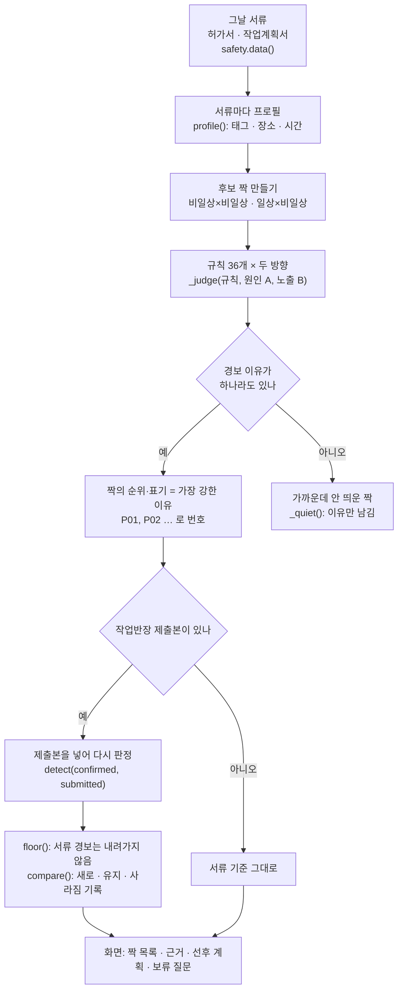
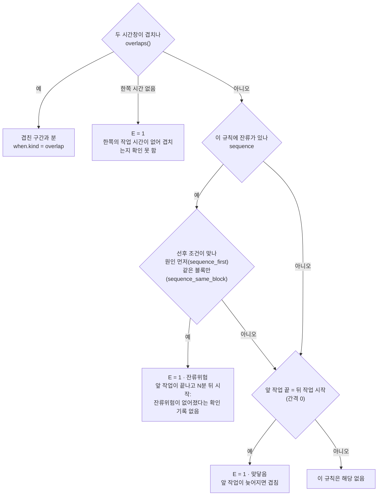
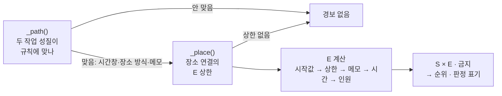
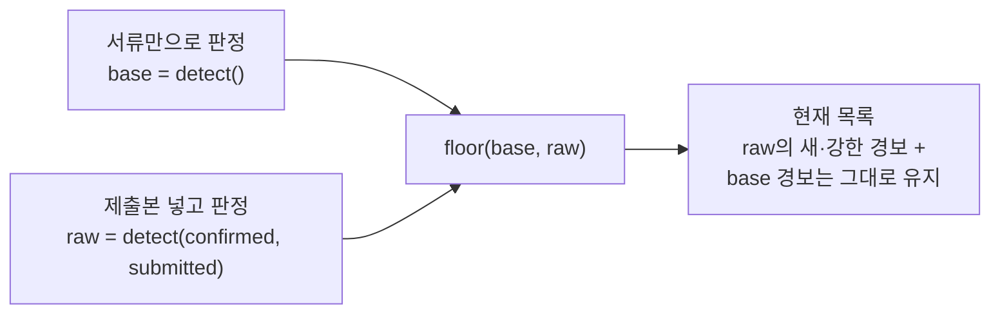

# 06. 쌍작업 판정 — 그날 서류에서 위험한 작업 짝 찾기

croScan은 그날 들어온 허가서와 작업계획서를 두 장씩 짝짓습니다. 함께 하면 위험한 짝(쌍작업)을 찾아 안전관리자에게 보여 줍니다.
판정은 규칙표 36개와 정해진 계산으로만 합니다. croScan은 작업을 승인하거나 막거나 일정을 바꾸지 않습니다.

**이 문서에서 알 수 있는 것**

- 서류 한 장이 어떤 「작업 성질(태그)」·장소·시간으로 읽히는지, 어떤 말은 일부러 읽지 않는지
- 두 작업의 위험을 강도 S × 노출 E로 매기고 1·2·3순위와 확인위험·보수위험·판정보류로 나누는 규칙
- 규칙 36개 전체 표, 앞 작업이 끝난 뒤 남는 위험(잔류위험)을 다루는 방법
- 작업반장 답이 서류로 낸 경보를 내리지 못하게 하는 안전 하한(`floor()`)과 그 시험
- 시연 자료 기준 결과, 고칠 곳, 한계

**목차**

1. [무엇을 하나](#1-무엇을-하나)
2. [왜 이렇게 하나](#2-왜-이렇게-하나)
3. [전체 흐름](#3-전체-흐름)
4. [서류 → 프로필: 작업 성질 읽기](#4-서류--프로필-작업-성질-읽기)
5. [장소: BAY·칼럼·블록](#5-장소-bay칼럼블록)
6. [시간: 겹침·선후·잔류](#6-시간-겹침선후잔류)
7. [판정: _path → _place → _judge](#7-판정-_path--_place--_judge)
8. [규칙 36개](#8-규칙-36개)
9. [잔류위험 자세히](#9-잔류위험-자세히)
10. [작업반장 제출본 반영과 안전 하한(floor)](#10-작업반장-제출본-반영과-안전-하한floor)
11. [하루 화면과 시연 자료 결과](#11-하루-화면과-시연-자료-결과)
12. [예시 세 가지](#12-예시-세-가지)
13. [코드 어디를 고치나](#13-코드-어디를-고치나)
14. [시험](#14-시험)
15. [한계](#15-한계)

판정보류 쌍을 각 작업반장에게 묻는 질문은 [06b_보류질문_holdq.md](06b_보류질문_holdq.md)에 따로 적었습니다.

---

## 1. 무엇을 하나

**입력.** 그날의 서류 두 종류입니다.

- 허가서: 비일상 작업(화기·밀폐·고소·중량물인양·정전(LOTO))의 작업허가서. LOTO는 에너지를 차단한 뒤 잠금·표지를 하는 절차입니다. 허가서에는 작업반장 답과 체크리스트까지 붙어 있습니다.
- 작업계획서: 일상 작업(마킹·검사·도장·운반 등)의 계획서. 협력사가 낸 것도 있습니다.

**짝.** 비일상×비일상, 일상×비일상만 봅니다. 일상×일상은 이번 범위 밖입니다.
한 서류는 자기 자신과 짝이 되지 않습니다.

**결과.** 짝마다 다음을 줍니다.

| 항목 | 뜻 |
|---|---|
| 순위 | 1순위 즉시 조정 · 2순위 조건부 병행 · 3순위 확인 필요 |
| 판정 표기 | 확인위험 · 보수위험 · 판정보류 (아래 용어 표) |
| 이유 | 어떤 규칙이, 어느 작업이 원인이고 어느 작업이 위험을 받는지, 언제·어디서 |
| 근거 | 어느 서류의 어느 칸에 무엇이 적혔는지 |
| 사슬 | 원인 → 노출 → 사고. 「일어난 일」이 아니라 「일어날 수 있는 일」로 씁니다 |
| 모르는 것 | 서류에 없어 확인해야 할 것(높이·시간·거리·인원 등) |

**하지 않는 것.** 승인·차단·일정 결정. 1순위의 행동 문구도 「두 작업반장이 일정 조정이나 한쪽 중지를 협의하도록 안내(croScan은 승인·일정 권한 없음)」입니다([`server/pair_rules.json`](../server/pair_rules.json)의 `priority`).
판단은 사람(작업반장·안전관리자)이 합니다.

**용어**

| 용어 | 뜻 |
|---|---|
| 쌍작업 | 같은 날 두 작업이 시간·장소·설비로 이어져 한쪽의 위험이 다른 쪽에 닿을 수 있는 짝 |
| 원인 작업(A) | 위험을 만드는 쪽(불티, 매단 하물, 정전 등) |
| 노출 작업(B) | 위험을 받는 쪽(도장 작업자, 아래 작업자, 그 크레인을 쓰는 반 등) |
| 강도 S | 사고가 나면 얼마나 큰가. 3 = 사망·중대재해 가능, 2 = 중상·건강장해. 규칙마다 고정 |
| 노출 E | 두 작업이 정말 이어지는지 서류로 얼마나 확실한가. 3 확인 · 2 가능 · 1 미확인 |
| 확인위험 | E 3. 같은 시간에 두 작업을 잇는 경로가 서류로 확인됨 |
| 보수위험 | E 2. 같은 칼럼 주소뿐이거나 사건이 하나 더 있어야 경로가 생김. 또는 장소가 서류로 이어진 잔류위험 |
| 판정보류 | E 1. 확인이 필요해 3순위로 남긴 경보. 시간·위치·높이·인원을 모르거나 잔류위험 해제 기록이 없음 |
| 잔류위험 | 앞 작업이 끝난 뒤에도 남는 위험(잔불, 용제 증기, 잔류 가스, 잔압, 안에 남은 사람, 회수 안 한 분리물 등) |
| BAY | 공장 안의 작업 구획. 시연 공장은 4BAY입니다 |
| 칼럼 | 공장 바닥을 나눈 번호. **주소일 뿐 거리가 아닙니다** |

## 2. 왜 이렇게 하나

**조사자의 판정 6단계를 그대로 따릅니다.** [`server/pairs.py`](../server/pairs.py) 첫머리 설명에 있습니다.

1. 서로 다른 두 작업 → 서류 한 장이 한 작업, 자기와는 짝 안 됨
2. 시간 겹침 또는 잔류위험 → 위험 단계의 시간창(인양 이동 시각, 크레인 단계 시각). 끝난 뒤에도 남는 위험은 누군가 「없어졌다」고 확인할 때까지 남습니다. 「몇 분 지나면 없어진다」는 시간은 두지 않습니다.
3. 두 작업을 잇는 길 → 규칙(불, 낙하, 하물 경로, 같은 크레인·전원, 가스 …)
4. 위험을 받는 사람·기능 → 규칙의 원인 쪽·노출 쪽을 각 서류에서 읽음
5. 원인 → 노출 → 사고 → 규칙의 사슬에 두 작업을 채워 「일어날 수 있는 일」로 씀
6. 모르는 것은 모르는 것으로 → 시간·장소가 없으면 노출 1(확인 필요). 인원이 안 적혀 있으면 노출은 그대로 두고 미확인 메모를 남깁니다(7.1). 「안전」으로 바꾸지 않습니다

**같은 BAY, 같은 칼럼 번호만으로는 경로가 확인된 것이 아닙니다.** 경로가 확인되는 것은 같은 블록, 적힌 이동 경로, 같은 설비 번호, 적힌 위·아래 관계뿐입니다. 칼럼 주소만 같으면 노출 2입니다.

**금지 조합(1순위).** 법과 멘토가 「동시에 하면 안 된다」고 한 조합이 서류로 확인(노출 3)되면 점수와 상관없이 1순위입니다. 도장×화기, 상하 동시 작업, 인양물 아래, 정비 중인 크레인 사용 등입니다. 멘토의 예시는 **완전한 금지표가 아닙니다**. 규칙표의 `_about`에도 그렇게 적혀 있습니다.

**11m는 화재감시자 반경입니다. 금지 반경이 아닙니다.** 산업안전보건기준에 관한 규칙 제241조의2는 화기 작업 반경 11m 안에 가연물이 있으면 화재감시자를 두라는 조항입니다. 코드에서 `FIRE_REACH_M = 11`은 거리 계산에 쓰지 않습니다. 장소가 같은 블록으로 확인되면 사슬 문구에 「화재감시자 반경 11m 기준」이라고 적습니다. 바로 옆 칼럼이면 「거리 미확인(화재감시자 11m 안일 수 있음·차폐 확인)」이라고 적고 판정보류로 남깁니다. 11m 밖이라서 빼는 일은 없습니다.

**칼럼 번호는 주소입니다. 거리가 아닙니다.** 시연 공장은 4BAY × 20칼럼으로 만든 배치입니다([`server/safety.py`](../server/safety.py)의 `BAYS, COLS = 4, 20`). 실제 공장의 칸 간격이 아닙니다. 그래서 「칼럼 7칸 = 84m라서 안전」 같은 계산을 하지 않습니다. 같은 BAY의 먼 칼럼도 화재·압력·방사선 규칙에서는 「거리 미확인」 판정보류로 남깁니다.

**모델을 쓰지 않습니다.** 순위·점수·판정은 규칙과 계산으로만 정합니다. AI가 읽은 답 가운데 작업반장이 확인한 것만 입력으로 들어갑니다(10장). 그 답도 서류로 낸 경보를 내리지 못합니다(`floor()`).

## 3. 전체 흐름



이 흐름의 입구는 [`server/app.py`](../server/app.py)의 `_detect()`입니다. `POST /api/safety/detect`가 이 함수를 부릅니다. 판정 본체는 `pairs.detect()`입니다.

## 4. 서류 → 프로필: 작업 성질 읽기

`profile(d)`가 서류 한 장을 다음으로 바꿉니다.

- `tags`: 작업 성질과 그 근거 `{태그: [(칸 이름, 적힌 값), …]}`
- `ids`: 크레인 번호(사용·잠금), 반 번호(사용·잠금), 블록 번호, 배관·계통 번호
- 높이(`low`, `high`), 위치 층(`level`), 장소(`spans`), 시간창(`wins`, `moves`, `lift_at`), 인원(`people`) 등

### 4.1 읽는 칸

| 서류 | 읽는 칸 |
|---|---|
| 허가서 | 허가서 종류, 체크 항목, 작업명, 작업 상세, 유해위험요소, 위치(답변 반영), 이동 경로(답변), 작업반장 답 전부 |
| 작업계획서 | 작업명, 작업장비, 사용물질, 1단계·2단계… 작업 단계, 작업높이, 대상ID |

칸마다 쓰임이 다릅니다. 예를 들어 「유해위험요소」 칸의 「용접」은 이 작업이 용접한다는 뜻이 아닙니다. 그래서 화기로 읽지 않습니다.

### 4.2 행위 단위로 자르기와 부정

먼저 한 칸을 짧은 구절로 자릅니다(`_tokens()`: `/ , ; ·` 와 「및」). 그다음 구절을 다시 행위 단위로 자릅니다(`_acts()`: 「후·뒤·다음·→·하고」, 「없이·않고·대신」).
확인이나 부정은 **그 행위에만** 붙습니다.

| 적힌 말 | 행위로 자른 결과 | 읽은 태그 |
|---|---|---|
| 가용접 후 치수 확인 | 가용접 / 치수 확인 | 화기(SPARK) |
| 절단 없이 볼트 해체 | 절단 없이 / 볼트 해체 | 절단·해체(SEP)만. 화기 아님 |
| 용접부 비파괴 검사 | (하나) | 없음 |
| 화기작업 여부 확인 | (하나) | 없음 |
| 용접 관찰 | (하나) | 없음 |
| 용접봉 불출 | (하나) | 없음 |
| 그라인더 미사용 | (하나) | 없음 |

위 결과는 지금 코드로 돌려 확인했습니다.

행위로 치지 않는 말은 세 묶음입니다.

- **확인·기록하는 말** `NOT_ACTION`: 확인, 여부, 점검, 검사, 탐상, 측정, 판독, 금지, 표지, 준비, 계획, 없음, 미사용, 제외, 보고, 기록, 관찰, 모니터링
- **부정** `NEGATED`: 미사용, 사용 안, 사용하지, 없음, 제외, 금지. `ACT_NO`: 없이, 않고, 말고, 대신, 않음, 안 함, 하지 않. `_says_no()`: 안 씀·안 써·안 함 등, 않, 없음, 없습니다
- **물건 이름** `WELD_TOOL`·`WELD_THING`: 「용접부」「용접기」는 물건입니다. 「용접부 그라인딩」은 그라인딩이라 화기입니다. 그 칸에 불출·지급·수령·보관·선정·재고·반납이 함께 적히면 「용접봉·용접재료·와이어·플럭스」도 물건으로 봅니다. 이때는 화기로 읽지 않습니다(조사자료 84쪽 17번: 용접재료 불출은 용접 수행이 아님). 「용접봉 운반」처럼 다른 말이면 예전처럼 읽습니다.

**부정 처리는 태그마다 다릅니다.** 세 부정 목록을 모든 태그에 똑같이 쓰지 않습니다.

- 화기·용제·절단 같은 대부분의 행위 태그는 `NOT_ACTION`·`NEGATED`·`ACT_NO`만 봅니다. `_says_no()`는 보지 않습니다.
- 그래서 지금 「그라인더 안 씀」은 화기(`SPARK`)로 읽힙니다. 「그라인더 미사용」은 화기가 아닙니다.
- 불활성가스는 구절 전체에 `NEGATED`가 있는지만 봅니다. 그래서 「아르곤 없이」는 불활성가스(`INERT`)로 읽힙니다.
- 태그 가운데에는 질소만 행위마다 세 부정 목록을 모두 봅니다. 「질소 없이」는 제외됩니다.
- `MEWP`(고소작업대)와 정전 허가서의 `POWER_LOTO`는 부정을 보지 않습니다(4.3 표).

이렇게 부정을 놓친 읽기는 15장 한계에 모아 두었습니다. 위 네 예는 지금 코드로 돌려 확인했습니다.

### 4.3 태그 표

| 태그 | 뜻 | 붙는 경우(근거 말) | 붙지 않는 경우 |
|---|---|---|---|
| `SPARK` | 화기 | 화기작업 허가서 · 체크 항목 「용접·용단·가우징」 · 작업 칸의 용접, 용단, 가우징, 절단, 그라인더·그라인딩, 사상, 연삭, 연마, 토치, 브레이징, 가열 교정, 선상 가열, 라인 히팅 · 계획서 작업장비의 용접기·그라인더·토치·절단기·가우징·플라즈마 · 확인된 답 HT1(가스·플라즈마·기계 절단), CF1(보수·용접), CF4 | 4.2의 확인·부정(`NEGATED`·`ACT_NO`)·물건 이름. 「안 씀」은 부정으로 보지 않습니다(15장) · 유해위험요소·위치·경로 칸 · 작업명이 점검·정비·정리·보관·수리·교체·판독이고 화기 행위가 없는 계획서의 장비 칸(「용접기 점검」) |
| `SOLVENT` | 유기용제 | 유기용제, 희석제, 시너·신나, thinner, 세정제, 솔벤트, 용제형, 인화성 · 작업명·상세의 도장, 세정, 탈지, 프라이머, 코팅, 터치업, 페인트, 도료, 에폭시, 래커 · 유해위험요소 칸도 입력입니다. 그 칸에 「유기용제」 같은 용제 말이 있으면 붙을 수 있습니다 | 같은 행위에 수성·불연·무용제·비인화 · 용제 이름이 어디에도 없으면 태그는 붙지만 근거 칸에 「작업명에서 추정: 사용물질에 용제 기재 없음」을 붙이고 종류를 묻습니다 |
| `CONFINED` | 밀폐 진입 | 밀폐공간 허가서 · 체크 「밀폐구역출입」 · 계획서 작업명의 이중저, 탱크 내부, 밀폐, 맨홀 진입, 코퍼댐, 보이드, 내부 진입 | |
| `LIFT` | 크레인 인양 | 중량물인양 허가서 · 사용하는 크레인 번호(OH-21-03 꼴) | 「미사용·사용 안·제외」와 같은 구절의 번호 · 계획서 작업명의 번호 |
| `CRANE_USE` / `CRANE_LOTO` | 크레인 사용 / 크레인 정전 | 크레인 번호. 정전(LOTO) 허가서면 잠금 쪽, 아니면 사용 쪽 | 유해위험요소 칸 |
| `POWER_USE` / `POWER_LOTO` | 전원 사용 / 전원 정전 | 반 번호(MCC·DB·PNL·LP·PP-숫자). 정전 허가서의 반 번호는 부정 표현이 있어도 `POWER_LOTO`로 읽습니다(「MCC-4 미사용」도, 15장). 그 밖의 서류는 같은 구절에 「전원」이 있고 `NEGATED`에 해당하지 않을 때 `POWER_USE` | 정전 허가서가 아닌 서류의 `NEGATED` 구절 |
| `SEP` | 절단·해체 | 작업 칸(작업명·상세·작업 단계)의 절단, 해체, 제거, 분리, 러그. 작업 단계의 「표면 이물 제거」도 붙습니다(15장) | 4.2의 확인·부정 |
| `DROP` | 높은 곳 절단·해체 | 작업명·상세가 절단·해체이고 ① 높이 2m 이상·상부·갑판·고소 허가·고소작업대, ② 높이가 안 적힘(「작업 높이 미확인」으로 E 2 이하), ③ 0m 초과 2m 미만(E 1~2) | 0m·「지상 작업」으로 적힌 작업 |
| `OVERHEAD` | 상부 설치·취급 | 높은 곳 작업(위 ①)이나 크레인 거더 정비, 또는 작업명에만 「상부·높은 곳」이 있는 작업에서 설치, 거치, 족장, 비계, 트레이, 의장, 덕트 · 공구, 볼트, 취부, 조립, 운반, 연마, 준비·세팅 · 화기 | 절단·해체와 함께 쓴 설치 말(그건 `DROP`) |
| `INERT` | 불활성가스 | 아르곤, TIG, 퍼지, 질소 치환, 불활성 가스, CO2 주입·치환·봉입·투입, 질소(행위마다) · 체크 「아르곤가스 사용」 · 확인된 답 H2, D3, CF2, D7 | 구절에 `NEGATED`가 있음(「아르곤 없이」는 붙습니다: 15장) · 질소는 행위마다 「없이」「안 씀」도 봄 · 압축공기·산소·에어 퍼지만 · 「N2」(조사자료의 작업 번호) |
| `FLAM_GAS` | 가연성 가스 취급 | LPG, 프로판, 부탄, 아세틸렌, 수소 가스, 가연성 가스, 오일 미스트를 교체·운반·연결·취급·충전·설치·분리·보관 등 하는 행위 | 산소 |
| `GAS_UNK` | 종류 모르는 가스 용기 | 가스 용기·실린더·봄베를 다루는데 가스 종류가 없음 → 판정보류 | 산소·아르곤·질소·탄산·CO2·헬륨·압축공기가 적힘 |
| `STAGE` | 적치·통로 점유 | 적치, 임시 보관·적재, 수거함, 하역, 자재 정리, 잔재 정리, 정차, 차광막, 방화포, 통제대, 펜스, 바리케이드 | |
| `STAGE_SOFT` | 반입·반출 물품 | 자재 반입·반출, 반입 대기, 공구함, 반납품. 통로에 놓인다는 말은 없으므로 E 1(확인) | |
| `VEHICLE` | 차량 운반 | 지게차, 운반차, 트럭, 카고, 화물차, 트레일러, 트랜스포터(T/P), SPMT, 셀프 프로펠, 스키드 로더, 이동식 크레인, 대차, 「차량으로 운반·이동…」, 장비 칸의 「차량」 | 수동 대차·손수레(→ `CART`) |
| `CART` | 수동 대차 | 수동 대차, 손수레, 수레, 핸드 카트, 운반 카트 | |
| `MEWP` | 고소작업대 | 체크 「고소작업대」 · 고소작업대, 고소작업차, 시저리프트, 붐리프트, 스카이, 곤돌라 | 유해위험요소 칸(부정은 보지 않음: 15장) |
| `PRESSURE` | 압력시험 | 압력시험, 가압, 수압, 기밀시험, 에어 테스트, 리크 테스트, 누설 시험 · 밀폐 양식 「압력사용」·시험압력 · 확인된 답 D7 | |
| `RADIATION` | 방사선투과검사 | 방사선, 선원, 이리듐, 감마선, RT | 판독·결과·기록·보고·계획·정리·여부·표지와 함께 쓴 말. 유해위험요소 칸에만 있으면 태그는 붙지만 금지로 보지 않고 「이 작업이 촬영하는지」를 묻습니다 |
| `COMBUST` | 가연물 | 포장재, 골판지, 종이, 박스, 목재, 합판, 비닐, 스티로폼, 우레탄, 천막, 기름 걸레, 폐기물, 보온재, 단열재, 방수포 | 미네랄울·글라스울·세라믹·불연과 함께 적힌 그 물건(「난연」은 탄다고 봅니다) |
| `ELEC_TOOL` | 전동공구 | 전동 공구·드릴, 임팩트 렌치, 전동 그라인더, 충전 공구, 발전기 | |
| `SUPPORT_ADJ` | 받침 조정 | 잭·유압 램·서포트·받침·트레슬의 조정·해체·교체·이동, 높이 조정, 잭 업 | |

태그 말고도 프로필에는 화기 공법(`hot_kind`: 아크·가스·연삭·소음), 연결선(`lines`: 덕트·호스·전선), 정전 때 멈추는 기능(`dep`, `dep_fn`: 환기·조명·연락), 크레인 거더 작업(`girder`), 시험운전(`test_run`, `test_drive`), 크레인이 잡은 채 취부(`held`), 반 개방(`panel_open`) 등이 들어갑니다.

### 4.4 높이와 위·아래

- 높이: 「4.5m」「지상 ~ 블록 상부 3.0m」 같은 글에서 낮은 값·높은 값을 읽습니다(`_heights()`). 계획서의 「지상 작업」은 알려진 0m입니다.
- 층(`level`): 위치에 내부·이중저·탱크·배관이 있으면 `inside`(외판 제외), 높이 2m 이상이거나 위치에 상부·갑판이 있으면 `top`, 나머지는 `ground`.
- `level_known`: 높이를 아무도 안 적어서 `ground`가 된 것은 사실이 아니라 기본값입니다. 이때 「블록 안·위인지 서류에 없음」 같은 메모가 붙고 E가 낮아집니다. 고소 허가서는 높이가 있어도 `level_known`이 아닙니다.

### 4.5 블록 번호

블록 번호는 작업명·위치에서 `E41P`, `B11`, `E170(A)`, 「B-01 블록」 꼴로 읽습니다(`BLOCK_ID`). 계획서 「대상ID」 칸에서는 「B-01」 단독도 읽습니다. 크레인(OH-21-03), 반(MCC-4), 배관(P-12), 강재 등급(AH36), 「12칼럼」의 숫자는 블록이 아닙니다.

## 5. 장소: BAY·칼럼·블록

### 5.1 BAY와 칼럼

[`server/safety.py`](../server/safety.py)의 `spans()`가 「3BAY 08-10 칼럼」을 `{bay: 3, c0: 8, c1: 10}`으로 읽습니다.

- 공장 밖 번호(5BAY, 28칼럼)는 공장 안으로 옮기지 않습니다. 위치 미상으로 둡니다.
- 「14-12 칼럼」처럼 큰 번호부터 적히면 12~14로 넓게 읽고 `rev` 표시를 남깁니다. 판정 이유에 「칼럼 범위가 큰 번호부터 적힘 … 오기인지 확인」이 붙습니다.
- BAY만 있고 칼럼이 없으면 그 BAY 어딘가(`c0: None`)입니다.
- BAY·칼럼이 없고 위치가 사무동·사무실·검사실·회의실·공장 밖이면 `where = off`입니다. `off`는 칼럼 주소로 따지는 일반 장소 판정에서 빠집니다. 다만 서류에 적힌 연결을 먼저 보는 분기에서는 경보가 생길 수 있습니다. 같은 설비, 같은 배관 계통, 차단 범위, 인양 블록이 받치는 블록 같은 연결입니다(예: 사무실에 적힌 크레인 정비와 같은 크레인 사용). BAY·칼럼도 없고 이런 말도 없으면 위치 미상(`unknown`)입니다.

**경로.** 「03→08칼럼」「03칼럼에서 08칼럼까지」「04→12→09→04축」은 끝점 두 개가 아니라 **그 사이 전체**로 읽습니다(`_route_spans()`). 하물이 그 위를 모두 지나기 때문입니다.

### 5.2 두 작업의 장소 관계 `place_rel()`

| 관계 | 뜻 |
|---|---|
| `same` | 같은 BAY에서 칼럼 범위가 겹침 |
| `near` | 바로 옆 칼럼(1칸 차이) |
| `far` | 같은 BAY, 2칸 이상 차이 |
| `unknown` | 한쪽에 칼럼이나 위치가 없음 |
| `none` | 다른 BAY |
| `off` | 한쪽이 공장 밖 |

**적힌 연결이 주소보다 앞섭니다.** 두 서류에 같은 블록 번호가 있으면 칼럼 주소가 달라도 `same`으로 봅니다(`_place()`의 `forced`).

### 5.3 규칙별 장소 판정 `_place()`

필요한 장소 증거(`mode`)는 규칙마다 다릅니다. `_place()`는 E의 상한(3·2·1)과 그 이유 문장을 돌려줍니다. 상한이 없으면(None) 이 규칙의 경보는 없습니다.

| 장소 방식 | 쓰는 규칙 | E 3 | E 2 | E 1 (판정보류) | 경보 없음 |
|---|---|---|---|---|---|
| `reach` 닿는 범위 | FIRE, FIRE_GAS, FIRE_SOLID, PRESSURE, RADIATION | 같은 블록 · (압력시험) 같은 배관 번호면 BAY가 달라도 | 같은 칼럼 주소 | 바로 옆 칼럼, 같은 BAY 먼 칼럼(「거리 미확인」), 옆 BAY 같은 칼럼대(화기 계열), 옆 BAY(방사선), 위치 미상 | 그 밖의 다른 BAY |
| `hot` 화기 발생물 | HOT_PERSON, HOT_PANEL, FIRE_SPREAD, GRIND_FLY | 같은 블록 | 같은 칼럼 주소 | 바로 옆 칼럼(「화재감시자 11m 안일 수 있음」), 위치 미상 | 2칸 이상 |
| `same_only` | EGRESS_BLOCK, NOISE_SIGNAL, EQUIP_IGNITION | 같은 블록 | 같은 칼럼 주소 | 위치 미상 | 옆 칼럼부터 |
| `block` / `paint` | CONF_HOT / CONF_PAINT | 같은 블록(도장은 둘 다 내부일 때) | 같은 칼럼 다른 블록 · 같은 블록인데 도장 구역과 진입 공간이 이어지는지 미확인 | 옆 칼럼·먼 칼럼의 다른 블록 | 다른 BAY |
| `below` 아래 | DROP_BELOW, OVERHEAD_WORK | 작업반장이 「아래 작업」이라고 답함 · 같은 블록이고 상대가 아래쪽 | 같은 칼럼 주소이고 아래쪽 · 위아래를 확정 못 함 | 바로 옆 칼럼, 위치 미상 | 상대가 분명히 위 |
| `path` 경로 | LOAD_OVER, ACCESS | 같은 블록 · 적힌 이동 경로가 그 칼럼 위를 지남(평면 경로) | 같은 칼럼 주소 | (인양) 경로 바로 옆 칼럼, 위치 미상 | 그 밖 |
| `covered` 운반 구간 | VEHICLE, CART, CABLE_RUN, MEWP_OVER | 같은 블록 | 같은 칼럼 주소 | 위치 미상 | 그 밖 |
| `same_block` / `landed` | TARGET_OCCUPIED, SUPPORT, WELD_RETURN, LIFT_LINE, HELD_FIT | 같은 블록 | | 위치 미상 | 블록이 다름 |
| `held_by` | SUPPORT(인양 블록이 받치는 블록) | 인양 허가서가 받친다고 적은 블록 | | | |
| `link` / `shared` | CRANE_LOTO, POWER_LOTO, CRANE_SHARE / SHARED_LOTO | 같은 설비 번호 | | | |
| `system` | CONF_GAS(상대가 밀폐 진입이거나 내부 작업) | 같은 배관·계통 번호 | 같은 블록, 둘 다 내부(같은 공기 구획일 수 있음) | 같은 블록인데 계통 미기재(상대가 밀폐) · 같은 칼럼·옆 칼럼·칼럼 없는 같은 BAY | 그 밖 |
| `system_any` | CONF_GAS(같은 블록인데 상대가 블록 안·위인지 서류에 없음) | | 같은 블록(「블록 안·위인지 서류에 없음」 메모로 E 2 이하) | | 한쪽이 공장 밖 |
| `dep` 정전 영향 | VENT_LOTO | 차단 범위에 환기·조명이 물렸다고 서류·답에 적힘 | | 같은 BAY, BAY 미상 | 다른 BAY |
| `crane_bay` | CRANE_TEST | 상대 서류에 같은 크레인 번호 | 같은 BAY(주행 구간 미확인) | BAY 미상 | 다른 BAY |
| `bay` / `bay2` | CRANE_CROSS / OTHER_CRANE_REPAIR | | 같은 BAY | 위치 미상 | 다른 BAY |

**새 규칙의 같은 블록.** 2026-10-31에 더한 새 규칙(`new_rule`)은 「같은 블록」만으로는 E 3이 되지 않고 2로 내려갑니다. 이유 문장에 「(같은 블록만으로는 전달 경로 미확인)」이 붙습니다(`_judge()` 첫 부분).

**규칙 자신의 미확인 메모.** `_path()`가 「이 짝에서 모르는 것」을 E 상한과 함께 돌려줍니다. 예: 「작업 높이 미확인(서류에 높이 없음)」 E≤2, 「가스 용기의 가스 종류(가연성인지) 서류에 없음」 E≤1, 「반을 열어 두는지 서류에 없음」 E≤1, 「정전 반장 답: 환기·조명 영향 없음(현장 확인 전)」 E≤1. 반장이 「영향 없다」고 답해도 경보를 빼지 않고 확인 질문으로 남깁니다.

## 6. 시간: 겹침·선후·잔류

### 6.1 시간창

- 허가서: 그날 날짜의 「HH:MM~HH:MM」. 전날 시간창이 자정을 넘으면 넘어간 부분이 그날 00:00부터 들어옵니다(`safety._day_wins()`).
- 계획서: 시작·끝 날짜와 시각. 이틀 넘는 작업은 23:59에서 자르지 않습니다(`days`).
- 끝이 시작보다 이르면(23:00~01:00) 다음 날 끝으로 넓게 읽습니다. 반장이 「다음 날·익일·야간」이라고 말하지 않았으면 `assumed_next_day` 표시를 남깁니다. 그러면 판정 이유에 「시간 역전 … 익일인지 오기인지 확인」이 붙습니다.

### 6.2 위험 단계의 시간

작업 전체 시간보다 좁은 「위험한 단계」가 적혀 있으면 그것을 씁니다.

| 값 | 어디서 | 쓰는 곳 |
|---|---|---|
| `move` | 인양 허가서 답 T6 「블록은 15:40~16:10에만 이동」 | 인양 경로(LOAD_OVER), 블록 인양(TARGET_OCCUPIED) 등 |
| `stage` | 제출본에서 반장이 확인한 이동 구간(T1·T6) | 인양 허가서의 `move`를 대신함 |
| `lift_at` | 계획서 단계의 「OH-21-03로 의장품 인양 (10:30)」 | 끝 시각이 없으므로 그 작업창 끝까지. 근거에 「끝 시각 없음」, 결과에 `estimated` |

`_pick()`은 `moves` → `lift_at` → 작업 전체 창 순서로 고릅니다. 이동 예정 시각이 허가 시간 밖이면(`move_off`) 「일정 불일치 확인」 메모를 붙이고 E를 2 이하로 둡니다.

### 6.3 겹침과 선후



- 겹침: 여러 창이 있어도 겹친 조각을 합쳐 같은 분을 두 번 세지 않습니다(`overlaps()`).
- 잔류: 앞 작업이 끝난 뒤 **그날 뒤에 오는 모든 작업**에 남습니다. 몇 시간 뒤라서 사라진다고 보지 않습니다. 자세한 조건은 9장.
- 맞닿음(`TOUCH`): 잔류 규칙이 없어도, 앞 작업이 끝나는 시각에 뒤 작업이 바로 시작하면 어느 쪽이 먼저든 묻습니다.
- 바로 옆 칼럼이나 멀리 떨어진 다른 블록을 잡는 까닭은 「지금 움직이거나 날아가는 것」 때문입니다. 그래서 선후(잔류)일 때는 이 짝을 띄우지 않습니다(`below`, `path`, `hot`, `block`, `paint` 방식).

## 7. 판정: _path → _place → _judge

`detect()`는 후보 짝마다 규칙 36개를 두 방향(X가 원인, Y가 원인)으로 모두 돌립니다. 한 규칙의 판정은 `_judge(rule, A, B)`가 합니다.



### 7.1 노출 E 계산

1. 시작값: 규칙의 `trigger`가 `direct`(두 작업이 함께 있으면 바로 경로가 생김)면 3, `conditional`(재통전·같은 시각 배차처럼 사건이 하나 더 있어야 함)이면 2. 시작값이 2이면 「경로가 생기려면 사건이 하나 더 있어야 함」이 붙습니다.
2. 장소 상한(5.3)과 규칙 메모의 상한 중 가장 작은 값.
3. 시간: 선후·시간 미상이면 1.
4. 인원: 서류상 인원 0이면 1(「서류상 인원 0: 실제 퇴실 확인 아님」). 설비 규칙(CRANE_LOTO, POWER_LOTO, CRANE_SHARE, CRANE_CROSS, SHARED_LOTO)에는 이 단계를 쓰지 않습니다. 인원 칸이 비어 있으면 E를 낮추지 않고 「위험을 받는 작업의 인원 수가 적혀 있지 않음」 메모만 남깁니다. 이 메모는 보류 질문의 `EXPLICIT` 목록에 없습니다. 그래서 그 이유가 E 1일 때만 인원 질문이 생깁니다([06b §4](06b_보류질문_holdq.md#4-어떤-이유를-묻나)).
5. 이동 예정 시각이 허가 시간 밖이면 2 이하.

### 7.2 순위

```
금지 조합이고 E = 3          → 1순위 (즉시 조정)
S × E ≥ 6                    → 2순위 (조건부 병행)
S × E ≥ 3 또는 정보가 빠짐    → 3순위 (확인 필요)
그 밖                        → 띄우지 않음
```

| | E 3 | E 2 | E 1 |
|---|---|---|---|
| **S 3** | 9 → 2순위 (금지면 1순위) | 6 → 2순위 | 3 → 3순위 |
| **S 2** | 6 → 2순위 | 4 → 3순위 | 2 → 3순위(정보 빠짐) |

「정보가 빠짐」(`info_gap`)은 E가 1이고, 그 이유가 시간 미상·선후·장소 상한 1·인원 0·메모 상한 1 가운데 하나인 경우입니다. 그래서 E 1 경보는 점수가 낮아도 3순위로 남습니다.

### 7.3 금지 조합

규칙표의 `forbidden`이 참인 규칙은 10개입니다(8장 표의 「금지」). E 3일 때만 1순위입니다. E가 2 이하이면 같은 규칙이라도 2·3순위입니다.

**상하 동시 작업.** `OVERHEAD_WORK`(상부 설치·취급 × 아래 작업)는 규칙표에서 금지가 아닙니다. 그러나 다음이 모두 맞으면 금지 조합(1순위)이 됩니다(`upper_lower`).

- 상부 작업의 작업반장이 「아래에서 하는 작업」을 답했고, 그 답에 상대 업체 이름이나 허가번호가 있음
- 그 답에 상대 작업과 겹치는 시각이 있음(`_said_window_meets()`)
- 상대가 분명히 더 높은 곳이 아님

이 조건은 멘토 손글씨 「상·하 병행 절대 불가」를 따릅니다. 같은 블록이라는 사실만으로는 바로 아래인지 알 수 없습니다. 그래서 2순위에 그칩니다.

**방사선이 유해위험요소 칸에만 있으면** 금지로 보지 않습니다. 대신 「이 작업이 촬영하는지 확인」을 묻습니다.

### 7.4 판정 표기

| 표기 | 조건 |
|---|---|
| 확인위험 | E 3 |
| 보수위험 | E 2, 또는 장소가 서류로 이어진(상한 3) 잔류위험이고 인원 0·상한 1 메모·맞닿음이 아님 |
| 판정보류 | 그 밖(E 1) |

보수위험으로 표기한 잔류위험도 점수·순위는 E 1 그대로(3순위)입니다. 이 표기는 두 작업의 관계는 알고 해제 여부만 모를 때 씁니다(조사자료 p24·p377).

### 7.5 한 짝의 정리

- 한 짝에 이유(규칙×방향)가 여러 개 붙을 수 있습니다. 이유는 순위 → 점수 → 겹친 분 순으로 정렬합니다. 맨 앞 이유가 그 짝의 순위·표기·제목이 됩니다.
- 짝 목록은 순위 → 점수 → 겹친 분 → 인원 순으로 정렬하고 P01, P02 … 번호를 붙입니다.
- 경보는 없지만 가까운 짝은 `near` 목록에 이유만 남깁니다(`_quiet()`). 예: 「같은 전원 번호는 아님(MCC-4 정전 · MCC-5 사용) — 상위·하위 전원인지는 서류에 없어 미확인」. 경보가 아니라 설명입니다.
- 근거(`_evidence()`)에는 두 작업의 태그 근거 칸, 시간, 위치가 들어갑니다. 반장이 확인한 답은 언제나 보입니다.
- 법 조문은 현행본과 대조한 규칙(`law_checked`, 16개)만 보여 줍니다. 나머지는 「관련 조문은 국가법령정보센터 현행본 대조 전이라 표시하지 않음」을 답니다.

## 8. 규칙 36개

[`server/pair_rules.json`](../server/pair_rules.json)에서 그대로 뽑았습니다. 「경로」의 바로 = `direct`, 조건 = `conditional`. 「장소 판정」은 5.3의 방식입니다(코드 `_path()`의 반환값). 「잔류」는 9장.

| # | id | 이름 | 원인 작업 → 위험을 받는 작업 | S | 경로 | 금지 | 장소 판정 | 잔류(앞 작업 뒤 남는 것) |
|---|---|---|---|---|---|---|---|---|
| 1 | `FIRE` | 화기 불티 × 가연성 증기 | 화기(용접·용단·가우징·그라인딩) → 유기용제를 쓰는 도장·세정 작업 | 3 | 바로 | 금지 | `reach` | 어느 쪽이 먼저든: 원인 먼저 → 잔불(확인 기록 전까지) / 노출 쪽 먼저 → 용제 증기·젖은 도막(건조·환기 확인 기록 전까지) |
| 2 | `CONF_HOT` | 밀폐 진입 × 같은 블록 화기 | 같은 블록의 화기 작업 → 밀폐공간 안에 들어간 인원 | 3 | 바로 | 금지 | `block` | 어느 쪽이 먼저든: 원인 먼저 → 잔불·흄(확인 기록 전까지) / 노출 쪽 먼저 → 내부 잔류 인원(퇴실 확인 기록 전까지) |
| 3 | `CONF_GAS` | 불활성가스 공급 × 밀폐 진입 | 아르곤·질소·TIG·퍼지 가스를 쓰는 작업 → 같은 블록 내부에 들어간 인원 | 3 | 바로 | 금지 | `system`·`system_any` | 어느 쪽이 먼저든: 원인 먼저 → 잔류 가스(공급을 끊어도 남음: 진입 전 호흡 위치에서 산소·가스 측정으로 확인) / 노출 쪽 먼저 → 내부 잔류 인원(퇴실 확인 기록 전까지) |
| 4 | `LOAD_OVER` | 인양 경로 × 아래 작업자 | 크레인으로 매단 블록·부재 이동 → 경로 아래·옆의 작업자 | 3 | 바로 | 금지 | `path` | 없음(동시일 때만) |
| 5 | `TARGET_OCCUPIED` | 블록 인양·반출 × 그 블록 안·위 작업 | 블록을 들어 옮기는 작업 → 그 블록 내부·위에서 일하는 인원 | 3 | 바로 | 금지 | `same_block`·`landed` | 어느 쪽이 먼저든: 원인 먼저 → 안착 블록의 받침·고정과 장구 해제(확인 기록 전까지) / 노출 쪽 먼저 → 잔류 인원(퇴실 확인 기록 전까지) |
| 6 | `CRANE_LOTO` | 크레인 정비(정전) × 같은 크레인 사용 | 크레인 제어반·전기계통 정전 수리 → 같은 크레인을 쓰기로 계획한 작업 | 3 | 바로 | 금지 | `link` | 원인 먼저일 때만: 복구·시험운전·잠금 해제·인계(확인 기록 전까지) |
| 7 | `POWER_LOTO` | 공유 전원 정전 × 그 전원 사용 | 배전반·분기 정전 작업 → 같은 분기에서 전원을 받는 작업 | 3 | 조건 | | `link` | 원인 먼저일 때만: 복구·시험운전·잠금 해제·인계(확인 기록 전까지) |
| 8 | `DROP_BELOW` | 높은 곳 절단·해체 × 아래 작업 | 높은 곳에서 절단·해체·러그 제거 → 그 아래에서 일하는 인원 | 3 | 바로 | 금지 | `below` | 원인 먼저일 때만: 미회수 분리물·잔존물(회수·고정 확인 기록 전까지) |
| 9 | `PRESSURE` | 압력시험 × 주변 작업 | 배관·탱크 압력·기밀시험 → 시험 구역 안·옆의 인원 | 3 | 바로 | 금지 | `reach` | 어느 쪽이 먼저든: 원인 먼저 → 잔압(감압 뒤에도 남는지 확인 기록) / 노출 쪽 먼저 → 시험 구역 잔류 인원(퇴실 확인 기록 전까지) |
| 10 | `RADIATION` | 방사선투과검사 × 통제구역 안 인원 | 방사선투과검사(선원 노출) → 통제구역 안·옆에서 일하는 인원 | 3 | 바로 | 금지 | `reach` | 원인 먼저일 때만: 선원 회수·측량(통제 해제 확인 기록 전까지) |
| 11 | `VEHICLE` | 차량 운반 경로 × 보행·고소작업대 | 지게차·차량 운반 → 운반 경로 안의 보행 작업자·고소작업대 | 3 | 바로 | | `covered` | 없음(동시일 때만) |
| 12 | `CRANE_SHARE` | 같은 크레인 같은 시각 사용 | 크레인 인양 → 같은 크레인을 같은 시간에 쓰는 작업 | 2 | 조건 | | `link` | 없음(동시일 때만) |
| 13 | `CRANE_CROSS` | 같은 BAY 다른 크레인 동시 인양 | 크레인 인양 → 같은 BAY에서 다른 크레인으로 인양하는 작업 | 3 | 조건 | | `bay` | 없음(동시일 때만) |
| 14 | `SUPPORT` | 절단·해체 × 같은 블록 위 작업(공통지지) | 같은 블록의 부재 절단·해체 → 그 블록 위·안·주변(받침 해체 시)에서 일하는 인원 | 3 | 조건 | | `same_block`·`held_by` | 원인 먼저일 때만: 지지 상실(임시 지지·하중 이전 확인 기록 전까지) |
| 15 | `ACCESS` | 하물·차량·낙하물·적치물 × 밀폐 출입·구조 경로 | 인양·운반·해체·적치 작업 → 밀폐공간 진입 인원(출입구·구조 경로) | 3 | 조건 | | `path` | 원인 먼저일 때만: 출입구·구조 경로의 적치물·잔해(정리·출입구 확보 확인 기록 전까지) |
| 16 | `HOT_PERSON` | 화기 발생물 × 같은 곳 작업자 | 화기(용접·절단·가우징·그라인딩) → 같은 블록·칼럼에서 일하는 인원 | 2 | 바로 | | `hot` | 원인 먼저일 때만 · 같은 블록만: 같은 블록의 잔열·불씨·흄(냉각·불씨·환기 확인 기록 전까지) |
| 17 | `VENT_LOTO` | 정전 × 그 전원에 기대는 작업(밀폐 환기·국소배기·조명·연락) (새 규칙) | 배전반·분기 정전(LOTO) → 환기·송기·조명·연락에 기대는 밀폐공간 진입 인원 | 3 | 바로 | | `dep` | 원인 먼저일 때만: 환기·조명 복구(재가동 확인 기록 전까지) |
| 18 | `CRANE_TEST` | 크레인 정비 복구·시험운전 × 같은 BAY 거더·상부 작업 (새 규칙) | 크레인 정비(LOTO)의 복구·시험운전 → 같은 BAY 거더·레일·상부·고소작업대 인원 | 3 | 조건 | | `crane_bay` | 원인 먼저일 때만: 복구 뒤 시험운전·주행(정비 허가 시간 뒤에도 할 수 있음, 실제 시험 시각 확인 기록 전까지) |
| 19 | `SHARED_LOTO` | 같은 크레인·전원을 잠근 두 정비 작업 (새 규칙) | 같은 설비를 잠근 정비 → 같은 설비를 함께 잠근 다른 정비 팀 | 3 | 조건 | | `shared` | 어느 쪽이 먼저든: 앞 팀의 복구·잠금 해제 인계(두 팀 확인 기록 전까지) |
| 20 | `OTHER_CRANE_REPAIR` | 다른 크레인 운행 × 크레인 수리자 (새 규칙) | 같은 BAY에서 다른 크레인으로 인양 → 같은 BAY 크레인을 잠그고 수리하는 인원 | 3 | 조건 | | `bay2` | 없음(동시일 때만) |
| 21 | `HOT_PANEL` | 화기 불티·이물 × 열린 제어반·배전반 (새 규칙) | 화기(용접·절단·가우징·그라인딩) → 반을 열고 정비하는 정전 작업 | 3 | 조건 | | `hot` | 원인 먼저일 때만: 반 내부 불티·이물(복구 전 반 내부 확인 기록 전까지) |
| 22 | `FIRE_SOLID` | 화기 불티 × 가연물 적치·취급 (새 규칙) | 화기(용접·용단·가우징·그라인딩) → 포장재·목재·비닐·단열재 등 가연물을 쌓거나 다루는 작업 | 2 | 바로 | | `reach` | 어느 쪽이 먼저든: 원인 먼저 → 잔불·불씨(가연물 쪽 확인 기록 전까지) / 노출 쪽 먼저 → 남은 가연물(치웠다는 확인 기록 전까지) |
| 23 | `FIRE_GAS` | 화기 불티 × 가연성 가스 취급 (새 규칙) | 화기(용접·용단·가우징·그라인딩) → LPG·아세틸렌·프로판 용기·호스를 바꾸거나 옮기거나 잇는 작업, 오일 미스트가 나는 작업(가스 종류를 모르는 용기 취급은 확인 필요) | 3 | 조건 | | `reach` | 어느 쪽이 먼저든: 원인 먼저 → 잔불·불씨(확인 기록 전까지) / 노출 쪽 먼저 → 새어 나온 가연성 가스(누출 점검·환기 확인 기록 전까지) |
| 24 | `EGRESS_BLOCK` | 적치·대차·차광막 × 대피·소방 접근 경로 (새 규칙) | 자재·포장재 적치, 대차 정차, 차광막·통제대 배치 → 같은 곳에서 대피·소방 접근이 필요한 작업(화기·높은 곳·내부) | 2 | 조건 | | `same_only` | 원인 먼저일 때만: 통로·출구·소화기 앞 적치물(정리 확인 기록 전까지) |
| 25 | `OVERHEAD_WORK` | 상부 설치·취급 × 아래 작업 (새 규칙) | 높은 곳에서 족장·의장품·케이블 트레이 등을 설치·거치 → 그 아래에서 일하는 인원 | 3 | 조건 | (반장 답이 있으면 금지, 7.3) | `below` | 원인 먼저일 때만: 상부 미고정물·잔존물(고정·회수 확인 기록 전까지) |
| 26 | `CART` | 수동 대차·수레 경로 × 보행·고소작업대 (새 규칙) | 수동 대차·수레 운반 → 같은 칼럼의 보행 작업자·고소작업대 | 2 | 조건 | | `covered` | 없음(동시일 때만) |
| 27 | `CABLE_RUN` | 차량·대차 경로 × 용접 케이블 (새 규칙) | 차량·대차 운반 → 같은 칼럼에서 용접 케이블을 깔고 일하는 화기 작업 | 3 | 조건 | | `covered` | 없음(동시일 때만) |
| 28 | `NOISE_SIGNAL` | 연삭·가우징 소음 × 인양 신호 (새 규칙) | 그라인딩·가우징·절단 소음 → 같은 곳에서 신호로 인양하는 작업 | 2 | 조건 | | `same_only` | 없음(동시일 때만) |
| 29 | `WELD_RETURN` | 아크 용접 귀환전류 × 같은 블록 내부 작업 (새 규칙) | 아크 용접·가우징(귀환선) → 같은 블록 내부·밀폐 공간의 작업자 | 2 | 조건 | | `same_block` | 없음(동시일 때만) |
| 30 | `LIFT_LINE` | 블록 인양 × 그 블록에 연결된 다른 작업의 덕트·호스·케이블 (새 규칙) | 블록을 들어 옮기는 작업 → 그 블록에 송기 덕트·호스·케이블을 연결한 작업 | 3 | 조건 | | `same_block` | 없음(동시일 때만) |
| 31 | `GRIND_FLY` | 연삭·절단 파편 × 같은 곳 작업자 (새 규칙) | 그라인더·연삭·기계 절단(회전 공구) → 같은 블록·칼럼에서 일하는 인원 | 2 | 바로 | | `hot` | 없음(동시일 때만) |
| 32 | `CONF_PAINT` | 도장·유기용제 × 밀폐 진입 (새 규칙) | 유기용제 도장·세정 → 같은 블록·구획 밀폐 진입 인원 | 3 | 바로 | 금지 | `paint` | 어느 쪽이 먼저든: 원인 먼저 → 용제 증기(진입 전 환기·측정 확인 기록 전까지) / 노출 쪽 먼저 → 내부 잔류 인원(퇴실 확인 기록 전까지) |
| 33 | `MEWP_OVER` | 고소작업대 전도·붐 회전 × 아래·옆 작업 (새 규칙) | 고소작업대(붐·시저) 작업 → 같은 칼럼 아래·옆 지상 작업자 | 3 | 조건 | | `covered` | 없음(동시일 때만) |
| 34 | `FIRE_SPREAD` | 가연물 옆 화기 × 같은 블록·옆 칼럼 작업 (새 규칙) | 보온재·가연물이 있는 곳의 화기 → 같은 블록·격벽 너머·옆 칼럼 작업자 | 3 | 조건 | | `hot` | 원인 먼저일 때만: 숨은 불씨(보온재·가연물 쪽 확인 기록 전까지) |
| 35 | `HELD_FIT` | 크레인으로 잡은 부재 × 그 부재 취부·용접 (새 규칙) | 크레인으로 부재를 잡고 있는 인양 → 같은 블록에서 그 부재를 취부·용접하는 작업 | 3 | 조건 | | `same_block` | 없음(동시일 때만) |
| 36 | `EQUIP_IGNITION` | 고소작업대·전동공구 × 도장 구역(점화원) (새 규칙) | 고소작업대·전동공구 등 전기기기 사용 → 같은 곳의 유기용제 도장·세정 | 3 | 조건 | | `same_only` | 없음(동시일 때만) |

**합계**: 36개. 금지 10 · 바로 경로 15 · 잔류 규칙 22 · 새 규칙 20 · 조문 대조 완료 16.

「없음(동시일 때만)」은 잔류 규칙이 없다는 뜻입니다. 이런 규칙도 앞 작업의 끝과 뒤 작업의 시작이 같으면(맞닿음, 6.3) E 1로 확인합니다. 「원인 먼저일 때만」인 규칙도 같습니다. 노출 작업이 먼저 끝나고 원인 작업이 바로 이어서 시작하면 맞닿음으로 E 1이 붙을 수 있습니다(12.2의 크레인 사용 직후 정비).

규칙마다 JSON에는 이 밖에도 `chain`(사슬 문장 틀), `measures`(조치), `post`(원인 쪽·노출 쪽·착수·중지 문구, 별지에 씀), `ask`(확인할 것), `cases`(참고 사례. 이 작업의 사고가 아님)가 있습니다. 문장 틀의 `{a}`, `{b}`, `{crane}`, `{reach}` 등은 `_fill()`이 이 짝의 값으로 채웁니다.

규칙이 붙는 조건(`_path()`) 가운데 표만으로는 안 보이는 것:

- `LOAD_OVER`: 그 크레인이 상대가 잠근 크레인이면 `CRANE_LOTO`로 넘깁니다.
- `VEHICLE`·`CART`: 상대가 지상 작업이거나 고소작업대일 때만.
- `HOT_PERSON`: 상대가 유기용제(→ FIRE)나 밀폐(→ CONF_HOT)가 아닐 때만.
- `CRANE_TEST`: 기본으로 상대가 거더·고소작업대·고소 허가·상부 작업일 때 봅니다. 정비 서류에 시험운전이 안 적혀 있으면 「시험운전·주행 계획이 서류에 없음(복구 뒤 시험이 보통 따름)」으로 E 1. 정비 서류에 시험운전·시험주행 등이 부정 없이 적혀 있으면 지상 작업도 E 1로 남깁니다. 이때 주행 구간·훅 아래인지 묻습니다(「시험 주행 구간·훅 아래 지상 작업인지 미확인」).
- `VENT_LOTO`: 상대가 밀폐가 아니어도 국소배기를 쓰는 화기나 조명에 기대는 상부 작업이면 E 1로 묻습니다. 그 기능이 다른 반에 물렸다고 적혀 있으면 묻지 않습니다.
- `SUPPORT`: 인양 허가서가 「받침·지그·서포트」로 다른 블록을 받친다고 적을 수 있습니다. 그러면 그 블록의 작업과 `held_by`로 잇고, 상한은 E 3입니다(메모로 E 2).

## 9. 잔류위험 자세히

앞 작업이 끝난 뒤 남는 위험입니다. 시간만 나눴다고 없어지지 않습니다(조사자료 p24 residual).

| 규칙 설정 | 뜻 |
|---|---|
| `sequence: true` | 이 규칙은 앞 작업이 끝난 뒤에도 봅니다 |
| `sequence_first: "cause"` | 원인 작업이 먼저 끝나고 노출 작업이 뒤에 올 때만(정비 뒤 사용, 절단 뒤 하부 작업) |
| `sequence_same_block: true` | 같은 블록일 때만(HOT_PERSON의 잔열·불씨) |
| `residual` / `residual_by_first` | 남는 것의 이름. 어느 쪽이 먼저냐에 따라 다릅니다(화기가 먼저면 잔불, 도장이 먼저면 용제 증기·젖은 도막) |

코드(`_judge()`의 선후 부분)가 더하는 조건:

- **같은 칼럼의 잔재 처리.** `sequence_same_block` 규칙이라도 잔류로 보는 경우가 있습니다. 블록 번호 없이 같은 칼럼(상한 2)이고 뒤 작업이 잔재·청소·수거·스크랩·슬래그·분진·정리를 하는 경우입니다(`RESIDUE`). 두 서류에 서로 다른 블록이 적혔으면 아닙니다.
- **상부 잔존물은 떨어진 자리에만.** `OVERHEAD_WORK`는 장소 상한 1(위치 미확인)이면 잔류로 보지 않습니다.
- **크레인 시험운전은 거더 높이까지만.** `CRANE_TEST` 잔류는 상대가 거더·고소작업대일 때만.
- **블록 인양 뒤(`landed`).** 블록을 옮긴 뒤 그 블록 옆 작업은 받침·고정·장구 해제 전까지 잔류입니다. 인양 중 겹침은 `LOAD_OVER`가 맡습니다.
- **잔불 감시 종료 시각.** 반장 답 T4의 감시 종료 예정 시각은 「감시 종료는 잔류 해제 확인이 아님」이라는 메모로만 보입니다. 해제로 쓰지 않습니다.

잔류는 E 1이라 3순위입니다. 장소가 서류로 이어지면(같은 블록·계통·설비, 상한 3) 표기는 보수위험입니다.
화면에는 「서류상 선후 계획 · 남은 확인」 상자(`sequence_plan()`, `annotate()`)가 붙습니다. 남은 확인은 앞 작업의 실제 완료, 재진입 계획 없음, 잔류위험 해제, 두 반장의 순서 합의입니다. 이 상자는 표시만 합니다. 경보를 풀거나 순위를 내리지 않습니다.

## 10. 작업반장 제출본 반영과 안전 하한(floor)

작업반장이 croScan에서 허가서를 검토하고 **제출**하면, 그 제출본이 판정의 입력이 됩니다(설계서 §8.1 「쌍 하이브리드」).

### 10.1 확인된 사실 `confirmed_facts()`

반장이 **자기 작업에 대해 확인한 답**만 사실로 넣습니다. 표에 있는 것만 읽습니다.

| 답 항목 | 넣는 것 |
|---|---|
| HT1 러그 절단 방법: 가스·플라즈마·기계 | `SPARK` (개수를 함께 적었으면 「가스절단 4개」) |
| CF1 내부 작업 방식: 보수·용접 | `SPARK` |
| CF4 밀폐 안 화기: 예 | `SPARK` |
| D2 크레인, LI1 크레인·인양 방법 | 적힌 크레인 번호 → `crane_use` (→ `CRANE_USE`, `LIFT`) |
| D4 함께 멈추는 설비 | 적힌 반 번호 → `power_use` |
| CF3 진입 공간의 환기·조명 전원 | 적힌 반 번호 → `dep_panel` (정전 영향) |
| H2 공법·가스, D3 가스·공급 방식, CF2 연결 계통, D7 시험 매체 | 아르곤·질소·TIG·퍼지가 적힌 구절 → `INERT` |
| D7 압력시험 매체·시각 | `PRESSURE` |

넣지 않는 것:

- 「모름」「해당 없음」「아니오」 선택
- 다른 팀 작업에 대한 답(`who`가 본인이 아님), 「옆 팀·다른 업체·○○팀은」「들었다」가 있는 구절(`OTHERS`)
- 부정 구절(`SAYS_NO`: 안 씀, 없음, 미사용, 제외, 아님, 빼고 …)
- 자유 메모, 확인용 질문, AI 질문의 답, 빈칸 채우기

위의 구절 거르기(`SAYS_NO`·`OTHERS`)는 크레인·반 번호와 불활성가스를 읽을 때만 씁니다. D7의 `PRESSURE` 처리는 예외입니다. 답이 비어 있지 않고 제외 선택(「모름」「해당 없음」 등)도 아니면 태그를 붙입니다. 이때 답 문장의 부정 표현과 다른 팀 이야기를 따로 걸러 내지 않습니다. 「압력시험 안 함」「옆 팀 질소 시험」도 `PRESSURE`가 됩니다(지금 코드로 확인, 15장).

답은 「지금 서 있는 답」만 씁니다. 반장이 「서류가 맞음」(C6)으로 되돌린 답은 뺍니다. 「추가로 적은 내용이 맞음」(C5)으로 고친 답은 고친 값으로 읽습니다(`standing()`). 서류 칸을 고쳐 기대던 답이 무효가 되면 `augment.answers_now()`가 걸러 냅니다([`server/safety.py`](../server/safety.py) `hybrid_inputs()`). 이 거르기는 판정 경로에만 있습니다. 별지 문안 초안은 제출본 답을 직접 읽습니다([06b §11](06b_보류질문_holdq.md#11-답-다음-협조-문자와-별지)).

이렇게 들어간 사실에는 근거 칸 이름에 「작업반장 답변 · 반장 답변 확인」이 붙습니다. 그래서 화면에서 구분됩니다.

### 10.2 제출본의 위치·시간

`safety.submitted_values()`가 제출본 답으로 바뀐 위치와 그날 시간창을 읽습니다. 잔불 감시 종료(T4)는 잔류 메모로만 넣습니다. 인양의 이동 구간(T1·T6)은 `stage`로 따로 넣습니다. 반장이 고친 작업계획서의 위치·시간도 그 계획서의 입력이 됩니다. 여러 허가서 제출본이 같은 계획서를 고치면 제출본이 만들어진 시각 순서대로 처리합니다. 나중 제출본의 위치·시간 변경값 묶음이 앞선 값을 덮어씁니다. 변경값이 없는 제출본은 덮어쓰지 않습니다. 그날 목록에 없는 허가번호로 들어온 제출은 입력에 넣지 않습니다. 대신 「이 날 작업 목록에 없는 제출」로 따로 보여 줍니다.
근거에는 「위치(제출본 반영)」「시간(제출본 반영)」으로 표시됩니다.

### 10.3 floor(): 경보는 답으로 내려가지 않는다



`floor()`는 현재 수집 서류로 계산한 경보(`base`)를 하한으로 삼습니다. 판정할 때마다 서류만으로 다시 계산한 `base`와 최신 제출본을 넣은 판정(`raw`)을 비교합니다.

`floor(before, after)`의 규칙:

- 서류 경보가 답 때문에 사라졌으면 그 이유를 그대로 붙여 둡니다(`floor: "gone"`). 짝 전체가 사라졌으면 짝째로 남깁니다.
- 답 때문에 약해졌으면(순위가 내려가거나 점수·표기가 낮아짐) 서류의 순위·S·E·점수·표기를 되돌립니다(`floor: "lowered"`).
- 답이 새 경보를 만들거나 올린 것은 받습니다. 다만 이것은 하한에 들지 않습니다.

그래서 제출본의 답 때문에만 생긴 경보는 다음 제출에서 그 답이 바뀌면 낮아지거나 사라질 수 있습니다. 예: 서류로는 경보가 없던 짝에 제출본 답이 경보를 만들고, 다음 제출본에서 그 답을 지우면 그 경보는 없어집니다.

화면에서는 「답으로는 해소 · 문서 기준 유지」로 보입니다. 해제는 안전관리자가 판단합니다.
이유: AI가 읽고 반장이 확인한 답도 틀릴 수 있습니다. 틀린 답 때문에 경보가 지워지면 위험을 놓칩니다. 그 책임을 확인 버튼을 누른 사람에게 돌릴 수도 없습니다(설계서 §8.1 2026-10-31 개정).

`compare(before, after, facts)`는 새로 생긴 경보 · 유지·변경된 경보 · 사라진 경보를 따로 기록합니다. 각 행에는 그 변경을 만든 확인 사실(문서·항목·값)을 붙입니다. 앱은 이것을 `hybrid.changes`로 내보냅니다.

### 10.4 기준본(v1) 시험

[`tools/fixtures/pairs_v1/`](../tools/fixtures/pairs_v1/)에 보강 전 매칭(`pairs.py`, `pair_rules.json`) 사본을 얼려 두었습니다. [`tools/check_pairs_material.py`](../tools/check_pairs_material.py) 12절의 `lost()`는 v1이 낸 모든 이유를 지금 코드에서 찾습니다. 그리고 사라지거나 순위·점수·E·S·판정 표기가 낮아진 것이 있는지 봅니다.

- 시연일: v1의 모든 경보가 남고 낮아지지 않음.
- 시험용 하루: 의도한 예외 하나만 허용. 「용접봉·용접재료 불출」만 적힌 작업은 화기가 아닙니다(조사자료 84쪽 17번).

규칙이나 읽는 말을 고칠 때 이 시험이 깨지면 기존 경보를 낮춘 것입니다. 예외로 둘 이유가 자료에 있는지 먼저 확인합니다.

## 11. 하루 화면과 시연 자료 결과

**자료.** [`server/safety.py`](../server/safety.py)가 시연 DB(`demo_day.sqlite3`)를 읽기 전용으로 엽니다. 서버에서는 데이터 디스크, 개발 PC에서는 `samples/시연_하루/`를 씁니다. DB의 정답표(겹침·근접·정답)는 화면에도 판정에도 쓰지 않습니다. 채점 시험 [`tools/check_pairs.py`](../tools/check_pairs.py)만 `skeleton.json`을 읽습니다.

**호출.** 화면이 `POST /api/safety/detect`를 부르면 [`server/app.py`](../server/app.py)의 `_detect()`가 다음을 합니다.

1. 그날 최신 제출본에서 확인된 사실·위치·시간을 모읍니다(`safety.hybrid_inputs()`).
2. 서류만으로 판정(`pairs.detect()`), 제출본을 넣어 판정, `floor()`, `compare()`.
3. 선후 계획 상자를 붙입니다(`annotate()`).
4. DB 파일 시각과 제출본이 바뀌지 않으면 결과를 다시 계산하지 않습니다.

`detect(overrides=…)`의 일정 바꿔 보기는 시험에서만 씁니다. 안전관리자는 일정을 정하지 않기 때문입니다(설계서 §5.5).

**시연 자료 기준 결과(2026-10-29 하루, 지금 코드로 `python tools/check_pairs.py` 실행).**

| 항목 | 값 |
|---|---|
| 서류 | 허가서 10장 · 작업계획서 40장 |
| 후보 짝 | 445 (비일상×비일상 45 · 일상×비일상 400) |
| 경보 짝 | 26 (1순위 8 · 2순위 2 · 3순위 16) |
| 정답 겹침 | 10/10 찾음. 순위까지 맞음 8/10, 2쌍(C08, C09)은 정답 2순위 → 1순위로 한 단계 높게 |
| 근접(경보하면 안 되는 짝) 5쌍 | 확정 경보 0. 3쌍(N01·N03·N05)은 3순위 판정보류(잔류·거리 확인 필요), 2쌍은 경보 없음 |
| 정답표 밖 경보 | 13쌍. 모두 3순위(E 1: 옆 BAY 불티, 시험운전, 잔류 등) |

정답표의 N05는 「칼럼 7칸(84m) 떨어짐」을 근거로 근접이라 했습니다. 지금 코드는 칼럼 간격을 측정값으로 보지 않습니다. 그래서 이 짝을 빼지 않고 「거리 미확인」 판정보류로 둡니다.
보류 질문 수는 [06b](06b_보류질문_holdq.md#9-시연-자료-결과)에 있습니다.

## 12. 예시 세 가지

### 12.1 화기 × 같은 블록 도장 (시연 자료 P02)

| | 0731 화기 허가서 | WP-1029-01 작업계획서 |
|---|---|---|
| 작업 | 론지 균열부 가우징·재용접 (E42P) | E42P 블록 상부 도장 터치업 |
| 근거 | 허가서 종류 화기, 체크 「용접·용단」 | 사용물질 「에폭시 도료, 희석제(유기용제)」 |
| 위치 | 3BAY 08-10 칼럼 E42P 블록 상부 | 3BAY 08-10 칼럼 E42P 블록 |
| 시간 | 13:00–15:00 | 13:30–15:00 |

1. 프로필: 0731은 `SPARK`, WP-01은 `SOLVENT`. 두 서류 모두 블록 `E42P`.
2. `_path(FIRE)`: 원인 `SPARK`, 노출 `SOLVENT` → 맞음. 장소 방식 `reach`.
3. `_place`: 같은 블록 E42P → 상한 3.
4. FIRE는 바로 경로 → E 시작 3. 13:30–15:00 90분 겹침 → E 3.
5. S 3 × E 3 = 9, 금지 조합이고 E 3 → **1순위 · 확인위험**.
6. 사슬: 「0731 화기의 불티·열이 WP-01의 작업 구역에 닿을 수 있다(화재감시자 반경 11m 기준) → 유기용제 증기·젖은 도막에 불이 붙을 수 있다 → 화재·폭발」.

같은 두 작업의 조건을 바꾸면 이렇게 달라집니다(시험용 서류로 지금 코드에서 돌린 결과).

| 바꾼 조건 | 결과 |
|---|---|
| 블록 번호 없이 같은 칼럼 | E 2 「같은 칼럼 주소(실제 거리 미확인)」 → 2순위 · 보수위험 |
| 바로 옆 칼럼 | E 1 「바로 옆 칼럼: 거리 미확인」 → 3순위 · 판정보류 |
| 같은 BAY 5칸 떨어짐 | E 1 「칼럼 5칸 떨어짐: 거리 미확인」 → 3순위 · 판정보류 |
| 옆 BAY 같은 칼럼대 | E 1 「불티·열이 넘어가는지(거리·칸막이·개구부) 미확인」 → 3순위 |
| 도장의 위치가 「대조립21공장」뿐 | E 1 「위치(칼럼)를 알 수 없어」 → 3순위 |
| 도장의 시간이 없음 | E 1 「한쪽의 작업 시간이 없어」 → 3순위 |
| 화기 09:00–11:00, 같은 블록 도장 13:00–14:00 | 잔류 E 1 「앞 작업이 끝나고 120분 뒤 시작: 잔류위험(잔불)이 없어졌다는 확인 기록이 없음」 → 3순위 · **보수위험**(같은 블록이라 장소는 확인됨) |
| 도장이 먼저 끝나고 같은 블록 화기 | 잔류 「용제 증기·젖은 도막」 → 3순위 · 보수위험 |
| 사용물질 「수성 도료」, 작업명 「블록 도장 터치업」 | 여전히 FIRE. 근거에 「작업명에서 추정: 사용물질에 용제 기재 없음」, 보류 질문으로 도료 종류를 묻습니다 |

### 12.2 크레인 정비 × 같은 크레인 인양 (시연 자료 P07)

| | 0739 정전·LOTO 허가서 | 0737 중량물인양 허가서 |
|---|---|---|
| 작업 | 천장크레인 제어반 고장 수리 | E45P 블록 반전 후 이동 |
| 근거 | 위치 「3BAY 천장크레인 OH-21-03 제어반 CP-03」 → `crane_loto` OH-21-03 | 답 LI1 「천장크레인 OH-21-03, 반전 후 2점 인양」 → `crane_use` OH-21-03 |
| 시간 | 10:00–12:00 | 10:30–11:30 |

1. `_path(CRANE_LOTO)`: 0739가 잠근 크레인과 0737이 쓰는 크레인이 같음 → 장소 방식 `link`.
2. `_place`: 「같은 설비 OH-21-03」 → 상한 3. 칼럼 주소는 보지 않습니다.
3. 바로 경로, 10:30–11:30 60분 겹침 → E 3. S 3, 금지 → **1순위 · 확인위험**.
4. 사슬: 「0739가 OH-21-03을 잠그고 수리하는 시간에 0737이 같은 크레인으로 인양하기로 계획했다(두 계획은 함께 지킬 수 없다) → 운행을 위해 잠금을 풀면 수리자 감전·주행부 끼임·거더 위 정비자 추락 가능」.

**정비가 끝난 뒤 쓰는 경우.** 시연 자료 P25에서 0739(10:00–12:00) × WP-1029-32(14:00 시작, 같은 OH-21-03 사용)는 겹치지 않습니다. CRANE_LOTO는 `sequence_first: cause`입니다. 그래서 정비가 먼저 끝난 경우만 잔류로 봅니다. 「앞 작업이 끝나고 120분 뒤 시작: 잔류위험(복구·시험운전·잠금 해제·인계)이 없어졌다는 확인 기록이 없음」 → E 1, 3순위. 같은 설비라 장소는 확인됐으므로 표기는 보수위험입니다. 반대로 크레인을 먼저 쓰고 나중에 정비하면 잔류로는 붙지 않습니다. 다만 크레인 사용이 끝나는 시각에 정비가 바로 시작하면 맞닿음(6.3)으로 E 1이 붙습니다.

### 12.3 상부 작업 × 아래 작업, 작업반장의 답 (시연 자료 P01)

| | 0735 고소 허가서 | WP-1029-04 작업계획서(삼녹) |
|---|---|---|
| 작업 | 블록 상부 임시 러그 절단·제거 | B21S 블록 측면 족장 해체 |
| 위치 | 1BAY 14-16 칼럼 B21S 블록 상부 | 1BAY 14-16 칼럼 B21S 블록 |
| 시간 | 14:00–16:00 | 13:00–15:30 |
| 작업반장 답 B3 「알고 있는 병행작업」 | 「하부에서 족장 해체 13:00~15:30 (삼녹)」 | |

1. 0735는 작업명이 절단·제거이고 높이 4.5m, 위치에 「상부」 → `DROP`.
2. `_path(DROP_BELOW)` → 장소 방식 `below`.
3. `_place`: 0735의 답에 「하부·아래」가 있고(`below`), 그 답에 상대 업체 이름 「삼녹」이 있습니다 → 「작업반장이 아래 작업이라고 답함」 상한 3.
4. 바로 경로, 14:00–15:30 90분 겹침 → E 3. 금지 → **1순위 · 확인위험**. 근거에 「답변(아래 작업)」이 인용으로 붙습니다.

같은 짝의 반대 방향(WP-04의 4.8m 족장 해체 → 0735)도 DROP_BELOW로 붙습니다. 다만 「같은 칼럼이지만 위아래 높이를 확정할 수 없음」이라 E 2 · 2순위입니다.

**금지가 아닌 상부 작업(OVERHEAD_WORK)에서 답이 하는 일.** 시험용 서류로 확인한 결과입니다.

| 경우 | 결과 |
|---|---|
| 고소 허가 「E42P 블록 상부 그라인딩」 4m, 13:00~15:00 · 반장 답 B3 「하부에서 마킹 작업 13:00~15:00 (시험)」 · 상대는 시험 업체의 블록 마킹, 같은 칼럼 13:00~15:00 | 답이 상대 업체와 겹치는 시각을 말함 → `upper_lower` → E 3, **금지 1순위 · 확인위험** |
| 같은 상부 작업, 답 없음, 상대는 같은 블록 「E42P 블록 하부 마킹」 | 새 규칙의 같은 블록 → E 2 「같은 블록만으로는 전달 경로 미확인」 → 2순위 · 보수위험 |
| 같은 상부 작업, 답 없음, 상대는 같은 칼럼(블록 번호 없음) | 조건 경로 E 2 「같은 칼럼 주소 · 아래 높이」 → 2순위 · 보수위험 |

반장 답은 경보를 **올릴** 수 있습니다. 「아래에 아무도 없다」는 답이 와도 `floor()` 때문에 서류의 경보는 내려가지 않습니다.

## 13. 코드 어디를 고치나

| 하고 싶은 일 | 고칠 곳 |
|---|---|
| 규칙의 강도·금지·문구·조치·잔류 이름 | [`server/pair_rules.json`](../server/pair_rules.json) |
| 새 규칙 추가 | `pair_rules.json`에 항목 + [`server/pairs.py`](../server/pairs.py) `_path()`에 분기 + `_WANT`(근거 태그) + [`server/holdq.py`](../server/holdq.py) `RULE_SIDE`(묻는 말) |
| 어떤 말을 화기·용제 등으로 읽을지 | `pairs.py` 위쪽 정규식(`SPARK`, `SOLVENT`, `NOT_ACTION` …)과 `profile()` |
| 장소 연결의 E 상한 | `_place()` |
| 시간·잔류 조건 | `_judge()`의 시간 부분, 규칙의 `sequence*` |
| 순위·판정 표기 공식 | `_judge()` 끝(`pri`, `judgement`), `_label()` |
| 반장 답 중 무엇을 사실로 넣을지 | `HYBRID_CHOICE`, `HYBRID_IDS`, `HYBRID_INERT`, `confirmed_facts()` |
| 공장 배치(BAY·칼럼 수), 위치 읽기 | [`server/safety.py`](../server/safety.py) `BAYS`, `COLS`, `spans()` |
| 하루 판정 호출·캐시 | [`server/app.py`](../server/app.py) `_detect()` |

고친 뒤에는 14장의 시험을 모두 돌립니다. 특히 기준본(v1) 시험이 깨지면 기존 경보를 낮춘 것입니다.

## 14. 시험

| 시험 | 무엇을 | 지금 결과 |
|---|---|---|
| [`tools/check_pairs.py`](../tools/check_pairs.py) | 시연일 정답표 채점(찾음·순위·근접 오경보). `-v`면 짝마다 이유 | 10/10 찾음, 근접 확정 경보 0/5 |
| [`tools/check_pairs_material.py`](../tools/check_pairs_material.py) | 조사자료 412쪽 대조 보강, 공개 경로(detect → floor → holdq), 기준본(v1) 보존 | 186/186 |
| [`tools/check_pairs_final.py`](../tools/check_pairs_final.py) | 최종 전수 검토에서 나온 빠짐(상부·낙하·화재·가스·정전 …) | 87/87 |
| [`tools/check_pairs_cases.py`](../tools/check_pairs_cases.py) | 외부 검토에서 나온 반례(행위 자르기·부정 등) | 35/35 |
| [`tools/check_hybrid.py`](../tools/check_hybrid.py) | 확인된 사실, 제출본 위치·시간, floor·compare | 34/34 |

2026-11-01 이 문서를 쓰며 저장소 루트에서 `python tools/<이름>.py`로 돌린 결과입니다.

## 15. 한계

- **실제 거리를 모릅니다.** 칼럼은 주소이고 시연 배치(4BAY × 20칼럼)입니다. 같은 칼럼은 E 2, 옆 칼럼·먼 칼럼은 거리 미확인 판정보류로 남습니다. 그래서 3순위가 많습니다(시연 자료 26쌍 중 16).
- **말로 읽습니다.** 정규식이 읽는 말 밖의 표현은 놓칠 수 있습니다.
- **부정·다른 팀 이야기를 다 거르지 못합니다(지나친 읽기).** 아래는 지금 코드로 확인한 예입니다. 대부분은 경보를 더 띄우는 쪽입니다.
  - 「그라인더 안 씀」을 화기(`SPARK`)로 읽습니다. 「안 씀」은 행위 태그의 부정 목록에 없습니다(4.2).
  - 「아르곤 없이」를 불활성가스(`INERT`)로 읽습니다. 「질소 없이」는 뺍니다.
  - 정전 허가서의 「MCC-4 미사용」도 `POWER_LOTO`(그 반을 정전)로 읽습니다.
  - `MEWP`(고소작업대)는 부정을 보지 않습니다. 「고소작업대 미사용」도 고소작업대로 읽습니다.
  - 작업 단계 어디든 「제거」가 있으면 `SEP`(절단·해체)가 됩니다. 「표면 이물 제거」「녹 제거」도 그렇습니다. 그래서 같은 블록 작업과 `SUPPORT`(공통지지) 이유가 붙을 수 있습니다(시연 자료 P02의 두 번째 이유, 2순위).
  - 반장 답 D7은 제외 선택이 아니면 `PRESSURE`가 됩니다. 「압력시험 안 함」「옆 팀 질소 시험」도 그렇습니다(10.1).
  - 경보가 빠지는 경우도 하나 확인했습니다. 「고소작업대 미사용」이라고 적은 지상 작업은 고소작업대 작업으로 읽힙니다. 그래서 같은 블록 고소작업대 작업과의 `MEWP_OVER`(전도·붐 회전 × 아래 작업) 이유가 붙지 않습니다. 같은 조건에서 그 말이 없으면 E 2 · 2순위가 붙습니다(시험용 서류로 확인).
- **도장 작업명은 용제로 봅니다.** 사용물질에 「수성」이 적혀도 작업명이 도장이면 「작업명에서 추정」으로 남고 종류를 묻습니다. 보수적으로 둔 것입니다.
- **같은 블록 = 같은 곳은 아닙니다.** 큰 블록의 양 끝은 멀 수 있습니다. 같은 블록이면 오래된 규칙(16개)은 대개 장소 상한 3이고, 새 규칙은 2입니다. 장소 상한과 최종 E는 다릅니다. 최종 E에는 경로 종류(`trigger`)·메모·시간·인원도 들어갑니다. 그래서 규칙마다 다릅니다. 예를 들어 `CONF_GAS`는 두 작업이 같은 블록에 있어도 계통 연결이 없으면 장소 상한이 2 이하입니다.
- **잔류에는 시간 한도가 없습니다.** 그날 뒤에 오는 작업은 모두 3순위로 묻습니다. 해제 기록을 받는 기능은 없습니다.
- **일상×일상 짝은 보지 않습니다.** 정답표의 C12(WP-10×WP-11)는 범위 밖입니다.
- **답은 서류로 낸 경보를 내리지 못합니다.** `floor()`는 현재 수집 서류로 계산한 경보를 하한으로 삼습니다. 잘못 띄운 경보도 사람이 판단해 풀어야 합니다. croScan에는 「해제」 버튼이 없습니다. 반대로 제출본의 답 때문에만 생긴 경보는 하한이 아닙니다. 다음 제출에서 그 답이 바뀌면 낮아지거나 사라질 수 있습니다(10.3).
- **법 조문**은 36개 중 16개만 현행본과 대조했습니다. 나머지는 표시하지 않습니다.
