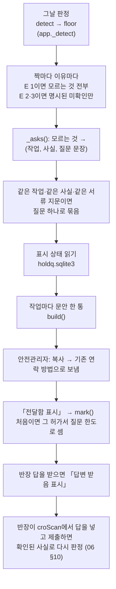
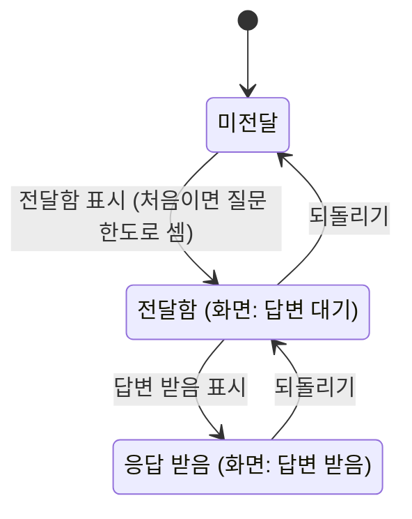
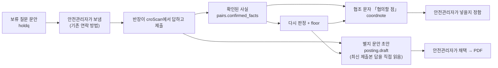

# 06b. 판정보류 질문 — 모르는 것을 그 작업의 반장에게 묻기

쌍작업 판정에는 「서류에 없어 모르는 것」 때문에 판정보류로 남은 이유가 있습니다. croScan은 그 이유를 그 작업을 하는 쪽 작업반장에게 물을 질문으로 바꿉니다.
croScan은 질문을 보내지 않습니다. 안전관리자가 문안을 복사해 기존 연락 방법으로 보냅니다. 그리고 「보냈다」「답을 받았다」를 표시합니다.

**이 문서에서 알 수 있는 것**

- 판정보류(확인이 필요해 3순위로 남긴 경보)의 이유가 어떤 질문이 되고, 누구에게 가는지
- 반장에게 상대 팀 작업을 묻지 않는 원칙과, 같은 질문을 한 번만 묻는 방법(지문)
- 미전달 → 전달함 → 응답 받음 상태와 질문 한도 계산
- 답이 돌아온 뒤 협조 문자의 「협의할 점」과 현장 게시용 별지로 이어지는 길
- 고칠 곳, 시험, 한계

**목차**

1. [무엇을 하나](#1-무엇을-하나)
2. [왜 이렇게 하나](#2-왜-이렇게-하나)
3. [전체 흐름](#3-전체-흐름)
4. [어떤 이유를 묻나](#4-어떤-이유를-묻나)
5. [모르는 것 → 질문: _asks()](#5-모르는-것--질문-_asks)
6. [같은 질문 묶기와 지문](#6-같은-질문-묶기와-지문)
7. [상태와 전달 표시](#7-상태와-전달-표시)
8. [반장에게 가는 문안](#8-반장에게-가는-문안)
9. [시연 자료 결과](#9-시연-자료-결과)
10. [예시 세 가지](#10-예시-세-가지)
11. [답 다음: 협조 문자와 별지](#11-답-다음-협조-문자와-별지)
12. [코드 어디를 고치나](#12-코드-어디를-고치나)
13. [시험](#13-시험)
14. [한계](#14-한계)

판정 자체(태그·장소·시간·S×E)는 [06_쌍작업_판정.md](06_쌍작업_판정.md)에 있습니다.

---

## 1. 무엇을 하나

- 그날 판정의 모든 짝에서 노출 E 1인 이유를 모읍니다. 표기가 판정보류든 보수위험이든 같습니다(4장). E 2·3 이유에서는 말로 명시된 미확인만 모읍니다.
- 이유마다 「모르는 것」(gap)을 읽습니다. 그것을 **그 사실이 속한 작업**의 반장에게 묻는 질문으로 바꿉니다.
- 반장마다 질문을 모아 문안 한 통을 만듭니다.
- 안전관리자는 문안을 복사해 보낸 뒤 「전달함」을 표시합니다. 답을 받으면 「응답 받음」을 표시합니다.

코드: [`server/holdq.py`](../server/holdq.py). 모델을 부르지 않습니다. 규칙이 남긴 「모르는 것」과 정해진 문장 틀로만 만듭니다.

## 2. 왜 이렇게 하나

설계서 §8.3(판정보류 쌍의 질문 생성·배정)의 원칙을 따릅니다.

- **자기 작업만 묻습니다.** 정전과 환기가 걸린 짝을 예로 들자. 정전하는 쪽에는 「차단 범위에 물린 설비와 복구 시각」을 묻습니다. 들어가는 쪽에는 「쓰는 환기설비와 진입 계획」을 묻습니다. 한쪽 반장에게 상대 작업이나 그 작업이 끝났는지를 확답하게 하지 않습니다. 문안 끝에도 「다른 팀 작업에 대해서는 답하지 않으셔도 됩니다」를 넣습니다.
- **같은 사실은 한 번만 묻습니다.** 여러 짝에 같은 사실(예: 크레인 정비의 시험운전 시각)이 필요하면 질문 하나에 짝 목록을 답니다.
- **별도 예산을 만들지 않습니다.** 처음 「전달함」을 표시하면 그 질문을 그 허가서의 반장 대화 질문 한도에 넣어 셉니다. 같은 검토에서 같은 사실·작업은 한 번만 셉니다(7장).
- **보내는 수단을 강요하지 않습니다.** croScan은 문안만 만듭니다. 상대 팀에 새 계정·앱을 요구하지 않습니다.
- **미전달과 미응답을 구분합니다.** 아직 안 보낸 것과 보냈는데 답이 없는 것은 다릅니다.

설계서 §8.3은 처음에 「AI가 담당자별로 질문을 나눈다」고 적었습니다. 지금 코드는 모델 없이 규칙과 문장 틀로 만듭니다(설계서 §22 정리표에 같은 내용).

## 3. 전체 흐름



API:

| 호출 | 하는 일 |
|---|---|
| `GET /api/safety/hold-questions` | `holdq.build(_detect())`: 작업별 질문·상태·문안 |
| `POST /api/safety/hold-questions/mark` `{key, state}` | `holdq.mark()`: 상태 표시 |

([`server/app.py`](../server/app.py))

## 4. 어떤 이유를 묻나

`build(det)`는 그날 판정(`floor()`까지 거친 것)의 **모든 짝의 모든 이유**를 봅니다. 짝의 맨 위 이유가 1순위여도 같은 짝의 다른 판정보류 이유는 따로 묻습니다. 더 강한 경보가 붙었다고 모르는 것이 풀리지는 않기 때문입니다.

| 이유 | 묻는 것 |
|---|---|
| E 1 | 그 이유의 `gaps`(모르는 것) 전부 |
| E 2·3 | `gaps` 가운데 **말로 명시된 미확인**(`EXPLICIT`)만 |
| 근거 칸에 「작업명에서 추정」 | 그 작업에 「사용하는 도료·세정제 이름과 수성·용제형 여부」(`solvent_kind`) |

나누는 기준은 표기가 아니라 E입니다. E 1 이유라면 표기가 판정보류든 보수위험이든 모르는 것을 전부 묻습니다. 장소 연결이 확인된 일부 잔류위험은 E 1이어도 보수위험으로 표시됩니다([06 §7.4](06_쌍작업_판정.md#74-판정-표기)).

`EXPLICIT`는 높이·위치·시간처럼 이 짝의 점수와 상관없이 모르는 사실입니다. 지금 목록: 평면 경로, 방사선은 유해위험요소 칸에만, 정전 반장 답 「환기·조명 영향 없음」, 서류상 인원 0, 작업 높이, 블록 안·위인지, 받침·지그 해체, 시간 역전, 칼럼 범위가 큰 번호부터, 시험운전·주행 계획이 없음, 블록 상부 작업의 시험 주행, 반을 열어 두는지, 귀환 클램프 위치, 크레인이 잡은 그 부재, 가스 용기의 가스 종류, 반입·반출 물품, 인양할 블록이 받침인지, 국소배기 전원, 상부 작업 조명 전원, 시험 주행 구간·훅 아래.

예를 들어 끝이 시작보다 이른 시간(22:00~02:00)은 E 3 경보에서도 「익일인지 오기인지」를 묻습니다.

## 5. 모르는 것 → 질문: _asks()

`_asks(r, docs)`는 이유 하나를 `[(작업, 사실 이름, 질문 문장)]`으로 바꿉니다. 이유의 `cause`가 원인 작업 A, `exposed`가 노출 작업 B입니다.

### 5.1 모르는 것의 종류별로

| 모르는 것(gaps 문장의 시작) | 누구에게 | 사실 이름 |
|---|---|---|
| 경로가 생기려면 사건이 하나 더 있어야 함 | 양쪽 | 규칙별 묻는 말(5.2) |
| 한쪽의 작업 시간이 없어 | 시간이 없는 쪽 | `time` |
| 작업 시간은 겹치지 않지만 … 잔류위험 | 앞 작업 · 뒤 작업 | 앞: `RULE_SEQ` 또는 `end_residual` · 뒤: `LATER` 또는 `start_check` (5.3) |
| 앞 작업이 끝나는 시각에 바로 이어서 시작 | 앞 작업 · 뒤 작업 | `end_time` · `start_check` |
| 위험을 받는 작업의 인원 수가 적혀 있지 않음 | 노출 쪽 | `workers` |
| 서류상 인원 0 | 노출 쪽 | `workers_zero` |
| 평면 경로 | 인양 쪽 | `lift_outline` |
| 작업 높이 … | 원인 쪽 | `height` |
| 가스 용기의 가스 종류 | 가스를 다루는 쪽 | `gas_kind` |
| 반입·반출 물품이 … | 원인 쪽 | `stage_place` |
| 인양할 블록이 … | 인양 쪽 · 상대 | `lift_support` · `work_zone` |
| 국소배기·집진기가 물렸는지 | 정전 쪽 · 화기 쪽 | 규칙별 · `exhaust_power` |
| 상부 작업 조명이 물렸는지 | 정전 쪽 · 상부 작업 쪽 | 규칙별 · `light_power` |
| 시험 주행 구간·훅 아래 | 정비 쪽 · 지상 작업 쪽 | 규칙별 · `work_zone` |
| 블록 안·위인지 / 블록 위·안인지 / 받침·지그 해체 | 노출 쪽 | `position` |
| 시간 역전 | 그 문서 | `time_rev` |
| 칼럼 범위가 큰 번호부터 | 그 문서 | `place` |
| 시험운전·주행 계획이 서류에 없음 | 정비 쪽 | 규칙별 |
| 블록 상부 작업: 시험 주행 … | 상부 작업 쪽 | 규칙별 |
| 방사선은 유해위험요소 칸에만 | 그 작업 | 규칙별 |
| 정전 반장 답: 환기·조명 영향 없음 | 진입 쪽 | 규칙별 |
| 반을 열어 두는지 | 정전 쪽 | 규칙별 |
| 귀환 클램프 위치 | 용접 쪽 | 규칙별 |
| 크레인이 잡은 그 부재 | 양쪽 | 규칙별 |
| 이동 예정 시각이 허가 시간 밖 | 그 문서 | `move_time` |
| 그 밖(장소를 정하지 못함: 「거리 미확인」「위치(칼럼)를 알 수 없어」 등) | 위치가 없는 쪽에 `place`. 둘 다 위치가 있으면 양쪽에 규칙별 묻는 말 | |

### 5.2 규칙별 묻는 말 `RULE_SIDE`

규칙 36개 모두 원인 쪽과 노출 쪽에 묻는 말이 정해져 있습니다.

| 규칙 | 원인 쪽에 묻는 것 | 노출 쪽에 묻는 것 |
|---|---|---|
| `FIRE` | `spark_reach` 화기 작업의 불티가 닿는 범위와 불티 차단 계획 | `solvent_end` 도장·세정이 끝나는 시각과 건조·환기 계획 |
| `CONF_HOT` | `hot_point` 화기 작업 위치와 가장 가까운 개구부까지의 거리, 화재감시자 | `entry_plan` 밀폐 공간 진입 시간대와 출입 개구부 위치, 밀폐 감시인이 화재감시자를 겸하는지 |
| `CONF_GAS` | `gas_line` 가스 공급 계통(배관 번호)과 차단·복구 계획 | `vent_entry` 사용하는 환기설비와 진입 계획, 다른 진입 작업과 환기·송기 설비를 나눠 쓰는지 |
| `LOAD_OVER` | `lift_route` 인양 경로와 인양 시각 | `work_zone` 작업 위치·시간과 인원 배치 |
| `TARGET_OCCUPIED` | `lift_time` 블록 인양 예정 시각 | `exit_time` 블록 안 작업이 끝나는 시각과 마지막 인원이 나오는 시각(정리·인계 포함, 다르면 각각) |
| `CRANE_LOTO` | `crane_repair` 크레인 정비 범위와 정비 후 복구·인계 예정 시각 | `crane_need` 그 크레인을 쓰려는 시각과 대체 크레인 계획 |
| `POWER_LOTO` | `power_cut` 정전 범위(분기)와 복구 예정 시각 | `power_need` 그 분기에서 쓰는 장비와 대체 전원 계획 |
| `DROP_BELOW` | `upper_work` 상부 작업의 실제 높이·시간, 아래로 뚫린 곳(양중구·맨홀·홀)과 덮개, 낙하물 방지 계획 | `work_zone` 작업 위치·시간과 인원 배치 |
| `PRESSURE` | `test_zone` 시험 매체(공기·질소·물)·압력·시험 구역과 시각, 호스 고정 방법 | `work_zone` 작업 위치·시간과 인원 배치 |
| `RADIATION` | `rt_zone` 방사선 통제구역 범위와 촬영 시각 | `work_zone` 작업 위치·시간과 인원 배치 |
| `VEHICLE` | `route_time` 운반 경로와 통과 시각 | `work_zone` 작업 위치·시간과 인원 배치 |
| `CRANE_SHARE` | `crane_time` 크레인 사용 시각 | `crane_time` 크레인 사용 시각 |
| `CRANE_CROSS` | `crane_travel` 크레인 주행 구간과 시각 | `crane_travel` 크레인 주행 구간과 시각 |
| `SUPPORT` | `cut_member` 절단·해체·받침 조정(잭)하는 부재와 받침 계획, 블록이 무엇으로 받쳐 있는지 | `work_zone` 작업 위치·시간과 인원 배치 |
| `ACCESS` | `lift_time` 블록 인양 예정 시각과 경로 (원인 종류에 따라 바뀜, 아래) | `entry_watch` 밀폐 출입구와 감시인 위치 |
| `HOT_PERSON` | `shield` 화기 작업의 차광·차폐 계획과 불티·흄이 닿는 범위(바로 옆 칼럼과의 실제 거리) | `work_zone` 작업 위치·시간과 인원 배치 |
| `VENT_LOTO` | `power_func` 차단 범위에 물린 환기팬·송기·조명·연락 설비와 복구 시각 | `vent_entry` 사용하는 환기설비와 진입 계획 |
| `CRANE_TEST` | `crane_test` 복구·시험운전 시각과 주행 구간 | `upper_pos` 작업 위치(거더·레일·블록 상부)와 높이, 그 시간 인원 배치 |
| `SHARED_LOTO` | `lock_release` 본인 잠금 해제·복구 예정 시각과 다른 팀 잠금 확인 방법 | `lock_release` 본인 잠금 해제·복구 예정 시각과 다른 팀 잠금 확인 방법 |
| `OTHER_CRANE_REPAIR` | `crane_travel` 크레인 주행 구간과 시각 | `repair_pos` 수리 위치(지상·거더)와 같은 주행로 다른 크레인 운행 정지 요청 여부 |
| `HOT_PANEL` | `spark_reach` 화기 작업의 불티가 닿는 범위와 불티 차단 계획 | `panel_cover` 반을 여는 시간과 반 덮개·복구 전 내부 확인 계획 |
| `FIRE_SOLID` | `spark_reach` 화기 작업의 불티가 닿는 범위와 불티 차단 계획 | `combust_place` 가연물(포장재·목재·비닐·단열재)을 두는 위치·양 |
| `EGRESS_BLOCK` | `stage_place` 자재·대차·차광막을 두는 위치와 치우는 시각 | `escape_route` 작업 구역의 대피 통로·소화기 위치 |
| `OVERHEAD_WORK` | `upper_work` 상부 작업의 실제 높이·시간과 낙하물 방지 계획 | `work_zone` 작업 위치·시간과 인원 배치 |
| `CART` | `route_time` 운반 경로와 통과 시각 | `work_zone` 작업 위치·시간과 인원 배치 |
| `CABLE_RUN` | `route_time` 운반 경로와 통과 시각 | `cable_route` 용접 케이블 배선 경로와 보호 덮개 |
| `NOISE_SIGNAL` | `noise_time` 소음 작업(연삭·가우징) 시간 | `signal_way` 인양 신호 방법(무전·수신호)과 신호수 |
| `WELD_RETURN` | `return_clamp` 용접 귀환(어스) 클램프 위치 | `work_zone` 작업 위치·시간과 인원 배치 |
| `LIFT_LINE` | `lift_time` 블록 인양 예정 시각 | `line_release` 그 블록에 연결한 덕트·호스·케이블과 해제 시각 |
| `GRIND_FLY` | `grind_dir` 연삭 방향과 차폐 계획 | `work_zone` 작업 위치·시간과 인원 배치 |
| `CONF_PAINT` | `paint_end` 도장·세정 위치와 끝·환기 완료 시각 | `entry_plan` 밀폐 공간 진입 시간대와 출입 개구부 위치 |
| `MEWP_OVER` | `mewp_pos` 고소작업대 위치와 붐 회전 범위 | `work_zone` 작업 위치·시간과 인원 배치 |
| `FIRE_SPREAD` | `combust_near` 화기 지점 주변과 판 반대편(격벽·이면)의 보온재·가연물, 방화포·이면 감시 계획 | `work_zone` 작업 위치·시간과 인원 배치 |
| `FIRE_GAS` | `spark_reach` 화기 작업의 불티가 닿는 범위와 불티 차단 계획 | `gas_handle` 가스 용기·호스를 다루는 위치·시각과 가스 종류(LPG·아세틸렌 등), 누출 점검·환기 계획 |
| `HELD_FIT` | `hold_time` 크레인이 부재를 잡고 있는 시간과 신호 방법 | `fit_order` 취부·가고정 순서와 크레인 조작 요청 방법 |
| `EQUIP_IGNITION` | `equip_kind` 쓰는 고소작업대·전기기기 종류(방폭형인지)와 시간 | `solvent_end` 도장·세정이 끝나는 시각과 건조·환기 계획 |

`ACCESS`의 원인 쪽 질문은 원인의 종류(`cause_kind`)에 따라 바뀝니다. 차량·대차면 `route_time`, 낙하·절단이면 `loose_end`(분리물·잔재가 떨어지거나 놓이는 곳과 회수 계획), 적치면 `stage_place`, 인양이면 표의 `lift_time`.

규칙표에 없는 규칙이 오면 양쪽에 `work_zone`(작업 위치·시간과 인원 배치)을 묻습니다.

### 5.3 잔류·맞닿음: 앞 작업과 뒤 작업

선후 이유에서는 「앞 작업」에 끝과 남는 것을 묻습니다. 「뒤 작업」에는 시작 전 확인을 묻습니다. 누가 앞인지는 판정의 `sequence.first`로 정합니다.

| 규칙 | 앞 작업에 (`RULE_SEQ`) | 뒤 작업에 (`LATER`) |
|---|---|---|
| DROP_BELOW, OVERHEAD_WORK | `loose_end` 작업이 끝나는 예정 시각과 분리물·잔존물 회수·고정 확인 방법 | `start_check` |
| SUPPORT | `support_end` 절단·해체가 끝나는 예정 시각과 임시 지지·하중 이전 확인 방법 | `start_check` |
| CRANE_LOTO, POWER_LOTO | `restore_end` 정비 완료·복구·시험운전·인계 예정 시각과 인계받는 사람 | `use_check` 그 설비를 쓰기 전에 정비 인계를 확인하는 방법 |
| ACCESS, EGRESS_BLOCK | `clear_end` 작업이 끝나는 예정 시각과 적치물·잔해를 치우는 계획 | `start_check` |
| HOT_PERSON | `hot_end` 화기 종료 시각과 그 면의 냉각·불씨·흄 확인 방법 | `touch_check` 시작 전 그 면의 냉각·불씨 확인 방법(청소라면 분진 성상·포집 계획) |
| HOT_PANEL | `hot_end` | `panel_check` 복구 전 반 내부 불티·이물 확인 시각 |
| FIRE_SOLID | `hot_end` | `clear_check` 시작 전 주변 가연물을 치웠는지·불씨 확인 방법 |
| FIRE_SPREAD, FIRE_GAS | `hot_end` | `start_check` |
| RADIATION | `rt_end` 촬영 종료·선원 회수·측정 확인 예정 시각과 알릴 사람 | `start_check` |
| CRANE_TEST | `test_end` 복구 뒤 시험운전·주행 예정 시각과 구간, 알릴 사람 | `start_check` |
| 그 밖(FIRE, CONF_HOT, CONF_GAS, TARGET_OCCUPIED, PRESSURE, CONF_PAINT, SHARED_LOTO, VENT_LOTO) | `end_residual` 작업이 끝나는 예정 시각과 끝난 뒤 남는 것(잔불·가스·잔압·자재·잔류 인원)의 정리 계획(개구부 덮개·난간·통로 복구 포함) · 남은 작업이 있어 다시 들어올 계획 | `start_check` 작업 시작 예정 시각과 시작 전에 하는 본인 작업의 확인 절차 |

끝·시작이 같아도 잔류 조건이 맞으면 판정은 잔류로 처리합니다. 그때는 위 표의 잔류 질문을 먼저 만듭니다. 잔류 조건이 맞지 않아 맞닿음(앞 작업 끝 = 뒤 작업 시작)으로 처리한 경우에만 앞 작업에 `end_time`(작업이 실제로 끝나는 예정 시각, 늦어질 수 있는지)을, 뒤 작업에 `start_check`를 묻습니다.

뒤 작업 반장에게 「앞 작업이 끝났는지」를 묻지 않습니다. 자기 작업을 시작하기 전에 무엇을 확인하는지만 묻습니다.

### 5.4 공통 질문 `GENERIC`

| 사실 이름 | 질문 |
|---|---|
| `time` | 작업 시작·끝 예정 시각 |
| `place` | 실제 작업 위치(BAY·칼럼·블록 번호) |
| `workers` | 작업 인원 수 |
| `workers_zero` | 그 시간 실제로 작업 공간에 들어가는 인원(서류에는 0명) |
| `move_time` | 크레인 실제 이동 예정 시각 |
| `end_time` | 작업이 실제로 끝나는 예정 시각(늦어질 수 있는지) |
| `height` | 작업 위치의 바닥 기준 높이(m)와 그 아래 작업·통행 |
| `position` | 블록 안·위·옆 중 실제 작업 위치와 높이 |
| `time_rev` | 끝나는 시각이 시작보다 이른데, 다음 날 끝나는 것인지 적을 때 잘못 쓴 것인지 |
| `solvent_kind` | 사용하는 도료·세정제 이름과 수성·용제형 여부 |
| `gas_kind` | 다루는 가스 용기의 가스 종류(LPG·아세틸렌 같은 가연성인지)와 위치·시각 |
| `lift_support` | 인양할 블록이 다른 블록·구조를 받치고 있는지와 인양 전 받침을 옮기는 계획 |
| `exhaust_power` | 국소배기·집진기의 전원(분전반 번호) |
| `light_power` | 상부 작업 조명의 전원(분전반 번호) |
| `lift_outline` | 인양물의 실제 크기(폭·길이)·매단 높이와 회전·흔들림 범위, 그 아래를 지나는 시각 |
| `end_residual`, `start_check` | 5.3 표 |

## 6. 같은 질문 묶기와 지문

질문 하나의 열쇠(`key`)는 `날짜:작업:사실 이름:지문`입니다. 예: `2026-10-29:0739:upper_work:ab7ba7baef`.

- 같은 작업·같은 사실이면 짝이 여러 개여도 질문 하나입니다. 질문에는 그 질문이 필요한 짝 목록(`pairs`)과 규칙 목록(`rules`)이 붙습니다.
- **지문**(`fingerprint()`)은 그 서류의 작업 사실로 만든 짧은 해시입니다. 들어가는 칸(`FP_KEYS`): 작업명, 상세, 위치, 경로, 대상ID, 시간창, 이동 시각, 인원, 허가 종류, 높이, 장비, 사용물질, 유해위험요소.
- `FP_KEYS`에 든 값이 바뀔 때만 지문이 바뀌어 **새 질문**이 됩니다. 반장 답 원문(`_records`)이나 작업계획서의 작업 단계만 바뀌고 이 값들이 같으면 기존 질문과 그 상태가 유지될 수 있습니다. 새 질문이 되면 예전 질문의 표시는 넘겨받지 않고 `history`(상태·시각·표시)로만 보입니다. 작업이 바뀌었는데 「이미 물었다」고 착각하지 않게 하려는 것입니다.
- 제출본의 판(revision)이나 쓴 사람은 지문에 넣지 않습니다. 체크리스트 한 칸만 고쳐도 같은 질문이 새 질문이 되면 「전달함」 표시가 기록으로 밀려납니다. 이것을 막으려는 것입니다(2026-11-01 최종 검토).

## 7. 상태와 전달 표시



화면 글자는 미전달 · 답변 대기(전달함) · 답변 받음(응답 받음)입니다([`web/app.js`](../web/app.js)). 한 반장 줄의 상태는 그 반장 질문 가운데 가장 덜 진행된 질문의 상태입니다.

`mark(det, key, state)`의 규칙:

- 상태는 세 가지뿐입니다. 다른 값은 422.
- 지금 판정에 없는 질문(서류나 판정이 바뀜)은 404 「그런 확인 질문이 없습니다 (판정이 바뀌었을 수 있습니다)」.
- 한 단계씩만 움직입니다. 미전달에서 바로 응답 받음은 409.
- 표시는 사실이므로 늘 저장합니다. 저장 위치는 데이터 폴더의 `holdq.sqlite3`, 표 `marks(key, day, doc, state, counted, at)`.

**질문 한도.** 처음 「전달함」을 표시하면 `_charge()`가 질문 하나로 셉니다. 세는 곳은 그 허가서의 그날 최신 제출본의 검토 대화입니다(`store.issue(..., "HOLD:사실@작업", "question")`). 결과는 `counted`에 남습니다. 다시 전달함으로 와도 두 번 세지 않습니다.

차감 열쇠 `HOLD:사실@작업`에는 지문이 없습니다. 그래서 같은 검토에서는 지문이 바뀐 새 질문이어도 한 번만 차감합니다. 새 지문으로 처음 전달해도 한도를 다시 쓰지 않습니다.

| `counted` | 뜻 | 화면 표시 |
|---|---|---|
| `store` | 그 검토의 질문 한도로 셈. 새로 차감했는지, 같은 열쇠의 기존 차감을 다시 쓴 것인지는 구분하지 않습니다 | 없음 |
| `over` | 한도가 다 찼음 | 「반장 대화 질문 한도 밖」 |
| `closed` | 검토가 마감됨 | 「검토 마감 뒤 전달」 |
| `none` | 검토가 없음(작업계획서, croScan으로 제출하지 않은 허가서) | 없음 |

한도가 찼어도 표시를 막지 않습니다. 이미 보낸 것은 사실이기 때문입니다. 다른 곳에서 따로 세지도 않습니다.

**「응답 받음」은 판정을 바꾸지 않습니다.** 표시는 기록일 뿐입니다. 답의 내용이 판정에 들어가는 길은 하나입니다. 반장이 croScan에서 그 답을 넣고 확인해 제출하면, 확인된 사실로 다시 판정합니다([06 §10](06_쌍작업_판정.md#10-작업반장-제출본-반영과-안전-하한floor)). 그때도 `floor()`는 현재 수집 서류로 계산한 경보를 하한으로 지킵니다. 제출본의 답 때문에만 생긴 경보는 하한이 아닙니다. 다음 제출에서 그 답이 바뀌면 낮아지거나 사라질 수 있습니다. 화면에도 「답변 받음은 해석 확인이 아닙니다」라고 적혀 있습니다.

## 8. 반장에게 가는 문안

작업마다 한 통입니다(`build()`의 `message`). 시연 자료의 0739 예:

```text
[작업 확인 요청] AC00-IH-20261029-0739 천장크레인 제어반 고장 수리
안전관리자 위험 검토에 필요한 본인 작업 정보입니다. 아는 만큼 알려 주세요.
1. 상부 작업의 실제 높이·시간과 낙하물 방지 계획
2. 작업 위치·시간과 인원 배치
3. 복구·시험운전 시각과 주행 구간
4. 차단 범위에 물린 환기팬·송기·조명·연락 설비와 복구 시각
5. 작업 시작 예정 시각과 시작 전에 하는 본인 작업의 확인 절차
6. 정비 완료·복구·시험운전·인계 예정 시각과 인계받는 사람
다른 팀 작업에 대해서는 답하지 않으셔도 됩니다.
```

- 머리줄은 허가번호(계획서면 문서 번호)와 작업명입니다.
- 상대 작업의 이름·시간은 넣지 않습니다. 자기 작업만 묻습니다.
- 화면의 「전달문 복사」로 복사합니다. 복사만으로는 상태가 바뀌지 않습니다. 보낸 뒤 「전달함 표시」를 눌러야 합니다.
- 작업 목록은 허가서 먼저, 그다음 계획서 순입니다.

## 9. 시연 자료 결과

2026-10-29 시연 하루를 서류 기준(제출본 없음)으로 판정하고 `build()`를 돌린 결과입니다(시연 자료 기준, 2026-11-01 지금 코드).

| 항목 | 값 |
|---|---|
| 질문 | 55개 (모두 미전달로 시작) |
| 질문을 받는 작업 | 20개 (허가서 9 · 작업계획서 11) |
| 가장 많은 작업 | 0732 B21S 외판 절단·재용접 8개, 0739 크레인 제어반 수리 6개, 0735 러그 절단 6개 |
| 묶인 예 | 0739의 「상부 작업의 실제 높이·시간과 낙하물 방지 계획」 하나가 6개 짝에 쓰임 |

설계서 §21에 적힌 「보류 질문 47개(19건)」는 그 뒤 판정을 보강하기 전의 값입니다.

## 10. 예시 세 가지

### 10.1 화기 × 같은 블록 도장

| 판정 | 묻는 것 |
|---|---|
| 같은 블록·같은 시간(시연 자료 P02, FIRE E 3 확인위험) | FIRE 이유에서는 묻지 않습니다. 모르는 것이 없습니다 |
| 화기가 09:00–11:00에 끝나고 같은 블록 도장이 13:00 시작(잔류, E 1 보수위험) | 화기 쪽: `end_residual` 끝나는 시각과 끝난 뒤 남는 것의 정리 계획 · 도장 쪽: `start_check` 시작 전 본인 작업의 확인 절차 |
| 바로 옆 칼럼(거리 미확인, E 1 판정보류) | 화기 쪽: `spark_reach` 불티가 닿는 범위와 차단 계획 · 도장 쪽: `solvent_end` 도장이 끝나는 시각과 건조·환기 계획 |
| 사용물질에 용제 이름이 없고 작업명이 도장(「작업명에서 추정」) | 도장 쪽: `solvent_kind` 도료·세정제 이름과 수성·용제형 여부 |

도장 반장에게 「화기 작업이 끝났는지」를 묻지 않습니다. 화기 반장에게 「도장 쪽에 사람이 있는지」를 묻지 않습니다.

### 10.2 크레인 정비 × 같은 크레인 인양

- 시연 자료 P07(0739 정비 × 0737 인양, 같은 OH-21-03, 동시): CRANE_LOTO E 3 확인위험. 이 이유에서는 묻지 않습니다. 이것은 묻기 전에 두 반장이 협의할 1순위입니다. 다만 같은 짝의 다른 이유(거더 위 정비자 × 아래 인양, OVERHEAD_WORK E 1 「위치(칼럼)를 알 수 없어」)는 판정보류입니다. 그래서 0739에 `upper_work`를, 0737에 `work_zone`을 따로 묻습니다.
- 시연 자료 P25(0739 정비가 12:00에 끝나고 WP-1029-32가 14:00에 같은 크레인 사용): 잔류 E 1. 0739에 `restore_end` 「정비 완료·복구·시험운전·인계 예정 시각과 인계받는 사람」, WP-1029-32에 `use_check` 「그 설비를 쓰기 전에 정비 인계를 확인하는 방법」.
- 같은 0739에 CRANE_TEST(복구 뒤 시험운전 × 같은 BAY 상부 작업) 판정보류가 세 짝(WP-1029-26, -28, -29)에 붙습니다. 0739에는 `crane_test` 「복구·시험운전 시각과 주행 구간」 하나로 묻습니다. 세 작업에는 각자 `upper_pos` 「작업 위치(거더·레일·블록 상부)와 높이, 그 시간 인원 배치」를 묻습니다.

### 10.3 상부 작업 × 아래 작업, 반장의 답

- 시연 자료 P01(0735 블록 상부 러그 절단 × WP-1029-04 족장 해체): 0735 반장이 「하부에서 족장 해체 13:00~15:30 (삼녹)」이라고 답했습니다. 그래서 DROP_BELOW E 3 확인위험이 되었습니다. 위·아래 관계가 이미 답으로 확인되었으니 이 짝에서는 질문이 생기지 않습니다. 같은 짝의 반대 방향 이유(E 2 「위아래 높이를 확정할 수 없음」)는 명시된 미확인 목록에 없습니다. 그래서 묻지 않습니다.
- 시연 자료 근접 N03(0736 측판 상부 보강재 취부 09:00–11:00 × WP-1029-12 같은 칼럼 하부 마킹 13:00 시작): OVERHEAD_WORK 잔류 E 1. 0736에 `upper_work` 「상부 작업의 실제 높이·시간과 낙하물 방지 계획」과 `loose_end` 「작업이 끝나는 예정 시각과 분리물·잔존물 회수·고정 확인 방법」. WP-1029-12에 `work_zone` 「작업 위치·시간과 인원 배치」와 `start_check`.

답이 판정에 들어가면 질문이 줄어듭니다. 답이 없으면 질문이 남습니다. 질문이 남았다고 경보가 약한 것은 아닙니다.

## 11. 답 다음: 협조 문자와 별지

안전관리자는 보류 질문과 따로 두 가지를 만듭니다. 짝마다 두 작업반장에게 보낼 **협조 문자**와 현장에 붙일 **별지**입니다. 두 기능은 보류 질문의 표시를 읽지 않습니다. 반장이 답을 넣고 제출하면 생기는 **확인된 사실**을 씁니다. 다만 사실을 가져오는 길이 다릅니다.

- 협조 문자는 재판정 근거에 남은 확인 사실을 씁니다. 판정 경로는 `answers_now()`로 무효가 된 답을 먼저 거릅니다.
- 별지 초안은 그 허가서 최신 제출본의 답을 직접 읽어 `confirmed_facts()`를 적용합니다. 이 경로에는 `answers_now()`로 무효 답을 거르는 단계가 없습니다.



### 11.1 협조 문자의 「협의할 점」 — [`server/coordnote.py`](../server/coordnote.py)

- 재료: 사실 후보로는 그 짝의 모든 이유에서 근거 가운데 「작업반장 답변 · 반장 답변 확인」 행(확인된 사실)을 모읍니다. 확인 항목은 맨 앞 이유의 `ask`(확인할 것)만 나눠 씁니다. 쉼표·슬래시·세미콜론·「및」으로 나눕니다.
- 확인된 사실이 없으면 만들지 않습니다(`none`).
- 사실과 항목이 하나씩이면 모델 없이 바로 만듭니다(`fixed`). 여럿이면 모델이 **번호만** 고릅니다(사실 F1…, 항목 C1…).
- 문장은 서버가 씁니다: 「{문서} 반장 확인 답 「{사실}」에 맞춰 {확인할 것}을 서로 확인해 주세요.」 모델이 자유 문장을 쓰면 「4개」가 「4시」가 되거나 이름이 들어가는 일이 있었기 때문입니다(2026-10-31 검토).
- 모델이 실패하거나 형식이 틀리면 첫 사실·첫 항목으로 만듭니다.
- 안전관리자가 누르기 전에는 문자에 들어가지 않습니다. API `POST /api/safety/coord-note`. 제출이 들어오면 1순위 앞 5쌍의 문장을 미리 만들어 둡니다(`app._warm_manager()`).

### 11.2 현장 게시용 별지 — [`server/posting.py`](../server/posting.py)

- **현장 게시용**: 허가서 원본 쪽은 그대로 두고, 뒤에 별지 「병행작업 조정·착수조건」을 붙인 PDF.
- **일상작업반 전달문**: 허가서가 없는 일상 작업용. 같은 내용 가운데 그 작업의 짝만 담은 별지.
- 별지는 내용에 따라 여러 쪽이 될 수 있습니다. 공간이 모자라면 다음 쪽을 만듭니다(`addendum` 그리기).
- 내용은 화면에서 만들고 안전관리자가 고칩니다. 서버는 그 글을 추가검토서 틀에 그립니다(`layout()` → `addendum._draw`). 글은 모두 이스케이프합니다. 칸당 2000자, 구역 40개, 구역당 14줄을 넘으면 자르지 않고 거절합니다. 발행된 종이가 무엇을 냈는지 말해야 하기 때문입니다.
- 구역마다 확인란 표(당일 확인 · 확인자 · 시각 · 확인한 것)를 넣을 수 있습니다.
- 서버는 별지 상태를 저장하지 않습니다(시연: 확정 상태는 브라우저에 있음). API `POST /api/safety/sheet.pdf`.

**별지 문안 초안**(`draft()`, API `POST /api/safety/post-draft`):

- 후보: 할 일 = 규칙 `post`의 그 쪽 문구(원인 쪽·노출 쪽) + 규칙의 `measures`. 착수조건 = `post.start` + 「{ask}을(를) 확인한 뒤 착수」. 할 일·착수조건 후보는 그 짝의 맨 앞 이유에서 가져옵니다. 사실 = 그 허가서 최신 제출본의 답에 `confirmed_facts()`를 바로 적용한 것(무효 답 거르기 없음, 위).
- 후보가 하나씩이고 사실이 없으면 모델 없이(`fixed`). 아니면 모델이 번호만 고릅니다.
- 모델 호출이 실패하거나 형식이 틀리면 초안을 만들지 않습니다(`fail`, 빈 초안). 화면은 「AI 결과를 준비하지 못함 · 규칙 문안 그대로 씁니다」를 보이고 기존 규칙 문안을 유지합니다. 협조 문자처럼 첫 후보로 문장을 대신 만들지는 않습니다.
- 문장은 서버의 틀입니다.
  - 「우리 반은 {시간} {위치} ({사실})에 {할 일}.」
  - 「착수조건: {조건}.」
  - 「중지·변경 시: 시간·위치·공법이 바뀌거나 멈추면 상대 반장과 안전관리자에게 바로 연락합니다.」
- 같은 고름으로 추가조치 초안 세 줄과 TBM 전달 초안도 만듭니다. TBM은 작업 전에 위험과 조치를 함께 확인하는 안전회의입니다.
- 초안은 제안일 뿐입니다. 안전관리자가 「문안 채택」을 눌러야 미발행 별지에 들어갑니다.
- 현재 화면에서는 문안을 하나라도 채택해야 인쇄물 끝에 한 번 「croScan AI 문안 보조 · 문안 상태: 일부 채택/채택 · 개정 n」이 붙습니다. 초안을 보기만 한 경우에는 표시하지 않습니다. 서버 틀은 「초안」 상태도 그릴 수 있지만 화면이 그 값을 보내지 않습니다.
- 채택은 보내기가 아닙니다. TBM을 했다는 뜻도, 작업 시작을 허락한다는 뜻도 아닙니다.

## 12. 코드 어디를 고치나

| 하고 싶은 일 | 고칠 곳 |
|---|---|
| 규칙별로 원인·노출 쪽에 묻는 말 | [`server/holdq.py`](../server/holdq.py) `RULE_SIDE` |
| 잔류일 때 앞·뒤 작업에 묻는 말 | `RULE_SEQ`, `LATER` |
| 공통 질문 문장 | `GENERIC` |
| E 2·3 이유에서도 묻는 미확인 | `EXPLICIT`, 그리고 `_asks()`에 그 문장의 분기 |
| 판정에 새 「모르는 것」 문장을 더했을 때 | [`server/pairs.py`](../server/pairs.py)의 문장과 `_asks()` 분기를 함께. 이 분기는 문장의 시작 글자로 맞춥니다. 그래서 문장 앞부분을 바꾸면 연결이 끊깁니다 |
| 질문이 새 질문이 되는 조건 | `FP_KEYS` |
| 상태와 이동 | `STATES`, `NEXT`, `mark()` |
| 질문 한도 계산 | `_charge()` (검토 대화 쪽은 `server/store.py`) |
| 문안 머리말·끝말 | `build()`의 `msg` |
| 협조 문자 「협의할 점」 문장 | [`server/coordnote.py`](../server/coordnote.py) `sentence()` |
| 별지 문장 틀·한도 | [`server/posting.py`](../server/posting.py) `compose()`, `STOP`, `MAX_*` |

## 13. 시험

| 시험 | 무엇을 | 지금 결과 |
|---|---|---|
| [`tools/check_pairs_material.py`](../tools/check_pairs_material.py) | 공개 경로 detect → floor → `holdq.build`: 높이 미상 절단 E 2에도 높이 질문, 역전 시간 E 3에도 「익일인지 오기인지」, 탱크 안인지 모르는 CONF_GAS에 위치 질문, 방사선 쪽 반장 질문 등 | 186/186 |
| [`tools/check_pairs_final.py`](../tools/check_pairs_final.py) | 「보류 질문 연결」 절: 새 미확인(가스 종류, 2m 미만 높이, 받침 블록, 국소배기 전원, 이동 시각) → 그 작업에 묻는 말 | 87/87 |
| [`tools/check_coordnote.py`](../tools/check_coordnote.py) | 협의할 점: 확인된 사실만, 다른 팀 절은 사실 아님, 고정 문장 | 8/8 |
| [`tools/check_docs_ai.py`](../tools/check_docs_ai.py) | 게시 문안 보충: 모델은 고르기만, 문장은 서버, 없는 짝은 문안 없음 등 | 38/38 |

2026-11-01 이 문서를 쓰며 저장소 루트에서 `python tools/<이름>.py`로 돌린 결과입니다. 상태 표시(`mark()`)의 단계 이동과 409는 임시 데이터 폴더(`CROSCAN_DATA`)로 따로 돌려 확인했습니다. 이것을 맡은 자동 시험은 찾지 못했습니다.

## 14. 한계

- **보내지 않습니다.** 전달·응답 표시는 안전관리자가 누른 기록입니다. 실제로 전해졌는지, 답이 맞는지는 croScan이 모릅니다.
- **답의 내용을 저장하지 않습니다.** 「응답 받음」에는 답 글이 없습니다. 답이 판정에 들어가려면 반장이 croScan에서 답하고 제출해야 합니다. 작업계획서(협력사) 쪽 답은 허가서 반장이 자기 제출본에서 그 계획서의 위치·시간을 고친 경우에만 들어갑니다.
- **질문은 판정 문장에 기댑니다.** `_asks()`는 판정의 「모르는 것」 문장 앞부분으로 질문을 고릅니다. 판정 문장이 바뀌고 분기를 고치지 않으면 일반 질문(`place` 또는 규칙별 묻는 말)으로 떨어집니다.
- **지문은 수집된 서류 기준입니다.** 반장 제출본이 위치·시간을 바꿔도 지문은 그대로라 같은 질문으로 남습니다. 수집 서류 안에서도 반장 답 원문과 작업계획서의 작업 단계는 지문에 직접 들어가지 않습니다.
- **별지 초안은 무효 답을 거르지 않습니다.** 판정과 협조 문자는 `answers_now()`를 거친 사실을 씁니다. 별지 초안은 최신 제출본 답을 직접 읽습니다. 그래서 서류 칸을 고쳐 무효가 된 답이 후보에 들어갈 수 있습니다. 채택은 안전관리자가 정합니다.
- **같은 작업에 질문이 여러 개 쌓일 수 있습니다.** 시연 자료에서 한 작업에 최대 8개입니다. 질문 한도가 차면 「한도 밖」으로 표시만 하고 줄여 주지 않습니다.
