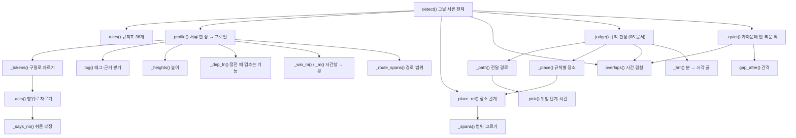

# 06c. 태그와 작업 프로필 — 서류 한 장을 「작업 성질」로 읽는 함수들

croScan은 쌍작업을 판정하기 전에 서류 한 장을 「작업 프로필」로 바꿉니다. 프로필에는 작업 성질(태그), 장비 번호, 높이, 장소, 시간이 들어갑니다.
이 문서는 [`server/pairs.py`](../server/pairs.py) 1~530행의 함수 18개와 상수 65개를 하나도 빼지 않고 적습니다. 규칙 판정(`_path()` 이후)은 [06_쌍작업_판정.md](06_쌍작업_판정.md)에 있습니다.

**이 문서에서 알 수 있는 것**

- `profile()`이 붙이는 태그 24개 전부: 뜻, 읽는 칸, 정규식, 부정·예외, 지금 코드로 돌린 예시
- `profile()`이 돌려주는 필드 42개가 각각 무엇이고 어디서 쓰이는지
- 글을 구절(`_tokens()`)과 행위(`_acts()`)로 자르고 부정을 읽는 순서
- 두 작업의 장소 관계(`place_rel()`)와 시간 겹침(`overlaps()`, `gap_after()`)을 계산하는 법
- 어긋나 보이는 읽기를 「의도 / 확인 필요 / 설계 근거 미기록」으로 나눈 목록

**목차**

1. [태그 전체 표](#1-태그-전체-표)
2. [함수 지도](#2-함수-지도)
3. [호출 흐름](#3-호출-흐름)
4. [모듈 상수](#4-모듈-상수)
5. [함수별 설명](#5-함수별-설명)
6. [시험](#6-시험)
7. [한계와 알려진 문제](#7-한계와-알려진-문제)

용어 몇 개를 먼저 풉니다.

- **태그**: 작업 성질 이름입니다. 예를 들어 `SPARK`는 화기(불꽃·불티가 나는 작업)입니다. 태그마다 근거 목록 `[(칸 이름, 적힌 값), …]`이 붙습니다.
- **칸**: 서류의 입력란입니다. 허가서의 「작업명」, 계획서의 「작업장비」, 작업반장 답 「답변 L3」 같은 것입니다.
- **구절(토큰)**: 한 칸을 `/ , ; ·`와 「및」으로 자른 조각입니다.
- **행위**: 구절을 「후·뒤·→·하고·없이」 같은 말로 다시 자른 조각입니다. 「가용접 후 치수 확인」은 행위 「가용접」과 「치수 확인」입니다.
- **정규식**: 글에서 낱말 무늬를 찾는 식입니다. 이 문서의 정규식은 코드에서 그대로 옮겼습니다.
- **분**: 시각은 0시부터 센 분으로 바꿔 계산합니다. 09:30은 570입니다. 다음 날 01:00은 1500입니다.

예시는 모두 2026-11-02에 지금 코드를 import해서 돌린 결과입니다. 시험 서류는 [`tools/check_pairs_cases.py`](../tools/check_pairs_cases.py)의 `plan()`·`permit()`과 같은 꼴로 만들었습니다. 계획서의 작업높이 기본값은 「지상 작업」입니다.

---

## 1. 태그 전체 표

모든 태그는 `profile()` 안에서 붙습니다. 공통 조건이 있습니다.

- **행위 조건(act)**: 그 행위에 `NOT_ACTION`(확인·점검·검사 …), `NEGATED`(미사용·없음 …), `ACT_NO`(없이·않고 …)가 없어야 합니다([250행](../server/pairs.py#L250)).
- **글 정리**: 칸 값은 먼저 대시를 `-`로 바꾸고 공백·탭 여러 개를 하나로 줄입니다([239행](../server/pairs.py#L239)). 「T/P」는 「TP」로 바꿉니다(`_tokens()`).
- **작업 칸(work_f)**: 「작업명」, 「작업 상세」, 계획서의 「N단계」입니다([240행](../server/pairs.py#L240)).
- **확인된 답**: 반장이 제출본에서 확인한 답(`d["_confirmed"]`)도 태그가 됩니다. 칸 이름은 「작업반장 답변 · 반장 답변 확인」 뒤에 항목 번호를 붙인 것입니다(예: 「작업반장 답변 · 반장 답변 확인 HT1」, [336~353행](../server/pairs.py#L336)). 어떤 답이 무슨 태그가 되는지는 [06_쌍작업_판정.md 10.1](06_쌍작업_판정.md#101-확인된-사실-confirmed_facts)에 있습니다.

「RT」는 따로 된 태그가 아닙니다. `RADIATION` 정규식 안의 낱말입니다.

| 태그 | 뜻 | 읽는 칸 | 정규식 | 부정·예외 | 예시(실행 결과) |
|---|---|---|---|---|---|
| `SPARK` | 화기(불꽃·불티·열원) | ① 화기 허가서(종류) ② 체크 항목 ③ 모든 칸의 행위. 단 유해위험요소·위치(답변 반영)·이동 경로(답변)는 빼고, 작업반장 답은 읽음 ④ 계획서 작업장비 ⑤ 확인된 답 HT1(gas·plasma·mech)·CF1(repair)·CF4(yes) | ③ `용접\|용단\|가우징\|절단\|그라인더\|그라인딩\|사상\|연삭\|연마(?!지)\|토치\|브레이징\|가열\s*교정\|선상\s*가열\|라인\s*히팅\|가열\s*작업` ② `용접\|용단\|가우징` ④ `용접기\|그라인더\|토치\|절단기\|가우징\|플라즈마` | ③ 행위 조건. 물건 이름은 지우고 봄: 보통 `용접부\|용접기`, 그 칸에 `불출\|지급\|수령\|보관\|선정\|재고\|반납`가 있으면 `용접부\|용접기\|용접\s*재료\|용접봉\|용접\s*와이어\|플럭스`. `_says_no()`는 보지 않음 ④ 작업명이 `점검\|정비\|정리\|보관\|수리\|교체\|판독`이고 작업명에 화기 행위가 없으면 장비 갈래를 건너뜀. 장비 구절에 `NEGATED`가 있으면 뺌 | 「가용접 후 치수 확인」→ SPARK(작업명) · 「용접봉 불출」→ 없음 · 「공용 용접기 점검」+장비 「용접기」→ 없음 · 「연마지로 표면 정리」→ 없음 · 「그라인더 안 씀」(1단계)→ SPARK |
| `SOLVENT` | 유기용제(가연성 증기) | 모든 칸의 행위(유해위험요소 칸 포함). 도장 말은 작업명·작업 상세에서만 | `유기용제\|희석제\|시너\|신너\|신나\|thinner\|세정제\|솔벤트\|용제형\|인화성` · 작업명·상세에서 `도장\|세정\|탈지\|프라이머\|코팅\|터치업\|페인트\|도료\|에폭시\|래커` | 행위 조건. 같은 행위에 `수성\|불연\|무용제\|비인화`이 있으면 뺌. 용제 이름이 어느 칸(유해위험요소 제외)에도 없고 도장 말로만 붙으면 칸 이름에 「(작업명에서 추정: 사용물질에 용제 기재 없음)」를 붙임 | 「E44P 블록 도장」→ SOLVENT(작업명(작업명에서 추정 …)) · 「수성 도료, 유기용제 세정제」(사용물질)→ SOLVENT(사용물질) · 사용물질 「수성 도료」뿐이어도 작업명 「도장」→ SOLVENT(추정) |
| `CONFINED` | 밀폐공간 진입 | 밀폐 허가서(종류) · 체크 「밀폐구역출입」 · 계획서 작업명 | 계획서: `이중저\|탱크 내부\|밀폐\|맨홀 진입\|코퍼\s*댐\|보이드\|내부\s*진입` | 계획서 갈래만 정규식으로 읽음. 허가서는 종류·체크만. 부정은 보지 않음 | 계획서 「이중저 내부 진입 점검」→ CONFINED(작업명) · 화기 허가서+체크 「밀폐구역출입」→ CONFINED(체크 항목) |
| `LIFT` | 크레인 인양 | 중량물인양 허가서(종류) · 사용 크레인 번호(`ids["crane_use"]`)가 하나라도 있으면 「크레인 사용」 | (크레인 번호) `OH-\d+-\d+` | 크레인 번호의 부정은 `CRANE_USE`와 같음. 확인된 답에서 온 크레인이면 그 답도 근거로 붙음 | 계획서 1단계 「OH-21-03 사용(10:30)」→ CRANE_USE(1단계)+LIFT(크레인 사용) |
| `CRANE_USE` | 크레인 사용 | 크레인 번호가 있는 구절(정전 허가서 아님). 계획서 작업명은 뺌 · 확인된 답 D2·LI1 | `OH-\d+-\d+` | 같은 구절에 `미사용\|사용 안\|제외`가 있거나 유해위험요소 칸이면 뺌 | 「OH-21-03 사용, OH-21-02 미사용」→ OH-21-03만 · 「OH-21-03 사용 OH-21-02 미사용」(쉼표 없음)→ 둘 다 빠짐(7장) · 계획서 작업명 「OH-21-03 사용 블록 취부」→ 없음 |
| `CRANE_LOTO` | 크레인 정전(정비) | 정전(LOTO) 허가서의 크레인 번호 구절 | `OH-\d+-\d+` | `CRANE_USE`와 같은 부정·칸 제외 | 정전 허가서 「OH-21-03 크레인 정비」→ CRANE_LOTO(작업명) |
| `POWER_USE` | 전원 사용 | 반 번호가 있는 구절(정전 허가서 아님) · 확인된 답 D4 | `(?:MCC\|DB\|PNL\|LP\|PP)-\d+` | 같은 구절에 「전원」이 있어야 하고 `NEGATED`가 없어야 함 | 1단계 「MCC-4 전원 연결」→ POWER_USE · 「MCC-4 전원 미사용(충전식)」→ 없음 |
| `POWER_LOTO` | 전원 정전 | 정전 허가서의 반 번호 구절. 칸 제한 없음(유해위험요소 포함) | `(?:MCC\|DB\|PNL\|LP\|PP)-\d+` | 부정을 보지 않음 | 「MCC-4 미사용 점검」→ POWER_LOTO · 유해위험요소 「MCC-5 감전」→ MCC-5도 정전 반 |
| `SEP` | 절단·해체·분리 | 작업 칸(작업명·작업 상세·N단계)의 행위 | `절단\|해체\|제거\|분리\|러그` | 행위 조건 | 「러그 절단」→ SEP+SPARK · 「절단 없이 볼트 해체」→ SEP만 · 1단계 「표면 이물 제거」→ SEP |
| `DROP` | 높은 곳 절단·해체(낙하 원인) | 작업명·작업 상세가 분리 작업일 때 「작업명」에 붙음 | 작업명·상세 `절단\|해체\|제거\|분리\|러그` | 높은 곳(`up`)이거나, 높이 미상(`drop_unknown`)이거나, 0m 초과 2m 미만(`drop_low`)일 때만. 「지상 작업」(0m)은 뺌 | 「러그 절단」 지상 작업 → DROP 없음 · 높이 빈칸 → DROP(drop_unknown) · 1.5m → DROP(drop_low) · 「블록 상부 4m」→ DROP+OVERHEAD |
| `OVERHEAD` | 상부 설치·취급(떨어질 물건) | 높은 곳 작업의 설치 말·공구 말·화기 근거 | 설치 `설치\|거치\|족장\|비계\|트레이\|의장\|덕트` · 공구 `그라인더\|공구\|볼트\|정비\|교체\|와이어\|취부\|조립\|운반\|반입\|연마` · `준비\|세팅\|셋업` | 설치 말은 같은 행위에 분리 말이 없어야 함(그건 DROP). 높은 곳(`up`)·크레인 거더 정전 허가서·작업명에 「상부·높은 곳」(`up_said`)일 때만 | 「케이블 트레이 설치」 5m + 장비 그라인더 → OVERHEAD(작업명·작업장비) · 시저리프트+「배관 지지대 설치」(지상)→ OVERHEAD · 「상부 덕트 설치」(높이 빈칸)→ OVERHEAD(up_said) |
| `INERT` | 불활성가스(질식) | 모든 칸의 구절(유해위험요소 포함). 질소 갈래는 유해위험요소 제외 · 체크 「아르곤가스 사용」 · 확인된 답 H2·D3·CF2·D7 | 구절: `아르곤\|TIG\|퍼지\|질소 치환\|불활성\s*가스\|(?:CO2\|CO₂\|이산화탄소)\s*(?:가스)?\s*(?:로\|를\|을)?\s*(?:주입\|치환\|봉입\|투입)` · 행위: `질소` | 구절에 `NEGATED`가 있으면 뺌(행위 단위 아님). 퍼지만 있고 압축공기·에어·산소·퍼지캡이거나 퍼지 행위가 모두 확인 말이면 뺌(purge_only). 질소는 행위마다 `NEGATED`·`ACT_NO`·`_says_no()` | 「배관 P-01 아르곤 퍼지 용접」→ INERT · 「아르곤 없이 작업」→ INERT · 「질소 없이 작업」→ 없음 · 「CO2 용접」→ 없음 · 「배관 에어 퍼지」→ 없음 · 「N2 작업 정리」→ 없음 |
| `FLAM_GAS` | 가연성 가스·미스트 취급 | 작업 칸·작업장비·사용물질의 행위 | `LPG\|프로판\|부탄\|아세틸렌\|수소\s*가스\|(?<!비)가연성\s*가스\|오일\s*미스트` 그리고 `교체\|운반\|연결\|취급\|충전\|이송\|하역\|반입\|반출\|설치\|분리\|보관\|적치\|가동\|발생\|분무` | 행위 조건 | 「LPG 용기 교체」→ FLAM_GAS · 「오일 미스트 발생 설비 가동」→ FLAM_GAS |
| `GAS_UNK` | 종류 모르는 가스 용기 | `FLAM_GAS`와 같은 칸 | `가스\s*(?:용기\|실린더\|봄베\|통)\|봄베` 그리고 `교체\|운반\|연결\|취급\|충전\|이송\|하역\|반입\|반출\|설치\|분리\|보관\|적치\|가동\|발생\|분무` | 가연성 가스 말이 있으면 `FLAM_GAS`가 먼저. `산소\|아르곤\|질소\|불활성\|비가연\|탄산\|CO2\|CO₂\|이산화탄소\|헬륨\|압축\s*공기`이 있으면 뺌 | 「가스 용기 교체」→ GAS_UNK · 「산소 용기 교체」→ 없음 · 「가스 실린더 연결(아르곤)」→ GAS_UNK 없음, INERT |
| `PRESSURE` | 압력시험 | 모든 칸의 행위(유해위험요소·위치 포함) · 밀폐 양식 체크 「압력사용…」 · 시험압력 칸(`key == "test_pressure"`) · 확인된 답 D7 | `압력시험\|압력 시험\|가압\|수압\|기밀시험\|에어 ?테스트\|리크 ?테스트\|누설\s*시험` | 행위 조건 | 「P-12 배관 수압시험」→ PRESSURE · 밀폐 허가서에 시험압력 「0.3MPa」만 → PRESSURE(체크 항목, 「압력사용 0.3MPa」) · 유해위험요소 「수압 파열」→ PRESSURE |
| `RADIATION` | 방사선투과검사 | ① 유해위험요소 밖 모든 칸 ② 유해위험요소 칸 | ① `방사선\|선원\|이리듐\|감마선\|(?<![A-Za-z])RT(?![A-Za-z])` ② `방사선\|선원\|이리듐\|감마선\|RT 촬영` | ① 행위 조건을 쓰지 않음(「검사」가 있어도 됨). 대신 `판독\|결과\|기록\|보고\|계획\|정리\|없음\|미사용\|제외\|금지\|여부\|표지`·`NEGATED`가 없어야 함 ② 행위 조건 | 「RT 촬영」→ RADIATION · 「RT 판독·결과 정리」→ 없음 · 유해위험요소 「RT 촬영」→ RADIATION(유해위험요소) |
| `VEHICLE` | 차량 운반 | 작업명·작업장비·작업 상세·이동 경로(답변)·N단계의 행위. 작업장비 칸의 「차량」 | `차량\s*(?:으로\|로)?\s*(?:[가-힣]+\s*)?(?:운반\|인계\|이동\|통행\|진입\|하역\|운행\|반입\|반출)\|(?:운반\|이송\|수송\|하역)\s*차량\|지게차\|운반차\|트럭\|카고\|화물차\|트레일러\|트랜스포터\|(?<![A-Za-z])T/?P(?![A-Za-z])\|SPMT\|셀프\s*프로펠\|스키드\s*로더\|이동식\s*크레인\|(?<!수동)(?<!수동 )(?<!손)(?<!핸드)대차` | 행위 조건. 「수동·손·핸드 대차」는 뒤보기로 뺌(`CART`) | 장비 「지게차」→ VEHICLE · 「블록 차량으로 운반」→ VEHICLE · 장비 「대차」→ VEHICLE · 장비 「T/P」→ VEHICLE · 상세 「이동식 크레인·트레일러로 운반」→ VEHICLE(작업 상세) |
| `CART` | 수동 대차 | `VEHICLE`과 같은 칸 | `수동\s*대차\|손수레\|수레\|핸드\s*카트\|핸드\s*카\|운반\s*카트\|카트` | 행위 조건 | 장비 「수동 대차」→ CART · 「수동  대차」(공백 둘)→ CART · 「핸드카」→ CART |
| `COMBUST` | 가연물(고체) | 작업 칸·사용물질·작업장비의 행위 | `포장재\|골판지\|폐지\|종이\|박스\|목재\|합판\|각재\|비닐\|스티로폼\|우레탄\|천막\|기름\s*걸레\|폐기물\|보온재\|단열재\|방수포` | 행위 조건. 같은 행위에 `미네랄\s*울\|글라스\s*울\|세라믹\|불연`가 있으면 뺌. 서류 어디서든 불연 말과 같은 구절에 적힌 가연물 낱말은 다른 구절에서도 뺌(`noncomb`) | 「포장재 정리」→ COMBUST · 「미네랄울 보온재 설치」→ 없음 · 「난연 단열재 설치」→ COMBUST |
| `STAGE` | 적치·통로 점유 | 작업 칸·작업장비의 행위 | `적치\|임시\s*보관\|임시\s*적재\|수거함\|하역\|자재\s*정리\|잔재\s*정리\|정차\|차광막\|방화포\|통제대\|펜스\|바리케이드` | 행위 조건 | 「자재 적치」→ STAGE |
| `STAGE_SOFT` | 반입·반출 물품(통로에 놓일 수 있음) | `STAGE`와 같은 칸 | `자재\s*반입\|자재\s*반출\|반입\s*대기\|공구함\|반납품` | `STAGE`가 먼저 맞으면 붙지 않음(elif) | 「자재 반입」→ STAGE_SOFT |
| `ELEC_TOOL` | 전동공구(점화원) | 작업 칸·작업장비의 행위 | `전동\s*공구\|전동\s*드릴\|임팩트\s*렌치\|전동\s*그라인더\|전기\s*공구\|충전\s*공구\|발전기` | 행위 조건 | 장비 「임팩트 렌치」→ ELEC_TOOL |
| `SUPPORT_ADJ` | 받침·잭 조정 | 작업 칸·작업장비의 행위 | `(?:잭\|유압\s*램\|서포트\|받침\|트레슬\|지지대\|버팀)[^,·/]{0,8}(?:조정\|해체\|교체\|제거\|이동\|올림\|내림\|높이\|업)\|높이\s*조정\|잭\s*업` | 행위 조건 | 「블록 받침 높이 조정」→ SUPPORT_ADJ |
| `MEWP` | 고소작업대 | 체크 「고소작업대」 · 유해위험요소 밖 모든 칸의 구절 | `고소작업대\|고소작업차\|MEWP\|시저리프트\|붐리프트\|스카이\|곤돌라` | 부정을 보지 않음(구절 단위, 행위 조건 없음) | 장비 「시저리프트」→ MEWP · 고소 허가서 체크 「고소작업대」→ MEWP |

태그 말고 근거 목록에 쌓이는 값도 있습니다. `overhead`(설치 말), `tools_up`(취급 말), `lines`(연결선)입니다. 이 값은 `OVERHEAD` 태그와 `lines` 필드가 됩니다. 자세한 순서는 [profile()](#profile)에 있습니다.

---

## 2. 함수 지도

| 함수 | 줄 | 한 줄 요약 | 부르는 곳 |
|---|---|---|---|
| [`rules()`](#rules) | [31](../server/pairs.py#L31) | 규칙표 `pair_rules.json`을 한 번 읽어 둠 | `detect()`, `_quiet()`, `sequence_plan()`, `annotate()`, [`server/explain.py`](../server/explain.py) |
| [`_m()`](#_m) | [40](../server/pairs.py#L40) | 「HH:MM」→ 분 | `_win_m()`, `profile()`, `_said_window_meets()`, `_override()` |
| [`_hm()`](#_hm) | [45](../server/pairs.py#L45) | 분 → 「HH:MM」(다음 날이면 「(+1)」) | `_judge()`, `_evidence()`, `_override()` |
| [`_win_m()`](#_win_m) | [49](../server/pairs.py#L49) | 시간창 하나 → (시작 분, 끝 분) | `profile()`, `_override()` |
| [`_tokens()`](#_tokens) | [143](../server/pairs.py#L143) | 칸 값을 구절로 자름 | `profile()`, `_path()`, `_place()`, `_line_words()` |
| [`_acts()`](#_acts) | [158](../server/pairs.py#L158) | 구절을 행위로 자름 | `profile()` |
| [`_says_no()`](#_says_no) | [162](../server/pairs.py#L162) | 「안 씀·않음·없다」 같은 쉬운 부정이 있나 | `profile()` |
| [`_dep_fn()`](#_dep_fn) | [167](../server/pairs.py#L167) | 정전 때 멈추는 기능(환기·조명·연락) | `profile()` |
| [`_heights()`](#_heights) | [172](../server/pairs.py#L172) | 글에서 최저·최고 높이(m) | `profile()` |
| [`profile()`](#profile) | [183](../server/pairs.py#L183) | 서류 한 장 → 작업 프로필 | `detect()`, [`server/docsum.py`](../server/docsum.py), [`server/pairreview.py`](../server/pairreview.py) |
| [`tag()`](#tag) | [187](../server/pairs.py#L187) | (`profile()` 안) 태그에 근거 하나를 더함 | `profile()` |
| [`_route_spans()`](#_route_spans) | [440](../server/pairs.py#L440) | 「03→08칼럼」 경로를 범위 전체로 | `profile()` |
| [`_spans()`](#_spans) | [463](../server/pairs.py#L463) | 장소 범위. 경로는 한 덩어리로 | `place_rel()` |
| [`place_rel()`](#place_rel) | [475](../server/pairs.py#L475) | 두 작업의 장소 관계(same·near·far·unknown·none·off) | `_place()`, `detect()`, [`server/pairreview.py`](../server/pairreview.py) |
| [`overlaps()`](#overlaps) | [497](../server/pairs.py#L497) | 두 시간창 목록이 겹치는 조각 | `_judge()`, `detect()`, `_quiet()`, [`server/pairreview.py`](../server/pairreview.py) |
| [`gap_after()`](#gap_after) | [514](../server/pairs.py#L514) | 앞 작업 끝 → 뒤 작업 시작 최소 간격(분) | `_quiet()`, [`server/pairreview.py`](../server/pairreview.py) |
| [`_people()`](#_people) | [523](../server/pairs.py#L523) | 늘 `True`(서류상 0명도 사람이 있다고 봄) | 지금 코드에서 부르는 곳 없음 |
| [`_pick()`](#_pick) | [527](../server/pairs.py#L527) | 위험 단계의 시간창 고르기 | `_path()` |

이 범위의 함수는 중첩 함수 `tag()`를 넣어 18개입니다. 이 문서는 18개를 모두 다룹니다.

---

## 3. 호출 흐름



[`server/pairreview.py`](../server/pairreview.py)도 짝 하나를 다시 볼 때 `profile()`, `overlaps()`, `gap_after()`, `place_rel()`을 부릅니다. [`server/docsum.py`](../server/docsum.py)는 서류 요약에 `profile()`의 `ids`를 씁니다.

---

## 4. 모듈 상수

이 범위에는 상수 65개가 있습니다. 값은 아래 코드 묶음에 그대로 옮겼습니다. 표는 무엇에 쓰는지만 적습니다. 「쓰는 곳」의 줄 번호가 530행보다 크면 규칙 판정 쪽에서 씁니다([06](06_쌍작업_판정.md)).

| 상수 | 줄 | 뜻 | 쓰는 곳(줄) |
|---|---|---|---|
| `RULES_PATH` | [26](../server/pairs.py#L26) | 규칙표 파일 경로(`pair_rules.json`) | 32 |
| `FIRE_REACH_M` | [27](../server/pairs.py#L27) | 화재감시자 반경 11m(안전보건규칙 제241조의2). 이유 문장에만 씀 | 1258 |
| `HM` | [37](../server/pairs.py#L37) | 「HH:MM」 형식 검사(00:00~23:59) | 1335, 1358, 1367, 1386 |
| `DASH` | [57](../server/pairs.py#L57) | 여러 대시 문자를 「-」로 바꾸는 표 | 239, 354, 444 |
| `SPARK` | [58](../server/pairs.py#L58) | 화기 행위 말 | 231, 254 |
| `SPARK_TOOL` | [59](../server/pairs.py#L59) | 계획서 작업장비 칸의 화기 장비 | 232 |
| `WELD_THING` | [61](../server/pairs.py#L61) | 「용접」이 든 물건 이름(불출 문맥에서 지움) | 253 |
| `WELD_TOOL` | [62](../server/pairs.py#L62) | 「용접부·용접기」(평소에 지움, v1 읽기) | 231, 253 |
| `ISSUE` | [65](../server/pairs.py#L65) | 불출·지급·수령·보관 등(용접재료를 다룰 뿐 용접이 아님) | 253 |
| `NOT_ACTION` | [66](../server/pairs.py#L66) | 확인·기록 말(행위가 아님) | 250, 300 |
| `SOLVENT` | [67](../server/pairs.py#L67) | 유기용제 말 | 242, 258, 259 |
| `PAINT_JOB` | [68](../server/pairs.py#L68) | 도장류 작업 말(작업명·상세에서만) | 258 |
| `NOT_FLAM` | [69](../server/pairs.py#L69) | 수성·불연·무용제·비인화 | 242, 258 |
| `NEGATED` | [70](../server/pairs.py#L70) | 부정 말(미사용·없음·제외·금지 …) | 218, 224, 232, 250, 264, 271, 298, 302, 305, 310, 334, 362, 390 |
| `UPKEEP` | [71](../server/pairs.py#L71) | 점검·정비·보관 등 계획서 작업명(장비 갈래 SPARK를 막음) | 231 |
| `SYSTEM_ID` | [72](../server/pairs.py#L72) | 배관·계통 번호(P-12 꼴) | 316 |
| `CRANE_ID` | [73](../server/pairs.py#L73) | 크레인 번호(OH-21-03 꼴) | 317, 322, 413, 924 |
| `PANEL_ID` | [74](../server/pairs.py#L74) | 전원 반 번호(MCC-4 꼴) | 311, 317, 331, 924 |
| `BLOCK_ID` | [77](../server/pairs.py#L77) | 작업명·위치의 블록 번호 | 314, 385, 606, 768 |
| `BLOCK_FIELD` | [79](../server/pairs.py#L79) | 대상ID 칸의 블록 번호(B-01 단독도) | 385 |
| `NOT_BLOCK` | [80](../server/pairs.py#L80) | 강재 등급(AH36·SS400 …)은 블록이 아님 | 386 |
| `SEPARATE` | [81](../server/pairs.py#L81) | 절단·해체·제거·분리·러그 | 260, 293, 368 |
| `PRESSURE` | [82](../server/pairs.py#L82) | 압력시험 말 | 262 |
| `RADIATION` | [83](../server/pairs.py#L83) | 방사선투과검사 말(RT 포함) | 264 |
| `RAD_NOT` | [85](../server/pairs.py#L85) | 방사선 촬영이 아닌 문맥(판독·결과·기록 …) | 264 |
| `VEHICLE` | [87](../server/pairs.py#L87) | 차량 운반 말 | 276 |
| `CART` | [88](../server/pairs.py#L88) | 수동 대차 말 | 278 |
| `MEWP` | [89](../server/pairs.py#L89) | 고소작업대 말 | 295 |
| `OFF_FLOOR` | [90](../server/pairs.py#L90) | 공장 밖 장소(where = off) | 419 |
| `INERT` | [91](../server/pairs.py#L91) | 불활성가스 무늬(정의만 있고 쓰지 않음) | 없음 |
| `COMBUST` | [93](../server/pairs.py#L93) | 고체 가연물 | 244, 280 |
| `NOT_COMBUST` | [94](../server/pairs.py#L94) | 타지 않는 단열재(난연은 아님) | 244, 280 |
| `FLAM_GAS` | [97](../server/pairs.py#L97) | 가연성 가스·미스트 | 287 |
| `GAS_CYL` | [98](../server/pairs.py#L98) | 가스 용기 말 | 289 |
| `NONFLAM` | [99](../server/pairs.py#L99) | 가연성이 아닌 가스 | 289 |
| `GAS_HANDLE` | [100](../server/pairs.py#L100) | 가스를 다루는 동작 | 286 |
| `STAGE` | [102](../server/pairs.py#L102) | 통로에 남는 적치물 | 282 |
| `OVERHEAD` | [104](../server/pairs.py#L104) | 높은 곳 설치 말 | 293 |
| `ARC` | [105](../server/pairs.py#L105) | 아크 공법 | 392 |
| `GAS_CUT` | [106](../server/pairs.py#L106) | 가스 절단·가열 공법 | 392 |
| `GRIND` | [107](../server/pairs.py#L107) | 연삭 공법 | 392 |
| `DEP` | [108](../server/pairs.py#L108) | 정전 때 멈추는 기능 말 전체(환기·조명·연락) | 218, 307, 310 |
| `GIRDER` | [109](../server/pairs.py#L109) | 크레인 거더·레일 | 221, 238 |
| `TEST_RUN` | [110](../server/pairs.py#L110) | 시험운전 말(넓게: 「시험」 포함) | 222 |
| `DEP_AIR` | [112](../server/pairs.py#L112) | 정전 때 멈추는 환기 | 169 |
| `DEP_LIGHT` | [113](../server/pairs.py#L113) | 정전 때 꺼지는 조명 | 169, 218, 307, 310, 638 |
| `DEP_COMM` | [114](../server/pairs.py#L114) | 정전 때 끊기는 연락 | 169 |
| `DEP_NONE` | [115](../server/pairs.py#L115) | 「다른 설비 영향 없음」류 답 | 218, 220, 310 |
| `ELEC_TOOL` | [116](../server/pairs.py#L116) | 전동공구 | 274 |
| `PANEL_OPEN` | [117](../server/pairs.py#L117) | 반을 여는 작업 | 432 |
| `HELD` | [118](../server/pairs.py#L118) | 크레인이 잡은 채 작업 | 432 |
| `RETURN_PATH` | [119](../server/pairs.py#L119) | 용접 귀환선·접지 | 432 |
| `LINES` | [120](../server/pairs.py#L120) | 덕트·호스·전선 | 305, 1207 |
| `STAGE_SOFT` | [123](../server/pairs.py#L123) | 반입·반출 물품(확인용) | 284 |
| `LINE_KIND` | [125](../server/pairs.py#L125) | 연결선 종류별 결과(질식·감전 …) 표 | 1207 |
| `RESIDUE` | [130](../server/pairs.py#L130) | 화기 뒤 잔재·청소 | 1071 |
| `LOCAL_EXH` | [131](../server/pairs.py#L131) | 국소배기·집진 | 636, 1194 |
| `SUPPORT_CUT` | [132](../server/pairs.py#L132) | 받침·지그·서포트 말 | 435, 602, 606, 768 |
| `SUPPORT_ADJ` | [134](../server/pairs.py#L134) | 받침·잭 조정 동작 | 268 |
| `TOOL_UP` | [135](../server/pairs.py#L135) | 높은 곳에서 다루는 공구·부품 말 | 272 |
| `NIGHT_OK` | [136](../server/pairs.py#L136) | 다음 날·야간 말(정의만 있고 쓰지 않음) | 없음 |
| `ROUTE_COLS` | [138](../server/pairs.py#L138) | 칼럼 범위 경로(정의만 있고 쓰지 않음) | 없음 |
| `ROUTE_CHAIN` | [140](../server/pairs.py#L140) | 여러 지점 경로(04→12→09→04축) | 446 |
| `ACT_SPLIT` | [151](../server/pairs.py#L151) | 구절을 행위로 자르는 기준 | 159 |
| `ACT_NO` | [155](../server/pairs.py#L155) | 행위에 붙은 부정(없이·않고 …) | 224, 250, 271, 298, 362, 390 |

`INFERRED`(1310행)와 `CONFIRMED`(867행)는 이 범위 밖에서 정의되지만 `profile()`이 씁니다. 값은 각각 「작업명에서 추정: 사용물질에 용제 기재 없음」, 「작업반장 답변 · 반장 답변 확인」입니다. 모듈을 다 읽은 뒤에 함수가 불리므로 문제없이 쓰입니다.

<details><summary>상수 값 전체(코드 26~155행 그대로)</summary>

```python
RULES_PATH = Path(__file__).with_name("pair_rules.json")
FIRE_REACH_M = 11          # 안전보건규칙 제241조의2: 화재감시자 반경 11m


@lru_cache(maxsize=1)
def rules():
    R = json.loads(RULES_PATH.read_text(encoding="utf-8"))
    R["by_id"] = {r["id"]: r for r in R["rules"]}
    return R


HM = re.compile(r"([01]\d|2[0-3]):[0-5]\d")


def _m(hm):
    h, m = map(int, hm.split(":"))
    return h * 60 + m


def _hm(m):
    return f"{(m // 60) % 24:02d}:{m % 60:02d}" + ("(+1)" if m >= 1440 else "")


def _win_m(w):
    a, b = _m(w["start"]), _m(w["end"])
    if w.get("days"):                                   # a work running on for days (dated plan): not cut at 23:59
        return (a, b + 1440 * w["days"])
    return (a, b + 1440) if w.get("next_day") or b <= a else (a, b)


# ---------------------------------------------------------------- what each work is (from what its document says)
DASH = str.maketrans({"‐": "-", "‑": "-", "‒": "-", "–": "-", "—": "-", "－": "-"})
SPARK = re.compile(r"용접|용단|가우징|절단|그라인더|그라인딩|사상|연삭|연마(?!지)|토치|브레이징|가열\s*교정|선상\s*가열|라인\s*히팅|가열\s*작업")
SPARK_TOOL = re.compile(r"용접기|그라인더|토치|절단기|가우징|플라즈마")
# a thing named with 용접, not the act (자료 17번 범위: 용접재료 선정·불출은 용접 수행이 아님): '용접부 그라인딩' is still grinding
WELD_THING = re.compile(r"용접부|용접기|용접\s*재료|용접봉|용접\s*와이어|플럭스")
WELD_TOOL = re.compile(r"용접부|용접기")              # the v1 reading: a welding-material word alone is still read as before
# the one exception (자료 84쪽 17번 「불출·포장 확인을 용접 수행으로 확대하지 않음」): issuing, receiving or storing welding
# material is no hot work; carrying it (용접봉 운반) or any other wording keeps the v1 reading
ISSUE = re.compile(r"불출|지급|수령|보관|선정|재고|반납")
NOT_ACTION = re.compile(r"확인|여부|점검|검사|탐상|측정|판독|금지|표지|준비|계획|없음|미사용|제외|보고|기록|관찰|모니터링")
SOLVENT = re.compile(r"유기용제|희석제|시너|신너|신나|thinner|세정제|솔벤트|용제형|인화성", re.I)
PAINT_JOB = re.compile(r"도장|세정|탈지|프라이머|코팅|터치업|페인트|도료|에폭시|래커")
NOT_FLAM = re.compile(r"수성|불연|무용제|비인화")
NEGATED = re.compile(r"미사용|사용 안|사용하지|없음|제외|금지")
UPKEEP = re.compile(r"점검|정비|정리|보관|수리|교체|판독")
SYSTEM_ID = re.compile(r"\b[A-Z]{1,3}-\d{1,3}\b(?![-\d])")
CRANE_ID = re.compile(r"OH-\d+-\d+")
PANEL_ID = re.compile(r"(?:MCC|DB|PNL|LP|PP)-\d+")
# a block number as the yard writes it: E41P, B11, F31, E170(A), and B-01 only with 「블록」 (실물 허가서·양식, others 감사);
# not a crane (OH-21-03), a panel (MCC-4), a pipe (P-12), a gas or steel grade (CO2, AH36) or a book ID (R42-01)
BLOCK_ID = re.compile(r"(?<![A-Za-z0-9-])[A-Z]\d{2,3}[A-Z]?(?:\([A-Z]\))?(?![A-Za-z0-9]|-\d|\s*(?:축|칼럼|밸브|번\s*밸브|열|라인|펌프))"
                      r"|(?<![A-Za-z0-9-])[A-Z]-\d{2}(?=\s*블록)")
BLOCK_FIELD = re.compile(r"(?<![A-Za-z0-9-])[A-Z]{1,2}-?\d{2,3}[A-Z]?(?:\([A-Z]\))?(?![A-Za-z0-9])")      # the 대상ID field: 「B-01」 alone too
NOT_BLOCK = re.compile(r"^(?:AH|DH|EH|FH)\d|^(?:SS|SM|SUS)\d")
SEPARATE = re.compile(r"절단|해체|제거|분리|러그")
PRESSURE = re.compile(r"압력시험|압력 시험|가압|수압|기밀시험|에어 ?테스트|리크 ?테스트|누설\s*시험")
RADIATION = re.compile(r"방사선|선원|이리듐|감마선|(?<![A-Za-z])RT(?![A-Za-z])")
# a radiography phrase is the work even with 「검사」 in it (방사선투과검사), but not its reading or report
RAD_NOT = re.compile(r"판독|결과|기록|보고|계획|정리|없음|미사용|제외|금지|여부|표지")
# vehicles (augment li_vehicle 「차량|트레일러|트랜스포터」와 맞춤, 자료 N4-MT14·MT-TRANSPORT); a hand cart is CART, not a vehicle
VEHICLE = re.compile(r"차량\s*(?:으로|로)?\s*(?:[가-힣]+\s*)?(?:운반|인계|이동|통행|진입|하역|운행|반입|반출)|(?:운반|이송|수송|하역)\s*차량|지게차|운반차|트럭|카고|화물차|트레일러|트랜스포터|(?<![A-Za-z])T/?P(?![A-Za-z])|SPMT|셀프\s*프로펠|스키드\s*로더|이동식\s*크레인|(?<!수동)(?<!수동 )(?<!손)(?<!핸드)대차")
CART = re.compile(r"수동\s*대차|손수레|수레|핸드\s*카트|핸드\s*카|운반\s*카트|카트")
MEWP = re.compile(r"고소작업대|고소작업차|MEWP|시저리프트|붐리프트|스카이|곤돌라")
OFF_FLOOR = re.compile(r"사무동|사무실|검사실|회의실|공장 밖")
INERT = re.compile(r"아르곤|TIG|퍼지|질소|불활성\s*가스|" + r"(?:CO2|CO₂|이산화탄소)\s*(?:가스)?\s*(?:로|를|을)?\s*(?:주입|치환|봉입|투입)")            # 「N2」 is the book's work number, never nitrogen (자료 2.1)
# general combustibles (자료 R42-18·34 IGNITION): solid ones only make a fire, never an explosion
COMBUST = re.compile(r"포장재|골판지|폐지|종이|박스|목재|합판|각재|비닐|스티로폼|우레탄|천막|기름\s*걸레|폐기물|보온재|단열재|방수포")
NOT_COMBUST = re.compile(r"미네랄\s*울|글라스\s*울|세라믹|불연")       # 난연(flame-retardant) still burns: not here
# flammable gas or mist handled by a work (interview 00:21: 화기 옆 「미스트 … 가스를 취급」): a cylinder changed, carried
# or connected, not oxygen (that is hot_oxygen)
FLAM_GAS = re.compile(r"LPG|프로판|부탄|아세틸렌|수소\s*가스|(?<!비)가연성\s*가스|오일\s*미스트")
GAS_CYL = re.compile(r"가스\s*(?:용기|실린더|봄베|통)|봄베")
NONFLAM = re.compile(r"산소|아르곤|질소|불활성|비가연|탄산|CO2|CO₂|이산화탄소|헬륨|압축\s*공기")
GAS_HANDLE = re.compile(r"교체|운반|연결|취급|충전|이송|하역|반입|반출|설치|분리|보관|적치|가동|발생|분무")
# what stays in a passage after it is put down (자료 R42-12·14·23·29·30·34·41-EGRESS)
STAGE = re.compile(r"적치|임시\s*보관|임시\s*적재|수거함|하역|자재\s*정리|잔재\s*정리|정차|차광막|방화포|통제대|펜스|바리케이드")
# overhead handling (자료 R42-09-DROP: 족장 설치·의장품 거치·케이블 트레이)
OVERHEAD = re.compile(r"설치|거치|족장|비계|트레이|의장|덕트")
ARC = re.compile(r"용접|가우징|플라즈마|아크|TIG|MIG|CO2|피복|FCAW|SMAW|브레이징")
GAS_CUT = re.compile(r"용단|가스\s*절단|산소\s*절단|토치|가열")
GRIND = re.compile(r"그라인더|그라인딩|사상|연삭|연마(?!지)|디스크|기계\s*절단|커터")
DEP = re.compile(r"환기|송기|배기|송풍|팬|조명|연락|통신|무전\s*중계|인터폰")
GIRDER = re.compile(r"거더|트롤리|크레인\s*상부|주행로|런웨이|레일")
TEST_RUN = re.compile(r"시험\s*운전|시운전|시험\s*주행|주행\s*시험|권상\s*시험|시험")      # a plain 「복구」 is not a test run
# what a power cut stops, by function (자료 p235·341: 기능별 결과) and an answer that says nothing else stops
DEP_AIR = re.compile(r"환기|송기|배기|송풍|팬")
DEP_LIGHT = re.compile(r"조명|작업등|투광등")
DEP_COMM = re.compile(r"연락|통신|무전\s*중계|인터폰")
DEP_NONE = re.compile(r"(?:환기|조명|다른\s*설비|함께\s*(?:멈추|꺼지)[^,.;]{0,6}|멈추는\s*(?:설비|것))[^,.;]{0,6}(?:영향\s*)?없|무관|해당\s*없")
ELEC_TOOL = re.compile(r"전동\s*공구|전동\s*드릴|임팩트\s*렌치|전동\s*그라인더|전기\s*공구|충전\s*공구|발전기")
PANEL_OPEN = re.compile(r"제어반|배전반|분전반|판넬|패널|반\s*(?:개방|열|문|내부)|결선|차단기|분기\s*(?:증설|공사)")
HELD = re.compile(r"크레인으로\s*잡|크레인에?\s*(?:걸|매단)|매단\s*채|잡은\s*채|들고\s*있는")
RETURN_PATH = re.compile(r"어스|귀환|접지\s*클램프|귀선")
LINES = re.compile(r"덕트|송기|호스|전선|케이블|용접선")
# goods brought in or out, tool boxes, returns (자료 R42-12·19·23-EGRESS): they may stand in a passage — not written that
# they do, so held to check, never a confirmed obstruction (Codex batch-1 #11)
STAGE_SOFT = re.compile(r"자재\s*반입|자재\s*반출|반입\s*대기|공구함|반납품")
# what a pulled or cut line does, by its kind (자료 p306 MV10: 연결선의 실제 기능·물질별 결과)
LINE_KIND = (("불활성가스 호스", r"아르곤|질소|불활성", "질식"), ("산소 호스", r"산소\s*(?:가스\s*)?호스", "산소 누출·연소 확대"),
             ("가연성 가스 호스", r"LPG|아세틸렌|프로판", "가스 누출·화재"), ("가스 호스", r"가스\s*호스", "가스 종류에 따라 질식·화재"),
             ("통신선", r"통신|무전|인터폰|랜\s*케이블", "연락 두절"), ("배기·집진 덕트", r"배기|집진|국소\s*배기", "흄 흡입"),
             ("송기·환기 덕트", r"덕트|송기|환기", "질식"), ("전선·케이블", r"전선|케이블|용접선", "감전"), ("호스", r"호스", "당김·끼임"))
# what is left of a hot work and handled after it at the same place (자료 R42-23·33-HOT: 잔재·청소·수거)
RESIDUE = re.compile(r"잔재|청소|수거|스크랩|슬래그|분진|정리")
LOCAL_EXH = re.compile(r"국소\s*배기|집진|배기\s*팬|흄\s*(?:추출|흡입|포집)")
SUPPORT_CUT = re.compile(r"받침|지그|쐐기|서포트|지지대|버팀")
# changing what holds a block up (사고사례집 C02·C03·C22: 받친 블록 아래 작업): jacking, adjusting, moving supports
SUPPORT_ADJ = re.compile(r"(?:잭|유압\s*램|서포트|받침|트레슬|지지대|버팀)[^,·/]{0,8}(?:조정|해체|교체|제거|이동|올림|내림|높이|업)|높이\s*조정|잭\s*업")
TOOL_UP = re.compile(r"그라인더|공구|볼트|정비|교체|와이어|취부|조립|운반|반입|연마")
NIGHT_OK = re.compile(r"다음\s*날|익일|야간|자정")
# a route written as a range of columns: '03→08칼럼', '03칼럼에서 08칼럼까지', '06↔16' (자료 일상 14·21·26·33)
ROUTE_COLS = re.compile(r"(?<!\d)(\d{1,2})\s*(?:칼럼|축)?\s*(?:→|->|↔|에서)\s*(\d{1,2})\s*(?:칼럼|축)")
# a route through several points ('04→12→09→04축'): every number on it (자료 일상 30 순회)
ROUTE_CHAIN = re.compile(r"(?<!\d)\d{1,2}(?!\d|\s*BAY)(?:\s*(?:칼럼|축))?(?:\s*(?:→|->|↔|에서)\s*\d{1,2}(?!\d|\s*BAY)(?:\s*(?:칼럼|축|까지))?)+")


def _tokens(value):
    """A field cut into short phrases: '크레인·체인블록으로 부재 취부 / 가용접·치수 확인' → each part on its own."""
    value = re.sub(r"(?<![A-Za-z])T/P(?![A-Za-z])", "TP", value or "")       # 트랜스포터 「T/P」 is one word, not two
    return [t.strip() for t in re.split(r"[/,;·]|\s및\s", value) if t.strip()]


# one phrase cut into its acts (Codex A8): a check or a no qualifies the act it is written with, not the whole phrase.
# '가용접 후 치수 확인' → '가용접' | '치수 확인'; '절단 없이 볼트 해체' → '절단 없이' | '볼트 해체' (the no stays with its act)
ACT_SPLIT = re.compile(r"\s*(?:→|->|=>|\+|&)\s*|(?<=[가-힣])\s*(?:하고|한\s*(?:후|뒤|다음)|후|뒤|다음|이후)\s+|\s+(?:그리고|또는|이후)\s+"
                       r"|(?<=없이|않고|말고|대신)\s+")


ACT_NO = re.compile(r"없이|않고|말고|대신|않음|안\s*함|하지\s*않")      # a no written with the act itself
```

</details>

---

## 5. 함수별 설명

### rules()

**요약.** 규칙표 [`server/pair_rules.json`](../server/pair_rules.json)을 읽어 돌려줍니다. 한 번 읽으면 기억해 둡니다(`lru_cache(maxsize=1)`).

**입력·출력.** 입력은 없습니다. 출력은 JSON 내용에 `by_id`(규칙 id → 규칙)를 더한 사전입니다. 지금 열쇠는 `_about`, `severity`, `exposure`, `priority`, `rules`, `by_id`입니다.

**단계.**
1. `RULES_PATH`(이 파일 옆 `pair_rules.json`)를 UTF-8로 읽습니다.
2. `R["by_id"] = {r["id"]: r for r in R["rules"]}`를 만듭니다.
3. 캐시 때문에 서버가 도는 동안 파일을 고쳐도 다시 읽지 않습니다. 서버를 다시 켜야 합니다.

**예시.** `len(rules()["rules"])` → 36. `rules()["by_id"]["FIRE"]["name"]` → 「화기 불티 × 가연성 증기」.

**호출 관계.** 부르는 곳: `detect()`(1383행), `_quiet()`(1453행), `sequence_plan()`(1500행), `annotate()`(1517행), [`server/explain.py`](../server/explain.py) 42·88행. 부르는 것: 없음.

**시험.** [`check_pairs_cases.py`](../tools/check_pairs_cases.py)·[`check_pairs_final.py`](../tools/check_pairs_final.py)·[`check_pairs_material.py`](../tools/check_pairs_material.py)의 `judge()`가 `pairs.rules()["rules"]`를 돌립니다. [`check_explain.py`](../tools/check_explain.py) 61행도 씁니다.

### _m()

**요약.** 「HH:MM」 글을 0시부터 센 분으로 바꿉니다.

**입력·출력.** `hm`: 「09:30」 꼴 글 → 정수 분.

**단계.** `:`로 나눠 `시 × 60 + 분`을 돌려줍니다. 형식 검사는 하지 않습니다. 형식 검사는 부르는 쪽이 `HM`(`([01]\d|2[0-3]):[0-5]\d`)으로 합니다(`detect()`의 일정 변경, `_submitted()`).

**예시.** `_m("09:30")` → 570.

**호출 관계.** 부르는 곳: `_win_m()`(50행), `profile()`(414행 크레인 단계 시각, 436행 잔류 끝), `_said_window_meets()`(1016행), `_override()`(1323행). 부르는 것: 없음.

**시험.** 따로 없습니다. `_win_m()` 시험이 함께 지킵니다.

### _hm()

**요약.** 분을 「HH:MM」 글로 바꿉니다. 1440분 이상이면 「(+1)」을 붙입니다.

**입력·출력.** `m`: 정수 분 → 글.

**단계.** `(m // 60) % 24`를 시, `m % 60`을 분으로 씁니다. `m >= 1440`이면 「(+1)」을 붙입니다.

**예시.** `_hm(570)` → 「09:30」. `_hm(1500)` → 「01:00(+1)」. `_hm(3000)` → 「02:00(+1)」. 이틀 뒤도 「(+1)」로 나옵니다(7장).

**호출 관계.** 부르는 곳: `_judge()`(1054·1055·1092·1101행), `_evidence()`(1283~1293행), `_override()`(1327행). 부르는 것: 없음. [`server/safety.py`](../server/safety.py)에도 이름이 같은 `_hm()`이 있지만 다른 함수입니다(글에서 시각을 찾음).

**시험.** 따로 없습니다.

### _win_m()

**요약.** 시간창 하나(`{"start", "end", …}`)를 (시작 분, 끝 분)으로 바꿉니다. 밤을 넘는 작업은 끝을 다음 날로 늘립니다.

**입력·출력.** `w`: `{"start": "HH:MM", "end": "HH:MM", "next_day"?, "days"?}` → `(a, b)`.

**단계.**
1. `a = _m(start)`, `b = _m(end)`.
2. `days`가 있으면(날짜가 적힌 여러 날 작업) `(a, b + 1440 × days)`를 돌려줍니다. 23:59에서 자르지 않습니다.
3. 아니면 `next_day`가 참이거나 `b <= a`이면 `(a, b + 1440)`입니다.
4. 그 밖에는 `(a, b)`입니다.

**순서가 중요한 까닭.** `days`를 먼저 봐야 이틀 넘는 작업이 하루로 줄지 않습니다(코드 주석: dated plan, not cut at 23:59).

**예시.**

| 입력 | 출력 |
|---|---|
| 09:00~11:00 | (540, 660) |
| 23:00~01:00, next_day | (1380, 1500) |
| 23:00~01:00, 표시 없음 | (1380, 1500) |
| 08:00~08:00 | (480, 1920) — 24시간 |
| 08:00~10:00, next_day, days 2 | (480, 3480) |

**호출 관계.** 부르는 곳: `profile()`(396·397·401·403·407행), `_override()`(1324·1326행). 부르는 것: `_m()`.

**시험.** [`check_pairs_cases.py`](../tools/check_pairs_cases.py) 「야간 23:00~01:00 → 다음 날까지」(104행). [`check_pairs_material.py`](../tools/check_pairs_material.py) 「적용 단계(pairs._submitted → profile)도 이틀 뒤까지 창 유지」(480행), 「익일 잔불 끝(01:00 다음 날) → 분으로 1500(창은 늘리지 않음)」(588행).

### _tokens()

**요약.** 한 칸의 글을 짧은 구절로 자릅니다.

**입력·출력.** `value`: 글(빈 값 가능) → 구절 목록.

**단계.**
1. 「T/P」(트랜스포터)를 「TP」로 바꿉니다. 정규식 `(?<![A-Za-z])T/P(?![A-Za-z])`. 그러지 않으면 `/`에서 둘로 잘립니다.
2. `[/,;·]|\s및\s`로 자릅니다. 「및」은 앞뒤에 빈칸이 있을 때만 자릅니다.
3. 앞뒤 빈칸을 지우고 빈 조각은 버립니다.

**예시.**

| 입력 | 출력 |
|---|---|
| 크레인·체인블록으로 부재 취부 / 가용접·치수 확인 | 크레인 / 체인블록으로 부재 취부 / 가용접 / 치수 확인 |
| T/P로 블록 운반 및 하역 | TP로 블록 운반 / 하역 |
| 도장; 세정, 탈지 | 도장 / 세정 / 탈지 |
| A및B | A및B (빈칸이 없어 안 자름) |

**호출 관계.** 부르는 곳: `profile()`(225·232·244·247·363·389행), `_path()`(606행), `_place()`(768행), `_line_words()`(1206행). 부르는 것: 없음.

**시험.** [`check_pairs_cases.py`](../tools/check_pairs_cases.py) 151~167행(「'가용접 후 치수 확인' → 화기(가용접) 유지」 등 9개), [`check_pairs_material.py`](../tools/check_pairs_material.py) 「'T/P 운반'(title) → VEHICLE」(499행).

### _acts()

**요약.** 구절 하나를 행위로 다시 자릅니다. 확인 말이나 부정은 그 말이 붙은 행위에만 걸리게 됩니다(Codex A8).

**입력·출력.** `t`: 구절 → 행위 목록.

**단계.** `ACT_SPLIT`으로 자릅니다.

```
\s*(?:→|->|=>|\+|&)\s*
|(?<=[가-힣])\s*(?:하고|한\s*(?:후|뒤|다음)|후|뒤|다음|이후)\s+
|\s+(?:그리고|또는|이후)\s+
|(?<=없이|않고|말고|대신)\s+
```

- 화살표·`+`·`&`에서 자릅니다.
- 한글 뒤의 「하고·한 후·후·뒤·다음·이후」에서 자릅니다. 뒤에 빈칸이 있어야 합니다. 「가용접후 치수확인」처럼 붙여 써도 자릅니다.
- 빈칸으로 둘러싼 「그리고·또는·이후」에서 자릅니다.
- 「없이·않고·말고·대신」 **뒤**에서 자릅니다. 그래서 부정 말은 앞 행위에 남습니다.

**예시.**

| 입력 | 출력 |
|---|---|
| 가용접 후 치수 확인 | 가용접 / 치수 확인 |
| 가용접후 치수확인 | 가용접 / 치수확인 |
| 절단 없이 볼트 해체 | 절단 없이 / 볼트 해체 |
| 용접 → 사상 + 검사 | 용접 / 사상 / 검사 |
| 가용접하고 사상 | 가용접 / 사상 |
| 질소 대신 아르곤 사용 | 질소 대신 / 아르곤 사용 |
| 도장한 뒤 건조 | 도장 / 건조 |

**호출 관계.** 부르는 곳: `profile()`(225·249·298·300·363·389행). 부르는 것: 없음.

**시험.** [`check_pairs_cases.py`](../tools/check_pairs_cases.py) 151~167행. 「'가용접후 치수확인'(붙여 씀) → 화기 유지」, 「'절단 없이 볼트 해체' → 해체(SEP)는 유지, 화기 아님」이 이 함수를 직접 지킵니다.

### _says_no()

**요약.** 행위에 쉬운 말 부정(「안 씀」「안 써요」「쓰지 않음」「없다」)이 있는지 봅니다.

**입력·출력.** `a`: 행위 → 참·거짓.

**단계.** 정규식 `안\s*(?:씀|써|쓰|함|해)|않|없음|없다` 하나로 찾습니다.

**예시.** 「그라인더 안 씀」 → 참. 「질소 안 써요」 → 참. 「쓰지 않음」 → 참. 「질소 없다」 → 참. 「질소 없이」 → 거짓(이것은 `ACT_NO`가 잡습니다). 「그라인더 사용」 → 거짓.

**쓰이는 곳은 넷뿐입니다.** 질소 갈래(`INERT`, 298행), 정전 허가서의 `test_drive`(224행), `up_said`(363행), 화기 공법 글 `spark_text`(390행). `SPARK`·`SOLVENT` 같은 행위 태그에는 쓰지 않습니다(7장).

**호출 관계.** 부르는 곳: `profile()`. 부르는 것: 없음.

**시험.** [`check_pairs_material.py`](../tools/check_pairs_material.py) 「'질소 안 씀' → 불활성가스 아님」(505행), [`check_pairs_final.py`](../tools/check_pairs_final.py) 「「아크용접 없음」 → 아크로 보지 않음(가스절단만)」(251행), 「#13 「OH-21-03 크레인 정비(시험운전 없음)」 → 지상 작업에 시험운전 확인 없음」.

### _dep_fn()

**요약.** 정전 때 함께 멈추는 기능을 글에서 읽습니다. 결과는 `air`(환기), `light`(조명), `comm`(연락) 가운데 적힌 것입니다(자료 p235·341: 기능별 결과).

**입력·출력.** `text`: 글 → 집합.

**단계.** 세 정규식을 차례로 봅니다.

| 기능 | 정규식 |
|---|---|
| `air` | `환기\|송기\|배기\|송풍\|팬` |
| `light` | `조명\|작업등\|투광등` |
| `comm` | `연락\|통신\|무전\s*중계\|인터폰` |

**예시.** 「환기팬·작업등 MCC-4 전원」 → {air, light}. 「인터폰 통신」 → {comm}. 「용접기」 → 빈 집합.

**호출 관계.** 부르는 곳: `profile()` 226행(정전 허가서 `dep_fn`), 313행(반 번호별 `dep_fn_b`), 344행(확인된 답 CF3). 부르는 것: 없음. 빈 집합이면 `profile()`이 `{"unknown"}`으로 바꿔 넣습니다(313·344행).

**시험.** [`check_pairs_final.py`](../tools/check_pairs_final.py) 「#8 「MCC-4 옆 배터리 작업등」은 MCC-4 전원 연결이 아님」, 「#10 차단 쪽에 「작업등」이라고 써도 상부 조명 확인(VENT_LOTO)」이 결과를 지킵니다.

### _heights()

**요약.** 글에서 최저·최고 높이(m)를 읽습니다. 계획서 「작업높이」 칸의 「지상 작업」은 0m로 압니다.

**입력·출력.** `text`, `field`(계획서 작업높이 칸이면 `True`) → `(low, high)` 또는 `(None, None)`.

**단계.**
1. `(\d+(?:\.\d+)?)\s*m\b`로 숫자를 모두 찾습니다.
2. 숫자가 없을 때: `field`가 참이고 `지상|바닥`이 있고 `상부|갑판|높`이 없으면 `(0.0, 0.0)`입니다. 아니면 `(None, None)`입니다.
3. 숫자가 있을 때: 글에 `지상|최고|~`가 있으면 low는 0입니다. 아니면 low는 가장 작은 값입니다. high는 가장 큰 값입니다.

**예시.**

| 입력 | field | 출력 |
|---|---|---|
| 지상 ~ 블록 상부 3.0m | 아니오 | (0.0, 3.0) |
| 최고 4.8m | 아니오 | (0.0, 4.8) |
| 4.5m | 아니오 | (4.5, 4.5) |
| 1.5m 와 3m | 아니오 | (1.5, 3.0) |
| 높이 2 m | 아니오 | (2.0, 2.0) |
| 지상 작업 | 예 | (0.0, 0.0) |
| 지상 작업 | 아니오 | (None, None) |
| 블록 상부 | 예 | (None, None) |
| 상부 4.5m에서 용접 | 아니오 | (None, None) — 「m」 바로 뒤에 한글이 붙음(7장) |
| 3m이상 / 2.5M | 아니오 | (None, None) |

**호출 관계.** 부르는 곳: `profile()` 214행(허가서: 답 L3 + 유해위험요소 + 작업 상세), 234행(계획서: 작업높이 칸, `field=True`). 부르는 것: 없음.

**시험.** [`check_pairs_material.py`](../tools/check_pairs_material.py) 「고소 허가 1.5m 절단 → DROP(2m 미만도 낙하 원인)」(125행), 「지상 작업(높이 기재) 해체 → DROP 아님(높이 0이 적힘)」(127행).

### profile()

**요약.** 서류 한 장(허가서 또는 작업계획서)을 작업 프로필로 바꿉니다. 판정 함수는 서류를 직접 보지 않고 이 프로필만 봅니다.

**입력.** `d`: [`server/safety.py`](../server/safety.py)의 `_load()`가 만든 서류 사전입니다. `detect()`에서는 `_override()`(일정 변경)와 `_submitted()`(제출본 위치·시간)를 거친 뒤 들어옵니다. 읽는 열쇠는 아래와 같습니다.

- 공통: `type`("permit"/"plan"), `title`, `place`, `spans`, `is_route`, `windows`, `move`, `workers`, `target`(계획서), `detail`, `route`
- 허가서: `kind`(hot·confined·height·lifting·loto), `hazards`, `_fields`(양식 칸: 체크 항목·시험압력), `_records`(작업반장 답), `_confirmed`(확인된 답)
- 계획서: `_items`(작업명·작업장비·사용물질·작업높이·N단계)
- 제출본·일정 변경이 더한 것: `extra_windows`, `stage_windows`, `residual_end`, `residual_next_day`

**출력.** 필드 42개 사전입니다. 필드 표는 이 절 끝에 있습니다.

#### 1단계. 준비 (185~189행)

- `tags = {}`, `ids = {crane_use, crane_loto, power_use, power_loto, blocks, systems}`(모두 빈 집합)를 만듭니다.
- 중첩 함수 [`tag()`](#tag)로 태그를 쌓습니다.

#### 2단계. 허가서 갈래 (191~226행)

1. `checks`: 양식 칸 가운데 `type == "check"`이고 값이 참인 칸의 이름입니다.
2. `rec`: 작업반장 답 `{항목: 값}`입니다(빈 값은 「」).
3. `fields`(읽을 칸): 작업명, 작업 상세, 유해위험요소, 위치(답변 반영), 이동 경로(답변), 그리고 값이 있는 답 전부(「답변 L3」처럼)입니다.
4. 종류와 체크로 붙는 태그:
   - `kind == "hot"` → `SPARK`(허가서 종류, 「화기작업 허가서」)
   - 체크 이름에 `용접|용단|가우징` → `SPARK`(체크 항목)
   - `kind == "confined"` 또는 체크 「밀폐구역출입」 → `CONFINED`
   - `kind == "lifting"` → `LIFT`
   - 체크 「고소작업대」 → `MEWP`
   - 체크 「아르곤가스 사용」 → `INERT`
   - 체크 이름이 「압력사용」으로 시작하거나, `key == "test_pressure"` 칸에 값이 있음 → `PRESSURE`(「압력사용 {시험압력}」). 밀폐 양식의 압력사용 칸이나 시험압력이 적히면 압력시험이 작업의 일부라는 뜻입니다(실물 양식).
5. 높이: `_heights(답 L3 + 유해위험요소 + 작업 상세)`.
6. 정전 영향(`dep`): 답 LO3·D4·X5 가운데 값이 있는 것을 `said`로 모읍니다.
   - `dep_said`: `said` + 작업명 + 작업 상세 가운데 `DEP` 또는 `DEP_LIGHT`가 있고 `NEGATED`·`DEP_NONE`이 없는 글.
   - `dep_said`가 있으면 `"yes"`입니다. 없고 `said` 가운데 `DEP_NONE`(「영향 없음」류)이 있으면 `"no"`입니다. 그 밖에는 `"unknown"`입니다. 시각만 적거나 일반적인 답은 「다른 것은 안 멈춘다」는 뜻이 아닙니다. 분명한 무관 답만 `"no"`입니다(자료 p235·341).
7. `girder`: 답 LO4, 위치, 작업명, 작업 상세 가운데 `GIRDER`가 있는 글.
8. `test_run`: 정전 허가서이고 LO3·작업명·상세에 `TEST_RUN`이 있으면 참. `TEST_RUN`에는 「시험」 한 낱말도 들어 있어 넓게 잡습니다.
9. `test_drive`: 정전 허가서이고 LO3·작업명·상세의 행위 가운데 `시험\s*운전|시운전|시험\s*주행|주행\s*시험|권상\s*시험`이 있고 `NEGATED`·`ACT_NO`·`_says_no()`가 모두 없을 때 참. 좁게 잡습니다.
10. `dep_fn = _dep_fn(dep_said 전체)`.

#### 2'단계. 계획서 갈래 (227~238행)

1. `it`: `_items`의 `{label: value}`. `steps`: 「1단계」「2단계」… 칸.
2. `fields`: 작업명, 작업장비, 사용물질, 그리고 단계 칸들.
3. `upkeep`: 작업명에 `UPKEEP`이 있고, 작업명에서 `WELD_TOOL` 말을 지운 뒤 `SPARK`가 없으면 참.
4. `upkeep`이 아니고 작업장비 구절 가운데 `SPARK_TOOL`이 있고 `NEGATED`가 없는 구절이 있으면 → `SPARK`(작업장비, 장비 칸 전체).
5. 높이: `_heights(작업높이, field=True)`. `hv`에 작업높이 글을 담지만 그 뒤에 쓰지 않습니다.
6. `title`: 작업명(없으면 서류 제목).
7. 계획서에는 정전 정보가 없으므로 `dep = "no"`, `test_run = False`, `dep_fn = set()`, `test_drive = False`입니다.
8. `girder`: 작업명과 단계 가운데 `GIRDER`가 있는 글.

#### 3단계. 글 정리와 준비 (239~245행)

- 값이 있는 칸만 남기고 `DASH`로 대시를 「-」로 바꾸고 공백·탭을 하나로 줄입니다.
- `work_f`: 작업명, 작업 상세, 「…단계」로 끝나는 칸.
- 빈 목록·사전: `overhead`, `lines`, `dep_panels`, `dep_blocks`, `tools_up`, `dep_fn_b`.
- `solvent_word`: 유해위험요소 밖 어느 칸에 `SOLVENT`가 있고 그 칸에 `NOT_FLAM`이 없으면 참. 도장 말로만 붙은 `SOLVENT`에 「추정」 표시를 붙일지 정합니다.
- `noncomb`: 구절에 `NOT_COMBUST`(미네랄울 등)가 있으면 그 구절의 `COMBUST` 낱말(예: 보온재)을 모읍니다. 「미네랄울 보온재」의 보온재는 타지 않는다고 봅니다(others·Codex).

#### 4단계. 행위 단위 읽기 (246~294행)

칸 → 구절(`_tokens()`) → 행위(`_acts()`) 순서로 돕니다. 행위마다 `act`(행위 조건)를 먼저 셉니다. 그다음 아래 검사를 **차례로, 서로 따로** 합니다. 한 행위가 태그 여럿을 받을 수 있습니다.

| 순서 | 검사 | 붙는 것 |
|---|---|---|
| 1 | `weld_thing`: 그 칸 값 전체에 `ISSUE`가 있으면 `WELD_THING`, 없으면 `WELD_TOOL`. `act`이고 물건 이름을 지운 행위에 `SPARK`가 있고 칸이 유해위험요소·위치·이동 경로가 아님 | `SPARK` |
| 2 | `act`이고 (`SOLVENT` 또는 작업명·상세의 `PAINT_JOB`)이고 `NOT_FLAM` 없음 | `SOLVENT`. 행위에 `SOLVENT` 말이 없고 `solvent_word`도 거짓이면 칸 이름에 「(작업명에서 추정: 사용물질에 용제 기재 없음)」 |
| 3 | `act`이고 `SEPARATE`이고 작업 칸 | `SEP` |
| 4 | `act`이고 `PRESSURE` | `PRESSURE`(칸 제한 없음) |
| 5 | `RADIATION`이고 `RAD_NOT`·`NEGATED` 없고 유해위험요소 칸이 아님 → 아니면(elif) `act`이고 `방사선\|선원\|이리듐\|감마선\|RT 촬영`이고 유해위험요소 칸 | `RADIATION`. 뒤쪽은 v1 읽기를 지킨 것입니다(Codex final #2) |
| 6 | `act`이고 `SUPPORT_ADJ`이고 작업 칸·작업장비 | `SUPPORT_ADJ` |
| 7 | (`act` 또는 `준비\|세팅\|셋업`)이고 `NEGATED`·`ACT_NO` 없고 (`TOOL_UP` 또는 `준비\|세팅\|셋업`)이고 작업 칸·작업장비 | `tools_up`에 (칸, 값). 「기밀시험 준비」처럼 준비 중에도 물건을 다룹니다(사고사례집 C43) |
| 8 | `act`이고 `ELEC_TOOL`이고 작업 칸·작업장비 | `ELEC_TOOL` |
| 9 | `act`이고 `VEHICLE`이고 칸이 작업명·작업장비·작업 상세·이동 경로(답변)·단계 | `VEHICLE` |
| 10 | `act`이고 `CART`이고 같은 칸 | `CART` |
| 11 | `act`이고 `COMBUST` 낱말 가운데 `noncomb`에 없는 것이 있고 `NOT_COMBUST` 없고 작업 칸·사용물질·작업장비 | `COMBUST` |
| 12 | `act`이고 `STAGE`이고 작업 칸·작업장비 → 아니면(elif) `STAGE_SOFT` | `STAGE` 또는 `STAGE_SOFT` |
| 13 | `act`이고 `GAS_HANDLE`이고 작업 칸·작업장비·사용물질: `FLAM_GAS`면 그것, 아니면 `GAS_CYL`이고 `NONFLAM` 없음 | `FLAM_GAS` 또는 `GAS_UNK` |
| 14 | `act`이고 작업장비 칸이고 행위에 「차량」 | `VEHICLE` |
| 15 | `act`이고 `OVERHEAD`이고 `SEPARATE` 없고 작업 칸 | `overhead`에 (칸, 값) |

#### 5단계. 구절 단위 읽기 (295~335행)

행위가 아니라 구절 하나를 통째로 봅니다.

1. **고소작업대.** 구절에 `MEWP`가 있고 유해위험요소 칸이 아니면 → `MEWP`. 부정은 보지 않습니다.
2. **불활성가스.**
   - `n2`: 구절의 행위 가운데 「질소」가 있고 `NEGATED`·`ACT_NO`·`_says_no()`가 모두 없는 것이 있음.
   - `purge_only`: 「퍼지」가 있고 아르곤·TIG·질소·불활성·CO2류가 없고, (압축공기·에어·산소·공기 퍼지·퍼지캡이 있거나, 퍼지가 든 행위가 모두 `NOT_ACTION`).
   - (구절에 `아르곤|TIG|퍼지|질소 치환|불활성\s*가스|CO2류 주입·치환·봉입·투입`이 있고 구절에 `NEGATED`가 없고 `purge_only`가 아님) 또는 (`n2`이고 유해위험요소 칸이 아님) → `INERT`.
   - 코드 주석: 질소는 행위마다 부정을 보고, 예전 말은 구절 규칙을 그대로 씁니다(the older words keep their phrase rule).
3. **연결선.** `LINES`가 있고 `NEGATED`가 없고 유해위험요소 칸이 아니면 `lines`에 (칸, 값).
4. **정전 때 물리는 반.**
   - `light_only`: `DEP_LIGHT`만 있고 `DEP`가 없고 칸이 「답변 CF3」가 아님.
   - `light_only`이고 (전원·급전·연결·물려·분기·공급 말이 없거나, 배터리·충전식·자체 전원이 있음) → 아무것도 안 함. 「MCC-4 옆에서 배터리 작업등」은 장소이지 전원이 아닙니다(Codex batch-1 #8).
   - 아니면(elif) (`DEP` 또는 `DEP_LIGHT` 또는 칸이 「답변 CF3」)이고 `NEGATED`·`DEP_NONE`이 없으면: 구절의 반 번호를 `dep_panels`에 넣고 `dep_fn_b[반]`에 `_dep_fn(구절)`(없으면 `unknown`)을 더합니다. 칸이 답변이면 구절의 블록 번호(`BLOCK_ID`)를 `dep_blocks`에 넣습니다.
5. **배관·계통 번호.** 구절에 `배관|계통|라인|퍼지`가 있으면 `SYSTEM_ID` 번호를 `ids["systems"]`에 넣습니다. 크레인 번호·반 번호와 똑같은 것은 뺍니다.
6. **계획서 밀폐.** 계획서이고 칸이 작업명·작업 상세·위치이고 `이중저|탱크 내부|밀폐|맨홀 진입|코퍼\s*댐|보이드|내부\s*진입` → `CONFINED`. 계획서의 읽는 칸에는 작업 상세·위치가 없으므로 실제로는 작업명만 봅니다.
7. **크레인 번호.** 구절의 `CRANE_ID`마다:
   - 구절에 `미사용|사용 안|제외`가 있거나 유해위험요소 칸이면 건너뜀.
   - 정전 허가서면 `crane_loto`에 넣고 `CRANE_LOTO`.
   - 계획서 작업명이면 건너뜀.
   - 그 밖에는 `crane_use`에 넣고 `CRANE_USE`.
8. **반 번호.** 구절의 `PANEL_ID`마다:
   - 정전 허가서면 `power_loto`에 넣고 `POWER_LOTO`(부정·칸을 보지 않음).
   - 아니면(elif) 구절에 「전원」이 있고 `NEGATED`가 없으면 `power_use`에 넣고 `POWER_USE`.

#### 6단계. 확인된 답 (336~353행)

`d["_confirmed"]`의 항목마다(만드는 곳은 `confirmed_facts()`, 867행 아래):

- 칸 이름은 「작업반장 답변 · 반장 답변 확인 {항목}」입니다.
- `tag`가 있으면 그 태그를 붙입니다(SPARK·INERT·PRESSURE).
- `ids`가 `("dep_panel", 반)`이면(CF3: 그 공간의 환기·조명 반) `dep_panels`와 `dep_fn_b`에 넣습니다.
- 다른 `ids`면 `ids[종류]`에 넣고 `from_answer[번호]`에 출처를 적고 `CRANE_USE` 또는 `POWER_USE`를 붙입니다.

그다음 `ids["crane_use"]`가 있으면 `LIFT`(「크레인 사용」, 번호 목록)를 붙입니다. 확인된 답에서 온 크레인이면 그 답도 `LIFT` 근거로 붙입니다.

예시(실행): 화기 허가서 「E42P 절단」에 확인된 답 HT1 「가스 절단」, D2 「OH-21-03 사용」, CF3 「MCC-4: 환기팬」을 넣으면 `SPARK`·`CRANE_USE`·`LIFT`에 「작업반장 답변 · 반장 답변 확인 HT1/D2」 근거가 붙고, `dep_panels = {MCC-4}`, `dep_fn_b = {MCC-4: {air}}`입니다.

#### 7단계. 높이·위·아래와 낙하 (354~380행)

1. `place`: 위치 글(대시 정리).
2. 높이가 안 읽혔고(`lows is None`) 위치·작업명에 「상부·갑판」이 있으면 높이는 그대로 미상입니다.
3. `known_up`: 최고 높이 2m 이상이거나 위치에 「상부·갑판」.
4. `height_permit`: 고소 허가서.
5. `up`(떨어질 수 있는 곳): `known_up` 또는 고소 허가서 또는 `MEWP` 태그. 높이 없는 고소 허가서는 `up`이지만 「top」은 아닙니다(Codex P1).
6. `up_said`: 높이 미상이고 `up`이 아니고, 작업명·상세의 행위에 「상부·높은 곳」이 있고 부정(`NEGATED`·`ACT_NO`·`_says_no()`)이 없음.
7. `drop_unknown`: 높이 미상이고 위치에 「상부·갑판」이 없음.
8. `sep_work`: `SEP` 근거가 작업명·작업 상세에 있거나, 작업명+상세에 `SEPARATE`가 있음. 단계의 「녹 제거」는 조각을 떼는 일이 아니므로 여기에 넣지 않습니다.
9. `drop_low`: 0 < 최고 높이 < 2.
10. `sep_work`이고 (`up` 또는 `drop_unknown` 또는 `drop_low`) → `DROP`(작업명). 높이를 몰라도, 2m 미만이어도 낙하를 빼지 않습니다(자료 LU02·R42-38-DROP·Q04).
11. `loto_girder`: 정전 허가서이고 `girder`가 있음.
12. `up` 또는 `loto_girder` 또는 `up_said`이면: `overhead` + `tools_up` + 화기 근거(체크·허가서 종류 근거는 뺌)를 모두 `OVERHEAD`로 붙입니다. `loto_girder`인데 아직 `OVERHEAD`가 없으면 「답변 LO4」, 첫 거더 글로 붙입니다(자료 R42-09-DROP, 사고사례집 C23·C43·C56, 멘토 「상하 병행 불가」).

#### 8단계. 층·블록·화기 공법 (381~395행)

1. `level`: 위치에 `내부|이중저|탱크|배관`이 있고 「외판」이 없으면 `inside`. 아니면 `known_up`이면 `top`. 나머지는 `ground`.
2. `level_known`: (`level`이 ground가 아니거나, 높이가 읽혔거나, 인양·정전 허가서)이고 고소 허가서가 아님. 아무도 높이를 안 적어 ground가 된 것은 사실이 아니라 기본값입니다(자료 3값 논리).
3. `ids["blocks"]`: 작업명+위치의 `BLOCK_ID`와 대상ID 칸의 `BLOCK_FIELD` 가운데 `NOT_BLOCK`(강재 등급 AH36·SS400 등)이 아닌 것.
4. `spark_text`: 화기 근거 값(체크·허가서 종류 근거 제외) + 작업명 + 상세를 구절·행위로 자르고, 부정(`NEGATED`·`ACT_NO`·`_says_no()`)이 있는 행위는 뺀 것.
5. `arc_text`: `spark_text`에서 `용접부|용접\s*재료|용접봉|용접\s*와이어|플럭스`를 지운 것.
6. `hot_kind`(`SPARK`가 있을 때만): `arc`(`ARC`를 `arc_text`에서), `gas`(`GAS_CUT`을 `spark_text`에서), `grind`(`GRIND`를 `spark_text`에서).
7. `hot_kind`가 있고 `spark_text`에 `가우징|그라인|연삭|사상`이 있으면 `noise`를 더합니다(자료 HW08-NOISE·PE12: 반경 없이 신호 방해로만).

#### 9단계. 시간·장소·그 밖의 사실 (396~426행)

1. `wins`: `windows`를 `_win_m()`으로.
2. `move`: 인양 허가서의 이동 시간(T6). `move_off`: 이동 시간이 어느 작업 창에도 다 들어가지 않으면 참(일정 불일치).
3. `moves`: `move` + 안전팀이 더한 재진입 창(`extra_windows`) 전체.
4. `stage`: 제출본의 인양 단계 창(`stage_windows`). 인양 허가서에 `stage`가 있으면 `moves = stage + extra`로 바꾸고 `move = None`으로 둡니다. 서류의 옛 이동 경보는 `floor()`가 지킵니다(Codex final #6).
5. `lift_at`: 계획서 칸에 크레인 번호와 「(10:30)」 꼴 시각이 있으면, 그 시각부터 그 시각이 든 작업 창 끝까지. 시각이 작업 창 밖이면 넣지 않습니다.
6. `spans`, `route_read`: [`_route_spans()`](#_route_spans).
7. `where`: 장소 범위가 있으면 `known`, 없고 위치에 `OFF_FLOOR`(사무동·사무실·검사실·회의실·공장 밖)가 있으면 `off`, 그 밖에는 `unknown`.
8. `below`: 「답변」 칸 가운데 `하부|아래|밑`이 있는 값(예: B3 「하부에서 족장 해체 13:00~15:30 (삼녹)」).
9. `assumed`: `assumed_next_day` 표시가 있는 창의 「시작~끝」(자료 MT04: 익일인지 오기인지).
10. `rev_cols`: `rev` 표시가 있는 장소 범위를 「3BAY 14-12」 꼴로(큰 번호부터 적힌 칼럼).
11. `fit`: 작업 칸 가운데 `취부|가용접|가고정|볼트\s*체결|정렬`이 있는 값.
12. `text_all`: 읽은 칸 값을 모두 이은 글.

#### 돌려주는 필드

| 필드 | 뜻 | 만드는 줄 | 쓰는 곳 |
|---|---|---|---|
| `d` | 원래 서류 | 427 | 거의 모든 판정 함수 |
| `tags` | `{태그: [(칸, 값), …]}` | 187~380 | `_path()`, `_place()`, `_judge()`, `_dep_words()`, `_ctx()`, `_evidence()`, `_quiet()` |
| `ids` | 크레인·반 사용/잠금, 블록, 계통 번호 집합 | 185, 311~353, 385 | `_path()`, `_place()`, `_judge()`, `_dep_words()`, `_ctx()`, `_quiet()`, docsum |
| `level` | `inside` / `top` / `ground` | 381 | `_path()`, `_place()`, `_dep_words()`, `_ctx()` |
| `level_known` | level이 사실인지(기본값이 아닌지) | 384 | `_path()`(CONF_GAS·SUPPORT 등) |
| `height_permit` | 고소 허가서인지 | 358 | `_path()` |
| `low`, `high` | 최저·최고 높이(m) 또는 None | 214·234·355 | `_place()`(below), `_judge()`, `_fill()` |
| `wins` | 작업 창 [(시작 분, 끝 분)] | 396 | `_pick()`, `_path()`, `_said_window_meets()`, `_evidence()`, `detect()`, `_quiet()` |
| `move` | 인양 이동 창 또는 None | 397·408 | `_judge()`, `_evidence()` |
| `moves` | 위험 단계(이동·재진입·제출본 단계) 창 | 401·407 | `_pick()`, `_path()` |
| `move_off` | 이동이 허가 시간 밖 | 398 | `_judge()`(일정 불일치) |
| `lift_at` | 계획서 크레인 단계 창 | 410~417 | `_pick()`, `_path()`, `_judge()`, `_evidence()` |
| `fields` | 읽은 칸 [(칸, 값)] | 239 | `_path()`, `_place()` |
| `where` | `known` / `off` / `unknown` | 419 | `place_rel()`, `_place()` |
| `below` | 아래 작업을 말한 답 | 421 | `_path()`, `_place()`, `_evidence()` |
| `spans` | 장소 범위 [{bay, c0, c1}] | 418 | `_spans()`, `_place()` |
| `route_read` | 경로를 범위로 읽었는지 | 418 | `_spans()` |
| `drop_unknown` | 높이 미상 DROP | 430 | `_path()` |
| `drop_low` | 2m 미만 DROP(높은 곳 아님) | 430 | `_path()` |
| `up_said` | 작업명에만 「상부」 | 362 | `_path()` |
| `hot_kind` | 화기 공법 {arc, gas, grind, noise} | 392~395 | `_path()`, `_ctx()` |
| `fit` | 취부·가용접·볼트 체결 글 | 425 | `_path()`(HELD_FIT) |
| `text_all` | 읽은 글 전체 | 426 | `_path()`, `_judge()`, `_dep_words()`, `_ctx()` |
| `held` | 크레인이 잡은 채 작업(`HELD`) | 432 | `_path()` |
| `return_path` | 용접 귀환선 말(`RETURN_PATH`) | 432 | `_path()`(WELD_RETURN) |
| `panel_open` | 반을 여는 작업(`PANEL_OPEN`) | 432 | `_path()`(HOT_PANEL) |
| `dep` | 정전 영향 yes / no / unknown | 220·237 | `_path()`(VENT_LOTO) |
| `dep_fn` | 정전 때 멈추는 기능 | 226·237 | `_path()`, `_dep_words()` |
| `dep_fn_b` | 반 번호별 물린 기능 | 313·344 | `_path()`, `_dep_words()` |
| `dep_panels` | 환기·조명이 물린 반 | 312·343 | `_path()`, `_place()`, `_dep_words()` |
| `dep_blocks` | 답에 적힌 정전 영향 블록 | 314 | `_path()`, `_place()` |
| `girder` | 크레인 거더·레일 글 | 221·238 | `_path()`, `_judge()`, `_ctx()` |
| `test_run` | 시험(넓게) | 222 | `_path()`(CRANE_TEST 메모) |
| `test_drive` | 시험 주행·운전(좁게, 부정 확인) | 223 | `_path()`(CRANE_TEST 지상 작업) |
| `lines` | 덕트·호스·전선 글 | 306 | `_path()`(LIFT_LINE), `_line_words()` |
| `support_cut` | SEP 근거에 받침 말(`SUPPORT_CUT`) | 435 | `_path()`(SUPPORT) |
| `assumed_nd` | 익일로 가정한 창 글 | 423 | `_judge()` |
| `rev_cols` | 거꾸로 적힌 칼럼 | 424 | `_judge()` |
| `res_end` | 잔불 확인 끝(분), 표시용 | 436 | `_judge()` |
| `stage` | 제출본 인양 단계 창 | 403 | `_evidence()` |
| `people` | 인원(`None`은 미상, 0은 서류상 0명) | 437 | `_judge()` |

#### 전체 출력 예시

화기 허가서 하나를 돌린 결과입니다. 작업명 「E42P 보강재 용접·가우징」, 위치 「3BAY 08-10 칼럼 E42P 블록 상부」, 상세 「크레인으로 잡은 채 취부, 어스 클램프 연결, 용접선 포설」, 체크 「용접·용단」, 답 L3 「지상 ~ 블록 상부 3.0m」, 답 B3 「하부에서 족장 해체 13:00~15:30 (삼녹)」, 시간 23:00~01:00(익일 가정 표시)입니다.

```
tags        = SPARK [허가서 종류, 체크 항목, 작업명, 작업 상세], OVERHEAD [작업 상세, 작업명]
ids.blocks  = {E42P}            level = top   level_known = True   low = 0.0   high = 3.0
wins        = [(1380, 1500)]    moves = []    lift_at = []         assumed_nd = ['23:00~01:00']
where       = known             spans = [{bay 3, c0 8, c1 10}]     route_read = False
below       = ['하부에서 족장 해체 13:00~15:30 (삼녹)']
hot_kind    = {arc, noise}      fit = [작업 상세]   held = True   return_path = True   panel_open = False
lines       = [(작업 상세, …)]  dep = unknown       girder = []    people = 3
```

**호출 관계.** 부르는 곳: `detect()`(1393·1394행), [`server/docsum.py`](../server/docsum.py) 31행, [`server/pairreview.py`](../server/pairreview.py) 91행. 부르는 것: `tag()`, `_tokens()`, `_acts()`, `_says_no()`, `_dep_fn()`, `_heights()`, `_win_m()`, `_m()`, `_route_spans()`.

**시험.** 태그 하나하나를 지키는 시험은 [6장](#6-시험)에 모았습니다.

### tag()

**요약.** `profile()` 안의 중첩 함수입니다. 태그 `t`의 근거 목록에 (칸, 값)을 하나 더합니다.

**입력·출력.** `t`, `field`, `value` → 없음(`tags`를 바꿈).

**단계.** `tags.setdefault(t, [])`에 (칸, 값)이 아직 없을 때만 붙입니다. 같은 칸의 같은 값은 한 번만 남습니다. 태그 순서와 근거 순서는 처음 붙은 차례입니다.

**호출 관계.** `profile()` 안에서만 부릅니다.

**시험.** [`check_hybrid.py`](../tools/check_hybrid.py) 「확인된 「가스절단」이 그 허가서의 SPARK 태그로(출처 표시)」, 「확인된 크레인에서 생긴 인양(LIFT)도 출처가 남음」이 근거 칸 이름을 지킵니다.

### _route_spans()

**요약.** 위치·이동 경로 글에 「03→08칼럼」「03칼럼에서 08칼럼까지」「04→12→09→04축」처럼 적힌 경로를 끝점 둘이 아니라 **사이 전체**로 읽습니다(자료 일상 2·14~16·21·26·33 경로형 장소). 하물이 그 위를 모두 지나기 때문입니다.

**입력·출력.** `d`: 서류 → `(spans, route_read)`. `route_read`는 경로를 범위로 읽었는지입니다.

**단계.**
1. `sp`: 서류의 `spans`(safety의 `spans()`가 읽은 것)를 복사합니다.
2. 위치 + 이동 경로 글을 이어 대시를 정리합니다.
3. `(?<!\d)(\d)\s*BAY` 또는 `ROUTE_CHAIN`을 앞에서부터 찾습니다.
   - BAY를 만나면 그 BAY를 기억합니다.
   - 경로 무늬를 만나면 「칼럼·축」이 없으면 건너뜁니다. 숫자를 모두 뽑고 1~`safety.COLS`(20) 밖은 버립니다.
   - BAY가 있고, 숫자가 둘 이상이고, 최소와 최대가 다르면 `{bay, c0: 최소, c1: 최대}`를 더합니다.
4. 읽은 경로가 없으면 `(sp, False)`입니다.
5. 있으면, 원래 범위 가운데 경로와 같은 BAY이면서 경로 안에 드는 것(또는 칼럼 없는 BAY만 적힌 것)을 지우고 경로 범위를 더해 `(…, True)`를 돌려줍니다.

**예시.**

| 위치·경로 | 원래 spans | 결과 |
|---|---|---|
| 1BAY 03→08칼럼 | — | ([{1, 3, 8}], True) |
| 1BAY 04→12→09→04축 | — | ([{1, 4, 12}], True) |
| 3BAY + 경로 「3BAY 06칼럼에서 16칼럼」 | [{3, 6, 6}, {3, 16, 16}] | ([{3, 6, 16}], True) |
| 2BAY 05-06 칼럼, 1BAY 03→08칼럼 | [{2, 5, 6}, {1, 8, 8}] | ([{2, 5, 6}, {1, 3, 8}], True) |
| 1BAY 03→08 (칼럼 말 없음) | [{1, None, None}] | 그대로, False |
| 1BAY 03→25칼럼 (25는 공장 밖) | — | ([], False) |
| 03→08칼럼 (BAY 없음) | — | ([], False) |

**호출 관계.** 부르는 곳: `profile()`(418행). 부르는 것: 없음(`safety.COLS`를 읽음).

**시험.** [`check_pairs_material.py`](../tools/check_pairs_material.py) 「'1BAY 03→08칼럼' → 03~08 전체 범위」(233행), 「여러 지점 경로 04→12→09→04 → 04~12 전체」(494행), 「그 경로 중간 12칼럼 작업과 CART(공개 경로)」.

### _spans()

**요약.** 장소 관계를 셀 때 쓸 범위를 고릅니다. 경로는 BAY마다 첫 칼럼부터 끝 칼럼까지 한 덩어리로 봅니다.

**입력·출력.** `P`: 프로필, `path`: 경로로 볼지 → 범위 목록.

**단계.**
1. `sp = P.get("spans", P["d"]["spans"])`. 프로필에는 늘 `spans`가 있으므로 뒤쪽은 예비입니다.
2. (`path`이고 서류가 `is_route`) 또는 `route_read`이면: BAY마다 칼럼이 있는 범위들의 최소 `c0`~최대 `c1`을 한 범위로 만듭니다. 칼럼 있는 범위가 없으면 `{bay, None, None}`입니다.
3. 아니면 `sp` 그대로입니다.

`route_read`가 참이면 `path`가 거짓이어도 합칩니다. 같은 BAY의 경로 아닌 범위도 함께 합쳐집니다.

**예시.** 위치 「3BAY 06칼럼, 3BAY 16칼럼」, `is_route` 참: `_spans(P)` → [{3, 6, 6}, {3, 16, 16}], `_spans(P, True)` → [{3, 6, 16}].

**호출 관계.** 부르는 곳: `place_rel()`(483·484행). 부르는 것: 없음.

**시험.** 따로 없습니다. `place_rel()`을 거치는 경로 시험(LOAD_OVER·CART)이 함께 지킵니다.

### place_rel()

**요약.** 두 작업의 장소 관계를 하나로 정합니다. 같은 BAY 안 칼럼 주소만 봅니다. 블록·설비 같은 「적힌 연결」은 규칙별 `_place()`가 따로 봅니다([06 5.3](06_쌍작업_판정.md#53-규칙별-장소-판정-_place)).

**입력·출력.** `A`, `B`: 프로필, `path_a`·`path_b`: 경로로 볼지 → `{"kind", "bay", "gap"}`.

**단계.**
1. 어느 한쪽이 `where == "off"`이면 `{"kind": "off"}`입니다.
2. 어느 한쪽이 `where == "unknown"`이면 `{"kind": "unknown"}`입니다.
3. 시작값은 `none`입니다. 두 쪽의 `_spans()` 범위를 모두 짝지어 봅니다.
   - BAY가 다르면 건너뜁니다.
   - 한쪽이라도 칼럼이 없으면 `unknown`(그 BAY).
   - 아니면 `gap = max(a.c0, b.c0) − min(a.c1, b.c1)`. `gap <= 0`이면 `same`, `1`이면 `near`, 그 밖은 `far`. `gap`은 0 미만이면 0으로 적습니다.
4. 순서 `same(0) < near(1) < unknown(2) < far(3) < none(4)`로 가장 가까운 것을 고릅니다. 둘 다 `far`이면 `gap`이 작은 쪽을 고릅니다.

**관계 종류.**

| kind | 뜻 |
|---|---|
| `same` | 같은 BAY, 칼럼 범위가 겹치거나 맞닿음 |
| `near` | 같은 BAY, 바로 옆 칼럼(1칸) |
| `far` | 같은 BAY, 2칸 이상 |
| `unknown` | 한쪽에 칼럼이 없음(같은 BAY), 또는 한쪽 위치를 모름 |
| `none` | 같은 BAY가 하나도 없음 |
| `off` | 한쪽이 공장 밖(사무동 등) |

**예시.**

| A | B | 결과 |
|---|---|---|
| 3BAY 08-10 칼럼 | 3BAY 10-12 칼럼 | same, 3, 0 |
| 3BAY 08-10 칼럼 | 3BAY 11 칼럼 | near, 3, 1 |
| 3BAY 08-10 칼럼 | 3BAY 14 칼럼 | far, 3, 4 |
| 3BAY 08-10 칼럼 | 3BAY | unknown, 3 |
| 3BAY 08-10 칼럼 | 2BAY 08-10 칼럼 | none |
| 3BAY 08-10 칼럼 | 사무동 | off |
| 3BAY 08-10 칼럼 | 현장 | unknown, BAY 없음 |
| 3BAY 08-10, 2BAY 01 칼럼 | 2BAY 03, 3BAY 15 칼럼 | far, 2, 2 (gap 2가 5보다 작음) |

**호출 관계.** 부르는 곳: `_place()`(737·777행), `detect()`(1402행, 통계와 `_quiet()`용), [`server/pairreview.py`](../server/pairreview.py) 102행. 부르는 것: `_spans()`.

**시험.** 직접 부르는 시험은 없습니다. [`check_pairs_cases.py`](../tools/check_pairs_cases.py)·[`check_pairs_material.py`](../tools/check_pairs_material.py)의 장소 판정 시험(예: 「다른 BAY라도 같은 배관 P-12 → 확인(1순위)」, 「'1BAY 03→08칼럼' → 03~08 전체 범위」 다음의 CART 판정)이 함께 지킵니다.

### overlaps()

**요약.** 두 시간창 목록이 겹치는 조각을 구합니다. 조각은 합쳐서 같은 분을 두 번 세지 않습니다.

**입력·출력.** `wa`, `wb`: [(시작, 끝)] → 합친 [(시작, 끝)].

**단계.**
1. 모든 짝에 대해 `s = max(시작)`, `e = min(끝)`. `e > s`일 때만 조각입니다. 끝과 시작이 맞닿기만 하면(0분) 겹침이 아닙니다.
2. 조각을 정렬하고, 앞 조각 끝 이상에서 시작하지 않는(`s <= 앞 끝`) 조각은 합칩니다.

**예시.** `overlaps([(540,600),(840,900)], [(480,960)])` → [(540,600),(840,900)] (120분, 09:00~15:00 한 덩어리가 아님). `overlaps([(540,600),(590,700)], [(500,800)])` → [(540,700)]. `overlaps([(0,10)], [(10,20)])` → [].

**호출 관계.** 부르는 곳: `_judge()`(1048행), `detect()`(1401행), `_quiet()`(1452행), [`server/pairreview.py`](../server/pairreview.py) 96행. 부르는 것: 없음.

**시험.** [`check_pairs_cases.py`](../tools/check_pairs_cases.py) 「겹침은 조각별: 2조각 120분」(102행).

### gap_after()

**요약.** 앞 작업(`first`)이 끝난 뒤 뒤 작업(`then`)이 시작하기까지 가장 짧은 간격(분)을 구합니다.

**입력·출력.** `first`, `then`: [(시작, 끝)] → 최소 간격 또는 `None`.

**단계.** 모든 짝에서 `then`의 시작이 `first`의 끝 이상(`b0 >= a1`)인 것만 `b0 − a1`을 모읍니다. 없으면 `None`입니다. 맞닿으면 0입니다.

**예시.** `gap_after([(540,600)], [(600,700)])` → 0. `gap_after([(540,600)], [(700,800),(650,660)])` → 50. `gap_after([(540,600)], [(500,550)])` → None.

**호출 관계.** 부르는 곳: `_quiet()`(1455행, 「같은 곳이지만 시간이 떨어짐(…분 간격)」), [`server/pairreview.py`](../server/pairreview.py) 97행. 부르는 것: 없음. 잔류 판정(`_judge()`)은 이 함수를 쓰지 않습니다.

**시험.** 직접 부르는 시험은 없습니다.

### _people()

**요약.** 늘 `True`를 돌려줍니다. 서류상 인원 0명도 「아무도 없다」는 증거가 아니라는 뜻입니다.

**입력·출력.** `B`: 프로필 → `True`.

**근거.** 코드 주석: 서류상 인원 0은 아무도 없다는 증거가 아닙니다(자료 MV03·Q06: 「인원 합계 0만으로 무인을 확정하지 않는다」). 경로는 남기고 `_judge()`가 노출 1로 낮춥니다. 인원이 안 적힌 서류는 미상으로 노출 2 이하입니다.

**호출 관계.** 지금 코드에서 이 함수를 부르는 곳은 없습니다. 기준본 사본 [`tools/fixtures/pairs_v1/pairs.py`](../tools/fixtures/pairs_v1/pairs.py)에서는 `B["people"] != 0`을 돌려주고 여러 규칙이 불렀습니다. 지금은 인원 0을 `_judge()`가 「서류상 인원 0: 실제 퇴실 확인 아님」 메모로 다룹니다.

**시험.** [`check_pairs_cases.py`](../tools/check_pairs_cases.py) 「밀폐 인원 0명 + 화기 → 제외 아님: 노출 1·3순위, 「서류상 인원 0: 실제 퇴실 확인 아님」」(66행)이 바뀐 동작을 지킵니다.

### _pick()

**요약.** 작업의 위험 단계 시간창을 고릅니다.

**입력·출력.** `P`: 프로필 → [(시작, 끝)].

**단계.** `moves`(인양 이동·재진입·제출본 단계)가 있으면 그것입니다. 없으면 `lift_at`(계획서 크레인 단계), 그것도 없으면 `wins`(작업 창 전체)입니다.

**예시.** 계획서 1단계 「OH-21-03 사용(10:30)」, 작업 09:00~12:00 → `lift_at` [(630, 720)]을 고름. 인양 허가서 13:00~14:00, 이동 13:10~13:40 → [(790, 820)]. 이동이 15:10~15:40이면 `moves`는 [(910, 940)]이고 `move_off`가 참입니다. 제출본 단계 13:20~13:30과 재진입 17:00~17:30이 있으면 `moves` = [(800, 810), (1020, 1050)], `move` = None.

**호출 관계.** 부르는 곳: `_path()`(558행 LOAD_OVER, 595행 CRANE_SHARE, 600행 CRANE_CROSS, 625행 ACCESS, 669행 OTHER_CRANE_REPAIR). 부르는 것: 없음.

**시험.** [`check_pairs_cases.py`](../tools/check_pairs_cases.py) 「허가 시간 밖 이동 → 일정 불일치(노출 2)」(81행), 「재진입 시간대(17:00~17:30)의 인양 경로 × 아래 작업 → 경보」(117행). [`check_pairs_material.py`](../tools/check_pairs_material.py) 「인양 stage(move)는 움직이는 구간으로만, 작업 창(13~16)은 그대로」(586행).

---

## 6. 시험

이 범위를 지키는 시험입니다. 2026-11-02에 돌린 결과는 [`check_pairs_cases.py`](../tools/check_pairs_cases.py) 35개, [`check_pairs_final.py`](../tools/check_pairs_final.py) 87개, [`check_pairs_material.py`](../tools/check_pairs_material.py) 127개, [`check_hybrid.py`](../tools/check_hybrid.py) 34/34가 모두 통과입니다. 아래는 이 범위의 함수나 태그를 직접 보는 것만 골랐습니다.

| 지키는 것 | 시험(파일: 이름) |
|---|---|
| `SPARK` 행위 읽기 | cases: 「'공용 용접기 점검' → 화기 아님」, 「'가용접 후 치수 확인' → 화기(가용접) 유지」, 「'가용접후 치수확인'(붙여 씀) → 화기 유지」, 「'용접부 검사만 실시' → 화기 아님」, 「'절단 없음' → 화기·절단 아님」, 「'용접부 그라인딩 후 검사' → 화기(그라인딩) 유지」, 「'화기작업 여부 확인'·'용접기 점검' → 화기 아님(그대로)」 · material: 「'용접재료 선정·불출'·'용접봉·와이어 불출'·'플럭스 보관 확인' → 화기(SPARK) 아님」, 「'가열 교정' → 화기(열원)」, 「'연마' → 화기(SPARK)」, 「'연마지'(사포) → 화기 아님」, 「불출과 함께 실제 용접 행위가 적히면 화기 유지」, 「'E42P 연삭'(title) → SPARK」 |
| `SOLVENT` | cases: 「'수성 도료, 유기용제 세정제' → 유기용제 있음」 · material: 「'신나' → 유기용제(SOLVENT)」 |
| `SEP`·`DROP` | cases: 「'절단 없이 볼트 해체' → 해체(SEP)는 유지, 화기 아님」 · material: 「고소 허가 1.5m 절단 → DROP(2m 미만도 낙하 원인)」, 「지상 작업(높이 기재) 해체 → DROP 아님(높이 0이 적힘)」 · final: 「「받침대 제거 상태 관찰」은 받침 제거 작업이 아님」 |
| `PRESSURE` | cases: 「'압력시험 후 누설 확인' → 압력시험 유지」 · material: 「'누설시험' → 압력시험」, 「밀폐 양식 「압력사용」 체크 → 압력시험(PRESSURE) 태그」 |
| `RADIATION` | cases: 「'RT 촬영 후 판독' → 방사선 유지」 · material: 「'RT 판독·결과 정리' → 방사선 아님」과 방사선 낱말 묶음(296행) · final: 「RT 검사 여부 확인」「방사선 표지 확인」 → 방사선 촬영 아님 |
| `INERT` | cases: 「'아르곤 미사용' → 불활성가스 아님」 · material: 「'질소' → 불활성가스(INERT)」, 「'질소 미사용' → 불활성가스 아님」, 「'N2'(작업 번호) → 질소 아님」, 「'질소 없이 작업'·'질소 안 씀' → 불활성가스 아님」 · final: 「「CO2 용접」은 불활성가스 아님」, #9 CO2 치환·주입 4가지, 「압축공기 퍼지」「산소 퍼지」「퍼지캡 확인」 → 아님, 「「아르곤 퍼지」는 그대로 불활성가스」 · hybrid: 「「아르곤 가스 안 씀」은 불활성가스가 아님」 |
| `FLAM_GAS`·`GAS_UNK` | final: 「산소는 가연성 가스 태그 아님」, #7 산소·아르곤·비가연성·「LPG 가스절단 용접」 → 가연성 가스 아님 |
| `VEHICLE`·`CART` | material: 트레일러·SPMT·트랜스포터·「블록 대차 이동」 → VEHICLE, 「'수동 대차' → CART(차량 VEHICLE 아님)」, 「'수동  대차'(공백 둘) → CART, 차량 아님」, 「작업 상세의 이동식 크레인·트레일러 → VEHICLE」, 「'T/P 운반'(title) → VEHICLE」, 「'수동 대차 운반'(detail) → CART」 · final: 「「차량 운반」은 차량」, 「핸드카는 수동 대차(CART), 차량 아님」, #15 「차량으로 자재 운반」「자재 운반 차량」 → 차량 |
| `COMBUST` | final: 「「종이」도 가연물」, 「#16 「종이컵 대량 수거」도 가연물」 · material: 「미네랄울 보온재 → 가연물(COMBUST) 아님」, 「다른 물건의 「불연성」이 보온재를 비가연으로 만들지 않음」, 「「난연 단열재」는 가연물(난연은 불연이 아님)」 |
| `STAGE_SOFT` | final: 「「자재 반입」은 통로에 놓일 수 있는 물건(STAGE_SOFT: 확인 필요)」 |
| `MEWP`·`OVERHEAD`·`ELEC_TOOL` | material: 「'곤돌라' → 고소작업대(MEWP)」, 「높이 숫자 없는 고소작업대 작업 → 상부 낙하 후보(OVERHEAD), 전동공구 → 점화원(ELEC_TOOL)」, 「높은 곳 「기밀시험 준비」 → 상부 취급(OVERHEAD, 사례집 C43)」, 「크레인 거더 위 정비(LO4) → 상부 낙하 원인(OVERHEAD)」 · final: #12 「천장크레인 부품 운반」「상부 작업 없이 지상에서 배관 설치」 → 상부 작업 아님 |
| 크레인·반 번호 | cases: 「'MCC-4 전원 미사용' → 전원 사용 아님」 · hybrid: 「크레인: 쓰는 것만(「미사용」 절의 번호는 뺌)」, 「확인된 크레인에서 생긴 인양(LIFT)도 출처가 남음」 |
| 블록 번호 | material: 블록 문맥 「B11축」「V12 밸브」「B11 블록」, 「대상ID 칸의 단독 「B-01」 → 블록」 |
| `hot_kind` | final: 「「아크용접 없음」 → 아크로 보지 않음(가스절단만)」 · material: 「소음 사실 없는 TIG 용접 × 인양 → NOISE_SIGNAL 없음」 |
| `dep`·`dep_fn_b` | final: 「#8 「MCC-4 옆 배터리 작업등」은 MCC-4 전원 연결이 아님(확인위험 아님)」, 「#10 차단 쪽에 「작업등」이라고 써도 상부 조명 확인(VENT_LOTO)」 |
| `test_run`·`test_drive` | final: #13 「OH-21-03 크레인 절연저항 시험」「OH-21-03 크레인 정비(시험운전 없음)」 → 지상 작업에 시험운전 확인 없음 |
| 시간·장소 도우미 | cases: 「겹침은 조각별: 2조각 120분」(`overlaps`), 「야간 23:00~01:00 → 다음 날까지」(`_win_m`), 「허가 시간 밖 이동 → 일정 불일치(노출 2)」(`move_off`) · material: 「'1BAY 03→08칼럼' → 03~08 전체 범위」, 「여러 지점 경로 04→12→09→04 → 04~12 전체」(`_route_spans`), 「익일 잔불 끝(01:00 다음 날) → 분으로 1500(창은 늘리지 않음)」(`res_end`) |

시험 이름에서 cases는 `check_pairs_cases.py`, final은 `check_pairs_final.py`, material은 `check_pairs_material.py`, hybrid는 `check_hybrid.py`입니다.

---

## 7. 한계와 알려진 문제

어긋나 보이는 읽기를 셋으로 나눴습니다. 코드는 고치지 않았습니다. 예시는 모두 지금 코드로 돌려 확인했습니다.

- **의도**: 그렇게 만든 이유를 코드 주석이나 설계 문서에서 찾은 것
- **확인 필요**: 설계가 밝힌 의도와 동작이 다른데, 그 차이의 이유를 찾지 못한 것
- **설계 근거 미기록**: 이유를 찾지 못했지만 의도와 부딪힌다는 근거도 없는 것

**기준본이란.** 보강 전 매칭 사본 [`tools/fixtures/pairs_v1/pairs.py`](../tools/fixtures/pairs_v1/pairs.py)입니다. 설계서는 「보강 뒤에도 기존 경보가 사라지거나 내려가지 않음」을 자동 시험으로 지킨다고 밝힙니다. 의도한 예외는 「용접봉·용접재료 불출」과 「관찰·모니터링」뿐입니다([설계서 21장](reference/AI도입계획_설계서.md#21-조사자료-전수-보강-2026-11-01), [22장](reference/AI도입계획_설계서.md#22-최종-전수-검토와-정정-2026-11-01-오후)). 아래에서 「기준본 동작」은 v1 사본에도 같은 줄이 있다는 뜻입니다.

### 7.1 의도

| 읽기 | 이유 — 근거 |
|---|---|
| 「그라인더 안 씀」을 `SPARK`로 읽음. `_says_no()`는 질소·시험운전·`up_said`·공법 글에만 씀 | 기준본 동작을 지킴. `SPARK`에 쉬운 부정을 더하면 v1 경보가 내려가는데, 의도한 예외 목록에 없음 — 근거: 설계서 21장 「기준본 보존 시험」, v1 사본 같은 줄. 이 말만 겨냥한 결정 기록은 없습니다. [06 15장](06_쌍작업_판정.md#15-한계)에도 적혀 있습니다 |
| 「아르곤 없이」를 `INERT`로 읽음. 질소만 행위마다 부정을 봄 | 의도: 「질소는 행위마다, 예전 말은 구절 규칙 그대로」 — 근거: 297행 주석, 설계서 21장 「판독 보강: … 질소 부정」 |
| `MEWP`·정전 허가서의 `POWER_LOTO`는 부정을 보지 않음(「MCC-4 미사용」도 정전 반) | 기준본 동작(v1 사본 같은 줄) — 근거: 설계서 21장 기준본 보존. 다만 「고소작업대 미사용」 지상 작업이 `MEWP_OVER` 이유를 놓치는 경우가 있다고 [06 15장](06_쌍작업_판정.md#15-한계)에 적혀 있습니다 |
| 작업 단계의 「표면 이물 제거」「녹 제거」도 `SEP` | `SEP` 태그는 기준본 동작. `DROP`에서는 단계의 「녹 제거」를 빼도록 따로 막음 — 근거: 367행 주석, v1 사본 |
| 사용물질이 「수성 도료」여도 작업명이 「도장」이면 `SOLVENT`(작업명에서 추정) | 의도: 안전 쪽이라 바꾸지 않음. 「작업명에서 추정」 표시와 종류 질문이 붙음 — 근거: 설계서 22장 「남은 것」(도장·세정 작업명만으로 용제), 256~257행 주석(자료 10번 범위) |
| 허가 종류·체크 항목만으로 `SPARK`·`CONFINED`·`LIFT` | 의도: v1부터의 동작, 빼면 기존 경보가 내려감 — 근거: 설계서 22장 「남은 것」 |
| 유해위험요소 칸의 방사선 말도 `RADIATION` | 의도: v1 읽기 유지, 위험 말을 버리지 않음 — 근거: 267행 주석(Codex final #2) |
| `test_run`은 「시험」 한 낱말로도 참, `test_drive`는 좁게 부정까지 봄 | 의도: `test_run`이 거짓이면 「시험운전 계획이 서류에 없음」 메모로 노출을 낮추므로 넓게 잡음. 지상 작업 쪽은 `test_drive`로 좁게 봄 — 근거: 652·656행, [`check_pairs_final.py`](../tools/check_pairs_final.py) #13 |
| 높이 미상·2m 미만 절단도 `DROP` | 의도 — 근거: 364~370행 주석(자료 LU02·R42-38-DROP·Q04) |
| 높이를 아무도 안 적은 작업은 `ground`지만 `level_known`은 거짓 | 의도: 기본값을 사실처럼 쓰지 않음 — 근거: 382~383행 주석(자료 3값 논리) |
| 「용접봉·용접재료 불출」은 `SPARK`가 아님, 「용접봉 운반」은 예전대로 | 의도 — 근거: 60~64행 주석(자료 84쪽 17번), 설계서 21장 의도한 예외 |
| `_people()`이 늘 `True` | 의도: 서류상 0명도 사람이 있다고 봄 — 근거: 521~522행 주석(자료 MV03·Q06) |
| 끝이 시작보다 이른 시간은 다음 날로, 큰 번호부터 적힌 칼럼은 넓게 읽고 표시(`assumed_nd`, `rev_cols`) | 의도: 보수적으로 넓게 읽고 「익일·오기 확인」을 물음 — 근거: 설계서 22장 「남은 것」, 422행 주석(자료 MT04) |
| `STAGE_SOFT`(자재 반입 등)는 확정 장애물이 아니라 확인용 | 의도 — 근거: 121~122행 주석(Codex batch-1 #11) |

### 7.2 확인 필요

| 무엇이 어떻게 다름 | 의도 근거 |
|---|---|
| **쉼표 없는 크레인 부정.** 「OH-21-03 사용 OH-21-02 미사용」처럼 한 구절에 쓰면 두 크레인이 모두 빠집니다(실행 확인). 쓰는 크레인 OH-21-03도 사용으로 남지 않습니다. 「OH-21-03 사용, OH-21-02 미사용」은 OH-21-03만 남습니다 | 설계는 「구절마다 부정을 따로 본다」, 주석은 「keeps only the one in use」라고 밝힙니다([쌍작업탐지_설계.md 3장](reference/쌍작업탐지_설계.md), 321행). 구분 기호가 없을 때의 처리 의도는 찾지 못했습니다 |
| **불연 낱말이 서류 전체에 걸림.** `noncomb`는 서류 전체 집합입니다. 단계 「미네랄울 보온재 설치」와 「기존 보온재 철거」가 함께 있으면, 철거하는 보온재와 작업명 「보온재 교체」도 `COMBUST`가 아닙니다(실행: 태그 없음) | 243행 주석은 「that insulation does not burn — only the material named with it」입니다. 다른 구절의 같은 낱말까지 빼는 의도는 찾지 못했습니다 |
| **다른 팀 작업을 적은 답이 이 서류의 태그가 됨.** 고소 허가서의 답 B3 「하부에서 타 팀 용접 13:00~15:00」이 이 허가서의 `SPARK`(답변 B3)와 `OVERHEAD`가 됩니다(실행 확인). `SPARK`는 답변 칸을 빼지 않습니다 | 확인된 답 표는 「다른 팀 작업(B3·C3·C5)은 넣지 않는다」고 밝힙니다(862~865행 주석, [설계서 부록 7조각](reference/AI도입계획_설계서.md#7조각-쌍-하이브리드--확인된-사실-보강과-보강-전후-경보-2026-10-31-운영-배포)). 원래 답을 읽는 `profile()`에는 그 거름이 없습니다. v1 사본에도 같은 읽기가 있습니다 |

### 7.3 설계 근거 미기록

| 읽기 | 메모 |
|---|---|
| `_heights()`가 「4.5m에서」「3m이상」「2.5M」을 못 읽음 | `m\b`는 「m」 뒤에 한글이 붙으면 맞지 않습니다. 대문자 M도 읽지 않습니다. 결과는 높이 미상이라 `drop_unknown` 같은 「높이 미확인」 메모 쪽으로 갑니다. v1 사본도 같은 정규식입니다 |
| 위치에 「배관」이 있으면 `level = inside` | 「3BAY 08-10 칼럼 배관랙 상부」, 높이 5m도 `inside`입니다(실행 확인). v1 사본도 같습니다 |
| 유해위험요소 칸의 말이 `SOLVENT`·`PRESSURE`·`INERT`·`POWER_LOTO`(정전 허가서)가 됨 | `SPARK`·`SEP`·`MEWP` 등은 이 칸을 뺍니다. 실행: 「수압 파열, 아르곤 질식」 → `PRESSURE`·`INERT`, 정전 허가서 「MCC-5 감전」 → MCC-5 정전 반. 방사선은 7.1처럼 의도가 적혀 있으나 나머지는 기록이 없습니다. v1 사본도 같습니다 |
| 정전 허가서 답 LO3·D4·X5의 「배터리 작업등」도 `dep = "yes"` | 배터리 예외(Codex batch-1 #8)는 반 번호 갈래(307~309행)에만 있습니다. 실행: X5 「배터리 작업등 사용」 → `dep = yes`, `dep_fn = {light}` |
| `_hm()`은 이틀 뒤도 「(+1)」 | 3000분 → 「02:00(+1)」. 화면 글에만 쓰입니다 |
| `_win_m()`은 시작과 끝이 같으면 24시간 | 서류 읽기(`safety._win()`)는 같은 시각을 버리지만, 일정 변경 입력 「08:00~08:00」은 `detect()`가 다음 날로 바꿔 24시간 창이 됩니다 |
| 쓰지 않는 이름 | 상수 `INERT`(91행; 301행이 같은 무늬를 따로 적음), `NIGHT_OK`(136행), `ROUTE_COLS`(138행; 지금은 `ROUTE_CHAIN`이 경로를 읽음), 변수 `hv`(235행), 함수 `_people()` |
| `_spans()`는 `route_read`이면 `path` 인자와 상관없이 같은 BAY 범위를 모두 합침 | 경로 아닌 범위가 같은 BAY에 있으면 함께 한 덩어리가 됩니다 |
