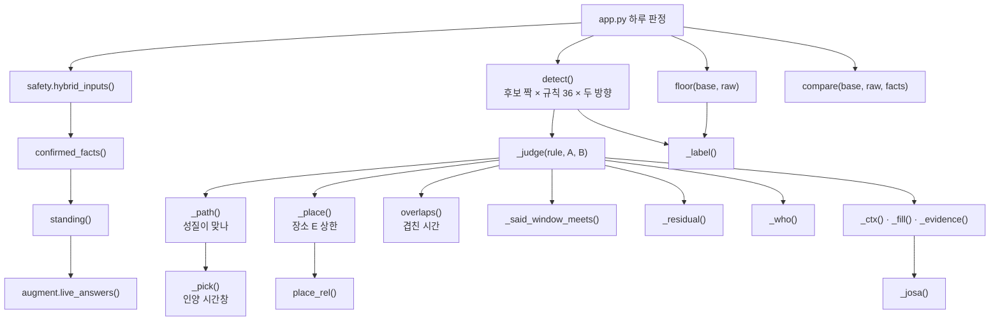
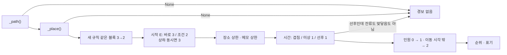

# 06d. 규칙별 경로와 판정 — `_path()`에서 `_judge()`까지

쌍작업 규칙 36개가 어떤 조건에서 붙고, 노출(E)과 순위가 어떻게 정해지는지 함수 단위로 적은 문서입니다.
[06 쌍작업 판정](06_쌍작업_판정.md)이 큰 흐름을 설명한다면, 이 문서는 [`server/pairs.py`](../server/pairs.py) 531~1182줄의 if 문 하나하나를 빠짐없이 옮깁니다.

**이 문서에서 알 수 있는 것**

- 규칙 36개마다 `_path()`가 보는 조건, 넘겨주는 시간창·장소 방식·메모(E 상한과 문장)
- `_place()`의 장소 방식 19가지(`reach`, `system`, `path` …)가 E 상한 3·2·1을 정하는 순서
- `_judge()`가 E를 깎는 순서(경로 종류 → 장소 → 메모 → 시간 → 인원)와 순위 1·2·3, 표기 확인위험·보수위험·판정보류
- 작업반장 제출본의 답이 사실이 되는 길(`standing()` → `confirmed_facts()`)과 안전 하한(`floor()`), 전후 비교(`compare()`)
- 코드에서 어긋나 보이는 곳을 「의도 / 확인 필요 / 설계 근거 미기록」으로 나눈 목록

**목차**

1. [규칙 36개 한눈에](#1-규칙-36개-한눈에)
2. [함수 지도](#2-함수-지도)
3. [호출 흐름](#3-호출-흐름)
4. [프로필에서 읽는 값](#4-프로필에서-읽는-값)
5. [함수별 설명](#5-함수별-설명)
   - [_path()](#_path) · [_place()](#_place) · [standing()](#standing) · [confirmed_facts()](#confirmed_facts) · [compare()](#compare) · [_label()](#_label) · [floor()](#floor) · [_said_window_meets()](#_said_window_meets) · [_judge()](#_judge) · [_josa()](#_josa) · [_who()](#_who) · [_residual()](#_residual)
6. [한계와 알려진 문제](#6-한계와-알려진-문제)

용어 몇 가지를 먼저 풉니다.

- **원인 작업(A)**: 위험을 만드는 작업입니다. 예: 화기(용접·절단처럼 불티가 나는 작업).
- **노출 작업(B)**: 그 위험을 받는 작업입니다. 예: 같은 블록에서 하는 도장.
- **S(강도)**: 사고가 나면 얼마나 크게 다치는지입니다. 3 = 사망·중대재해 가능, 2 = 중상·건강장해.
- **E(노출)**: 두 작업이 정말 이어지는지를 서류로 얼마나 확인했는지입니다. 3 = 확인, 2 = 가능, 1 = 미확인.
- **E 상한**: E가 넘을 수 없는 값입니다. 여러 상한 가운데 가장 작은 값이 E가 됩니다.
- **잔류위험**: 앞 작업이 끝난 뒤에도 남는 위험입니다. 예: 화기가 끝난 뒤의 잔불.
- **판정보류**: 확인이 필요해서 3순위로 남긴 경보입니다.

---

## 1. 규칙 36개 한눈에

[`server/pair_rules.json`](../server/pair_rules.json)의 규칙 36개를 `_path()` 코드와 맞춰 정리했습니다.
「E가 정해지는 법」의 시작값은 `trigger`가 `direct`(바로)면 3, `conditional`(조건: 사건이 하나 더 있어야 경로가 생김)이면 2입니다. 여기에 장소 상한과 메모 상한을 겹칩니다. 시간(선후·시간 미상 → 1)과 인원(서류상 인원 0 → 1)은 규칙 전체에 같은 식으로 적용하므로 표에서 뺐습니다. 인원 0 하향은 설비 규칙 5개(`EQUIP_RULES`)에는 적용하지 않습니다([_judge()](#_judge)).
「새」는 보강 과정에서 더한 새 규칙(`new_rule`)입니다. 대부분 2026-10-31에 더했고, `FIRE_GAS`는 2026-11-01에 더했습니다. 새 규칙은 장소 상한이 「같은 블록」 하나뿐일 때 3을 2로 낮춥니다.

| # | id | 원인(A) | 노출(B) | `_path` 조건 요약 | 장소 방식 | E가 정해지는 법 |
|---|---|---|---|---|---|---|
| 1 | [`FIRE`](#fire) | 화기 | 유기용제 도장·세정 | A `SPARK` · B `SOLVENT` | `reach` | 바로 3 → 같은 블록 3 · 같은 칼럼 2 · 옆 칼럼·먼 칼럼·옆 BAY 같은 칼럼대·위치 미상 1 |
| 2 | [`CONF_HOT`](#conf_hot) | 같은 블록 화기 | 밀폐 진입 인원 | A `SPARK` · B `CONFINED` | `block` | 바로 3 → 같은 블록 3 · 같은 칼럼 다른 블록 2 · 옆 칼럼·먼 칼럼 다른 블록 1 |
| 3 | [`CONF_GAS`](#conf_gas) | 불활성가스 사용 | 블록 내부 인원 | A `INERT` · B 밀폐 또는 내부 → `system` / B 높이·층 미상이고 같은 블록 → `system_any` | `system` · `system_any` | 바로 3 → 같은 배관·계통 3 · 같은 블록 둘 다 내부 2 · 같은 블록(B 밀폐)·같은 칼럼·옆 칼럼 1 / `system_any`는 2 |
| 4 | [`LOAD_OVER`](#load_over) | 매단 하물 이동 | 경로 아래·옆 작업자 | A `LIFT` · A의 크레인이 B가 잠근 크레인이 아님 · 시간창은 이동 구간 | `path` | 바로 3 → 같은 블록·명시 경로 3 · 같은 칼럼 2 · 경로 옆 칼럼 1 |
| 5 | [`TARGET_OCCUPIED`](#target_occupied) | 블록 인양 | 그 블록 안·위 인원 | A 인양 허가서 · B 안·위 → `same_block` / B 층 미상이고 같은 블록 → `same_block`(메모 2) / 그 밖 → `landed`(인양 뒤 안착 블록) | `same_block` · `landed` | 바로 3 → 같은 블록 3. `landed`는 인양 뒤에만 잡혀 늘 선후 E 1 |
| 6 | [`CRANE_LOTO`](#crane_loto) | 크레인 정전 수리 | 같은 크레인 사용 | A 잠근 크레인 ∩ B 쓰는 크레인 | `link` | 바로 3 → 같은 설비 3 |
| 7 | [`POWER_LOTO`](#power_loto) | 반 정전 | 그 반 전원 사용 | A 잠근 반 ∩ B 쓰는 반 | `link` | 조건 2 → 같은 설비 3이라 2 |
| 8 | [`DROP_BELOW`](#drop_below) | 높은 곳 절단·해체 | 아래 작업자 | A `DROP` · 높이 2m 미만 메모 1(답에 아래 작업이 있으면 2) · 높이 미상 메모 2 | `below` | 바로 3 → 반장 답 3 · 같은 블록 아래 3 · 같은 칼럼 아래·높이 미정 2 · 옆 칼럼 1 · 상대가 분명히 위면 없음 |
| 9 | [`PRESSURE`](#pressure) | 압력시험 | 주변 인원 | A `PRESSURE` | `reach`(같은 계통 먼저) | 바로 3 → 같은 배관·계통이면 BAY가 달라도 3 · 그 밖은 `reach` |
| 10 | [`RADIATION`](#radiation) | 방사선투과검사 | 통제구역 안·옆 | A `RADIATION` | `reach`(옆 BAY 1) | 바로 3 → `reach` · 옆 BAY 1. 유해위험요소 칸에만 있으면 금지 아님 |
| 11 | [`VEHICLE`](#vehicle) | 차량 운반 | 보행·고소작업대 | A `VEHICLE` · B 지상이거나 `MEWP` | `covered` | 바로 3 → 같은 블록 3 · 같은 칼럼 2 |
| 12 | [`CRANE_SHARE`](#crane_share) | 크레인 인양 | 같은 크레인 인양 | 같은 크레인 사용 · A 번호 ≤ B 번호 | `link` | 조건 2 |
| 13 | [`CRANE_CROSS`](#crane_cross) | 크레인 인양 | 다른 크레인 인양 | 둘 다 `LIFT`·크레인 번호 있음 · 같은 크레인 없음 · A 번호 ≤ B 번호 | `bay` | 조건 2 → 같은 BAY 2 |
| 14 | [`SUPPORT`](#support) | 절단·해체·받침 조정 / 받치는 블록 인양 | 블록 위·안·주변 | 인양 분기: 인양 허가서에 받침 말 · 절단 분기: A `SEP`·`DROP`·`SUPPORT_ADJ` | `same_block` · `held_by` | 조건 2 → 메모 2 |
| 15 | [`ACCESS`](#access) | 인양·운반·해체·적치 | 밀폐 진입(출입구) | A 인양·차량·낙하·절단·적치·대차 또는 반입 물품 · B `CONFINED` | `path` | 조건 2 · 반입 물품만이면 메모 1 |
| 16 | [`HOT_PERSON`](#hot_person) | 화기 | 같은 곳 작업자 | A `SPARK` · B가 용제·밀폐가 아님 | `hot` | 바로 3 → 같은 블록 3 · 같은 칼럼 2 · 옆 칼럼 1 |
| 17 | [`VENT_LOTO`](#vent_loto) 새 | 반 정전 | 환기·조명에 기대는 작업 | 정전 허가서 · B 밀폐: 늘 / B 밀폐 아님: 국소배기 화기·조명 쓰는 상부 작업만(메모 1) | `dep` | 바로 3 → 차단 범위에 연결이 적힘 3 · 같은 BAY 1 |
| 18 | [`CRANE_TEST`](#crane_test) 새 | 크레인 정비 뒤 시험운전 | 거더·상부·고소작업대 | 정전 허가서에 크레인 · B는 정비가 아니고 그 크레인을 쓰지 않음 · 상부 작업 / 시험 주행이 적히면 지상도(메모 1) | `crane_bay` | 조건 2 → 상대 서류에 같은 크레인 3 · 같은 BAY 2 · 메모 1 |
| 19 | [`SHARED_LOTO`](#shared_loto) 새 | 정비 | 같은 설비 정비 | 둘 다 정전 허가서 · 같은 설비를 잠금 · A 번호 ≤ B 번호 | `shared` | 조건 2 |
| 20 | [`OTHER_CRANE_REPAIR`](#other_crane_repair) 새 | 다른 크레인 인양 | 크레인 수리자 | A 인양에 크레인 · B 정전 허가서에 다른 크레인 | `bay2` | 조건 2 → 같은 BAY 2 |
| 21 | [`HOT_PANEL`](#hot_panel) 새 | 화기 | 열린 반 정비 | A `SPARK` · B 정전 허가서에 반·크레인 번호 · 반 개방이 안 적히면 메모 1 | `hot` | 조건 2 |
| 22 | [`FIRE_SOLID`](#fire_solid) 새 | 화기 | 가연물 적치 | A `SPARK` · B `COMBUST` | `reach` | 바로 3 → 같은 블록은 새 규칙이라 2 |
| 23 | [`FIRE_GAS`](#fire_gas) 새 | 화기 | 가연성 가스 취급 | A `SPARK` · B `FLAM_GAS` 또는 `GAS_UNK`(메모 1) | `reach` | 조건 2 |
| 24 | [`EGRESS_BLOCK`](#egress_block) 새 | 적치·대차 | 대피가 필요한 작업 | A 적치·대차 또는 반입 물품(메모 1) · B 밀폐 아님 · B 화기·상부·내부·고소작업대·고소 허가 | `same_only` | 조건 2 |
| 25 | [`OVERHEAD_WORK`](#overhead_work) 새 | 상부 설치 | 아래 작업자 | A `OVERHEAD`이고 `DROP` 아님 · 작업명에만 「상부」면 메모 1 | `below` | 조건 2 · 반장 답에 아래 작업과 겹치는 시각이 있으면 3·금지 |
| 26 | [`CART`](#cart) 새 | 수동 대차 | 보행·고소작업대 | A `CART`이고 `VEHICLE` 아님 · B 지상이거나 `MEWP` | `covered` | 조건 2 |
| 27 | [`CABLE_RUN`](#cable_run) 새 | 차량·대차 | 아크 화기의 케이블 | A `VEHICLE`·`CART` · B `SPARK`이고 아크 | `covered` | 조건 2 |
| 28 | [`NOISE_SIGNAL`](#noise_signal) 새 | 가우징·연삭 소음 | 신호 인양 | A 화기 소음 · B `LIFT` | `same_only` | 조건 2 |
| 29 | [`WELD_RETURN`](#weld_return) 새 | 아크 용접 | 같은 블록 내부 | A 아크 화기 · B 밀폐 또는 내부 · 귀환선이 안 적히면 메모 1 | `same_block` | 조건 2 |
| 30 | [`LIFT_LINE`](#lift_line) 새 | 블록 인양 | 덕트·호스·케이블 연결 작업 | A 인양 허가서 · B 연결선 있음 | `same_block` | 조건 2 |
| 31 | [`GRIND_FLY`](#grind_fly) 새 | 연삭·기계 절단 | 같은 곳 작업자 | A 연삭 화기 · B 밀폐 아님 | `hot` | 바로 3 → 같은 블록은 새 규칙이라 2 |
| 32 | [`CONF_PAINT`](#conf_paint) 새 | 유기용제 도장 | 밀폐 진입 | A `SOLVENT` · B 밀폐 또는 내부 | `paint` | 바로 3 → 같은 블록 둘 다 내부 3 · 같은 블록 2 · 그 밖은 `block` |
| 33 | [`MEWP_OVER`](#mewp_over) 새 | 고소작업대 | 아래·옆 지상 작업자 | A `MEWP` · B 고소작업대 아님·지상 | `covered` | 조건 2 |
| 34 | [`FIRE_SPREAD`](#fire_spread) 새 | 가연물 옆 화기 | 같은 블록·옆 칼럼 | A `SPARK`와 `COMBUST` · B 용제·가연물 아님 | `hot` | 조건 2 |
| 35 | [`HELD_FIT`](#held_fit) 새 | 크레인이 잡은 부재 | 그 부재 취부·용접 | A 인양 허가서 · B 화기 또는 취부 · 「잡은 채」가 안 적히면 메모 1 | `same_block` | 조건 2 |
| 36 | [`EQUIP_IGNITION`](#equip_ignition) 새 | 고소작업대·전원·전동공구 | 용제 도장 | A `MEWP`·`POWER_USE`·`ELEC_TOOL`, `SPARK` 아님 · B `SOLVENT` | `same_only` | 조건 2 |

합계는 [06 §8](06_쌍작업_판정.md#8-규칙-36개)과 같습니다. 금지 10 · 바로 15 · 잔류 규칙 22 · 새 규칙 20 · 조문 대조 완료 16입니다(지금 `pair_rules.json`에서 다시 셌습니다).

---

## 2. 함수 지도

맡은 범위(531~1182줄)의 함수 12개와 중첩 함수 1개입니다. 줄 번호는 지금 코드 기준입니다.

| 함수 | 줄 | 한 줄 요약 | 부르는 곳 |
|---|---|---|---|
| [`_path()`](#_path) | [531](../server/pairs.py#L531) | 두 작업 성질이 규칙에 맞는지 보고, 맞으면 시간창·장소 방식·메모를 돌려줌 | `_judge()`, `_quiet()` |
| [`_place()`](#_place) | [727](../server/pairs.py#L727) | 장소 방식대로 두 작업의 장소 연결을 보고 E 상한(3·2·1)과 문장을 돌려줌 | `_judge()` |
| [`standing()`](#standing) | [880](../server/pairs.py#L880) | 철회(C6)·정정(C5)을 반영해 지금 서 있는 답만 남김 | `confirmed_facts()` |
| [`confirmed_facts()`](#confirmed_facts) | [901](../server/pairs.py#L901) | 반장이 확인한 자기 작업의 답을 사실(태그·설비 번호)로 바꿈 | `safety.hybrid_inputs()`, `app.py`, `docsum.py` |
| [`compare()`](#compare) | [933](../server/pairs.py#L933) | 답을 넣기 전과 뒤의 경보를 새로 생김·유지·사라짐으로 나눔 | `app.py` |
| ↳ `row()` | [943](../server/pairs.py#L943) | `compare()` 안의 중첩 함수. 비교 한 줄을 만듦 | `compare()` |
| [`_label()`](#_label) | [959](../server/pairs.py#L959) | 이유 하나의 표기(확인위험·보수위험·판정보류)를 고름 | `detect()`, `floor()` |
| [`floor()`](#floor) | [964](../server/pairs.py#L964) | 답을 넣은 판정이 서류만의 판정보다 약해지지 않게 하한을 지킴 | `app.py` |
| [`_said_window_meets()`](#_said_window_meets) | [1011](../server/pairs.py#L1011) | 반장 「아래 작업」 답의 시각이 상대 작업 시간과 겹치는지 봄 | `_judge()` |
| [`_judge()`](#_judge) | [1021](../server/pairs.py#L1021) | 규칙 하나·방향 하나로 E·점수·순위·표기·이유를 만듦 | `detect()` |
| [`_josa()`](#_josa) | [1163](../server/pairs.py#L1163) | 이름 뒤에 받침에 맞는 조사(이/가, 을/를)를 붙임 | `_fill()`, `analyze.py`, `coordnote.py` |
| [`_who()`](#_who) | [1173](../server/pairs.py#L1173) | 작업의 짧은 이름(「F001 화기」「WP-07」)을 만듦 | `_judge()`, `_fill()` |
| [`_residual()`](#_residual) | [1178](../server/pairs.py#L1178) | 어느 쪽이 먼저 끝났는지에 따라 남는 위험의 이름을 고름 | `_judge()`, `sequence_plan()`, `explain.py` |

범위 안의 상수입니다.

| 상수 | 줄 | 값 | 쓰는 곳 |
|---|---|---|---|
| `CONFIRMED` | 867 | `"작업반장 답변 · 반장 답변 확인"` | `profile()`이 확인 사실의 근거 칸 이름 앞에 붙임 |
| `HYBRID_CHOICE` | 869 | `("HT1","gas"/"plasma"/"mech")`, `("CF1","repair")`, `("CF4","yes")` → 모두 `"SPARK"` | `confirmed_facts()` |
| `HYBRID_IDS` | 872 | `D2`·`LI1` → `crane_use`, `D4` → `power_use`, `CF3` → `dep_panel` | `confirmed_facts()` |
| `HYBRID_INERT` | 874 | `("H2", "D3", "CF2", "D7")` | `confirmed_facts()` |
| `SAYS_NO` | 875 | `안\s*(?:씀|써|쓰|함|해|하|합|들)|않|없|미사용|사용\s*안|제외|아님|아니|말고|금지|빼고` | `confirmed_facts()` |
| `OTHERS` | 876 | `(?:옆|다른|타|상대|저쪽)\s*(?:팀|업체|반|작업|회사)|[가-힣]{1,6}팀(?:은|는|이|가|도|의|에서|이랑|하고)|들었` | `confirmed_facts()` |
| `CLAUSE` | 877 | `[,·/;.]|\s(?:그리고|또는|및)\s` | `confirmed_facts()` |
| `LABEL_RANK` | 956 | `{"판정보류": 1, "보수위험": 2, "확인위험": 3}` | `floor()` |
| `LAW_PENDING` | 1002 | `"관련 조문은 국가법령정보센터 현행본 대조 전이라 표시하지 않음"` | `_judge()` |
| `EQUIP_RULES` | 1003 | `CRANE_LOTO`, `POWER_LOTO`, `CRANE_SHARE`, `CRANE_CROSS`, `SHARED_LOTO` | `_judge()`(인원 단계를 건너뜀) |
| `TOUCH` | 1004 | `"앞 작업이 끝나는 시각에 바로 이어서 시작: 앞 작업이 늦어지면 겹침(실제 종료 확인 기록 없음)"` | `_judge()` |
| `ZERO` | 1005 | `"서류상 인원 0: 실제 퇴실 확인 아님"` | `_judge()` |
| `REVERSED` | 1006 | `"시간 역전"` | `_judge()` |
| `REV_COLS` | 1007 | `"칼럼 범위가 큰 번호부터 적힘"` | `_judge()` |
| `NEXT_COL` | 1008 | `"바로 옆 칼럼"` | `_judge()`(선후일 때 옆 칼럼을 빼는 표지) |
| `_BATCHIM_DIGIT` | 1160 | `set("013678")` | `_josa()` |

---

## 3. 호출 흐름

`_judge()` 한 번 안의 순서입니다.

---

## 4. 프로필에서 읽는 값

`_path()`·`_place()`·`_judge()`는 서류를 직접 읽지 않습니다. `profile(d)`가 만든 프로필(사전)을 읽습니다. 프로필을 만드는 규칙(정규식, 부정 처리)은 [06 §4](06_쌍작업_판정.md#4-서류--프로필-작업-성질-읽기)와 [06 §4.3 태그 표](06_쌍작업_판정.md#43-태그-표)에 있습니다. 여기서는 이 문서의 함수가 쓰는 필드만 풉니다.

| 필드 | 뜻 |
|---|---|
| `tags` | 작업 성질 `{태그: [(칸, 값), …]}`. `SPARK`(화기), `SOLVENT`(유기용제), `CONFINED`(밀폐 진입), `INERT`(불활성가스), `LIFT`(크레인 인양), `DROP`(높은 곳 절단·해체), `SEP`(절단·해체), `OVERHEAD`(상부 설치·취급), `VEHICLE`, `CART`, `MEWP`(고소작업대), `PRESSURE`, `RADIATION`, `COMBUST`(가연물), `FLAM_GAS`, `GAS_UNK`, `STAGE`(적치), `STAGE_SOFT`(반입 물품), `SUPPORT_ADJ`(받침 조정), `ELEC_TOOL`, `POWER_USE` 등 |
| `ids` | `crane_use`·`crane_loto`(크레인 번호, 사용·잠금), `power_use`·`power_loto`(반 번호), `blocks`(블록 번호), `systems`(배관·계통 번호) |
| `d` | 원래 서류. `d["type"]`(`permit`·`plan`), `d["kind"]`(`hot`·`confined`·`lifting`·`loto`·`height`), `d["id"]`, `d["is_route"]`, `d["company"]` |
| `wins` | 그날 시간창 `[(시작 분, 끝 분)]` |
| `move`, `moves` | 인양 이동 시각. `moves`는 기본적으로 이동 시각 + 안전팀이 더한 재진입 창입니다. 인양 허가서에 제출본 이동 구간(T1·T6)이 있으면 기존 이동 시각을 그 구간으로 바꾸고 `move`는 비웁니다 |
| `move_off` | 이동 시각이 허가 시간창 밖에 있음 |
| `lift_at` | 계획서 단계에 「(10:30)」처럼 적힌 크레인 단계 시작 ~ 그 창의 끝 |
| `level` | `inside`(내부·이중저·탱크·배관), `top`(2m 이상·상부·갑판), `ground`(그 밖) |
| `level_known` | `ground`가 사실인지. 높이를 아무도 안 적어 `ground`가 된 것은 `False`. 고소 허가서도 `False` |
| `height_permit` | 고소작업 허가서 |
| `low`, `high` | 작업 높이(m). 모르면 `None` |
| `drop_low` | 절단 높이가 0m 초과 2m 미만으로 적힘(높은 곳 근거 없음) |
| `drop_unknown` | 절단인데 높이가 안 적힘 |
| `up_said` | 높이 근거 없이 작업명·상세에만 「상부」「높은 곳」 |
| `below` | 반장 답 가운데 「하부·아래·밑」이 들어간 답 |
| `where` | `known`(BAY·칼럼 있음), `off`(사무동 등 공장 밖), `unknown` |
| `spans` | BAY·칼럼 범위 `{bay, c0, c1}` |
| `hot_kind` | 화기 공법 `arc`(아크), `gas`(가스 절단), `grind`(연삭), `noise`(가우징·연삭 소음) |
| `fit` | 취부·가용접·가고정·볼트 체결·정렬 |
| `held` | 「크레인으로 잡은 채」 같은 말 (`HELD`) |
| `return_path` | 어스·귀환·접지 클램프·귀선 (`RETURN_PATH`) |
| `panel_open` | 제어반·배전반·반 개방·결선·차단기 등 (`PANEL_OPEN`) |
| `dep`, `dep_fn` | 정전 허가서: 정전으로 함께 멈추는 것(`yes`·`no`·`unknown`)과 그 기능(`air`·`light`·`comm`) |
| `dep_panels`, `dep_fn_b` | 이 작업의 환기·조명이 물린 반 번호와 그 반의 기능 |
| `dep_blocks` | 정전 반장 답에 적힌 블록 |
| `girder` | 크레인 거더·트롤리·레일 작업의 근거 문장 |
| `test_run`, `test_drive` | 정전 허가서에 시험(운전)이 적힘 / 부정 없이 시운전·시험 주행이 적힘 |
| `lines` | 덕트·송기·호스·전선·케이블 |
| `support_cut` | `SEP` 근거에 받침·지그·쐐기·서포트·지지대·버팀 |
| `text_all` | 읽은 칸 전부를 이은 글 |
| `people` | 인원. `None` = 미상, `0` = 서류상 0명 |
| `res_end` | 반장 답 T4의 잔불 감시 종료 예정 시각(분) |
| `assumed_nd`, `rev_cols` | 끝이 시작보다 일러 다음 날로 읽은 창 / 큰 번호부터 적힌 칼럼 범위 |

---

## 5. 함수별 설명

예시는 따로 적지 않으면 지금 코드를 실제로 import해 돌린 결과입니다. 시험용 서류는 [`tools/check_pairs_final.py`](../tools/check_pairs_final.py)의 `plan()`·`permit()` 도우미와 같은 꼴로 만들었습니다. 기본 입력은 다음과 같습니다.

- 장소 `3BAY 08-10 칼럼 E42P 블록`, 시간 `13:00~15:00`
- 화기: 화기작업 허가서 「E42P 론지 용접」, 체크 「용접·용단」
- 지상 작업: 계획서 「E42P 블록 마킹」, 장비 「마킹펜」, 작업높이 「지상 작업」
- 도장: 계획서 「E42P 블록 도장」, 사용물질 「에폭시 도료, 시너」
- 밀폐: 밀폐공간 허가서 「E42P 탱크 내부 점검」, 장소 끝에 「내부」
- 인양: 중량물인양 허가서 「E42P 블록 인양」, 상세 「OH-21-03 사용」

---

### _path()

**한 줄 요약.** 규칙 하나와 두 작업(A = 원인 후보, B = 노출 후보)을 받아, 두 작업의 성질이 그 규칙에 맞는지 봅니다. 맞으면 「어느 시간창으로 겹침을 볼지」「어떤 장소 증거가 필요한지」「이 짝에서 모르는 것」을 돌려줍니다.

**입력과 출력.**

- 입력: `rule`(규칙 사전, `rule["id"]`만 씀), `A`, `B`(프로필)
- 출력: `None`(이 규칙은 해당 없음) 또는 `(wa, wb, mode, notes)`
  - `wa`, `wb`: 겹침을 볼 시간창. 대개 `A["wins"]`, `B["wins"]`. 인양은 이동 구간
  - `mode`: 장소 방식 문자열. [`_place()`](#_place)가 받음
  - `notes`: `[(E 상한, 문장)]`. 이 짝에서 서류에 없는 것

**안에서 쓰는 도우미.**

- `loto(P)`: `P["d"]["type"] == "permit"`이고 `P["d"]["kind"] == "loto"`(정전 허가서).
- `over(P)`: `P["level"] == "top"`, 또는 `MEWP` 태그, 또는 `girder`가 있음, 또는 고소 허가서. 「높은 곳 작업」입니다.
- `_pick(P)`(527줄, 범위 밖): `P["moves"]`가 있으면 그것, 없으면 `P["lift_at"]`, 그것도 없으면 `P["wins"]`. 인양의 「하물이 실제로 움직이는 시간」을 고릅니다.

**공통 순서.** `rule["id"]`로 분기합니다. 분기 순서는 결과에 영향을 주지 않습니다. 규칙마다 분기가 하나씩이기 때문입니다. 어떤 분기에도 해당하지 않으면 맨 끝에서 `None`을 돌려줍니다.

**부르는 곳 / 부르는 것.** `_judge()`와 `_quiet()`이 부릅니다. `_pick()`, `_tokens()`, 정규식 `SUPPORT_CUT`·`BLOCK_ID`·`LOCAL_EXH`·`DEP_LIGHT`를 씁니다.

**시험.** `_path()`를 직접 부르는 시험은 없습니다. `_judge()`를 부르는 [`check_pairs_cases.py`](../tools/check_pairs_cases.py)·[`check_pairs_final.py`](../tools/check_pairs_final.py)·[`check_pairs_material.py`](../tools/check_pairs_material.py), 그리고 `detect()` 전체를 보는 [`check_pairs.py`](../tools/check_pairs.py)가 규칙별 결과를 지킵니다. 규칙 절마다 그 id를 문자열로 쓰는 시험 파일을 적었습니다.

아래는 규칙별 절입니다. 「돌린 예」의 입력은 위 기본 입력이고, 결과는 `_judge()`까지 돌린 값입니다.

#### FIRE

화기 불티 × 가연성 증기. S 3 · 바로 · 금지 · 잔류(어느 쪽이 먼저든).

- 조건: A에 `SPARK`, B에 `SOLVENT`.
- 돌려주는 것: `(wa, wb, "reach", [])`. 메모 없음.
- E: 시작 3 → [`reach`](#reach-기본-닿는-범위) 상한. 같은 블록 3, 같은 칼럼 주소 2, 바로 옆 칼럼·같은 BAY 먼 칼럼·옆 BAY 같은 칼럼대·위치 미상 1.
- 잔류: 화기가 먼저면 「잔불(확인 기록 전까지)」, 도장이 먼저면 「용제 증기·젖은 도막(건조·환기 확인 기록 전까지)」.
- 돌린 예: 화기 × 도장 같은 블록 → E 3 · 점수 9 · **1순위** · 확인위험. 블록 없이 3BAY 08-10 × 09-10 → E 2 · 2순위 · 보수위험 「3BAY 같은 칼럼 주소(실제 거리 미확인)」. 08-10 × 11-12 → E 1 · 3순위 · 판정보류 「3BAY 바로 옆 칼럼: 거리 미확인(실제 거리·차폐 확인 필요)」. 3BAY 08-10 × 4BAY 09-10 → E 1 「옆 BAY 같은 칼럼대: 불티·열이 넘어가는지(거리·칸막이·개구부) 미확인」. 3BAY 08-10 × 4BAY 15-16 → 경보 없음. 화기 09~11 → 도장 13~15(같은 블록) → E 1 · 3순위 · 보수위험 「…120분 뒤 시작: 잔류위험(잔불)이 없어졌다는 확인 기록이 없음」.
- 시험: check_pairs, check_pairs_cases, check_pairs_final, check_pairs_material, check_hybrid, check_pairreview, check_docs_ai.

#### CONF_HOT

밀폐 진입 × 같은 블록 화기. S 3 · 바로 · 금지 · 잔류(어느 쪽이든).

- 조건: A에 `SPARK`, B에 `CONFINED`.
- 돌려주는 것: `(wa, wb, "block", [])`.
- E: 시작 3 → [`block`](#block--paint) 상한. 같은 블록 3, 같은 칼럼 다른 블록 2, 옆 칼럼·먼 칼럼 다른 블록 1.
- 잔류: 화기가 먼저면 「잔불·흄」, 밀폐가 먼저면 「내부 잔류 인원(퇴실 확인 기록 전까지)」.
- 돌린 예: 같은 블록 → E 3 · 1순위. E41P(08-10) × E42P 내부(11-12) → E 1 「3BAY 바로 옆 칼럼 다른 블록: 개구부까지 거리 미확인(화재감시자 11m 안일 수 있음·차폐 확인)」. E41P × E42P 같은 칼럼 → E 2 「3BAY 같은 칼럼 주소(다른 블록)」.
- 시험: check_pairs_cases, check_pairs_final, check_pairs_material.

#### CONF_GAS

불활성가스 공급 × 밀폐 진입. S 3 · 바로 · 금지 · 잔류(어느 쪽이든).
코드 주석: 가스는 배관으로도, 같은 내부 공간의 공기로도 닿습니다(자료 PE01·PE09: 배관 OR 공기 경로).

1. A에 `INERT`가 없으면 `None`.
2. B에 `CONFINED`가 있거나 `B["level"] == "inside"`이면 `(wa, wb, "system", [])`.
3. 아니고, B의 층이 사실이 아니며(`not B["level_known"]`) 두 작업에 같은 블록 번호가 있으면 `(wa, wb, "system_any", [(2, "블록 안·위인지(탱크·구획 안 작업인지) 서류에 없음")])`.
4. 그 밖은 `None`.

- E: 시작 3 → [`system`](#system) 또는 [`system_any`](#system_any) 상한.
- 잔류: 가스가 먼저면 「잔류 가스(공급을 끊어도 남음: 진입 전 호흡 위치에서 산소·가스 측정으로 확인)」, 밀폐가 먼저면 「내부 잔류 인원」.
- 돌린 예: TIG(「P-12 배관 아르곤 퍼지」, E43P) × 밀폐(E42P, 상세에 「P-12 배관 계통 연결」) → E 3 「같은 배관·계통 P-12」 · 1순위. 같은 블록 둘 다 내부, 계통 미기재 → E 2 「같은 블록 E42P 내부 공기 구획을 함께 쓸 수 있음(가스 계통 연결은 서류에 없음)」 · 2순위. 블록 없이 같은 칼럼 → E 1 「3BAY 같은 칼럼: 같은 공간·가스 계통인지 미확인」. B가 높이 칸이 빈 마킹 계획서(같은 블록) → `system_any`, E 2 · 2순위. 공통 계통·공통 블록이 없고 한쪽 위치가 미상(BAY도 모름)이거나 칼럼이 멀면 → 경보 없음(6장 확인 필요 3번).
- 시험: check_pairs_cases, check_pairs_final, check_pairs_material, check_pairreview.

#### LOAD_OVER

인양 경로 × 아래 작업자. S 3 · 바로 · 금지 · 잔류 없음.

1. A에 `LIFT`가 없으면 `None`.
2. A의 사용 크레인이 B가 잠근 크레인과 같으면 `None`. 코드 주석: 자기 정비 위로 크레인이 지나가는 것은 `CRANE_LOTO`가 맡습니다.
3. `(A의 시간창, wb, "path", [])`. A의 시간창은 `moves`나 `lift_at`이 있으면 `_pick(A)`, 없으면 `wa`입니다.

- E: 시작 3 → [`path`](#path) 상한. 같은 블록 3, 명시된 이동 경로가 그 칼럼 위를 지남 3, 같은 칼럼 주소 2, 경로 바로 옆 칼럼 1.
- 돌린 예: 같은 블록 → E 3 · 1순위. 이동 경로 「3BAY 03→08칼럼」(`is_route`) × 05칼럼 마킹 → E 3 「명시된 이동 경로가 3BAY 그 칼럼 위를 지남(평면 경로: 실제 하물 외곽·높이는 서류에 없음)」 · 1순위. 블록 없이 08-10 × 09-10 → E 2 「3BAY 같은 칼럼 주소(실제 위치 미확인)」. 08-10 × 11-12 → E 1 「3BAY 경로 바로 옆 칼럼: 하물 폭·회전·흔들림 외곽 미확인」. 이동 15:30~16:30이 허가 13:00~15:00 밖이고 상대가 15:00~17:00 → E 2 「F005의 이동 예정 시각이 허가 시간 밖: 일정 불일치 확인」.
- 시험: check_pairs_cases, check_pairs_final, check_pairs_material.

#### TARGET_OCCUPIED

블록 인양·반출 × 그 블록 안·위 작업. S 3 · 바로 · 금지 · 잔류(어느 쪽이든).

1. A가 인양 허가서(`kind == "lifting"`)가 아니면 `None`.
2. A의 시간창은 `moves`가 있으면 그것, 없으면 `wa`.
3. `B["level"]`이 `inside`나 `top`이면 `same_block`, 메모 없음.
4. B의 층이 사실이 아니고 같은 블록 번호가 있으면 `same_block`, 메모 `(2, "블록 안·위인지(작업 높이·위치) 서류에 없음")`. 코드 주석: 블록 어디인지 아무도 안 적었으니 안·위일 수 있습니다.
5. 그 밖은 `landed`. 코드 주석: 인양 뒤 받침·고정·장구가 풀리기 전, 안착한 블록 옆의 작업입니다(자료 MV05·MV06·MV13).

- E: 시작 3 → `same_block`·`landed`는 같은 블록이면 3, 아니면 경보 없음. 다만 한쪽 위치가 미상이면 블록 일치 검사보다 먼저 상한 1로 남깁니다.
- `landed`는 [`_judge()`](#_judge)에서 따로 다룹니다. 시간이 겹치면 경보를 내지 않습니다(인양 중 겹침은 `LOAD_OVER`). 인양이 먼저 끝나고 B가 뒤에 올 때만 잔류로 봅니다.
- 잔류: 인양이 먼저면 「안착 블록의 받침·고정과 장구 해제」, 블록 안 작업이 먼저면 「잔류 인원(퇴실 확인 기록 전까지)」.
- 사슬 문장 추가: B에 `SEP`가 있고 같은 블록이면 사슬 셋째 줄에 「{B}가 그 블록의 러그·부재를 자르는 중이면 인양점·지지가 약해질 수 있다」를 끼웁니다.
- 돌린 예: 인양 × 「E42P 블록 상부 취부」 높이 3.0m → E 3 · 1순위. 인양 09~11 → 같은 블록 지상 마킹 13~15 → `landed`, E 1 · 3순위 · 보수위험 「…잔류위험(안착 블록의 받침·고정과 장구 해제)…」. 같은 짝이 같은 시간이면 → 경보 없음.
- 시험: check_pairs_cases, check_pairreview.

#### CRANE_LOTO

크레인 정비(정전) × 같은 크레인 사용. S 3 · 바로 · 금지 · 잔류(원인 먼저일 때만). 설비 규칙(`EQUIP_RULES`)입니다.

- 조건: A가 잠근 크레인 ∩ B가 쓰는 크레인이 있어야 합니다.
- 돌려주는 것: `(wa, B의 시간창, "link", [])`. B의 시간창은 `moves` → `lift_at` → `wb` 순으로 고릅니다.
- E: 시작 3 → [`link`](#link--shared)는 늘 3(장소를 보지 않음).
- 잔류: 「복구·시험운전·잠금 해제·인계(확인 기록 전까지)」. 정비가 먼저 끝날 때만.
- 돌린 예: 같은 시간 → E 3 「같은 설비 OH-21-03」 · 1순위. 정비 09~11 → 인양 13~15(인양 인원 0) → E 1 · 3순위 · **보수위험**. 설비 규칙이라 인원 0 단계를 건너뜁니다. 인양 09~11 → 정비 13~15 → 경보 없음(원인 먼저만, 맞닿음도 아님). 정비 장소가 「사무동 전기실」이어도 E 3 · 1순위(6장 의도 2번).
- 시험: check_pairs_material.

#### POWER_LOTO

공유 전원 정전 × 그 전원 사용. S 3 · 조건 · 잔류(원인 먼저). 설비 규칙입니다.

- 조건: A가 잠근 반 ∩ B가 쓰는 반.
- 돌려주는 것: `(wa, wb, "link", [])`.
- E: 시작 2(재통전이라는 사건이 하나 더 있어야 함) → `link` 3 → E 2.
- 돌린 예: 「MCC-4 분기 정전」 × 장비 「MCC-4 전원 연결 조명」 → E 2 · 점수 6 · 2순위 · 보수위험, 이유 「경로가 생기려면 사건이 하나 더 있어야 함(재통전·같은 시각 배차·주행 구간 겹침 등)」.
- 시험: check_pairs_material.

#### DROP_BELOW

높은 곳 절단·해체 × 아래 작업. S 3 · 바로 · 금지 · 잔류(원인 먼저).

1. A에 `DROP`이 없으면 `None`.
2. `A["drop_low"]`(0m 초과 2m 미만)이면 `below`, 메모 `(2 if A["below"] else 1, "작업 높이 2m 미만으로 적힘: 낮아도 떨어지는 부재에 맞거나 깔릴 수 있음(실제 하부 노출 확인)")`. 반장이 아래 작업을 답했으면 상한 2, 아니면 1입니다.
3. 그 밖은 `below`, `A["drop_unknown"]`이면 메모 `(2, "작업 높이 미확인(서류에 높이 없음)")`.

- 근거(프로필 주석): 높이 미상·2m 미만만으로 낙하를 빼지 않습니다(자료 LU02·R42-38-DROP·Q04).
- E: 시작 3 → [`below`](#below) 상한 → 메모.
- 잔류: 「미회수 분리물·잔존물(회수·고정 확인 기록 전까지)」.
- 돌린 예: 고소 허가 「작업높이 4.5m 러그 절단」 × 같은 블록 지상 → E 3 「같은 블록 E42P · 아래 높이」 · 1순위. 높이가 안 적힌 화기 「E42P 러그 절단」 → E 2 「작업 높이 미확인(서류에 높이 없음)」 · 2순위. 「작업높이 1.5m」(고소 허가·MEWP·위치 상부 같은 근거가 없는 계획서) → E 1 · 3순위 · 판정보류. 상대가 8m 배관 설치 → 경보 없음(상대가 분명히 위). 옆 칼럼 → E 1 「3BAY 바로 옆 칼럼: 떨어지는 물체의 크기·회전·미끄러짐 범위 미확인」.
- 시험: check_pairs, check_pairs_cases, check_pairs_final, check_pairs_material.

#### PRESSURE

압력시험 × 주변 작업. S 3 · 바로 · 금지 · 잔류(어느 쪽이든).

- 조건: A에 `PRESSURE`.
- 돌려주는 것: `(wa, wb, "reach", [])`.
- E: 시작 3 → `_place()`가 `reach` 전에 「같은 배관·계통 번호」를 먼저 봅니다. 같은 계통이면 BAY가 달라도 3입니다(코드 주석: Codex final P5·L113 「다른 BAY라도 계통이 이어짐」). 그 밖은 `reach`.
- 잔류: 시험이 먼저면 「잔압(감압 뒤에도 남는지 확인 기록)」, 상대가 먼저면 「시험 구역 잔류 인원」.
- 돌린 예: 「P-12 배관 수압시험」(3BAY) × 「P-12 배관 플랜지 조립」(4BAY 15-16) → E 3 「같은 배관·계통 P-12(시험 매체·압력이 들어올 수 있음)」 · 1순위.
- 시험: check_pairs_cases, check_pairs_final, check_pairs_material.

#### RADIATION

방사선투과검사 × 통제구역 안 인원. S 3 · 바로 · 금지 · 잔류(원인 먼저).

- 조건: A에 `RADIATION`.
- 돌려주는 것: `(wa, wb, "reach", [])`.
- E: 시작 3 → `reach`. 다른 BAY라도 바로 옆 BAY면 1입니다(「옆 BAY: 방사선 통제구역 범위 미확인(촬영 담당에게 통제 범위 확인)」). 코드 주석: 통제구역은 선원 세기·차폐·방향에 따라 BAY보다 넓을 수 있습니다.
- `_judge()` 예외: A의 `RADIATION` 근거가 모두 「유해위험요소」 칸이면 금지로 보지 않습니다. 이유와 gaps에 「{A}의 방사선은 유해위험요소 칸에만 적힘: 이 작업이 촬영하는지 확인」을 붙입니다.
- 잔류: 「선원 회수·측량(통제 해제 확인 기록 전까지)」.
- 돌린 예: 「E42P 방사선투과검사」 장비 「이리듐 선원」 × 같은 블록 → E 3 · 1순위. 유해위험요소 칸에만 「방사선 노출」 → E 3 · 점수 9 · **2순위**(금지 아님). 3BAY × 4BAY 15-16 → E 1 · 판정보류.
- 시험: check_pairs_cases, check_pairs_final, check_pairs_material.

#### VEHICLE

차량 운반 경로 × 보행·고소작업대. S 3 · 바로 · 금지 아님 · 잔류 없음.

- 조건: A에 `VEHICLE`. B가 지상(`level == "ground"`)이거나 `MEWP`.
- 돌려주는 것: `(wa, wb, "covered", [])`.
- E: 시작 3 → [`covered`](#covered) 상한. 같은 블록 3, 같은 칼럼 주소 2.
- 돌린 예: 「자재 지게차 운반」 × 같은 블록 지상 → E 3 · 점수 9 · **2순위**(금지 아님) · 확인위험. 같은 칼럼 주소 → E 2. 운반 09~11 → 마킹 11~12 → 맞닿음 E 1 · 판정보류(`TOUCH` 문장). 마킹 12~13 → 경보 없음.
- 시험: check_pairs_final, check_pairs_material.

#### CRANE_SHARE

같은 크레인 같은 시각 사용. S 2 · 조건 · 잔류 없음. 설비 규칙입니다.

- 조건: 두 작업이 같은 크레인을 씀. `A["d"]["id"] > B["d"]["id"]`이면 `None`(같은 짝을 한 번만 내려고 번호 작은 쪽을 A로 고정).
- 돌려주는 것: `(_pick(A), _pick(B), "link", [])`.
- E: 시작 2 → `link` 3 → 2. 점수 4 → 3순위.
- 돌린 예: 두 인양 허가서가 OH-21-03 → E 2 · 점수 4 · 3순위 · 보수위험.
- 시험: check_pairs_material.

#### CRANE_CROSS

같은 BAY 다른 크레인 동시 인양. S 3 · 조건 · 잔류 없음. 설비 규칙입니다.

- 조건: 둘 다 `LIFT`. A 번호 ≤ B 번호. 같은 크레인이 없음. 둘 다 크레인 번호가 있음.
- 돌려주는 것: `(_pick(A), _pick(B), "bay", [])`.
- E: 시작 2 → [`bay`](#bay--bay2--crane_bay--dep의-bay-단계) 상한 2.
- 돌린 예: OH-21-03(08-10) × OH-21-04(14-16), 같은 3BAY → E 2 「같은 3BAY(주행 구간 미확인)」 · 2순위.
- 시험: 이 id를 문자열로 쓰는 시험은 없습니다. [`check_pairs_material.py`](../tools/check_pairs_material.py) 12절의 v1 대비 보존 시험(`lost()`)이 기준본의 경보 전체를 지킵니다.

#### SUPPORT

절단·해체 × 같은 블록 위 작업(공통지지). S 3 · 조건 · 잔류(원인 먼저).

인양 분기를 먼저 봅니다.

1. A가 인양 허가서이고, A의 칸 어딘가에 `SUPPORT_CUT`(받침·지그·쐐기·서포트·지지대·버팀)이 있으며, A에 `SEP`·`DROP`·`SUPPORT_ADJ`가 없으면 「인양할 블록이 다른 구조를 받친다」로 읽습니다(자료 MV07·Q07 p305).
   - 받침 말이 들어간 구절의 블록 번호 가운데 A 자신의 블록이 아닌 것을 `held`로 모읍니다.
   - `held ∩ B 블록`이 있으면 `held_by`, 메모 `(2, "인양할 블록이 받치는 블록 {…}: 들어 옮기면 받침이 빠짐")`.
   - 없으면 `same_block`, 메모 `(2, "인양할 블록이 다른 구조·작업의 받침·지지로 쓰이는지 확인 필요")`.

그다음 절단 분기입니다.

2. A에 `SEP`·`DROP`·`SUPPORT_ADJ`가 하나도 없으면 `None`.
3. B가 `top`이나 `inside`면 `same_block`, 메모 없음(자료 PE16: 붙은 배관·공간 안).
4. A의 `support_cut`이거나 `SUPPORT_ADJ`면 `same_block`, 메모 `(2, "받침·지그 해체·조정: 블록 아래·주변 작업과의 높이 관계 미확인")`(자료 R42-09-SUPPORT).
5. B의 층이 사실이 아니고 같은 블록이면 `same_block`, 메모 `(2, "블록 위·안인지(작업 높이·위치) 서류에 없음")`.
6. 그 밖은 `None`.

- E: 시작 2 → 장소 → 메모 2.
- 잔류: 「지지 상실(임시 지지·하중 이전 확인 기록 전까지)」.
- 돌린 예: 「E42P 블록 받침 해체」 × 같은 블록 지상 → E 2 · 2순위, 이유 둘(조건 경로 · 받침 메모). 인양 허가서 답 LI2 「E42P 블록이 E43P 블록 받침으로 쓰임」 × E43P 작업 → `held_by` E 2 「인양 블록이 받치는 블록 E43P(인양 허가서에 적힘)」.
- 시험: check_pairs, check_pairs_cases, check_pairs_final, check_pairs_material.

#### ACCESS

하물·차량·낙하물·적치물 × 밀폐 출입·구조 경로. S 3 · 조건 · 잔류(원인 먼저).

- `hard = {LIFT, VEHICLE, DROP, SEP, STAGE, CART} ∩ A 태그`.
- 조건: `hard`가 있거나 A에 `STAGE_SOFT`. 그리고 B에 `CONFINED`.
- 돌려주는 것: `(A 시간창, wb, "path", 메모)`. A 시간창은 `LOAD_OVER`와 같습니다. `hard`가 없으면(반입 물품만) 메모 `(1, "반입·반출 물품이 출입구·통로에 놓이는지 서류에 없음")`.
- `_judge()`는 결과에 `cause_kind`(A 태그 가운데 `LIFT`, `VEHICLE`, `CART`, `DROP`, `SEP`, `STAGE`, `STAGE_SOFT` 순으로 처음 것)를 붙입니다.
- 잔류: 「출입구·구조 경로의 적치물·잔해(정리·출입구 확보 확인 기록 전까지)」.
- 돌린 예: 인양 × 같은 블록 밀폐 → E 2 · 2순위, `cause_kind` = `LIFT`.
- 시험: check_pairs_final, check_pairs_material.

#### HOT_PERSON

화기 발생물 × 같은 곳 작업자. S 2 · 바로 · 잔류(원인 먼저, 같은 블록만).

- 조건: A에 `SPARK`. B에 `SOLVENT`도 `CONFINED`도 없음(그건 `FIRE`·`CONF_HOT`).
- 돌려주는 것: `(wa, wb, "hot", [])`.
- E: 시작 3 → [`hot`](#same_only--hot) 상한. 같은 블록 3, 같은 칼럼 2, 바로 옆 칼럼 1.
- 잔류: 「같은 블록의 잔열·불씨·흄」. `sequence_same_block`이라 같은 블록만 봅니다. 예외로 블록 번호가 없는 같은 칼럼(상한 2)에서 뒤 작업이 잔재를 다루면(`RESIDUE`) 봅니다.
- 돌린 예: 같은 블록 → E 3 · 점수 6 · 2순위 · 확인위험. 상대 인원 0 → E 1 · 3순위 「서류상 인원 0: 실제 퇴실 확인 아님」. 상대 인원 미상 → E 3 그대로, 이유 「위험을 받는 작업의 인원 수가 적혀 있지 않음」. 상대 시간 없음 → E 1 「한쪽의 작업 시간이 없어 겹치는지 확인 못 함」. 화기 09~11(블록 없음) → 13~15 「슬래그 청소」 같은 칼럼 → E 1 잔류. 같은 조건의 「블록 마킹」 → 경보 없음. 옆 칼럼 + 2시간 뒤 → 경보 없음. 옆 칼럼 + 맞닿음 → E 1(맞닿음).
- 시험: check_pairs, check_pairs_final, check_pairs_material, check_coordnote.

#### VENT_LOTO

정전 × 그 전원에 기대는 작업(밀폐 환기·국소배기·조명·연락). S 3 · 바로 · 새 · 잔류(원인 먼저).

A가 정전 허가서가 아니면 `None`입니다. 그다음 B가 밀폐인지에 따라 나뉩니다.

**B가 밀폐가 아닐 때.** 코드 주석: 정전은 화기 작업의 국소배기나 높은 곳 작업의 조명도 멈출 수 있습니다(자료 EL09-FUME·EL09-LIGHT-FALL p341). 다른 반에 물렸다고 적힌 기능은 빼고(시연 N04: 환기팬·작업등 MCC-5), 용접기 전원만으로는 국소배기를 말하지 않습니다(Codex batch-1 #3).

- `other(fn)`: B의 `dep_fn_b`에 그 기능이 어떤 반에 적혀 있고, 그 반들 가운데 A가 잠근 반이 하나도 없음 = 다른 반에 물렸다고 적힘.
1. B에 `SPARK`가 있고 B 글에 `LOCAL_EXH`(국소 배기·집진·배기 팬·흄 추출 등)가 있으며 `not other("air")` → `dep`, 메모 `(1, "차단 전원에 이 화기 작업의 국소배기·집진기가 물렸는지 서류에 없음")`.
2. `over(B)`이고 (A의 `dep_fn`에 `light` 또는 B 글에 `DEP_LIGHT`)이며 `not other("light")` → `dep`, 메모 `(1, "차단 전원에 상부 작업 조명이 물렸는지 서류에 없음")`.
3. 그 밖은 `None`.

**B가 밀폐일 때.**

- `linked = (B dep_panels ∩ A 잠근 반) 또는 (A dep_blocks ∩ B 블록)`.
- `A["dep"] == "no"`(정전 반장이 「환기·조명 영향 없음」이라고 답함)이고 `linked`가 없으면 `dep`, 메모 `(1, "정전 반장 답: 환기·조명 영향 없음(현장 확인 전)")`. 코드 주석: 반장이 「영향 없다」고 해도 빼지 않고 확인 질문으로 남깁니다.
- 그 밖은 `dep`, 메모 없음.

- E: 시작 3 → [`dep`](#dep) 상한(연결이 적히면 3, 같은 BAY면 1) → 메모.
- 새 규칙이지만 `dep` 상한 3의 문장은 「같은 블록」으로 시작하지 않아 낮추지 않습니다. 금지가 아니라 E 3이어도 2순위입니다.
- 잔류: 「환기·조명 복구(재가동 확인 기록 전까지)」.
- 돌린 예: 「MCC-4 분기 정전」 × 밀폐(상세 「환기팬 MCC-4 전원 연결」) → E 3 「차단 범위(MCC-4)에 진입 공간의 환기·송기·조명이 물려 있다고 서류·답에 적힘」 · 점수 9 · 2순위. 정전 답 LO3 「환기 영향 없음」 × 밀폐 → E 1 · 판정보류. 국소배기 쓰는 화기 → E 1 「차단 전원에 이 화기 작업의 국소배기·집진기가 물렸는지 서류에 없음」.
- 시험: check_pairs_final, check_pairs_material.

#### CRANE_TEST

크레인 정비 복구·시험운전 × 같은 BAY 거더·상부 작업. S 3 · 조건 · 새 · 잔류(원인 먼저).

1. A가 정전 허가서이고 잠근 크레인이 있어야 합니다. B가 정전 허가서면 `None`. A가 잠근 크레인을 B가 쓰면 `None`(그건 `CRANE_LOTO`).
2. B가 높은 곳 작업(`over(B)`)이 아니면: A에 `test_drive`(부정 없이 시운전·시험 주행이 적힘)가 있고 B가 지상이면 `crane_bay`, 메모 `(1, "시험 주행 구간·훅 아래 지상 작업인지 미확인")`(자료 EL05-MOTION p340). 아니면 `None`.
3. B가 높은 곳 작업이면 메모를 모읍니다. A에 `test_run`이 없으면 `(1, "시험운전·주행 계획이 서류에 없음(복구 뒤 시험이 보통 따름)")`. B가 거더 작업도 고소작업대도 아니면 `(1, "블록 상부 작업: 시험 주행 구간·훅 높이와 겹치는지 미확인")`. 그리고 `crane_bay`.

- E: 시작 2 → [`crane_bay`](#crane_bay) 상한(상대 서류에 같은 크레인 번호 3, 같은 BAY 2, BAY 미상 1) → 메모.
- 잔류: 「복구 뒤 시험운전·주행(…실제 시험 시각 확인 기록 전까지)」. `_judge()`는 B가 거더·고소작업대일 때만 잔류로 봅니다(자료 EL13-FALL p343).
- 돌린 예: 「OH-21-03 주행 모터 수리 후 시운전」 × 「크레인 레일 볼트 체결」 12m → E 2 「같은 3BAY(주행 구간 미확인)」 · 2순위. 상대 작업명에 「OH-21-03」 → 상한 3이지만 조건 경로라 E 2. 「시험 주행」 × 같은 BAY 지상 → E 1 · 판정보류.
- 시험: check_pairs_final, check_pairs_material.

#### SHARED_LOTO

같은 크레인·전원을 잠근 두 정비 작업. S 3 · 조건 · 새 · 잔류(어느 쪽이든). 설비 규칙입니다.

- 조건: 둘 다 정전 허가서. A 번호 ≤ B 번호. 같은 크레인이나 같은 반을 함께 잠금.
- 돌려주는 것: `(wa, wb, "shared", [])`.
- E: 시작 2 → [`shared`](#link--shared) 3 → 2.
- 잔류: 「앞 팀의 복구·잠금 해제 인계(두 팀 확인 기록 전까지)」.
- 돌린 예: OH-21-03 제어반 수리 × OH-21-03 브레이크 교체 → E 2 「같은 설비 OH-21-03를 두 정비 작업이 함께 잠금」 · 2순위.
- 시험: check_pairs_material.

#### OTHER_CRANE_REPAIR

다른 크레인 운행 × 크레인 수리자. S 3 · 조건 · 새 · 잔류 없음.

- 조건: A에 `LIFT`와 사용 크레인. B가 정전 허가서이고 잠근 크레인이 있음. A의 크레인과 B의 잠근 크레인이 겹치지 않음.
- 돌려주는 것: `(_pick(A), wb, "bay2", [])`.
- E: 시작 2 → [`bay2`](#bay--bay2--crane_bay--dep의-bay-단계) 상한 2.
- 돌린 예: OH-21-04 인양 × OH-21-03 수리, 같은 3BAY → E 2 「같은 3BAY(같은 주행로인지 미확인)」 · 2순위.
- 시험: check_pairs_material.

#### HOT_PANEL

화기 불티·이물 × 열린 제어반·배전반. S 3 · 조건 · 새 · 잔류(원인 먼저).

- 조건: A에 `SPARK`. B가 정전 허가서이고 잠근 반이나 크레인이 있음.
- 돌려주는 것: `(wa, wb, "hot", 메모)`. B에 `panel_open`이 없으면 메모 `(1, "반을 열어 두는지 서류에 없음")`.
- E: 시작 2 → `hot` 상한(같은 블록 3은 새 규칙이라 2) → 메모.
- 잔류: 「반 내부 불티·이물(복구 전 반 내부 확인 기록 전까지)」.
- 돌린 예: 화기 × 「MCC-4 반 개방 결선 정비」 → E 2 · 2순위. 「MCC-4 정비」(개방 말 없음) → E 1 · 판정보류.
- 시험: check_pairs_material.

#### FIRE_SOLID

화기 불티 × 가연물 적치·취급. S 2 · 바로 · 새 · 잔류(어느 쪽이든).

- 조건: A에 `SPARK`, B에 `COMBUST`.
- 돌려주는 것: `(wa, wb, "reach", [])`. `reach`의 「옆 BAY 같은 칼럼대」 분기도 받습니다.
- E: 시작 3 → 같은 블록 3은 새 규칙이라 2.
- 잔류: 화기가 먼저면 「잔불·불씨」, 가연물이 먼저면 「남은 가연물(치웠다는 확인 기록 전까지)」.
- 돌린 예: 화기 × 「포장재 적치」(골판지) 같은 블록 → E 2 「같은 블록 E42P(같은 블록만으로는 전달 경로 미확인)」 · 점수 4 · 3순위.
- 시험: check_pairs_final, check_pairs_material.

#### FIRE_GAS

화기 불티 × 가연성 가스 취급. S 3 · 조건 · 새 · 잔류(어느 쪽이든).

- 조건: A에 `SPARK`. B에 `FLAM_GAS` 또는 `GAS_UNK`.
- 돌려주는 것: `(wa, wb, "reach", 메모)`. B에 `FLAM_GAS`가 없으면(종류 모르는 가스 용기만) 메모 `(1, "가스 용기의 가스 종류(가연성인지) 서류에 없음")`.
- E: 시작 2 → `reach` → 메모.
- 잔류: 화기가 먼저면 「잔불·불씨」, 가스 작업이 먼저면 「새어 나온 가연성 가스(누출 점검·환기 확인 기록 전까지)」.
- 돌린 예: 화기 × 「LPG 용기 교체」 → E 2 · 2순위. 「가스 용기 교체」 → E 1 · 판정보류.
- 시험: check_pairs_final.

#### EGRESS_BLOCK

적치·대차·차광막 × 대피·소방 접근 경로. S 2 · 조건 · 새 · 잔류(원인 먼저).

- `hard = {STAGE, CART} ∩ A 태그`.
- 조건: `hard`가 있거나 A에 `STAGE_SOFT`. B에 `CONFINED`가 있으면 `None`(코드 주석: 밀폐 출입구는 `ACCESS`가 맡음).
- `need`: B에 `SPARK`, 또는 B가 `top`·`inside`, 또는 `MEWP`, 또는 고소 허가서. 없으면 `None`.
- 돌려주는 것: `(wa, wb, "same_only", 메모)`. `hard`가 없으면 메모 `(1, "반입·반출 물품이 대피 통로에 놓이는지 서류에 없음")`.
- E: 시작 2 → [`same_only`](#same_only--hot) 상한.
- 잔류: 「통로·출구·소화기 앞 적치물(정리 확인 기록 전까지)」.
- 돌린 예: 「자재 적치」 × 같은 블록 화기 → E 2 · 점수 4 · 3순위.
- 시험: check_pairs_material.

#### OVERHEAD_WORK

상부 설치·취급 × 아래 작업. S 3 · 조건 · 새 · 잔류(원인 먼저).

- 조건: A에 `OVERHEAD`. A에 `DROP`이 있으면 `None`(그건 `DROP_BELOW`).
- 돌려주는 것: `(wa, wb, "below", 메모)`. `A["up_said"]`(높이 근거 없이 작업명에만 「상부」)이면 메모 `(1, "작업 높이·위아래 관계 미확인(작업명에 「상부」만 적힘)")`.
- E: 시작 2 → `below` 상한 → 메모. 상하 동시(`upper_lower`)가 맞으면 시작이 3이고 금지 조합이 됩니다([_judge()](#_judge) 4단계). 멘토 손글씨 「상·하 병행 절대로 불가」가 근거입니다.
- 잔류: 「상부 미고정물·잔존물」. `_judge()`는 장소 상한이 1이면 잔류로 보지 않습니다(코드 주석: 위에 남은 것은 남긴 자리에 떨어짐).
- 돌린 예: 「E42P 블록 상부 배관 서포트 설치」 3.0m × 같은 블록 지상 → E 2 · 2순위. 고소 허가 「E42P 블록 상부 그라인딩」 4m, 답 B3 「하부에서 마킹 작업 13:00~15:00 (시험)」 × 시험 업체 마킹 13:00~15:00 → E 3 · **1순위 · 금지**. 같은 답에 시각이 없으면 → E 2 · 2순위.
- 시험: check_pairs, check_pairs_final, check_pairs_material.

#### CART

수동 대차·수레 경로 × 보행·고소작업대. S 2 · 조건 · 새 · 잔류 없음.

- 조건: A에 `CART`. A에 `VEHICLE`이 있으면 `None`(그건 `VEHICLE`). B가 지상이거나 `MEWP`.
- 돌려주는 것: `(wa, wb, "covered", [])`.
- E: 시작 2 → `covered`.
- 돌린 예: 「수동 대차 운반」 × 같은 블록 지상 → E 2 · 점수 4 · 3순위.
- 시험: check_pairs_final, check_pairs_material.

#### CABLE_RUN

차량·대차 경로 × 용접 케이블. S 3 · 조건 · 새 · 잔류 없음.

- 조건: A에 `VEHICLE`이나 `CART`. B에 `SPARK`가 있고 `B["hot_kind"]`에 `arc`.
- 돌려주는 것: `(wa, wb, "covered", [])`.
- E: 시작 2 → `covered`.
- 돌린 예: 지게차 운반 × 같은 블록 론지 용접 → E 2 · 2순위.
- 시험: check_pairs_material.

#### NOISE_SIGNAL

연삭·가우징 소음 × 인양 신호. S 2 · 조건 · 새 · 잔류 없음.

- 조건: A에 `SPARK`이고 `A["hot_kind"]`에 `noise`(가우징·그라인·연삭·사상). B에 `LIFT`.
- 돌려주는 것: `(wa, wb, "same_only", [])`. 프로필 주석: 소음은 반경 없이 신호 방해로만 봅니다(자료 HW08-NOISE·PE12).
- E: 시작 2 → `same_only`.
- 돌린 예: 「E42P 가우징」 × 같은 블록 인양 → E 2 · 점수 4 · 3순위.
- 시험: check_pairs_material.

#### WELD_RETURN

아크 용접 귀환전류 × 같은 블록 내부 작업. S 2 · 조건 · 새 · 잔류 없음.

- 조건: A에 `SPARK`이고 `hot_kind`에 `arc`. B에 `CONFINED`이거나 `inside`.
- 돌려주는 것: `(wa, wb, "same_block", 메모)`. A에 `return_path`가 없으면 메모 `(1, "귀환 클램프 위치·전류 경로가 서류에 없음")`.
- E: 시작 2 → `same_block`(같은 블록만, 새 규칙이라 2. 위치 미상이면 먼저 상한 1) → 메모.
- 돌린 예: 론지 용접 × 같은 블록 밀폐 → E 1 · 점수 2 · 3순위 · 판정보류. 블록 번호가 없으면 → 경보 없음.
- 시험: check_pairs_material.

#### LIFT_LINE

블록 인양 × 그 블록에 연결된 다른 작업의 덕트·호스·케이블. S 3 · 조건 · 새 · 잔류 없음.

- 조건: A가 인양 허가서. B에 `lines`가 있음.
- 돌려주는 것: `(A moves 또는 wa, wb, "same_block", [])`.
- E: 시작 2 → `same_block`.
- 돌린 예: 인양 × 「E42P 내부 송기 덕트 연결」 → E 2 · 2순위.
- 시험: check_pairs_material.

#### GRIND_FLY

연삭·절단 파편 × 같은 곳 작업자. S 2 · 바로 · 새 · 잔류 없음.

- 조건: A에 `SPARK`이고 `hot_kind`에 `grind`. B에 `CONFINED`가 없음.
- 돌려주는 것: `(wa, wb, "hot", [])`.
- E: 시작 3 → `hot`. 같은 블록 3은 새 규칙이라 2.
- 돌린 예: 「E42P 그라인딩 사상」 × 같은 블록 지상 → E 2 · 점수 4 · 3순위.
- 시험: check_pairs_material.

#### CONF_PAINT

도장·유기용제 × 밀폐 진입. S 3 · 바로 · 새 · **금지** · 잔류(어느 쪽이든).

- 조건: A에 `SOLVENT`. B에 `CONFINED`이거나 `inside`. 코드 주석: 같은 밀폐 공간 안의 도장도 셉니다. 서류가 둘이면 작업도 둘입니다(Codex P1-2).
- 돌려주는 것: `(wa, wb, "paint", [])`.
- E: 시작 3 → [`paint`](#block--paint) 상한. 같은 블록이고 둘 다 내부면 3, 같은 블록이면 2, 그 밖은 `block`과 같음.
- 잔류: 도장이 먼저면 「용제 증기(진입 전 환기·측정 확인 기록 전까지)」, 밀폐가 먼저면 「내부 잔류 인원」.
- 돌린 예: 「E42P 블록 내부 도장」(시너, 도장 계획서의 장소 끝에도 「내부」를 적음) × 같은 블록 밀폐 → E 3 「블록 E42P 안 같은 공간일 수 있음(도장·진입 모두 내부)」 · **1순위 · 금지**.
- 시험: check_pairs_material.

#### MEWP_OVER

고소작업대 전도·붐 회전 × 아래·옆 작업. S 3 · 조건 · 새 · 잔류 없음.

- 조건: A에 `MEWP`. B에 `MEWP`가 없고 B가 지상.
- 돌려주는 것: `(wa, wb, "covered", [])`.
- E: 시작 2 → `covered`.
- 돌린 예: 장비 「고소작업대」 × 같은 블록 지상 → E 2 · 2순위.
- 시험: check_pairs_material.

#### FIRE_SPREAD

가연물 옆 화기 × 같은 블록·옆 칼럼 작업. S 3 · 조건 · 새 · 잔류(원인 먼저).

- 조건: A에 `SPARK`와 `COMBUST`가 함께. B에 `SOLVENT`도 `COMBUST`도 없음(그건 `FIRE`·`FIRE_SOLID`).
- 돌려주는 것: `(wa, wb, "hot", [])`.
- E: 시작 2 → `hot`.
- 잔류: 「숨은 불씨(보온재·가연물 쪽 확인 기록 전까지)」.
- 돌린 예: 「E42P 보온재 주변 용접」 × 같은 블록 지상 → E 2 · 2순위.
- 시험: check_pairs_material.

#### HELD_FIT

크레인으로 잡은 부재 × 그 부재 취부·용접. S 3 · 조건 · 새 · 잔류 없음.

- 조건: A가 인양 허가서. B에 `SPARK`가 있거나 `B["fit"]`.
- 돌려주는 것: `(wa, wb, "same_block", 메모)`. A·B 어느 쪽에도 `held`가 없으면 메모 `(1, "크레인이 잡은 그 부재를 취부하는지 서류에 없음")`.
- E: 시작 2 → `same_block` → 메모.
- 돌린 예: 인양 × 「E42P 론지 취부」 → E 1 · 점수 3 · 3순위 · 판정보류.
- 시험: check_pairs_final, check_pairs_material.

#### EQUIP_IGNITION

고소작업대·전동공구 × 도장 구역(점화원). S 3 · 조건 · 새 · 잔류 없음.

- 조건: A에 `MEWP`·`POWER_USE`·`ELEC_TOOL` 가운데 하나. B에 `SOLVENT`. A에 `SPARK`가 있으면 `None`(그건 `FIRE`).
- 돌려주는 것: `(wa, wb, "same_only", [])`.
- E: 시작 2 → `same_only`.
- 돌린 예: 장비 「전동 드릴」 × 같은 블록 도장 → E 2 · 2순위.
- 시험: check_pairs_material.

---

### _place()

**한 줄 요약.** `_path()`가 고른 장소 방식(`mode`)대로 두 작업의 장소가 얼마나 이어지는지 보고, E 상한과 이유 문장을 돌려줍니다.

**입력과 출력.**

- 입력: `mode`, `A`, `B`, `rule`(id만 씀)
- 출력: `(cap, words)`. `cap`은 3·2·1. `None`이면 이 규칙은 경보 없음
- 지역 값: `rid = rule["id"]`, `common = A 블록 ∩ B 블록`(정렬된 목록)

**판정 순서.** 위에서부터 차례로 보고, 처음 `return`에서 끝납니다. 순서가 중요합니다. 서류에 적힌 연결(같은 계통·설비·차단 범위·받치는 블록)을 칼럼 주소보다 먼저 봅니다. 그래서 칼럼 주소가 멀거나 없어도 적힌 연결은 살아남습니다.

| 순서 | 조건 | 결과 |
|---|---|---|
| 1 | `mode == "system"` | [system](#system) 표 |
| 2 | `mode == "link"` | 3, 「같은 설비 …」 |
| 3 | `mode == "shared"` | 3, 「같은 설비 …를 두 정비 작업이 함께 잠금」 |
| 4 | `mode == "dep"`이고 연결이 적힘 | 3. 연결이 없으면 아래로 내려감 |
| 5 | `mode == "crane_bay"`이고 상대 서류에 같은 크레인 | 3. 없으면 아래로 |
| 6 | `mode == "paint"`이고 `common` | 둘 다 내부 3, 아니면 2 |
| 7 | `mode == "paint"`(블록 없음) | `mode`를 `block`으로 바꿔 계속 |
| 8 | `mode == "held_by"` | 3 |
| 9 | `mode == "system_any"` | 한쪽이 공장 밖이면 `None`, 아니면 2 |
| 10 | 규칙이 `PRESSURE`이고 같은 배관·계통 | 3 |
| 11 | `rel = place_rel(A, B, path_a=(mode == "path"))` | 장소 관계 계산 |
| 12 | 화기 계열(`FIRE`·`FIRE_SOLID`·`FIRE_GAS`), `rel` none, `common` 없음, 바로 옆 BAY이고 칼럼이 한 칸 안으로 겹치거나 한쪽 칼럼이 없음 | 1, 「옆 BAY 같은 칼럼대: 불티·열이 넘어가는지(거리·칸막이·개구부) 미확인」(자료 HW05 15m 예시·B22) |
| 13 | `RADIATION`, `rel` none, 바로 옆 BAY | 1, 「옆 BAY: 방사선 통제구역 범위 미확인(촬영 담당에게 통제 범위 확인)」 |
| 14 | `common`이 있고 `rel`이 none·near·far·unknown | `rel`을 `same`으로 바꿈(`forced`). Codex B 13, 자료 398~399: 적힌 연결이 주소보다 앞섬 |
| 15 | `mode`가 `dep`·`crane_bay`·`bay2` | [BAY 단계](#bay--bay2--crane_bay--dep의-bay-단계) |
| 16 | `rel`이 off·none | `None` |
| 17 | `rel`이 unknown | 1, 「위치(칼럼)를 알 수 없어 같은 곳인지 확인 못 함」 |
| 18 이후 | 방식별 | 아래 절 |

`place_rel()`의 관계 이름은 [06 §5.2](06_쌍작업_판정.md#52-두-작업의-장소-관계-place_rel)에 있습니다. 짧게: `same` 칼럼 범위가 겹침, `near` 한 칸 차이, `far` 두 칸 이상, `unknown` 한쪽에 칼럼이나 위치가 없음, `none` 다른 BAY, `off` 한쪽이 공장 밖. 「N칸 떨어짐」의 N은 칼럼 번호의 차이입니다(08-10과 14-15면 14 − 10 = 4).

**부르는 곳 / 부르는 것.** `_judge()`만 부릅니다. `place_rel()`, `_tokens()`, `SUPPORT_CUT`, `BLOCK_ID`를 씁니다.

**시험.** 직접 부르는 시험은 없습니다. `_judge()` 시험(check_pairs_cases·final·material)이 문장까지 봅니다. 예: [`check_pairs_cases.py`](../tools/check_pairs_cases.py) 124~141줄은 같은 BAY 먼 칼럼과 옆 BAY의 「거리 미확인」 판정보류를 지킵니다.

#### system

`CONF_GAS`가 씁니다.

1. 같은 배관·계통 번호(`ids["systems"]`)가 있으면 3, 「같은 배관·계통 {번호}」.
2. 같은 블록이 없으면 `rel0 = place_rel(A, B)`로 봅니다.
   - `unknown`이고 BAY는 있음 → 1, 「{n}BAY(칼럼 미기재): 같은 공간·가스 계통인지 미확인」
   - `near` → 1, 「{n}BAY 바로 옆 칼럼: 같은 공간·가스 계통인지 미확인」. 코드 주석: 멘토 #45 아르곤 × 밀폐 병행 불가, 옆 칼럼도 빼지 않음
   - `same` → 1, 「{n}BAY 같은 칼럼: 같은 공간·가스 계통인지 미확인」
   - 그 밖(먼 칼럼, 다른 BAY, 위치 미상, 공장 밖) → `None`
3. 같은 블록이 있고 둘 다 `inside` → 2, 「같은 블록 {…} 내부 공기 구획을 함께 쓸 수 있음(가스 계통 연결은 서류에 없음)」(자료 PE01, ACC-AR2013).
4. 같은 블록이 있고 B에 `CONFINED` → 1, 「같은 블록 {…}이지만 가스 계통 연결은 서류에 없음」. 아니면 `None`.

#### system_any

`CONF_GAS`의 「B가 블록 안인지 모름」 분기입니다. 한쪽이라도 `where == "off"`면 `None`. 아니면 2, 「같은 블록 {…}: 같은 탱크·구획 안이면 가스가 닿을 수 있음(작업 위치 미확인)」.

#### link / shared

`link`(CRANE_LOTO, POWER_LOTO, CRANE_SHARE)는 `(A 잠금 크레인 ∪ A 잠금 반 ∪ A 사용 크레인) ∩ (B 사용 크레인 ∪ B 사용 반)`을 이름으로 적고 늘 3입니다. `shared`(SHARED_LOTO)는 두 작업이 함께 잠근 설비를 적고 늘 3입니다. 둘 다 장소(BAY·칼럼)를 보지 않습니다.

#### dep

`VENT_LOTO`가 씁니다. `B dep_panels ∩ A 잠근 반`이 있으면 그 반, 없으면 `A dep_blocks ∩ B 블록`을 씁니다. 하나라도 있으면 3, 「차단 범위({…})에 진입 공간의 환기·송기·조명이 물려 있다고 서류·답에 적힘」. 없으면 BAY 단계로 내려갑니다.

#### crane_bay

`CRANE_TEST`가 씁니다. A가 잠근 크레인 번호가 B의 칸 어딘가에 글자로 적혀 있으면 3, 「상대 서류에 같은 크레인 {…}이 적힘」. 없으면 BAY 단계로 내려갑니다.

#### bay / bay2 / crane_bay / dep의 BAY 단계

`dep`·`crane_bay`·`bay2`는 14번 `forced` 다음에 이 단계를 거칩니다.

| `rel` | 결과 |
|---|---|
| off·none | `None` |
| unknown이고 BAY 없음 | 1, 「위치(BAY)를 알 수 없어 같은 BAY인지 확인 못 함」 |
| 그 밖(같은 BAY의 same·near·far, BAY만 있는 unknown, forced) | `dep` → 1, 「같은 {n}BAY: 차단 전원에 {진입 공간 / 그 작업}의 환기·배기·조명·연락이 물렸는지 서류에 없음」(B가 밀폐면 「진입 공간」) · `crane_bay` → 2, 「같은 {n}BAY(주행 구간 미확인)」 · `bay2` → 2, 「같은 {n}BAY(같은 주행로인지 미확인)」 |

BAY 이름이 없으면(`forced`로 바뀌었는데 원래 다른 BAY) 「{n}BAY」 자리에 「같은 블록」이 들어갑니다. 그래서 문장이 「같은 같은 블록(…)」이 됩니다(6장 확인 필요 1번).

`bay`(CRANE_CROSS)는 16·17번 다음에 봅니다. `rel`이 same·near·far이고 BAY가 있으면 2, 「같은 {n}BAY(주행 구간 미확인)」. 아니면 `None`.

#### same_block / landed

`common`이 있으면 3, 「같은 블록 {…}」. 없으면 `None`. 위치 미상은 17번에서 이미 1로 끝납니다.

#### path

`LOAD_OVER`, `ACCESS`가 씁니다. `place_rel()`에 `path_a=True`를 넘깁니다. A가 경로(`is_route`)면 첫 칼럼부터 끝 칼럼까지를 한 범위로 봅니다.

1. `rel`이 near이고 규칙이 `LOAD_OVER` → 1, 「{n}BAY 경로 바로 옆 칼럼: 하물 폭·회전·흔들림 외곽 미확인」(자료 p316 포괄외곽의 한계, B10).
2. `rel`이 same이 아니면 `None`.
3. `common`이 있고 (`forced`이거나 A가 경로가 아님) → 3, 「같은 블록 {…}」.
4. A가 경로 → 3, 「명시된 이동 경로가 {n}BAY 그 칼럼 위를 지남(평면 경로: 실제 하물 외곽·높이는 서류에 없음)」. `_judge()`는 이 문장이 있으면 gaps에 「평면 경로: 실제 하물 외곽·높이 확인 필요」를 더합니다.
5. 그 밖 → 2, 「{n}BAY 같은 칼럼 주소(실제 위치 미확인)」.

#### covered

`VEHICLE`, `CART`, `CABLE_RUN`, `MEWP_OVER`가 씁니다. same이 아니면 `None`. `common`이 있으면 3 「운반 구간 안 · 같은 블록 {…}」, 없으면 2 「{n}BAY 운반 구간과 같은 칼럼 주소」.

#### below

`DROP_BELOW`, `OVERHEAD_WORK`가 씁니다.

1. near이고 `common`이 없음 → 1, 「{n}BAY 바로 옆 칼럼: 떨어지는 물체의 크기·회전·미끄러짐 범위 미확인」(자료 HW03-FALL p210).
2. same이 아니면 `None`.
3. A의 `below` 답 가운데 B의 업체 이름이나 (B가 허가서면) B의 허가번호가 들어간 답이 있으면 → 3, 「작업반장이 아래 작업이라고 답함: '{답}'」.
4. B의 가장 낮은 높이 > A의 가장 높은 높이 → `None`(상대가 분명히 위).
5. B가 `ground`·`inside`, 또는 B의 가장 높은 높이 < A의 가장 낮은 높이 → `common`이면 3 「같은 블록 {…} · 아래 높이」, 아니면 2 「같은 칼럼 주소 · 아래 높이」.
6. 그 밖 → 2, 「같은 칼럼이지만 위아래 높이를 확정할 수 없음」.

#### block / paint

`CONF_HOT`(그리고 블록이 없는 `CONF_PAINT`)가 씁니다. `common` → 3. near → 1, 「{n}BAY 바로 옆 칼럼 다른 블록: 개구부까지 거리 미확인(화재감시자 11m 안일 수 있음·차폐 확인)」. far → 1, 「{n}BAY 칼럼 {gap}칸 떨어진 다른 블록: 거리 미확인(개구부·차폐 확인 필요)」. same → 2, 「{n}BAY 같은 칼럼 주소(다른 블록)」. 그 밖 `None`.

`paint`는 6번에서 같은 블록을 먼저 봅니다. 둘 다 `inside`면 3 「블록 {…} 안 같은 공간일 수 있음(도장·진입 모두 내부)」, 아니면 2 「같은 블록 {…}: 도장 구역과 진입 공간이 이어지는지 미확인」.

#### same_only / hot

`same_only`는 `EGRESS_BLOCK`·`NOISE_SIGNAL`·`EQUIP_IGNITION`, `hot`은 `HOT_PERSON`·`HOT_PANEL`·`FIRE_SPREAD`·`GRIND_FLY`가 씁니다.

1. near이고 `hot` → 1, 「{n}BAY 바로 옆 칼럼: 거리 미확인(화재감시자 11m 안일 수 있음·차폐 확인)」. 코드 주석: 11m는 제241조의2의 화재감시자 반경이지 금지 반경이 아닙니다. 칼럼 간격을 재지 않았으니 옆 칼럼이 그 안일 수 있습니다(자료 HW01·LU07·Q01, p382 2번).
2. same이 아니면 `None`(`same_only`는 옆 칼럼부터 경보 없음).
3. `common` → 3, 아니면 2 「{n}BAY 같은 칼럼 주소(실제 거리 미확인)」.

#### reach (기본, 닿는 범위)

`FIRE`, `FIRE_SOLID`, `FIRE_GAS`, `PRESSURE`, `RADIATION`이 씁니다. 위 어느 방식에도 해당하지 않으면 여기로 옵니다. 코드 주석: 칼럼 간격은 추정이고 11m는 모든 위험의 끝이 아니므로, 먼 칼럼도 빼지 않고 「거리 미확인」으로 남깁니다(Codex A7).

| `rel` | 결과 |
|---|---|
| same | `common`이면 3 「같은 블록 {…}」, 아니면 2 「{n}BAY 같은 칼럼 주소(실제 거리 미확인)」 |
| near | 1, 「{n}BAY 바로 옆 칼럼: 거리 미확인(실제 거리·차폐 확인 필요)」 |
| far | 1, 「{n}BAY 칼럼 {gap}칸 떨어짐: 거리 미확인(실제 거리·차폐 확인 필요)」 |
| 그 밖 | `None` |

---

### standing()

**한 줄 요약.** 제출본의 답 목록에서 지금 서 있는 답만 남깁니다. 반장이 「서류가 맞음」(C6)으로 거둔 답은 빼고, 「추가로 적은 내용이 맞음」(C5)으로 고친 답은 고친 글로 바꿉니다.

**입력과 출력.** 입력 `answers`(답 사전 목록, `qid`·`choice`·`value`·`read`). 출력 같은 꼴의 목록.

**판정 순서.**

1. `augment`에 `standing`이나 `standing_answers` 함수가 있으면 그것을 부르고 끝냅니다. 지금 `augment`에는 둘 다 없습니다(import해서 확인). 그래서 아래 2~5가 실제로 돕니다.
2. `augment.live_answers(answers)`: C6으로 거둔 답을 빼고, `C5_POSITIVE` 항목(B3·LI2·CF2·LO4)의 정정을 접습니다([05 §11](05_멀티턴_질문.md#11-철회c6와-정정c5)).
3. `qid`가 `C5.`로 시작하고 `choice == "free"`이고 `:`가 있는 답을 모읍니다. `C5.CF2:P1`이면 열쇠는 `CF2:P1`, 값은 `read` 또는 `value`입니다. 여기서는 `C5_POSITIVE`가 아닌 항목도 모읍니다.
4. 열쇠와 같은 `qid`의 답은 `choice: "text"`, `value`·`read`를 고친 글로 바꿉니다.
5. 고친 답의 원래 답이 목록에 없으면 `{"qid", "choice": "text", "value", "read"}`를 새로 더합니다(빈 글은 더하지 않음).

**예시(실행).** `[CF2:P1 none, C5.CF2:P1 free 「아르곤 퍼지 라인 V-12 연결 있음」]` → CF2:P1이 `choice: "text"`, 그 글로 바뀌고 `corrected: True`가 붙습니다(2단계에서). `[D2:P1 free 「x」, C5.D2:P1 free 「OH-21-03 사용」]` → D2:P1이 `text` 「OH-21-03 사용」으로 바뀝니다(3~4단계, D2는 `C5_POSITIVE`가 아님).

**호출 관계.** `confirmed_facts()`가 부릅니다. `augment.live_answers()`를 부릅니다. 체크리스트 쪽에는 같은 읽기의 `checklist.standing()`이 따로 있습니다.

**시험.** `pairs.standing()`을 직접 부르는 시험은 없습니다. [`check_pairs_material.py`](../tools/check_pairs_material.py) 607~609줄이 「CF2 「없음」 뒤 C5.CF2 정정 → 불활성가스 사실」을 `confirmed_facts()`로 지킵니다. 같은 읽기는 [`check_checklist_material.py`](../tools/check_checklist_material.py) 394~396줄이 `checklist.standing()`으로 봅니다.

---

### confirmed_facts()

**한 줄 요약.** 작업반장이 제출본에서 확인한 **자기 작업의** 답을 판정용 사실로 바꿉니다. 표에 있는 항목만 읽습니다.

**입력과 출력.**

- 입력: `answers`(제출본 답 목록)
- 출력: `[{"item", "value", "tag"}]` 또는 `[{"item", "value", "ids": (종류, 번호)}]`
- 이 사실은 `detect(confirmed=…)`로 허가서의 `_confirmed`에 들어가고, `profile()`이 「작업반장 답변 · 반장 답변 확인 {항목}」 칸으로 태그를 붙입니다.

**판정 순서.** `standing(answers)`의 답마다:

1. `item` = `qid`의 `:` 앞(예: `HT1`). `v` = `value`를 다듬은 것.
2. `ch = augment.eff_choice(item, a)`: 선택지, 또는 답 글이 그 항목을 분명히 부정하면 부정 선택지.
3. `ch`가 `unknown`·`na`·`none`·`no`이면 건너뜀. `pid`가 있고 `who`가 `None`·`"self"`가 아니면(다른 팀 작업에 대한 답) 건너뜀.
4. `label` = 질문 선택지에서 `ch`의 이름(없으면 `ch`).
5. `(item, ch)`가 `HYBRID_CHOICE`에 있으면: 개수를 찾습니다(`(?<!\d)(\d{1,3})\s*개` 또는 숫자만 있는 답). 있으면 `"{label} {n}개"`, 없으면 `label`. 태그는 `SPARK`.
6. `item`이 `HYBRID_IDS`나 `HYBRID_INERT`에 있으면 `v`를 `CLAUSE`로 구절마다 자릅니다. 구절에 `SAYS_NO`(부정)나 `OTHERS`(다른 팀 이야기)가 있으면 그 구절은 건너뜁니다.
   - `HYBRID_IDS`: `crane_use`면 `CRANE_ID`(`OH-\d+-\d+`), 그 밖은 `PANEL_ID`(`(?:MCC|DB|PNL|LP|PP)-\d+`)로 번호를 찾습니다. 값은 CF3이면 `"{번호}: {v 앞 40자}"`, 아니면 `"{번호} 사용"`.
   - `HYBRID_INERT`: 구절에 `아르곤|질소|TIG|퍼지`가 있고 이 항목의 `INERT` 사실이 아직 없으면 구절 앞 40자를 값으로 `INERT`.
7. `item == "D7"`이고 `v`가 있으며 제외 선택이 아니면 `v` 앞 40자를 값으로 `PRESSURE`. 이 단계는 구절 거르기(`SAYS_NO`·`OTHERS`)를 쓰지 않습니다.

넣지 않는 것: 다른 팀 작업, 자유 메모, 확인용 질문, AI 질문(`AI…`), 빈칸 채우기, 「모름」·「해당 없음」·「아니오」. 이 가운데 메모·확인 질문·AI 질문·빈칸 채우기는 표에 그 항목 id가 없어서 빠집니다. 코드 주석(설계서 §8.1): 답은 말한 것을 더할 뿐, 서류가 말한 것을 빼지 않습니다.

**예시(실행).**

| 답 | 결과 |
|---|---|
| HT1 `gas`(가스절단) 「러그 4개」 | `{HT1, "가스절단 4개", SPARK}` |
| HT1 `gas` 「러그 4개. 도장팀은 오후에 작업한다고 들었습니다.」 | 같음(선택지와 개수만 읽음) |
| CF1 `repair` 빈 글 | `{CF1, "보수·용접", SPARK}` |
| CF4 `yes` 「2개」 | `{CF4, "예 2개", SPARK}` |
| D2 「OH-21-03 사용, OH-21-04 안 씀」 | `{D2, "OH-21-03 사용", ids: (crane_use, OH-21-03)}`만 |
| D4 「MCC-4 전원」 | `{D4, "MCC-4 사용", ids: (power_use, MCC-4)}` |
| CF3 「DB-2에서 환기팬·조명」 | `{CF3, "DB-2: DB-2에서 환기팬·조명", ids: (dep_panel, DB-2)}` |
| CF2 「옆 팀이 아르곤 퍼지, 우리는 산소만」 | 없음(첫 구절은 `OTHERS`, 둘째 구절에는 가스 말이 없음) |
| H2 「TIG, 아르곤 백퍼지」 | `{H2, "TIG", INERT}` 하나(항목당 한 번) |
| D7 「질소 0.5MPa 10:00~11:00」 | `{D7, "질소 0", INERT}`, `{D7, "질소 0.5MPa 10:00~11:00", PRESSURE}` |
| D7 「압력시험 안 함」 | `{D7, "압력시험 안 함", PRESSURE}` |
| D2 `unknown` 「OH-21-03」 | 없음 |
| D2, `pid` 있고 `who: "other"` | 없음 |

**호출 관계.** `safety.hybrid_inputs()`([`server/safety.py`](../server/safety.py) 400줄), [`server/app.py`](../server/app.py) 1577줄, [`server/docsum.py`](../server/docsum.py) 82줄이 부릅니다. `standing()`, `augment.eff_choice()`를 부릅니다.

**시험.** [`check_coordnote.py`](../tools/check_coordnote.py) 56~58줄(HT1의 다른 팀 문장, CF2 「옆 팀이 아르곤 퍼지」), [`check_pairs_material.py`](../tools/check_pairs_material.py) 375·548·577~582·607~609줄(CF1, CF3, C6 철회, 「없음」·「차단 예정」, C5 정정).

---

### compare()

**한 줄 요약.** 확인된 답을 넣기 전(`before`)과 뒤(`after`)의 경보를 견주어 「새로 생김 · 유지·변경 · 사라짐」으로 나눕니다(설계서 §8.1).

**입력과 출력.**

- 입력: `before`, `after`(`detect()` 결과), `facts`(`{문서 id: [{item, value}]}`)
- 출력: `{"new": [...], "kept": [...], "gone": [...]}`

**판정 순서.**

1. 이유마다 열쇠 `(짝 key, rule, cause, exposed)`를 만듭니다.
2. `num(r)` = `{priority, S, E, score}`.
3. `new`: `after`에만 있는 열쇠.
4. `gone`: `before`에만 있는 열쇠.
5. `kept`: 둘 다 있고, 다음 가운데 하나가 맞는 것. 숫자(`num`)가 달라짐, 또는 `after` 이유의 근거(`evidence`)에 `confirmed`나 `submitted` 표시가 있음, 또는 원인·노출 문서에 확인 사실이 있음. 아무 변화도 근거도 없는 이유는 넣지 않습니다.

#### row()

`compare()` 안의 중첩 함수입니다. `row(key, was, now)`는 비교 한 줄을 만듭니다.

- `p, r = now or was`(있는 쪽).
- `from` = 원인 문서와 노출 문서의 확인 사실 `[{doc, item, value}]`. 무엇이 변화를 만들었는지 보여 줍니다.
- 돌려주는 것: `key`, `pair`(짝 번호), `rule`, `name`, `cause`, `exposed`, `before`(`num` 또는 `None`), `after`, `from`, `moved`(둘 다 있고 숫자가 다름).

**예시(실행, 손으로 만든 판정 사전).** `before`에 FIRE(1순위·E 3)·HOT_PERSON, `after`에 FIRE(3순위·E 1)·GRIND_FLY. 확인 사실 F001 HT1 「가스절단 4개」. → `new`: GRIND_FLY. `kept`: FIRE(`moved: True`, 전 9점 → 후 3점, `from`에 HT1). `gone`: HOT_PERSON.

**호출 관계.** [`server/app.py`](../server/app.py) 1273줄이 `hybrid.changes`로 내보냅니다. 화면은 셋째 칸을 「답으로는 해소 · 문서 기준 유지」로 보여 줍니다([`web/app.js`](../web/app.js) 4487줄).

**시험.** [`check_hybrid.py`](../tools/check_hybrid.py) 43~49줄(확인 사실이 없으면 전후가 같음, 사라진 경보의 근거).

---

### _label()

**한 줄 요약.** 이유 하나의 표기를 고릅니다.

- `r["judgement"]`가 있으면 그것.
- 없으면 E 3 → 확인위험, E 2 → 보수위험, 그 밖 → 판정보류.

`judgement`를 먼저 보는 까닭은 잔류위험 때문입니다. 장소가 서류로 이어진 잔류는 E 1이어도 `_judge()`가 「보수위험」을 적어 둡니다.

**예시(실행).** `{E: 3}` → 확인위험, `{E: 2}` → 보수위험, `{E: 1}` → 판정보류, `{E: 1, judgement: "보수위험"}` → 보수위험.

**호출 관계.** `detect()`(짝의 표기), `floor()`(순위 비교와 되돌린 표기)가 부릅니다.

**시험.** [`check_pairs_material.py`](../tools/check_pairs_material.py) 413·469줄.

---

### floor()

**한 줄 요약.** 답을 넣은 판정이 서류만의 판정보다 약해지지 않게 합니다. 서류가 낸 경보는 답 때문에 사라지거나 내려가지 않습니다. 경보를 푸는 것은 사람뿐입니다(설계서 §8.1 2026-10-31 개정).

**입력과 출력.**

- 입력: `before`(서류만, `detect()`), `after`(답과 제출본을 넣은 `detect(confirmed, submitted)`)
- 출력: 새 판정 사전. `after`는 바꾸지 않습니다.

**판정 순서.**

1. 이유 열쇠는 `compare()`와 같은 `(짝 key, rule, cause, exposed)`.
2. `rank(r) = (priority, -score, -LABEL_RANK[표기])`. 작을수록 강합니다.
3. `after`의 짝을 모두 복사합니다.
4. `before`의 짝마다:
   - `after`에 그 짝이 없으면 짝째로 넣고, 이유마다 `floor: "gone"`을 붙입니다.
   - 있으면 이유마다 봅니다. `after`에 그 이유가 없으면 `before`의 이유를 `floor: "gone"`으로 더합니다. 있는데 `before` 쪽이 더 강하면(`rank(before) < rank(after)`), `after` 이유에 `before`의 `priority`·`S`·`E`·`score`와 `judgement = _label(before)`을 덮고 `floor: "lowered"`를 붙입니다.
5. 짝마다 이유를 `(priority, -score, -겹친 분)`으로 정렬하고, 맨 앞 이유로 짝의 `priority`·`score`·`S`·`E`·`title`·`forbidden`·`judgement`를 다시 정합니다. 사라진 이유가 가장 강하면 그 이유가 짝을 대표합니다.
6. 짝 목록을 `(priority, -score, -겹친 분, -인원, a, b)`로 정렬하고 P01부터 번호를 다시 붙입니다.
7. `stats`의 `pairs`·`by_priority`를 다시 셉니다.
8. `near`(경보 없는 가까운 짝)에서 지금 짝 목록에 있는 짝을 뺍니다.

답이 새로 만든 경보나 더 강하게 만든 경보는 그대로 받습니다. 다만 하한은 아니어서, 다음 제출본에서 답이 바뀌면 사라질 수 있습니다([06 §10.3](06_쌍작업_판정.md#103-floor-경보는-답으로-내려가지-않는다)).

**예시(실행, 손으로 만든 판정 사전).** `before`: F001|WP-02에 FIRE(1순위·E 3)·HOT_PERSON(2순위), F009|WP-07에 CART(3순위). `after`: F001|WP-02에 FIRE(3순위·E 1)·GRIND_FLY(3순위)만.
→ P01 F001|WP-02: 1순위 · 확인위험. 이유는 FIRE(1순위·E 3·확인위험·`lowered`), HOT_PERSON(`gone`), GRIND_FLY. P02 F009|WP-07: CART(`gone`). `by_priority` = 1순위 1 · 3순위 1. `near`에 있던 F009×WP-07은 빠집니다.

**호출 관계.** [`server/app.py`](../server/app.py) 1266줄(제출본이 있을 때만). `_label()`을 부릅니다.

**시험.** [`check_hybrid.py`](../tools/check_hybrid.py) 51~97줄(사라진 쌍도 문서 기준으로 남음, 약해진 이유는 `lowered`, 제출본 반영 뒤에도 서류 경보가 모두 남음), [`check_pairs_material.py`](../tools/check_pairs_material.py) 450·462~469·574·614~623줄(표기도 숫자와 함께 유지 — Codex 9).

---

### _said_window_meets()

**한 줄 요약.** 상부 작업 반장의 「아래 작업」 답에 적힌 시각이 상대 작업 시간과 겹치는지 봅니다. 시각이 없으면 금지 조합의 근거로 부족하다고 봅니다.

**입력과 출력.** 입력 `place_txt`(`_place()`가 만든 문장. 그 안에 반장 답이 따옴표로 들어 있음), `B`(노출 작업 프로필). 출력 `True`/`False`.

**판정 순서.**

1. `(\d{1,2}:\d{2})\s*[~-]\s*(\d{1,2}:\d{2})`로 첫 시각 범위를 찾습니다. 없으면 `False`.
2. 분으로 바꿉니다. 끝 ≤ 시작이면 끝에 1440(하루)을 더합니다.
3. B의 시간창 가운데 하나라도 `a < y and x < b`(끝점만 닿는 것은 겹침 아님)이면 `True`.

**예시(실행).** B 13:00~15:00일 때 「하부에서 마킹 13:30~14:00 (시험)」 → `True`. 「15:00-16:00」 → `False`(끝점만 닿음). 시각 없음 → `False`. 「23:00~01:00」과 B 23:20~01:00(분 1400~1500) → `True`.

**호출 관계.** `_judge()`의 상하 동시(`upper_lower`) 판정만 부릅니다. `_m()`을 씁니다.

**시험.** 직접 부르는 시험은 없습니다. [`check_pairs_final.py`](../tools/check_pairs_final.py) 74~83줄이 「답이 아래 작업과 겹치는 시각을 말함 → 1순위」와 「같은 블록만으로는 금지 아님 → 2순위」를 지킵니다.

---

### _judge()

**한 줄 요약.** 규칙 하나와 방향 하나(A가 원인, B가 노출)로 이유 한 건을 만듭니다. E, 점수, 순위, 금지 여부, 표기, 이유 문장, 모르는 것(gaps)이 들어갑니다.

**입력과 출력.**

- 입력: `rule`(규칙 사전 전체), `A`, `B`(프로필)
- 출력: `None` 또는 이유 사전. 키는 `rule`, `name`, `mode`, `S`, `E`, `score`, `priority`, `forbidden`, `cause`, `exposed`, `why_E`, `gaps`, (ACCESS만) `cause_kind`, `when`, `sequence`, `relation`, `chain`, `judgement`, `measures`, `cases`, `ask`, `law`, (조문 미대조면) `law_note`, `headline`, `accident`, `story`, `mechanism`, `roles`, `roles_short`, `evidence`, `estimated`입니다.
- 주의: 돌려주는 `mode`는 규칙표의 위험 유형 이름(예: 「이동·충돌 / 접근·구조 방해」)입니다. `_path()`의 장소 방식이 아닙니다. 장소 문장은 `relation`에 있습니다.

**판정 순서.** 순서가 E에 영향을 주므로 그대로 적습니다.

1. **경로.** `p = _path(rule, A, B)`. `None`이면 끝. `wa, wb, mode, notes`를 받습니다.
2. **장소.** `cap, place_txt = _place(mode, A, B, rule)`. `cap`이 `None`이면 끝. `why = []`.
3. **새 규칙의 같은 블록.** `rule["new_rule"]`이고 `cap == 3`이고 `place_txt`가 「같은 블록」으로 시작하면, `cap = 2`, 문장 뒤에 「(같은 블록만으로는 전달 경로 미확인)」. 그래서 이 조정은 같은 블록만이 근거인 상한 3에만 걸립니다. 차단 범위(`dep`)·같은 크레인(`crane_bay`)·계통·「작업반장이 아래 작업이라고 답함」·「블록 … 안 같은 공간일 수 있음」(`paint`) 문장은 그대로 3입니다.
4. **상하 동시(`upper_lower`).** 다음이 모두 맞으면 참입니다. 규칙이 `OVERHEAD_WORK`, `cap == 3`, 문장이 「작업반장이 아래 작업이라고 답함」으로 시작, B가 분명히 위가 아님(`not (B low ≥ A high)`), `_said_window_meets()`가 참. 코드 주석: 멘토 손글씨 「상·하 병행 절대로 불가」 — 절단 아래 사람처럼 금지 조합입니다.
5. **시작 E.** `trigger == "direct"`이거나 `upper_lower`면 3, 아니면 2. 2이면 이유 「경로가 생기려면 사건이 하나 더 있어야 함(재통전·같은 시각 배차·주행 구간 겹침 등)」.
6. **장소 상한.** `cap < 3`이면 `place_txt`를 이유에 넣습니다. `E = min(E, cap)`.
7. **메모 상한.** `notes`마다 `E = min(E, c)`, 문장을 이유에 넣습니다.
8. **시간.** `ovs = overlaps(wa, wb)`(둘 다 있을 때만). `common` = 같은 블록.
   - 겹치고 `mode == "landed"` → `None`(인양 중은 `LOAD_OVER`).
   - 겹침 → `when = {start, end(첫 조각), min(겹친 분 합), kind: "overlap", segments}`.
   - 한쪽 시간이 없음 → `landed`면 `None`. 아니면 `when.kind = "unknown"`, E = 1, 이유 「한쪽의 작업 시간이 없어 겹치는지 확인 못 함」.
   - 둘 다 있는데 겹치지 않음 → 9번 선후 단계.
9. **선후(잔류·맞닿음).**
   - `a_first`: A가 끝난 뒤 B가 시작하는 모든 조합 `(간격, "A", A 끝, B 시작)`. `b_first`: 반대.
   - `residue`: 같은 블록이 없고, 두 서류 모두에 블록이 적힌 것도 아니며, `cap == 2`이고, B 글에 `RESIDUE`(잔재·청소·수거·스크랩·슬래그·분진·정리). 코드 주석: 블록 번호 없는 같은 칼럼에서는 남은 것을 다루는 작업만 따라갑니다(자료 R42-23·33-HOT, Codex final P3·L47).
   - `res_ok`: (`rule["sequence"]` 또는 `landed`)이고, `sequence_same_block` 규칙이면 같은 블록이거나 `residue`여야 합니다.
   - `OVERHEAD_WORK`이고 `cap == 1`이면 `res_ok = False`.
   - `CRANE_TEST`이고 B가 거더도 고소작업대도 아니면 `res_ok = False`.
   - `res_cands`: `res_ok`일 때, `sequence_first == "cause"`이거나 `landed`면 `a_first`만, 아니면 둘 다.
   - `touch_cands`: 간격이 0인 조합(어느 쪽이 먼저든). `landed`는 제외.
   - `res_cands`가 있으면 가장 작은 간격을 고르고 잔류. 없고 `touch_cands`가 있으면 맞닿음. 둘 다 없으면 `None`.
   - `when = {start: 앞 작업 끝, end: 뒤 작업 시작, min: 0, kind: "sequence", gap}`. 간격이 0이면 `touch: True`, 잔류면 `residual: True`(둘 다 붙을 수 있음).
   - E = 1.
   - 잔류 이유: 「작업 시간은 겹치지 않지만, 앞 작업이 끝나고 {g}분 뒤 시작: 잔류위험({남는 것})이 없어졌다는 확인 기록이 없음」. 남는 것은 `_residual(rule, first)`의 괄호 앞부분입니다. 없으면 「잔불·증기·가스·잔압·잔류 인원」.
   - 앞 작업에 잔불 감시 종료(`res_end`, 반장 답 T4)가 있으면 표시만 합니다: 「{id} 잔불 감시 종료 예정 {시각}(반장 답) — 감시 종료는 잔류 해제 확인이 아님」, 뒤 작업이 감시 중에 시작하면 「 · 뒤 작업이 감시 중에 시작」. 코드 주석: 감시 시간 ≠ 냉각 완료(자료 HOT·p185).
   - 맞닿음 이유: `TOUCH`.
10. **옆 칼럼의 선후는 빼기.** 선후이고 맞닿음이 아니며, `mode`가 `below`·`path`·`hot`·`block`·`paint`이고, 장소 문장에 「바로 옆 칼럼」이나 「칸 떨어진 다른 블록」이 있으면 `None`. 코드 주석: 옆 칼럼은 지금 움직이거나 날아가는 것 때문에 잡은 것이지, 남은 것 때문이 아닙니다. `reach` 방식(화기 × 도장 등)은 이 목록에 없어서 옆 칼럼 잔류도 남습니다.
11. **인원.** 설비 규칙(`EQUIP_RULES`)이 아니고 B 인원이 0이면 E = 1, 이유 `ZERO`(자료 MV03·Q06: 인원 합계 0만으로 무인을 확정하지 않음). 인원이 `None`이면 E는 그대로 두고 이유 「위험을 받는 작업의 인원 수가 적혀 있지 않음」(최종 검토 A12: 작업에는 사람이 있음).
12. **이동 시각.** A·B 가운데 `move_off`가 있고 `mode`가 `path`·`same_block`·`link`면 E ≤ 2, 이유 「{id}의 이동 예정 시각이 허가 시간 밖: 일정 불일치 확인」.
13. **서류 이상 표시.** `assumed_nd`가 있으면 「{id} 시간 역전({창}): 끝이 시작보다 일러 다음 날 종료로 계산함 — 익일인지 오기인지 확인」(자료 MT04). `rev_cols`가 있고 `mode`가 `link`·`shared`·`system`이 아니면 「{id} 칼럼 범위가 큰 번호부터 적힘({범위}): 범위로 읽음 — 오기인지 확인」. 이 둘은 E를 바꾸지 않습니다.
14. **정보 빠짐(`info_gap`).** E = 1이고, 시간이 미상·선후, 또는 `cap == 1`, 또는 인원 0, 또는 상한 1 메모가 있음.
15. **gaps.** 지금까지의 이유 전부를 복사합니다. 장소 문장에 「평면 경로」가 있으면 「평면 경로: 실제 하물 외곽·높이 확인 필요」를 더합니다. 그다음 잔불 감시 표시를 이유에만 더합니다(gaps에는 넣지 않음). 이유가 하나도 없으면 「같은 시간에 {장소 문장} — 두 작업이 이어지는 것이 서류로 확인됨」.
16. **금지.** `forbidden = rule["forbidden"] 또는 upper_lower`. `RADIATION`이고 A의 방사선 근거가 모두 유해위험요소 칸이면 금지 해제, 확인 문장을 이유와 gaps에 더합니다.
17. **순위.** `1 if 금지 and E == 3 else 2 if S×E ≥ 6 else 3 if S×E ≥ 3 or info_gap else 0`. 규칙표의 S는 2·3뿐이고, E가 1이 되는 길(시간 미상·선후·상한 1·인원 0·메모 1)은 모두 `info_gap`에 들어갑니다. 그래서 지금 규칙표로는 0이 나오지 않습니다.
18. **표기.** E 3 → 확인위험. E 2, 또는 (선후이고 `cap == 3`이고 인원 0 하향을 받지 않았고(설비 규칙은 인원 0이어도 받지 않음) 상한 1 메모가 없고 맞닿음이 아님) → 보수위험. 그 밖 → 판정보류. 코드 주석: 장소가 서류로 이어진 잔류는 관계는 알고 해제만 모르는 것이라 보수위험입니다. 점수·순위는 그대로입니다(자료 p24 residual, p377).
19. **문장 채우기.** `ctx = _ctx(rule, A, B, cap)`, 사슬 `chain`의 각 줄을 `_fill()`로 채웁니다. `TARGET_OCCUPIED`이고 B에 `SEP`가 있고 같은 블록이면 사슬 셋째 자리에 「{_who(B)}가 그 블록의 러그·부재를 자르는 중이면 인양점·지지가 약해질 수 있다」를 끼웁니다.
20. **돌려줌.** `score = S × E`. 조문은 `law_checked`일 때만 `law`를 보내고, 아니면 `law`를 비우고 `law_note = LAW_PENDING`(Codex 12). `headline`·`accident`·`story`·`mechanism`·`roles`·`roles_short`는 `{`가 든 글이면 `_fill()`로 채웁니다. `evidence = _evidence(rule, A, B)`. `estimated`는 (B의 `lift_at`이 있고 `link`) 또는 (A의 `lift_at`이 있고 `move`가 없고 `path`)일 때 참입니다. 크레인 단계 시각을 계획서 단계 「(10:30)」에서 추정했다는 뜻입니다.

**순위·점수 표.**

| | E 3 | E 2 | E 1 |
|---|---|---|---|
| S 3 | 9 → 2순위(금지면 1순위) | 6 → 2순위 | 3 → 3순위 |
| S 2 | 6 → 2순위 | 4 → 3순위 | 2 → 3순위(정보 빠짐) |

**예시(실행).** 규칙 절의 「돌린 예」가 모두 이 함수의 결과입니다. 몇 가지 경계:

| 입력 | 결과 |
|---|---|
| 화기 × 같은 블록 지상, 인원 0 | E 1 · 3순위 · 판정보류, 「서류상 인원 0: 실제 퇴실 확인 아님」 |
| 같은 짝, 인원 미상 | E 3 · 2순위 · 확인위험, 「위험을 받는 작업의 인원 수가 적혀 있지 않음」 |
| 화기 22:00~02:00(다음 날로 읽음) × 23:00~23:30, 같은 칼럼 | E 2, 「F001 시간 역전(22:00~02:00): …익일인지 오기인지 확인」 |
| 화기 「3BAY 10-08 칼럼」 × 09칼럼 | E 2, 「F001 칼럼 범위가 큰 번호부터 적힘(3BAY 10-08): 범위로 읽음 — 오기인지 확인」 |
| 화기 09~11 + 잔불 감시 답 14:00 → 도장 13~15(같은 블록) | E 1 · 보수위험, 이유에 「F001 잔불 감시 종료 예정 14:00(반장 답) — 감시 종료는 잔류 해제 확인이 아님 · 뒤 작업이 감시 중에 시작」 |
| 화기(블록 없음) 09~11 → 옆 칼럼 도장 13~15 | E 1 · 판정보류(`reach`라 옆 칼럼 잔류가 남음) |

**호출 관계.** `detect()`가 후보 짝마다 규칙 36개 × 두 방향으로 부르고, 순위가 0이 아닌 이유만 모읍니다. `_path()`, `_place()`, `_said_window_meets()`, `overlaps()`, `_residual()`, `_hm()`, `_ctx()`, `_fill()`, `_who()`, `_evidence()`를 부릅니다. `gaps`는 [`server/explain.py`](../server/explain.py) 66줄과 [`server/holdq.py`](../server/holdq.py) 173줄이 「모르는 것」으로 씁니다([06b](06b_보류질문_holdq.md)).

**시험.** [`check_pairs_cases.py`](../tools/check_pairs_cases.py), [`check_pairs_final.py`](../tools/check_pairs_final.py), [`check_pairs_material.py`](../tools/check_pairs_material.py)가 `_judge()`를 직접 부릅니다. 단계별로: 인원 0(check_pairs_cases 66줄, check_pairs_material 129~132줄), 맞닿음(check_pairs_material 260·448줄, check_pairs_final 246줄), 잔불 감시 표시(check_pairs_material 490줄), 상하 동시(check_pairs_final 77줄), 거리 미확인(check_pairs_cases 124~141줄).

---

### _josa()

**한 줄 요약.** 이름 뒤에 받침에 맞는 조사를 붙입니다.

- 입력 `word`, `pair`(예: `"이가"`, `"을를"`). 출력 `word + 조사`.
- 끝 글자가 한글이면 `(코드 − 0xAC00) % 28 != 0`이 받침 있음입니다.
- 한글이 아니면 숫자 0·1·3·6·7·8(`_BATCHIM_DIGIT`, 읽을 때 받침이 있는 숫자)이나 L·M·N·R이면 받침 있음으로 봅니다.
- 받침이 있으면 `pair[0]`, 없으면 `pair[1]`.

**예시(실행).** 「0737 중량물인양」 → 이/을, 「WP-02」 → 가/를, 「OH-21-03」 → 이/을, 「MCC-4」 → 가/를, 「E42P」 → 가/를.

**호출 관계.** `_fill()`(`a_ga`, `b_ga`, `a_wa`, `crane_eul`, `panel_eul`), [`server/analyze.py`](../server/analyze.py) 188줄, [`server/coordnote.py`](../server/coordnote.py) 36줄.

**시험.** 직접 부르는 시험은 없습니다.

---

### _who()

**한 줄 요약.** 작업의 짧은 이름입니다. 허가서는 「{id} {label}」, 계획서는 「WP-{id 끝 두 글자}」입니다.

**예시(실행).** 허가서 F001(화기) → 「F001 화기」. 계획서 WP-F-07 → 「WP-07」.

**호출 관계.** `_judge()`(TARGET_OCCUPIED 사슬 추가 문장), `_fill()`(문장 틀의 `{a}`, `{b}`).

**시험.** 직접 부르는 시험은 없습니다.

---

### _residual()

**한 줄 요약.** 앞 작업이 끝난 뒤 남는 위험의 이름을 고릅니다. 어느 쪽이 먼저 끝났는지에 따라 다릅니다(화기가 먼저면 잔불, 도장이 먼저면 증기·도막).

- 입력 `rule`, `first`(`"A"` 원인 먼저 / `"B"` 노출 먼저, 기본 `"A"`).
- 출력 `rule["residual_by_first"][first]`가 있으면 그것, 없으면 `rule["residual"]`(없으면 `None`).

**예시(실행).** FIRE, A → 「잔불(확인 기록 전까지)」. FIRE, B → 「용제 증기·젖은 도막(건조·환기 확인 기록 전까지)」. CRANE_LOTO, B → `residual_by_first`가 없어 「복구·시험운전·잠금 해제·인계(확인 기록 전까지)」. LOAD_OVER → `None`.

`residual_by_first`가 없는 규칙은 어느 쪽이 먼저든 `residual` 하나를 돌려줍니다.

**호출 관계.** `_judge()`(잔류 문장), `sequence_plan()`(1508줄, 「서류상 선후 계획 · 남은 확인」 상자), [`server/explain.py`](../server/explain.py) 67줄.

**시험.** 직접 부르는 시험은 없습니다. 잔류 문장은 [`check_pairs_final.py`](../tools/check_pairs_final.py) 86줄(「남은 가연물」)이 지킵니다.

---

## 6. 한계와 알려진 문제

코드에서 어긋나 보이는 곳을 이유부터 찾고 세 가지로 나눴습니다. 코드는 고치지 않았습니다.

### 의도 (이유를 찾음)

1. **`standing()`이 `augment`의 함수를 먼저 찾는데, 지금 `augment`에는 그 함수가 없습니다.** 의도: `augment`가 자기 함수를 갖게 되면 그것을 쓰고, 없으면 같은 읽기(`live_answers` + C5 접기)를 직접 합니다 — 근거: 함수 설명 「augment's own function when it has one, else augment.live_answers」. 지금은 둘째 길이 돕니다.
2. **`link`·`shared` 방식은 장소를 보지 않습니다.** 사무동에 적힌 크레인 정비도 같은 크레인 사용과 E 3 · 1순위가 됩니다. 의도: 같은 설비 번호라는 서류의 연결이 장소 주소보다 앞섭니다 — 근거: [06 §5.1](06_쌍작업_판정.md#51-bay와-칼럼), `_place()` 주석(Codex B 13, 자료 398~399).
3. **`CONF_PAINT`는 새 규칙인데 「둘 다 내부」면 E 3 · 1순위 금지입니다.** 새 규칙의 같은 블록 하향(3단계)은 문장이 「같은 블록」으로 시작할 때만 걸립니다. `paint`의 둘 다 내부 문장은 「블록 … 안 같은 공간일 수 있음」으로 시작합니다. 의도: 도장 × 밀폐는 1순위 금지 조합입니다 — 근거: [설계서](reference/AI도입계획_설계서.md) 매칭 「새 규칙」 목록의 「멘토 손글씨 근거: 도장×밀폐(1순위 금지 조합)」.
4. **서류상 인원 0도 경보를 빼지 않고 E 1로 남깁니다(설비 규칙 5개는 이 하향을 받지 않습니다).** 의도 — 근거: `_people()`·`_judge()` 주석(자료 MV03·Q06 「인원 합계 0만으로 무인을 확정하지 않는다」).
5. **답이 약하게 만든 서류 경보도 서류의 숫자로 되돌립니다.** 의도 — 근거: 설계서 §8.1 2026-10-31 개정(답의 오류가 경보 제거로 이어지면 놓침).
6. **선후일 때 옆 칼럼을 `below`·`path`·`hot`·`block`·`paint`에서만 빼고 `reach`에서는 남깁니다.** 의도: 옆 칼럼은 지금 움직이거나 날아가는 것 때문에 잡은 것입니다. 화기 × 도장 같은 `reach`는 잔불·증기가 남아 닿을 수 있습니다 — 근거: `_judge()` 주석, `_place()` reach 주석(Codex A7).

### 확인 필요 (설계가 밝힌 의도와 실제 동작이 다름, 의도 근거를 찾지 못함)

1. **BAY 단계의 문장이 「같은 같은 블록」이 됩니다.** `dep`·`crane_bay`·`bay2`에서 다른 BAY인데 같은 블록 번호라 `forced`로 바뀌면 BAY 이름이 없습니다. 이때 `bay = "같은 블록"`이 되고 문장 틀 「같은 {bay}…」와 겹칩니다. 실행: 크레인 정비(3BAY, E42P) × 「E42P 크레인 레일 볼트 체결」(2BAY) → 「같은 같은 블록(주행 구간 미확인)」. 의도 근거를 찾지 못했습니다.
2. **`TARGET_OCCUPIED` 사슬 추가 문장의 조사가 「가」로 고정입니다.** `_fill()`은 `_josa()`로 조사를 고르지만, `_judge()` 19단계는 `f"{_who(B)}가 …"`입니다. 실행: B가 계획서 WP-07이면 「WP-07가 그 블록의 러그·부재를 자르는 중이면 …」. 의도 근거를 찾지 못했습니다.
3. **`system` 방식(`CONF_GAS`)은 공통 계통·블록이 없고 BAY도 특정할 수 없는 위치 미상이면 경보를 내지 않습니다.** 공통 계통이나 공통 블록이 있으면 위치가 미상이어도 경보가 납니다. 다른 방식은 위치 미상을 E 1 「위치(칼럼)를 알 수 없어 같은 곳인지 확인 못 함」으로 남깁니다. 진행정리의 원칙은 「미확인은 빼지 않는다」입니다([진행정리](reference/진행정리.md) 13줄). 실행: TIG 「도크 근처」 × 3BAY 09-10 밀폐 → 경보 없음. 코드 주석은 「블록·계통 없이 같은 칼럼은 질문으로 남긴다」, 「옆 칼럼도 빼지 않는다(멘토 #45)」까지만 말하고 위치 미상은 말하지 않습니다. 먼 칼럼을 빼는 것은 공기·배관 경로 근거(자료 PE01·PE09)로 설명되지만, 위치 미상을 빼는 근거는 찾지 못했습니다.

### 설계 근거 미기록 (이유를 못 찾았지만 의도와 충돌한다는 근거도 없음)

1. **`floor()`가 `lowered`일 때 숫자와 표기만 서류 쪽으로 되돌립니다.** `why_E`, `gaps`, `relation`, `when`, `forbidden`은 답을 넣은 판정의 것이 남습니다. 그래서 E 3 · 1순위로 되돌린 이유에 E 1 때의 문장(예: 「…같은 곳인지 확인 못 함」)이 보일 수 있습니다. 설계서와 함수 설명은 「순위·점수」만 말하고, 표기는 Codex 9로 더했습니다(check_pairs_material 462줄). 문장을 어느 쪽으로 둘지는 적힌 데가 없습니다.
2. **확인 사실의 값이 소수점에서 잘립니다.** `CLAUSE`가 `.`로도 자르므로 D7 「질소 0.5MPa 10:00~11:00」의 `INERT` 값이 「질소 0」이 됩니다. 태그는 맞게 붙고, 근거 칸에 보이는 글만 짧아집니다.
3. **`pairs.standing()`은 `C5.concurrent` 답도 정정으로 접습니다.** `checklist.standing()`은 `C5.concurrent:`를 뺍니다. `pairs` 쪽은 `concurrent:…`라는 답이 하나 생기지만, `confirmed_facts()`의 표에 없는 항목이라 사실은 생기지 않습니다.
4. **「칼럼 N칸 떨어짐」의 N은 칼럼 번호 차이입니다.** 08-10과 14-15는 사이에 칼럼이 셋인데 「4칸 떨어짐」으로 적힙니다. 바로 옆(10과 11)이 1칸입니다. 시험도 같은 셈을 씁니다([`check_pairs_cases.py`](../tools/check_pairs_cases.py) 126줄: 08-10 × 13-14를 「칼럼 3칸」). 다만 이 뜻을 문서로 적어 둔 곳은 찾지 못했습니다.
5. **D7(압력시험 매체) 답은 부정·다른 팀 거르기 없이 `PRESSURE`가 됩니다.** 「압력시험 안 함」도 압력시험 사실입니다. [06 §15](06_쌍작업_판정.md#15-한계)에 한계로 이미 적혀 있고, 코드 주석에는 「a pressure test with its medium and times」만 있습니다.
6. **순위 0(띄우지 않음) 분기는 지금 규칙표로는 나오지 않습니다.** 규칙의 S가 2·3뿐이고, E 1이 되는 모든 길이 `info_gap`이기 때문입니다(17단계). S 1 규칙이 생기면 쓰일 분기로 보입니다.

### 그 밖의 한계

- 이 문서의 「돌린 예」는 시험용으로 만든 서류입니다. 시연 자료의 실제 짝 결과는 [06 §11](06_쌍작업_판정.md#11-하루-화면과-시연-자료-결과)과 [06 §12](06_쌍작업_판정.md#12-예시-세-가지)에 있습니다.
- 프로필을 만드는 읽기(정규식·부정)의 한계는 [06 §15](06_쌍작업_판정.md#15-한계)에 모았습니다. `_path()`의 판정은 그 읽기 결과를 그대로 믿습니다.
