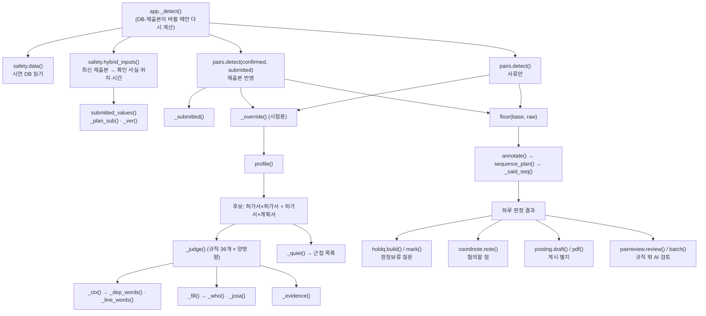
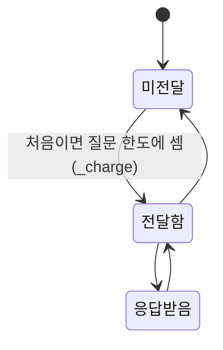

# 06e. 하루 판정과 설명문 — 함수 단위 세부

이 문서는 그날 서류 전체로 작업 짝을 판정하는 함수와, 판정 결과를 사람이 읽는 글로 바꾸는 함수를 하나씩 풀어 씁니다.
대상은 `pairs.py`의 뒷부분(1163행~끝), `safety.py` 전체, `holdq.py` 전체, 그리고 `coordnote.py`·`posting.py`·`pairreview.py`의 규칙 부분입니다.

**이 문서에서 알 수 있는 것**

- 하루 판정 `detect()`가 후보를 만들고, 거르고, 정렬하고, 근접 목록과 집계를 만드는 순서
- 경보 문장(연쇄·사고 요약)의 빈칸이 어떤 사실로 채워지는지, 근거 표가 어떻게 만들어지는지
- 시연 DB를 읽는 법, 작업반장 제출본이 판정 입력으로 들어가는 길, 화면에 나가는 것과 나가지 않는 것
- 판정보류 질문, 협조 문자 「협의할 점」, 게시 별지 문안, 규칙 밖 AI 검토 권장의 규칙 부분
- 함수마다 부르는 곳·불리는 곳·지키는 시험, 그리고 어긋나 보이는 곳의 분류(의도 / 확인 필요 / 설계 근거 미기록)

**목차**

1. [범위와 읽는 법](#1-범위와-읽는-법)
2. [함수 지도](#2-함수-지도)
3. [호출 흐름](#3-호출-흐름)
4. [설명문 낱말 만들기](#4-설명문-낱말-만들기)
5. [하루 판정 실행](#5-하루-판정-실행)
6. [서류상 선후 계획 표시](#6-서류상-선후-계획-표시)
7. [시연 DB 읽기와 제출본 연결](#7-시연-db-읽기와-제출본-연결)
8. [판정보류 질문](#8-판정보류-질문)
9. [협조 문자의 협의할 점](#9-협조-문자의-협의할-점)
10. [현장 게시 별지 문안](#10-현장-게시-별지-문안)
11. [규칙 밖 AI 검토 권장](#11-규칙-밖-ai-검토-권장)
12. [한계와 알려진 문제](#12-한계와-알려진-문제)

큰 그림은 다른 문서에 있습니다. 태그·장소·시간·S×E 판정은 [06_쌍작업_판정.md](06_쌍작업_판정.md), 판정보류 질문의 취지는 [06b_보류질문_holdq.md](06b_보류질문_holdq.md), 모델 호출은 [05c_라온이_하는_일.md](05c_라온이_하는_일.md)에 있습니다. 이 문서는 그 문서들이 다루지 않는 **함수 단위 세부**를 빠짐없이 적는 것이 목적입니다.

---

## 1. 범위와 읽는 법

**맡은 범위와 함수 수**

| 파일 | 범위 | 함수 수 |
|---|---|---|
| [`server/pairs.py`](../server/pairs.py) | 1163행~끝 | 16 |
| [`server/safety.py`](../server/safety.py) | 전체 | 26 |
| [`server/holdq.py`](../server/holdq.py) | 전체 | 11 (`HoldError.__init__` 포함) |
| [`server/coordnote.py`](../server/coordnote.py) | 전체(모델 호출은 05c로 넘김) | 5 |
| [`server/posting.py`](../server/posting.py) | 전체(모델 호출은 05c로 넘김) | 9 |
| [`server/pairreview.py`](../server/pairreview.py) | 전체(모델 호출은 05c로 넘김) | 14 (중첩 `one()` 포함) |
| 합계 | | **81** |

`lambda`로 만든 작은 함수(`_submitted()`의 `key`, `submitted_values()`의 `on_day`·`per_day`)는 바깥 함수 절 안에서 함께 설명합니다.
`_judge()`(1021~1157행)는 06 문서와 다른 담당 범위입니다. 이 문서는 `_judge()`가 부르는 `_ctx()`·`_fill()`·`_evidence()`부터 다룹니다.

**자주 나오는 말**

- 프로필: `pairs.profile()`이 서류 한 건을 읽어 만든 작업 성질 묶음입니다. `P["d"]`는 원래 서류, `P["tags"]`는 태그(화기 `SPARK` 같은 작업 성질), `P["ids"]`는 크레인·반·블록 번호, `P["wins"]`는 분 단위 시간창입니다.
- 원인 쪽 A, 노출 쪽 B: 규칙 하나에서 위험을 주는 작업이 A, 받는 작업이 B입니다.
- 판정보류: 서류에 없어 모르는 것이 있어 확인이 필요한 3순위 경보입니다. 노출 E가 1입니다.
- 근접 목록(`near`): 가까워 보이지만 경보를 내지 않은 짝과 그 까닭입니다.
- 예시: 「실행 예시」는 이 저장소에서 함수를 실제로 import해서 돌린 결과입니다(시연 자료 기준, 시연일 2026-10-29). 「코드에서 따라간 예시」는 돌리지 않고 코드를 읽어 적은 것입니다.

**어긋나 보이는 곳을 적는 법**

이 문서는 어긋나 보이는 곳을 세 가지로 나눕니다. 결함이라고 단정하지 않습니다.

- **의도**: 이유를 코드 주석이나 설계 문서에서 찾았습니다. 근거를 함께 적습니다.
- **확인 필요**: 이유를 찾지 못했고, 밝혀 둔 의도와 실제 동작이 분명히 다릅니다.
- **설계 근거 미기록**: 이유를 찾지 못했지만, 의도와 충돌한다는 근거도 없습니다.

---

## 2. 함수 지도

### pairs.py (1163행~끝)

| 함수 | 줄 | 한 줄 요약 | 부르는 곳 |
|---|---|---|---|
| [`_josa()`](#_josa) | 1163 | 이름 뒤에 받침에 맞는 조사(이/가, 을/를, 과/와)를 붙임 | `_fill()`, `coordnote.sentence()`, `analyze.py` |
| [`_who()`](#_who) | 1173 | 문장에 쓸 작업 이름(「0735 고소」, 「WP-04」) | `_fill()`, `_judge()` |
| [`_residual()`](#_residual) | 1178 | 어느 쪽이 먼저냐에 따라 남는 위험 문구 | `_judge()`, `sequence_plan()`, `explain.py` |
| [`_dep_words()`](#_dep_words) | 1186 | 정전으로 멈추는 기능(환기·조명·연락)에 맞는 결과 문구 | `_ctx()` |
| [`_line_words()`](#_line_words) | 1203 | 인양 블록에 걸린 연결선 종류에 맞는 결과 문구 | `_ctx()` |
| [`_ctx()`](#_ctx) | 1215 | 규칙 문장의 빈칸 낱말(화기 공법별 위험 등)을 이 짝에서 만듦 | `_judge()` |
| [`_fill()`](#_fill) | 1247 | 규칙 문장 틀의 `{…}` 빈칸을 채움 | `_judge()` |
| [`_evidence()`](#_evidence) | 1274 | 판정이 기대는 서류 사실의 근거 표 | `_judge()` |
| [`_override()`](#_override) | 1313 | (시험용) 정한 시간으로 작업 시간창과 인양 이동을 바꿈 | `detect()`, `check_pairs_cases.py`, `eval_scale.py` |
| [`_windows_ok()`](#_windows_ok) | 1334 | 시간창 목록이 「HH:MM」 형식인지 검사 | `_submitted()` |
| [`_submitted()`](#_submitted) | 1338 | 반장 제출본이 확인한 위치·시간 등을 서류에 덧씌움 | `detect()` |
| [`detect()`](#detect) | 1374 | 그날 전체 작업 짝을 판정하는 하루 판정 | `app._detect()`, 여러 시험 |
| [`_quiet()`](#_quiet) | 1440 | 경보 없는 가까운 짝에 「왜 안 냈는지」를 붙임 | `detect()` |
| [`_said_seq()`](#_said_seq) | 1485 | 서류에 적힌 「…완료 후」 같은 선후 구절을 찾음 | `sequence_plan()` |
| [`sequence_plan()`](#sequence_plan) | 1494 | 서류상 선후 계획과 남은 확인을 표시용으로 만듦 | `annotate()` |
| [`annotate()`](#annotate) | 1515 | 판정 결과의 각 짝에 선후 계획 표시를 붙임 | `app._detect()` |

### safety.py

| 함수 | 줄 | 한 줄 요약 | 부르는 곳 |
|---|---|---|---|
| [`_home()`](#_home) | 28 | 시연 DB와 PDF 폴더 위치를 찾음 | `data()`, `app._detect()` |
| [`spans()`](#spans) | 35 | 위치 글에서 BAY·칼럼 범위를 읽음 | `_load()`, `pairs._submitted()`, 시험 |
| [`_hm()`](#_hm) | 58 | 글에서 첫 「H:MM」을 「HH:MM」으로 | `_win()`, `_dated_win()`, `_load()` |
| [`_win()`](#_win) | 63 | 「HH:MM~HH:MM」을 시간창으로(끝이 이르면 다음 날) | `_dated_win()`, `_day_wins()` |
| [`_dated_win()`](#_dated_win) | 78 | 날짜가 붙은 시작·끝에서 그날 부분만 시간창으로 | `_load()`, `_plan_sub()` |
| [`_day_wins()`](#_day_wins) | 102 | 허가서의 날짜별 시간에서 그날 창(전날 밤 넘어온 부분 포함) | `_load()` |
| [`_prev_day()`](#_prev_day) | 111 | 하루 전 날짜 | `_day_wins()`, `submitted_values()` |
| [`spanned_dates()`](#spanned_dates) | 119 | 밤을 넘는 창이면 다음 날짜까지 넣은 날짜 목록 | `app.py` 제출 요약 |
| [`_num()`](#_num) | 141 | 글에서 첫 숫자(인원) | `_load()` |
| [`_rev()`](#_rev) | 146 | 서류 내용의 짧은 지문 | `_load()` |
| [`_load()`](#_load) | 153 | 시연 DB를 읽기 전용으로 열어 허가서·계획서 목록을 만듦 | `data()` |
| [`data()`](#data) | 215 | 시연 하루 자료(파일이 바뀌면 다시 읽음) | 거의 모든 안전관리자 함수 |
| [`_public()`](#_public) | 220 | 밑줄로 시작하는 내부 칸을 빼고 화면용으로 | `overview()`, `detail()` |
| [`overview()`](#overview) | 224 | 그날 서류 목록(화면용) | `GET /api/safety/overview` |
| [`find()`](#find) | 230 | 문서 id나 허가번호로 서류 한 건 | `detail()`, `pdf()`, `posting` |
| [`detail()`](#detail) | 238 | 서류 한 건의 상세(양식 칸·답·체크리스트) | `GET /api/safety/doc/{id}` |
| [`pdf()`](#pdf) | 257 | 원본·반영본·체크리스트 PDF | `GET /api/safety/pdf/{id}/{part}.pdf` |
| [`_hm_of()`](#_hm_of) | 282 | 분 → 「HH:MM」(24시간 넘으면 돌림) | `_day_windows()`, `submitted_values()` |
| [`_day_windows()`](#_day_windows) | 286 | 분 단위 창 목록 → 시간창(다음 날·여러 날 표시) | `submitted_values()` |
| [`submitted_values()`](#submitted_values) | 293 | 제출본 답이 바꾼 위치·그날 시간 등을 뽑음 | `hybrid_inputs()` |
| [`plan_values()`](#plan_values) | 337 | 제출 때 반장이 고친 작업계획서 위치·시간을 남김 | `app.py` 제출 |
| [`_plan_sub()`](#_plan_sub) | 364 | 반장이 고친 계획서 값 → 그날 판정 입력 | `hybrid_inputs()` |
| [`_ver()`](#_ver) | 377 | 문서마다 「서류 기준」/「제출본 반영」 판 표시 | `hybrid_inputs()` |
| [`hybrid_inputs()`](#hybrid_inputs) | 384 | 그날 최신 제출본 → 확인 사실·위치·시간·판 표시 | `app._detect()`, `submission_view()` |
| [`submission_view()`](#submission_view) | 417 | 관리자 화면의 제출본 목록(목록 밖 제출은 따로) | `GET /api/safety/submissions` |
| [`placement()`](#placement) | 435 | 반장 제출 안내: 관리자 목록에 이 작업이 있는지 | `app.py` 제출 |

### holdq.py

| 함수 | 줄 | 한 줄 요약 | 부르는 곳 |
|---|---|---|---|
| [`fingerprint()`](#fingerprint) | 121 | 질문이 기대는 작업 사실의 짧은 지문 | `build()` |
| [`HoldError()`](#holderror) | 126 | 상태 코드와 문구를 가진 오류 | `mark()`, `app.py` |
| [`_db()`](#_db) | 133 | `holdq.sqlite3`의 `marks` 표를 엶 | `build()`, `mark()` |
| [`_explicit()`](#_explicit) | 156 | 모르는 것이 말로 명시된 것인지 | `_asks()` |
| [`_asks()`](#_asks) | 160 | 판정보류 이유 하나 → (문서, 사실, 질문) 목록 | `build()` |
| [`_no()`](#_no) | 241 | 문안에 쓸 번호(허가번호 또는 문서 id) | `build()` |
| [`_who()`](#_who-1) | 245 | 부서나 회사 이름 | `build()` |
| [`build()`](#build) | 249 | 그날 판정의 판정보류 질문을 반장별로 모음 | `GET /api/safety/hold-questions`, `mark()` |
| [`_session_of()`](#_session_of) | 296 | 허가서 최신 제출본의 검토 세션 | `_charge()` |
| [`mark()`](#mark) | 307 | 관리자의 전달 표시(미전달·전달함·응답 받음) | `POST /api/safety/hold-questions/mark` |
| [`_charge()`](#_charge) | 333 | 처음 「전달함」을 허가서의 질문 한도에 셈 | `mark()` |

### coordnote.py · posting.py · pairreview.py

| 함수 | 줄 | 한 줄 요약 | 부르는 곳 |
|---|---|---|---|
| [`sources()`](#sources) | coordnote 19 | 짝의 근거에서 반장 확인 사실만 모음 | `model_input()` |
| [`items()`](#items) | coordnote 30 | 규칙의 「확인할 것」을 항목별로 나눔 | `model_input()` |
| [`sentence()`](#sentence) | coordnote 35 | 협의할 점 문장 틀 | `note()` |
| [`model_input()`](#model_input) | coordnote 39 | 협의할 점의 재료(캐시 열쇠로도 씀) | `note()`, `app._note_key()` |
| [`note()`](#note) | coordnote 46 | 협의할 점 한 문장(필요할 때만 모델) | `POST /api/safety/coord-note`, `app._warm_manager()` |
| [`_t()`](#_t) | posting 26 | 별지 한 칸 글을 HTML로 안전하게 | `layout()` |
| [`layout()`](#layout) | posting 34 | 화면이 보낸 별지 → 추가검토서 틀 배치 | `pdf()`, `check_render.py` |
| [`ai_mark()`](#ai_mark) | posting 68 | 「croScan AI 문안 보조 · 문안 상태」 표기 | `layout()` |
| [`_schema()`](#_schema) | posting 79 | 별지 초안 고르기의 JSON 스키마 | `draft()` |
| [`options()`](#options) | posting 85 | 별지 초안의 후보(할 일·사실·착수조건) | `draft()` |
| [`_when()`](#_when) | posting 99 | 작업 시간 글 | `compose()` |
| [`compose()`](#compose) | posting 104 | 고정 틀 세 줄(할 일·착수조건·중지·변경 시) | `draft()` |
| [`draft()`](#draft) | posting 113 | 별지 「우리 반이 할 일」 초안 | `POST /api/safety/post-draft` |
| [`pdf()`](#pdf-1) | posting 157 | 현장 게시용(원본+별지)·일상작업반 전달문 PDF | `POST /api/safety/sheet.pdf` |
| [`_rows()`](#_rows) | pairreview 53 | 작업 한 건의 사실을 번호 붙은 행으로 | `_current()` |
| [`_shared()`](#_shared) | pairreview 69 | 두 작업이 함께 적은 번호 | `prefilter()` |
| [`prefilter()`](#prefilter) | pairreview 76 | AI 검토 대상인지 사전 거르기 | `_current()`, `targets()` |
| [`_digest()`](#_digest) | pairreview 117 | 두 작업 행의 해시 | `_current()` |
| [`_no()`](#_no-1) | pairreview 121 | 번호(허가번호 또는 문서 id) | `_review()`, `judge()` |
| [`_current()`](#_current) | pairreview 125 | 지금 서류 기준의 짝 재료와 해시 | `review()`, `states()`, `listing()` |
| [`review()`](#review) | pairreview 133 | 한 짝 AI 검토(상태·캐시 관리) | `POST /api/safety/pair-review`, `one()` |
| [`_review()`](#_review) | pairreview 156 | 모델 호출 → `judge()` → 관계 대조 | `review()` |
| [`judge()`](#judge) | pairreview 190 | 모델이 고른 것을 검사하고 문장은 서버가 씀 | `_review()` |
| [`targets()`](#targets) | pairreview 213 | 지금 검토를 요청할 수 있는 근접 짝 | `states()`, `listing()`, `batch()` |
| [`states()`](#states) | pairreview 228 | 대상마다 미분석·대기 중·처리 중·실패·검토 완료 | `listing()` |
| [`listing()`](#listing) | pairreview 243 | 지금 서류 기준 검토 결과 목록과 집계 | `GET /api/safety/pair-reviews` |
| [`batch()`](#batch) | pairreview 270 | 제출 뒤 앞 20쌍 미리 검토 | `app._warm_manager()` |
| [`one()`](#one) | pairreview 281 | (batch 안) 한 짝 검토, 양보되면 실패로 | `batch()` |

---

## 3. 호출 흐름

하루 판정이 만들어지고, 그 결과를 네 가지 글로 바꾸는 흐름입니다.



판정보류 질문의 전달 표시는 아래 상태로만 움직입니다.



---

## 4. 설명문 낱말 만들기

`_judge()`가 경보 이유 하나를 만들 때, 규칙 파일([`server/pair_rules.json`](../server/pair_rules.json))의 문장 틀을 이 짝의 사실로 채웁니다. 이 장의 함수가 그 일을 합니다.

### _josa()

**하는 일.** 이름 뒤에 받침에 맞는 조사를 붙입니다.

**입력 → 출력.** `word`(이름), `pair`(조사 두 글자: 받침 있을 때, 없을 때. 예 `"이가"`, `"을를"`, `"과와"`) → 조사를 붙인 글.

**판정 단계.**

1. `word`의 오른쪽 공백을 지우고 마지막 글자 `c`를 봅니다.
2. `c`가 한글(`"가" <= c <= "힣"`)이면 `(ord(c) - 0xAC00) % 28 != 0`이면 받침이 있습니다.
3. 한글이 아니면, 숫자 `_BATCHIM_DIGIT = set("013678")`(영·일·삼·육·칠·팔)이거나 영문 `"LMNRlmnr"`(엘·엠·엔·알)이면 받침이 있다고 봅니다.
4. 받침이 있으면 `pair[0]`, 없으면 `pair[1]`을 붙입니다.

**예시(실행 예시).**

| 입력 | 출력 |
|---|---|
| `("0737 중량물인양", "이가")` | `0737 중량물인양이` |
| `("WP-02", "이가")` | `WP-02가` |
| `("OH-21-03", "을를")` | `OH-21-03을` |
| `("MCC-4", "을를")` | `MCC-4를` |
| `("작업자 위치", "을를")` | `작업자 위치를` |

**호출 관계.** 부르는 곳: `_fill()`(`a_ga`, `b_ga`, `a_wa`, `crane_eul`, `panel_eul`), [`coordnote.sentence()`](#sentence), `analyze.py` 188행. 부르는 함수 없음.

**시험.** 직접 시험은 없습니다. [`tools/check_coordnote.py`](../tools/check_coordnote.py) 43행이 「…에 맞춰 작업자 위치를 서로 확인해 주세요」를 기대하므로 간접으로 지킵니다.

### _who()

**하는 일.** 문장에 쓸 작업 이름을 만듭니다.

**입력 → 출력.** 프로필 `P` → 허가서면 `"{id} {label}"`(예 `0735 고소`), 작업계획서면 `"WP-" + id의 끝 두 글자`(예 `WP-04`).

**판정 단계.** `P["d"]["type"] == "permit"`인지 하나만 봅니다.

**예시(실행 예시).** 0735 → `0735 고소`, WP-1029-04 → `WP-04`.

**호출 관계.** 부르는 곳: `_fill()`, `_judge()`(TARGET_OCCUPIED 연쇄에 한 줄 끼울 때). 부르는 함수 없음.

**시험.** 직접 시험은 없습니다. 연쇄 문장을 보는 [`tools/check_pairs_material.py`](../tools/check_pairs_material.py) 등이 간접으로 봅니다.

### _residual()

**하는 일.** 앞 작업이 끝난 뒤 남는 위험(잔류위험) 문구를, 어느 쪽이 먼저였는지에 따라 고릅니다. 예: 화기가 먼저면 잔불, 도장이 먼저면 증기·도막입니다(코드 주석).

**입력 → 출력.** `rule`(규칙), `first`(`"A"` 원인 쪽 먼저 / `"B"` 노출 쪽 먼저, 기본 `"A"`) → 문구 또는 `None`.

**판정 단계.**

1. 규칙에 `residual_by_first`가 있고 그 안에 `first` 값이 있으면 그것을 씁니다. 시연 규칙 36개 중 8개(FIRE, CONF_HOT, CONF_GAS, TARGET_OCCUPIED, PRESSURE, FIRE_SOLID, FIRE_GAS, CONF_PAINT)에 있습니다.
2. 없으면 규칙의 `residual`을 씁니다. 둘 다 없으면 `None`입니다.

**예시(코드에서 따라간 예시).** FIRE 규칙, `first="B"`(도장이 먼저) → 용제 증기·젖은 도막 문구. [`tools/check_pairs_material.py`](../tools/check_pairs_material.py) 363~365행이 이 경우 「증기」가 들어가고 「잔불」로 끝나지 않는 것을 확인합니다.

**호출 관계.** 부르는 곳: `_judge()` 1096행(선후 이유 문장), [`sequence_plan()`](#sequence_plan), `explain.py` 67행. 부르는 함수 없음.

**시험.** [`tools/check_pairs_material.py`](../tools/check_pairs_material.py) 111~114행(CONF_GAS 잔류 표시가 「가스 밸브 잠금」이 아니라 측정), 363~366행(도장 먼저 → 증기).

### _dep_words()

**하는 일.** 정전(VENT_LOTO 규칙)으로 멈추는 기능에 맞춰 결과 문구를 만듭니다. 팬이 멈추면 공기 문제, 조명이 꺼지면 조명 상실입니다. 조명이 멈췄는데 「산소결핍」이라고 쓰지 않으려는 것입니다(자료 p235·341).

**입력 → 출력.** 원인 프로필 `A`, 노출 프로필 `B` → `{"dep_harm": …, "dep_accident": …}`.

**판정 단계.**

1. `fn`을 모읍니다. `B["dep_panels"]`의 반 번호 가운데 `A["ids"]["power_loto"]`(A가 끄는 반)에 든 것마다 `B["dep_fn_b"][반]`(그 반에 물린 기능)을 더합니다.
2. `fn`이 비면 `A["dep_fn"]`을 씁니다. 그다음 `"unknown"`을 뺍니다.
3. B가 밀폐 진입(`CONFINED` 태그)이 아니고 `B["level"] != "inside"`이면:
   - B가 화기(`SPARK`)이고 B의 전체 글에 `LOCAL_EXH`(`국소\s*배기|집진|배기\s*팬|흄\s*(?:추출|흡입|포집)`)가 있으면 → `국소배기가 멈춰 흄 흡입` / `흄 흡입 위험`.
   - 아니면 → `조명이 꺼져 걸림·추락·대피 지연` / `조명 상실로 걸림·추락 위험`.
4. 밀폐 쪽인데 `fn`이 비면 → 「멈추는 기능에 따라 산소결핍·흄 축적(환기) 또는 대피 지연(조명)」 / 「기능 상실(종류 미확인) 위험」.
5. 그 밖에는 `DEP_HARM`(`air`: 산소결핍·흄 축적, `light`: 조명 상실로 걸림·추락·대피 지연, `comm`: 연락 두절로 구조 지연)을 air·light·comm 순서로 「·」로 잇습니다. 사고 요약은 뒤에 「 위험」을 붙입니다.

순서가 중요한 까닭: 3단계(밀폐 밖)를 먼저 봐야 밀폐가 아닌 작업에 「산소결핍」이 붙지 않습니다.

**예시(실행 예시).** 0740(MCC-4 정전) × WP-1029-07: WP-1029-07은 밀폐가 아니고 바닥 작업입니다 → `{"dep_harm": "조명이 꺼져 걸림·추락·대피 지연", "dep_accident": "조명 상실로 걸림·추락 위험"}`.

**호출 관계.** 부르는 곳: `_ctx()`. 부르는 함수 없음.

**시험.** [`tools/check_pairs_material.py`](../tools/check_pairs_material.py) 155행(조명만 같은 분기 → 결과는 조명 상실, 산소결핍 아님), 557행(CF3로 같은 분기 → 환기·조명 각각), [`tools/check_pairs_final.py`](../tools/check_pairs_final.py) 271행(국소배기 화기 → 「흄 흡입」).

### _line_words()

**하는 일.** 인양 블록에 연결된 선(LIFT_LINE 규칙)의 종류에 맞춰 결과 문구를 만듭니다(자료 p306 MV10).

**입력 → 출력.** 노출 프로필 `B` → `{"line_name": …, "line_harm": …}`.

**판정 단계.**

1. `B["lines"]`의 값마다 `_tokens()`로 자른 토막을 봅니다.
2. 토막마다 `LINE_KIND`를 위에서부터 보며, 그 종류의 정규식과 `LINES`(`덕트|송기|호스|전선|케이블|용접선`)가 **둘 다** 맞는 첫 종류를 고릅니다.
3. `LINE_KIND` 순서(위가 먼저): 불활성가스 호스(질식) → 산소 호스(산소 누출·연소 확대) → 가연성 가스 호스(가스 누출·화재) → 가스 호스(가스 종류에 따라 질식·화재) → 통신선(연락 두절) → 배기·집진 덕트(흄 흡입) → 송기·환기 덕트(질식) → 전선·케이블(감전) → 호스(당김·끼임). 순서가 중요한 까닭: 「아르곤 호스」는 「호스」보다 먼저 「불활성가스 호스」로 잡혀야 합니다.
4. 같은 종류는 한 번만 넣습니다. 이름은 「·」로 잇고, 결과는 겹치지 않게 「·」로 잇습니다.
5. 하나도 없으면 `연결선` / `연결선 종류에 따라 질식·감전·끼임`.

**예시(실행 예시).** WP-1029-13(연장 케이블) → `{"line_name": "전선·케이블", "line_harm": "감전"}`. WP-1029-02(선 없음) → `연결선` 기본값.

**호출 관계.** 부르는 곳: `_ctx()`. 부르는 함수: `pairs._tokens()`.

**시험.** [`tools/check_pairs_final.py`](../tools/check_pairs_final.py) 142~145행(아르곤 호스 → 질식, 배기 덕트 → 흄 흡입), 210·257행.

### _ctx()

**하는 일.** 규칙 문장에 들어갈 낱말을 이 짝의 사실로 만듭니다. 화기가 무엇을 내놓는지는 공법(아크·가스 절단·연삭)에 따라 다릅니다(자료 결과 후보 선택·LU11·HW08). 가스 절단은 아크가 아니고, 연삭은 파편이 튑니다.

**입력 → 출력.** `rule`, `A`, `B`, `cap` → 낱말 사전. `rule`과 `cap`은 지금 본문에서 쓰지 않습니다(12장).

**판정 단계(나오는 칸마다).**

| 칸 | 만드는 법 |
|---|---|
| `hot_emit` | `A["hot_kind"]`가 있으면 불티 + (arc면 아크광) + (gas면 강한 빛·열) + (grind면 연삭 파편) + 흄 + (noise면 소음). 없으면 「불티·열·흄(아크 용접이면 아크광)」 |
| `hot_harm` | 있으면 화상 + (arc: 눈 손상(아크광)) + (gas: 눈 자극(강한 빛)) + (grind: 파편 맞음) + 흄 흡입(같은 공기 공간·환기 방향이면) + (noise: 청력 손상(누적 소음), 소음으로 신호·연락 방해). 없으면 화상·흄 흡입(같은 공기 공간이면)·눈 손상(아크 용접이면) |
| `hot_accident` | 공법이 있으면 `hot_harm` + 「 위험」, 없으면 「화상·흄 흡입·눈 손상(아크 용접이면) 위험」. 공법을 모르면 아크라고 단정하지 않습니다(주석 「no arc is claimed」) |
| `girder_fall` | A가 거더 위 작업(`A["girder"]`)이면 「·거더 위 정비자 추락」 |
| `support_act` | A가 인양 허가서이고 `SEP`·`DROP`·`SUPPORT_ADJ` 태그가 없으면 「블록을 들어 옮긴다」, 아니면 「블록의 부재를 자르거나 해체한다」 |
| `gas_src` | B의 `FLAM_GAS` 값에 「미스트」가 있고 `LPG|프로판|부탄|아세틸렌|수소|가연성`이 없으면 「오일 미스트가 퍼지면」, 아니면 「가스 용기·호스를 다루다 가연성 가스가 새면」 |
| `arc_in` | arc면 「·아크 용접이면 개구부로 들어오는 아크광에 눈 손상」(자료 PE15·PE12) |
| `noise_in` | noise면 「·가우징·연삭 소음으로 안팎 연락 방해」 |
| `sling` | A 글에 `섬유\s*슬링|벨트\s*슬링|라운드\s*슬링|웨빙`이 있고 B가 화기면 「·섬유 슬링이면 불티·열에 끊어져 부재 낙하」(재독 B L505) |
| `girder_fall_b` | B가 거더 위면 「·거더 위 수리자 추락」 |
| `dep_harm`, `dep_accident` | [`_dep_words()`](#_dep_words) |
| `line_name`, `line_harm` | [`_line_words()`](#_line_words) |
| `load_extra` | B가 위(`level == "top"`)이거나 고소작업대면 「(작업발판·작업대를 치면 흔들리거나 부서져 추락)」, B에 `SEP`·`DROP`이 있으면 「(절단 중·임시 지지 부재를 치면 넘어짐)」, 아니면 빈칸 |
| `shared` | A·B가 함께 잠그는 크레인 번호와 반 번호(교집합)를 정렬해 「, 」로. 없으면 「설비」 |

`hot_kind`(공법)는 `profile()`이 정합니다. 아크는 `ARC`, 가스 절단은 `GAS_CUT`, 연삭은 `GRIND` 정규식이고, 가우징·연삭이 있으면 `noise`를 더합니다([06 §4](06_쌍작업_판정.md#4-서류--프로필-작업-성질-읽기)).

**예시(실행 예시).** 0731(가우징·재용접, `hot_kind = {arc, noise}`) × WP-1029-01(도장), FIRE:

- `hot_emit`: `불티·아크광·흄·소음`
- `hot_harm`: `화상·눈 손상(아크광)·흄 흡입(같은 공기 공간·환기 방향이면)·청력 손상(누적 소음)·소음으로 신호·연락 방해`
- `load_extra`: `(작업발판·작업대를 치면 흔들리거나 부서져 추락)`(WP-1029-01이 블록 상부), `shared`: `설비`

**호출 관계.** 부르는 곳: `_judge()` 1142행. 부르는 함수: `_dep_words()`, `_line_words()`.

**시험.** [`tools/check_pairs_final.py`](../tools/check_pairs_final.py) 146~156행(공법 모르는 화기는 「아크 용접이면」 조건, 가우징 → 아크광·소음, 가스 절단 → 아크광·소음 없음), 160행(섬유 슬링), 272행. [`tools/check_pairs_material.py`](../tools/check_pairs_material.py) 242·246행.

### _fill()

**하는 일.** 규칙 문장 틀의 `{…}` 빈칸을 채웁니다.

**입력 → 출력.** 틀 글 `s`, `A`, `B`, `cap`, `ctx`(없으면 모든 낱말 칸을 빈칸으로) → 채운 글.

**판정 단계(빈칸 이름).**

| 빈칸 | 값 |
|---|---|
| `a`, `b` | [`_who()`](#_who) |
| `a_ga`, `b_ga`, `a_wa` | `_josa(…, "이가")`, `_josa(a, "과와")` |
| `a_ui`, `b_ui` | 이름 + 「의」 |
| `crane`, `crane_eul` | A의 크레인 번호(잠금 ∪ 사용) 정렬, 없으면 「크레인」. 뒤는 「을/를」 붙임 |
| `panel_eul` | A가 끄는 반 번호, 없으면 「전원」 + 「을/를」 |
| `where` | B의 위치에서 「대조립21공장 」을 뺀 것 |
| `block` | A·B 공통 블록 번호, 없으면 「같은」 |
| `height` | A의 높이(`A["high"]`)가 있으면 「4.5m」처럼, 없으면 「높이 미확인」 |
| `reach` | `cap == 3`이면 「화재감시자 반경 11m 기준」(`FIRE_REACH_M = 11`, 안전보건규칙 제241조의2), 아니면 「실제 거리·차폐 미확인」 |
| 그 밖 | [`_ctx()`](#_ctx)의 16칸 |

`ctx`가 없을 때 쓰는 빈칸 이름 16개와 `_ctx()`가 내는 칸은 같습니다. 그래서 어느 쪽이든 `str.format()`이 빈칸을 남기지 않습니다. 시연 규칙 36개의 연쇄·headline·accident·story·mechanism에 나오는 빈칸 이름은 이 표의 것뿐입니다(실행 확인).

**예시(실행 예시).** 틀 `"{a_ga} {b_ui} 구역 · {reach} · {height} · {block} 블록"`, 0731 × WP-1029-01, cap 3 → `0731 화기가 WP-01의 구역 · 화재감시자 반경 11m 기준 · 높이 미확인 · E42P 블록`. 같은 틀에서 cap 2면 `{reach}`는 `실제 거리·차폐 미확인`입니다.

**호출 관계.** 부르는 곳: `_judge()` 1143행(연쇄 `chain`), 1155행(`headline`·`accident`·`story`·`mechanism`·`roles`·`roles_short` 중 `{`가 있는 글). 부르는 함수: `_who()`, `_josa()`.

**시험.** [`tools/check_pairs_material.py`](../tools/check_pairs_material.py) 246행(headline에 `{`가 남지 않음).

### _evidence()

**하는 일.** 판정이 기대는 사실을 표로 만듭니다. 어느 서류의 어느 칸에 무엇이 적혔는지, 언제·어디인지입니다.

**입력 → 출력.** `rule`, `A`, `B` → `[{doc, field, value, confirmed?, submitted?, quote?}]`.

**판정 단계.**

1. 규칙별로 볼 태그를 `_WANT`에서 꺼냅니다. 예: FIRE는 (A: `SPARK`, B: `SOLVENT`), FIRE_GAS는 (A: `SPARK`, B: `FLAM_GAS` 또는 `GAS_UNK`). 규칙 36개가 모두 `_WANT`에 있습니다(실행 확인). 표의 칸이 묶음(tuple)이면 그 작업에 있는 첫 태그를 씁니다. `None`이면 태그 행이 없습니다.
2. 그 태그의 (칸, 값) 가운데 앞의 2개를 넣습니다. 3번째부터는 칸 이름이 `CONFIRMED`(「작업반장 답변 · 반장 답변 확인」)로 시작하는 것만 더 넣습니다. 반장이 확인한 답은 늘 보이게 하려는 것입니다(주석). 이런 행에는 `confirmed: True`가 붙습니다.
3. A·B마다 「시간」 행을 넣습니다.
   - 시간창을 「13:00–15:00」처럼 잇고, 없으면 「시간 없음」.
   - 인양 이동이 있으면 「(이동 예정 …)」. 관찰한 이동이 아니라 계획이라는 뜻입니다(재독 B L16).
   - 제출본의 이동 구간이 있으면 「(확인된 이동 구간 …)」, 서류에 적힌 단계가 있으면 「(서류에 적힌 단계 …)」, 전체 끝이 있으면 「(전체 작업 끝 …)」.
   - 계획서에 크레인 인양 시작만 적혔으면 「(크레인 인양 10:30 시작, 끝 시각 없음)」.
   - 제출본이 시간을 바꿨으면(`d["_sub"]["time"]`) 칸 이름이 「시간(제출본 반영)」이 되고 `submitted: True`가 붙습니다(Codex A6).
4. A·B마다 「위치」 행을 넣습니다. 「대조립21공장 」을 빼고, 경로가 있으면 「 / 경로: …」를 붙입니다. 제출본이 위치를 바꿨으면 「위치(제출본 반영)」.
5. DROP_BELOW 규칙이고 A에 「아래 작업」 답(`A["below"]`)이 있으면, B의 회사 이름이나 B 허가번호가 든 답을 먼저 고르고, 없으면 첫 답을 「답변(아래 작업)」 행으로 넣습니다(`quote: True`).

**예시(실행 예시).** P01 0735 × WP-1029-04(DROP_BELOW)의 근거 일부:

| doc | field | value |
|---|---|---|
| 0735 | 작업명 | 블록 상부 임시 러그 절단·제거 |
| 0735 | 시간 | 14:00–16:00 |
| 0735 | 위치 | 1BAY 14-16 칼럼 B21S 블록 상부 |
| 0735 | 답변(아래 작업) | 하부에서 족장 해체 13:00~15:30 (삼녹) |
| WP-1029-04 | 시간 | 13:00–15:30 |

**호출 관계.** 부르는 곳: `_judge()` 1157행. 부르는 함수: `pairs._hm()`. 이 표의 「작업명에서 추정」 칸은 [`holdq.build()`](#build)가 도료 종류 질문으로 바꿉니다.

**시험.** [`tools/check_pairs_final.py`](../tools/check_pairs_final.py) 163~164행(「이동 예정」이지 「실제 이동」 아님), [`tools/check_pairs_material.py`](../tools/check_pairs_material.py) 625행(서류에 적힌 단계·전체 끝 표시), [`tools/check_hybrid.py`](../tools/check_hybrid.py) 94행(「위치(제출본 반영)」「시간(제출본 반영)」).

---

## 5. 하루 판정 실행

### _override()

**하는 일.** 시험에서 정한 시간으로 작업의 시간창을 바꿉니다. 인양의 이동 예정은 시작이 옮겨진 만큼 함께 옮기고, 새 창에 들어가지 않으면 지웁니다.

**입력 → 출력.** 서류 `d`, 시간창 목록 `wins`(`extra: True`인 창은 「완료 후 재진입」으로 더한 창) → 새 서류(원본은 그대로).

**판정 단계.**

1. `wins`가 비면 `d`를 그대로 돌려줍니다.
2. `extra` 창을 따로 모으고, 모든 창에서 `extra` 표시를 뺍니다.
3. 새 서류: `windows`=새 창 전체, `start`=첫 창 시작, `end`=마지막 창 끝, `extra_windows`=더한 창.
4. 서류에 이동 예정(`move`)과 원래 창이 있으면:
   - 기준 창 = 더한 창이 아닌 창(없으면 전체). 이동량 `delta` = 기준 첫 창 시작 − 원래 첫 창 시작(분).
   - 이동 예정의 시작·끝에 `delta`를 더합니다.
   - 그 구간이 새 창 중 하나에 통째로 들어가면 옮긴 값, 아니면 `None`.

**예시(실행 예시).** 창 13:00~15:00, 이동 14:00~14:30.

| 바꾼 창 | 결과 이동 |
|---|---|
| 14:00~16:00 | 15:00~15:30(한 시간 옮김) |
| 14:00~14:20 | `None`(옮긴 15:00~15:30이 창에 안 들어감) |

**호출 관계.** 부르는 곳: `detect()`(허가서·계획서 모두), [`tools/check_pairs_cases.py`](../tools/check_pairs_cases.py) 116행, `tools/eval_scale.py` 336행. 부르는 함수: `pairs._m()`, `_win_m()`, `_hm()`.

**시험.** [`tools/check_pairs_cases.py`](../tools/check_pairs_cases.py) 110~117행(재진입 창 17:00~17:30의 인양 경로 × 아래 작업 → 경보).

**근거.** 공개 `/api/safety/detect`는 일정 가정을 받지 않습니다. `pairs.detect(overrides)`는 시험용으로만 남았습니다(설계서 2104행 「공개 `/api/safety/detect`의 일정 가정 입력(`overrides`) 제거(시험용 `pairs.detect(overrides)`만 남김)」, `app.py` 1239~1240행 주석). 안전관리자는 일정을 정하지 않습니다(설계서 30행).

### _windows_ok()

**하는 일.** 시간창 목록의 모양을 검사합니다.

**입력 → 출력.** `ws` → `True`/`False`.

**판정 단계.** 목록이고, 모든 원소가 사전이고, `start`·`end`가 모두 `HM`(`([01]\d|2[0-3]):[0-5]\d`)에 통째로 맞아야 `True`입니다. 「8:00」처럼 한 자리 시는 `False`입니다.

**예시(실행 예시).** `[{"start":"08:00","end":"10:00"}]` → `True`. `"8:00"` 시작 → `False`. 문자열 `"x"` → `False`.

**호출 관계.** 부르는 곳: `_submitted()`(windows, stage, stage_written). 부르는 함수 없음. `detect()`의 `overrides` 검사는 같은 조건을 따로 적어 씁니다.

**시험.** [`tools/check_hybrid.py`](../tools/check_hybrid.py) 105행(읽을 수 없는 시간은 넣지 않음)이 간접으로 봅니다.

### _submitted()

**하는 일.** 작업반장의 최신 제출본이 확인한 위치와 그날 시간을 서류에 덧씌웁니다. 확인된 답과 같은 「하이브리드」 길이라 경보를 더할 수 있습니다. 서류 자체의 경보는 `floor()`가 지킵니다(Codex A6, 설계서 §8.1).

**입력 → 출력.** 서류 `d`, 제출 값 `s`(`{place?, windows?, residual_end?, residual_next_day?, stage?, stage_written?, full_end?}`, [`submitted_values()`](#submitted_values)·[`_plan_sub()`](#_plan_sub)가 만듦) → 새 서류. 바뀐 것이 있으면 `_sub`에 「원래 값」을 남깁니다.

**판정 단계.**

1. `s`가 비면 `d`를 그대로 돌려줍니다.
2. **위치.** `place`가 있고 서류와 다르면 `place`를 바꾸고, `spans`를 `safety.spans(새 위치 + " " + 경로)`로 다시 읽고, `is_route`를 「경로가 있거나 위치에 →가 있음」으로 다시 정합니다. `_sub["place"]` = 원래 위치.
3. **시간.** `windows`가 `_windows_ok()`이고, 창을 `key`로 바꾼 목록이 서류와 다를 때만 바꿉니다. `key`(lambda) = (시작, 끝, 다음 날인지, 며칠). 날짜를 비교에 넣는 까닭: 08:00→10:00과 08:00→다음 날 10:00은 다른 창입니다(Codex P1-4). 새 창은 「끝 ≤ 시작」이면 `next_day: True`를 붙여 정리합니다. `_sub["time"]` = 원래 창 글 목록.
4. **잔불 감시 끝.** `residual_end`가 `HM`에 맞으면 `residual_end`·`residual_next_day`를 넣고 `_sub["residual"] = True`. 이것은 잔류 메모일 뿐 해제가 아닙니다(주석).
5. **이동 구간.** `stage`가 `_windows_ok()`이면 `stage_windows`로 넣고 `_sub["stage"] = True`. 작업 창과 따로 둡니다.
6. **서류에 적힌 단계.** `stage_written`이 맞으면 넣습니다(T6 「특정 단계만」, 표시용). `_sub` 표시는 하지 않습니다.
7. **전체 끝.** `full_end`가 `HM`에 맞으면 넣습니다. 창이 이미 그 끝까지 닿습니다. `_sub` 표시는 하지 않습니다.
8. `_sub`가 비어 있지 않으면 `nd["_sub"]`에 넣습니다.

서류와 같거나 읽을 수 없는 값은 아무것도 바꾸지 않습니다. 다만 1단계를 지나면 늘 복사본(`dict(d)`)을 돌려줍니다.

**예시(실행 예시).** 0732(1BAY 14-16 칼럼, 09:00~11:30)에 `{"place": "대조립21공장 3BAY 08-10 칼럼", "windows": [13:00~15:00], "residual_end": "16:30"}` → 위치·창이 바뀌고 `_sub = {"place": "대조립21공장 1BAY 14-16 칼럼 B21S 블록 외판 하부", "time": ["09:00~11:30"], "residual": True}`.

**호출 관계.** 부르는 곳: `detect()`(허가서·계획서 모두). 부르는 함수: `_windows_ok()`, `safety.spans()`. 결과를 읽는 곳: `profile()`(`stage_windows`, `residual_end`), [`_evidence()`](#_evidence)(`_sub`, `stage_written`, `full_end`).

**시험.** [`tools/check_hybrid.py`](../tools/check_hybrid.py) 89~105행, [`tools/check_pairs_material.py`](../tools/check_pairs_material.py) 479~483행(이틀 뒤까지 창 유지, 날짜만 다른 창도 바뀜으로 셈), 585~587행(인양 stage, 잔불 끝), 625행.

### detect()

**하는 일.** 그날 서류 전체로 작업 짝을 판정합니다. 결과는 경보 짝 목록, 근접 목록, 집계입니다.

**입력 → 출력.**

- 입력: `overrides`(시험용 `{문서 id: [창…]}`), `confirmed`(`{허가번호: [확인 사실]}`, 쌍 하이브리드), `submitted`(`{문서 id: {place?, windows?, …}}`, Codex A6).
- 출력: `{date, stats, pairs, near, overrides, rules, levels}`.

**판정 단계.**

1. **자료.** `D = safety.data()`.
2. **확인 사실.** `confirmed`에 허가번호가 있는 허가서에 `_confirmed`로 붙입니다. `profile()`이 이것을 태그로 읽고 칸 이름에 `CONFIRMED`를 붙입니다.
3. **제출 값.** `submitted`가 있으면 허가서·계획서 모두 `_submitted()`를 거칩니다.
4. **규칙.** `R = rules()`(`pair_rules.json`, 규칙 36개).
5. **시험용 시간 검사.** `overrides`의 각 값이 목록이고, 모든 창이 사전이고, 시작·끝이 `HM`에 맞아야 합니다. 아니면 `ValueError("{k}: 시각은 00:00~23:59 형식이어야 합니다")`로 거절합니다. 잘못된 값을 「중지」로 읽지 않으려는 것입니다(주석). 맞으면 「끝 ≤ 시작」이면 `next_day`, `extra is True`면 `extra`를 붙입니다.
6. **하루 중지.** 빈 목록을 받은 문서(`off`)는 그날 하지 않는 작업이라 아무와도 짝이 되지 않습니다.
7. **프로필.** 나머지 허가서·계획서를 `profile(_override(…))`로 만듭니다.
8. **후보.** 허가서×허가서(i<j, `nn`) + 허가서×계획서(`rn`). 계획서×계획서는 후보가 아닙니다(설계 §8). 일상 작업끼리는 이번 범위 밖입니다.
9. **집계 시작.** `candidates`, `nn = n(n−1)/2`, `rn = 허가서 수 × 계획서 수`, 나머지 0.
10. **후보마다(X, Y):**
    - `both_t` = 둘 다 시간창이 있음. `ov` = `both_t`이고 `overlaps()`가 있음.
    - `rel = place_rel(X, Y, True, True)`(경로를 한 범위로 봄, [06 §5.2](06_쌍작업_판정.md#52-두-작업의-장소-관계-place_rel)).
    - 집계: `time += ov`, `time_bay += ov and rel이 same·near·far`, `unknown_place += ov and rel이 unknown`, `unknown_time += not both_t`.
    - 규칙마다, 방향 (X→Y), (Y→X) 둘 다 `_judge()`를 부릅니다. 결과가 있고 `priority`가 0이 아니고 (규칙, 원인, 노출)이 처음이면 `hits`에 넣습니다. 순위 0(점수 3 미만이고 정보 부족도 아님)은 버립니다.
    - `hits`를 (순위 오름, 점수 내림, 겹친 분 내림)으로 정렬합니다.
    - `hits`가 있으면: 맨 위 이유 `top`. `top`이 「겹침」이고 E>1이면 `path += 1`, 아니면 `sequence += 1`. 짝을 만듭니다(아래 표).
    - `hits`가 없으면: `_quiet(X, Y, rel)`이 까닭을 내면 근접 목록에 넣습니다.
11. **짝 정렬.** (순위, −점수, −맨 위 이유의 겹친 분, −인원 합, a, b). 정렬 뒤 `P01`, `P02` … 번호를 붙입니다.
12. **집계 끝.** `pairs` = 짝 수, `by_priority` = {"1", "2", "3"}별 수.
13. **근접 정렬.** (`rank`, a, b).
14. **돌려주기.** `rules`는 각 규칙의 `id, name, mode, S, trigger, forbidden, post, measures, residual`만, `levels`는 규칙 파일의 `severity`·`exposure`·`priority`.

**짝 한 건의 칸**

| 칸 | 값 |
|---|---|
| `a`, `b`, `key` | 후보의 앞·뒤 문서 id, `"a|b"`. 원인·노출 순서가 아닙니다(원인은 `reasons[i].cause`) |
| `kind` | `NN`(허가서×허가서) / `RN`(허가서×계획서) |
| `priority`, `score`, `S`, `E`, `title`, `forbidden` | 맨 위 이유의 값. `title`은 규칙 이름 |
| `reasons` | 정렬된 모든 이유 |
| `judgement` | `_label(top)`: 확인위험·보수위험·판정보류 |
| `people` | 두 문서 인원 중 적힌 것의 합 |

**집계 칸의 뜻**

| 칸 | 뜻 | 화면 |
|---|---|---|
| `candidates`, `nn`, `rn` | 전체 후보, 허가서끼리, 허가서×계획서 | ① 전체 작업 조합 |
| `time` | 시간이 겹치는 후보 | ② |
| `time_bay` + `unknown_place` | 겹치면서 같은 BAY, 또는 위치를 모름 | ③ |
| `unknown_time` | 한쪽이라도 시간창 없음 | 화면 직접 표시 없음 |
| `path` | 맨 위 이유가 「겹침」이고 E>1인 짝 | 화면은 같은 값을 따로 계산(QA #84) |
| `sequence` | 경보 짝 중 `path`가 아닌 나머지 전부 | 같은 |
| `pairs`, `by_priority` | 경보 짝 수, 순위별 | ④, 도넛 |

화면의 ①~④ 깔때기는 [`web/app.js`](../web/app.js) 4503~4515행입니다.

**예시(실행 예시, 시연 자료 기준).**

```
stats = {candidates: 445, nn: 45, rn: 400, time: 151, time_bay: 32, path: 10, sequence: 16,
         unknown_time: 0, unknown_place: 5, pairs: 26, by_priority: {1: 8, 2: 2, 3: 16}}
```

허가서 10건, 계획서 40건입니다. 경보 26쌍(NN 5, RN 21), 표기는 판정보류 13·확인위험 9·보수위험 4입니다. 맨 앞 P01은 0735 × WP-1029-04(DROP_BELOW, 1순위 9점)입니다. 근접 목록은 29쌍입니다. `overrides={"0732": []}`(하루 중지)로 돌리면 후보가 396쌍으로 줄어듭니다. `overrides={"0732": [{"start": "25:00", …}]}`는 `ValueError`입니다.

**호출 관계.** 부르는 곳: `app._detect()` 1263·1265행(서류만, 제출본 반영 두 번), 시험 7종. 부르는 함수: `safety.data()`, `_submitted()`, `rules()`, `_override()`, `profile()`, `overlaps()`, `place_rel()`, `_judge()`, `_label()`, `_quiet()`.

**시험.** [`tools/check_pairs.py`](../tools/check_pairs.py)(시연일 정답표 채점: 찾음·근접 오경보·정답표 밖), [`tools/check_pairs_material.py`](../tools/check_pairs_material.py) 560행(계획서끼리는 후보 0), [`tools/check_hybrid.py`](../tools/check_hybrid.py) 41~70·89~103행, [`tools/check_submit_link.py`](../tools/check_submit_link.py) 54~58행, [`tools/check_explain.py`](../tools/check_explain.py), [`tools/check_docs_ai.py`](../tools/check_docs_ai.py), [`tools/check_pairreview.py`](../tools/check_pairreview.py).

**뒤에 일어나는 일.** `app._detect()`는 두 판정을 [`floor()`](06_쌍작업_판정.md#103-floor-경보는-답으로-내려가지-않는다)로 합칩니다. 답은 경보를 더하거나 올릴 수 있지만 내리거나 지우지 못합니다. 그다음 `annotate()`를 부르고, 결과를 DB 파일 수정 시각과 제출본 id 목록을 열쇠로 기억합니다.

### _quiet()

**하는 일.** 가까워 보이지만 경보를 내지 않은 짝에 「왜 안 냈는지」를 붙입니다. 가장 가까운 까닭부터 봅니다(조사자 6단계). 규칙에 맞는 작업인데 장소가 이어지지 않으면 「규칙이 없음」이라 하지 않고 그렇게 말합니다(자료 1.2·p399: 근접이 거짓이라는 것만으로 배제하지 않음).

**입력 → 출력.** `X`, `Y`, `rel`(`place_rel()` 결과) → `{rank, text, kind}` 또는 `None`.

**판정 단계(위에서부터, 처음 맞는 것).**

| 순서 | 조건 | rank | kind | 문구 요지 |
|---|---|---|---|---|
| 0 | `rel`이 `none`(다른 BAY 등)·`off`(공장 밖) | — | — | `None` |
| 1 | 한쪽이 전원(또는 크레인)을 잠그고, 다른 쪽이 같은 종류를 쓰는데 번호가 다름. 전원 먼저, 방향 둘 다 | 0 | `link` | 「같은 전원 번호는 아님(MCC-4 정전 · MCC-5 사용) — 상위·하위 전원이나 같은 주행로인지는 서류에 없어 미확인」. 시간은 보지 않습니다 |
| 2 | `same`·`near`이고 시간이 겹치지 않음. 앞뒤 간격 중 작은 값 ≤ 180분 | 1 | `time` | 「같은 곳이지만 시간이 떨어짐(N분 간격)」(0분이면 「한 작업이 끝난 뒤 이어서 시작」) + 규칙이 맞는 짝이면 「잔류위험 규칙의 조건(같은 블록·원인 작업이 먼저)에 맞지 않음」, 아니면 「앞 작업에 잔류위험 규칙이 없음」. 180분을 넘으면 `None` |
| 3 | 시간이 겹치고 `far`(같은 BAY, 칼럼 2칸 이상) | 2 | `far` | 거리 단정 없이, 떨어져도 닿는 규칙(화기×유기용제·가연물·압력시험·방사선)이 아니고, 낙하·인양·운반·불티 규칙은 같은 칼럼·블록(화기는 바로 옆 칼럼)일 때 본다는 설명. 「아크광·불티·흄은 실제 차광·거리 확인 전에는 닿지 않는다고 판단하지 않음」 |
| 4 | 시간이 겹치고 `_path()`가 맞는 규칙이 있음 | 3 | `path` | 「「규칙 이름」 규칙의 장소 조건(같은 칼럼·블록·설비)이 서류로 이어지지 않음(실제 위치 미확인)」 |
| 5 | 시간이 겹치고 맞는 규칙 없음 | 3 | `path` | 「두 작업 성질(밀폐 진입·불활성가스 × 일반 작업) 사이에 위험 전달 규칙이 없음」. 성질 이름은 `TAG_KO`, 없으면 「일반 작업」 |
| 6 | 그 밖(`far`·`unknown`인데 겹치지 않음 등) | — | — | `None` |

「규칙이 맞는 짝」(`fit`)은 규칙 36개를 양방향으로 `_path()`에 넣어 맞는 규칙 이름입니다. `far`(3번)에서는 거리를 말하지 않습니다. 칼럼 간격은 측정한 거리가 아니기 때문입니다(주석, Codex A7).

**예시(실행 예시, 시연 자료 기준).** 근접 29쌍: `far` 19, `time` 8, `link` 1, `path` 1.

- 0740 × WP-1029-13: rank 0 `link` 「같은 전원 번호는 아님(MCC-4 정전 · MCC-5 사용) …」
- 0731 × 0737: rank 1 「같은 곳이지만 시간이 떨어짐(90분 간격) · …조건(같은 블록·원인 작업이 먼저)에 맞지 않음」
- 0734 × WP-1029-03: rank 3 「같은 시간·가까운 곳이지만 두 작업 성질(밀폐 진입·불활성가스 × 일반 작업) 사이에 위험 전달 규칙이 없음」

**호출 관계.** 부르는 곳: `detect()`. 부르는 함수: `overlaps()`, `gap_after()`, `rules()`, `_path()`. 근접 목록은 [`pairreview.targets()`](#targets)의 재료가 됩니다.

**시험.** [`tools/check_pairs_cases.py`](../tools/check_pairs_cases.py) 145~147행(근접 문구에 추정 거리·「도달 범위 밖」 없음, 「거리 미확인」 있음), [`tools/check_pairs_material.py`](../tools/check_pairs_material.py) 173~174행(다른 크레인 번호: 「이어지지 않음」 단정 없이 미확인), [`tools/check_pairs.py`](../tools/check_pairs.py)(정답표 근접 짝에 경보가 없고 까닭이 있음).

---

## 6. 서류상 선후 계획 표시

서류가 한 작업 뒤에 다른 작업을 하도록 계획했을 때, 그 계획과 아직 확인되지 않은 것을 보여 줍니다(설계 §8.4·§19.1). **표시만 합니다.** 경보를 지우거나 순위를 내리거나 무엇을 「완료」로 표시하지 않습니다. 서류가 새로 오거나 고쳐지면 다시 판정합니다(코드 주석).

상수: `SEQ_TITLE = "서류상 선후 계획 · 남은 확인"`, `SEQ_TEXT = "문서에 선후 계획이 있으나 실제 완료·잔류위험 해제·상대 반장 합의는 확인되지 않았습니다."`.

### _said_seq()

**하는 일.** 서류에서 순서를 정한 구절(「도장 완료 후 진입」)을 찾습니다.

**입력 → 출력.** 서류 `d` → 찾은 구절(앞뒤 공백 제거) 또는 `None`.

**판정 단계.**

1. 찾는 곳 순서: `title`, `detail`, `place`, `route`, 그리고 `d["fields"]`의 문자열 값.
2. 정규식 `SEQ_SAID`:
   `[^.。\n]{0,24}(?:완료\s*(?:후|뒤|이후)|끝난\s*(?:뒤|후)|끝나면|종료\s*(?:후|뒤|이후)|마친\s*(?:뒤|후)|선행\s*작업|후행\s*작업|이후\s*(?:시작|진행|착수|작업))[^.。\n]{0,24}`
   — 마침표·줄바꿈을 넘지 않고 앞뒤 24자까지 함께 잡습니다.
3. 처음 맞는 곳의 구절을 돌려줍니다.

**예시(실행 예시).** `{"title": "도장 완료 후 진입"}` → `도장 완료 후 진입`. `{"title": "용접"}` → `None`. 시연 자료 50건에서는 이 구절이 나오지 않습니다.

**호출 관계.** 부르는 곳: `sequence_plan()`. 부르는 함수 없음.

**시험.** [`tools/check_explain.py`](../tools/check_explain.py) 113~114행.

### sequence_plan()

**하는 일.** 짝 하나의 서류상 선후 계획과 남은 확인을 만듭니다.

**입력 → 출력.** 짝 `p`, 문서 사전 `docs`, 규칙(`rules_`, 없으면 `rules()`) → `{title, text, plan: [{first, later, end, start, gap, rule}], said: [{doc, text}], left: [...]}` 또는 `None`.

**판정 단계.**

1. `seqs` = 이유 중 `when.kind == "sequence"`인 것.
2. `said` = a·b 문서마다 `_said_seq()`가 찾은 구절.
3. 둘 다 없으면 `None`.
4. `plan`: 이유마다 먼저 한 쪽을 정합니다. `sequence.first`가 `"A"`(기본)면 원인이 먼저, 아니면 노출이 먼저입니다. (먼저, 나중) 쌍이 같으면 한 번만 넣습니다. `end` = 앞 작업 끝(`when.start`), `start` = 뒤 작업 시작(`when.end`), `gap` = 간격, `rule` = 규칙 이름.
5. 잔류 문구: 이유마다 [`_residual()`](#_residual)(먼저 한 쪽 기준)을 모아 겹치지 않게 둡니다. 규칙 id가 규칙 목록에 없으면 빠집니다.
6. `left`(남은 확인) 순서: 「앞 작업의 실제 완료(현장 확인 기록 없음)」, 「앞 작업의 남은 작업·재진입 계획 없음 확인」, 「잔류위험 해제: {문구}」…, 「두 작업반장의 순서 합의」.

**예시(실행 예시, 시연 자료 기준).** 0734 × 0738(TARGET_OCCUPIED, 노출 쪽 0734가 먼저):

```
plan: [{first: "0734", later: "0738", end: "15:00", start: "15:40", gap: 40,
        rule: "블록 인양·반출 × 그 블록 안·위 작업"}]
left: ["앞 작업의 실제 완료(현장 확인 기록 없음)", "앞 작업의 남은 작업·재진입 계획 없음 확인",
       "잔류위험 해제: 잔류 인원(퇴실 확인 기록 전까지)", "두 작업반장의 순서 합의"]
```

시연 자료에서 26쌍 중 9쌍에 선후 계획 표시가 붙습니다.

**호출 관계.** 부르는 곳: `annotate()`. 부르는 함수: `_said_seq()`, `_residual()`, `rules()`.

**시험.** [`tools/check_pairs_material.py`](../tools/check_pairs_material.py) 111~114·363~366행, [`tools/check_explain.py`](../tools/check_explain.py) 105~112행.

### annotate()

**하는 일.** 판정 결과의 모든 짝에 `seq_plan`을 붙입니다. 판정이 정한 것은 바꾸지 않습니다.

**입력 → 출력.** 판정 `det`, 문서 사전 `docs` → 같은 `det`(제자리에서 `p["seq_plan"]` 추가).

**판정 단계.** `rules()`를 한 번 읽고, 짝마다 `sequence_plan(p, docs, R)`.

**호출 관계.** 부르는 곳: `app._detect()` 1274행(`floor()` 다음). 부르는 함수: `sequence_plan()`, `rules()`. 화면은 [`web/app.js`](../web/app.js) 4847행에서 `p.seq_plan`을 그립니다.

**시험.** [`tools/check_explain.py`](../tools/check_explain.py) 105~112행(고정 제목·남은 확인, 경보·순위·점수를 바꾸지 않음, 「실제 완료」「합의」가 남은 확인에 있음).

---

## 7. 시연 DB 읽기와 제출본 연결

[`server/safety.py`](../server/safety.py)는 안전관리자 시점의 자료입니다. 생산부서와 협력사가 낸 하루치 서류를 시연 DB에서 **읽기 전용**으로 읽습니다. DB에는 정답표(`clashes`, `near_misses`, 계획서의 `truth` 칸)가 있지만 읽지도 내보내지도 않습니다. 쌍 판정은 스스로 찾아야 하기 때문입니다(모듈 설명). 정답표는 채점 시험 [`tools/check_pairs.py`](../tools/check_pairs.py)만 `skeleton.json`으로 읽습니다.

상수: `BAYS, COLS = 4, 20`(시연용 대조립21공장 4BAY·20칼럼. 조사자료의 3BAY 배치와 다르며 둘 다 실제 현장 격자가 아닙니다. 칼럼 번호는 후보를 찾는 주소일 뿐 거리가 아닙니다. 주석, Codex B 518~525).

### _home()

**하는 일.** 시연 DB와 PDF 폴더 위치를 찾습니다.

**입력 → 출력.** 없음 → `(DB 경로, 파일 폴더)`.

**판정 단계.** `_HOMES`를 순서대로 봅니다. ① 데이터 디스크 `qa.DATA/demo_day.sqlite3`(서버), ② `samples/시연_하루/demo_day.sqlite3`(개발 PC). 처음 있는 것을 씁니다. 둘 다 없으면 `FileNotFoundError("시연 DB(demo_day.sqlite3)가 없습니다")`.

**호출 관계.** 부르는 곳: `data()`, `app._detect()`(판정 기억 열쇠). 부르는 함수 없음.

**시험.** 직접 시험은 없습니다. DB를 쓰는 모든 시험이 간접으로 지납니다.

### spans()

**하는 일.** 위치 글에서 BAY와 칼럼 범위를 읽습니다.

**입력 → 출력.** 글 → `[{bay, c0, c1, rev?}]`. `c0`·`c1`이 `None`이면 「그 BAY 어딘가」입니다.

**판정 단계.**

1. 정규식 `_POS`: `(?<!\d)(\d+)\s*BAY|(?<!\d)(\d+)\s*[-~]\s*(\d+)\s*칼럼|(?<!\d)(\d+)\s*칼럼`.
2. BAY를 만나면 1~`BAYS`(4) 안일 때만 현재 BAY로 삼고, 밖이면 현재 BAY를 `None`으로 둡니다. 공장 밖 BAY를 안으로 끌어오지 않습니다(주석).
3. 칼럼은 현재 BAY가 있을 때만 읽습니다. 범위(「14-16 칼럼」)나 하나(「10칼럼」)입니다. 양 끝이 1~`COLS`(20) 안일 때만 넣습니다.
4. 큰 번호부터 적힌 범위(「14-12」)는 12~14로 넓게 읽고 `rev: True`를 붙여 오기인지 묻게 합니다(자료 4-8·p392).
5. 칼럼 없이 이름만 나온 BAY는 그 BAY에 칼럼 범위가 하나도 없을 때만 `{bay, None, None}`을 한 번 더합니다.

**예시(실행 예시).**

| 입력 | 출력 |
|---|---|
| `3BAY 06칼럼에서 16칼럼` | 경로 양 끝 두 개: `{3, 6, 6}`, `{3, 16, 16}` |
| `2BAY 14-12 칼럼` | `{2, 12, 14, rev: True}` |
| `5BAY 3칼럼` | `[]`(공장 밖 BAY) |
| `1BAY` | `{1, None, None}` |

**호출 관계.** 부르는 곳: `_load()`, `pairs._submitted()`, 시험의 가짜 서류 만들기. 부르는 함수 없음. 경로를 한 범위로 합치는 일은 `pairs._spans()`가 합니다.

**시험.** [`tools/check_pairs_material.py`](../tools/check_pairs_material.py) 283~284행(역순 14-12), 233·494행(경로 범위).

### _hm()

**하는 일.** 글에서 첫 「H:MM」을 찾아 「HH:MM」으로 맞춥니다.

**입력 → 출력.** 글 → 「HH:MM」 또는 `None`. 정규식 `(\d{1,2}):(\d{2})`.

**예시(실행 예시).** `" 9:05"` → `09:05`.

**호출 관계.** 부르는 곳: `_win()`, `_dated_win()`, `_load()`(인양 이동, 계획서 시작·끝). 부르는 함수 없음.

**시험.** 직접 시험은 없습니다.

### _win()

**하는 일.** 「HH:MM~HH:MM」을 시간창으로 바꿉니다. 끝이 시작보다 이르면 다음 날 끝나는 것으로 읽습니다(보수적으로 긴 창).

**입력 → 출력.** 글, `said_next`(반장이 다음 날이라고 말했는지) → `{start, end, next_day?, assumed_next_day?}` 또는 `None`.

**판정 단계.**

1. 「~」로 둘로 나누고 각각 `_hm()`.
2. 한쪽이라도 없거나 둘이 같으면 `None`.
3. 시작 < 끝이면 그대로.
4. 아니면 `next_day: True`. 반장이 말하지 않았으면 `assumed_next_day: True`도 붙입니다. 그러면 짝 판정이 「익일인지 오기인지」를 묻습니다(자료 MT04).

**예시(실행 예시).** `23:00~01:00` → `{next_day, assumed_next_day}`. `said_next=True`면 `assumed_next_day` 없음. `08:00~08:00` → `None`.

**호출 관계.** 부르는 곳: `_dated_win()`(날짜가 없을 때), `_day_wins()`. 부르는 함수: `_hm()`.

**시험.** [`tools/check_pairs_material.py`](../tools/check_pairs_material.py) 273~275행.

### _dated_win()

**하는 일.** 계획서의 날짜 붙은 시작·끝(ISO)에서 `day`에 걸친 부분만 시간창으로 만듭니다. 날짜를 지킵니다(Codex B 41·P1-4). 이틀짜리 작업을 23:59에서 자르지 않습니다.

**입력 → 출력.** `start`, `end`(예 `2026-10-29T22:00`), `day` → 시간창 또는 `None`.

**판정 단계.**

1. 둘 다 「T」가 있고 날짜 부분과 `day`가 모두 `ISO_DAY`(`\d{4}-\d{2}-\d{2}`)에 맞지 않으면, 시각만으로 `_win()`.
2. 시각을 `_hm()`으로 읽지 못하면 `None`.
3. `day` 0시부터의 분으로 `s`, `e`를 계산합니다(날짜 차이 × 1440 포함).
4. `e ≤ s`(끝이 시작보다 이름)면 적힌 대로 `_win()`. `e ≤ 0`(그 전에 끝남)이거나 `s ≥ 1440`(그 뒤에 시작)이면 `None`.
5. `s`가 음수면 0(전날 시작한 작업은 0시에 진행 중).
6. 끝 시각 = `e % 1440`. `e ≥ 1440`이면 `next_day: True`. 하루를 넘거나(`e // 1440 > 1`) 자정에 딱 끝나면 `days`를 붙입니다.

**예시(실행 예시, day=2026-10-29).**

| 시작 → 끝 | 결과 |
|---|---|
| 10-28 22:00 → 10-29 02:00 | `00:00~02:00` |
| 10-29 22:00 → 10-31 02:00 | `22:00~02:00, next_day, days 2` |
| 10-28 08:00 → 10-28 10:00 | `None` |
| 10-29 08:00 → 10-30 00:00 | `08:00~00:00, next_day, days 1` |

**호출 관계.** 부르는 곳: `_load()`(계획서), `_plan_sub()`. 부르는 함수: `_win()`, `_hm()`.

**시험.** [`tools/check_pairs_material.py`](../tools/check_pairs_material.py) 280행, 628~630행(10/31→11/2 정정이 11/1에 하루 종일).

### _day_wins()

**하는 일.** 허가서의 날짜별 시간 기록에서 그날 창을 만듭니다. 전날 밤에 시작해 자정을 넘은 부분도 0시부터 넣습니다(Codex final #7).

**입력 → 출력.** `allw`(`{날짜: ["HH:MM~HH:MM"]}`), `day`, `said_next` → 시간창 목록.

**판정 단계.**

1. 그날 글마다 `_win()`.
2. 전날 글마다 `_win()`해서 `next_day`이고 끝이 「00:00」이 아니면 `{start: "00:00", end: 그 끝, from_prev: True}`를 더합니다. 전날 창이 추정 다음 날이면 `assumed_next_day`도 넘깁니다.

**예시(실행 예시).** `{"2026-11-01": ["22:00~02:00"], "2026-11-02": ["08:00~10:00"]}`, day 11-02 → `[08:00~10:00, {00:00~02:00, from_prev, assumed_next_day}]`.

**호출 관계.** 부르는 곳: `_load()`. 부르는 함수: `_win()`, `_prev_day()`.

**시험.** [`tools/check_pairs_material.py`](../tools/check_pairs_material.py) 631행.

### _prev_day()

**하는 일.** 하루 전 날짜(ISO)를 돌려줍니다. 날짜가 아니면 빈 글입니다.

**예시(실행 예시).** `2026-11-01` → `2026-10-31`. `"x"` → `""`.

**호출 관계.** 부르는 곳: `_day_wins()`, `submitted_values()`의 `on_day`. 부르는 함수 없음.

**시험.** 직접 시험은 없습니다.

### spanned_dates()

**하는 일.** 날짜별 창이 걸친 날짜 목록을 만듭니다. 자정을 넘는 창이면 다음 날짜도 넣습니다. 제출본을 날짜로 찾는 색인입니다(Codex final #7).

**입력 → 출력.** `{날짜: [창 글]}` → 정렬된 날짜 목록.

**판정 단계.**

1. 모든 날짜를 넣습니다.
2. 창 글마다 다음 날짜로 넘는지 봅니다. 「익일」이 들어 있거나, 끝(`~\s*(\d{1,2}:\d{2})\s*$`)이 시작(두 자리로 맞춤)보다 글자 순서로 앞서면 넘는 것입니다.
3. 넘으면 다음 날짜를 넣습니다. 날짜가 아니면 건너뜁니다.

**예시(실행 예시).** `{"2026-11-01": ["22:00~익일 02:00"]}` → `["2026-11-01", "2026-11-02"]`. `["08:00~17:00"]` → 그날만.

**호출 관계.** 부르는 곳: `app.py` 1098행(제출 요약의 `dates`). 입력은 `augment`가 만든 창이라 「HH:MM」 두 자리이거나 「익일 HH:MM」입니다. 부르는 함수 없음.

**시험.** [`tools/check_pairs_material.py`](../tools/check_pairs_material.py) 633~634행.

### _num()

**하는 일.** 글에서 첫 숫자를 정수로 읽습니다(인원 칸). 없으면 `None`.

**예시(실행 예시).** `"5명"` → 5. `""` → `None`.

**호출 관계.** 부르는 곳: `_load()`(허가서 `workers`, 계획서 「작업인원」). 시험: 직접 없음.

### _rev()

**하는 일.** 서류 내용(값·답·체크리스트)의 짧은 지문입니다. 「자료 확인」 표시를 이 내용에만 묶으려는 것입니다(주석).

**입력 → 출력.** 글 여러 개 → `\x00`으로 이어 SHA-1, 앞 12글자.

**호출 관계.** 부르는 곳: `_load()`(허가서: fields·records·checklist, 계획서: record). 시험: 직접 없음.

### _load()

**하는 일.** 시연 DB를 읽기 전용으로 열어 그날 허가서·계획서 목록을 만듭니다.

**입력 → 출력.** `path`(DB 경로 글), `stamp`(파일 수정 시각, 캐시 열쇠) → `{date, factory, bays, cols, permits, plans}`.

**판정 단계.**

1. `@lru_cache(maxsize=2)`: 같은 경로·같은 수정 시각이면 다시 읽지 않습니다. DB 파일이 바뀌면 새로 읽습니다.
2. `file:…?mode=ro`로 엽니다(읽기 전용).
3. `meta` 표에서 `date`(작업일), `factory`.
4. **허가서**(`permits`, 허가번호 순):
   - `fields`의 값은 키별 첫 값(두 쪽에 찍힌 값은 첫 쪽).
   - `route` = 답 L5 값. `move` = 답 T6 값에서 `(\d{1,2}:\d{2})\s*[~-]\s*(\d{1,2}:\d{2})`(블록만 움직이는 시간, 작업 시간과 따로).
   - `said_next` = 답 T5에 `NEXT_SAID`(`다음\s*날|익일|야간|자정\s*넘`)가 있음.
   - `windows` = `_day_wins(날짜별 창, day, said_next)`.
   - `days` = 창이 있는 날짜들. `running` = 첫 날짜가 그날보다 앞섬(7일 단위 신청으로 그 전에 낸 허가서가 오늘도 진행 중). `works_today` = 오늘 창이 있음.
   - `id` = 허가번호 끝 네 자리. `isolation` = 정전·LOTO 허가서의 답 LO3(반장이 말한 차단·복구 계획).
   - `answer_status`(상태별 답 수), `unconfirmed`(「미확인」 수), `open_questions` 수, `checklist`(상태별 항목 수, `checklist.STATES`), `checklist_confirmed`(모든 항목을 반장이 만졌는지).
   - 그 밖 화면 칸: `kind, label, title(job), detail(job_detail), dept, place, spans, is_route, start, end, rev, workers, hazards, concurrent, permit_type, double_check, applicant, applied, supervisor, phone, answers`.
   - 내부 칸(밑줄): `_file, _fields, _records, _checklist, _sheets`.
5. **계획서**(`workplans`, 문서번호 순): `windows` = `[_dated_win(start, end_, day)]`(없으면 빈 목록), `start`·`end` = 시각만, `workers`(작업인원), `equipment`(작업장비), `materials`(사용물질), `height`(작업높이), `target`(대상ID), `boss`(책임자), `rev`, 내부 칸 `_file, _items`.
6. 읽지 않는 것: `clashes`, `near_misses` 표, 계획서의 `truth` 칸, 허가서의 `case_type`·`answers` 칸.

**예시(실행 예시, 시연 자료 기준).** 날짜 2026-10-29, 대조립21공장, 허가서 10건, 계획서 40건. 0732·0734는 10-27부터 여러 날 신청이라 `running: True`입니다.

**호출 관계.** 부르는 곳: `data()`. 부르는 함수: `spans()`, `_hm()`, `_day_wins()`, `_dated_win()`, `_num()`, `_rev()`.

**시험.** DB를 쓰는 모든 시험이 지납니다. 정답표가 판정 입력에 섞이지 않는다는 것은 [`tools/check_pairs.py`](../tools/check_pairs.py)가 정답표를 따로 읽는 구조로 지킵니다.

### data()

**하는 일.** 시연 하루 자료를 돌려줍니다. `_home()`으로 찾고 `_load(경로, 수정 시각)`을 부릅니다.

**호출 관계.** 부르는 곳: `overview()`, `find()`, `placement()`, `pairs.detect()`, `holdq.build()`·`mark()`, `pairreview.prefilter()`, `app.py` 여러 곳. 부르는 함수: `_home()`, `_load()`.

### _public()

**하는 일.** 밑줄로 시작하는 내부 칸을 빼고, 경로(`Path`)는 글로 바꿉니다. 화면에 나가는 것만 남깁니다.

**호출 관계.** 부르는 곳: `overview()`, `detail()`.

### overview()

**하는 일.** 그날 서류 목록을 화면용으로 내보냅니다.

**입력 → 출력.** 없음 → `{date, factory, bays, cols, permits: [_public], plans: [_public]}`.

**호출 관계.** 부르는 곳: `GET /api/safety/overview`(DB가 없으면 404). 부르는 함수: `data()`, `_public()`.

**예시(실행 예시).** 허가서 칸 이름: `answer_status, answers, applicant, applied, checklist, checklist_confirmed, concurrent, days, dept, detail, double_check, end, hazards, id, is_route, isolation, kind, label, move, open_questions, permit_no, permit_type, phone, place, rev, route, running, spans, start, supervisor, title, type, unconfirmed, windows, workers, works_today`.

### find()

**하는 일.** 문서 id(「0731」, 「WP-1029-01」)나 허가번호로 서류 한 건(내부 칸 포함)을 찾습니다. 없으면 `KeyError`.

**호출 관계.** 부르는 곳: `detail()`, `pdf()`, `posting.draft()`, `posting.pdf()`. 부르는 함수: `data()`.

**시험.** [`tools/check_docs_ai.py`](../tools/check_docs_ai.py) 144~165행이 이 함수를 가짜로 바꿔 `posting.draft()`를 시험합니다.

### detail()

**하는 일.** 서류 한 건의 상세를 내보냅니다.

**판정 단계.** `_public()`에 더해:

- 허가서: `form`(그림 칸 제외, 체크 칸은 값이 있을 때만: 이름·값·종류·쪽), `records`(답: item·question·original·answer·value·status·source), `checklist_items`(id·title·why·state·memo·reasons + 켜진 조치 글 `controls`), `kind_title`(허가서 종류 이름).
- 계획서: `items`(section·label·value·page).

**예시(실행 예시).** 0731: 양식 칸 50, 답 3, 체크리스트 14항목.

**호출 관계.** 부르는 곳: `GET /api/safety/doc/{id}`(없으면 404). 부르는 함수: `find()`, `_public()`.

### pdf()

**하는 일.** 서류 PDF를 만듭니다.

**판정 단계.** `part`:

- `original`: 들어온 PDF 그대로.
- 계획서에서 다른 `part`면 `KeyError`.
- `full`: 허가서 + 추가검토서. 별지 정보마다 제출된 반영본(`reflect`)을 넘깁니다(QA #37). `addendum.pdf()`.
- `checklist`: 반장이 확인한 위험 체크리스트. `checklist.pdf()`.
- 그 밖: `KeyError`.

**호출 관계.** 부르는 곳: `GET /api/safety/pdf/{id}/{part}.pdf`. 부르는 함수: `find()`, `addendum.pdf()`, `checklist.pdf()`.

**시험.** [`tools/check_ui_state.py`](../tools/check_ui_state.py) 413~416행(내려받기 이름과 경로).

### _hm_of()

**하는 일.** 분을 「HH:MM」으로 바꿉니다. 24시간을 넘으면 돌립니다(`(m // 60) % 24`).

**예시(실행 예시).** 1500 → `01:00`.

**호출 관계.** 부르는 곳: `_day_windows()`, `submitted_values()`.

### _day_windows()

**하는 일.** 하루 기준 분 단위 창 목록을 시간창으로 바꿉니다. 자정을 넘으면 `next_day`, 이틀 이상이면 `days`를 남깁니다. 23:59에서 자르지 않습니다.

**판정 단계.** 정렬한 뒤 창마다: `b ≥ 1440`이면 `next_day`. `b ≥ 2880`이거나 (`b ≥ 1440`이고 자정에 딱 끝남)이면 `days = b // 1440`.

**예시(실행 예시).** `[(1320, 1560), (600, 720), (600, 2880)]` → `[10:00~12:00, {10:00~00:00, next_day, days 2}, {22:00~02:00, next_day}]`.

**호출 관계.** 부르는 곳: `submitted_values()`.

### submitted_values()

**하는 일.** 제출본의 답이 정한 위치와 그날 시간을, 허가서 자체와 다를 때만 뽑습니다. 판정에 넣을 「제출본 반영」 값입니다.

**입력 → 출력.** 제출 `payload`, `day`, `permit_no` → `{place?, windows?, residual_end?, residual_next_day?, stage?, stage_written?, full_end?}`. 바뀐 것이 없거나 읽을 수 없으면 `{}`.

**판정 단계.**

1. 답은 제출 때 읽은 답(`answers_read`)이 있으면 그것, 없으면 `answers`.
2. 기준은 업로드한 그대로의 허가서입니다. 각 칸의 `original`을 값으로 둡니다. 그래서 반장이 칸 자체를 고친 값도 바뀜으로 셉니다.
3. `augment.effective(fields, answers)`(지금)와 `augment.effective(첫 값, [])`(원래)를 계산합니다. `KeyError, TypeError, AttributeError, ValueError, IndexError`가 나면 `{}`.
4. 허가번호가 맞는 허가서(하나뿐이면 그것)와 그 원래 판을 고릅니다. 없으면 `{}`.
5. **위치.** 지금 위치 글이 있고 원래와 다르면 `place`.
6. **그날 창.** `on_day`(lambda) = 그날 창 + 전날 창 중 자정을 넘은 부분 `(0, b−1440)`. 지금과 원래가 다르면 `windows = _day_windows(…)`. 작업 자체의 창이며, 잔불 감시 끝까지 늘린 창이 아닙니다.
7. **잔불 감시 끝(T4).** `per_day`(lambda: 날짜별 값이면 그날 값)로 읽은 `residual`이 있고 그날 창이 있으면 `residual_end`(24시간 넘으면 `residual_next_day`). 잔류 메모일 뿐 해제가 아닙니다(multiturn 계약).
8. **이동 구간(T1·확인된 추가 전달).** `windows_stage.move`의 그날 값이 그날 창과 다르면 `stage`.
9. **서류에 적힌 단계(T6 「특정 단계만」).** `windows_stage.written`의 그날 값이 그날 창과 다르면 `stage_written`.
10. **전체 끝.** `full_end`가 있고 그날 창이 있으면 `full_end`.

**예시.** 시험의 예: 0732 제출본이 위치·시간을 고치면 `{"place": "3BAY 08-10 칼럼 E42P 블록 상부", "windows": [{"start": "13:00", "end": "14:00"}]}`([`tools/check_hybrid.py`](../tools/check_hybrid.py) 85행). 고친 것이 없으면 `{}`(86행).

**호출 관계.** 부르는 곳: `hybrid_inputs()`. 부르는 함수: `augment.effective()`, `_prev_day()`, `_day_windows()`, `_hm_of()`.

**시험.** [`tools/check_hybrid.py`](../tools/check_hybrid.py) 84~88행(「모름」 위치는 정정이 아님), [`tools/check_pairs_material.py`](../tools/check_pairs_material.py) 486~487·568~571행(T4는 `residual_end`로만, C6로 철회한 T4는 안 씀), [`tools/check_submit_link.py`](../tools/check_submit_link.py) 66~68행(칸을 직접 고친 위치도 들어감).

### plan_values()

**하는 일.** 제출 때, 반장이 확인한 작업계획서의 위치·시간을 고친 값과 함께 남깁니다. 업로드와 편집은 오래 남지 않아서 제출 스냅숏에 넣습니다(주석).

**입력 → 출력.** `token`(계획서 업로드), `edits`(`{순번: {칸 키: 값}}`), `checked`(확인한 순번) → `[{doc_no, title, place, start, end, changed: [location|start|end]}]`.

**판정 단계.**

1. `workplan.load_plans(token)`. 토큰이 없으면 `None`.
2. 확인한 순번마다(정수이고 범위 안일 때만):
   - 항목을 `key`별로 모읍니다. `location`·`start`·`end`마다, `fk`가 있으면 편집 값(없으면 원래 값), 없으면 원래 값.
   - 원래 값과 다르면 `changed`에 넣습니다.
   - `start`·`end`는 `workplan._iso()`로 ISO로 바꿉니다.

**호출 관계.** 부르는 곳: `app.py` 1094행(제출 스냅숏의 `plan_values`). 부르는 함수: `workplan.load_plans()`, `workplan._iso()`.

**시험.** [`tools/check_submit_link.py`](../tools/check_submit_link.py) 77~80행(고친 값 남김, 확인 안 한 계획서·없는 업로드는 넣지 않음).

### _plan_sub()

**하는 일.** 반장이 제출본에서 고친 계획서를 그날 판정 입력으로 바꿉니다.

**판정 단계.**

1. `location`이 바뀌었고 위치가 있으면 `place`.
2. `start`나 `end`가 바뀌었고 둘 다 「T」가 있으면 `_dated_win(start, end, day)`. 결과가 있으면 `windows = [창]`. 날짜 구간을 그날로 자르므로, 10/31→11/2 정정은 11/1에도 걸립니다(주석).

**예시(실행 예시).** `{"changed": ["end"], "start": "2026-10-29T22:00", "end": "2026-10-30T02:00"}`, day 10-29 → `{"windows": [{22:00~02:00, next_day}]}`.

**호출 관계.** 부르는 곳: `hybrid_inputs()`. 부르는 함수: `_dated_win()`.

**시험.** [`tools/check_pairs_material.py`](../tools/check_pairs_material.py) 281·628~630행.

### _ver()

**하는 일.** 문서마다 판정이 어느 판을 썼는지 적습니다.

**입력 → 출력.** 제출 요약 `summ`, 들어간 것 `used`, 값 `vals`, 고친 허가서 `by` → `{version, sub, created, used, values: {위치?, 시간?}, by?}`. `used`가 있으면 `VERSION_SUB`(「제출본 반영」), 없으면 `VERSION_DOC`(「서류 기준」).

**예시(실행 예시).** `_ver({"id": "s1", "created": 1}, ["위치"], {"place": "3BAY", "windows": [13:00~15:00]})` → `{"version": "제출본 반영", "sub": "s1", "created": 1, "used": ["위치"], "values": {"위치": "3BAY", "시간": "13:00~15:00"}}`.

**호출 관계.** 부르는 곳: `hybrid_inputs()`.

### hybrid_inputs()

**하는 일.** 그날 최신 제출본들을 판정 입력으로 바꿉니다.

**입력 → 출력.** `D`(하루 자료), `latest`(`{허가번호: 제출 요약}`), `get`(제출 id → 내용) → `(confirmed, submitted, versions)`.

**판정 단계.**

1. 제출본을 만든 시각 오름차순으로 봅니다. 나중 제출이 앞선 값을 덮습니다.
2. 허가번호가 그날 목록에 없으면 건너뜁니다. 그런 제출은 `submission_view()`가 따로 보여 줍니다.
3. 제출 내용을 `get()`으로 꺼냅니다. 칸이 사전이면 `augment.answers_now(fields, answers)`로 지금 서 있는 답만 남깁니다. 서류 칸을 고쳐 기대던 답이 무효가 된 것을 거릅니다.
4. `pairs.confirmed_facts()`로 확인 사실, `submitted_values()`로 위치·시간을 뽑습니다. 있으면 각각 넣습니다.
5. `used` = (위치) + (시간) + (「확인한 답 N건」). `versions[문서 id] = _ver(…)`. 허가서는 바뀐 것이 없어도 「서류 기준」 판 기록이 생깁니다.
6. 제출본의 `plan_values`마다, 그날 계획서이고 `_plan_sub()` 값이 있으면 `submitted[계획서 id]`와 `versions[계획서 id]`(`by` = 고친 허가서)를 넣습니다. 바뀐 값이 없는 제출은 덮지 않습니다.

**호출 관계.** 부르는 곳: `app._detect()` 1261행, `submission_view()`. 부르는 함수: `augment.answers_now()`, `pairs.confirmed_facts()`, `submitted_values()`, `_plan_sub()`, `_ver()`. 확인 사실 표는 [06 §10.1](06_쌍작업_판정.md#101-확인된-사실-confirmed_facts)에 있습니다.

**시험.** [`tools/check_hybrid.py`](../tools/check_hybrid.py) 114~122행(목록 안 제출본은 입력으로, 목록 밖 0701은 넣지 않음, 고친 계획서도 입력으로, 반영할 값이 없으면 「서류 기준」), [`tools/check_pairs_material.py`](../tools/check_pairs_material.py) 470~480행(날짜가 제출을 지나 이틀 뒤까지 유지).

### submission_view()

**하는 일.** 관리자 화면의 제출본 목록을 만듭니다. 목록에 없는 번호로 들어온 제출도 버리지 않고 따로 보여 줍니다(Codex A6).

**입력 → 출력.** `D`, `latest_day`(그날 최신), `latest_all`(날짜 상관없는 최신), `get` → `{허가번호: 요약 + used(판 기록), "_outside": [...], "_versions": {...}, "_day": 날짜}`.

**판정 단계.**

1. `hybrid_inputs(D, latest_day, get)`로 판 기록을 얻습니다.
2. 그날 목록에 있는 허가번호는 요약에 `used`를 붙여 넣습니다.
3. `_outside`: 그날·전체 최신의 모든 번호 중
   - 목록에 없는 번호 → `why = OUTSIDE`(「이 날 작업 목록에 없는 제출」).
   - 목록에 있는데 전체 최신이 그날 것과 다른 제출 → 날짜가 있으면 `OTHER_DAY`(「이 허가번호의 다른 작업일 제출」), 없으면 `NO_DAY`(「작업일을 알 수 없는 제출(이 날 판정에 넣지 않음)」).
4. `_outside`는 최신 순.

**호출 관계.** 부르는 곳: `GET /api/safety/submissions`. 부르는 함수: `hybrid_inputs()`.

**시험.** [`tools/check_hybrid.py`](../tools/check_hybrid.py) 124~128행, [`tools/check_submit_link.py`](../tools/check_submit_link.py) 47~49행.

### placement()

**하는 일.** 반장의 제출 안내 문구용입니다. 관리자 그날 목록에 이 작업이 있는지 알려 줍니다.

**판정 단계.** DB가 없으면 `None`. 아니면 `{day, listed}`. `listed`는 허가번호가 목록에 있고 그날이 제출 날짜 목록에 들어 있을 때 `True`입니다.

**예시(실행 예시).** 없는 번호 → `{"day": "2026-10-29", "listed": False}`. 0731 → `listed: True`.

**호출 관계.** 부르는 곳: `app.py` 1089·1115행(제출 응답의 `manager`). 부르는 함수: `data()`.

**시험.** [`tools/check_hybrid.py`](../tools/check_hybrid.py) 130~131행, [`tools/check_submit_link.py`](../tools/check_submit_link.py) 81행.

---

## 8. 판정보류 질문

판정보류 이유(E1: 사실이 빠짐)가 아직 모르는 것을, 각 쪽 반장에게 **자기 작업**에 대한 질문으로 바꿉니다(설계 §8.3). 모델은 쓰지 않습니다. croScan은 보내지 않습니다. 안전관리자가 문안을 복사해 기존 연락 방법으로 보냅니다. 취지와 질문 표 전체는 [06b](06b_보류질문_holdq.md)에 있습니다.

상수 요약(값 전체는 [`server/holdq.py`](../server/holdq.py)와 [17 §3](17_규칙과_설정값_전체.md#3-모듈별-상수와-정규식)):

| 이름 | 값 |
|---|---|
| `DB` | `qa.DATA / "holdq.sqlite3"` |
| `STATES` | 미전달, 전달함, 응답 받음 |
| `NEXT` | 미전달 → 전달함 / 전달함 → 응답 받음·미전달 / 응답 받음 → 전달함 |
| `RULE_SIDE` | 규칙 36개마다 (원인 쪽 사실·질문, 노출 쪽 사실·질문) |
| `RULE_SEQ` | 잔류 규칙 14개: 앞 작업에 묻는 끝·정리 질문 |
| `LATER` | 5개 규칙: 뒤 작업에 묻는 시작 전 확인 |
| `GENERIC` | 공통 질문 17개(`time`, `place`, `workers`, `move_time`, `end_residual`, `start_check`, `end_time`, `height`, `position`, `workers_zero`, `time_rev`, `solvent_kind`, `gas_kind`, `lift_support`, `exhaust_power`, `light_power`, `lift_outline`) |
| `FLAGS` | `over`: 반장 대화 질문 한도 밖, `closed`: 검토 마감 뒤 전달 |
| `FP_KEYS` | 지문에 넣는 칸 13개 |
| `EXPLICIT` | 말로 명시된 미확인 21개 구절 |

### fingerprint()

**하는 일.** 질문이 기대는 작업 사실의 짧은 지문을 만듭니다. 작업이 바뀌면 새 질문이 됩니다.

**판정 단계.** `FP_KEYS`(`title, detail, place, route, target, windows, move, workers, kind, height, equipment, materials, hazards`)만 골라 JSON(키 정렬)으로 만든 뒤 SHA-256, 앞 10글자.

**근거.** 제출본 개정 번호(`rev`)와 작성자는 넣지 않습니다. 체크리스트만 고쳐도 같은 질문이 새 질문이 되어 「전달함」이 이력으로 밀려나기 때문입니다(최종 검토 2026-11-01). 설계서 1865행도 「질문 지문에서 개정 번호·회사명은 빼고 높이·장비·물질·유해위험은 넣음」이라고 적습니다.

**예시(실행 예시).** 0731 → `fd50529d45`.

**호출 관계.** 부르는 곳: `build()`. 시험: [`tools/check_pairreview.py`](../tools/check_pairreview.py) 238~249행(작업이 바뀌면 새 질문, 이전 표시는 이력).

### HoldError()

**하는 일.** `__init__(status, detail)`이 HTTP 상태와 문구를 담습니다. `app.py`가 그대로 응답 코드로 바꿉니다(422 알 수 없는 상태, 404 없는 질문, 409 바로 바꿀 수 없는 상태).

**호출 관계.** 부르는 곳: `mark()`. 받는 곳: `app.safety_hold_mark()`.

### _db()

**하는 일.** `holdq.sqlite3`를 엽니다(문맥 관리자).

**판정 단계.** 데이터 폴더를 만들고, `timeout=5`, 자동 커밋(`isolation_level=None`)으로 엽니다. `PRAGMA busy_timeout=5000`, `PRAGMA journal_mode=WAL`. 표가 없으면 만듭니다:

```
marks (key TEXT PRIMARY KEY, day TEXT, doc TEXT, state TEXT, counted TEXT, at REAL)
```

나갈 때 거래가 열려 있으면 되돌리고 닫습니다.

**호출 관계.** 부르는 곳: `build()`(읽기), `mark()`(쓰기), 시험.

### _explicit()

**하는 일.** 모르는 것(`gap`) 글에 `EXPLICIT` 구절이 하나라도 들어 있는지 봅니다. 이런 미확인은 이유의 E가 무엇이든 묻습니다. 같은 짝의 더 강한 이유가 그것에 답하지 않기 때문입니다(Codex 8).

**예시(실행 예시).** 「작업 높이 미확인」 → `True`. 「경로가 생기려면 …」 → `False`.

**호출 관계.** 부르는 곳: `_asks()`(`only_explicit`일 때).

### _asks()

**하는 일.** 판정보류 이유 하나를 (문서 id, 사실 이름, 질문) 목록으로 바꿉니다. 모르는 것마다 그 사실이 속한 쪽에 묻습니다.

**입력 → 출력.** 이유 `r`, 문서 사전 `docs`, `only_explicit` → `[(doc, fact, text)]`.

**판정 단계.**

1. `side = RULE_SIDE[규칙]`(없으면 양쪽 모두 `work_zone` 「작업 위치·시간과 인원 배치」).
2. ACCESS 규칙이면 원인 쪽 질문을 원인 종류(`cause_kind`)로 바꿉니다: 차량·대차 → `route_time`, 낙하·절단 → `loose_end`, 적치 → `stage_place`.
3. `gaps`마다(`only_explicit`면 `_explicit()`이 맞는 것만), 아래 표에서 **처음 맞는 줄**을 씁니다.

| 모르는 것 글 | 묻는 쪽 · 사실 |
|---|---|
| 「경로가 생기려면」으로 시작 | A: `side[0]`, B: `side[1]` |
| 「한쪽의 작업 시간이 없어」 | 시간창이 없는 쪽: `time` |
| 「작업 시간은 겹치지 않지만」(잔류) | 먼저 한 쪽: `RULE_SEQ`(없으면 `end_residual`), 뒤 쪽: `LATER`(없으면 `start_check`) |
| 「앞 작업이 끝나는 시각에 바로」(맞닿음) | 먼저: `end_time`, 뒤: `start_check` |
| 「위험을 받는 작업의 인원 수」 | B: `workers` |
| 「서류상 인원 0」 | B: `workers_zero` |
| 「평면 경로」 | A: `lift_outline` |
| 「작업 높이」 | A: `height` |
| 「가스 용기의 가스 종류」 | B: `gas_kind` |
| 「반입·반출 물품이」 | A: EGRESS_BLOCK의 원인 질문(`stage_place`) |
| 「인양할 블록이」 | A: `lift_support`, B: `work_zone` |
| 「국소배기·집진기가 물렸는지」 포함 | A: `side[0]`, B: `exhaust_power` |
| 「상부 작업 조명이 물렸는지」 포함 | A: `side[0]`, B: `light_power` |
| 「시험 주행 구간·훅 아래」 | A: `side[0]`, B: `work_zone` |
| 「블록 안·위인지」「블록 위·안인지」「받침·지그 해체」 | B: `position` |
| 「시간 역전」 포함 | 글 앞의 문서 id(없으면 A): `time_rev` |
| 「칼럼 범위가 큰 번호부터」 포함 | 글 앞의 문서 id(없으면 A): `place` |
| 「시험운전·주행 계획이」 | A: `side[0]` |
| 「블록 상부 작업: 시험 주행」 | B: `side[1]` |
| 「방사선은 유해위험요소 칸에만」 포함 | A: `side[0]` |
| 「정전 반장 답: 환기·조명 영향 없음」 | B: `side[1]` |
| 「반을 열어 두는지」 | B: `side[1]` |
| 「귀환 클램프 위치」 | A: `side[0]` |
| 「크레인이 잡은 그 부재」 | A: `side[0]`, B: `side[1]` |
| 「이동 예정 시각이 허가 시간 밖」「실제 이동 시각이 허가 시간 밖」 포함 | 글 앞(「의 이동 예정 시각」 앞)의 문서 id(없으면 A): `move_time` |
| 그 밖(장소를 못 정함) | 위치(`spans`)가 없는 쪽: `place`. 둘 다 있으면 A: `side[0]`, B: `side[1]` |

먼저 한 쪽은 `sequence.first`가 `"A"`(기본)면 원인, 아니면 노출입니다. 결과에 같은 줄이 여러 번 나올 수 있습니다. `build()`가 열쇠로 하나로 합칩니다.

**예시(실행 예시, 시연 자료 기준).**

- TARGET_OCCUPIED 0738(원인) × 0734(노출), 노출 쪽이 먼저, 「작업 시간은 겹치지 않지만, 앞 작업이 끝나고 40분 뒤 시작 …」 → `[(0734, end_residual, …), (0738, start_check, …)]`.
- OVERHEAD_WORK 0739 × WP-1029-02, 「경로가 생기려면 …」·「위치(칼럼)를 알 수 없어 …」 → 0739 `upper_work`, WP-1029-02 `work_zone`(각 두 번). `only_explicit=True`면 `[]`.

**호출 관계.** 부르는 곳: `build()`, 시험. 부르는 함수: `_explicit()`.

**시험.** [`tools/check_pairreview.py`](../tools/check_pairreview.py) 195~204행(차단 쪽은 계통·복구, 진입 쪽은 환기·진입 / 선후 짝은 먼저 끝나는 쪽에 종료·정리, 뒤 작업에 시작·확인 절차).

### _no()

**하는 일.** 문안에 쓸 번호입니다. 허가서면 허가번호(없으면 id), 계획서면 id.

**호출 관계.** 부르는 곳: `build()`.

### _who()

**하는 일.** 문안 행에 쓸 부서(허가서 `dept`) 또는 회사(계획서 `company`) 이름입니다. 없으면 빈 글.

**호출 관계.** 부르는 곳: `build()`.

### build()

**하는 일.** 그날 판정의 모든 판정보류 이유에서 질문을 모아 반장별로 묶습니다. 짝의 맨 위 표기와 상관없이 모읍니다. 여러 짝이 같은 사실을 필요로 하면 한 질문입니다.

**입력 → 출력.** 판정 `det` → `{date, docs: [{doc, no, title, who, kind, questions: [{key, fact, text, pairs, rules, state, flag, history}], message}], count}`.

**판정 단계.**

1. `D = safety.data()`. 날짜는 `det["date"]`(없으면 DB 날짜).
2. 짝마다, 이유마다:
   - 근거 칸 이름에 「작업명에서 추정」이 있는 문서는 `solvent_kind` 질문을 더합니다. 작업명만 보고 유기용제로 읽은 경우입니다(자료 10번 범위). 경보는 그대로 둡니다.
   - `_asks(r, docs, only_explicit = r["E"] != 1)`. E가 1이 아닌 이유는 말로 명시된 미확인만 묻습니다.
   - 그날 문서가 아니면 건너뜁니다.
   - 열쇠 = `"{날짜}:{문서}:{사실}:{fingerprint(문서)}"`. 같은 열쇠면 한 질문에 짝 키와 규칙 id만 더합니다.
3. `marks`에서 그날 표시를 읽어 질문마다:
   - `state` = 저장된 상태(없으면 「미전달」), `flag` = `FLAGS[counted]`.
   - `history` = 같은 날·문서·사실인데 지문이 다른(이전 판 작업) 표시들, 시각 순. 이전 표시는 이어받지 않고 이력으로만 보여 줍니다.
4. 문서별 문안:
   ```
   [작업 확인 요청] {번호} {작업명}
   안전관리자 위험 검토에 필요한 본인 작업 정보입니다. 아는 만큼 알려 주세요.
   1. {질문}
   …
   다른 팀 작업에 대해서는 답하지 않으셔도 됩니다.
   ```
5. 허가서 먼저, 그다음 문서 id 순으로 정렬합니다.
6. `count` = 질문 수와 상태별 수.

**예시(실행 예시, 시연 자료 기준).** 질문 55개, 문서 20건, 모두 미전달. 첫 문서 0731(대조립3부-용접2팀)은 질문 1개: `spark_reach` 「화기 작업의 불티가 닿는 범위와 불티 차단 계획」(짝 0731|WP-1029-30, 규칙 FIRE).

**호출 관계.** 부르는 곳: `GET /api/safety/hold-questions`, `mark()`. 부르는 함수: `safety.data()`, `_asks()`, `fingerprint()`, `_db()`, `_no()`, `_who()`.

**시험.** [`tools/check_pairreview.py`](../tools/check_pairreview.py) 209~227행(E1 이유가 없는 짝은 질문 없음, 다른 이유로 확인위험이 된 짝도 남은 판정보류 질문은 그대로, 상대 작업·완료를 확답시키지 않음, 문안은 반장별로 번호와 함께, 시연 하루에도 질문이 생김).

### _session_of()

**하는 일.** 허가서의 그날 최신 제출본에 묶인 검토 세션 id를 찾습니다.

**판정 단계.** `submissions.latest(day)`에서 허가번호의 제출을 찾고, 없으면 `None`. 있으면 `store._db()`의 `submissions` 표에서 `session_id`를 읽습니다.

**호출 관계.** 부르는 곳: `_charge()`. 시험은 이 함수를 가짜로 바꿔 씁니다(254~281행).

### mark()

**하는 일.** 안전관리자가 질문의 전달 상태를 표시합니다. 표시는 사실이라 늘 저장합니다.

**입력 → 출력.** `det`, 질문 열쇠 `key`, 새 상태 `state` → 바뀐 질문.

**판정 단계.**

1. `state`가 `STATES`에 없으면 `HoldError(422, "알 수 없는 상태")`.
2. `build(det)`로 지금 질문을 찾습니다. 없으면 `HoldError(404, "그런 확인 질문이 없습니다 (판정이 바뀌었을 수 있습니다)")`.
3. 같은 상태면 저장하지 않고 그대로 돌려줍니다.
4. `NEXT`에 없는 이동이면 `HoldError(409, "「…」에서 「…」로 바로 바꿀 수 없습니다")`. 예: 미전달 → 응답 받음.
5. 잠금(`_LOCK`) 안에서 저장된 `counted`를 읽습니다. 「전달함」이고 아직 센 적이 없으면 `_charge()`로 셉니다. 한 번 센 값은 계속 남으므로 미전달로 되돌렸다가 다시 전달해도 두 번 세지 않습니다.
6. `INSERT … ON CONFLICT(key) DO UPDATE`로 상태·counted·시각을 씁니다.

**호출 관계.** 부르는 곳: `POST /api/safety/hold-questions/mark`. 부르는 함수: `build()`, `safety.data()`, `_db()`, `_charge()`.

**시험.** [`tools/check_pairreview.py`](../tools/check_pairreview.py) 229~281행(미전달 → 응답 받음 거절 409, 전달함·응답 받음 저장, 한도 밖·검토 마감 표시, 열린 검토면 그 예산으로 셈, 별도 장부 없음).

### _charge()

**하는 일.** 처음 「전달함」을 허가서 자신의 질문 한도에 셉니다(설계 §8.3: 따로 한도를 두지 않음). 거절하지 않습니다. 전달은 이미 일어났고, 한도를 넘었다는 것은 표시로만 말합니다.

**입력 → 출력.** 문서, 날짜, 질문 → `"store"`(검토에서 셈), `"over"`(한도 없음), `"closed"`(검토 마감), `"none"`(검토가 없음: 다른 회사 계획서나 croScan으로 내지 않은 허가서).

**판정 단계.**

1. 허가서가 아니거나 `_session_of()`가 없으면 `"none"`.
2. `store.budget(sid)`가 `StoreError`면 `"none"`.
3. 검토가 마감(`close`)이면 `"closed"`.
4. `store.issue(sid, "HOLD:{사실}@{문서}", "question")`가 되면 `"store"`. `StoreError` 코드가 `closed`면 `"closed"`, 아니면 `"over"`.

**호출 관계.** 부르는 곳: `mark()`. 부르는 함수: `_session_of()`, `store.budget()`, `store.issue()`.

**시험.** [`tools/check_pairreview.py`](../tools/check_pairreview.py) 254~281행.

---

## 9. 협조 문자의 협의할 점

안전관리자가 짝의 협조 문자에 넣을 수 있는 한 문장입니다(설계 §6.5·§19.1). 반장이 자기 작업에 대해 확인한 사실이 있을 때만 만듭니다. 모델은 「어느 사실」과 「어느 확인할 것」을 고르기만 하고, 문장은 서버가 씁니다. 그래서 시각·순서·이름·숫자를 지어낼 수 없습니다(자유 문장에서 「4개」가 「4시」가 된 일: Codex 검토 2026-10-31). 관리자가 누르지 않으면 문자에 들어가지 않습니다. 모델 호출 부분은 [05c §6.13](05c_라온이_하는_일.md#613-write협조-문자-협의할-점-고르기)에 있습니다.

### sources()

**하는 일.** 짝의 모든 이유의 근거에서 `confirmed`인 행만 모읍니다. (문서, 값)이 같으면 한 번만.

**입력 → 출력.** 짝 `p`, 번호 함수 `no` → `[{doc, no, value}]`. `no`는 `app._doc_no`(허가서는 id 그대로, 계획서는 「WP-」+끝 두 글자)입니다.

**호출 관계.** 부르는 곳: `model_input()`. 시험: [`tools/check_coordnote.py`](../tools/check_coordnote.py) 38행.

### items()

**하는 일.** 규칙의 「확인할 것」(`ask`)을 항목별로 나눕니다.

**판정 단계.** `\s*[,/;]\s*|\s+및\s+`로 나누고 빈 것을 뺍니다. 결과가 비면 원래 글 하나(비어 있으면 `[]`). 「·」로 이은 글은 나누지 않습니다.

**예시(실행 예시).** `"상부 작업과 하부 작업의 실제 높이·시간"` → 한 항목. `"불티 비산방지 조치, 작업자 위치 및 시간"` → 세 항목.

**호출 관계.** 부르는 곳: `model_input()`. 시험: [`tools/check_coordnote.py`](../tools/check_coordnote.py) 39행.

### sentence()

**하는 일.** 문장 틀: `「{번호} 반장 확인 답 「{값}」에 맞춰 {항목}을/를 서로 확인해 주세요.」` 조사는 [`_josa()`](#_josa)가 붙입니다.

**예시(실행 예시).** `({"no": "0731", "value": "가스절단 4개"}, "작업자 위치")` → `0731 반장 확인 답 「가스절단 4개」에 맞춰 작업자 위치를 서로 확인해 주세요.`

**호출 관계.** 부르는 곳: `note()`.

### model_input()

**하는 일.** 협의할 점의 재료를 모읍니다. 맨 위 이유의 원인·노출·규칙 id·이름·headline, `items(ask)`, `sources()`. 이 사전은 `app._note_key()`에서 이미 만든 결과를 찾는 열쇠로도 씁니다.

**예시(실행 예시, 시연 자료 기준).** P02 0731 × WP-1029-01(FIRE): `items`는 「도장·세정이 끝나는 시각과 건조·환기 완료 시각」, 「화기가 먼저면 남은 화기(보수·추가 용접) 유무와 실제 종료·잔불 확인 시각」 두 개, `sources`는 `[]`(제출본이 없음).

**호출 관계.** 부르는 곳: `note()`, `app._note_key()`.

### note()

**하는 일.** 협의할 점 한 문장을 만듭니다.

**입력 → 출력.** 짝, 번호 함수, 기한(기본 30초), 우선순위 → `{status: ok|fixed|none, text, sources, why}`.

**판정 단계(규칙 부분).**

1. 확인 사실이 없으면 `none`, 「확인된 반장 답이 없음」. 확인할 것이 없으면 `none`, 「규칙의 확인할 것이 없음」. 모델을 부르지 않습니다.
2. 사실 1개 × 항목 1개면 `fixed`, 「고를 것이 하나뿐」. 모델을 부르지 않습니다.
3. 그 밖에는 모델이 `F`번호와 `C`번호를 고릅니다(05c). 모델 실패면 첫 사실·첫 항목으로 `fixed`(이유 = 실패 코드). 답이 `{f, c}` 두 키가 아니거나 보기 밖이면 `fixed`, 「schema」. 맞으면 `ok`, 고른 사실 하나만 `sources`에 남깁니다.

**호출 관계.** 부르는 곳: `POST /api/safety/coord-note`(ASKED), `app._warm_manager()`(1순위 짝 앞 5개, WARM). 앱은 `ok`와 세 가지 `none`·`fixed` 이유(확인 답 없음, 확인할 것 없음, 하나뿐)일 때만 기억합니다(`_keep_note`). 부르는 함수: `model_input()`, `sentence()`, `llm.call_json()`.

**시험.** [`tools/check_coordnote.py`](../tools/check_coordnote.py) 40~59행(확인 사실 없으면 제안 없음, 하나뿐이면 모델 없이, 모델은 고르기만, 모델이 문장을 덧붙이면 받지 않음, 다른 팀 전언은 빠짐).

---

## 10. 현장 게시 별지 문안

쌍작업 판정 뒤 안전팀이 확정한 조정을 현장에 내보내는 서류입니다. 현장 게시용은 원본 허가서 쪽 + 별지 「병행작업 조정·착수조건」, 일상작업반 전달문은 별지만입니다. 별지 문안 초안은 「우리 반은 {시점·대상}에 {할 일}」 → 착수조건 → 중지·변경 시 연락의 고정 틀입니다. 모델은 고르기만 하고 모든 문장은 서버가 씁니다. 초안은 제안일 뿐이고, 안전관리자가 「문안 채택」해야 별지에 들어갑니다. 채택은 발송도, TBM 실시도, 착수 허가도 아닙니다(모듈 설명). 별지 전체 흐름은 [08 §7](08_반영본과_별지.md#7-어떻게-별지), 모델 호출은 [05c §6.14](05c_라온이_하는_일.md#614-write게시-문안-게시-별지-초안-고르기)에 있습니다.

상수: `MAX_SECTIONS, MAX_ROWS, MAX_TEXT = 40, 14, 2000`, `SIGN_W = [0.205, 0.25, 0.25, 0.295]`(서명 표 열 너비), `AI_STATES = ("초안", "일부 채택", "채택")`, `STOP = "시간·위치·공법이 바뀌거나 멈추면 상대 반장과 안전관리자에게 바로 연락합니다"`.

### _t()

**하는 일.** 별지 한 칸의 글을 HTML로 안전하게 바꿉니다. 화면에서 온 글은 HTML로 받지 않습니다.

**판정 단계.** 2000자를 넘으면 `ValueError("한 칸은 2000자까지입니다")`. 자르지 않고 거절합니다. 인쇄된 별지는 실제로 발행한 내용을 말해야 하기 때문입니다(주석). 그다음 HTML 이스케이프, 줄바꿈 → `<br>`, `bold`면 `<b>`로 감쌉니다.

**예시(실행 예시).** `_t("a<b>\nc", True)` → `<b>a&lt;b&gt;<br>c</b>`.

**호출 관계.** 부르는 곳: `layout()`.

### layout()

**하는 일.** 화면이 보낸 별지(제목, 머리 3줄, 절과 행)를 추가검토서 틀(`addendum._draw`)의 배치로 바꿉니다.

**판정 단계.**

1. 사전이 아니면 `ValueError("서류 내용 형식이 맞지 않습니다")`.
2. 머리는 앞 3줄만, 모자라면 빈 줄로 채웁니다.
3. `note`가 있으면 `note` 블록.
4. 절이 40개를 넘거나 한 절의 행이 14개를 넘으면 `ValueError("쌍이나 줄이 너무 많습니다")`.
5. 절마다 `bar`(절 제목), 길이 2 이상인 행만 `kv`(셋째 값이 참이면 굵게), `sign`이면 서명 표(「당일 확인 · 확인자 · 시각 · 확인한 것」, 행은 `sign_rows` 앞 2개, 기본 「우리 반」「상대 반」).
6. `foot`이 있으면 `full` 블록.
7. `ai.state`가 `AI_STATES` 안일 때만 끝에 한 번 [`ai_mark()`](#ai_mark) 표기(설계 §19.6). 저장 상태가 아니면 그리지 않습니다.
8. 제목이 없으면 「병행작업 조정·착수조건 (별지)」. `cont` = 머리 첫 값(이어지는 쪽 표시).

**예시(실행 예시).** 머리 한 줄, 절 하나(행 `["할 일", "x", True]`와 잘못된 행 `["bad"]`), `sign`, `ai: {state: "초안", rev: 1}` → 블록 `note, bar, kv(할 일 · <b>x</b>), table(우리 반, 상대 반), full(foot), full(croScan AI 문안 보조 · 문안 상태: 초안 · 개정 1)`. 잘못된 행은 빠집니다.

**호출 관계.** 부르는 곳: posting `pdf()`, [`tools/check_render.py`](../tools/check_render.py). 부르는 함수: `_t()`, `ai_mark()`.

**시험.** [`tools/check_render.py`](../tools/check_render.py) 52~61행(AI 표기가 끝에 한 번, 이어지는 쪽에 별지 번호, 저장 상태가 아닌 표기는 그리지 않음).

### ai_mark()

**하는 일.** `croScan AI 문안 보조 · 문안 상태: {상태}` + (개정이 있으면 ` · 개정 {rev}`).

**호출 관계.** 부르는 곳: `layout()`.

### _schema()

**하는 일.** 초안 고르기 답의 JSON 스키마입니다. `a`(할 일 번호), `f`(사실 번호 또는 `none`), `c`(착수조건 번호) 셋만, 보기 밖 값과 다른 키는 받지 않습니다.

**호출 관계.** 부르는 곳: `draft()`.

### options()

**하는 일.** 이 짝·이 작업의 초안 후보를 모읍니다.

**입력 → 출력.** `det`, 짝 키, 문서 id, 확인 사실 → `(짝, 쪽, 할 일 후보, 사실 후보, 착수조건 후보)` 또는 `None`.

**판정 단계.**

1. 짝이 없거나 문서가 그 짝에 없으면 `None`.
2. 맨 위 이유 `R`과 그 규칙(`det["rules"]`)의 `post`.
3. 쪽 = 문서가 원인이면 `cause`, 아니면 `exposed`.
4. 할 일 = `post[쪽]` + 이유의 `measures`(없으면 규칙의 `measures`). 겹침 제거.
5. 사실 = 값이 있는 확인 사실만.
6. 착수조건 = `post["start"]` + (이유에 `ask`가 있으면 「{ask}을(를) 확인한 뒤 착수」). 겹침 제거.

**예시(실행 예시, 시연 자료 기준).** P02 0731(원인 쪽): 할 일 4개(첫째 「도장·세정 작업과 겹치는 동안 화기 금지. 화기가 끝나면 잔불 확인 기록을 남기고 상대 반장에게 알림」), 착수조건 2개(첫째 「화기 쪽 화재감시자가 잔불 없음을 확인해 도장 반장에게 알림」).

**호출 관계.** 부르는 곳: `draft()`.

### _when()

**하는 일.** 작업 시간 글(「13:00~15:00」, 여러 창이면 「, 」로). 없으면 「작업 시간(서류에 없음)」.

**호출 관계.** 부르는 곳: `compose()`.

### compose()

**하는 일.** 고정 틀 세 줄을 만듭니다(설계 §19.2 게시 문안).

**판정 단계.** 대상 = 위치에서 `^대조립\S*공장\s*`을 뺀 것. `what` = 「{시간} {대상}」 + (사실이 있으면 「 ({값})」). 할 일과 조건의 끝 마침표·공백은 지웁니다.

```
우리 반은 {what}에 {할 일}.
착수조건: {조건}.
중지·변경 시: {STOP}.
```

**예시(실행 예시).** 0731, 위 할 일·조건, 사실 「가스절단 4개」(시험용 입력) → `우리 반은 13:00~15:00 3BAY 08-10 칼럼 E42P 블록 상부 (가스절단 4개)에 도장·세정 작업과 겹치는 동안 화기 금지. …`

**호출 관계.** 부르는 곳: `draft()`. 시험: [`tools/check_docs_ai.py`](../tools/check_docs_ai.py) 149~151행.

### draft()

**하는 일.** 별지 「우리 반이 할 일」 초안과, 같은 고름에서 나온 추가조치 3줄·TBM 전달 초안을 만듭니다.

**입력 → 출력.** `det`, 짝 키, 문서 id, 확인 사실(`pairs.confirmed_facts` 결과), 우선순위 → `{status: ok|fixed|none|fail, lines, extra, tbm, picked, sources, why}`.

**판정 단계(규칙 부분).**

1. `options()`가 없으면 `none`, 「그런 작업쌍·작업이 없음」.
2. 할 일이나 착수조건이 없으면 `none`, 「규칙에 할 일·착수조건 문구가 없음」.
3. 캐시 열쇠 = (짝, 문서, 할 일들, 사실들, 조건들, 문서 시간창). 있으면 그대로.
4. 할 일이 1개, 조건이 1개, 사실이 없으면 모델 없이 `fixed`(a=0, c=0, f=없음).
5. 그 밖에는 모델이 `A/F/C` 번호를 고릅니다(05c). 실패면 `fail`(줄 없음). 답의 키가 셋을 넘거나 보기 밖이면 `fail`, 「schema」. 이때는 캐시하지 않습니다.
6. `lines = compose(…)`. `extra` = 「{상대}과(와) 병행작업: {할 일}.」, 「{조건} 전에는 해당 단계 착수 금지.」, 「{STOP}.」. `tbm` = 「오늘 {작업명}: {첫 줄에서 '우리 반은 ' 뒤}」, 착수조건 줄, 중지 줄.
7. `sources` = 규칙 문구(할 일), 규칙 문구(조건), (사실이 있으면) 반장 답변 확인.
8. 캐시에 넣고, 500개를 넘으면 비웁니다.

**호출 관계.** 부르는 곳: `POST /api/safety/post-draft`. 부르는 함수: `options()`, `safety.find()`, `_schema()`, `llm.call_json()`, `compose()`.

**시험.** [`tools/check_docs_ai.py`](../tools/check_docs_ai.py) 148~163행(틀·출처, 추가조치 3줄·TBM, 모델이 문장을 덧붙이면 fail, 하나뿐이면 모델 없이 fixed, 없는 짝이면 none).

### pdf()

**하는 일.** 별지 PDF를 만듭니다.

**판정 단계.** 새 쪽에 `addendum._draw(layout(sheet))`, 글꼴 줄이기, `fix_tounicode`. `kind == "notice"`면 별지만(일상작업반 전달문). `post`이고 허가서면 원본 PDF 뒤에 별지를 붙입니다. 그 밖은 `KeyError`.

**호출 관계.** 부르는 곳: `POST /api/safety/sheet.pdf`(없는 서류는 404, 내용 오류는 400). 부르는 함수: `safety.find()`, `layout()`, `addendum._draw()`, `workplan_pdf.fix_tounicode()`.

**시험.** [`tools/check_ui_state.py`](../tools/check_ui_state.py) 415·431행(내려받기 이름), [`tools/check_render.py`](../tools/check_render.py)(배치).

---

## 11. 규칙 밖 AI 검토 권장

규칙이 아무것도 내지 않은 두 작업에 대해, 규칙이 다루지 않는 관계가 있을 수 있는지 모델에게 한 번 묻습니다(설계 §8.2). 결과는 「AI 검토 권장 · 규칙 판정 아님」이라는 **별도 목록**입니다. 규칙 짝·순위·점수를 만들거나 바꾸지 않습니다. 찾지 못한 것이 관계가 없다는 뜻도 아닙니다(모듈 설명). 모델 호출과 관계 대조는 [05c §6.11](05c_라온이_하는_일.md#611-pair_review-규칙-밖-ai-검토-권장), [§6.4](05c_라온이_하는_일.md#64-critique-뜻-한-번-더-대조)에 있습니다.

상수: `LABEL`, `RELS`(관계 6종: shared_equipment, same_path, sequence_residual, overhead, shared_air, none), `ASKS`(질문 5종 Q_EQUIP·Q_PATH·Q_RESIDUAL·Q_OVERHEAD·Q_AIR), `REL_ASK`(관계별 허락된 질문), `ADJACENT_MIN = 60`, `DEADLINE = 60.0`(검토와 대조를 합친 초), `MAX_ROWS = 10`, `BATCH = 20`, `STATE_KO`(not_run 미분석, waiting 대기 중, running 처리 중, fail 실패, done 검토 완료). `Refused`는 거절 까닭을 담는 예외입니다.

### _rows()

**하는 일.** 작업 한 건의 사실을 번호 붙은 행으로 만듭니다.

**판정 단계.** (작업명) + 프로필의 `fields`를 차례로 봅니다. 공백을 하나로 줄이고 80자로 자릅니다. 빈 값과 (칸, 값) 중복은 뺍니다. 앞 8개(`MAX_ROWS − 2`)만 남기고 「시간」(창, 없으면 「시간 없음」), 「위치」(공장 이름 뺌, 없으면 「위치 없음」)를 더합니다. 번호는 `F{start + i}`.

**예시(실행 예시).** 0740: F1 작업명 「MCC-4 용접기 전원 분기 증설」 … F6 시간 「13:00~15:00」, F7 위치. 이어서 WP-1029-13은 F8부터.

**호출 관계.** 부르는 곳: `_current()`. 시험: [`tools/check_pairreview.py`](../tools/check_pairreview.py) 62~63행.

### _shared()

**하는 일.** 두 작업이 함께 적은 번호(크레인·반·계통·블록)를 정렬해 돌려줍니다.

**예시(실행 예시).** 0740(MCC-4) × WP-1029-13(MCC-5) → `[]`.

**호출 관계.** 부르는 곳: `prefilter()`.

### prefilter()

**하는 일.** AI 검토 대상인지 먼저 거릅니다. 같은 날이고, 규칙 짝이 아니고, 가까워야 합니다.

**입력 → 출력.** `det`, `a`, `b` → `(X 프로필, Y 프로필, 가까운 까닭 목록)` 또는 `Refused`.

**판정 단계.**

1. 같은 문서면 「같은 작업입니다」.
2. 그날 문서가 아니면 「이 작업일의 문서가 아닙니다」.
3. 허가서인데 `works_today`가 `False`면 「{id}는 이 작업일에 하지 않는 작업입니다」.
4. 이미 규칙 짝이면 「이미 규칙 경보가 있는 작업쌍입니다. 규칙 판정을 보세요」.
5. 까닭을 모읍니다.
   - 한쪽 시간이 없으면 「한쪽 작업 시간이 없음」. 아니면 겹치면 「작업 시간이 겹침」, 끝→시작 간격이 60분 이하면 「앞 작업이 끝나고 N분 안에 이어짐」.
   - 장소가 `unknown`이면 「한쪽 위치(칼럼)가 없음」. `same`·`near`·`far`이고 BAY가 있으면 「같은 nBAY」.
   - 공통 블록이 있으면 「같은 블록」. 공통 번호가 있으면 「같은 설비·계통 번호 …」.
6. 까닭이 없으면 「시간·위치·공유 설비가 이어지지 않아 AI 검토 대상이 아닙니다」.

**예시(실행 예시, 시연 자료 기준).** 0740 × WP-1029-13 → 「작업 시간이 겹침」, 「같은 4BAY」. 같은 문서·없는 문서·규칙 짝은 위 문구로 거절됩니다.

**호출 관계.** 부르는 곳: `_current()`, `targets()`. 부르는 함수: `safety.data()`, `pairs.profile()`, `pairs.overlaps()`, `pairs.gap_after()`, `pairs.place_rel()`, `_shared()`.

**시험.** [`tools/check_pairreview.py`](../tools/check_pairreview.py) 40~58행.

### _digest()

**하는 일.** 두 작업 행의 SHA-256 앞 16글자입니다. 서류가 바뀌면 값이 바뀌어 옛 결과를 쓰지 않게 합니다.

**호출 관계.** 부르는 곳: `_current()`.

### _no()

**하는 일.** [holdq의 `_no()`](#_no)와 같은 규칙의 번호입니다.

**호출 관계.** 부르는 곳: `_review()`, `judge()`.

### _current()

**하는 일.** 지금 서류 기준의 짝 재료를 만듭니다: `prefilter()` → A 행(F1부터) → B 행(이어서) → 두 행의 `_digest()`.

**호출 관계.** 부르는 곳: `review()`, `states()`, `listing()`.

### review()

**하는 일.** 한 짝을 검토하고 상태와 캐시를 관리합니다.

**입력 → 출력.** `det`, `a`, `b`, 우선순위(기본 ASKED) → `{status: ok|none|held|fail|refused, label, rel, rel_text, evidence, question, why, close}`.

**판정 단계.**

1. `a`, `b`를 정렬합니다. 어느 방향으로 물어도 같은 짝입니다.
2. `_current()`가 거절하면 `refused`.
3. 캐시 열쇠 (날짜, a, b, 해시)가 있으면 그대로.
4. 상태를 「처리 중」으로 두고 `_review()`. 끝나면 상태를 지웁니다.
5. 결과가 `fail`이거나 대조가 `late`(시간 부족)면 `_FAIL`에 (해시, 이유)를 남깁니다. 아니면 지웁니다.

**호출 관계.** 부르는 곳: `POST /api/safety/pair-review`(refused는 422), `one()`. 부르는 함수: `_current()`, `_review()`.

**시험.** [`tools/check_pairreview.py`](../tools/check_pairreview.py) 57~133행(규칙 짝 거절, 거꾸로 물어도 같은 짝, 같은 서류는 다시 묻지 않음, 대조 보류, 시간 부족 보류는 보관 안 함·상태 실패).

### _review()

**하는 일.** 모델에 묻고(05c), `judge()`로 검사하고, 관계를 두 행에 대조합니다.

**판정 단계(규칙 부분).**

1. 두 작업 행과 관계·질문 보기를 글로 만듭니다. 스키마는 `rel`(RELS), `a`(A 행 번호 또는 빈칸), `b`(B 행 번호 또는 빈칸), `ask`(ASKS 또는 빈칸).
2. 시작 시각을 잡습니다. 검토와 대조가 한 기한(60초)을 나눠 씁니다(Codex persona A12).
3. 모델 실패면 `fail`(캐시 안 함).
4. `judge()`. 결과가 `ok`면 `critique.relation()`으로 한 번 대조합니다(남은 시간 = 60 − 지난 시간).
   - 대조 실패(`fail`)면 `fail`, 「critique」(캐시 안 함).
   - 지지하지 않으면 `held`, 질문 없이 「근거 부족으로 보류」(`HELD_REL`). 시간 부족(`late`)이면 「시간 안에 확인하지 못해 보류」(`HELD_LATE`)이고 캐시하지 않습니다.
5. `meta`(ms, prompt_n, gen_n)를 붙여 캐시에 넣습니다. 500개를 넘으면 비웁니다.

**호출 관계.** 부르는 곳: `review()`. 부르는 함수: `llm.call_json()`, `judge()`, `critique.relation()`.

### judge()

**하는 일.** 모델이 고른 것을 검사하고, 문장은 서버 틀로 씁니다.

**판정 단계.**

1. `rel`이 `RELS`에 없으면 `fail`, 「schema」.
2. `none`이면 `none`, 「AI가 규칙 밖 관계를 찾지 못함 (찾지 못한 것이 관계가 없다는 뜻은 아님)」.
3. `a`가 A 행에 없거나 `b`가 B 행에 없으면 `none`, 「양쪽 근거 행이 없어 쓰지 않음」. 각 근거는 자기 쪽 행이어야 합니다.
4. 질문이 그 관계에 허락된 것(`REL_ASK`)이 아니면 관계의 첫 질문으로 바꿉니다.
5. 문장: 「{A번호} {칸} 「{값}」와 {B번호} {칸} 「{값}」 사이에 {관계}가 있을 수 있습니다. 규칙 판정이 아니며, 확인할 것: {질문}.」

**예시(실행 예시).** 0740 × WP-1029-13에 `{"rel": "same_path", "a": "F1", "b": "F8", "ask": "Q_AIR"}` → `ok`, 질문은 허락되지 않은 Q_AIR 대신 `Q_PATH`. B 행 번호를 `a`에 넣으면 `none`, 「양쪽 근거 행이 없어 쓰지 않음」.

**호출 관계.** 부르는 곳: `_review()`. 시험: [`tools/check_pairreview.py`](../tools/check_pairreview.py) 68·127·129행.

### targets()

**하는 일.** 지금 검토를 요청할 수 있는 짝입니다. 근접 목록 중 `prefilter()`를 통과한 것, 정렬해 한 번씩.

**예시(실행 예시, 시연 자료 기준).** 근접 29쌍이 모두 대상입니다(29).

**호출 관계.** 부르는 곳: `states()`, `listing()`, `batch()`.

### states()

**하는 일.** 대상마다 상태를 정합니다.

**판정 단계(우선순위 순).** 지금 해시로 캐시에 있음 → 검토 완료. 「대기 중」·「처리 중」 표시가 있음 → 그 상태. `_FAIL`의 해시가 지금 해시와 같음 → 실패. 그 밖 → 미분석.

**예시(실행 예시).** 아무것도 돌리지 않은 시연일: 모든 대상이 `not_run`(미분석).

**호출 관계.** 부르는 곳: `listing()`. 시험: [`tools/check_pairreview.py`](../tools/check_pairreview.py) 112·148~149·167·174행.

### listing()

**하는 일.** 그날 서류 기준의 검토 결과 목록과 집계입니다(설계 §8.2 별도 목록).

**판정 단계.**

1. 캐시에서 그날 결과를 짝마다 하나씩 모읍니다. `det`가 있으면 지금도 대상이고(규칙 짝이 되었거나 멀어졌으면 뺌) 해시가 같은 것만. 옛 판 결과는 목록에 없습니다.
2. 집계: `ok`·`none`·`held` 수, 전체, 대상 수, 대상 중 결과가 있는 수, 상태별 수(미분석·대기 중·처리 중·실패).

**예시(실행 예시).** 시연일, 돌리기 전: `{ok 0, none 0, held 0, all 0, targets 29, done 0, not_run 29, waiting 0, running 0, fail 0}`.

**호출 관계.** 부르는 곳: `GET /api/safety/pair-reviews`. 시험: [`tools/check_pairreview.py`](../tools/check_pairreview.py) 139~146행.

### batch()

**하는 일.** 제출 뒤 앞의 근접 짝을 미리 검토합니다. 20은 한 번에 하는 크기이지 잘라 내는 기준이 아닙니다. 나머지는 「미분석」으로 남고 요청할 수 있습니다(설계 §8.2).

**판정 단계.**

1. 대상 앞 `n`개(기본 20)를 「대기 중」으로 표시합니다.
2. 하나씩 `one()`. `ok`·`none`·`held`면 완료로 셉니다. `fail`이면 실패 목록에 넣습니다.
3. 실패한 것은 끝에 한 번씩 다시 시도합니다.
4. 끝나면 아직 「대기 중」인 표시를 지웁니다.
5. `{candidates, done, failed, left = 대상 − 완료 − 실패}`.

**호출 관계.** 부르는 곳: `app._warm_manager()`(제출이 들어올 때, 협의할 점 다음). 부르는 함수: `targets()`, `one()`.

**시험.** [`tools/check_pairreview.py`](../tools/check_pairreview.py) 137·150·164~174행(WARM 순서, 배치 크기 20, 실패는 한 번 더, 두 번 실패하면 「실패」).

### one()

**하는 일.** `batch()` 안의 한 짝 검토입니다. 가장 낮은 순서(WARM)로 돌립니다.

**판정 단계.** 결과가 시간 부족 보류(`late`)면 `fail`로 셉니다(확인 없이 보류된 것은 다시 시도). 사람 요청에 자리를 양보해 취소되었으면(`uncancel()` 뒤 남은 취소가 0) `fail`. 바깥에서 취소되었으면(서버 정지) 다시 올립니다.

**호출 관계.** 부르는 곳: `batch()`. 부르는 함수: `review()`.

---

## 12. 한계와 알려진 문제

**하는 일의 한계**

- 짝 판정과 모든 글은 서류에 적힌 것만 봅니다. 칼럼 간격은 거리가 아닙니다. 근접 목록과 AI 검토 권장은 「경보 없음」이 안전하다는 뜻이 아닙니다.
- croScan은 승인·일정·작업 차단을 하지 않습니다. 판정보류 질문을 보내지 않고, 별지 채택은 발송이 아닙니다. 판단은 작업반장과 안전관리자가 합니다.
- 선후 계획 표시는 표시만 합니다. 완료·해제를 확인하지 않습니다.
- 시연 DB는 시연용 배치(4BAY·20칼럼)입니다. 실제 현장 격자가 아닙니다.

**어긋나 보이는 곳**

| 분류 | 위치 | 내용 | 근거 |
|---|---|---|---|
| 의도 | `holdq.fingerprint()` | 지문에 개정 번호·작성자를 넣지 않음 | 코드 주석(최종 검토 2026-11-01), 설계서 1865행 |
| 의도 | `detect(overrides)` | 일정 가정 입력이 시험용으로만 남음 | 설계서 700·2104행, `app.py` 1239~1240행 |
| 의도 | `_quiet()` `link`(rank 0) | 다른 번호의 전원·크레인 짝을 시간과 상관없이 근접으로 둠. 상위·하위 전원이나 같은 주행로인지 서류에 없어서 | 코드 주석, [`tools/check_pairs_material.py`](../tools/check_pairs_material.py) 173~174행 |
| 의도 | `_t()` | 긴 글을 자르지 않고 거절 | 코드 주석(인쇄된 별지는 발행 내용을 그대로 말해야 함) |
| 확인 필요 | `detect()` 1435행 | 돌려주는 `overrides`가 정리한 시험용 일정 사전이 아니라 `False`/`True`입니다. 같은 이름 `ov`를 후보 반복문(1401행)에서 겹침 여부로 다시 쓰기 때문입니다. 시간창 적용(1393~1394행)은 반복문 전에 끝나 판정에는 영향이 없습니다. 이 칸을 읽는 곳은 서버·시험·화면에 없습니다(실행 확인: 기본·overrides 지정 모두 `False`) | 의도 근거를 찾지 못함 |
| 확인 필요 | `pairreview._review()` 183~184행 | 05c §5.6 표는 PAIR_REVIEW에서 「실패·시간 안에 확인 못 함은 보관 안 함」이라고 적습니다. 그런데 `judge()`가 `fail`(「schema」)을 내면 그 결과가 캐시에 들어갑니다. 그러면 `states()`가 「검토 완료」로 보이고, 다시 물어도 새로 검토하지 않습니다(가짜 모델로 실행 확인). 모델 서버가 JSON 스키마(`enum`)로 답을 묶으므로 실제로 일어나기는 드뭅니다 | 의도 근거를 찾지 못함 |
| 확인 필요 | `pairs._said_seq()` | 찾는 곳에 `d["fields"]`의 문자열 값이 들어 있지만, `safety.data()`의 문서에는 `fields` 칸이 없습니다(허가서는 `_fields` 사전, 계획서는 `_items`). 그래서 실제로는 작업명·상세·위치·경로만 봅니다. 시연 자료 50건에는 해당 구절이 없어 결과 차이는 없습니다 | 의도 근거를 찾지 못함 |
| 설계 근거 미기록 | `pairs._ctx()` | 인자 `rule`, `cap`을 본문에서 쓰지 않음 | — |
| 설계 근거 미기록 | `detect()` 집계 `sequence` | 「선후」가 아니라 `path`(겹침·E>1)가 아닌 경보 짝 전부를 셈. 화면은 이 칸을 쓰지 않고 같은 기준으로 따로 계산(QA #84) | — |
| 설계 근거 미기록 | `pairs.TAG_KO` | `ELEC_TOOL`, `FLAM_GAS`, `GAS_UNK`, `STAGE_SOFT`, `SUPPORT_ADJ` 태그는 이름이 없어 `_quiet()` 성질 문구에서 빠짐(예: 전원 사용·전동 공구 작업이 「전원 사용」만으로 나옴) | — |
| 설계 근거 미기록 | `_quiet()` rank 1 | 바로 옆 칼럼(`near`)도 「같은 곳이지만 …」으로 씀 | — |
| 설계 근거 미기록 | `holdq.build()` | 지문은 서류(`safety.data()`) 기준이라, 제출본이 위치·시간을 바꿔도 질문 열쇠는 그대로 | — |
| 설계 근거 미기록 | `safety.spanned_dates()` | 끝 시각을 두 자리로 맞추지 않고 글자 순서로 비교해 「22:00~9:00」은 다음 날짜를 넣지 않음. 앱 입력은 `augment`가 두 자리로 만들어 지금 경로에서는 나오지 않음 | — |

**코드 어디를 고치나**

- 경보 문장 낱말: `_ctx()`, `_dep_words()`, `_line_words()`, `LINE_KIND`, `DEP_HARM`. 빈칸 이름을 새로 쓰면 `_fill()` 기본 사전에도 넣습니다.
- 근거 표: `_WANT`(규칙별 태그), `_evidence()`.
- 하루 판정 순서와 집계: `detect()`. 정렬을 바꾸면 `P01` 번호가 바뀝니다.
- 근접 문구: `_quiet()`, `TAG_KO`.
- 판정보류 질문: `RULE_SIDE`, `RULE_SEQ`, `LATER`, `GENERIC`, `EXPLICIT`, `_asks()`의 줄 순서.
- 시연 DB 읽기·제출본 연결: `safety._load()`, `submitted_values()`, `hybrid_inputs()`.

고친 뒤에는 [`tools/check_pairs.py`](../tools/check_pairs.py), [`tools/check_pairs_material.py`](../tools/check_pairs_material.py)(기준본 v1 대조 포함), [`tools/check_pairs_final.py`](../tools/check_pairs_final.py), [`tools/check_pairs_cases.py`](../tools/check_pairs_cases.py), [`tools/check_hybrid.py`](../tools/check_hybrid.py), [`tools/check_submit_link.py`](../tools/check_submit_link.py), [`tools/check_explain.py`](../tools/check_explain.py), [`tools/check_pairreview.py`](../tools/check_pairreview.py), [`tools/check_coordnote.py`](../tools/check_coordnote.py), [`tools/check_docs_ai.py`](../tools/check_docs_ai.py), [`tools/check_render.py`](../tools/check_render.py)를 돌립니다.
