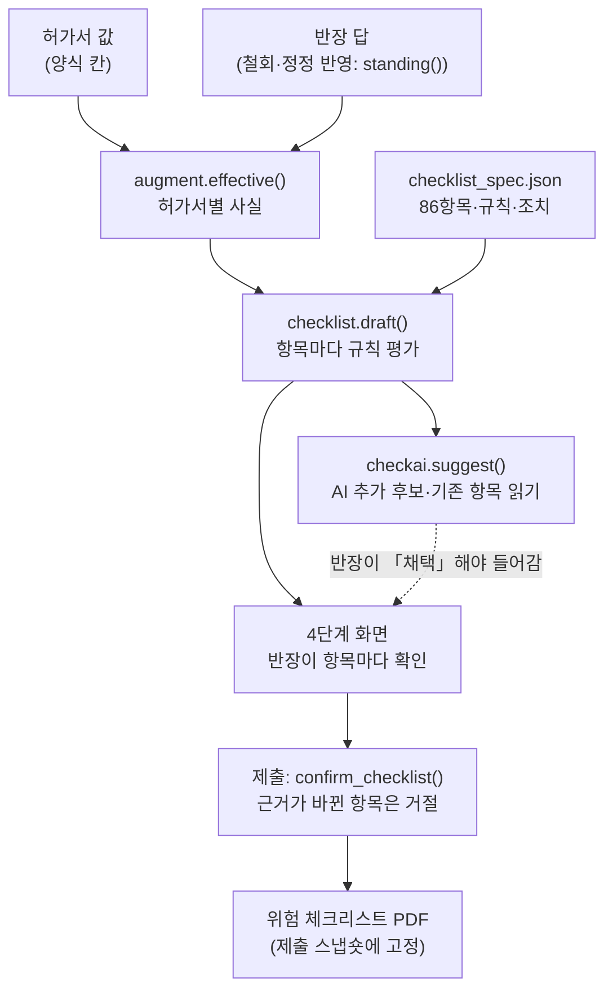
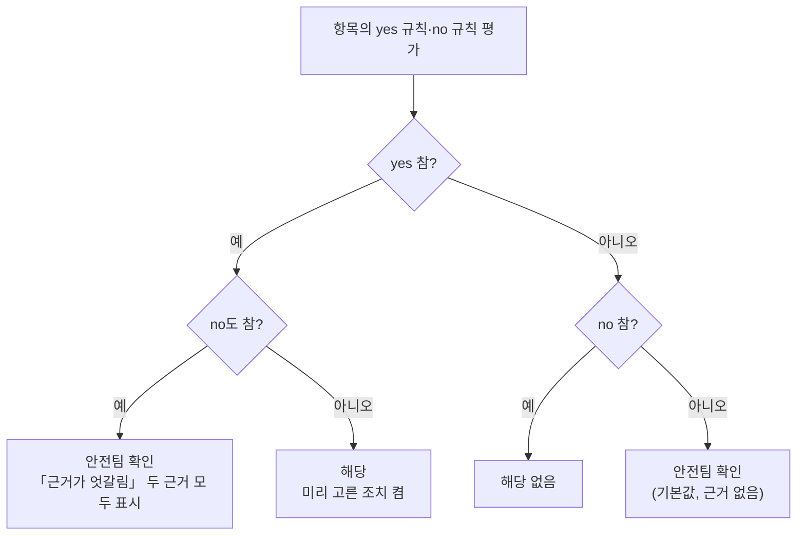
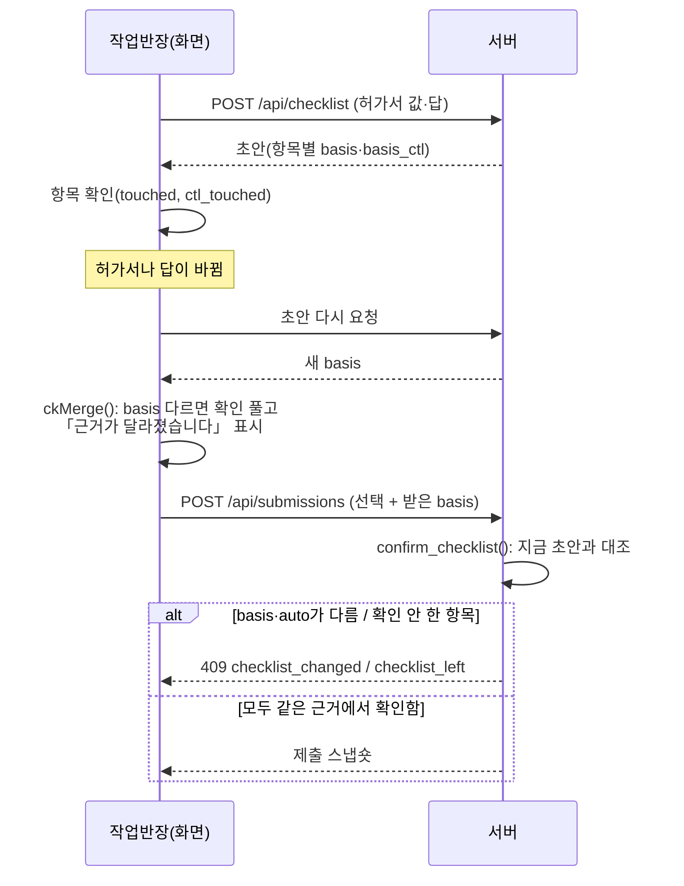

# 07. 위험 체크리스트

작업반장은 작업 전날 허가서를 냅니다. 그 전에 croScan이 허가서를 보고 위험요인 목록과 준비할 안전조치를 미리 채워 둡니다. 작업반장은 항목마다 해당 여부와 조치를 직접 확인합니다. 확인한 목록은 허가서와 함께 안전팀으로 갑니다.

**이 문서에서 알 수 있는 것**

- 체크리스트 86항목이 무엇이고, 어떤 작업에서 어떤 항목이 나오는지
- croScan이 「해당」「해당 없음」「안전팀 확인」을 어떤 규칙으로 미리 고르는지, 왜 「해당 없음」은 드물게만 고르는지
- 작업반장의 확인이 언제 풀리는지(basis·basis_ctl·work_digest)
- AI 제안, 연구 자료·사고 사례·법 조문이 어디에 어떻게 붙는지
- 고칠 때 볼 파일과 돌릴 시험

**목차**

1. [무엇을](#1-무엇을)
2. [왜](#2-왜)
3. [어떻게: 흐름](#3-어떻게-흐름)
4. [어떻게: 미리 채우는 규칙](#4-어떻게-미리-채우는-규칙)
5. [어떻게: 미리 고른 조치와 다른 종류 항목(cross)](#5-어떻게-미리-고른-조치와-다른-종류-항목cross)
6. [어떻게: 확인과 만료](#6-어떻게-확인과-만료)
7. [어떻게: AI 제안(checkai)](#7-어떻게-ai-제안checkai)
8. [근거: 연구 자료·사고 사례·법 조문](#8-근거-연구-자료사고-사례법-조문)
9. [86항목 표](#9-86항목-표)
10. [코드 어디](#10-코드-어디)
11. [시험](#11-시험)
12. [한계](#12-한계)

---

## 1. 무엇을

- **위험 체크리스트**: 허가서 한 건마다 만드는 위험요인 목록입니다. 항목마다 세 가지 중 하나를 고릅니다.

  | 화면·PDF 표기 | 코드 값 | 뜻 |
  |---|---|---|
  | 해당 | `yes` | 이 작업에 이 위험이 있다. 준비할 안전조치를 고른다 |
  | 해당 없음 | `no` | 이 작업에 이 위험이 없다 |
  | 안전팀 확인 | `check` | 반장이 정하기 어렵다. 안전팀이 확인한다(설계 문서와 코드 주석에서는 「확인 필요」라고도 부름) |

- **허가서만으로 만듭니다.** 근거는 허가서 값과, 그 허가서에 대한 작업반장의 답(멀티턴 확인 질문의 답 = 추가정보)뿐입니다. 작업계획서는 쓰지 않습니다(팀 결정 2026-10-27, [`docs/reference/위험체크리스트_설계.md`](reference/위험체크리스트_설계.md) §11).
- **계획이지 증거가 아닙니다.** 체크리스트는 「무엇을 준비할 예정인가」를 적은 전날 계획입니다. 조치를 실제로 했다는 기록이 아닙니다. TBM(작업 전 안전교육) 기록도 아닙니다. PDF 머리말에도 그렇게 적습니다([`server/checklist.py`](../server/checklist.py) `layout()`).
- **croScan은 승인하지 않습니다.** 해당 여부는 작업반장이 고르고, 안전팀이 봅니다. croScan은 초안만 채웁니다.

항목 수(지금 코드 기준, [`server/checklist_spec.json`](../server/checklist_spec.json)):

| 종류 | 코드 | 항목 | 조치 문장 | 미리 고른 조치 | 당일 허가서 칸과 연결된 조치 |
|---|---|---|---|---|---|
| 공통 | `common` | 7 | 23 | 8 | 5 |
| 화기 | `hot` | 21 | 67 | 36 | 21 |
| 밀폐 | `confined` | 16 | 50 | 25 | 23 |
| 고소 | `height` | 16 | 45 | 23 | 13 |
| 중량물인양 | `lifting` | 12 | 42 | 15 | 24 |
| 정전·LOTO | `loto` | 14 | 48 | 24 | 25 |
| **합계** | | **86** | **275** | **131** | **111** |

LOTO(Lockout·Tagout)는 에너지를 차단한 뒤 잠금장치와 꼬리표로 재가동을 막는 절차입니다.

허가서 한 건의 기본 목록은 「그 종류 항목 + 공통 7」이라 19~28개입니다. 밀폐·정전 허가서 안에서 화기를 하면 화기 항목이 더 붙습니다(5절). 그러면 최대 32개가 됩니다. 반장이 직접 더한 항목과 AI 제안을 합쳐 한 건에 40개까지 받습니다(`MAX_ITEMS`).

## 2. 왜

- **현장 흐름.** 생산 쪽(작업반장·생산부서)이 허가서를 올릴 때 1차 위험 체크리스트를 함께 올린다고 조사했습니다(설계 문서 기준, [`위험체크리스트_설계.md`](reference/위험체크리스트_설계.md) §1). 반장이 처음부터 쓰지 않고 「확인만」 하게 하는 것이 목적입니다.
- **당일 칸은 비워 둡니다.** 허가서 5번 「현장 안전조치 및 추가정보」는 작업 당일 시작 전에 체크하는 칸입니다(사전 작성 금지). 그래서 체크리스트는 그 칸을 채우지 않습니다. 같은 내용의 조치 옆에 「당일 허가서 5번에서 확인」만 표시합니다(조치의 `permit_key`, [`web/app.js`](../web/app.js) `ckItem()`).
- **기존 시스템을 대신하지 않습니다.** 조선소에는 이미 맞춤 체크리스트 기능이 있습니다(현장 정정 D12·D20, [`AI도입계획_설계서.md`](reference/AI도입계획_설계서.md) §7). croScan 체크리스트는 보완 기능입니다. 허가서와 반장 답에서 고른 「준비할 안전조치(계획)」를 사전검토 서류로 묶습니다.
- **「해당 없음」을 쉽게 고르면 위험합니다.** 허가서에 적혀 있지 않다고 위험이 없는 것은 아닙니다(침묵 ≠ 부재). 그래서 croScan은 기본값을 「안전팀 확인」으로 둡니다. 「해당 없음」은 허가서와 반장 답이 둘 다 분명히 「없다」고 할 때만 제안합니다(Codex 검토 2026-11-01 #2).

## 3. 어떻게: 흐름

1. 서버가 허가서 값과 답을 읽어 허가서별 사실을 만듭니다(`augment.effective()`). 철회된 답(C6 「서류가 맞음」)은 뺍니다. 정정(C5 「추가로 적은 내용이 맞음」)은 정정한 글로 읽습니다(`checklist.standing()`).
2. `checklist.draft()`가 그 종류 항목, 다른 종류에서 넘어온 항목(cross), 공통 항목을 차례로 평가합니다.
3. 화면 4단계에서 작업반장이 항목마다 「해당 / 해당 없음 / 안전팀 확인」을 누릅니다. croScan이 고른 값이 맞으면 「그대로 확인」을 체크해도 됩니다. 「해당」이면 준비할 안전조치도 확인합니다.
4. 대화가 끝나면 AI 제안을 미리 만들어 둡니다(`ckAiAhead()`). 반장이 「채택」해야만 목록에 들어갑니다.
5. 제출할 때 서버가 지금 사실로 초안을 다시 만듭니다. 반장의 선택은 같은 근거에서 고른 것만 받아들입니다(6절).

## 4. 어떻게: 미리 채우는 규칙

### 4.1 규칙의 모양

항목마다 `prefill.yes`(해당 근거)와 `prefill.no`(해당 없음 근거) 규칙 목록이 있습니다. 규칙은 다음 조각을 조합합니다(`_match()`).

| 규칙 | 읽는 것 | 예 |
|---|---|---|
| `head` | 허가서 분류 체크칸 | `weld_cut` 칸이 체크됨 |
| `text` | 허가서 글 칸(작업명·상세·장소·유해위험요소·추가정보 등)에서 정규식 | 「가우징」이 적힘 |
| `denied` | 허가서가 **분명히 아니라고** 적었을 때만 참 | 「산소 안 씀」. 아무 말이 없으면 거짓 |
| `answer` | 반장 답(질문 번호, 고른 선택지, 적은 글) | H2 답에 「LPG」 |
| `eff` | 계산된 사실(종류·높이·인원·병행여부·`facts.CF4` 등) | 높이 ≥ 2 |
| `any` / `all` / `not` | 조합 | |

규칙은 참·거짓 말고 **「모름」(None)** 도 돌려줄 수 있습니다. 「아마」「없으면」「미정」「모름」 답은 모름입니다. 빈 값의 결과는 규칙마다 다릅니다. 글에 찾는 말이 없거나, 있는 체크칸이 비어 있으면 거짓입니다. 계산된 사실(`eff`)이 비어 있으면 모름입니다. 답하지 않은 질문은 모름입니다. 다만 `"missing": false`인 답 규칙은 거짓으로 처리합니다. 모름은 규칙을 참으로 만들지 않습니다. `not`을 씌워도 모름으로 남습니다. 그래서 불확실한 반대 말 때문에 「해당 없음」이 되는 일이 없습니다.

글을 읽는 함수 `says()`가 지키는 것:

- 칸마다 따로 읽습니다. 한 칸의 「없음」이 다른 칸의 낱말을 지우지 않습니다.
- 끝에서 부정한 목록은 통째로 부정입니다. 「용접·절단 없음」은 용접도 절단도 없음입니다.
- 미정어(미정·모름·여부·확인 중 …)가 바로 뒤에 붙은 사실은 모름입니다. 「산소 사용 미정」은 모름입니다. 그러나 「CO2 용접 감시자 미정」에서 용접은 그대로 있습니다.

### 4.2 상태 정하기

`evaluate()`가 위 순서로 정합니다. 근거 문장(`reasons`)마다 출처를 붙입니다: `(서류)` 허가서, `(반장 답)` 답, 둘 다면 `(서류·반장 답)`.

### 4.3 「해당 없음」은 언제 제안하나

86항목 중 **6항목만** `no` 규칙이 있습니다(9절 표에서 ※). 나머지 80항목은 croScan이 「해당 없음」을 제안하지 않습니다. `common_ra`(위험성평가 대책 누락)는 `yes` 규칙도 없습니다. 그래서 늘 「안전팀 확인」으로 시작합니다.

| 항목 | 반장 답이 말해야 하는 것 | 허가서가 말해야 하는 것 |
|---|---|---|
| `common_mixed` 병행·혼재 | B3 「없음」 또는 C3 「다른 장소·설비」 | 병행여부 칸이 N, RT(방사선투과검사) 기재 없음 |
| `hot_oxygen` 산소 | H2 또는 D3 「가스 안 씀(전기 용접만)」 | 가스·산소를 안 쓴다고 적음 또는 「전기 용접만」, 산소·토치·LPG 문구 없음 |
| `confined_inflow` 연결 배관 유입 | CF2 「연결 계통 없음」 | 연결 계통이 없다고 적음, 아르곤·압력사용·수전구역 칸 미체크, 테스트압력 값 없음, 공급·퍼지 등 문구 없음 |
| `height_loaded`·`height_support`·`height_recovery` 러그 | HT1 「떼는 러그 없음」 | 떼는 러그가 없다고 적음 |

러그는 블록에 줄걸이를 걸기 위해 붙이는 고리나 부착물입니다. 「떼는 러그」는 이 부착물을 잘라 제거하는 작업을 말합니다(HT1 질문: 러그 제거 여부·수량·절단 방법).

여섯 규칙 모두 `all`(모두 참)입니다. 반장이 「없음」을 골라도 함께 적은 글에 「있다」는 말(「없음. 질소 투입 예정」)이 있으면 해당 없음이 되지 않습니다(`"missing": false` 가드).

**반장은 어느 항목이든 직접 「해당 없음」을 고를 수 있습니다.** 위 조건은 croScan이 「해당 없음」을 *제안*하는 조건일 뿐입니다([`AI도입계획_설계서.md`](reference/AI도입계획_설계서.md) §22 정정표). 다만 AI가 「작업 글에 이 위험이 있다」고 읽은 항목에 반장이 「해당 없음」을 고르면, 그 읽기를 본 뒤에 다시 골라야 제출됩니다(7절).

## 5. 어떻게: 미리 고른 조치와 다른 종류 항목(cross)

### 5.1 조치는 모두 계획 문장

- 조치 275개는 모두 「…할 예정」으로 끝납니다. 「실시함」「완료함」은 쓰지 않습니다(`tools/check_checklist.py`가 명세와 PDF에서 금지어를 검사).
- `preselect`(131개)는 항목이 「해당」일 때 미리 켜 두는 조치입니다. **법정 필수라는 뜻이 아닙니다**([`AI도입계획_설계서.md`](reference/AI도입계획_설계서.md) §7). 반장이 끄거나 다른 조치를 켤 수 있습니다.
- 화면에서 반장이 처음 「해당」을 누를 때 켜진 조치가 하나도 없으면 `pre` 표시가 있는 조치를 켭니다(`ckItem()`).
- `permit_key`가 있는 조치(111개)는 허가서 당일 칸과 같은 내용입니다. 화면에 「당일 허가서 5번에서 확인」을 붙입니다. 공통 항목은 종류마다 다른 칸을 가리킵니다(`_key()`).

### 5.2 다른 종류 항목(cross)

허가서 종류는 하나지만 작업 안에 다른 종류 일이 섞일 수 있습니다. 그때 명세의 `cross`가 다른 종류 항목을 더합니다(Codex 검토 #4).

| 허가서 | 이럴 때 | 더하는 화기 항목 |
|---|---|---|
| 밀폐 | CF4 「밀폐 안 화기」에 「함」, CF1 「보수·용접」, 또는 허가서 유해위험요소·작업명·상세에 용접·용단·가우징·절단·연삭 | `hot_spark` `hot_fire` `hot_explosion` `hot_electric` `hot_embers` `hot_contact` `hot_arc` `hot_oxygen` `hot_noise` (9개) |
| 정전·LOTO | 작업명·상세 또는 LO1 답에 용접·절단 등 | `hot_spark` `hot_fire` `hot_fume` `hot_embers` `hot_contact` (5개) |

「용접부」「용접기」「용접 비드·검사·품질」, 「절단기」는 화기로 보지 않습니다(정규식의 부정 전방탐색).

## 6. 어떻게: 확인과 만료

항목마다 확인이 두 개입니다(설계서 §7). 이 절의 두 확인과 만료 규칙은 기본 항목(초안이 만든 항목) 기준입니다. 반장이 직접 추가한 `U…` 항목과 AI 추가 항목(`A:…`)은 표 아래 목록 끝에 따로 적습니다.

| 확인 | 화면 동작 | 저장 값 | 무엇에 기대나(바뀌면 풀림) |
|---|---|---|---|
| 해당 여부 | 세 버튼 중 하나, 또는 「그대로 확인」 | `touched` | `basis` |
| 준비할 안전조치 (「해당」일 때만) | 조치 체크, 또는 「준비할 안전조치 그대로 확인」 | `ctl_touched` | `basis_ctl` |

- **`basis`** = 명세 버전, 항목 id·제목·`why`, croScan 제안과 근거, 규칙이 읽은 사실, 그리고 `work_digest`.
- **`work_digest`** = 허가서의 작업 사실 전부(사람 이름·연락처·서명·승인과 시각 칸은 뺌) + 이 허가서의 답(시간 답 T·A1~A3은 뺌)의 해시. 작업이 조금이라도 바뀌면(작업인원 3→5도) **모든 기본 항목의 해당 여부 확인**이 풀립니다. 시각만 바뀌면 아무것도 풀리지 않습니다(Codex 최종 검토 #3, 페르소나 A5).
- **`basis_ctl`** = 조치 목록 문장, 작업 방법·장비(작업명·상세·유해위험요소), 규칙이 읽은 답, 작업 규모(작업인원·높이).
- 작업 방법·인원·높이는 `work_digest`에도 들어갑니다. 그래서 이것이 바뀌면 해당 여부와 조치 확인이 모두 풀립니다. 조치 문장만 바뀌면 조치 확인만 풀립니다.
- 직접 추가한 `U…` 항목은 작업이 바뀌어도 확인이 자동으로 풀리지 않습니다. 별도 조치 확인도 요구하지 않습니다(`ckNeedCtl()`, `confirm_checklist()`).
- AI 추가 항목의 조치 근거에는 조치 목록과 작업 종류·작업명·상세·유해위험요소가 들어갑니다. 인원·높이는 직접 넣지 않습니다(`checkai.item_of()`, `method_digest()`). AI 항목이 지금 작업과 맞는지는 7절의 `checkai.attach()`가 따로 봅니다.

만료를 보는 곳은 세 군데입니다.

| 곳 | 함수 | 하는 일 |
|---|---|---|
| 화면 | `ckMerge()` ([`web/app.js`](../web/app.js)) | 새 초안에 반장 선택을 옮김. 제안(`auto`)이나 `basis`가 바뀐 항목은 확인을 풀고 이유를 보여 줌 |
| 제출 | `confirm_checklist()` ([`server/submissions.py`](../server/submissions.py)) | 서버가 지금 다시 만든 초안이 기준. 한 항목이라도 안 맞으면 409로 거절 |
| PDF | `checklist.merge()` | 다른 근거로 고른 항목은 초안 그대로 「(반장 확인 전)」으로 찍음. 기본 항목은 종이에서 빠지지 않음 |

PDF 표의 「해당 여부」 칸에는 확인 상태도 적습니다: 「(반장 확인 전)」, 「(조치 확인 전)」, 반장이 croScan과 다르게 고르면 「(croScan: 원래 제안)」.

## 7. 어떻게: AI 제안(checkai)

[`server/checkai.py`](../server/checkai.py)가 언어 모델에 한 번 묻습니다. 모델에게서 두 가지를 받습니다.

| 종류 | 모델이 하는 일 | 서버가 검사하는 것 | 화면 |
|---|---|---|---|
| **picks** (새 항목, 최대 3) | 다른 종류 카탈로그 항목(후보 최대 24개) 중 이 작업에 맞는 것을 고르고, 작업 사실의 한 구절(60자 이내)을 붙임 | 후보 목록 안의 id인지, 구절이 작업 사실에 그대로 있는지, 그 구절이 부정문·다른 팀 이야기가 아닌지, 그 작업 종류의 말이 들어 있는지(`KIND_WORDS`) | 「AI 제안」 줄에 「채택」「제외」. 채택하면 id `A:<항목 id>`, 상태 「안전팀 확인」, 확인 전 |
| **marks** (기존 항목 읽기, 최대 6) | 기본 항목에 대해 작업 글이 위험을 말하면 `support`(맞는 조치 id도), 하지 않는다고 하면 `conflict` | 기본 목록 안의 항목인지, 구절이 작업 사실에 있는지, support는 긍정문·conflict는 부정문인지, 다른 팀 이야기가 아닌지(`common_mixed`는 다른 팀 이야기도 받음), 항목 제목·설명·조치와 겹치는 두 글자 묶음이 구절에 있는지, 조치가 그 항목의 것인지 | 항목 안에 「AI 제안」 한 줄. 상태는 바꾸지 않음 |

- 구절은 공백과 일부 문장부호(따옴표·마침표·쉼표·가운뎃점 등)를 지운 뒤 대조합니다(`_norm()`). picks는 부정문과 다른 팀 이야기를 늘 뺍니다. marks는 위 표처럼 support·conflict와 `common_mixed`를 다르게 다룹니다.
- **새 위험요인 문장을 만들지 않습니다.** 모델은 명세에 있는 항목과 조치 id만 고릅니다.
- **모델이 말하지 않은 항목은 「해당 없음」이 되지 않습니다.**
- marks와 croScan 제안의 관계(설계서 §7 표대로):

  | croScan 제안 | AI 읽기 | 화면 문구 요지 |
  |---|---|---|
  | 해당 | support | 같은 근거 |
  | 안전팀 확인 | support | 해당이면 「해당」을 골라 주세요 |
  | 해당 없음 | support | 상충. 다시 골라 주세요 |
  | 해당 | conflict | 상충. 누구의 어떤 작업인지 확인해 판단. 「해당」이 기본 |

- 반장이 「해당 없음」을 고른 항목에 AI가 support를 붙이면, 그 읽기를 본 상태에서 다시 골라야 합니다(`ai_ack`). 제출 때 `checkai.marks_cached()`로 확인합니다.
- 결과는 검토 세션·작업 사실·명세·카탈로그별로 저장합니다. 그래서 같은 사실이면 모델을 다시 부르지 않습니다(`store.job`, 키 `checkai:<해시>`). 보여 주기 전에는 지금 작업 사실로 다시 검사합니다(`_now()`).
- 채택한 AI 항목은 나중에 온 결과가 빼지 않습니다. 작업이 바뀌어 구절이 맞지 않게 되면 「재확인 필요」가 됩니다. 그러면 반장이 「이 항목 빼기」 또는 「반장 항목으로 유지」를 고릅니다. 제출 때 맞지 않으면 409입니다(`checkai.attach()`, `Stale`).
- 모델 호출이 실패하거나 늦으면 아무것도 더하지 않습니다. 기본 목록은 그대로입니다. 허가서가 한 건인 파일에서만 동작합니다.

## 8. 근거: 연구 자료·사고 사례·법 조문

### 8.1 연구 ref (팀 조사본 412쪽)

- 항목마다 `ref`가 있습니다(예: `HW02-SPARK`). 팀 조사본(추가본·전체자료, 412쪽)의 위험 코드입니다.
- [`server/knowledge/research_refs.json`](../server/knowledge/research_refs.json)은 `tools/build_corpus.py`가 만듭니다. 법 조문이 아닌 ref **81개 중 73개**가 조사본 정의 표의 같은 코드에 쪽수·원문으로 「연결」됐습니다.
- 「미연결」 8개는 조사본 코드가 아닌 표시입니다(사례 번호, 안전보건보고서, 멘토 메모, 「부록B MACHINE」, 「(조문 미기재)」). 검색 후보 구절은 붙어 있지만 「검수 전」이고 인용하지 않습니다.
- 연결 결과는 「근거 지도」 화면([`web/evidence.js`](../web/evidence.js), `/api/knowledge/map`, [`server/evidencemap.py`](../server/evidencemap.py))에서 봅니다. 판정에는 쓰이지 않습니다.

### 8.2 사고 사례 (「왜?」)

- 출처: 「2025 조선업 중대재해 사례집(2015~2024)」, 안전보건공단 부산광역본부(명세 `case_source`).
- 같은 기전의 사고만 골라 **40항목에 사례 48건**(항목당 최대 3건, 연결 78개)을 붙였습니다. 사례집에 같은 기전이 없는 항목(보호구·흄·소음·온열·아크광 등)은 비워 두었습니다. 흄은 용접·절단 중 생기는 미세한 금속 입자입니다. 용접 때 생기는 흄을 용접흄이라고 합니다.
- 화면 항목의 「왜?」를 누르면 `/api/explanations/query`(kind `checklist`) → `explain.checklist()`가 다음을 보여 줍니다. 모델은 쓰지 않습니다.
  - croScan이 무엇을 제안했는지, 근거 문장, 「이 위험이 생기는 때」
  - 명세 id와 ref, 「참고 사고 사례(조선업 중대재해 사례집 N쪽): 제목」 최대 3건
  - 고른 조치, 아직 남은 것(안전팀 확인, 반장 미확인 등)
  - 마지막 줄은 늘 「조치 이행은 현장에서 따로 확인합니다(체크리스트는 계획입니다)」
- 사례는 참고입니다. 사례가 있다고 「해당」이 되지 않습니다.

### 8.3 법 조문 (law_fit)

- 현행 법령 원문과 맞춰 본 기록(`law_fit`)은 **공통 4항목에만** 있습니다(2026-10-31, 국가법령정보센터 현행본 대조).

  | 항목 | law_fit | 메모 |
  |---|---|---|
  | `common_mixed` | 맞음 | 산업안전보건법 제64조제1항제7·8호, 안전보건규칙 제575조제2항(RT) |
  | `common_ppe` | 맞음 | 안전보건규칙 제32조 |
  | `common_access` | 약함 | 인용 조문은 낙하·크레인만 직접 다룸. 밀폐 출입은 제619·622조 |
  | `common_rescue` | 약함 | 인용 조문은 화기·밀폐만 직접 다룸 |

- 다른 항목의 조치 문장에 든 조문(예: 제241조의2, 제618조, 제122조)은 대조 기록이 아직 없습니다. 「법이 요구한다」고 말할 때는 이 표의 「맞음」만 근거로 씁니다.

## 9. 86항목 표

명세에서 바로 뽑은 표입니다. 「이런 때 해당」은 명세의 `why`입니다. ※는 croScan이 「해당 없음」을 제안할 수 있는 항목(4.3절). 「근거 ref」 괄호는 조사본 연결 상태, 「사례」는 붙은 사고 사례 수입니다.

### 공통 (`common`) — 7개

| # | id | 위험요인 | 이런 때 해당 | 근거 ref | 사례 |
|---|---|---|---|---|---|
| 1 | `common_mixed` ※ | 병행·혼재작업으로 서로 다침 | 다른 팀의 작업시간·이동·불티·공유 설비가 겹칠 때 | 산업안전보건법 제64조제1항제7호·제8호(같은 장소 작업 확인·혼재 작업 조정)·안전보건규칙 제575조제2항(RT) (법 조문 · 현행본 대조 맞음) | 3 |
| 2 | `common_access` | 출입·통행 중 위험구역에 들어감 | 작업구역·하부·이동경로에 사람의 접근 가능성이 있을 때 | 산업안전보건기준에 관한 규칙 제14조제2항·제146조제1항제4호 (법 조문 · 현행본 대조 약함) | 3 |
| 3 | `common_ppe` | 보호구가 맞지 않아 몸·눈·호흡기가 다침 | 작업별 충격·불티·분진·추락·전기 노출이 있을 때 | 산업안전보건기준에 관한 규칙 제32조 (법 조문 · 현행본 대조 맞음) | - |
| 4 | `common_rescue` | 비상연락·구조가 늦어 피해가 커짐 | 화재·추락·질식·끼임·감전 때 즉시 대피·구조가 필요할 때 | 산업안전보건기준에 관한 규칙 제18조·제241조제2항제6호·제623조·제625조(제623·625조는 밀폐공간) (법 조문 · 현행본 대조 약함) | - |
| 5 | `common_ra` | 위험성평가에 있는 대책이 허가서 조치에서 빠짐 | 해당 공정의 위험성평가가 있을 때 | (조문 미기재) 사내 위험성평가 대조 — 정정내용 D12·안전보건보고서 (미연결) | - |
| 6 | `common_sharp` | 날카로운 모서리·절단면·잔재에 베임 | 절단·해체·그라인딩으로 날카로운 면이나 잔재가 생기거나 그것을 만질 때 | R42-02-SHARP (조사본 30쪽) | - |
| 7 | `common_machine` | 회전·구동부에 끼이거나 말림 | 모터·펌프·윈치·컨베이어·롤러 같은 움직이는 설비 가까이에서 일할 때 | 부록B MACHINE (미연결) | 3 |

### 화기 (`hot`) — 21개

| # | id | 위험요인 | 이런 때 해당 | 근거 ref | 사례 |
|---|---|---|---|---|---|
| 1 | `hot_spark` | 불티가 아래·틈새로 번져 화상·화재 | 용접·용단·가우징 불티가 사람이나 주변 물질로 갈 때 | HW02-SPARK (조사본 192쪽) | 3 |
| 2 | `hot_fire` | 가연물·도장 잔류물에 불이 붙음 | 불티·열이 가연물이나 잔류물에 닿을 수 있을 때 | HW05-FIRE (조사본 194쪽) | 2 |
| 3 | `hot_explosion` | 가연성 가스·증기에 불이 붙어 폭발 | 연료·용제·잔류물이 있는 곳에 화기가 닿을 때 | HW05-EXPLOSION (조사본 195쪽) | 2 |
| 4 | `hot_piece` | 떼어낸 부재가 떨어지거나 돌아감 | 부재를 완전히 분리하여 받치고 내리는 작업일 때 | HW03-FALL (조사본 193쪽) | 2 |
| 5 | `hot_support` | 절단으로 구조·발판의 받침이 사라짐 | 절단 대상이 다른 부재나 작업발판을 받칠 때 | HW03-SUPPORT (조사본 193쪽) | 3 |
| 6 | `hot_fall` | 높은 곳·개구부에서 화기작업하거나 오가다 떨어짐 | 높은 곳·개구부 근처에서 화기작업하거나 그곳을 오갈 때 | HW03-ACCESS-FALL (조사본 194쪽) | 2 |
| 7 | `hot_asphyxia` | 보호·퍼지 가스가 고여 질식 | 치환성 가스가 사람이 들어가는 배관·구획으로 갈 때 | HW06 (조사본 195쪽) | 2 |
| 8 | `hot_fume` | 용접흄·절단 분진을 들이마심 | 용접·가우징·절단·연삭 입자가 호흡 위치로 갈 때 | HW07 (조사본 196쪽) | - |
| 9 | `hot_electric` | 용접기·케이블 손상으로 감전 | 전기 용접·가우징 장비와 케이블을 사용할 때 | HW09-CABLE-ELECTRIC (조사본 197쪽) | - |
| 10 | `hot_embers` | 작업 뒤 남은 불씨에서 화재 | 화기 종료 뒤에도 불씨·열이 남을 수 있을 때 | HW10-FIRE (조사본 198쪽) | - |
| 11 | `hot_contact` | 작업 뒤 뜨거운 부재·절단편에 닿아 화상 | 화기 뒤 같은 부재·잔재를 만지거나 다음 작업에 넘길 때 | HW10-CONTACT (조사본 198쪽) | - |
| 12 | `hot_oxygen` ※ | 새거나 고인 산소로 옷·주변에 불이 쉽게 붙고 크게 번짐 | 산소 용기·호스를 쓰는 절단·가열일 때 | HW05-OXYGEN (조사본 195쪽) | - |
| 13 | `hot_hose` | 압축공기 호스가 빠지거나 터져 맞음·분출 상해 | 가우징 등 압축공기·가압 호스를 쓸 때 | HW09-HOSE-PRESSURE (조사본 197쪽) | - |
| 14 | `hot_heat` | 더운 곳·용접열에서 일해 온열질환(열탈진·열사병) | 고온·고습·복사열 환경에서 보호구를 입고 오래 일할 때 | HW02-HEAT (조사본 192쪽) | - |
| 15 | `hot_wheel` | 연삭 파편이 튀거나 회전공구에 베임·말림 | 그라인더·연삭기·디스크 절단기를 쓸 때 | HW03-FLYING·HW03-TOOL (조사본 193쪽) | 2 |
| 16 | `hot_noise` | 가우징·연삭 소음으로 청력 손상, 신호를 못 들음 | 가우징·연삭·치핑처럼 큰 소음이 나는 작업일 때 | HW08-NOISE-HEARING·HW08-NOISE-SIGNAL (조사본 196·197쪽) | - |
| 17 | `hot_arc` | 아크광에 눈·피부가 다침(주변 사람 포함) | 아크 용접·가우징·플라즈마로 강한 빛이 날 때 | HW08-ARC (조사본 196쪽) | - |
| 18 | `hot_drop` | 높은 곳 화기 중 용접기·와이어 스풀·공구가 아래 사람을 침 | 높은 곳에서 용접기·피더·공구를 쓰는 화기작업일 때 | HW03-FALL·LU02·사례 C23 (조사본 193·264쪽) | 1 |
| 19 | `hot_under` | 받쳐 둔 블록 아래·옆에서 일하다 블록이 넘어지거나 내려앉아 깔림 | 서포트·트레슬·잭으로 받친 블록 아래·옆에서 용접·높이 조정을 할 때 | 사례 C02·C03·C22 (미연결) | 2 |
| 20 | `hot_tack` | 취부·가고정 중 세워 두거나 매단 판넬·부재가 넘어지거나 빠짐 | 판넬·부재를 세우거나 크레인·체인블록으로 잡은 채 취부·가용접할 때 | 사례 C02·C11 (미연결) | 2 |
| 21 | `hot_glare` | 가스절단·가열의 강한 빛·복사열에 눈·피부가 다침 | 가스절단·용단·토치 가열을 할 때(아크가 아니어도) | HW08-NONARC (조사본 196쪽) | - |

### 밀폐 (`confined`) — 16개

| # | id | 위험요인 | 이런 때 해당 | 근거 ref | 사례 |
|---|---|---|---|---|---|
| 1 | `confined_argon` | 아르곤 등이 들어와 산소 부족·질식 | 치환성 가스를 쓰는 진입 구간 또는 연결 공기 경로일 때 | PE01 (조사본 235쪽) | 2 |
| 2 | `confined_residual` | 공급을 끊어도 남은 가스로 질식 | 가스 사용 뒤 같은 구간에 들어가거나 다시 들어갈 때 | PE02 (조사본 235쪽) | 1 |
| 3 | `confined_air` | 상태를 모르는 내부 공기로 건강장해 | 머리·상체만 넣는 경우를 포함해 내부 공기를 호흡할 때 | PE03-UNKNOWN (조사본 235쪽) | 1 |
| 4 | `confined_vent` | 환기·호흡용 공기가 끊겨 다침 | 진입자가 환기·배기·호흡용 공기 공급에 의존할 때 | PE04 (조사본 235쪽) | - |
| 5 | `confined_inflow` ※ | 연결 배관의 물질·압력이 갑자기 들어옴 | 진입 구간에 공급·세정·시험·복구 계통이 연결될 때 | PE05 (조사본 235쪽) | - |
| 6 | `confined_move` | 사람이 들어간 배관·블록이 움직임 | 진입 대상과 함께 움직이는 블록을 인양·이동할 때 | PE06 (조사본 236쪽) | - |
| 7 | `confined_watch` | 내부 이상을 놓치거나 연락이 끊김 | 내부 작업자의 상태와 퇴실 여부를 외부에서 살펴야 할 때 | PE08 (조사본 236쪽) | - |
| 8 | `confined_rescue` | 안쪽 사람을 꺼내지 못하거나 구조자가 다침 | 협소한 내부에서 의식 없는 사람의 구조가 필요할 수 있을 때 | PE10-PRE·PE10-RESCUE (조사본 236쪽) | - |
| 9 | `confined_access` | 좁은 출입구·호스에 걸려 이동·탈출이 막힘 | 협소부·굴곡·어두운 통로로 진입·이동·회수할 때 | PE14 (조사본 237쪽) | - |
| 10 | `confined_fall` | 밀폐공간 출입·고소작업 중 추락 | 높은 진입구·사다리·작업대·개구부에 접근할 때 | LU03 (조사본 264쪽) | 3 |
| 11 | `confined_heat` | 더운 내부·용접열로 온열질환(열탈진·열사병) | 고온·고습·복사열이 있는 내부에 오래 머물 때 | PE15-HEAT (조사본 240쪽) | - |
| 12 | `confined_fume` | 안팎의 화기 흄이 진입 공간으로 들어와 들이마심 | 진입 공간 안이나 그 흡기 가까이에서 용접·절단·가우징을 할 때 | PE11 (조사본 236쪽) | - |
| 13 | `confined_oxygen` | 산소가 많아져(23.5% 이상) 불이 쉽게 붙고 크게 번짐 | 내부에 산소 호스·용기를 들이거나 산소가 샐 수 있을 때 | PE03-O2HIGH (조사본 235쪽) | - |
| 14 | `confined_electric` | 내부 전등·전동공구·케이블 손상으로 감전 | 좁은 내부에서 전기 기기·케이블을 쓸 때 | PE13 (조사본 237쪽) | - |
| 15 | `confined_solvent` | 도료·신나 증기로 중독·질식·폭발 | 진입 공간 안이나 이어진 곳에서 도장·세정을 하거나 그 뒤에 들어갈 때 | 사례집 도장(밀폐·혼재)·멘토 병행 불가 (미연결) | 3 |
| 16 | `confined_noise` | 좁은 내부에서 울리는 소음으로 청력 손상, 감시인 신호를 못 들음 | 내부에서 그라인더·가우징·치핑처럼 큰 소음이 나는 작업을 할 때 | PE12-HEARING·PE12-COMM (조사본 237쪽) | - |

### 고소 (`height`) — 16개

| # | id | 위험요인 | 이런 때 해당 | 근거 ref | 사례 |
|---|---|---|---|---|---|
| 1 | `height_loaded` ※ | 하중이 걸린 러그를 잘라 낙하·붕괴 | 현재 쓰는지 확인되지 않은 러그를 제거할 때 | LU01 (조사본 264쪽) | 1 |
| 2 | `height_drop` | 러그·절단편·공구가 아래 사람을 침 | 상부에서 공구를 쓰거나 물체를 분리·회수할 때 | LU02 (조사본 264쪽) | 3 |
| 3 | `height_fall` | 발판·사다리·작업대에서 추락 | 접근·작업·복귀 중 가장자리나 불안정한 발판에 노출될 때 | LU03 (조사본 264쪽) | 3 |
| 4 | `height_support` ※ | 절단으로 모재·작업발판 지지가 무너짐 | 러그·모재 절단이 같은 구조나 부착 발판에 영향을 줄 때 | LU04 (조사본 264쪽) | 1 |
| 5 | `height_recovery` ※ | 분리물에 몸이 끌리거나 손이 끼임 | 러그를 마지막으로 자르거나 로프·장구로 내릴 때 | LU05 (조사본 264쪽) | - |
| 6 | `height_crane` | 크레인·블록이 작업대를 치거나 끼움 | 이동물 외곽이 상부 작업자·작업대와 겹칠 때 | LU06 (조사본 264쪽) | 2 |
| 7 | `height_spark` | 상부 절단 불티가 내려가 화상·화재 | 불티가 생기는 절단·연삭을 높은 곳에서 할 때 | LU07 (조사본 265쪽) | 2 |
| 8 | `height_fume` | 절단흄·사상 분진을 들이마심 | 절단·사상 입자가 자신이나 주변 호흡 위치로 갈 때 | LU09 (조사본 265쪽) | - |
| 9 | `height_residual` | 남은 열·불씨·분리물로 뒤늦게 다침 | 절단·회수 뒤 뜨거운 부재나 불안정 물체가 남을 때 | LU15 (조사본 266쪽) | - |
| 10 | `height_cable` | 절단·운반 중 케이블이 손상돼 감전, 케이블·호스에 걸림 | 플라즈마·전동공구를 쓰거나 절단선·회수 경로에 전선이 있을 때 | LU13 (조사본 266쪽) | - |
| 11 | `height_wheel` | 연삭 파편이 튀거나 회전공구 반동에 베임·말림 | 그라인더·기계절단으로 러그를 떼거나 사상할 때 | LU02-FLYING·LU05-TOOL (조사본 268·269쪽) | 2 |
| 12 | `height_oxygen` | 새거나 고인 산소로 옷·주변에 불이 쉽게 붙고 크게 번짐 | 산소 용기·호스를 쓰는 가스절단을 높은 곳에서 할 때 | LU08-OXYGEN (조사본 269쪽) | - |
| 13 | `height_noise` | 연삭·가우징 소음으로 청력 손상, 신호를 못 들음 | 높은 곳에서 연삭·가우징처럼 큰 소음이 나는 작업일 때 | LU12-HEARING·LU12-SIGNAL (조사본 265쪽) | - |
| 14 | `height_mewp` | 고소작업대가 넘어지거나 탑승자가 블록·돌출물에 끼임 | 고소작업대·고소차로 블록 아래·옆에 접근할 때 | 사례 C26·C28 (미연결) | 2 |
| 15 | `height_heat` | 더운 날 높은 곳·옥외에서 일해 온열질환(열탈진·열사병) | 폭염·고온 때 블록 상부·옥외에서 보호구를 입고 일할 때 | 안전보건보고서 혹서기 온열질환(옥외·고소) (미연결) | - |
| 16 | `height_explosion` | 가연성 가스·증기가 있는 곳에서 러그 절단 불티로 폭발 | 도장·용제·연료가스가 있거나 남은 곳 가까이에서 러그를 자를 때 | LU08-EXPLOSION (조사본 265쪽) | 1 |

### 중량물인양 (`lifting`) — 12개

| # | id | 위험요인 | 이런 때 해당 | 근거 ref | 사례 |
|---|---|---|---|---|---|
| 1 | `lifting_route` | 이동하는 블록에 부딪히거나 끼임 | 블록·줄걸이 전체 외곽과 작업·통행 경로가 만날 때 | MV01 (조사본 305쪽) | 2 |
| 2 | `lifting_drop` | 인양물·부착물이 아래로 떨어짐 | 현수 하중이나 고정되지 않은 부착물이 사람 위를 지날 때 | MV02 (조사본 305쪽) | 3 |
| 3 | `lifting_people` | 블록 안·위의 사람이 이동에 휩쓸림 | 이동 블록 내부·상부·부착 배관에 작업자가 있을 때 | MV03 (조사본 305쪽) | 2 |
| 4 | `lifting_rigging` | 장구·인양점 파손이나 불균형으로 낙하 | 하중·무게중심·장구·장비 구성이 맞아야 하는 인양일 때 | MV04 (조사본 305쪽) | 2 |
| 5 | `lifting_land` | 받침이 무너지거나 블록이 넘어짐 | 안착 뒤 하중을 받침으로 넘기고 줄걸이를 풀 때 | MV05 (조사본 305쪽) | 2 |
| 6 | `lifting_release` | 남은 줄걸이를 당겨 블록이 뒤집힘 | 안착 후 장구 일부가 연결된 채 다시 권상할 수 있을 때 | MV06 (조사본 305쪽) | 2 |
| 7 | `lifting_support` | 블록 이동으로 이웃 구조의 받침이 사라짐 | 이동 블록이 다른 부재·발판의 지지에 쓰일 때 | MV07 (조사본 306쪽) | - |
| 8 | `lifting_cranes` | 다른 크레인·하중과 부딪힘 | 별도 운행 장비의 주행로·외곽이 겹칠 때 | MV08 (조사본 306쪽) | - |
| 9 | `lifting_lines` | 붙은 호스·케이블이 당겨져 손상·상해 | 이동 블록에 사용 중인 선·덕트·배관이 연결될 때 | MV10 (조사본 306쪽) | - |
| 10 | `lifting_signal` | 신호를 잘못 받아 하중이 갑자기 움직임 | 시험인양·이동·안착·해제에 신호가 필요한 작업일 때 | MV12 (조사본 306쪽) | 1 |
| 11 | `lifting_egress` | 안착·적치물이 출입구·대피로·소화기 앞을 막음 | 블록을 내려놓거나 쌓아 두는 곳이 통로·출입구 가까이일 때 | MV11 (조사본 306쪽) | - |
| 12 | `lifting_fall` | 줄걸이 체결·해제하러 블록 위·고소작업대에 올라가 떨어짐 | 줄걸이를 걸거나 풀러 블록 위·메인빔·고소작업대에 오를 때 | LU03·사례 C25 (조사본 264쪽) | 1 |

### 정전·LOTO (`loto`) — 14개

| # | id | 위험요인 | 이런 때 해당 | 근거 ref | 사례 |
|---|---|---|---|---|---|
| 1 | `loto_contact` | 충전부에 닿아 감전 | 전기반·전로를 열어 점검·수리·교체할 때 | EL01 (조사본 340쪽) | - |
| 2 | `loto_backfeed` | 주전원을 꺼도 역송전·저장전하로 감전 | 보조전원·유도·저장 경로가 있거나 목록이 불완전할 때 | EL02 (조사본 340쪽) | - |
| 3 | `loto_arc` | 점검·복구 중 아크·단락으로 화상 | 전기 에너지가 남거나 다시 들어오는 경계에서 작업할 때 | EL03 (조사본 340쪽) | 1 |
| 4 | `loto_restart` | 다른 사람이 전원을 넣어 감전 | 잠금 중 다른 팀이 같은 전로를 사용·복구할 수 있을 때 | EL04-ELECTRIC (조사본 340쪽) | - |
| 5 | `loto_test` | 복구·시험 중 크레인이 움직여 끼임 | 주행·권상 등 구동을 복구하거나 시험할 때 | EL05-MOTION (조사본 340쪽) | - |
| 6 | `loto_energy` | 남은 기계 에너지가 풀려 맞거나 끼임 | 구동·지지부에 접근하며 에너지 종류·격리를 검토해야 할 때 | EL06-ENERGY (조사본 341쪽) | 1 |
| 7 | `loto_other_crane` | 다른 크레인이 수리자를 치거나 끼움 | 다른 크레인·하중 외곽이 접근·수리 영역으로 올 때 | EL07-COLLISION (조사본 341쪽) | - |
| 8 | `loto_fall` | 거더·사다리·작업대 접근 중 추락 | 제어반 작업을 위해 상부·추락 경계에 접근할 때 | EL08 (조사본 341쪽) | - |
| 9 | `loto_dependencies` | 정전으로 다른 작업의 필수 기능이 끊김 | 차단 전원에 다른 작업의 환기·조명·연락 등이 연결될 때 | EL09-DEPENDENCY (조사본 342쪽) | - |
| 10 | `loto_wiring` | 제어·연동 복구 오류로 뜻밖에 움직임 | 구동에 영향을 주는 제어회로·연동·방호를 바꿀 때 | EL12-MOTION (조사본 343쪽) | - |
| 11 | `loto_handover` | 작업이 끝난 뒤 복구·시험운전에서 다른 팀이 감전·끼임·추락 | 복구·시험운전·인계가 같은 전로·크레인을 쓰는 다른 팀 작업과 이어질 때 | EL13 (조사본 343쪽) | 1 |
| 12 | `loto_ingress` | 불티·이물이 열린 반에 들어가 화재·단락 | 제어반·배전반을 연 채 가까이에서 용접·절단·연삭이 있을 때 | EL10 (조사본 342쪽) | - |
| 13 | `loto_temp` | 임시 전원선 손상·접촉으로 감전, 임시선에 걸림 | 작업 중 임시 전원·가설 전선·연장선을 쓸 때 | EL11 (조사본 342쪽) | - |
| 14 | `loto_drop` | 거더·상부 정비 중 부품·공구가 아래로 떨어짐 | 크레인 거더·상부나 높은 반에서 부품을 떼거나 교체할 때 | 사례 C56·단기공사표준 (미연결) | 1 |

## 10. 코드 어디

| 고칠 것 | 파일 · 함수 |
|---|---|
| 항목·조치·규칙·cross·사례 | [`server/checklist_spec.json`](../server/checklist_spec.json) (기존 id·순서 유지, 새 항목은 뒤에) |
| 규칙 평가, 상태 정하기 | [`server/checklist.py`](../server/checklist.py) `_match()` `says()` `evaluate()` |
| 초안·근거 해시 | `checklist.draft()` `work_digest()` `facts_of()` |
| 답 읽기(철회·정정) | `checklist.standing()`, [`server/augment.py`](../server/augment.py) `live_answers()` `effective()` |
| PDF | `checklist.layout()` `sheets()` `merge()` `pdf()` (그리기는 [`server/addendum.py`](../server/addendum.py) `_draw()`) |
| AI 제안 | [`server/checkai.py`](../server/checkai.py) `candidates()` `check()` `check_marks()` `suggest()` `attach()` |
| 제출 때 확인 | [`server/submissions.py`](../server/submissions.py) `confirm_checklist()` |
| 「왜?」 | [`server/explain.py`](../server/explain.py) `checklist()` |
| 근거 지도 | [`server/evidencemap.py`](../server/evidencemap.py), [`tools/build_corpus.py`](../tools/build_corpus.py) `research_refs()` |
| API | [`server/app.py`](../server/app.py) `POST /api/checklist`, `/api/checklist/ai-suggest`, `/api/checklist/pdf` |
| 화면 4단계 | [`web/app.js`](../web/app.js) `openChecklist()` `ckMerge()` `ckItem()` `ckPayload()` `ckAiLoad()` `ckTakeAi()` `ckCandRows()` |

## 11. 시험

이 문서를 쓰면서 로컬에서 돌린 결과입니다(2026-11-01).

| 시험 | 보는 것 | 결과 |
|---|---|---|
| `python tools/check_checklist.py` | 명세가 있는 칸·질문만 씀, 조치는 계획 문장, 근거 없는 「해당 없음」 없음, 단일 신호가 항목을 움직임, 당일 칸 안 씀, PDF | 2794 / 2794 |
| `python tools/check_checklist_material.py` | 412쪽 대조로 더한 항목이 맞는 허가서에만 「해당」, 이름만으로는 안 됨(「용접부 비드 확인」은 용접 아님) | 561 / 561 |
| `python tools/check_checkai.py` | 카탈로그 항목만, 작업 글 구절만, 기본 목록 안 바뀜, 모델 실패 시 후보 없음 | 69 / 69 |
| `python tools/check_ckmerge.py` | 빠뜨리거나 다른 근거로 고른 기본 항목도 종이에 「반장 확인 전」으로 찍힘 | 6 / 6 |
| `python tools/check_submissions.py` | 제출 때 확인·거절, 스냅숏 한 번 | 21 / 21 |
| `python tools/check_ui_state.py` | `ckSig`·`ckTakeAi`: 늦은 AI 결과가 제출 내용을 바꾸지 않음 (node 필요) | 75 / 75 |

## 12. 한계

- **계획일 뿐입니다.** 「해당」에 조치를 골랐다고 그 조치를 했다는 뜻이 아닙니다. 이행은 당일 허가서 5번 칸과 현장 확인으로 따로 봅니다.
- **허가서와 답만 봅니다.** 작업계획서, 다른 팀의 서류, 위험성평가 문서는 읽지 않습니다. 다만 이 허가서와 반장 답에 적힌 병행작업 정보(병행여부 칸, RT 기재, B3·C3 답)는 `common_mixed`에 씁니다. 여러 작업의 실제 겹침 검토는 안전관리자 단계에서 합니다. `common_ra`는 그래서 늘 「안전팀 확인」입니다.
- **규칙은 낱말을 읽습니다.** 규칙은 정규식입니다. 그래서 정규식에 현장 말투·약어가 빠져 있으면 「해당」을 못 잡고 「안전팀 확인」으로 남습니다. 반대로 「해당」을 잘못 잡을 수도 있습니다. 그래서 반장 확인이 반드시 필요합니다.
- **만료가 넓습니다.** 작업 사실이 하나만 바뀌어도 모든 기본 항목의 해당 여부 확인이 풀립니다. 안전을 위해 일부러 고른 설계입니다. 대신 반장은 다시 눌러야 합니다.
- **법 조문 대조는 4항목뿐입니다.** 나머지 항목의 법 근거는 검수 기록이 없습니다(8.3절).
- **AI 제안은 허가서 한 건일 때만** 동작합니다. 모델이 늦거나 실패하면 비어 있습니다.
