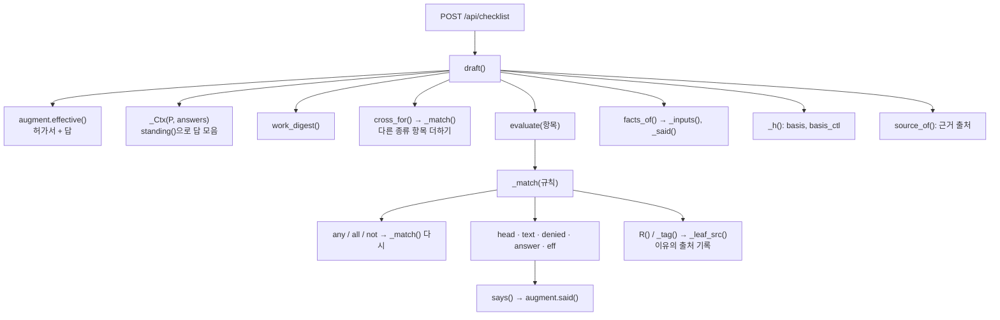
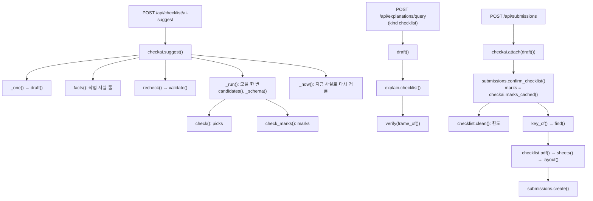
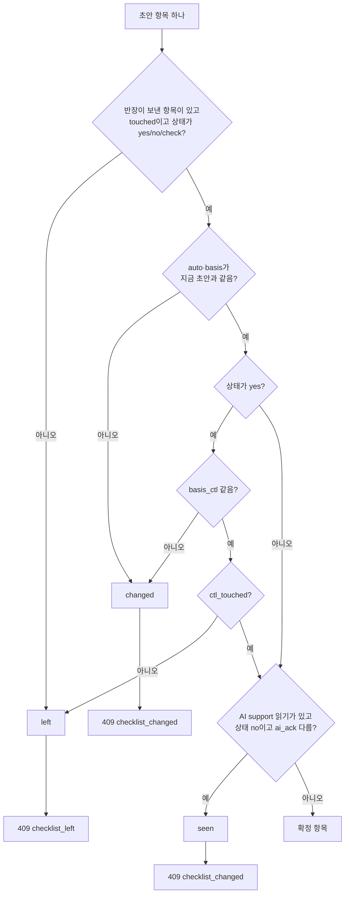

# 07b. 체크리스트 판정식 — 함수 하나하나

위험 체크리스트를 만드는 코드의 모든 함수를 한 줄씩 따라갑니다. croScan이 규칙으로 「해당」「해당 없음」「안전팀 확인」을 정하는 방법, AI 후보를 거르는 방법, 「위험한 이유 보기」를 짜는 방법, 제출 때 확인하는 방법을 함수 단위로 적습니다.

**이 문서에서 알 수 있는 것**

- 체크리스트 규칙 언어(`checklist_spec.json`의 `prefill`) 전체 문법과, 연산자마다 실제로 `evaluate()`에 넣어 본 결과
- 참·거짓·모름(None)이 어떻게 합쳐지는지, 답이 없을 때 어떻게 되는지
- 해당 여부 확인과 조치 확인이 기대는 해시(`basis`, `basis_ctl`, `work_digest`)를 무엇으로 만드는지
- AI 후보(picks)와 기존 항목 읽기(marks)를 서버가 어떤 순서로 검사하고 버리는지
- 제출 때 `checklist_left`·`checklist_changed`로 거절하는 조건과 제출 스냅숏을 남기는 방법

큰 흐름과 86항목 표는 [07. 위험 체크리스트](07_위험체크리스트.md)에 있습니다. 이 문서는 그 뒤의 함수 세부를 빠짐없이 적는 것이 목적입니다.

**목차**

1. [함수 지도](#1-함수-지도)
2. [호출 흐름](#2-호출-흐름)
3. [규칙 언어 문법표](#3-규칙-언어-문법표)
4. [checklist.py 함수](#4-checklistpy-함수)
5. [checkai.py 규칙 부분](#5-checkaipy-규칙-부분)
6. [explain.py 「위험한 이유 보기」](#6-explainpy-위험한-이유-보기)
7. [submissions.py 제출 확인과 스냅숏](#7-submissionspy-제출-확인과-스냅숏)
8. [시험](#8-시험)
9. [한계와 알려진 문제](#9-한계와-알려진-문제)

**용어 몇 개**

- **규칙(rule)**: 명세 JSON에 적힌 조건 하나입니다. 참이면 그 이유 문장이 근거로 화면에 나옵니다.
- **모름(None)**: 참도 거짓도 아닌 값입니다. 「아마」「미정」「모름」 같은 말이 여기에 들어갑니다. 모름은 규칙을 참으로 만들지 않습니다.
- **해시**: 내용을 짧은 글자열로 줄인 지문입니다. 내용이 조금만 바뀌어도 값이 바뀝니다. 확인이 풀리는지 볼 때 씁니다.
- **P (effective 허가서)**: [`augment.effective()`](../server/augment.py)가 허가서 값에 반장 답을 겹쳐 만든 허가서 한 건입니다. `p`(칸 값), `kind`, `height`, `concurrent`, `notes`, `facts`, `said`, `stale` 등이 들어 있습니다.

---

## 1. 함수 지도

줄 번호는 지금 코드 기준입니다. 이 문서가 다룬 함수는 `checklist.py` 23개(+ `_Ctx` 메서드 4개, 중첩 `R()` 1개), `checkai.py` 29개(+ 중첩 `turns()`), `explain.py` 4개(+ 중첩 `ck()`), `submissions.py` 9개입니다.

### 1.1 server/checklist.py

| 함수 | 줄 | 한 줄 요약 | 부르는 곳 |
|---|---|---|---|
| [`items_for()`](#items_for) | 48 | 종류 항목 + 공통 항목 목록 | `known_for()`, 시험 |
| [`_by_id()`](#_by_id) | 53 | id로 종류 항목 하나 찾기 | `cross_for()` |
| [`cross_for()`](#cross_for) | 57 | 다른 종류 항목을 더하는 조건과 그 항목들 | `known_for()`, `draft()` |
| [`known_for()`](#known_for) | 62 | 이 종류 허가서가 가질 수 있는 모든 항목 | `clean()` |
| [`_Ctx.__init__()`](#_ctx__init__) | 73 | 허가서 한 건의 답을 항목별로 모음 | `draft()`, 시험 |
| [`_Ctx.head()`](#_ctxhead) | 88 | 체크칸이 체크됐는지 | `facts_of()` |
| [`_Ctx.text()`](#_ctxtext) | 91 | 글 칸들을 줄바꿈으로 이어 붙임 | `_match()` |
| [`_Ctx.eff()`](#_ctxeff) | 94 | 계산된 사실 하나 꺼내기 | `_match()`, `facts_of()` |
| [`_leaf_src()`](#_leaf_src) | 123 | 규칙이 읽는 사실의 출처(서류/반장 답) | `_tag()` |
| [`says()`](#says) | 150 | 글이 그 말을 어떻게 말하나: 참/거짓/모름 | `_match()` |
| [`standing()`](#standing) | 189 | 철회·정정을 반영한 「살아 있는 답」 | `_Ctx`, `work_digest()`, `checkai.facts()` |
| [`_tag()`](#_tag) | 210 | 참이 된 이유에 출처를 기록 | `R()`, `_match()` |
| [`source_of()`](#source_of) | 215 | 출처 집합 → 「서류」「반장 답」「서류·반장 답」 | `draft()` |
| [`_match()`](#_match) | 220 | 규칙 하나 평가: 참/거짓/모름 + 이유 | `evaluate()`, `draft()` |
| [`R()`](#r) | 224 | `_match()` 안: 잎 결과에 이유 붙이기 | `_match()` |
| [`evaluate()`](#evaluate) | 305 | 항목의 상태·이유·미리 고른 조치 | `draft()` |
| [`_key()`](#_key) | 325 | 조치의 당일 허가서 칸 | `draft()`, 시험 |
| [`work_digest()`](#work_digest) | 337 | 작업 사실 전체의 해시 | `draft()`, `checkai` |
| [`_inputs()`](#_inputs) | 358 | 규칙이 읽는 칸·체크칸·답·사실 | `facts_of()` |
| [`_said()`](#_said) | 376 | 주어진 질문 번호의 답 목록 | `facts_of()` |
| [`facts_of()`](#facts_of) | 385 | 항목의 해당 여부·조치가 기대는 사실 | `draft()` |
| [`_h()`](#_h) | 405 | 짧은 해시 | `draft()` |
| [`draft()`](#draft) | 409 | 허가서마다 체크리스트 초안 | API, `checkai`, 제출 |
| [`clean()`](#clean) | 446 | 화면이 보낸 체크리스트를 정리·한도 검사 | `sheets()`, `merge()`, `confirm_checklist()` |
| [`layout()`](#layout) | 479 | PDF 한 장의 틀 | `sheets()` |
| [`sheets()`](#sheets) | 518 | 이 파일의 허가서마다 틀 | `pdf()` |
| [`merge()`](#merge) | 534 | 서버 초안 + 반장 선택(종이용) | `/api/checklist/pdf` |
| [`pdf()`](#pdf) | 562 | 체크리스트 PDF 바이트 | 제출, `/api/checklist/pdf`, `safety` |

### 1.2 server/checkai.py

| 함수 | 줄 | 한 줄 요약 | 부르는 곳 |
|---|---|---|---|
| [`Stale`](#stale) | 64 | 넣은 AI 항목이 지금 작업과 안 맞음 | `attach()` → 제출 409 |
| [`_norm()`](#_norm) | 68 | 공백·따옴표·문장부호 지우기 | 여러 곳 |
| [`_all_items()`](#_all_items) | 72 | 카탈로그 전체 (종류, 항목) | `spec_item()`, `candidates()` |
| [`spec_item()`](#spec_item) | 78 | id → (종류, 항목) | `validate()` |
| [`_item_words()`](#_item_words) | 87 | 항목 말의 두 글자 묶음 | `candidates()` |
| [`candidates()`](#candidates) | 91 | 모델에 보일 다른 종류 후보 최대 24개 | `_run()` |
| [`turns()`](#turns) | 106 | 종류별 목록을 번갈아 섞기 | `candidates()` |
| [`facts()`](#facts) | 116 | 작업 사실 줄 목록 | `suggest()`, `marks_cached()`, `attach()` |
| [`digest()`](#digest) | 143 | 목록 해시 | `_key()`, `method_digest()`, `check_marks()` |
| [`_words()`](#_words) | 147 | 「칸 이름: 값」 인용에서 값만 떼기 | `_find()`, `why_not()`, `check_marks()` |
| [`_find()`](#_find) | 160 | 인용이 들어 있는 줄과 구절 | `_clause()`, `source()` |
| [`_clause()`](#_clause) | 174 | 인용이 들어 있는 구절 | `why_not()`, `check_marks()` |
| [`source()`](#source) | 179 | 인용의 출처: 서류/반장 답 | `check()`, `check_marks()`, `validate()` |
| [`_bigrams()`](#_bigrams) | 184 | 두 글자 묶음 집합 | `relevant()`, `candidates()` |
| [`relevant()`](#relevant) | 189 | 인용이 그 항목의 말인지 | `check_marks()` |
| [`why_not()`](#why_not) | 194 | 후보 인용을 버릴 이유 | `check()`, `validate()` |
| [`method_digest()`](#method_digest) | 208 | 작업 방법·장비 해시 | `_run()`, `validate()` |
| [`check_marks()`](#check_marks) | 213 | 기존 항목 읽기(marks) 검사 | `_run()`, `_now()` |
| [`check()`](#check) | 242 | 추가 후보(picks) 검사 | `_run()` |
| [`item_of()`](#item_of) | 262 | 후보 → 체크리스트 항목 모양 | `check()`, `validate()` |
| [`_schema()`](#_schema) | 277 | 모델 답의 JSON 스키마 | `_run()` |
| [`_one()`](#_one) | 288 | 허가서 한 건과 그 초안 | `suggest()`, `marks_cached()`, `attach()` |
| [`validate()`](#validate) | 298 | 넣은 AI 항목을 지금 작업으로 다시 검사 | `recheck()`, `_now()`, `attach()` |
| [`_key()`](#_key-1) | 314 | 보관 결과의 열쇠 | `suggest()`, `marks_cached()` |
| [`_run()`](#_run) | 323 | 모델 한 번 호출 | `suggest()` |
| [`recheck()`](#recheck) | 349 | 넣은 항목들 재검사 결과 | `suggest()` |
| [`_now()`](#_now) | 361 | 보관 결과를 지금 작업으로 다시 거름 | `suggest()`, `marks_cached()` |
| [`suggest()`](#suggest) | 376 | AI 제안 끝점의 본체 | `/api/checklist/ai-suggest` |
| [`marks_cached()`](#marks_cached) | 410 | 보관한 읽기만 꺼냄(모델 호출 없음) | 제출 |
| [`attach()`](#attach) | 423 | 넣은 AI 항목을 초안에 붙임 | 제출 |

### 1.3 server/explain.py (체크리스트 부분)

| 함수 | 줄 | 한 줄 요약 | 부르는 곳 |
|---|---|---|---|
| [`checklist()`](#checklist) | 267 | 항목 하나의 설명 주장(J·F·R·U) | `/api/explanations/query` |
| [`_claims()`](#_claims) | 253 | 문장 목록에 id 붙이기 | `checklist()` 등 |
| [`frame_of()`](#frame_of) | 260 | 주장 → 화면 틀 | `/api/explanations/query` |
| [`verify()`](#verify) | 194 | 설명 검증기 7가지 | `/api/explanations/query` |
| [`ck()`](#ck) | 198 | `verify()` 안: 검사 한 줄 기록 | `verify()` |

쌍 판정의 「왜?」(`claims()`, `fixed()`, `ask()`)는 [06. 쌍작업 판정](06_쌍작업_판정.md)과 [05c §6.12](05c_라온이_하는_일.md#612-explain-왜-자유-질문)를 봅니다.

### 1.4 server/submissions.py

| 함수 | 줄 | 한 줄 요약 | 부르는 곳 |
|---|---|---|---|
| [`Refused`](#refused) | 26 | 제출 거절(코드·문장·항목) | `confirm_checklist()` → 409 |
| [`confirm_checklist()`](#confirm_checklist) | 32 | 반장 선택을 지금 초안과 대조해 확정 | `POST /api/submissions` |
| [`key_of()`](#key_of) | 85 | 같은 제출인지 가르는 열쇠 | `POST /api/submissions` |
| [`find()`](#find) | 90 | 같은 열쇠의 제출본 찾기 | `POST /api/submissions` |
| [`_put()`](#_put) | 97 | PDF 바이트를 해시 이름으로 저장 | `create()` |
| [`create()`](#create) | 107 | 제출본 한 번 만들기 | `POST /api/submissions` |
| [`get()`](#get) | 139 | 제출본 읽기 | 제출 문서 다운로드, 안전관리자 화면 |
| [`file()`](#file) | 149 | 제출 때 만든 PDF 바이트 | 제출 문서 다운로드 |
| [`latest()`](#latest) | 156 | 허가서별 가장 최근 제출본 | 안전관리자 화면, `docsum`, `holdq` |

---

## 2. 호출 흐름

### 2.1 초안 만들기

### 2.2 AI 제안, 설명, 제출

---

## 3. 규칙 언어 문법표

항목마다 `prefill.yes`(해당 근거)와 `prefill.no`(해당 없음 근거) 규칙 목록이 있습니다. 명세의 `cross[종류][].when`도 같은 문법입니다. 규칙 하나는 JSON 객체 하나입니다. `_match()`는 아래 순서로 열쇠를 찾고, **처음 찾은 열쇠 하나만** 봅니다: `any` → `all` → `not` → `head` → `text` → `denied` → `answer` → `eff`. 아무 열쇠도 없으면 모름입니다.

모든 규칙에 `reason`(이유 문장)을 붙일 수 있습니다. 참이 된 규칙의 `reason`이 화면과 PDF의 「근거」가 됩니다.

### 3.1 문법표

「명세 수」는 지금 `checklist_spec.json`에 그 형태가 나오는 횟수입니다(86항목, `prefill.yes` 183개·`prefill.no` 6개 최상위 규칙, `cross` 포함).

| 형태 | 모양 | 읽는 것 | 참 | 거짓 | 모름(None) | 출처 | 명세 수 |
|---|---|---|---|---|---|---|---|
| 묶음: 하나라도 | `{"any": [규칙…]}` | 안의 규칙 | 하나라도 참 | 모두 거짓(빈 목록도 거짓) | 참은 없고 모름이 하나라도 | 안 규칙들의 합 | 28 |
| 묶음: 모두 | `{"all": [규칙…]}` | 안의 규칙 | 모두 참(빈 목록도 참) | 하나라도 거짓 | 거짓은 없고 모름이 하나라도 | 안 규칙들의 합 | 9 |
| 반대 | `{"not": 규칙}` | 안의 규칙 | 안이 거짓 | 안이 참 | 안이 모름 | 안 규칙의 출처 | 15 |
| 체크칸 | `{"head": 칸}` | 허가서 체크칸 값 | 값이 `TICK` 안 | 칸은 있는데 체크 안 됨 | 그 칸이 허가서에 없음 | 서류 | 37 |
| 글 | `{"text": 정규식, "fields"?: [칸…]}` | 글 칸(줄바꿈으로 이음) | 그렇다고 말함 | 말이 없음, 또는 아니라고 말함 | 조건·추정·미정 말 | 서류 | 83 |
| 아니라고 적음 | `{"denied": 정규식, "fields"?: [칸…]}` | 글 칸 | 말이 있고 분명히 아니라고 말함 | 말이 없음(침묵은 부재가 아님), 또는 그렇다고 말함 | 조건·추정·미정 말 | 서류 | 5 |
| 반장 답 | `{"answer": 질문 접두어, "choice"?: id 또는 [id…], "value"?: 정규식, "missing"?: false}` | 이 허가서의 살아 있는 답 | 한 답이라도 맞음 | 맞지 않는 답이 있음, 또는 `missing: false`인데 답 없음 | 답이 없음, 「모름」, 글이 모름 | 반장 답 | 110 |
| 계산된 사실 | `{"eff": 이름, "op": 연산, "value": 값}` | `_Ctx.eff(이름)` | 비교가 맞음 | 비교가 틀림 | 값이 비었거나 비교 불가 | 이름에 따라 | 40 |

보충 규칙:

- `fields`가 없으면 `TEXT_FIELDS` = `("hazards", "notes", "job", "job_detail", "location", "location_detail")`를 읽습니다. 명세에서 실제 쓰는 칸은 이 6개와 `concurrent`, `test_pressure`입니다.
- `text`·`denied` 정규식 앞에는 `(?i)`(대소문자 무시)를 붙여 읽습니다. `answer`의 `value`, `eff`의 `re`도 같습니다.
- `answer`의 질문 접두어는 정확히 같은 질문(`H2`)이나 그 아래 질문(`H2.x`, `C5` → `C5.CF2`)에 맞습니다.
- `choice`가 문자열이면 목록 하나로 바꿔 봅니다. 명세에서 `choice`는 문자열 17번, 목록 16번, 없음 77번입니다.
- `"missing": false`는 명세에 8번 나오고, 모두 `false`입니다. 「답이 없거나 모름이면 거짓으로 친다」는 가드입니다. 「해당 없음」 규칙의 `all` 안에서 「있다는 말이 없을 때만」을 표현합니다.

`eff`의 연산(`op`, 없으면 `==`):

| 연산 | 뜻 | 빈 값일 때 | 명세 수 |
|---|---|---|---|
| `present` | 값이 있으면 참, 없으면 **거짓**(`value`는 읽지 않음) | 거짓 | 2 |
| `==` `!=` `>` `>=` `<` `<=` | `value`가 숫자면 둘 다 실수로 비교, 아니면 대문자로 바꿔 글자 비교. 실수로 못 바꾸면 모름 | 모름 | `==` 26, `>=` 6 |
| `in` | 값(대문자)이 `value` 목록(대문자) 안에 있음 | 모름 | 2 |
| `re` | 값을 `says()`로 읽음(글 규칙과 같음) | 모름 | 4 |
| 그 밖 | 모름 | 모름 | 0 |

`eff` 이름(`_Ctx.eff()`):

| 이름 | 값 | 출처(`EFF_SRC`) | 명세 수 |
|---|---|---|---|
| `kind` | 허가 종류(`hot` 등) | 서류 | 18 |
| `height` | 작업높이(실수, 없으면 None) | 서류 | 6 |
| `layer`, `place.layer` | 장소의 층(`P["place"]["layer"]`) | 서류 | 1 |
| `concurrent` | 병행여부(`Y`/`N`/빈칸, B3·C5 답으로 채워질 수 있음) | 서류·반장 답 | 1 |
| `workers` | 작업인원 칸의 숫자 | 서류 | 0 |
| `said` | 반장 답에서 모은 글(`P["said"]`) | 반장 답 | 0 |
| `notes.<이름>` | 추가정보 답(`이동 경로`, `작업 중 통제 범위` 등) | 반장 답 | 2 |
| `facts.<질문>[.<부분>]` | 확정 답 사실 `P["facts"][질문]`의 `choice`(기본) 또는 `value` | 반장 답 | 12 |

### 3.2 참·거짓·모름 합치기

`_match()`는 클레이니 3값 논리(Kleene logic: 참·거짓·모름 세 값을 쓰는 논리)를 따릅니다. 모름은 규칙을 참으로 만들지 않습니다. `not`을 씌워도 모름으로 남습니다. 그래서 불확실한 반대 말 때문에 「해당 없음」이 생기지 않습니다(코드 주석 `_match()`).

| A | B | `any[A,B]` | `all[A,B]` | `not A` |
|---|---|---|---|---|
| 참 | 참 | 참 | 참 | 거짓 |
| 참 | 거짓 | 참 | 거짓 | 거짓 |
| 참 | 모름 | 참 | 모름 | 거짓 |
| 거짓 | 거짓 | 거짓 | 거짓 | 참 |
| 거짓 | 모름 | 모름 | 거짓 | 참 |
| 모름 | 모름 | 모름 | 모름 | 모름 |

`answer` 한 규칙 안에서 같은 질문의 답이 여러 개면 다르게 합칩니다. 하나라도 맞으면 참, 아니면 맞지 않은 답이 하나라도 있으면 거짓, 그것도 없으면 모름입니다(아래 [`_match()`](#_match) 4단계).

### 3.3 상태 정하기 (`evaluate()`)

1. `prefill.yes` 규칙마다 `_match()`를 부릅니다. 참이면 그 이유를 「해당 근거」에 모읍니다.
2. `prefill.no`도 같은 방법으로 「해당 없음 근거」에 모읍니다.
3. 빈 이유를 빼고, 같은 문장은 한 번만 남깁니다.
4. 둘 다 있으면 `check`(안전팀 확인)이고, 이유는 `근거가 엇갈림 — 해당: … / 해당 없음: …` 한 줄입니다.
5. 해당 근거만 있으면 `yes`이고, 항목의 `preselect` 조치를 켭니다.
6. 해당 없음 근거만 있으면 `no`입니다.
7. 아무것도 없으면 `check`, 이유 없음입니다(기본값).

### 3.4 연산자마다 돌려 본 결과

아래는 가짜 허가서 P를 만들어 `_Ctx`에 넣고, 규칙 하나를 `_match()`와 `evaluate()`(그 규칙을 `prefill.yes`에 둔 항목)에 넣어 실제로 돌린 결과입니다(2026-11-02, 지금 코드). 「상태」는 `evaluate()`가 돌려준 값입니다. `yes` = 해당, `check` = 안전팀 확인.

**head**

| 규칙 | 입력 | `_match()` | 상태 · 근거 출처 |
|---|---|---|---|
| `{"head": "weld_cut"}` | `weld_cut` = `True` | 참 | yes · 서류 |
| 〃 | `weld_cut` = `"■"` | 참 | yes |
| 〃 | `weld_cut` = `""` | 거짓 | check |
| 〃 | `weld_cut` 칸이 없음 | 모름 | check |

**text** (정규식 `용접|절단|산소`, 칸 `job`)

| 입력 글 | `_match()` | 상태 |
|---|---|---|
| `CO2 용접 2개소` | 참 | yes · 서류 |
| `용접·절단 없음` | 거짓 (끝에서 부정한 목록은 통째로 부정) | check |
| `산소 사용 미정` | 모름 (미정어가 그 사실을 말함) | check |
| `아마 용접할 듯` | 모름 (추정) | check |
| `다른 작업 없으면 용접` | 모름 (조건) | check |
| `도장 작업` | 거짓 (말 없음) | check |

**denied** (정규식 `산소|가스`, 칸 `hazards`)

| 입력 글 | `_match()` | 상태 |
|---|---|---|
| `산소 안 씀` | 참 | yes · 서류 |
| `산소 사용` | 거짓 | check |
| `도장 작업` | 거짓 (침묵은 부재가 아님) | check |
| `아마 산소 안 쓸 듯` | 모름 | check |
| `산소 사용 미정` | 모름 | check |

**answer**

| 규칙 | 답 | `_match()` | 상태 |
|---|---|---|---|
| `{"answer": "H2", "value": "LPG\|산소"}` | H2 글 `LPG 토치 사용` | 참 | yes · 반장 답 |
| 〃 | H2 글 `LPG 안 씀` | 거짓 | check |
| `{"answer": "B3", "choice": "yes"}` | B3 `yes` | 참 | yes |
| `{"answer": "CF1", "choice": ["repair", "local"]}` | CF1 `repair` | 참 | yes |
| `{"answer": "B3", "choice": "yes"}` | B3 `no` | 거짓 | check |
| 〃 | B3 `unknown`(모름) | 모름 | check |
| 〃 | 답 없음 | 모름 | check |
| `{"answer": "B3", "choice": "yes", "missing": false}` | 답 없음 | 거짓 | check |
| `{"answer": "B3", "choice": "no"}` | B3 `free`, 글 `없음` | 거짓 (아래 설명) | check |
| `{"answer": "C5"}` | `C5.CF2` 답 | 참 (접두어) | yes |

`B3` 글 「없음」 줄: `free`로 고른 답은 `augment.negated()`가 「없음」 선택으로 바꿔 읽지 않습니다(`ch in ("yes", "free")`이면 None). 그래서 선택 `free`가 `no`와 달라 거짓입니다. 선택 `text`로 적은 「없음」은 `no`로 읽힙니다.

**eff**

| 규칙 | P 값 | `_match()` | 상태 · 출처 |
|---|---|---|---|
| `{"eff": "height", "op": ">=", "value": 2}` | `height` 4.8 | 참 | yes · 서류 |
| 〃 | `height` 1.5 | 거짓 | check |
| 〃 | `height` None | 모름 | check |
| `{"eff": "kind", "op": "==", "value": "HOT"}` | `kind` `hot` | 참 (대문자 비교) | yes |
| `{"eff": "concurrent", "op": "!=", "value": "N"}` | `Y` | 참 | yes · 서류·반장 답 |
| `{"eff": "kind", "op": "in", "value": ["hot", "loto"]}` | `hot` | 참 | yes |
| `{"eff": "facts.CF4", "op": "==", "value": "yes"}` | CF4 `{"choice": "yes"}` | 참 | yes · 반장 답 |
| `{"eff": "facts.CF4.value", "op": "re", "value": "CO2\\s*용접"}` | CF4 값 `CO2 용접` | 참 | yes · 반장 답 |
| `{"eff": "notes.이동 경로", "op": "present"}` | `2B 통로` | 참 | yes · 반장 답 |
| 〃 | 없음 | **거짓** | check |
| `{"eff": "concurrent", "op": ">", "value": 1}` | `Y` | 모름 (실수로 못 바꿈) | check |
| `{"eff": "kind", "op": "~"}` | | 모름 (모르는 연산) | check |
| `{"eff": "nothing", "op": "=="}` | | 모름 (모르는 이름) | check |
| `{"eff": "workers", "op": "<", "value": 5}` | 작업인원 `3` | 참 | yes · 서류 |
| `{"eff": "place.layer", "op": "==", "value": "상부"}` | 층 `상부` | 참 | yes |
| `{"eff": "said", "op": "re", "value": "그라인더"}` | `그라인더 사용` | 참 | yes · 반장 답 |

**not** (`{"not": {"text": "산소", "fields": ["job"]}}`)

| 입력 글 | `_match()` | 상태 |
|---|---|---|
| `산소 사용` | 거짓 | check |
| `도장` | 참 | yes · 서류 |
| `산소 사용 미정` | 모름 | check |

**any / all** (`a` 칸 체크·이유 「A」, `b` 칸 미체크, `zz` 칸 없음)

| 규칙 | `_match()` | 근거로 나오는 이유 |
|---|---|---|
| `any[b, a]`, 묶음 이유 있음 | 참 | 「A」 (참이 된 안 규칙의 이유가 먼저) |
| `any[이유 없는 a]`, 묶음 이유 있음 | 참 | 묶음 이유 |
| `any[zz, b]` | 모름 | 없음 |
| `any[b]` | 거짓 | 없음 |
| `any[]` | 거짓 | 없음 |
| `all[a, a2]`, 묶음 이유 있음 | 참 | 묶음 이유 하나 |
| `all[a, a2]`, 묶음 이유 없음 | 참 | 「A」「A2」 둘 다 |
| `all[a, zz]` | 모름 | 없음 |
| `all[zz, b]` | 거짓 | 없음 |
| `all[]`, 묶음 이유 있음 | 참 | 묶음 이유 (출처 기록은 빈 집합 → 「서류」로 표시) |
| `{}` (열쇠 없음) | 모름 | 없음 |

**evaluate() 상태**

| 항목 | 결과 |
|---|---|
| yes 규칙 참 + no 규칙 참 | `check`, `근거가 엇갈림 — 해당: 해당 근거 / 해당 없음: 해당 없음 근거` |
| no 규칙만 참 | `no`, `["없음 근거"]`, 조치 없음 |
| 규칙 없음 | `check`, 이유 없음 |
| yes 규칙이 참이지만 이유가 하나도 없음 | `check` (이유 없는 참은 세지 않음) |

---

## 4. checklist.py 함수

모듈 상수:

| 이름 | 값 | 쓰는 곳 |
|---|---|---|
| `MAX_PERMITS`, `MAX_ITEMS` | 10, 40 | `clean()` 한도 |
| `SPEC` | `checklist_spec.json` (version 1) | 어디서나 |
| `STATES` | `{"yes": "해당", "no": "해당 없음", "check": "안전팀 확인"}` | 상태 검사, PDF 글, `safety.py` 집계 |
| `TEXT_FIELDS` | `("hazards", "notes", "job", "job_detail", "location", "location_detail")` | 글 규칙 기본 칸 |
| `TICK` | `{"true", "1", "y", "yes", "■", "v", "✓", "o"}` | 체크칸 |
| `OPS` | `>=` `>` `<=` `<` `==` `!=` 비교 함수 | `eff` |
| `EFF_SRC` | `kind`·`layer`·`place.layer`·`height`·`workers` = 서류, `said` = 반장 답, `concurrent` = 서류·반장 답 | `_leaf_src()` |
| `METHOD_FIELDS` | `("job", "job_detail", "hazards")` | 조치 근거, `checkai.method_digest()` |
| `PEOPLE`, `TIME_KEY`, `TIME_ANS` | 아래 [`work_digest()`](#work_digest) | `work_digest()` |
| `NOT_WORK` | `("T", "B1.workers", "B2.workers", "A1.", "A2.", "A3.", "U1.", "C5.", "C6.")` | `facts_of()` |

### items_for()

**한 줄 요약.** 허가 종류 하나의 자기 항목 뒤에 공통 항목을 붙인 목록을 돌려줍니다.

- 입력: `kind`(`"hot"` 등). 출력: 항목 dict 목록.
- 단계: `SPEC["kinds"][kind]["items"]`(없으면 빈 목록) + `SPEC["common"]`. 모르는 종류면 공통 7개만 나옵니다.
- 예시(실행): `hot` 28, `confined` 23, `height` 23, `lifting` 19, `loto` 21개.
- 부르는 곳: [`known_for()`](#known_for). 이 함수가 부르는 곳: 없음.
- 시험: `check_checklist.py` 1절(명세 검사), `check_checklist_material.py`, `check_checkai.py`, `check_ckmerge.py`.

### _by_id()

**한 줄 요약.** 모든 종류의 항목 가운데 id가 같은 항목 하나를 찾습니다.

- 입력: 항목 id. 출력: 항목 dict 또는 None.
- 단계: `SPEC["kinds"]`의 종류를 차례로 돌며 처음 맞는 것을 돌려줍니다. 공통 항목은 찾지 않습니다.
- 부르는 곳: [`cross_for()`](#cross_for). 시험: 직접 시험은 없습니다(`cross_for()`를 거쳐 `check_checklist_material.py`의 밀폐+화기 사례).

### cross_for()

**한 줄 요약.** 이 종류 허가서에 다른 종류 항목을 더할 조건과 그 항목들을 돌려줍니다.

- 입력: `kind`. 출력: `[(when 규칙, [항목…])]`.
- 단계: `SPEC["cross"][kind]`의 항목마다 `when`과, `items` id를 `_by_id()`로 찾은 항목들(못 찾은 id는 뺌)을 짝지어 돌려줍니다.
- 지금 명세: `confined` → 화기 9항목(`hot_spark` `hot_fire` `hot_explosion` `hot_electric` `hot_embers` `hot_contact` `hot_arc` `hot_oxygen` `hot_noise`), `loto` → 화기 5항목(`hot_spark` `hot_fire` `hot_fume` `hot_embers` `hot_contact`).
- 예시(실행): `cross_for("loto")` → `[("정전 허가서 안에서 화기를 함", ["hot_spark", "hot_fire", "hot_fume", "hot_embers", "hot_contact"])]`.
- 부르는 곳: [`known_for()`](#known_for), [`draft()`](#draft). 부르는 함수: [`_by_id()`](#_by_id).
- 근거: 밀폐 공간 안에서 화기를 하면 화기 항목을 더합니다(Codex 검토 2026-11-01 #4, 모듈 머리 주석).
- 시험: `check_checklist_material.py` 2-3절 「CF4 「함」(effective.facts)」, 「CF4 「함」을 C6으로 철회하면 밀폐 목록에 화기 항목이 붙지 않음」.

### known_for()

**한 줄 요약.** 이 종류 허가서에 나올 수 있는 모든 항목을 id로 찾을 수 있게 모읍니다.

- 입력: `kind`. 출력: `{id: 항목}`.
- 단계: [`items_for()`](#items_for)로 자기·공통 항목을 넣고, [`cross_for()`](#cross_for)의 항목을 덧붙입니다(조건과 상관없이 전부).
- 예시(실행): `confined` 32개(23 + 화기 9), `loto` 26개, `hot` 28개.
- 부르는 곳: [`clean()`](#clean). 시험: `check_checklist_material.py`의 `clean()` 사례(밀폐 허가서의 `hot_embers`가 남음).

### _Ctx.__init__()

**한 줄 요약.** 허가서 한 건(P)과 그 허가서의 답을 규칙이 읽기 좋게 모읍니다.

- 입력: `P`(effective 허가서), `answers`(정규화된 답 목록), `one`(이 파일의 허가서가 한 건인지, 기본 True).
- 만드는 값: `self.P`, `self.p = P["p"]`(칸 값), `self.src = {}`(이유 → 출처 집합), `self.ans = {질문 → [답…]}`.
- 단계:
  1. [`standing()`](#standing)으로 철회(C6)된 답을 빼고 정정(C5)을 반영합니다.
  2. 답의 `qid`가 `P["stale"]`(앞 답이 바뀌어 다시 확인할 답)에 있으면 건너뜁니다.
  3. `qid`가 `FREE:`로 시작하고 `one`이 참이면 열쇠 `"FREE"`로 모읍니다.
  4. 아니면 `qid.split(":")[1:2] == [승인번호]`일 때만, 열쇠 `qid.split(":")[0]`(예: `H2`, `A1.T1`, `C5.CF2`)로 모읍니다. 쌍 질문처럼 `pid>other` 꼴인 답은 이 조건에 맞지 않아 들어가지 않습니다.
- 근거: 자유 답(FREE)은 허가서에 묶이지 않습니다. 허가서가 여럿이면 어느 허가서도 움직이지 않습니다(`augment.effective`의 `P["free"]`와 같음, Codex 검토 #7).
- 부르는 곳: [`draft()`](#draft). 시험: `check_checklist.py` 3-2절(직접 `_Ctx` 생성), `check_checklist_material.py` 「허가서 2건 파일의 자유 답변은 어느 항목도 켜지 않음」.

### _Ctx.head()

**한 줄 요약.** 체크칸 하나가 체크됐는지 참/거짓으로 돌려줍니다.

- 단계: `str(p.get(key, {}).get("value", "")).strip().lower() in TICK`. 칸이 없어도 거짓입니다(규칙 평가의 `head`는 칸이 없으면 모름으로 따로 처리합니다).
- 부르는 곳: [`facts_of()`](#facts_of)(규칙이 읽는 체크칸 값을 해시에 넣을 때).

### _Ctx.text()

**한 줄 요약.** 여러 글 칸의 값을 한 칸에 한 줄씩 이어 붙입니다.

- 단계: `"\n".join(augment._v(self.p, k) for k in keys)`. 빈 칸도 빈 줄로 들어갑니다.
- 근거: 한 칸의 말이 다른 칸의 말에 닿지 않게 줄바꿈으로 나눕니다(#10, 코드 주석).
- 부르는 곳: [`_match()`](#_match)의 `text`·`denied`.

### _Ctx.eff()

**한 줄 요약.** 규칙의 `eff` 이름에 맞는 계산된 사실 하나를 꺼냅니다.

- 단계(위에서부터 처음 맞는 것):

  | 이름 | 돌려주는 값 |
  |---|---|
  | `kind` | `P["kind"]` |
  | `layer`, `place.layer` | `P["place"].get("layer", "")` |
  | `height` | `P.get("height")` |
  | `concurrent` | `P.get("concurrent", "")` |
  | `layer` (두 번째) | 위에서 이미 걸려 닿지 않음 |
  | `workers` | `augment._num(augment._v(p, "workers"))` (실수 또는 None) |
  | `notes.<이름>` | `P["notes"].get(이름, "")` |
  | `facts.<질문>[.<부분>]` | `P["facts"][질문][부분 또는 "choice"]`, 없으면 `""` |
  | `said` | `P.get("said", "")` |
  | 그 밖 | None |

- `P["facts"]`는 `augment.effective()`가 확정 답(`FACT_ITEMS` = CF3·CF4·CF5·D6·D7·LO5·LO6·LI3·T8·T9·T4)에서 만듭니다. 고른 값이 `unknown`이면 넣지 않습니다.
- 부르는 곳: [`_match()`](#_match), [`facts_of()`](#facts_of). 시험: `check_checklist.py` 1절이 명세의 `eff` 이름을 `EFF_OK` 또는 `notes.`·`facts.` 접두어로 제한합니다.

### _leaf_src()

**한 줄 요약.** 규칙이 읽는 사실이 허가서(서류)에서 오는지 반장 답에서 오는지 모읍니다.

- 입력: 규칙. 출력: `{"서류", "반장 답"}`의 부분집합.
- 단계:
  1. `any`나 `all`이 있으면 안 규칙들의 합집합(목록이 비면 빈 집합). `any`가 있으면 `all`은 보지 않습니다.
  2. `not` → 안 규칙.
  3. `answer` → 반장 답. `denied` → 서류.
  4. `eff` → `notes.`·`facts.`로 시작하면 반장 답, 아니면 `EFF_SRC`(없는 이름은 서류). `"서류·반장 답"`은 `·`로 나눠 둘 다 넣습니다.
  5. 나머지(`head`, `text`) → 서류.
- 예시(실행): `{"eff": "concurrent"}` → `{"반장 답", "서류"}`, `{"any": []}` → 빈 집합.
- 부르는 곳: [`_tag()`](#_tag). 시험: `check_checkai.py` 「근거마다 출처(서류/반장 답)」, 「반장 답으로 정한 근거는 「반장 답」」.

### says()

**한 줄 요약.** 글이 정규식의 말을 「그렇다(참)」「아니다(거짓)」「모른다(None)」 가운데 무엇으로 말하는지 읽습니다.

- 입력: `t`(글, 칸마다 한 줄), `rx`(정규식). 출력: True / False / None.
- 이 함수는 [`augment.said()`](../server/augment.py)에 두 가지 읽기를 더합니다(Codex 검토 #6). 끝에서 부정한 목록은 통째로 부정입니다(「용접·절단 없음」). 미정어가 가리키는 사실은 모름입니다(「산소 사용 미정」).
- 쓰는 정규식:
  - `SEG` = `[,;\n/]|그리고|지만|(?<!\d)\.(?!\d)` — 구절 나누기. 「·」는 목록을 잇는 말이라 나누지 않습니다. 「4.8」의 점도 나누지 않습니다.
  - `GAP` = `[\s·와과및,]*` — 목록 사이 이음말.
  - `UNSURE_WORDS` = `augment.UNDECIDED.pattern + r"|모름|모르|미상|불확실|정해지지|확인\s*(?:중|필요)"`.
  - `ABOUT` = 조사(`은 는 이 가 을 를 도 의`)와 「그 일을 하는 말」(`사용 공급 여부 작업 방법 투입 주입 시행 실시 계획 일정 진행 유무 할지`)만 이어지는 꼬리.
  - `UNSURE_AFTER` = `^` + `ABOUT` + `\s*(?:` + `UNSURE_WORDS` + `)` — 맞은 말 바로 뒤에, 하는 말만 거쳐 미정어가 오는지.
- 단계:
  1. `t`가 비면 `""`로 봅니다. 글 전체에 `rx`가 없으면 거짓입니다.
  2. `SEG`로 구절을 나눕니다. `rx`가 없는 구절은 건너뜁니다.
  3. 구절 안의 맞은 자리들을 끝에서부터 봅니다. 사이가 `GAP`뿐인 연속 자리는 한 목록(`j`~`i`)으로 묶습니다.
  4. 목록 마지막 말의 꼬리(`tail`)가 `UNSURE_AFTER`에 맞으면 `unsure`를 켜고, 그 목록 자리를 공백으로 지웁니다.
  5. 아니고, 목록이 둘 이상이며 `tail[:8]`에 `augment.NEG`(부정어)가 있으면 거짓 하나를 넣고 그 목록을 지웁니다.
  6. 둘 다 아니면 그대로 둡니다(한 낱말의 부정은 6단계의 `augment.said()`가 읽습니다).
  7. 지우고 남은 구절에 아직 `rx`가 있으면 `augment.said(keep.replace("·", " "), rx)` 결과를 넣습니다. 「·」로 이은 낱말은 옆 낱말과 함께 읽습니다.
  8. 어느 구절에서도 `rx`를 못 찾았으면(정규식이 칸·구절을 넘는 경우) 옛 읽기 `augment.said(t.replace("\n", " "), rx)`를 씁니다.
  9. 합치기: 참이 하나라도 있으면 참. 아니고 None이 있거나 `unsure`면 None. 아니고 결과가 있으면 거짓.
- `augment.said()`가 하는 일(요약): 구절(`augment.CLAUSE`)마다, 추정 말(`HEDGE`)이 있는 구절은 건너뜁니다. 맞은 말 앞뒤에 조건(`COND`: 「…면」「경우」「때」)이 있으면 건너뜁니다. 뒤 20자에 미정 말(`OPEN`)이 있으면 건너뜁니다. 뒤 12자에 부정(`NEG`)이 있거나 앞 10자에 「안 쓰는」 꼴(`PRENEG`)이 있으면 거짓, 아니면 참입니다. 참이 하나라도 있으면 참입니다.
- 예시(실행, 정규식 `용접|절단|산소|가스`):

  | 글 | 결과 |
  |---|---|
  | `용접·절단 없음` | False |
  | `산소 사용 미정` | None |
  | `가스 안 씀` + 줄바꿈 + `용접 2개소` | True (칸마다 따로) |
  | `용접 안 함` | False |
  | `아마 용접` | None |
  | `CO2 용접, 감시자 미정` | True |
  | `CO2 용접 감시자 미정` (한 구절) | None ([9절](#9-한계와-알려진-문제) 확인 필요 1) |

- 부르는 곳: [`_match()`](#_match)의 `text`·`denied`·`answer`(value)·`eff`(`re`). 부르는 함수: `augment.said()`, `augment.NEG`.
- 시험: `check_checklist.py` 3-2절(「아르곤 가스 안 씀」 → 거짓, 「아마 아르곤 쓸 듯」 → None …), `check_checklist_material.py` 2-2절 `says()` 5사례, 2-4절 「칸을 섞은 입력 … 예전 읽기보다 낮아진 상태 없음」.

### standing()

**한 줄 요약.** 계산에 쓸 「살아 있는 답」을 만듭니다. 철회한 답은 빼고, 정정한 답은 반장이 새로 적은 글로 읽습니다.

- 입력: 답 목록. 출력: 답 목록.
- 단계:
  1. `augment.live_answers()`: C6.X 「서류가 맞음」(`choice == "doc"`)으로 철회한 X를 뺍니다. C5.X 「추가로 적은 내용이 맞음」이 있고 X가 `C5_POSITIVE`(B3·LI2·CF2·LO4)면, X의 「없음」을 그 글과 긍정 선택으로 바꿉니다.
  2. 살아 있는 답 가운데 `C5.X:…`이고 `choice == "free"`이며 `C5.concurrent:`가 아닌 답마다, `X:승인번호` → 그 글(`read` 또는 `value`)을 기록합니다.
  3. 같은 `qid`의 답은 `choice: "text"`, `value`·`read`: 정정 글로 바꿉니다.
  4. 원래 X 답이 목록에 없으면 `{"qid": X, "choice": "text", "value": 글, "read": 글, "q": {}}`를 새로 더합니다.
- 근거: 철회하거나 정정한 답은 항목을 움직이지 않습니다(코드 주석). C5 정정만 남아 있어도 CF2를 정정 글로 읽습니다(마지막 Codex 검토 #3). 자세한 질문 흐름은 [05 §11](05_멀티턴_질문.md#11-철회c6와-정정c5).
- 예시(실행): CF2 `none` + C5.CF2 글 「아르곤 퍼지 라인 연결 있음」 + H2 `LPG` + C6.H2 `doc` → `CF2`는 `text`·「아르곤 퍼지 라인 연결 있음」, H2는 빠짐.
- 부르는 곳: [`_Ctx.__init__()`](#_ctx__init__), [`work_digest()`](#work_digest), [`checkai.facts()`](#facts). 시험: `check_checklist_material.py` 2-3·2-4절.

### _tag()

**한 줄 요약.** 참이 된 규칙의 이유 문장에 그 규칙이 읽은 출처를 기록합니다.

- 단계: `ok is True`이고 `reason`이 있으면 `c.src[reason]`에 [`_leaf_src(rule)`](#_leaf_src)을 더합니다.
- 부르는 곳: [`R()`](#r), [`_match()`](#_match)의 `any`·`all`.

### source_of()

**한 줄 요약.** 출처 집합을 화면 글로 바꿉니다.

- 단계: `("서류", "반장 답")` 순서로 있는 것만 `·`로 잇습니다. 비면 「서류」입니다.
- 예시: `{"반장 답", "서류"}` → 「서류·반장 답」.
- 부르는 곳: [`draft()`](#draft). 시험: `check_checkai.py` 「근거마다 출처」.

### _match()

**한 줄 요약.** 규칙 하나를 평가해 (참/거짓/모름, 참이 되게 한 이유 목록)을 돌려줍니다.

- 입력: `rule`, `c`(`_Ctx`). 출력: `(True|False|None, [이유…])`.
- 단계(열쇠 순서가 곧 우선순위입니다):
  1. **`any`**: 안 규칙을 차례로 평가합니다. 처음 참이 나오면 바로 참을 돌려줍니다. 이유는 그 안 규칙의 이유이고, 안 규칙에 이유가 없으면 묶음의 이유입니다(이때 묶음의 출처를 기록). 참이 없으면, 모름이 하나라도 있었으면 모름, 아니면 거짓입니다. 첫 줄의 `got` 변수는 쓰이지 않습니다.
  2. **`all`**: 안 규칙을 차례로 평가합니다. 거짓이 나오면 바로 거짓(뒤 규칙은 보지 않음). 모름이 있었으면 모름. 모두 참이면 참이고, 묶음 이유가 있으면 그것 하나, 없으면 안 규칙 이유를 모두 돌려줍니다.
  3. **`not`**: 안 규칙이 모름이면 모름, 아니면 반대입니다.
  4. **`head`**: `c.p.get(head)`가 없으면 모름. 있으면 값이 `TICK` 안인지.
  5. **`text`**: `c.text(fields 또는 TEXT_FIELDS)`를 [`says()`](#says)로 읽습니다.
  6. **`denied`**: 같은 글을 `says()`로 읽습니다. 모름이면 모름. 아니면 「글에 그 말이 있고 `says()`가 거짓」일 때만 참입니다.
  7. **`answer`**:
     1. `choices` = `choice`가 문자열이면 `[choice]`, 아니면 그대로(없으면 None).
     2. `got = None`에서 시작합니다(묻지 않았거나 답이 없으면 모름).
     3. `c.ans`에서 열쇠가 접두어와 같거나 `접두어.`로 시작하는 답만 봅니다.
     4. `choice == "unknown"`(모름)인 답은 건너뜁니다. 규칙이 `["unknown"]`을 찾을 때만 봅니다.
     5. `choices`가 있으면 `augment.eff_choice(item, a)`를 봅니다. 글로 쓴 무조건 「없음」 하나는 「없음」 선택으로 읽습니다. 목록에 없으면 `got`이 None일 때만 거짓으로 두고 다음 답으로 갑니다.
     6. `value`가 없으면 참, 있으면 `says(a["value"], "(?i)" + value)`. 참이면 바로 참을 돌려줍니다. 아니면 `got`이 None일 때만 그 값으로 둡니다.
     7. 끝까지 `got`이 None이고 규칙에 `"missing": false`가 있으면 거짓, 아니면 `got`을 돌려줍니다.
     - 결과: 맞는 답이 하나라도 있으면 참 → 아니면 맞지 않는 확정 답이 하나라도 있으면 거짓 → 그것도 없으면 모름. 실행 확인: H2 「아마 LPG」 + H2.x 「LPG 안 씀」은 순서와 상관없이 거짓입니다.
  8. **`eff`**: `v = c.eff(이름)`, `op` 기본 `==`.
     1. `present` → `bool(v)` (빈 값은 거짓).
     2. `v`가 None이나 `""`이면 모름(모르는 값은 0으로도 치지 않음).
     3. `in` → `str(v).upper()`가 `value` 목록(대문자) 안인지.
     4. `re` → `says(str(v), "(?i)" + value)`.
     5. `OPS` → `value`가 int·float면 `float(v)`와 비교, 아니면 대문자 글자 비교. `TypeError`·`ValueError`면 모름.
     6. 그 밖 연산은 모름.
  9. 열쇠가 없으면 모름.
- 근거: 모름은 「아마 연결돼 있음」, 「없으면」 같은 조건, 「모름」 답, 빈 값입니다. 모름은 규칙을 참으로 만들지 않고, `not`도 모름으로 둡니다. 그래서 불확실한 반대 말 때문에 「해당 없음」이 되지 않습니다(코드 주석, 클레이니 논리).
- 예시: [3.4절](#34-연산자마다-돌려-본-결과) 전부.
- 부르는 곳: [`evaluate()`](#evaluate), [`draft()`](#draft)(cross 조건), 자기 자신. 부르는 함수: [`says()`](#says), [`R()`](#r), [`_tag()`](#_tag), `augment.eff_choice()`, `_Ctx.text()`·`eff()`.
- 시험: `check_checklist.py` 3절(규칙 하나가 항목을 「해당」으로 움직이는지, 2794건 중 해당 부분), 3-2절(불확실한 말과 `not`), `check_checklist_material.py` 2~2-4절.

### R()

**한 줄 요약.** `_match()` 안의 작은 함수입니다. 잎 규칙의 결과에 이유를 붙여 돌려줍니다.

- 단계: [`_tag(c, rule, ok)`](#_tag)를 부르고, `ok`가 참이고 `reason`이 있으면 `[reason]`, 아니면 `[]`를 함께 돌려줍니다.
- 부르는 곳: `_match()`의 `not`·`head`·`text`·`denied`·`answer`·`eff`와 열쇠 없음.

### evaluate()

**한 줄 요약.** 항목 하나의 상태(`yes`/`no`/`check`), 이유, 미리 켤 조치 id를 정합니다.

- 입력: 항목(`prefill`, `preselect`), `c`. 출력: `(state, reasons, preselected ids)`.
- 단계: [3.3절](#33-상태-정하기-evaluate) 그대로입니다. 참이 된 규칙의 이유가 비면 그 규칙의 `reason`을 쓰고, 그것도 비면 빈 문장이 되어 걸러집니다.
- 근거: 「해당」과 「해당 없음」이 둘 다 맞으면(허가서와 답이 엇갈리면) 확인 필요로 두고 두 근거를 모두 보입니다(코드 주석, [`위험체크리스트_설계.md`](reference/위험체크리스트_설계.md)). croScan은 「해당 없음」을 짐작하지 않습니다. 기본은 확인 필요입니다(같은 설계 문서).
- 예시: [3.4절](#34-연산자마다-돌려-본-결과) 끝 표. 시험 허가서 `BS22-IV-20261027-4012`(화기)의 초안은 해당 12 · 안전팀 확인 16 / 28항목입니다(실행).
- 부르는 곳: [`draft()`](#draft). 시험: `check_checklist.py` 2절(「해당·해당 없음에는 늘 근거」, 「미리 고른 조치는 해당일 때만」), 3절.

### _key()

**한 줄 요약.** 조치 하나가 가리키는 당일 허가서 칸 이름을 돌려줍니다.

- 단계: `permit_key`가 dict면 `pk.get(kind)`(공통 항목은 종류마다 칸이 다름), 아니면 그 값입니다.
- 부르는 곳: [`draft()`](#draft). 시험: `check_checklist.py` 1절 「당일 칸 …」(그 종류 양식에 있는 칸만).

### work_digest()

**한 줄 요약.** 이 허가서 체크리스트의 모든 「해당 여부」 확인이 기대는 작업 사실 전체의 해시(12자)를 만듭니다.

- 입력: `P`, `answers`. 출력: 12자 해시.
- 쓰는 정규식·상수:
  - `PEOPLE` = `phone|tel|name$|supervisor$|manager$|signer|sign|approv|성명|이름|연락처|전화|서명|승인|결재` (대소문자 무시)
  - `TIME_KEY` = `^(?:date|from|to)_\d+$|_date$`
  - `TIME_ANS` = `("T", "A1.", "A2.", "A3.")`
- 단계:
  1. 허가서 칸(`P["p"]`) 가운데 dict이고, 칸 이름과 표시 이름(`name`)이 `PEOPLE`에 안 맞고, 칸 이름이 `TIME_KEY`에 안 맞고, 값이 있는 칸만 `(칸, 값)`으로 모아 정렬합니다.
  2. [`standing()`](#standing)의 답 가운데 `stale`이 아니고, `FREE:`이거나 이 승인번호의 답이며, `TIME_ANS`로 시작하지 않는 답만 `(질문, 선택, 값)`으로 모아 정렬합니다.
  3. `sha256(json([명세 버전, 종류, 칸들, 답들]))[:12]`.
- 근거: 작업이 바뀌면(작업인원 포함) 모든 해당 여부 확인을 일부러 한꺼번에 풉니다(Codex 최종 검토 #3: 「크레인 OH-21-02 아래에서 용접」을 써 넣어도 확인 14개가 남았던 일, Codex 페르소나 A5: 작업인원 3→5). 시각만 바뀌면 아무것도 풀지 않습니다(코드 주석, 설계 §7 `basis_digest`).
- 예시(실행, 시험 허가서 4012): 처음 `63186b6b9ed3` → 작업인원 9로 바꿈 `ccbb65da7335` → 시작 시각만 06:00으로 바꿈 `63186b6b9ed3`(같음).
- 부르는 곳: [`draft()`](#draft), `checkai.suggest()`, [`checkai.validate()`](#validate). 시험: `check_checkai.py` 「작업 내용이 바뀌면 모든 항목의 근거가 바뀜」, 「사람 이름·연락처만 바뀌면 근거 그대로」, 「시간 답만 바뀌면 … 그대로」, 「작업인원 3→5 …」, `check_checklist_material.py` 「work_digest: C6으로 철회한 답의 글은 근거 해시에 들어가지 않음」.

### _inputs()

**한 줄 요약.** 규칙이 무엇을 읽는지 모읍니다: 글 칸, 체크칸, 답 접두어, `eff` 이름.

- 입력: 규칙, 누적 dict(없으면 새로). 출력: `{"fields", "heads", "answers", "effs"}` 집합 dict.
- 단계: `any` 또는 `all`(앞의 것만)의 안 규칙, `not`의 안 규칙을 다시 부릅니다. `head` → heads, `text`·`denied` → fields(없으면 `TEXT_FIELDS` 전부), `answer` → answers, `eff` → effs.
- 예시(실행): `{"any": [head a, text x, answer H2, not eff height]}` → fields 6칸, heads `{a}`, answers `{H2}`, effs `{height}`.
- 부르는 곳: [`facts_of()`](#facts_of).

### _said()

**한 줄 요약.** 주어진 질문 접두어들의 답을 `(질문, 선택, 값)` 정렬 목록으로 돌려줍니다.

- 단계: `c.ans`에서 열쇠가 접두어와 같거나 `접두어.`로 시작하는 답만 모읍니다.
- 부르는 곳: [`facts_of()`](#facts_of).

### facts_of()

**한 줄 요약.** 항목 하나의 「해당 여부」와 「안전조치」가 각각 기대는 사실을 따로 모읍니다.

- 입력: 항목, `c`. 출력: `(app, ctl)`.
- 단계:
  1. 항목의 yes·no 규칙을 모두 [`_inputs()`](#_inputs)에 넣습니다.
  2. `said` = 규칙이 읽는 답([`_said()`](#_said)).
  3. `work` = 이 허가서의 답 가운데 `NOT_WORK`로 시작하지 않는 답(작업이 어디서·어떻게·무엇으로인지 말하는 답).
  4. `app` = `[종류, (TEXT_FIELDS ∪ 규칙의 글 칸) 값, 규칙의 체크칸 값, 규칙의 eff 값, said, work]`.
  5. `size` = `[작업인원, 높이, B1.workers·B2.workers 답]`.
  6. `ctl` = `[종류, METHOD_FIELDS(작업명·상세·유해위험요소) 값, said, size]`.
- 근거: 조치 근거에 작업 규모(몇 명이 얼마나 높이)를 넣습니다. 작업자마다 잠금과 인원 대조, 추락 방지가 그에 따라 달라지기 때문입니다(Codex 페르소나 A5, 코드 주석).
- 부르는 곳: [`draft()`](#draft). 시험: `check_checkai.py` 「위치 답은 안전조치 근거를 바꾸지 않음」, 「작업 방법·장비 말이 바뀌면 안전조치 근거가 바뀜」, 「작업인원 3→5: 안전조치 근거도 바뀜」.

### _h()

**한 줄 요약.** 무엇이든 JSON으로 바꿔(`sort_keys`, `default=str`) sha256 앞 12자를 돌려줍니다.

- 부르는 곳: [`draft()`](#draft)의 `basis`, `basis_ctl`.

### draft()

**한 줄 요약.** 허가서마다 체크리스트 초안을 만듭니다.

- 입력: `fields`(양식 값), `answers`(정규화된 답). 출력: `{"version": 1, "permits": [{permit_no, kind, label, who, facts, items}]}`.
- 단계:
  1. `augment.effective(fields, answers)`로 허가서 목록을 만듭니다. 종류가 명세에 없는 허가서는 건너뜁니다.
  2. `_Ctx(P, answers, one=허가서가 한 건인지)`, `wd = work_digest(P, answers)`.
  3. [`cross_for()`](#cross_for)의 조건마다 `c.src`를 비우고 `_match()`가 **참**일 때만 그 항목을 `extra`에 더합니다(겹치면 한 번).
  4. 자기 항목 + `extra` + 공통 항목 순서로, 항목마다:
     1. `c.src`를 비우고 [`evaluate()`](#evaluate) → `state, why, sel`.
     2. [`facts_of()`](#facts_of) → `fa, fc`.
     3. `basis = _h([버전, id, title, why(항목 설명), state, 이유, fa, wd])`.
     4. `basis_ctl = _h([버전, id, [(조치 id, 조치 문장)…], fc])`.
     5. 이유마다 출처: `c.src[이유]`, 없으면 「근거가 엇갈림」이면 서류·반장 답, 아니면 서류 → [`source_of()`](#source_of).
     6. 항목: `id, basis, basis_ctl, ref, title, why, cases, common, state, auto(=state), reasons, sources, controls, memo("")`. 조치마다 `permit_key`([`_key()`](#_key)), `on`(미리 켬), `pre`(preselect 표시).
  5. 허가서: `permit_no, kind, label, who(augment._who), facts(wd), items`.
- 근거: 해당 여부와 안전조치는 각자의 근거에 기댑니다(설계 §7). 항목 자신의 「적용 범위」 문장(`why`)도 `basis`에 넣어, 범위가 넓어지면 다시 묻습니다(Codex 검토 #3).
- 예시(실행, 4012 첫 항목): `hot_spark`, `yes`, 이유 「허가서 「용접·용단」 칸이 체크되어 있음」, 출처 「서류」, 첫 조치 `hot_spark_c1`(`permit_key` `hw_spark_cover`, `on` 참).
- 부르는 곳: `POST /api/checklist`, `/api/checklist/pdf`(`merge()` 앞), `POST /api/submissions`(`attach()` 앞), `/api/explanations/query`, `checkai._one()`. 시험: `check_checklist.py` 2·3·3-3절, `check_checklist_material.py`, `check_checkai.py`.

### clean()

**한 줄 요약.** 화면이 보낸 체크리스트를 아는 항목과 평범한 값으로 줄이고, 한도를 넘으면 거절합니다.

- 입력: 화면 체크리스트. 출력: `[{permit_no, kind, items}]`.
- 단계:
  1. dict가 아니면 빈 목록으로 봅니다. 허가서 목록이 list가 아니거나 10건(`MAX_PERMITS`)을 넘으면 `ValueError("허가서는 10건까지입니다")`.
  2. 허가서마다 항목이 40개(`MAX_ITEMS`)를 넘으면 `ValueError`(지금 개수 포함).
  3. [`known_for(kind)`](#known_for)에서 항목을 찾습니다. 못 찾고 id가 `A:`로 시작하면 `A:`를 뗀 id를 모든 종류에서 찾습니다(반장이 넣은 AI 후보). 그래도 없고 `U`로 시작하지 않으면 버립니다.
  4. 상태가 `STATES`에 없으면 `check`.
  5. 켠 조치(`on`)만 남깁니다. 명세에 있는 id면 명세 문장, 아니면 보낸 문장(120자).
  6. 자르기: 제목 80자, 이유 160자×4개, 조치 8개, 메모 300자, 출처 12자×4개, 승인번호 40자.
  7. `touched`는 그대로, `ctl_touched`는 보낸 값 또는 `U` 항목이면 참, `common`은 명세 공통 항목인지.
- 근거: 설계 정정표(§22)는 「기본 목록 복원과 선택 병합은 `merge()`가 하고, `clean()`은 받은 항목을 정리한다」고 적습니다([`AI도입계획_설계서.md`](reference/AI도입계획_설계서.md)).
- 예시(실행): 허가서 11건 → `허가서는 10건까지입니다`.
- 부르는 곳: [`sheets()`](#sheets), [`merge()`](#merge), [`confirm_checklist()`](#confirm_checklist). 시험: `check_checklist.py` 5절(한도 초과 400, 다른 파일 허가서 400), `check_checklist_material.py`의 밀폐 허가서 `hot_embers`.

### layout()

**한 줄 요약.** 정리된 허가서 한 건을 PDF 한 장의 틀(제목·머리·블록)로 만듭니다.

- 입력: `P`(정리된 허가서), `when`(작성 시각), `who`. 출력: `{"title", "head", "blocks"}`.
- 단계:
  1. 머리 안내문 블록: 작업 전날의 계획이며 TBM 교육이나 조치 완료 기록이 아니라는 것, croScan은 승인하지 않는다는 것.
  2. 요약 표: 「해당 n · 안전팀 확인 n · 해당 없음 n (전체 n)」, 「작업반장 확인 a / n」. 확인 안 한 항목이 있으면 「확인 전 k개는 croScan 초안 그대로입니다」.
  3. 두 묶음: 「1. {label} 작업 위험요인」(label이 없으면 「1. 이 작업의 위험요인」)과 「2. 공통 위험요인」. 번호는 두 묶음을 이어서 셉니다(QA #90).
  4. 항목마다 「해당 여부」 칸: 상태 글 + `touched`가 없으면 「(반장 확인 전)」, 해당인데 `ctl_touched`가 없으면 「(조치 확인 전)」, `auto`와 다르면 「(croScan: 원래 제안)」.
  5. 조치 칸: 「· 조치」 줄들, 없으면 해당 없음은 「-」, 나머지는 「(정하지 않음)」. 메모가 있으면 「메모: …」.
  6. 근거 칸: 이유마다 「(출처)」를 붙임. 없으면 `U` 항목은 「작업반장 추가」, 아니면 「-」.
  7. 표 너비 `[0.06, 0.27, 0.13, 0.34, 0.20]`, 머리 「번호 / 위험요인 / 해당 여부 / 준비할 안전조치(계획) / 근거」.
- 부르는 곳: [`sheets()`](#sheets). 시험: `check_ckmerge.py` 「종이에 「반장 확인 전」 표시」, `check_checklist.py` 4절.

### sheets()

**한 줄 요약.** 이 파일의 허가서마다 [`layout()`](#layout) 틀을 만듭니다.

- 단계:
  1. `when` = 지금 한국 시각(UTC+9) `YYYY-MM-DD HH:MM`.
  2. `augment._permits(fields)`의 승인번호만 받습니다. 이 파일에 없거나 이미 본 승인번호는 건너뜁니다.
  3. `who` = 부서 · 작업책임자(없으면 「작업반장」), 앞에 종류 이름(예: 「화기 · …」).
- 예시(실행): 머리 `[("승인번호", "BS22-IV-20261027-4012"), ("작성", "화기 · 대조립1부-용접3팀 · 김XX"), ("작성 시각", …)]`, 묶음 제목 「1. 이 작업의 위험요인」, 「2. 공통 위험요인」.
- 부르는 곳: [`pdf()`](#pdf).

### merge()

**한 줄 요약.** 서버가 다시 만든 초안을 바탕으로, 같은 근거에서 고른 반장 선택만 옮겨 종이용 목록을 만듭니다.

- 입력: `draft`(서버 초안), `sent`(화면 체크리스트). 출력: `{"permits": [{permit_no, kind, items}]}`.
- 단계:
  1. `sent`를 [`clean()`](#clean)합니다. 초안에 없는 승인번호가 있으면 `ValueError("이 파일에 없는 허가서: …")`.
  2. 정리 전 원본에서 `(승인번호, 항목 id)` → 보낸 항목(`basis` 대조용)을 만듭니다.
  3. 초안 항목마다: 보낸 항목이 있고 보낸 `basis`가 초안 `basis`와 같으면 반장 선택을 씁니다. 이때 `basis_ctl`이 다르면 `ctl_touched`를 끕니다. 아니면 초안 그대로(`touched: False`, 켠 조치만, 메모 없음)를 넣습니다.
  4. 보낸 항목 가운데 `U…`와 `A:…`를 뒤에 붙입니다(정리된 그대로).
- 근거: 기본 항목은 종이에서 빠지지 않습니다. 다른 근거로 고른 조치는 확인 전으로 찍습니다(설계 §7, Codex 검토 #5).
- 부르는 곳: `/api/checklist/pdf`. 시험: `check_ckmerge.py` 6건, `check_checklist_material.py` 「merge(): 조치 문구가 바뀐 확인은 「조치 확인 전」으로」.

### pdf()

**한 줄 요약.** 체크리스트 PDF 바이트를 만듭니다.

- 단계: [`sheets()`](#sheets)의 틀마다 `addendum._draw()`로 그립니다. 쪽이 없으면 `ValueError("체크리스트가 비어 있습니다")`. 쓴 글자만 글꼴에 남기고(`subset_fonts`, 전체 한글 글꼴은 5MB), `workplan_pdf.fix_tounicode()`로 「·」가 「・」로 복사되지 않게 합니다. `tobytes(garbage=3, deflate=True)`.
- 부르는 곳: `POST /api/submissions`(확정본), `/api/checklist/pdf`(`merge()` 결과), `safety.py`(안전관리자 화면). 시험: `check_checklist.py` 4절(600KB 미만, 메모·직접 추가 항목, 「실시함/완료함」 없음, 「반장 확인 전」), 5절.

---

## 5. checkai.py 규칙 부분

모델 호출(CHECKLIST) 자체와 모델 자리·기한은 [05c §6.7](05c_라온이_하는_일.md#67-checklist-체크리스트-ai-제안)에 있습니다. 여기서는 서버가 모델 답을 거르는 규칙을 적습니다. 큰 흐름은 [07 §7](07_위험체크리스트.md#7-어떻게-ai-제안checkai)을 봅니다.

모듈 상수:

| 이름 | 값 |
|---|---|
| `MAX_PICKS`, `MAX_QUOTE`, `MAX_CANDIDATES`, `MAX_MARKS` | 3, 60, 24, 6 |
| `CATALOG` | 명세 `kinds`·`common`·`cross`의 해시(12자) |
| `POLICY` | `"relevance-then-kinds/2026-11-01"` (후보 고르는 방식, 보관 열쇠에 들어감) |
| `GENERIC` | 너무 흔한 두 글자: 작업 위험 확인 예정 준비 안전 사람 장소 시간 있을 때문 하는 하여 정할 나누 |
| `FACT_FIELDS` | 작업명, 작업 상세, 작업장소, 상세 위치, 유해위험요소, 추가정보 |
| `KIND_WORDS` | 종류마다 「그 종류 일」을 말하는 정규식(아래) |
| `SAYS_NO` | `없\|않\|아니\|말고\|무관\|안\s*(?:함\|합\|해\|하\|씀\|써\|쓰\|들어\|나)\|못\s*(?:함\|합\|해\|하)\|미사용\|제외` |
| `OTHER_TEAM` | `(?:옆\|다른\|타\|상대\|저쪽)\s*(?:팀\|업체\|반\|작업\|회사)\|[가-힣]{1,6}팀(?:은\|이\|도\|의\|에서\|이랑\|하고\|\s)\|들었` |
| `MIXED` | `{"common_mixed"}` (다른 팀 작업이 곧 주제인 항목) |
| `CLAUSE` | `[,.;·/\n]\|\s(?:그리고\|또는\|및)\s` |
| `STATE_KO` | `{"yes": "해당", "no": "해당 없음", "check": "확인 필요"}` (모델에게 보이는 기본 항목 줄에만 씀) |

`KIND_WORDS`:

| 종류 | 정규식 |
|---|---|
| hot | `용접\|용단\|절단\|가우징\|그라인\|불티\|화기\|토치\|산소\|플라즈마\|가열` |
| confined | `탱크\|밀폐\|이중저\|맨홀\|보이드\|코퍼댐\|내부\s*진입\|구획\s*내부` |
| height | `고소\|상부\|추락\|비계\|사다리\|고소작업대\|갑판\|높이\|\d+(?:\.\d+)?\s*m\|\d+\s*미터` |
| lifting | `인양\|크레인\|호이스트\|리깅\|중량물\|턴오버\|반전\|탑재\|체인\s*블록` |
| loto | `정전\|전원\|차단\|LOTO\|잠금\|배전\|패널\|MCC\|분전` |

### Stale

**한 줄 요약.** 반장이 넣은 AI 항목이 지금 작업 사실로는 더 이상 성립하지 않을 때 쓰는 예외입니다(구절이 사라졌거나 근거가 바뀜).

- 던지는 곳: [`attach()`](#attach). 받는 곳: `POST /api/submissions`가 이름이 `Stale`인 예외를 409 `checklist_changed`(「작업 내용이 바뀌어 AI 추가 후보를 다시 확인해야 합니다」)로 바꿉니다.
- 시험: `check_checkai.py` 「근거 구절이 없어진 넣은 항목은 제출 거절」.

### _norm()

**한 줄 요약.** 공백과 따옴표·낫표·마침표·쉼표·가운뎃점·말줄임표를 지웁니다.

- 정규식: `[\s\"'“”‘’「」『』.,·…]`.
- 부르는 곳: [`candidates()`](#candidates)(제목 비교), [`_find()`](#_find)(구절 대조), [`validate()`](#validate). 시험: `check_checkai.py` 「후보는 제목이 겹치지 않음」.

### _all_items()

**한 줄 요약.** 카탈로그 전체를 `(종류, 항목)` 목록으로 돌려줍니다. 공통 항목의 종류는 None입니다.

- 부르는 곳: [`spec_item()`](#spec_item), [`candidates()`](#candidates).

### spec_item()

**한 줄 요약.** id로 `(종류, 항목)`을 찾습니다. 없으면 `(None, None)`.

- 부르는 곳: [`validate()`](#validate).

### _item_words()

**한 줄 요약.** 항목의 제목·설명(`why`)·조치 문장을 이어 [`_bigrams()`](#_bigrams)를 만듭니다.

- 부르는 곳: [`candidates()`](#candidates).

### candidates()

**한 줄 요약.** 모델에게 보일 「다른 종류 카탈로그 항목」 후보를 최대 24개 고릅니다.

- 입력: `kind`, `base_items`(이 허가서 초안 항목), `lines`(작업 사실 줄). 출력: `[(종류, 항목)]`.
- 단계:
  1. 이 허가서 목록의 id와 제목(`_norm`)을 모읍니다.
  2. 작업 사실 줄의 값 부분(`": "` 뒤)으로 두 글자 묶음 `fw`를 만듭니다.
  3. 카탈로그를 돌며 공통 항목, 이 종류 항목, 이미 있는 id·제목, 앞에서 본 제목을 뺍니다. 남은 항목마다 `fw`와 겹치는 두 글자 수를 셉니다.
  4. `hit` = 종류마다 겹침이 있는 항목을 많은 순으로. `rest` = 겹침이 없는 항목을 카탈로그 순으로.
  5. [`turns(hit)`](#turns) + `turns(rest)`의 앞 24개.
- 근거: 관련 있는 항목 먼저, 그리고 종류마다 번갈아 넣습니다. 그래서 모든 종류가 후보에 들고, 작업이 말하는 항목(잔불·아크·소음·온열 …)이 한도에 잘리지 않습니다(Codex 검토 2026-11-01 #4).
- 예시(실행): 높이 허가서, 작업 사실 「블록 상부 러그 절단 / 추락, 용접흄 / …」 → 24개, 앞 다섯 `hot_fume`, `confined_fall`, `lifting_land`, `loto_fall`, `hot_electric`.
- 시험: `check_checkai.py` 「후보는 다른 작업 종류의 카탈로그 항목만」, 「… 후보에 다른 네 작업 종류가 모두 들어감(한도 24)」.

### turns()

**한 줄 요약.** `candidates()` 안의 함수입니다. 여러 목록에서 1번째끼리, 2번째끼리 … 번갈아 꺼내 한 줄로 잇습니다.

### facts()

**한 줄 요약.** 이 허가서의 작업 사실을 「이름: 값」 줄 목록으로 만듭니다.

- 입력: `P`, `answers`. 출력: 줄 목록.
- 단계:
  1. `FACT_FIELDS` 칸마다 값(공백 하나로 줄임)이 있으면 「작업명: …」.
  2. [`standing()`](#standing)의 답마다 건너뛰기: `stale`, `FREE:`, 다른 승인번호, 선택이 `unknown`·None, `augment.ABOUT_OTHERS`(B3·C3·C5.B3·C5.concurrent·LI3·LO6, 다른 팀 이야기) 질문, `A1.`·`A2.`·`A3.`·`U1.`·`C5.`·`C6.` 확인 질문, 다른 사람(`pid`가 있고 `who`가 self가 아님)의 답.
  3. 남은 답은 고른 선택지 이름 + 글을 「반장 답(칸 이름): …」으로. 칸 이름은 `addendum.ITEM`.
- 예시(실행, 4012): `작업명: 취부 불량부 절단·재용접(B11, F31, E11 블록)`, `작업 상세: 발판 위 높이 2.5m 구간 포함`, `작업장소: …`, `유해위험요소: 용접흄, 소음`.
- 시험: `check_checkai.py` 「작업 사실에 작업명이 들어감」, `check_checklist_material.py` 「checkai 작업 사실: C6으로 철회한 답은 넣지 않음」.

### digest()

**한 줄 요약.** 목록을 JSON으로 바꿔 sha256 앞 12자를 돌려줍니다.

### _words()

**한 줄 요약.** 인용에 줄 이름이 붙어 있으면(「유해위험요소: 용접흄, 소음」) 이름을 떼고, 그 이름의 줄을 먼저 보게 줄 순서를 바꿉니다.

- 단계: `quote.partition(": ")`. 값과 머리가 모두 있고 머리를 이름에 담은 줄이 있으면 `(값, 그 줄들 + 나머지 줄)`. 아니면 `(인용, 줄)`.
- 근거: 인용의 모든 대조(구절, 출처, 그 종류의 말, 그 항목의 말)가 이 함수를 거칩니다. 이름 없이 구절은 찾았는데 출처는 이름째 찾아 「반장 답」이 「서류」로 보였던 일이 있었습니다(Codex 페르소나 A10).
- 예시(실행): `유해위험요소: 추락, 용접흄` → `추락, 용접흄`.
- 시험: `check_checkai.py` 「칸 이름을 붙인 인용(「칸: 값」)도 그 칸의 말로 찾음」, 「머리말 붙은 인용도 출처는 그 줄(반장 답)」, 「줄 이름의 말(용접 위치)은 그 작업 종류의 말로 치지 않음」.

### _find()

**한 줄 요약.** 인용이 들어 있는 (줄, 구절)을 찾습니다. 없으면 `("", "")`.

- 단계: `_words()`로 인용과 줄 순서를 정하고 `_norm()`합니다. 줄마다 값 부분을 `CLAUSE`로 나눠, 구절에 들어 있으면 `(줄, 구절)`. 구절을 넘으면 값 전체에 들어 있을 때 `(줄, 값)`.
- 예시(실행): `러그 절단` → `("작업명: 블록 상부 러그 절단", "블록 상부 러그 절단")`.

### _clause()

**한 줄 요약.** [`_find()`](#_find)의 구절만 돌려줍니다.

### source()

**한 줄 요약.** 인용이 들어 있는 줄이 「반장 답」으로 시작하면 「반장 답」, 아니면 「서류」입니다.

- 예시(실행): `사다리는 쓰지 않음` → 반장 답, `러그 절단` → 서류.

### _bigrams()

**한 줄 요약.** 한글·영문·숫자만 남기고(공백도 지움) 이어진 두 글자 묶음 집합을 만든 뒤 `GENERIC`을 뺍니다.

- 예시(실행): `러그 절단 작업` → `{러그, 그절, 절단, 단작}`.

### relevant()

**한 줄 요약.** 인용과 항목(제목·설명·조치)이 두 글자 묶음을 하나라도 같이 가지면 참입니다.

- 부르는 곳: [`check_marks()`](#check_marks)만. picks는 이 검사 대신 `KIND_WORDS`를 봅니다.

### why_not()

**한 줄 요약.** 인용이 그 종류 후보의 근거가 될 수 없는 이유를 돌려줍니다. 될 수 있으면 None.

- 단계(순서대로, 처음 걸린 이유):
  1. 구절을 못 찾음 → 「구절이 작업 사실에 없음」
  2. 구절에 `SAYS_NO` → 「하지 않는다는 문장」
  3. 구절에 `OTHER_TEAM` → 「다른 팀 이야기」
  4. 인용 값(줄 이름 뺀 것)에 `KIND_WORDS[kind]`가 없음 → 「그 작업 종류의 말이 구절에 없음」
- 예시(실행, 화기 후보): `러그 절단` → None, `블록 상부` → 종류 말 없음, `사다리는 쓰지 않음` → 하지 않는다는 문장, `옆 팀이 용접함` → 다른 팀 이야기, `러그 용접 보수` → 구절 없음.
- 부르는 곳: [`check()`](#check), [`validate()`](#validate). 시험: `check_checkai.py` 74~85줄의 다섯 사례.

### method_digest()

**한 줄 요약.** 작업 방법·장비(종류 + 작업명·상세·유해위험요소)의 해시입니다. AI 항목의 조치 근거가 기댑니다.

### check_marks()

**한 줄 요약.** 모델이 기존 항목에 붙인 읽기(support/conflict)를 검사해 남길 것과 버릴 것을 나눕니다.

- 입력: `marks`(모델 답), `base_items`(A:·U 항목을 뺀 초안 항목), `lines`. 출력: `({항목 id: {m, quote, src, controls, id}}, 버린 것 [[b, 이유, 인용?]…])`.
- 단계(앞 6개만, 인용은 60자로 자름):
  1. `B<n>`이 목록 밖이거나 `m`이 support·conflict가 아니면 → 「항목이 아님」
  2. 같은 항목이 이미 있으면 → 「같은 항목 두 번」
  3. 구절이 없으면 → 「구절이 작업 사실에 없음」
  4. 구절에 `OTHER_TEAM`이 있고 `common_mixed`가 아니면 → 「다른 팀 이야기」
  5. 구절의 `SAYS_NO` 여부와 conflict 여부가 다르면 → conflict는 「하지 않는다는 말이 아님」, support는 「하지 않는다는 문장」
  6. [`relevant()`](#relevant)가 거짓이고 (`common_mixed`이면서 다른 팀 이야기)도 아니면 → 「그 항목의 말이 구절에 없음」
  7. support이면 모델이 고른 조치 id 가운데 그 항목의 조치만 앞 3개.
  8. 남기는 값: `m`, `quote`, `src`([`source()`](#source)), `controls`, `id = digest([항목 id, m, quote])`.
- 근거: 읽기는 상태와 근거를 바꾸지 않고 표시만 합니다. 설계 §7 표(규칙 해당 + support → 같은 근거, 확인 필요 + support → 「해당이면 골라 주세요」, 해당 없음 + support → 상충, conflict → 「누구의 어떤 작업인지 확인해 판단」, 해당이 기본)를 따릅니다(모듈 머리 주석). 다른 팀 작업은 병행·혼재 항목의 주제입니다(코드 주석).
- 예시(실행): `[{b: height_fall, support, "추락", k: [height_fall_c1, zz]}, {b: B99, …}]` → `height_fall: {m: support, quote: 추락, src: 서류, controls: [height_fall_c1], id: ccfec159fbf7}`, 버림 `[B99, 항목이 아님]`.
- 시험: `check_checkai.py` 174~201줄(support·conflict, 목록 밖, 다른 팀, 병행·혼재, 머리말 인용).

### check()

**한 줄 요약.** 모델이 고른 추가 후보(picks)를 검사해 체크리스트 항목으로 바꿉니다.

- 입력: `picks`, `cands`, `lines`, `wd`(work_digest), `md`(method_digest). 출력: `(항목들, 버린 것)`.
- 단계(앞 3개만): `C<n>`이 후보가 아니면 「후보가 아님」, 같은 항목이면 「같은 항목 두 번」, [`why_not()`](#why_not)에 걸리면 그 이유. 통과하면 [`item_of()`](#item_of).
- 예시(실행): 같은 `C<n>` 「러그 절단」 두 번 + `C99` → `A:hot_spark` 하나(상태 check, 이유 「AI 추가 후보(화기 작업 위험요인) · 근거 「러그 절단」」, 출처 서류), 버림 `[hot_spark, 같은 항목 두 번]`, `[C99, 후보가 아님]`.
- 시험: `check_checkai.py` 71~85줄.

### item_of()

**한 줄 요약.** 통과한 후보를 체크리스트 항목 모양으로 만듭니다.

- 출력 필드: `id = "A:" + 항목 id`, `spec`, `kind`, `basis`, `basis_ctl`, `ref`, `title`, `why`, `common: False`, `state`·`auto`: `check`, `reasons`(「AI 추가 후보(종류 작업 위험요인) · 근거 「인용」」), `sources: [src]`, `controls`(모두 꺼짐, `permit_key` None, `pre` 표시), `memo`, `origin: "ai"`, `quote`, `quote_src`.
- `basis` = sha256(`["A", 버전, id, title, why, quote, 조치들, wd]`)[:12]. `basis_ctl` = sha256(`["A", 버전, id, 조치들, md]`)[:12].
- 근거: 넣으면 다른 항목처럼 확인합니다(안전팀 확인, 확인 전). 해당 여부는 작업 사실(wd)에, 조치는 작업 방법·장비(md)에 기댑니다(설계 §7). 인원·높이는 조치 근거에 직접 넣지 않습니다([07 §6](07_위험체크리스트.md#6-어떻게-확인과-만료)).
- 시험: `check_checkai.py` 「후보는 확인 전(touched 없음)·근거 구절이 이유에」.

### _schema()

**한 줄 요약.** 모델 답의 JSON 모양을 정합니다.

- `picks`: 최대 3개, 각 `{c: 후보 id 중 하나, quote: 60자 이하}`.
- `marks`(기본 항목이 있을 때만): 최대 6개, 각 `{b: B id, m: support|conflict, quote: 60자 이하, k?: 조치 id 최대 3개}`. 조치 id가 없으면 `["-"]`.
- 다른 열쇠는 받지 않습니다(`additionalProperties: False`).

### _one()

**한 줄 요약.** 파일의 허가서가 (명세 종류로) 정확히 한 건이면 그 P와 초안을 돌려줍니다. 아니면 `(None, None)`.

- 근거: AI 제안은 허가서 한 건일 때만 동작합니다([07 §7](07_위험체크리스트.md#7-어떻게-ai-제안checkai)).

### validate()

**한 줄 요약.** 반장이 넣은 AI 항목을 지금 작업 사실로 다시 검사하고, 지금 근거로 다시 만듭니다.

- 입력: `P`, `base`, `lines`, `iid`(`A:…`), `quote`, `answers`. 출력: `(항목, None)` 또는 `(None, 이유)`.
- 단계:
  1. `A:`를 뗀 id가 카탈로그 종류 항목이 아니면 → 「카탈로그 항목이 아님」(공통 항목도 여기서 걸림)
  2. 종류가 이 허가서 종류이거나, 초안에 같은 id·제목이 있으면 → 「이 허가서 목록에 이미 있음」
  3. [`why_not()`](#why_not)(인용 60자) → 그 이유
  4. 통과하면 [`item_of()`](#item_of)(`work_digest` 지금 값, `source`, `method_digest` 지금 값).
- 시험: `check_checkai.py` 「작업이 바뀌면 넣은 항목의 근거가 바뀜(재확인 필요)」, 「근거 구절이 작업에 없으면 「재확인 필요」로 보고(지우지 않음)」.

### _key()

**한 줄 요약.** 보관한 AI 결과의 열쇠 `"checkai:" + digest([명세 버전, CATALOG, POLICY, 종류] + 작업 사실 줄)`를 만듭니다.

- 근거: 명세 버전만 쓰면 카탈로그가 늘어난 뒤에도 옛 결과를 썼습니다(Codex 검토 #8).
- 시험: `check_checkai.py` 「AI 보관 키에 카탈로그·후보 정책이 들어감」, 「보관 키에 명세 판·허가 종류가 들어감」.

### _run()

**한 줄 요약.** 모델을 한 번 불러 picks와 marks를 받고 검사합니다. 모델 쪽 세부는 [05c §6.7](05c_라온이_하는_일.md#67-checklist-체크리스트-ai-제안).

- 단계: 후보([`candidates()`](#candidates))와 기본 항목(A:·U 제외)을 만듭니다. 작업 사실이 없거나 후보·기본 항목이 모두 없으면 `none`. 후보 줄 「C1 [종류] 제목 — 설명」, 기본 항목 줄 「B1 [STATE_KO] 제목 · 조치 id=문장(24자)」으로 묻습니다. `llm.call_json("CHECKLIST", …, think=0, out_tokens=360, deadline=120.0, pri=llm.PREPARED)`. 실패(`LlmFail`) → `fail`(이유 코드), `picks`가 목록이 아니면 `fail`(`schema`). 통과하면 [`check()`](#check), [`check_marks()`](#check_marks). 하나라도 남으면 `ok`, 아니면 `none`.
- 시험: `check_checkai.py` 「모델 호출은 준비 작업 순위(PREPARED)」, 「한 번의 CHECKLIST 호출로 추가 후보와 기본 항목 읽기」, 「모델 실패 → 후보 없음(기본 목록만)」.

### recheck()

**한 줄 요약.** 반장이 넣은 AI 항목(`keep: [{id, quote}]`, 앞 12개)을 하나씩 [`validate()`](#validate)해 `{id: {ok, item}}` 또는 `{id: {ok: False, why}}`를 돌려줍니다. 빼지는 않습니다.

- 시험: `check_checkai.py` 「새 모델 결과에 없어도 넣은 항목은 남음」.

### _now()

**한 줄 요약.** 보관하거나 함께 쓰는 결과를 지금 작업 사실로 다시 거릅니다.

- 단계: 결과의 항목마다 [`validate()`](#validate)해 성립하는 것만 지금 근거로 남깁니다. 읽기는 지금 기본 목록의 `B<n>` 번호로 다시 매겨 [`check_marks()`](#check_marks)합니다. 상태가 `ok`·`none`이면 남은 것에 따라 다시 정하고, 그 밖 상태는 그대로 둡니다.
- 근거: 같은 말로 보관한 제안이 작업인원 3→5 전의 근거를 들고 있어 제출에서 거절된 일이 있었습니다(Codex 페르소나 A5, 코드 주석).
- 시험: `check_checkai.py` 「보관 후보는 지금 작업의 근거로 제시」, 「지금 사실로 성립하지 않는 보관 후보·읽기는 빼고 제시」.

### suggest()

**한 줄 요약.** `/api/checklist/ai-suggest`의 본체입니다. 같은 검토·작업 사실이면 보관한 결과를, 아니면 모델 결과를 지금 사실로 걸러 돌려줍니다.

- 단계: [`_one()`](#_one) 실패 → `none`(「허가서 한 건이 아님」). 작업 사실, 열쇠, 넣은 항목 재검사([`recheck()`](#recheck)). `store.job(sid, 열쇠)`에 `ok`·`none` 결과가 있으면 그것을 [`_now()`](#_now)로. 없으면 `(sid, 해시)`마다 작업 하나만 띄우고(`_TASKS`) 기다립니다. 더 급한 호출에 자리를 뺏기면 `fail`(`preempted`). 결과가 `ok`·`none`이면 `store.start_job`/`finish_job`으로 항목과 읽기를 보관합니다. 돌려주는 값: `{status, items, marks, facts(해시), kept}`.
- 시험: `check_checkai.py` 「같은 작업 사실이면 모델을 다시 부르지 않음」, 「인원만 바뀌면 같은 작업 말이라 모델을 다시 부르지 않음」.

### marks_cached()

**한 줄 요약.** 제출 때 쓰는 함수입니다. 보관한 읽기만 지금 사실로 다시 걸러 `{항목 id: 읽기}`를 돌려줍니다. 모델은 부르지 않습니다.

- 단계: 세션이 없거나 허가서가 한 건이 아니거나 보관 결과가 없으면 `{}`.
- 시험: `check_checkai.py` 「제출 때는 보관한 읽기만(모델 다시 안 부름)」.

### attach()

**한 줄 요약.** 제출 때 반장이 넣은 AI 항목(`A:…`)을 지금 작업 사실로 검사해 서버 초안에 붙입니다.

- 단계:
  1. 보낸 체크리스트에서 `A:` 항목을 모읍니다. 없으면 초안 그대로.
  2. [`_one()`](#_one)이 실패하면 `Stale`.
  3. 초안을 복사하고, 항목마다 [`validate()`](#validate). 실패하거나 승인번호가 다르면 `Stale(「id: 이유」)`.
  4. 아직 없으면 `spec`·`kind`·`origin`을 뺀 항목을 붙입니다.
- 근거: 보관한 제안이 아니라 지금 작업으로 검사합니다. 새 모델 결과가 넣은 항목을 빼지 않습니다(Codex 최종 검토 #5). 붙은 항목은 다른 항목처럼 [`confirm_checklist()`](#confirm_checklist)가 근거를 대조합니다.
- 시험: `check_checkai.py` 「넣은 AI 항목은 초안 항목으로 붙음」, 「붙은 AI 항목의 근거는 지금 작업 사실로 다시 만든 것」, 「작업이 바뀐 뒤 예전 근거로 확인한 항목은 제출 거절」, 「넣지 않으면 초안 그대로」.

---

## 6. explain.py 「위험한 이유 보기」

체크리스트 항목의 「위험한 이유 보기」는 모델을 쓰지 않습니다. `POST /api/explanations/query`(kind `checklist`)가 지금 답으로 [`draft()`](#draft)를 다시 만들고, 화면이 보낸 지금 상태(`now`: `touched`, `state`, 켠 조치 `on`)를 덮은 뒤 `explain.checklist()` → `verify(frame_of())` 순서로 부릅니다. 설명 틀은 「판단 → 사용한 사실 → 적용한 규칙 → 아직 확인할 것 → 근거 보기」입니다(설계 §19.2). 사고 사례 출처는 [07 §8.2](07_위험체크리스트.md#82-사고-사례-위험한-이유-보기).

### checklist()

**한 줄 요약.** 항목 하나를 설명 주장 네 묶음(J 판단, F 사실, R 규칙, U 아직 확인할 것)으로 만듭니다.

- 입력: 항목(초안 항목 + 지금 상태), `permit_no`. 출력: `_claims()` 결과.
- 단계:
  1. `auto` = `CK_STATE`(`yes` 해당, `no` 해당 없음, `check` 안전팀 확인)로 `it["auto"]`(없으면 `state`)를 바꾼 글.
  2. J: 「「제목」 항목은 croScan 규칙이 「auto」으로 제안했습니다.」. `auto`가 없으면 「「제목」 항목입니다.」.
  3. F: 이유마다 「근거: …」. 이유가 없으면 「허가서에 이 항목을 해당으로 볼 기재가 없어 규칙 제안이 없습니다」. `why`가 있으면 「이 위험이 생기는 때: …」.
  4. R: 「체크리스트 명세 {id} · 근거 {ref}」, 사례마다(최대 3) 「참고 사고 사례(조선업 중대재해 사례집 {쪽}쪽): {제목}」, 켠 조치가 있으면 「고른 조치: …」.
  5. U: 상태가 `check`면 「해당 여부를 안전팀이 확인해야 합니다」, `yes`인데 켠 조치가 없으면 「해당인데 고른 조치가 없습니다」, `touched`가 없으면 「작업반장이 이 항목을 아직 확인하지 않았습니다」, 늘 「조치 이행은 현장에서 따로 확인합니다(체크리스트는 계획입니다)」.
  6. 근거 보기(refs): `[{doc: 승인번호, no: 승인번호, title: 항목 제목}]`.
- 예시(실행, 4012 `hot_spark`, 미확인): J1 「「불티가 아래·틈새로 번져 화상·화재」 항목은 croScan 규칙이 「해당」으로 제안했습니다.」, F1 「근거: 허가서 「용접·용단」 칸이 체크되어 있음」, R2~R4 사례집 86쪽·31쪽·31쪽, R5 고른 조치 2개, U1 「작업반장이 이 항목을 아직 확인하지 않았습니다」, U2 「조치 이행은 …」. `verify` 통과.
- 시험: `check_explain.py` 「체크리스트 「왜?」: 근거→항목→조치, 해당인데 조치 없음·미확인·이행은 현장」, `check_checklist_material.py` 「체크 항목 설명(왜?)에 같은 위험의 참고 사고 사례와 쪽수」.

### _claims()

**한 줄 요약.** 판단 한 줄과 F·R·U 문장 목록에 `J1`, `F1`, `R1`, `U1` … id를 붙입니다.

- 단계: 묶음마다 빈 문장을 빼고 같은 문장은 한 번만 남겨 번호를 매깁니다. `rev`(판)는 주어지지 않으면 `sha256([J, F, R, U])[:16]`입니다. `src`는 빈 dict입니다(체크리스트 사실은 서류 행에서 온 것이 아님).
- 예시(실행): U에 같은 문장 두 번 → `[{"id": "U1", "text": "남은 것"}]`.
- 부르는 곳: `checklist()`, `change()`, `revision()`, `question()`.

### frame_of()

**한 줄 요약.** 주장을 화면 틀 `{judge: J1 문장, facts: F, rules: R, left: U, refs, rev}`로 옮깁니다.

### verify()

**한 줄 요약.** 화면에 보이기 전에 틀을 7가지로 검사합니다. 하나라도 어기면 틀을 주장 자체(근거 표, `fallback: True`)로 바꿉니다.

체크리스트 설명은 `docs=None`으로 부릅니다. 그래서 각 검사는 이렇게 됩니다.

| 번호 | 검사 | 체크리스트 설명에서 |
|---|---|---|
| ① | 참조 ID: 사실·규칙·남은 것이 준 주장 그대로, 판단 문장이 허용 문장이거나 J 문장 | `frame_of()`가 주장을 그대로 옮기므로 통과 |
| ② | 구절 존재: 서류 행에서 쓴 사실이 지금 서류에 있음 | `src`가 비어 있어 검사할 것이 없음 |
| ③ | 숫자·시간·설비·작업 일치 | `pair`가 없어 검사할 것이 없음 |
| ④ | 바꿔 말하기 금지(`NO_CONVERT`: 안전합니다, 문제 없음, 완료됐, 확인됐습니다, 승인됨, 해당 없음 …) | 판단·사실 글에 이 말이 있고 주장 F에는 없으면 실패 |
| ⑤ | 아직 확인할 것을 모두 보임 | 통과 |
| ⑥ | 판(rev) 일치 | 통과 |
| ⑦ | 글로만 보임 | 통과 |

- 끝에 모든 글의 `<` `>`를 비슷한 글자 `‹` `›`로 바꿉니다.
- 예시(실행): `auto` = `yes`·`check` 항목은 통과합니다. `auto` = `no` 항목은 판단 문장의 「해당 없음」이 ④에 걸려 근거 표로 바뀌고, 화면에 「설명 검사를 통과하지 못해 근거 표만 보여 드립니다.」가 붙습니다([9절](#9-한계와-알려진-문제) 확인 필요 2).
- 쌍 설명에서의 7가지 검사는 [05c §6.12](05c_라온이_하는_일.md#612-explain-왜-자유-질문).
- 시험: `check_explain.py`(① ~ ⑦, 34건).

### ck()

**한 줄 요약.** `verify()` 안의 함수입니다. 검사 한 줄 `{n, name, ok, why}`를 기록합니다. 통과하면 `why`는 빈 글입니다.

---

## 7. submissions.py 제출 확인과 스냅숏

`POST /api/submissions`의 순서는 이렇습니다(`server/app.py` `submit_snapshot()`).

1. 원본 PDF가 열리는지 봅니다. 아니면 400.
2. 반장이 본 개정 번호의 세션으로 답을 다시 계산합니다(뒤처졌으면 409).
3. `checkai.attach(checklist.draft(…))`로 지금 초안에 넣은 AI 항목을 붙이고, `confirm_checklist(…, marks=checkai.marks_cached(…))`로 확정합니다.
   - `Refused` → 409 `{code, message, items}`. `Stale` → 409 `checklist_changed`. 형식 오류 → 400.
4. 허가서가 한 건이 아니면 400(「허가서 한 건씩 제출합니다」).
5. `key_of(세션, 개정, [원본 해시, 양식 값, 답, 확정 체크리스트, 계획서 열쇠])` → `find()`. 이미 있으면 그것을 돌려줍니다.
6. 스냅숏 내용과 요약(체크리스트 상태별 수 포함)을 만들고, PDF(원본, 추가검토서, 체크리스트, 계획서)를 지금 한 번 그립니다.
7. `create()`.

화면은 409 코드가 `checklist_`로 시작하면 4단계(체크리스트)로 돌아가 첫 미완료 항목으로 데려갑니다(`web/app.js`, [07 §6](07_위험체크리스트.md#6-어떻게-확인과-만료)). API 모양은 [04b §5](04b_API.md#5-제출).

### Refused

**한 줄 요약.** 제출 거절 예외입니다. `code`(`checklist_left`·`checklist_changed`), `detail`(문장), `extra`(예: `items`)를 가집니다.

### confirm_checklist()

**한 줄 요약.** 서버가 지금 만든 초안을 기준으로 반장 선택을 대조해 확정본을 만듭니다. 맞지 않으면 거절합니다.

- 입력: `draft`(서버 초안, AI 항목이 붙은 것), `sent`(화면 체크리스트), `marks`(`checkai.marks_cached()`). 출력: `{"version", "permits": [{permit_no, kind, label, who, items}]}` 또는 `Refused`.
- 단계:
  1. 보낸 항목을 `(승인번호, 항목 id)`로 모읍니다.
  2. 초안 항목마다(위 흐름도):
     1. 보낸 항목이 없거나 `touched`가 없거나 상태가 `yes`/`no`/`check`가 아니면 → `left`.
     2. 보낸 `auto`나 `basis`가 초안과 다르면 → `changed`.
     3. 상태가 `yes`이면: 초안에 `basis_ctl`이 있고 보낸 값이 다르면 → `changed`. `ctl_touched`가 없으면 → `left`.
     4. AI 읽기가 support이고 반장이 `no`를 골랐는데 `ai_ack`가 그 읽기의 id와 다르면 → `seen`.
     5. 통과하면 초안 항목에 반장의 상태, `touched: True`, `ctl_touched`(상태가 yes일 때만 참), 메모(300자), 조치 켬 여부(초안 조치의 id로만)를 넣습니다.
  3. 이 허가서의 `U…` 항목은 상태가 맞으면 반장이 쓴 그대로 둡니다(제목 80자, 켠 조치만 8개·문장 120자, `ctl_touched: True`, `auto: None`).
  4. 거절 순서: `changed`가 있으면 「허가서나 답이 바뀌어 위험 체크리스트 n개 항목을 다시 확인해야 합니다」(`checklist_changed`). 다음 `seen`이 있으면 「작업 내용에 해당 근거가 있는 항목 n개를 「해당 없음」으로 골랐습니다. 다시 확인해 주세요」(`checklist_changed`). 다음 `left`가 있으면 「위험 체크리스트에 확인하지 않은 항목(해당 여부 또는 준비할 안전조치)이 n개 있습니다」(`checklist_left`). 모두 `items`에 해당 항목 id를 담습니다.
  5. [`checklist.clean()`](#clean)으로 PDF와 같은 한도를 검사합니다.
- 근거: 모든 항목은 croScan 제안을 보고 골라야 하고, 해당이면 조치도 따로 확인해야 합니다(설계 §7). 모델은 반장 선택을 바꾸지 않지만, 놓쳤을 수 있는 위험을 조용히 넘기지도 않습니다(`ai_ack`, 코드 주석). 화면이 만든 다른 조치는 버리고 초안 조치만 씁니다.
- 예시(실행): 4012 초안에 빈 선택 → `Refused checklist_left`, 「… 확인하지 않은 항목(해당 여부 또는 준비할 안전조치)이 28개 있습니다」, `items` 28개.
- 시험: `check_submissions.py` 1~13번(상태·메모 반영, 초안 조치만, U 항목 유지, 미확인 거절, 제안 바뀜 거절, 항목 빠짐 거절, basis 바뀜 거절, 조치 확인 전 거절, basis_ctl 바뀜 거절, 해당 아닌 항목은 조치 확인 불필요, AI support + 해당 없음 거절, 다시 고른 해당 없음 유지, conflict는 확인 그대로), `check_checkai.py` 「인원이 바뀐 뒤 예전 확인으로 제출하면 거절」.

### key_of()

**한 줄 요약.** 같은 제출인지 가르는 16자 열쇠입니다: `sha256(json([세션, 개정, 입력], sort_keys))[:16]`. 시각은 넣지 않습니다.

- 시험: `check_submissions.py` 「같은 입력의 멱등 키는 시각과 무관하게 같음」.

### find()

**한 줄 요약.** 같은 세션·개정·열쇠의 제출본을 찾아 `{id, created, digest, again: True, summary}`를 돌려줍니다. 없으면 None.

- 표 `submissions`가 없으면 먼저 만듭니다(`_SCHEMA`). 시험: 「이미 만든 제출본은 찾아서 그대로」.

### _put()

**한 줄 요약.** PDF 바이트를 `submitted/<sha256>.pdf`로 저장합니다. 이미 있으면 쓰지 않습니다.

- 임시 파일에 쓴 뒤 바꿔치기(`replace`)해서 반쯤 쓴 파일이 남지 않게 합니다.

### create()

**한 줄 요약.** 제출본을 한 번만 만듭니다. 같은 열쇠로 다시 오면 처음 것을 돌려줍니다.

- 단계:
  1. 비지 않은 파일마다 [`_put()`](#_put).
  2. 잠금(`store._LOCK`) + `BEGIN IMMEDIATE` 안에서 같은 세션·개정·열쇠 행을 찾습니다. 있으면 `again: True`.
  3. 없으면 새 id(`token_urlsafe(12)`)로 행을 넣습니다: 승인번호, 시각, 파일 해시 dict, 열쇠, 요약(+시각, 파일 이름), 스냅숏 내용.
  4. 30일(`KEEP_DAYS`)보다 오래된 행을 지우고, 아직 쓰는 파일 해시를 모읍니다.
  5. 어느 행도 쓰지 않고 1시간이 지난 PDF 파일을 지웁니다.
- 근거: 제출은 문서·사실·체크리스트의 판을 고정하고, 다운로드 때 모델을 다시 돌리지 않습니다(설계 §2.3, 모듈 머리 주석). 전산·결재로는 아무것도 보내지 않습니다.
- 시험: 「같은 키로 다시 만들면 처음 것(두 번째 행 없음)」.

### get()

**한 줄 요약.** 제출 id로 `(스냅숏 내용, {이름: 해시}, 요약)`을 돌려줍니다. 없으면 None.

- 시험: 「제출본은 그때의 내용 그대로」, 「없는 제출본은 없음」.

### file()

**한 줄 요약.** 제출 때 만든 PDF 바이트를 돌려줍니다. 보관 기간이 지나 파일이 없으면 None(끝점은 410).

- 시험: 「제출본 문서는 제출 때 만든 바이트 그대로」.

### latest()

**한 줄 요약.** 승인번호마다 가장 최근 제출본 요약(+id)을 돌려줍니다. 날짜를 주면 요약의 `dates`에 그 날짜가 있는 것만.

- 근거: 다른 날 작업의 제출본은 오늘 판정에 아무것도 말하지 않습니다(코드 주석).
- 시험: 「안전관리자 보기에는 허가서별 가장 최근 제출본」, 「다른 작업일의 제출본은 그날 판정에 안 들어감」.

---

## 8. 시험

이 문서를 쓰며 로컬에서 돌린 결과입니다(2026-11-02).

| 시험 | 이 문서의 함수 | 결과 |
|---|---|---|
| [`tools/check_checklist.py`](../tools/check_checklist.py) | 명세 문법, `draft()` `evaluate()` `_match()` `_key()` `pdf()` `clean()`, API | 2794 / 2794 |
| [`tools/check_checklist_material.py`](../tools/check_checklist_material.py) | `says()` `standing()` `work_digest()` `clean()` `merge()` `cross_for()`, `explain.checklist()` 사례 | 561 / 561 |
| [`tools/check_checkai.py`](../tools/check_checkai.py) | `candidates()` `facts()` `check()` `check_marks()` `_words()` `source()` `validate()` `_key()` `_now()` `suggest()` `marks_cached()` `attach()`, 근거 해시 | 69 / 69 |
| [`tools/check_ckmerge.py`](../tools/check_ckmerge.py) | `merge()` `layout()` | 6 / 6 |
| [`tools/check_submissions.py`](../tools/check_submissions.py) | `confirm_checklist()` `key_of()` `find()` `create()` `get()` `file()` `latest()` | 21 / 21 |
| [`tools/check_explain.py`](../tools/check_explain.py) | `explain.checklist()` `verify()` `frame_of()` | 34 / 34 |

이 문서의 3.4절 예시는 시험 파일이 아니라 따로 만든 실행 스크립트로 돌렸습니다. 직접 시험이 없는 함수는 `_by_id()` `_leaf_src()` `_tag()` `source_of()` `_inputs()` `_said()` `facts_of()` `_h()` `sheets()`입니다. 모두 `draft()`·`pdf()`를 거치는 시험이 간접으로 지킵니다.

---

## 9. 한계와 알려진 문제

코드가 어긋나 보이는 곳은 이유를 먼저 찾았습니다. 아래는 세 가지로 나눕니다: **의도**(이유를 찾음), **확인 필요**(설계가 밝힌 의도와 실제 동작이 다른데 이유를 못 찾음), **설계 근거 미기록**(이유를 못 찾았지만 의도와 충돌한다는 근거도 없음).

### 9.1 확인 필요

1. **한 구절 안의 「CO2 용접 감시자 미정」은 모름입니다.** `says()` 주석은 이 예를 들며 「다른 사실 옆의 미정어는 용접을 지우지 않는다」고 적습니다. 그러나 한 칸·한 구절에 이 글이 있으면 `augment.said()`가 맞은 말 뒤 20자 안의 미정 말(`OPEN`)을 보고 건너뛰어 결과가 None입니다(실행 확인). 쉼표로 나누거나(「CO2 용접, 감시자 미정」) 다른 칸에 있으면 참입니다. 이 주석의 근거인 시험(마지막 Codex 검토 #10)은 칸이 다른 경우만 봅니다. — 의도 근거를 찾지 못함.
2. **croScan이 「해당 없음」을 제안한 항목의 「위험한 이유 보기」는 늘 근거 표로 바뀝니다.** 판단 문장 「… croScan 규칙이 「해당 없음」으로 제안했습니다」가 설명 검증기 ④의 금지어(`해당\s*없(?:습|음)`)에 걸립니다. 그래서 `fallback`이 켜지고 「설명 검사를 통과하지 못해 근거 표만 보여 드립니다.」가 나옵니다(실행 확인, 「해당 없음」 규칙이 있는 6항목만 해당). 보이는 주장 내용은 같습니다. ④는 「모름 → 없음」 바꿔 말하기를 막는 검사인데(설계 §5.4), 여기서는 규칙이 낸 제안을 그대로 적은 문장입니다. — 의도 근거를 찾지 못함.

### 9.2 설계 근거 미기록

1. **`_Ctx.eff()`의 두 번째 `layer` 분기는 닿지 않습니다.** 앞의 `("layer", "place.layer")` 분기가 먼저 받습니다. 값은 같습니다.
2. **`_match()`의 `any` 첫 줄 `got` 변수는 쓰이지 않습니다.** 빈 `any`는 거짓, 빈 `all`은 참입니다. 명세에는 빈 묶음이 없습니다.
3. **`any`와 `all`을 한 규칙에 같이 쓰면 `any`만 봅니다**(`_match()`·`_leaf_src()`·`_inputs()` 모두). 명세에는 그런 규칙이 없습니다.
4. **`answer` 한 규칙 안의 여러 답은 「참 > 거짓 > 모름」으로 합칩니다.** 묶음(`any`/`all`)의 클레이니 논리와 다릅니다. 예: H2 「아마 LPG」 + H2.x 「LPG 안 씀」 → 거짓.
5. **`answer`의 `value`는 답의 `value` 전체를 읽습니다.** `eff_choice()`는 `read`(긴 답 가운데 그 질문 몫, `app._normalize()`)를 먼저 봅니다.
6. **`present`는 빈 값을 모름이 아니라 거짓으로 봅니다.** 다른 `eff` 연산은 빈 값을 모름으로 봅니다. 명세의 `present` 2건은 모두 `prefill.yes`이므로 거짓과 모름의 결과(`check`)가 같습니다. 명세의 `"value": true`는 읽지 않습니다.
7. **`standing()`은 C5로 정정한 B3을 `text`로 바꿉니다.** `augment.live_answers()`는 같은 답을 `yes`로 바꿉니다. 코드 주석은 「augment가 C5를 접어 넣으면 아래 반복은 아무것도 바꾸지 않는다」고 적지만, B3은 `yes` → `text`가 됩니다. 그래서 `common_mixed`의 `{"answer": "B3", "choice": "yes"}`는 거짓이 됩니다. 같은 `any` 안의 `concurrent == Y`가 참이라(정정이 있으면 `effective()`가 병행여부를 Y로 둠) 상태는 「해당」으로 같습니다. 근거 문장만 「허가서 병행여부가 Y임」(서류·반장 답)으로 나옵니다.
8. **`work_digest()`는 허가서가 여럿인 파일에서도 자유 답(FREE)을 넣습니다.** 규칙(`_Ctx`)과 `facts_of()`는 허가서가 한 건일 때만 자유 답을 읽습니다(Codex 검토 #7). 그래서 여러 건 파일에서는 자유 답이 바뀌면 확인이 풀립니다. 확인이 더 넓게 풀리는 쪽입니다.
9. **PDF의 첫 묶음 제목은 늘 「1. 이 작업의 위험요인」입니다.** `layout()`은 `label`이 있으면 「1. 화기 작업 위험요인」처럼 쓰지만, `sheets()`가 넘기는 `clean()` 결과에는 `label`이 없습니다. 종류 이름은 머리의 「작성」 칸(「화기 · …」)에 나옵니다.
10. **`checkai.STATE_KO`는 `check`를 「확인 필요」로, 화면·PDF·설명은 「안전팀 확인」으로 씁니다.** `STATE_KO`는 모델에게 보내는 기본 항목 줄에만 씁니다. 설계 문서도 「확인 필요」라는 이름을 씁니다([07 §1](07_위험체크리스트.md#1-무엇을)).

### 9.3 의도

1. **이유가 없는 참 규칙은 상태를 움직이지 않습니다**(`evaluate()`가 빈 이유를 거름). 의도: 「해당」「해당 없음」에는 늘 croScan이 왜 그런지 말합니다 — 근거: `check_checklist.py` 머리 주석 2번, 지금 명세의 최상위 규칙 189개는 모두 `reason`이 있음(실행 확인).
2. **`merge()`(종이 미리보기)는 `A:` 항목을 지금 작업으로 다시 검사하지 않고 정리된 그대로 찍습니다.** 의도: 「His own items (U…) and the AI items he put in (A:…) follow, as cleaned」 — 근거: `merge()` 주석, 설계 §22 정정표. 제출에서는 `attach()`가 다시 검사합니다.
3. **AI support를 본 뒤 다시 고르지 않은 「해당 없음」도 `checklist_changed` 코드로 거절합니다.** 의도: 화면은 `checklist_`로 시작하는 409를 모두 같은 방법(4단계로 돌아가 첫 미완료 항목)으로 처리합니다 — 근거: `web/app.js`의 `/^checklist_/` 처리, [07 §6](07_위험체크리스트.md#6-어떻게-확인과-만료).
4. **체크리스트 설명은 `verify(…, docs=None)`이라 ②·③ 검사가 비어 있습니다.** 의도: 체크리스트 주장은 서류 행이 아니라 서버 자료(초안)에서 만듭니다 — 근거: `explain.py` 「설명 대상 확장 (design §5.2): … each from the server's own data, with the same frame and the same verifier (no model)」.
5. **`work_digest()`는 작업이 조금만 바뀌어도 모든 기본 항목의 해당 여부 확인을 풉니다.** 의도: 안전을 위해 항목별이 아니라 한꺼번에 — 근거: `work_digest()` 주석(Codex 최종 검토 #3, 페르소나 A5).

### 9.4 그 밖의 한계

- 규칙은 정규식으로 낱말을 읽습니다. 현장 말투·약어가 정규식에 없으면 「해당」을 못 잡고 「안전팀 확인」으로 남습니다. 그래서 반장 확인이 반드시 필요합니다([07 §12](07_위험체크리스트.md#12-한계)).
- AI 제안(picks·marks)은 허가서 한 건일 때만 동작하고, 모델이 늦거나 실패하면 비어 있습니다.
