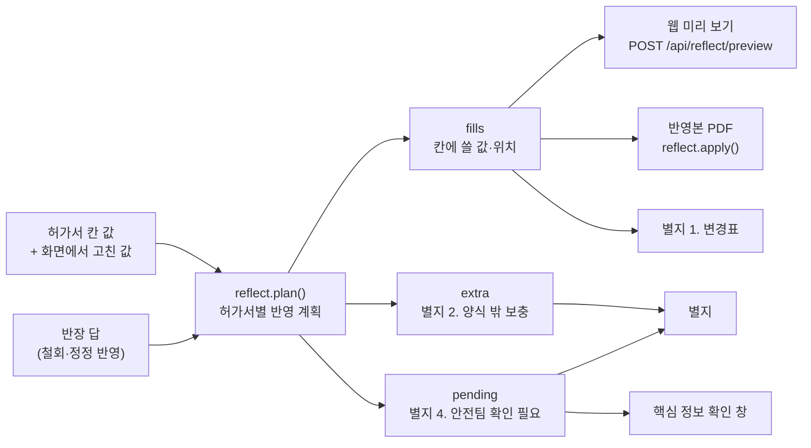
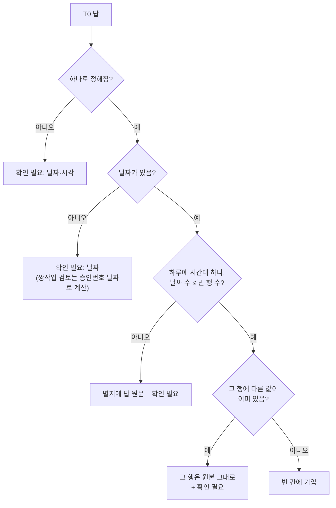
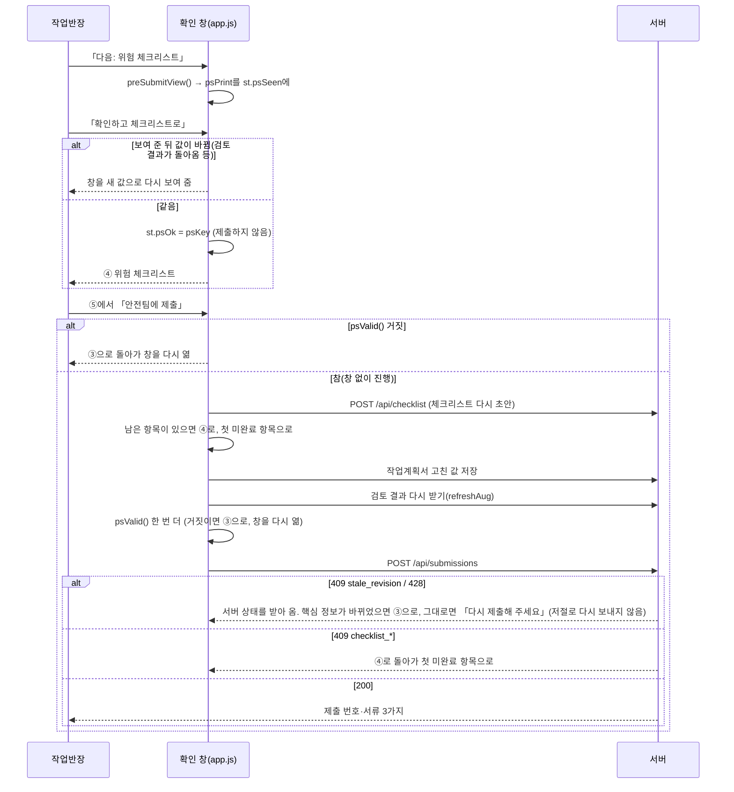

# 08. 반영본과 별지, 제출

「반영본」은 허가서의 사본입니다. 작업반장의 답과 화면에서 고친 값을 허가서 양식의 알맞은 칸에 파란 글씨로 적습니다. 칸에 넣을 수 없는 내용과 안전팀이 확인할 것은 「별지(추가검토서)」에 적습니다. 별지는 반영본 뒤에 붙습니다. 올린 원본 파일은 바꾸지 않습니다. 제출하면 croScan이 이 서류들을 그 순간 모습 그대로 한 번 만들어 보관합니다.

**이 문서에서 알 수 있는 것**

- 어떤 답이 반영본의 어느 칸에 들어가고, 어떤 칸에는 절대 쓰지 않는지
- 작업 시각(T0·T5·T7)을 어떻게 다루는지, 「확인 필요」 줄은 어디서 생기는지
- 별지에 무엇이 어떤 순서로 적히는지
- 체크리스트 전에 뜨는 핵심 정보 확인 창이 무엇을 보여 주고, 확인한 것과 보낼 것이 같은지 어떻게 확인하는지
- 제출 스냅숏과 양식 훼손 점검(`check_form_intact.py`)

**목차**

1. [무엇을](#1-무엇을)
2. [왜](#2-왜)
3. [어떻게: 반영 계획 하나로 세 화면](#3-어떻게-반영-계획-하나로-세-화면)
4. [어떻게: 어느 칸에 무엇을](#4-어떻게-어느-칸에-무엇을)
5. [어떻게: 작업 시각(T0·T5·T7)](#5-어떻게-작업-시각t0t5t7)
6. [어떻게: 확인 필요(pending)](#6-어떻게-확인-필요pending)
7. [어떻게: 별지](#7-어떻게-별지)
8. [어떻게: 핵심 정보 확인 창](#8-어떻게-핵심-정보-확인-창)
9. [어떻게: 제출 스냅숏](#9-어떻게-제출-스냅숏)
10. [양식 훼손 점검](#10-양식-훼손-점검)
11. [코드 어디](#11-코드-어디)
12. [시험](#12-시험)
13. [한계](#13-한계)

---

## 1. 무엇을

| 서류 | 무엇 | 만드는 곳 |
|---|---|---|
| **반영본** | 원본 허가서 쪽 위에, 알맞은 칸에만 파란 글씨와 변경 번호(①②…)를 더한 **새 사본**. 각 쪽 위 여백에 「croScan 사전검토 반영본 … 업로드한 원본 파일은 그대로 보존」 한 줄 | [`server/reflect.py`](../server/reflect.py) `plan()` `apply()` |
| **별지(추가검토서)** | 반영본 뒤에 붙는 A4 쪽. 변경 내역, 칸 밖 보충, 확인된 작업 범위, 안전팀 확인 필요, 추가조치 초안 | [`server/addendum.py`](../server/addendum.py) `layout()` `_draw()` |
| **제출 스냅숏** | 제출 순간의 허가서·답·반영 계획·별지·체크리스트를 한 번 고정. PDF는 그 뒤 몇 번을 받아도 같은 바이트 | [`server/submissions.py`](../server/submissions.py) |

반영본과 별지는 한 PDF(「허가서(원본+추가검토서)」)로 나옵니다(`addendum.pdf()`). 위험 체크리스트 PDF는 따로 나옵니다([07 문서](07_위험체크리스트.md)).

**croScan은 승인하지 않습니다.** 반영본은 내부 초안입니다. 전산 원본의 정정과 전산승인은 생산부서 승인권한자가 합니다. 현장 확인과 (2중점검 Y 작업의) 대면허가는 안전 측이 합니다. 둘 다 기존 절차대로 합니다. 별지 첫 줄(`NOTE`)에 이 내용을 적습니다.

## 2. 왜

- **원본은 증거입니다.** 반장이 낸 서류를 croScan이 고치면 누가 무엇을 썼는지 흐려집니다. 그래서 croScan은 원본 바이트를 그대로 둡니다. 바뀐 곳은 파란 글씨와 번호로 구분합니다. 별지에는 「원본 값 → 반영본 값 · 근거」를 적습니다.
- **당일 칸은 당일에 씁니다.** 허가서의 「현장 안전조치 및 추가정보」 블록(가스농도·산소농도·풍속·하중 같은 측정값, 체크칸)은 작업 당일 시작 전에 쓰는 칸입니다(사전 작성 금지). 서명·승인 칸은 사람이 씁니다. croScan이 이 칸을 채우면 「한 적 없는 확인을 한 것처럼」 보입니다.
- **칸의 용도를 지킵니다.** 다른 팀 작업은 이 허가서 칸에 넣지 않습니다. 「모름」은 값이 아닙니다. 허가서와 반대되는 답(러그 없음 ↔ 러그 절단)은 어느 쪽이 맞는지 사람이 정해야 합니다.

## 3. 어떻게: 반영 계획 하나로 세 화면



croScan은 반영 계획을 한 번만 계산합니다. 웹 미리 보기, PDF, 별지가 이 계획 하나를 함께 씁니다. 그래서 셋이 늘 같습니다. 계획은 이렇게 생겼습니다.

```text
{승인번호: {"fills": [...], "extra": [(라벨, 글)], "pending": [(라벨, 글)]}}
fill = {no, mark(①…), base(칸 키), name(칸 이름), mode(fill|append|replace),
        original, text, final, src(근거), keys, draw(쪽별 글자 위치)}
```

## 4. 어떻게: 어느 칸에 무엇을

### 4.1 절대 쓰지 않는 칸 (NEVER)

아래 칸들은 `reflect.NEVER`와 칸 형식으로 막습니다. 답이 이 칸을 가리켜도 칸에는 쓰지 않고 별지로 보냅니다. 반장이 화면에서 이 칸을 고쳐도 반영본에 넣지 않고 「확인 필요」에 적습니다.

| 묶음 | 칸 |
|---|---|
| 당일 측정값 (`augment.DAY_OF_VALUES`) | 테스트압력·파이프직경, 가연성가스(%LEL)·산소농도, 순간풍속·작업대 정격하중, 인양물 중량·크레인 정격하중, 정격전압·무전압 측정값·잠금 수, 작업높이·최대 인양높이 |
| 결정 주체가 반장이 아닌 칸 (`NOT_FOREMAN`) | 허가구분, 2중점검 대상 |
| 서명·승인 | 허가신청 서명, 전산승인자·일시·서명, 안전대면허가자·일시·서명 |
| 안전요원 칸 | 추가조치 요청사항(안전요원) |
| 형식으로 막는 칸 | 모든 체크칸(`check`, 당일 안전조치 체크 포함), 손글씨·서명 이미지(`image`) |

### 4.2 세 가지 정보, 세 가지 자리

| 정보 | 자리 | 방식(mode) | 예 |
|---|---|---|---|
| 빈 칸에 없던 것 | 그 칸 | `fill` 빈칸에 기입 | 비어 있던 작업내용에 「내부 보수·용접」 |
| 채워진 칸에 더할 것 | 그 칸 아래 「상세」 칸, 원래 글 뒤 | `append` 덧붙임(겹치는 부분은 빼고) | 작업장소(상세) 「4BAY 10칼럼 배전반」 → 「… MCC-4」 |
| 칸이 없는 것 | 별지 2절 | — | 블록 안·위 다른 작업, 알고 있는 병행작업 내용 |
| 고친 값 | 그 칸 | `replace` 바꿈(원래 글자만 지우고 새로 씀) | 화면에서 고친 값, 종료 시각 정정 |

- 답이 어디로 갈지는 **질문의 뜻(질문 번호·고른 선택지)과 칸의 용도**로 정합니다. 버튼 이름으로 정하지 않습니다(`_facts()`의 표 `T`).
- 작업에 대한 답(H1·CF1·LI1·LO1·HT1)은 작업내용이 비어 있으면 그 칸에 갑니다. 아니면 작업내용(상세)에 갑니다.
- 장소 답은 작업장소가 비었거나 팀 이름처럼 보이면 그 칸에 갑니다. 아니면 작업장소(상세)에 갑니다.
- 병행여부(B3)는 Y/N만 그 칸에 쓰고, 무엇인지는 별지에 씁니다. 다른 팀 작업 내용은 이 허가서 칸에 넣지 않습니다.
- 반장이 화면에서 직접 고친 칸은 반장 값이 우선입니다. 같은 칸을 가리키는 답은 별지로 갑니다.
- 칸 형식(날짜·Y/N·숫자 등)에 맞지 않는 값은 넣지 않고 「확인 필요」에 적습니다.

**들어가지 않는 경우**

- **칸이 좁을 때.** 먼저 원래 글자 크기(8~8.5pt)로 넣어 봅니다. 안 되면 0.5pt 줄여 보고, 마지막으로 가장 작은 7pt(`MIN_SIZE`)로 맞춰 봅니다. 그래도 안 되면 별지에 「칸이 좁거나 원본 글자 위치를 몰라 반영본에 넣지 못함」으로 적습니다.
- **바꿈인데 원래 글자 위치를 모를 때.** 지울 자리를 모르면 쓰지 않습니다(`layout.glyphs`가 있어야 함).
- **같은 허가서 사본이 여러 쪽일 때.** 원래 값이 같은 사본에만 쓰고, 다른 사본은 「확인 필요」에 적습니다.
- **「모름」.** 어디에도 쓰지 않습니다. 「무엇을 확인할지」(`CHECK` 표)로 바꿔 「확인 필요」에 적습니다.
- **허가서와 반대되는 답.** 「없음」 답인데 허가서 원문에 그것이 있으면 쓰지 않습니다(`NOT_THERE`). 답의 「…없음」 낱말이 허가서에 있을 때, 블록 번호가 허가서와 다를 때도 쓰지 않습니다. 이때는 「확인 필요」에 적습니다(`checked()`). 답을 쉼표로 나눈 부분 가운데 하나만 어긋나도 **답 전체**를 쓰지 않습니다. 답 전체를 그대로 「확인 필요」에 옮기고 어긋난 까닭을 붙입니다. 어긋나지 않은 나머지만 잘라 쓰지 않습니다. 잘린 나머지는 무엇에 대한 말인지 잃기 때문입니다. 예: 다른 블록 번호가 든 「통제 예정 범위는 … E41P 블록 내부와 출입구, 작업 지점 바로 아래 통로를 …」 답을 쉼표에서 자르면 「작업 지점 바로 아래 통로를 …」만 남습니다.

### 4.3 PDF에 쓰는 법

`reflect.apply()`가 원본 문서를 열어 계획대로 씁니다.

- `replace`만 그 칸의 **원래 값 글자**를 지웁니다(redaction, 텍스트만. 선·로고·인쇄된 라벨은 그대로).
- 파란 글씨(`BLUE`)로 쓰고, 마지막 줄 끝에 작은 변경 번호(①…⑳, 그 뒤는 (21)…)를 붙입니다.
- 쓴 칸이 하나라도 있으면 원본의 모든 쪽 위 여백(y≈22pt)에 반영본 안내 한 줄을 씁니다.
- 결과는 새 PDF입니다. 올린 바이트는 그대로입니다(`addendum.pdf()`).

## 5. 어떻게: 작업 시각(T0·T5·T7)

**원칙: 질문의 답으로 신청 작업일시를 채우거나 고치는 경로는 T0·T5·T7입니다.** 칸이 비어 있으면 채웁니다(T0). 「잘못 적음」이면 고칩니다(T5 「고침」, T7 「시간을 고침」). 반장이 화면에서 직접 고친 날짜·시각도 반영합니다. 단, 칸 형식과 배치 검사를 통과해야 합니다(4.2절 「고친 값」). 실제 작업 시간이나 단계 시간 답은 작업내용(상세)에 「실제 작업 예정 …」으로 덧붙입니다. 신청 시간은 그대로 둡니다.

| 질문 | 답 | 반영 |
|---|---|---|
| T0 작업일시(빈칸) | 값 | `t0`: 빈 날짜 행에 하루 한 줄씩 날짜·시작·종료를 씀 |
| T1 작업시간 | 일부 | 작업내용(상세)에 「실제 작업 예정 …」(인양은 「블록 이동 예정 …」). 설명이 섞인 긴 답은 읽은 시간만 쓰고 원문은 별지 2절로(아래 「실제 작업 시간 줄」) |
| T2 날짜별 작업 | 일부 | 작업내용(상세)에 「날짜별 작업 예정 …」 |
| T5 종료 시각 | 고침 | `time_row`: 그 행의 시작·종료를 바꿈(`replace`) |
| T5 종료 시각 | 다음 날 아침 | 작업내용(상세)에 「다음 날 아침 종료(신청자 확인)」 |
| T6 시간 참고 비교 | 다시 정함 / 전체 / 포함 | 작업내용(상세)에 「실제 작업 예정 …」「전체 작업 예정 …」「작업시간에 포함: …」. 「다시 정함」의 긴 답은 T1과 같이 다룸 |
| T7 주간·야간 체크와 시간 | 시간을 고침 | `time_row`: **물어본 그 행만** 바꿈 |
| T7 | 체크를 고쳐야 함 | 「확인 필요」: 주간·야간 체크칸은 croScan이 고치지 않음 |
| T7 | 둘 다 맞음 | 별지 2절 |

`t0`가 칸에 쓰지 않고 「확인 필요」로 남기는 경우:



- `time_row`가 시간 문장을 한 구간으로 읽지 못할 때가 있습니다(오전·오후·날짜가 모호할 때). 그러면 칸을 그대로 두고 「작업시간 정정」 확인 필요를 남깁니다.
- 정정이 같은 칸에 들어가면 그 칸의 T0 값은 버립니다(`fixed`).
- 「실제 작업 예정」 시간이 신청 작업일시 밖이면 「신청 시간은 그대로」라고 적고 확인 필요를 남깁니다.
- 예전 T7 답이 지금 물어보는 행과 다른 행을 가리키면 쓰지 않습니다(`augment.drop_stale()`).

**실제 작업 시간 줄(`reflect._actual()`).** T1 「일부」와 T6 「다시 정함」의 답을 반영본에 적는 법입니다.

- 시간 말고 다른 말이 거의 없는 짧은 답은 답 그대로 붙입니다. 예: 「실제 작업 예정 13:30~15:00」.
- 설명이 섞인 긴 답이면 반영본 줄에는 croScan이 그 답에서 읽은 시간만 씁니다. 답 원문은 별지 2절에 「실제 작업시간(신청자 원문)」(인양은 「블록 이동시간(신청자 원문)」)으로 한 글자도 빼지 않고 남깁니다.
- 예: 신청 08:00~16:59, 답 「08:00~16:59는 하루 허가 신청 시간입니다. 실제 절단·용접은 09:00~11:30, 13:00~15:00에 하고, 나머지는 자재 준비와 대기 시간입니다.」 → 반영본 「실제 작업 예정 09:00~11:30, 13:00~15:00」, 별지 2절에 답 원문.
- 「읽은 시간」은 검토 계산(`augment.effective()`)이 그 답에서 읽어 둔 시간(`said_windows`)입니다. 오전·오후(A1)와 날짜(A2) 확인 답을 반영한 값입니다. 신청 시간을 다시 말한 구간은 뺀 값입니다([05 §7](05_멀티턴_질문.md#7-시간-답-읽기)).
- 날짜는 허가서가 하루이고 답도 그 하루일 때만 뺍니다. 그 밖에는 날짜를 붙입니다. 예: 10/27 허가서에 「다음 날 00:00~02:00에 절단 작업합니다. 그 전에는 자재 준비와 대기입니다.」 → 「실제 작업 예정 10/28 00:00~02:00」.
- 오전·오후가 아직 정해지지 않은 시간(예: 「2시~4시」)이 있거나 시간을 읽지 못했으면 일부만 골라 쓰지 않습니다. 답 그대로 붙입니다.
- 신청 작업일시 칸은 이 답으로 덮어쓰지 않습니다.

## 6. 어떻게: 확인 필요(pending)

`pending`은 「쓰지 않았고, 사람이 정해야 하는 것」의 목록입니다. 숨기지 않고 모두 적습니다.

| 생기는 까닭 | 예시 문구 요지 |
|---|---|
| 「모름」 답 / 값이 「미정」뿐 | 「실제 작업장소 확인 필요 (입력 원문 '…')」 |
| 빈칸 질문에 「해당 없음」 | 「작업인원 확인 필요 (신청자는 「해당 없음」이라고 답함)」 |
| 답이 허가서와 반대 | 「… 확인 필요 — 답 '없음'이 허가서 내용과 다름」 |
| 블록 번호가 다름 | 「'답 전체' — 블록 번호가 허가서와 다름 (허가서 … / 답 …) → 확인 필요」. 답의 한 부분만 달라도 답 전체를 여기에 둠 |
| 보호 칸을 화면에서 고침 | 「화면에서 고친 값 '…'은 이 칸이 당일·서명·승인 칸이라 반영본에 넣지 않음」 |
| 칸 형식이 안 맞음 | 「'…'은 칸 형식(date)에 맞지 않아 넣지 않음」 |
| 사본 차이·사본 칸 좁음 | 「2쪽 사본의 원본 값이 다름 → 그 쪽에는 반영하지 않음」 |
| 시간 문제 | 5절 |

확인 필요가 보이는 곳: 별지 4절 「안전팀 확인 필요」, 핵심 정보 확인 창의 「안전팀 확인으로 넘어가는 것 N개」, 제안 카드의 「들어갈 곳」(`reflect.destination()`가 「확인 필요 · 라벨」로 보여 줌). 반영본 변경의 「왜?」(`explain.change()`)는 지금 `fills`와 `extra`만 설명합니다. `pending` 줄은 「왜?」로 보지 못합니다.

## 7. 어떻게: 별지

`addendum.layout()`이 허가서 한 건에 한 장(필요하면 여러 쪽)을 만듭니다. 같은 레이아웃을 두 번 그립니다. 한 번은 웹(HTML), 한 번은 PDF(칸을 직접 그림)입니다. 1쪽과 같은 틀·선·로고를 씁니다.

| 순서 | 블록 | 내용 |
|---|---|---|
| 머리 | 승인번호 · 원본(작성자) · 작성 시각(KST) | |
| 안내 | `NOTE` | 원본은 바꾸지 않음, 당일·서명·승인 칸에는 안 씀, croScan은 승인하지 않음 |
| 1 | 반영본에 적은 내용 (파란 글씨) | 표: 번호 · 칸 · 원본 값 · 반영본 값(빈칸에 기입/덧붙임/바꿈) · 근거. 「바꿈」이 있으면 전산 원본 정정은 기존 절차라는 줄 |
| 2 | 양식 밖 보충 (신청자 답변) | `extra` + 규칙으로 추정한 값(「규칙 추정」 표시) |
| 3 | 확인된 작업 범위 | 위험시간대(출처: 서류 기재/반장 답변·예정), 종료 후 잔류, 위험 순간, 위치(자세한 정도), 대상·설비 ID, 시간 참고 비교(「현장 평균·표준시간·안전 기준이 아님」) |
| (관리자만) | 작업쌍 검토 | 순위 · 상대 작업 · 판단 근거 · 조치 초안. 반장 화면의 별지에는 없음 |
| 4 | 안전팀 확인 필요 | `pending`, 답하지 않은 질문, 끝나지 않은 AI 분석, 미룬 항목, 허가구분·2중점검 기준, 「선택 보강(반장이 넘김)」 |
| 5 | 작업허가 전 추가조치 초안 (안전요원 수기란 참고용) | 1·2순위 쌍의 조치 초안 + C1 답. 안전요원 칸(추가조치 요청사항)에는 쓰지 않고 여기에만 |
| 끝 | AI 문안 상태 | 「채택 / 일부 채택 / 초안」과 개정 번호 |

- 다음 쪽으로 넘어가면 맨 위에 「croScan 추가검토서 (별지) · 승인번호 … (계속)」과 표 머리를 다시 그립니다. 한 쪽보다 긴 행은 줄 사이에서 끊고, 첫 칸에 「(계속)」을 붙입니다. 글은 잘라 내지 않습니다(`_Pen.row()`).

## 8. 어떻게: 핵심 정보 확인 창

반장이 ③ 허가서 검토를 마치고 「다음: 위험 체크리스트」를 누르면 화면 가운데에 창이 뜹니다. 이 창은 반장이 자주 틀리는 핵심 값만 보여 줍니다(팀장 요청 2026-10-31). 반장이 「확인하고 체크리스트로」를 눌러야 ④ 위험 체크리스트로 갑니다. 이 버튼은 아무것도 제출하지 않습니다. 함수는 [`web/app.js`](../web/app.js) `preSubmitView()`, `enterChecklist()`, `openPreSubmit()`입니다.

창이 체크리스트 앞에 있는 까닭은 체크리스트가 허가서 값과 답으로 채워지기 때문입니다. 값이 맞는지 먼저 보고 체크리스트를 씁니다. 보통 제출에는 창이 뜨지 않습니다.

**보여 주는 값은 「제출되는 값」입니다.** 칸 값은 반영 계획의 `final`을 씁니다(없으면 별지로 간 값을 쓰고 「별지에 기록」이라고 표시). 답은 정정(C5)·철회(C6)를 반영한 뒤의 답을 씁니다.

허가서마다 나오는 행:

| 행 | 내용 |
|---|---|
| 작업일·작업시간 | 같은 시간이 이어지는 날은 한 줄(「7/1~7/3 매일 …」). 인양 이동 단계, 일부 단계 시간, 잔불·잔류 확인 끝은 따로 |
| 작업 위치 | 장소 글 + 블록 번호. BAY·칼럼이 없거나 팀 이름처럼 보이면 경고 |
| 작업 내용 | 「종류 허가서 · 작업내용 / 상세」 |
| 작업 범위(보수·교체) | H1 답이 있을 때 |
| 작업 인원 | 인원 + 감시인(W1 답이 있을 때) |
| 병행작업 | 있음(무엇) / 없음 / 미확인 |
| 종류별 행 (`PS_KIND` → `PS_EXTRA`) | 화기: 절단·용접 방법·가스, 분리물 지지·회수, 상하 위치·높이, 작업 중 통제 범위 · 정전: 차단·복구·시험 시각, 접근 위치, 통전 상태 측정, 같은 주행로·다른 팀 · 밀폐: 진입·내부 작업, 가스·공기 계통, 환기·송기·조명 전원, 밀폐 안 화기 · 인양: 크레인·이동 경로, 중량·정격하중, 블록 안·위 작업·부착물, 크레인 정비·같은 주행로 · 고소: 높이·위치, 러그 수량·절단 방법, 회수·하부 통제 |
| 공통 행 (`PS_COMMON`) | 야간·교대 지원·인계(T8), 대기·중단 중 유지(T9), 수전구역 통전·시운전(D6), 압력시험 매체·가압·감압(D7) |

종류별·공통 행은 답이 있거나 비어 있을 때만 나옵니다. 경고(「모름」, 「답하지 않음」, 「앞 답과 추가 전달이 다름」, 「비어 있음」, 「미확인」)가 있는 행은 창 맨 위 「먼저 확인할 것」에 모읍니다. 안전팀으로 넘어가는 `pending` 수도 거기에 적습니다. 체크리스트는 이 창 뒤에 쓰므로 체크리스트 줄은 넣지 않습니다. 「모름」·빈칸은 보여 주기만 합니다. 새로 꼭 채워야 하는 칸이 되지 않습니다.

**확인한 것과 보여 준 것을 따로 둡니다.**

- `psPrint`는 창이 보여 준 행 전체와 「먼저 확인할 것」(체크리스트 줄은 빼고)을 JSON으로 묶은 값입니다. 창을 그릴 때 `st.psSeen`에 둡니다. 이것은 「보여 준 것」입니다.
- 「확인하고 체크리스트로」를 누르면 그때 「확인한 것」을 `st.psOk`에 기록합니다. 열쇠(`psKey`)는 검토 세션 id, 올린 파일(종류·파일 해시), `psPrint`입니다. 체크리스트 선택·메모·남은 수와 일반 변경 번호(`st.rev`)는 넣지 않습니다. 그래서 체크리스트를 고쳐도 확인은 그대로입니다.
- 「돌아가서 고치기」, Escape, 창 바깥 누르기는 창을 닫기만 합니다. 확인을 만들지 않습니다. 반장은 ③ 허가서 검토에 남습니다.
- 기록은 브라우저 메모리에만 둡니다. 새로 고침하거나 허가서를 다시 열면(`openDoc()`) 지워지고 다시 묻습니다. 답과 체크리스트 저장값은 그대로입니다.
- `psValid()`는 지금 값으로 `psKey`를 다시 계산해 기록과 같은지 봅니다. 검토 결과를 기다리는 중이면 거짓입니다.

**4·5단계로 가는 길은 모두 확인을 봅니다.** `goStep(4)`와 `goStep(5)`는 반장 화면에서 `psValid()`가 거짓이면 들어가지 않습니다. 대신 `enterChecklist(true)`로 ③ 허가서 검토(코드의 `goStep(2)`)로 가서 창을 엽니다. 위 단계 표시, 「제출 확인으로 돌아가기」, 요약의 「바꾸기」 뒤 돌아오기가 모두 이 길을 지납니다. 「다음: 위험 체크리스트」는 기록이 있어도 늘 창을 엽니다.



체크리스트 수는 `sendFinalOnce()`가 따로 확인합니다. 제출 쪽 보호(`sameSource()`, `plansOk()`, `ckDone()`, `savePlans()`, 서버의 개정 번호·체크리스트 대조)는 그대로입니다.

## 9. 어떻게: 제출 스냅숏

`POST /api/submissions` ([`server/app.py`](../server/app.py) `submit_snapshot()`)가 하는 일:

1. 올린 PDF가 열리는지 확인합니다.
2. 반장이 본 개정 번호(`expected_revision`)의 세션으로 검토 결과를 다시 계산합니다. 그 사이 바뀌었으면 409 `stale_revision`.
3. 체크리스트를 확인합니다. 서버가 지금 초안을 다시 만들고, 채택한 AI 항목을 다시 검사합니다(`checkai.attach()`). 그다음 반장 선택과 대조합니다(`submissions.confirm_checklist()`). 근거가 바뀌었거나 확인 안 한 항목이 있으면 409 `checklist_changed` / `checklist_left`.
4. 허가서가 한 건이 아니면 400.
5. 같은 검토·같은 개정·같은 입력(원본 해시, 칸 값, 답, 체크리스트, 작업계획서 고친 값)이면 **처음 제출을 그대로 돌려줍니다**(`key_of()`, `again: true`). 시각은 키에 넣지 않습니다.
6. 처음이면 서류를 지금 한 번 그립니다: `original`(원본), `permit`(반영본+별지), `checklist`, `plans`(작업계획서 수정본, 있을 때). 서류는 해시 이름으로 `submitted/` 폴더에 저장합니다. 스냅숏(칸 값·답·반영 계획·별지·체크리스트·확인 기록·이벤트 등)과 요약은 SQLite `submissions` 표에 넣습니다.
7. 이 제출이 안전관리자 화면의 그날 작업 목록에 연결되는지 돌려줍니다(`safety.placement()`).

| API | 하는 일 |
|---|---|
| `GET /api/submissions/{id}/{name}.pdf` (name: `permit`·`checklist`·`plans`) | 제출 때 그린 바이트 그대로. 프록시 인증에서 반장은 자기 제출만. 제출 기록이 없으면 404, 기록은 있지만 요청한 PDF가 없으면 410. 다운로드 때 경과 일수를 직접 검사하지는 않음(30일 정리는 아래 참고) |
| `GET /api/safety/submissions` | 허가서 번호마다 가장 최근 제출. 그날 목록에 없는 번호도 따로 보여 줌 |
| `POST /api/submit` | 저장 없이 반영본+별지 PDF만 만들어 줌(예전 경로) |

보관 정리: 새 제출을 저장할 때 30일을 넘긴 제출 기록을 지웁니다(`submissions.create()`). 그때 어느 제출도 쓰지 않는 PDF 파일도 지웁니다. 새 제출이 없으면 30일이 지나도 정리하지 않습니다.

지금은 시연 환경입니다. 전산·결재로 보내지 않습니다. 화면에도 「(시연: 전산·결재로 보내지 않음)」이라고 씁니다.

## 10. 양식 훼손 점검

[`tools/check_form_intact.py`](../tools/check_form_intact.py)는 제출본이 원본 양식을 망가뜨리지 않았는지 **픽셀로** 봅니다.

```text
python tools/check_form_intact.py <원본.pdf> <제출본 permit.pdf> <종류>
```

- 원본과 제출본의 각 쪽을 2배로 그려 픽셀을 비교합니다.
- 바뀌어도 되는 곳은 둘뿐입니다: **위 여백 24pt**(반영본 안내 줄) 와 **양식 칸 상자 둘레 2pt 안**(칸 위치는 원본을 다시 읽어 얻음, `extract.build()`).
- 그 밖의 픽셀이 하나라도 바뀌면 실패입니다. 칸 밖의 회사 선·로고·인쇄된 라벨은 같은 픽셀이어야 합니다.
- 이 허용 범위는 croScan이 쓴 칸이든 아니든 **모든 양식 칸**에 똑같이 적용됩니다. 그래서 수정하지 않은 칸 안의 글자가 망가져도 이 시험은 잡아내지 못합니다.
- 함께 보는 것: 제출본 쪽 수 ≥ 원본 쪽 수, 원본 뒤 쪽은 「croScan」 별지(양식 위에 그리지 않음).
- 설계서 기록: 스테이징 실물 흐름에서 4/4 통과, 칸 밖 픽셀 변화 0([`AI도입계획_설계서.md`](reference/AI도입계획_설계서.md) §21).

## 11. 코드 어디

| 고칠 것 | 파일 · 함수 |
|---|---|
| 답의 뜻 → 칸·별지·확인 필요 | [`server/reflect.py`](../server/reflect.py) `_facts()` (표 `T`, `CHECK`, `NOT_THERE`, `POSITIVE`), 실제 작업 시간 줄 `_actual()`, 허가서와 어긋난 답 `plan()` 안의 `checked()` |
| 절대 안 쓰는 칸 | `reflect.NEVER`, [`server/augment.py`](../server/augment.py) `DAY_OF_VALUES` `NOT_FOREMAN`, [`server/permit_kinds.py`](../server/permit_kinds.py), [`server/form_spec.py`](../server/form_spec.py) |
| 칸 배치·크기 맞추기 | `reflect.plan()` `_place_text()` `_lines_for()` |
| PDF에 쓰기 | `reflect.apply()`, `addendum.pdf()` `_tidy()` |
| 제안의 「들어갈 곳」 | `reflect.destination()` |
| 별지 내용 | [`server/addendum.py`](../server/addendum.py) `layout()` `_tag()` `_ai_state()`, 질문 이름 `ITEM` |
| 별지 그리기 | `addendum.html()` `_Pen` `_draw()` |
| 「왜?」(반영본 변경) | [`server/explain.py`](../server/explain.py) `change()` |
| 확인 창 | [`web/app.js`](../web/app.js) `PS_KIND` `PS_EXTRA` `PS_COMMON` `preSubmitView()` `psPrint` `psKey` `psValid()` `enterChecklist()` `openPreSubmit()` `goStep()` `sendFinalOnce()` `submitForm()` |
| 제출 | [`server/app.py`](../server/app.py) `submit_snapshot()` `submitted_file()`, [`server/submissions.py`](../server/submissions.py) |
| 미리 보기 | `POST /api/reflect/preview` |

## 12. 시험

| 시험 | 보는 것 | 결과(로컬, 2026-11-01) |
|---|---|---|
| `python tools/check_reflect.py` | 시연 허가서 10건과 답: 당일·서명·승인·체크칸에 안 씀, 「모름」·버튼 이름 안 씀, T1이 신청 작업일시를 안 바꿈, 다른 팀 내용이 칸에 안 들어감, 같은 입력 같은 계획, 원본 바이트 그대로 | 로컬에서는 PDF 읽기 도구(ODL, Java)가 끝나지 않아 못 돌림. 서버에서 돌리는 시험 |
| `python tools/check_form_intact.py …` | 10절 | 인자 필요. 설계서 기록 4/4 |
| `python tools/check_render.py` | 긴 행은 줄 사이에서 끊김, 「(계속)」, 머리 줄 반복, 글 잃지 않음 | 11 / 11 |
| `python tools/check_submissions.py` | 체크리스트 대조·거절, 스냅숏 한 번, 같은 제출은 같은 결과 | 21 / 21 |
| `python tools/check_ui_state.py` | PS: 확인 창이 제출되는 값을 보여 줌(인양 이동 단계·C6 철회 포함). RC: 체크리스트 남은 수만 바뀌면 같은 확인, 핵심 값·검토 세션이 바뀌면 다른 확인 | 83 / 83 (2026-11-02) |
| `python tools/check_questions_material.py` | 신청 시간을 다시 말한 구간은 실제 시간이 아님, 숫자만 같은 실제 시간은 지우지 않음, 반영본 줄은 읽은 실제 시간만·긴 답 원문은 별지에, 오전·오후 미정이면 답 그대로, 다른 날이면 날짜를 붙임, 다른 블록이 든 통제 범위 답은 전체를 확인 필요로 | 254 / 254 (2026-11-02) |
| `python tools/check_submit_link.py` | 제출본이 안전관리자 화면에 연결됨 | 시연 자료 필요(이번에 안 돌림) |

## 13. 한계

- **칸 위치는 추출에 기댑니다.** 칸 상자와 원래 글자 위치(`layout.box`, `layout.glyphs`)는 PDF 추출 결과입니다. 칸 위치가 없거나 글을 배치할 수 없으면 별지로 보냅니다. croScan이 잘못 추출된 좌표를 모두 가려내지는 못합니다. 그래서 반영 위치는 원본과 대조해 봐야 합니다.
- **좁은 칸은 별지로 갑니다.** 7pt보다 작게는 쓰지 않습니다. 반장이 별지까지 읽어야 전체가 보입니다.
- **반영본은 승인 문서가 아닙니다.** 전산 원본은 바뀌지 않습니다. 「바꿈」 값의 정정은 기존 전산 절차를 따라야 합니다.
- **확인 창은 핵심 행만 보여 줍니다.** 모든 칸을 보여 주지 않습니다. 나머지는 반영본·별지에서 봅니다.
- **확인 기록은 이 브라우저 메모리에만 있습니다.** 새로 고침하면 다시 확인해야 합니다. 서버는 반장이 창을 확인했는지 따로 검사하지 않습니다. 서버는 개정 번호와 체크리스트로 제출을 막습니다.
- **시연 범위입니다.** 제출은 croScan 자체 기록이며 전산·결재와 연결되지 않습니다. 30일을 넘긴 제출은 다음 제출을 저장할 때 지웁니다(9절).
- **훼손 점검은 사람이 돌립니다.** 제출 때 자동으로 돌지 않습니다. 원본·제출본·종류를 넣어 따로 실행합니다.
