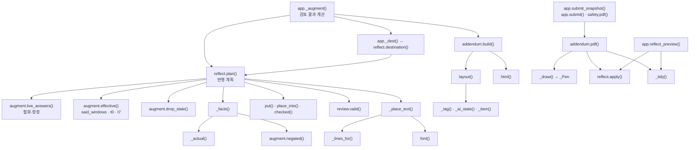
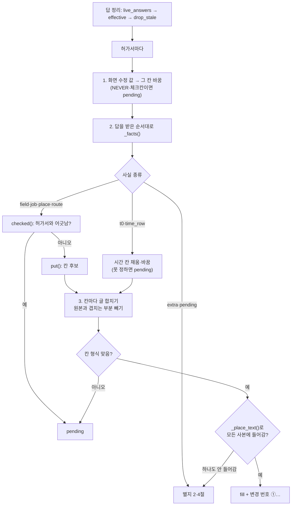

# 08b. 반영 규칙 전부 (reflect.py · addendum.py 함수 단위)

작업반장의 답이 반영본의 어느 칸에, 어떤 글로 들어가는지를 함수 하나하나까지 적은 문서입니다. 별지(추가검토서) PDF를 만드는 함수도 모두 적습니다. 큰 흐름은 [08 반영본과 별지](08_반영본과_별지.md)에 있습니다. 이 문서는 그 뒤의 세부를 빠짐없이 적습니다.

**이 문서에서 알 수 있는 것**

- 질문 번호와 고른 선택지마다 반영본·별지·확인 필요 가운데 어디에, 어떤 글이 들어가는지(1절의 전체 대응표)
- 반영 계획 `plan()`이 화면 수정, 답, 시간, 칸 크기를 어떤 순서로 처리하는지
- 글을 칸에 맞추는 법(글자 크기, 줄바꿈, 별지로 보내기, 변경 번호 ①…)
- 별지 PDF의 1~5절이 무엇으로 채워지고, 쪽을 넘길 때 어떻게 그려지는지
- 각 함수를 부르는 곳, 지키는 시험, 그리고 어긋나 보이는 곳의 분류(의도 / 확인 필요 / 설계 근거 미기록)

**목차**

1. [질문과 선택지별 반영 대응표](#1-질문과-선택지별-반영-대응표)
2. [함수 지도](#2-함수-지도)
3. [호출 흐름](#3-호출-흐름)
4. [reflect.py 함수](#4-reflectpy-함수)
5. [addendum.py 함수](#5-addendumpy-함수)
6. [review.py 형식 검사](#6-reviewpy-형식-검사)
7. [시험](#7-시험)
8. [한계와 알려진 문제](#8-한계와-알려진-문제)

용어 몇 가지를 먼저 풉니다.

| 용어 | 뜻 |
|---|---|
| 반영본 | 원본 허가서 쪽 위에 croScan이 파란 글씨를 더한 새 사본. 올린 원본 파일은 바뀌지 않습니다. |
| 별지(추가검토서) | 반영본 뒤에 붙는 A4 쪽. 변경표, 양식 밖 보충, 확인된 작업 범위, 안전팀 확인 필요, 추가조치 초안이 들어갑니다. |
| fact(사실) | `_facts()`가 답 하나를 풀어 만든 조각. `("종류", 목적, 글)` 꼴입니다. |
| fill | 반영본 칸 하나에 쓸 값과 위치. |
| extra | 별지 2절 「양식 밖 보충」 한 줄. `(라벨, 글)`. |
| pending | 별지 4절 「안전팀 확인 필요」 한 줄. `(라벨, 글)`. 쓰지 않았고 사람이 정할 것입니다. |
| 상세 칸 | 작업장소(상세) `location_detail`, 작업내용(상세) `job_detail`. 원래 칸 아래의 여러 줄 칸입니다. |
| 원본 값(`original`) / 지금 값(`value`) | 원본은 PDF에서 읽은 값, 지금 값은 반장이 화면에서 고친 뒤의 값입니다. |

---

## 1. 질문과 선택지별 반영 대응표

### 1.1 표 읽는 법

- **질문**은 질문 번호(item)입니다. `T0.2`, `U1.F1`, `A1.T1.0`처럼 점이 붙은 번호는 `_base()`가 앞부분(`T0`, `U1`, `A1`)으로 줄입니다. `B1.`, `B2.`, `C5.`는 줄이지 않습니다.
- **이름**은 별지에 쓰는 질문 이름(`addendum.ITEM`)입니다.
- **선택지**는 반장이 누른 버튼의 id와 버튼 글입니다. 버튼 글은 [`server/augment.py`](../server/augment.py)에서 옮겼습니다. 선택지 글이 같은 id로 둘 이상인 것은 반장 화면(`_foreman()`)과 관리자 질문 목록(`questions()`)의 글이 다르기 때문입니다.
- **사실**은 `_facts()`가 만드는 종류입니다. 종류마다 `plan()`이 가는 곳을 정합니다(1.3절).
- **적는 글**의 `{v}`는 반장이 입력한 글입니다. `{v}`는 `_clean()`으로 공백을 하나로 줄인 값입니다. 긴 답에서 그 질문 몫만 읽은 값(`read`)이 있으면 그 값을 씁니다(QA #39).
- 표의 글은 코드를 직접 import해 돌린 결과입니다(`_facts()`에 `{v}` 자리 값을 넣어 실행, 2026-11-02).

모든 질문에 먼저 아래 공통 규칙이 적용됩니다. 표의 행은 공통 규칙에 걸리지 않을 때의 결과입니다.

| 순서 | 조건 | 결과 |
|---|---|---|
| 0 | 질문 번호가 `AI1`, `AI2` …(AI가 서류에서 찾은 질문) | 「모름」이면 pending `추가 확인 질문`: `「{원문}」 확인 필요 (반장 「모름」)`. 그 밖에는 extra `추가 확인 질문`: `「{원문}」 → {버튼 글}` + (값이 있고 선택지가 `first`·`second`가 아니면) `: {v}`. 칸에는 쓰지 않습니다. |
| 1 | `B1.<칸>`, `B2.<칸>`(빈 칸 채우기) | 1.2절 표의 B1·B2 행 |
| 2 | 선택지가 `unknown`(「모름」) | pending `{이름}`: `{확인할 것} 확인 필요` + (입력이 있으면) ` (입력 원문 '{v}')` + (질문에 근거가 있으면) ` · 근거: {signal}` |
| 3 | 값이 「모름·미정」뿐(`NOT_A_VALUE`) | pending `{이름}`: `{확인할 것} 확인 필요 (입력 '{v}')` + 근거 |
| 4 | `C5.concurrent`, `C5.<항목>` | 1.2절 표의 C5 행 |
| 5 | 표 `T`에 (질문, 선택지)가 있음 | 표의 글. 단, 「없음」류 답이 허가서 원문과 반대면 1.4절 |
| 6 | `L1` + `place`, `HT1`(표 `T`에 없는 선택지), `A1`·`A2` | 1.2절 표의 행 |
| 7 | 그 밖의 모든 (질문, 선택지) | extra `{이름}`: `{v}`(없으면 버튼 글) |

「확인할 것」은 `CHECK` 표의 글입니다. 표에 없는 질문은 질문 이름을 씁니다.

`NOT_A_VALUE`는 `augment.NOT_A_VALUE`이며 정규식은 `^\s*(?:모름|몰라요?|미정|미상|확인\s*중|나중에|-|—|\?+)\s*$`입니다.

### 1.2 전체 대응표

**시간**

| 질문 | 이름 | 선택지 (버튼 글) | 사실 | 가는 곳 | 적는 글 |
|---|---|---|---|---|---|
| T0.<행> | 작업일시 | `value` 날짜·시간 입력 | `t0` | 빈 작업일시 행의 날짜·시작·종료 칸 (하루 한 줄) | 날짜 `YYYY-MM-DD`, 시각 `HH:MM`. 못 넣는 경우는 [plan() 단계 2의 t0](#plan) |
| T1 | 작업시간 | `yes` 이 시간 내내 함 / 매일 같음 / 내내 함 | 없음 | 아무 데도 안 씀 | — |
| T1 | 작업시간 | `partial` 실제 시간대 입력 / 일부 시간만 | `field` (`_actual()`) | 작업내용(상세) | `실제 작업 예정 {v}`. 인양 허가서는 `블록 이동 예정 {v}`. 설명이 섞인 긴 답은 `실제 작업 예정 {읽은 시간}` + extra `실제 작업시간(신청자 원문)`(인양은 `블록 이동시간(신청자 원문)`): `{v}` |
| T2 | 날짜별 작업 | `yes` 매일 같음 | `extra` (공통 7) | 별지 2절 | `날짜별 작업`: `{v}` 또는 `매일 같음` |
| T2 | 날짜별 작업 | `partial` 날마다 다름 | `field` | 작업내용(상세) | `날짜별 작업 예정 {v}` |
| T3 | 인양 단계 시각 | `time` 시각 입력 | `extra` | 별지 2절 | `{v}` |
| T4 | 종료 후 잔류위험 | `incl` 잔불 확인·정리까지 포함 / `time` 시각 입력 / `none` 바로 끝남 | `extra` | 별지 2절 | `{v}` 또는 버튼 글 |
| T5 | 종료 시각 | `overnight` 다음 날 끝남 | `field` | 작업내용(상세) | `다음 날 아침 종료(신청자 확인)` |
| T5 | 종료 시각 | `fix` 잘못 적음 | `time_row` | 그 행의 시작·종료 칸 (바꿈) | `HH:MM`. 한 구간으로 읽히지 않으면 pending |
| T6 | 시간 참고 비교 | `yes` …까지 전체 시간이 맞음 | 없음 | 아무 데도 안 씀 | — |
| T6 | 시간 참고 비교 | `text` 포함된 것 입력 | `field` | 작업내용(상세) | `작업시간에 포함: {v}` |
| T6 | 시간 참고 비교 | `retime` 실제 시간 다시 입력 | `field` (`_actual()`) | 작업내용(상세) | `실제 작업 예정 {v}` (긴 답은 T1과 같음) |
| T6 | 시간 참고 비교 | `stage` 특정 단계만 적음 | `field` | 작업내용(상세) | `전체 작업 예정 {v}` |
| T7 | 주간·야간 체크와 시간 | `check` 「주간/야간」 체크가 맞음(이 날 시간을 고침) | `time_row` | **물어본 그 행만** 시작·종료 칸 (바꿈) | `HH:MM` |
| T7 | 주간·야간 체크와 시간 | `time` 적힌 시간이 맞음(체크를 고쳐야 함) | `pending` | 별지 4절 | `주간·야간 체크`: `체크 정정 필요 — 신청자 답: 적힌 시간이 맞고 체크를 고쳐야 함 ({질문 원문}) · 체크 칸은 croScan이 고치지 않음` |
| T7 | 주간·야간 체크와 시간 | `both` 둘 다 맞음(현장에서 이 시간을 …으로 봄) | `extra` | 별지 2절 | `주간·야간 체크와 시간`: `둘 다 맞음(현장 분류) — {질문 원문}` |
| T8 | 야간·교대 지원·인계 | `same` / `text` | `extra` | 별지 2절 | `{v}` 또는 버튼 글 |
| T9 | 대기·중단 중 유지 | 모든 선택지 | `extra` | 별지 2절 | `{v}` 또는 버튼 글 |
| A1.… | 시간 오전·오후 확인 | `am` / `pm` | 없음 | 아무 데도 안 씀 | — (다른 답의 시간을 읽는 데만 씀) |
| A2.… | 시간 날짜 확인 | 날짜 / `all` / 새 날짜 | 없음 | 아무 데도 안 씀 | — (같은 까닭) |
| A3.F<n> | 숫자 없는 시간 확인 | `time` 시간 입력 | `field` | 작업내용(상세) | `실제 작업 예정 {v}` |
| A3.F<n> | 숫자 없는 시간 확인 | `same` 신청한 시간 그대로 | `extra` | 별지 2절 | `{v}` 또는 `신청한 시간 그대로` |
| A4.cols | 칼럼 범위 순서 확인 | `yes` / `place` | `extra` | 별지 2절 | `{v}` 또는 버튼 글 |
| A5.T4 | (이름 없음, `A5`) | `next` / `fix` | `extra` | 별지 2절 | 라벨이 `A5` 그대로입니다(8절 확인 필요) |

**장소**

| 질문 | 이름 | 선택지 (버튼 글) | 사실 | 가는 곳 | 적는 글 |
|---|---|---|---|---|---|
| L1 | 작업장소 | `place` 위치 입력 | `place` | 작업장소가 비었거나 팀 이름이면 작업장소(바꿈), 아니면 작업장소(상세)에 새 부분만 | `{v}` |
| L1 | 작업장소 | `place` 번호 입력 (정전 허가서의 설비 번호 질문: 질문 칸에 `job`이 있음) | `field` | `parse_place()`가 BAY나 칼럼을 찾으면 작업장소(상세), 아니면 작업내용(상세) | `{v}` |
| L1 | 작업장소 | `whole` 정말 공장 전체를 오가며 함 | `whole` | 작업장소가 팀 이름이거나 비면 pending, 아니면 작업장소(상세) | pending `작업장소`: `어느 공장인지 확인 필요 (신청자는 공장 전체를 오가며 작업한다고 답함)` / 칸: `공장 안 여러 곳을 오가며 작업` |
| L2 | 실제 작업점 | `text` 작업점 입력 | `field` | 작업장소(상세) | `실제 작업점 {v}` |
| L3 | 높이·위치 | `text` 위치 입력 / 높이 입력 | `field` | 작업장소(상세) | `{v}` |
| L4 | 블록 작업 순서 | `text` / `same` | `extra` | 별지 2절 | `{v}` 또는 버튼 글 |
| L5 | 이동 경로 | `text` 경로 입력 | `route` | 작업장소가 비면 작업장소, 아니면 작업장소(상세) | 작업장소: `{v}` / 상세: `이동 경로: {v}` |
| L6 | 작업 중 통제 범위 | `text` 범위 입력 | `field` | 작업장소(상세) | `통제 예정 범위 {v}` |
| L7 | 칼럼 범위의 뜻 | `place` 실제 작업 위치는 좁음 | `field` | 작업장소(상세) | `실제 작업 위치 {v}` |
| U1.F<n> | 알아듣지 못한 말 확인 | `time` 작업 시간 | `field` | 작업내용(상세) | `실제 작업 예정 {v}` |
| U1.F<n> | 알아듣지 못한 말 확인 | `place` 작업 장소 | `place` | L1 `place`와 같음 | `{v}` |
| U1.F<n> | 알아듣지 못한 말 확인 | `other` 다른 팀 작업 | `extra` | 별지 2절 | `다른 팀 작업(추가 전달)`: `{v}` |
| U1.F<n> | 알아듣지 못한 말 확인 | `note` 안전팀 참고로만 남김 | `extra` | 별지 2절 | `안전팀 참고(추가 전달)`: `{질문 원문}` |

**대상·작업 내용**

| 질문 | 이름 | 선택지 (버튼 글) | 사실 | 가는 곳 | 적는 글 |
|---|---|---|---|---|---|
| D1 | 대상 블록·설비 | `text` 번호 입력 | `field` | 작업내용(상세) | `대상 {v}` |
| D1 | 대상 블록·설비 | `na` 특정 대상 없음 | `field` | 작업내용(상세) | `특정 대상 블록·배관 없음` |
| D2 | 사용 크레인 | `text` 크레인 번호 | `field` | 작업내용(상세) | `사용 크레인 {v}` |
| X1 | 사용 크레인 | `text` 크레인 번호 | `field` | 작업내용(상세) | `사용 크레인 {v}` |
| D3 | 가스·공급 방식 | `text` 가스·방식 입력 | `field` | 작업내용(상세) | `{v}` |
| D3 | 가스·공급 방식 | `na` 가스 안 씀(전기 용접만) | `extra` | 별지 2절 | `{v}` 또는 버튼 글 |
| D4 | 정전 범위·복구 | `text` 설비·시각 입력 | `field` | 작업내용(상세) | `함께 멈추는 설비·복구 {v}` |
| D4 | 정전 범위·복구 | `none` 함께 멈추는 것 없음 | `extra` | 별지 2절 | `{v}` 또는 버튼 글 |
| D5 | 진입 구획 공급 계통 | `text` 계통·담당 입력 | `field` | 유해위험요소/추가전달사항 | `연결 계통 확인 계획: {v}` |
| D5 | 진입 구획 공급 계통 | `na` 공급 계통 없음 | `extra` | 별지 2절 | `{v}` 또는 버튼 글 |
| D6 | 수전구역 통전·시운전 | `text` / `none` | `extra` | 별지 2절 | `{v}` 또는 버튼 글 |
| D7 | 압력시험 매체·가압 시각 | `text` | `extra` | 별지 2절 | `{v}` |
| H1 | 보수 범위·개수 | `local` 용접부만 보수 | `job` | 작업내용이 비면 작업내용, 아니면 작업내용(상세) | `용접부 국부 보수 {v}` (값이 없으면 `용접부 국부 보수`) |
| H1 | 보수 범위·개수 | `replace` 부재를 떼어 교체 | `job` | 같음 | `{v} 분리·교체` (값이 없으면 `부재 분리·교체`) |
| H2 | 공법·가스 | `text` 방법·가스 입력 / 가스 입력 | `field` | 작업내용(상세) | `{v}` |
| H2 | 공법·가스 | `na` 가스 안 씀(전기 용접만) | `field` | 작업내용(상세) | `용접용 가스 사용 없음` (허가서에 가스 절단이 있으면 1.4절) |
| H3 | 분리물 지지·회수 | `text` 지지·회수 입력 / 받치고 있음(받침 계획) | `field` | 작업내용(상세) | `분리물 지지·회수 계획: {v}` |
| H3 | 분리물 지지·회수 | `none` 받치는 것 없음 | `extra` | 별지 2절 | `{v}` 또는 `받치는 것 없음` |
| CF1 | 내부 작업·진입 방식 | `inspect` 검사·점검 | `job` | 작업내용이 비면 작업내용, 아니면 상세 | `내부 검사·점검 {v}` |
| CF1 | 내부 작업·진입 방식 | `clean` 청소·잔재 정리 | `job` | 같음 | `내부 청소·잔재 정리 {v}` |
| CF1 | 내부 작업·진입 방식 | `repair` 보수·용접 | `job` | 같음 | `내부 보수·용접 {v}` |
| CF1 | 내부 작업·진입 방식 | `text` 기타 입력 | `job` | 같음 | `내부 작업 {v}` |
| CF1 | 내부 작업·진입 방식 | `head` 머리·상체만 넣음 / `full` 몸 전체가 들어가 이동함 | `extra` | 별지 2절 | `{v}` 또는 버튼 글 |
| CF2 | 연결 계통·차단 | `text` 있음(계통·차단·다른 팀 예정) | `field` | 유해위험요소/추가전달사항 | `연결 계통·차단 계획: {v}` (말로 「없음」이라 했으면 1.4절) |
| CF2 | 연결 계통·차단 | `none` 연결 계통 없음 | `field` | 유해위험요소/추가전달사항 | `가스·공기 공급 연결 없음(신청자 확인)` |
| CF3 | 환기·송기·조명 전원 | `text` / `na` | `extra` | 별지 2절 | `{v}` 또는 버튼 글 |
| CF4 | 밀폐 안 화기 | `yes` / `no` | `extra` | 별지 2절 | `{v}` 또는 버튼 글 |
| CF5 | 도장 구획의 남은 화기 | `done` / `left` | `extra` | 별지 2절 | `{v}` 또는 버튼 글 |
| HT1 | 러그 수량·절단 방법 | `gas` 가스절단 | `job` | 작업내용이 비면 작업내용, 아니면 상세 | `러그 {n} 가스절단` |
| HT1 | 러그 수량·절단 방법 | `plasma` 플라즈마 | `job` | 같음 | `러그 {n} 플라즈마 절단` |
| HT1 | 러그 수량·절단 방법 | `mech` 그라인더·기계절단 | `job` | 같음 | `러그 {n} 그라인더·기계절단` |
| HT1 | 러그 수량·절단 방법 | `text` 개수 입력 | `job` | 같음 | `러그 {n}` |
| HT1 | 러그 수량·절단 방법 | `na` 떼는 러그 없음 | `field` | 작업내용(상세) | `떼어 낼 러그 없음` (허가서에 러그가 있으면 1.4절) |
| HT2 | 러그 회수·하부 | `text` 회수 방법 입력 | `field` | 작업내용(상세) | `러그 회수 계획: {v}` |
| HT2 | 러그 회수·하부 | `na` 해당 없음 | `pending` | 별지 4절 | `러그 회수·하부`: `러그 제거 여부와 제거물 처리 방법 확인 필요 (신청자는 「해당 없음」이라고 답함)` |
| LI1 | 크레인·인양 방법 | `text` 크레인·방법 입력 | `job` | 작업내용이 비면 작업내용, 아니면 상세 | `{v}` |
| LI1 | 크레인·인양 방법 | `blocks` 블록·방법 입력 | `extra` | 별지 2절 | `{v}` |
| LI2 | 블록 안·위 작업 | `none` 없음 | `field` | 유해위험요소/추가전달사항 | `블록 안·위 작업·부착물 없음(신청 시점)` |
| LI2 | 블록 안·위 작업 | `text` 있음 | `extra` | 별지 2절 | `블록 안·위 다른 작업·부착물 (인양 전 철수·해제 확인 필요)`: `{v}` |
| LI3 | 같은 크레인 정비·주행로 | `none` / `text` | `extra` | 별지 2절 | `{v}` 또는 버튼 글 |
| LO1 | 작업 범위 | `diag` 원인 찾는 점검 | `job` | 작업내용이 비면 작업내용, 아니면 상세 | `고장 원인 진단·점검` |
| LO1 | 작업 범위 | `module` 부품 교체 | `job` | 같음 | `{v}`에 「교체」가 있으면 `{v}`, 없으면 `{v} 교체`. 값이 없으면 `부품 교체` |
| LO1 | 작업 범위 | `repair` 정해진 수리 | `job` | 같음 | `{v}`에 「수리·교체·보수」가 있으면 `{v}`, 없으면 `{v} 수리`. 값이 없으면 `수리` |
| LO1 | 작업 범위 | `install` 설치·증설 | `job` | 같음 | `{v}` (값이 없으면 `설치·증설`) |
| LO3 | 차단·복구·시험 | `text` 시각·설비 입력 | `field` | 작업내용(상세) | `차단·복구·시험 예정 {v}` |
| LO4 | 접근 위치 | `front` 제어반 앞에서만 | `field` | 작업장소(상세) | `제어반 앞에서만 작업` |
| LO4 | 접근 위치 | `text` 거더·상부에도 올라감 | `field` | 작업장소(상세) | `{v}`에 「거더·상부·트롤리」가 있으면 `{v}`, 없으면 `거더·상부 접근 {v}` |
| LO5 | 통전 상태 측정 | `dead` / `live` | `extra` | 별지 2절 | `{v}` 또는 버튼 글 |
| LO6 | 같은 주행로·다른 팀 | `none` / `text` | `extra` | 별지 2절 | `{v}` 또는 버튼 글 |
| C4 | 중량·정격하중 | `text` 맞는 값 입력 | `extra` | 별지 2절 | `중량·정격하중 (신청자 정정)`: `{v}` |
| W1 | 감시·입회 인원 | `text` | `extra` | 별지 2절 | `{v}` |

HT1의 `{n}`은 `{v}`입니다. `{v}`가 숫자만이면 뒤에 「개」를 붙입니다(`6` → `6개`). 값이 없으면 `러그 가스절단`처럼 씁니다. 공백은 `_clean()`으로 정리합니다.

**병행·기타**

| 질문 | 이름 | 선택지 (버튼 글) | 사실 | 가는 곳 | 적는 글 |
|---|---|---|---|---|---|
| B3 | 병행여부 | `yes` 있음 | `field` + `extra` | 병행여부 칸(Y/N) + 별지 2절 | 칸 `Y`. 값이 있으면 extra `알고 있는 병행작업`: `{v}` |
| B3 | 병행여부 | `no` 없음 | `field` | 병행여부 칸 | `N` |
| B4 | 호선/공사 | `value` 입력 누락 | `field` | 호선/공사 칸 | `{v}` |
| B4 | 호선/공사 | `na` 호선 무관 | `extra` | 별지 2절 | `{v}` 또는 `호선 무관` |
| C1 | 유해위험요소 | `text` 설명 입력 | `field` | 유해위험요소/추가전달사항 | `{v}` |
| C1 | 유해위험요소 | `na` 해당 없음 | `extra` | 별지 2절 | `{v}` 또는 `해당 없음` |
| C2, C2h | 추가정보 분류 | `yes` / `na` / `text` | `extra` | 별지 2절 | `{v}` 또는 버튼 글 |
| C3 | 병행여부 | `unaware` / `aware` / `na` | `extra` | 별지 2절 | `{v}` 또는 버튼 글 |
| X2~X6 | 가스 공급 연결 · 내부 인원 확인 · 절단 부재 지지 · 차단 전원 연결 · 협의한 시간대 | 모든 선택지 | `extra` | 별지 2절 | `{v}` 또는 버튼 글 |
| B1.<칸> | 빈칸: <칸 이름> | `value` 값 입력 | `field` | 그 칸 | `{v}`. 값이 「모름·미정」뿐이면 pending `{칸 이름} 확인 필요 (입력 '{v}')` |
| B1.<칸>, B2.<칸> | 빈칸 | `na` 해당 없음 | `pending` | 별지 4절 | `{칸 이름} 확인 필요 (신청자는 「해당 없음」이라고 답함)` |
| B1.<칸>, B2.<칸> | 빈칸 | 그 밖(「모름」 포함) | `pending` | 별지 4절 | `{칸 이름} 확인 필요` + (값이 있으면) ` (입력 '{v}')` |
| B2.work_height | 빈칸: 작업높이 | `value` 높이 입력 | `field` | 작업높이는 당일 칸(`NEVER`)이라 칸에 쓰지 않고 별지 2절 | `작업높이(미터)`: `{v} (빈칸 답변)` |
| C5.concurrent | 상충 확인: 병행여부 | `free` 같은 시간·장소임 | `field` + `extra` | 병행여부 칸 + 별지 2절 | 칸 `Y`, extra `병행작업`: `{v}` |
| C5.concurrent | 상충 확인: 병행여부 | `before` 시간이나 장소가 다름 | 없음 | — | — |
| C5.<항목> | 상충 확인: <항목 이름> | `free` 추가로 적은 내용이 맞음 | `extra` (+ 아래) | 별지 2절 | `상충 확인: {항목 이름}`: `추가로 적은 내용이 맞음 (앞 답 철회)` + `: {v}`. 항목이 `B3`·`LI2`·`CF2`·`LO4`(`POSITIVE`)이면 그 항목의 「있음」 선택지(`B3`→`yes`, 나머지→`text`)로 `{v}`를 다시 풀어 같이 씁니다. 앞의 답은 쓰지 않습니다. |
| C5.<항목> | 상충 확인 | `before` 앞의 답이 맞음 | 없음 | — | — |
| C6.<항목> | (이름 없음, `C6`) | `answer` 답이 맞음(서류 정정) / `doc` 서류가 맞음 | `extra` | 별지 2절 | `C6`: `{v}` 또는 버튼 글. `doc`이면 앞의 답은 `augment.live_answers()`가 이미 뺐습니다. 라벨은 8절 확인 필요 |
| FREE:<n> | 추가 전달(자유 입력) | (선택지 없음) | `plan()`이 직접 | 허가서가 한 건이면 별지 2절 | `추가 전달(신청자 원문)`: `{v}` (원문 그대로). 여러 건이면 쓰지 않음 |
| AI<n> | 추가 확인 질문 | 모든 선택지 | `extra` / `pending` | 별지 2·4절 | 1.1절 공통 0번 |

인양 허가서의 `T1`만 `블록 이동 예정`을 씁니다. 나머지 종류는 `실제 작업 예정`입니다(`_facts()`의 `lift = P["kind"] == "lifting"`).

### 1.3 사실 종류별로 `plan()`이 가는 곳을 정하는 법

| 사실 | `plan()`의 처리 |
|---|---|
| `field` (목적 = 칸 키) | 반장이 화면에서 그 칸을 직접 고쳤으면 칸에 쓰지 않고 extra `(칸 이름, "{글} ({출처})")`. 병행여부(`concurrent`)나 글(text)이 아닌 칸이면 지금 값이 있을 때 바꿈, 없을 때 채움. 글 칸이면 덧붙임 후보로 모음 |
| `job` | 작업내용이 비었고(화면 수정 아님) B1으로 작업내용을 받지 않았으면 작업내용, 아니면 작업내용(상세) |
| `place` | `place_into()`: 작업장소가 비었거나 팀 이름이면(화면에서 고치지 않았을 때) 작업장소를 바꿈, 아니면 작업장소(상세)에 작업장소와 겹치는 앞부분을 빼고 덧붙임 |
| `route` | 작업장소가 비면 작업장소, 아니면 작업장소(상세)에 `이동 경로: {글}` |
| `whole` | 작업장소가 팀 이름이거나 비면 pending, 아니면 작업장소(상세)에 `공장 안 여러 곳을 오가며 작업`(버튼 글에 「BAY」가 있으면 `BAY 전체를 오가며 작업`) |
| `t0` | 빈 작업일시 행에 하루 한 줄 |
| `time_row` | 그 행의 시작·종료를 바꿈(T5: 질문이 가리킨 행, T7: 지금 물어본 행) |
| `extra` | 별지 2절 |
| `pending` | 별지 4절 |

`field`·`job`·`place`·`route`는 쓰기 전에 모두 `checked()`를 지납니다. 허가서와 어긋나면 쓰지 않고 pending으로 보냅니다.

### 1.4 허가서와 반대되는 「없음」 답 (`NOT_THERE`)

답이 「없다」고 하는데 허가서 원문(`orig_text`)에 그것이 있으면 칸에 쓰지 않습니다. 대신 pending `{이름}`: `{확인할 것} 확인 필요 — 답 '{답}'이 허가서 내용과 다름(문서와 다름)`을 남깁니다.

| (질문, 「없음」 선택지) | 허가서 원문에서 찾는 정규식 |
|---|---|
| (`HT1`, `na`) | `러그|인양\s*고리` |
| (`H2`, `na`) | `가스\s*절단|산소|LPG|아세틸렌|프로판` |
| (`CF2`, `none`) | `아르곤|질소|퍼지|가스\s*(?:공급|라인|배관|호스)` |
| (`LI2`, `none`) | `블록\s*(?:안|내부)\s*(?:작업|취부|용접)` |

- 버튼은 「있음/입력」인데 글로 「없음」이라고 쓴 답도 같이 봅니다. `augment.negated()`가 글을 읽어 「없음」 선택지 id를 돌려주면 그 id로 표를 찾습니다(Codex trace 2026-10-31 §B). 예: H2에 「전기 용접만」, CF2에 「가스·공기 배관 연결 없음」.
- `{답}`은 글로 「없음」이라 한 경우 반장이 쓴 글, 버튼으로 고른 경우 버튼 글입니다.
- `orig_text`는 화면 수정 전 원본 값(`original`)의 작업내용·작업내용(상세)·작업장소·작업장소(상세)·유해위험요소를 이은 글입니다.

예(실행): 고소 허가서 5151(작업내용 「블록 상부 임시 러그 절단·제거」)에서 HT1 「떼는 러그 없음」 → pending `러그 수량·절단 방법`: `러그 제거 여부·수량·절단 방법 확인 필요 — 답 '떼는 러그 없음'이 허가서 내용과 다름(문서와 다름)`.

### 1.5 「모름」이 남기는 「확인할 것」 (`CHECK`)

| 질문 | 확인할 것 | 질문 | 확인할 것 |
|---|---|---|---|
| T0 | 작업 날짜·시작·종료 시각 | HT1 | 러그 제거 여부·수량·절단 방법 |
| T1 | 실제 작업 시간 | HT2 | 러그 회수 방법·내릴 곳·하부 통제 |
| T2 | 날짜별 작업 시간 | LI1 | 사용 크레인·인양 방법 |
| T5 | 종료 시각 | LI2 | 블록 안·위 작업과 부착물 |
| T6 | 작업시간의 범위(전체/특정 단계) | LO1 | 작업 범위(점검/교체/수리/증설) |
| L1 | 실제 작업장소 | LO3 | 차단·복구·시험운전 시각과 함께 멈추는 설비 |
| L3 | 작업 높이·상하 위치 | LO4 | 접근 위치(제어반 앞/거더·상부) |
| L5 | 출발·경유·도착 위치 | B3 | 같은 시간·장소의 병행작업 |
| L7 | 실제 작업 위치 | C4 | 인양물 중량·크레인 정격하중 |
| D1 | 작업 대상(블록·배관) | A1 | 시간의 오전·오후 |
| H1 | 보수 범위·개수 | A2 | 시간의 날짜 |
| H2 | 절단·용접 방법과 사용 가스 | A3 | 추가 전달의 시간 |
| H3 | 분리물 지지·회수 계획 | U1 | 추가 전달의 뜻 |
| CF1 | 내부 작업 목적·횟수 | CF2 | 가스·공기 연결 계통과 차단 계획 |

예(실행): 화기 허가서 4012에서 L1 「모름」 → pending `작업장소`: `실제 작업장소 확인 필요 · 근거: 장소가 팀·부서 이름처럼 보임: '대조립1부 용접3팀'`.

---

## 2. 함수 지도

범위 안 함수는 41개입니다(reflect.py 14, addendum.py 25, review.py 2). 줄 번호는 2026-11-02 코드 기준입니다.

| 함수 | 줄 | 한 줄 요약 | 부르는 곳 |
|---|---|---|---|
| [`font()`](#font) | reflect 53 | 반영본에 쓸 한글 글꼴을 한 번 열어 둠 | `_lines_for()`, `_place_text()`, `apply()` |
| [`_clean()`](#_clean) | reflect 61 | 공백을 하나로 줄이고 앞뒤를 자름 | reflect 곳곳 |
| [`_base()`](#_base) | reflect 65 | 질문 번호를 그 질문의 뿌리 번호로 줄임 | `_facts()` |
| [`_actual()`](#_actual) | reflect 72 | 실제·단계 작업 시간 답을 상세 칸 한 줄로 만듦 | `_facts()` |
| [`_facts()`](#_facts) | reflect 87 | 답 하나를 fact 목록으로 풂(1절 표) | `plan()`, 자기 자신(C5) |
| [`_lines_for()`](#_lines_for) | reflect 223 | 글을 주어진 폭과 크기로 줄바꿈 | `_place_text()` |
| [`_place_text()`](#_place_text) | reflect 247 | 칸 안에서 글의 크기와 줄 위치를 정함 | `plan()` |
| [`plan()`](#plan) | reflect 285 | 허가서마다 반영 계획(fills·extra·pending)을 만듦 | `app._augment()`, `destination()`, 시험 |
| [`put()`](#put) | reflect 313 (plan 안) | 칸에 쓸 후보를 모음. 못 쓰는 칸이면 별지로 | `plan()` |
| [`place_into()`](#place_into) | reflect 338 (plan 안) | 장소 답을 작업장소나 상세 칸으로 보냄 | `plan()` |
| [`checked()`](#checked) | reflect 351 (plan 안) | 허가서와 어긋나는 답을 걸러 pending으로 | `plan()` |
| [`destination()`](#destination) | reflect 533 | 제안 하나를 확인하면 무엇이 바뀌는지 계산 | `app._dest()` |
| [`_uniq()`](#_uniq) | reflect 557 | 같은 줄과 빈 줄을 뺌 | `plan()` |
| [`apply()`](#apply) | reflect 567 | 계획대로 원본 PDF 쪽에 파란 글씨를 씀 | `addendum.pdf()`, `app.reflect_preview()` |
| [`_e()`](#_e) | addendum 47 | HTML 이스케이프 | addendum 곳곳, `checklist.py` |
| [`_item()`](#_item) | addendum 51 | 질문·기록의 이름을 말로 | `layout()` |
| [`_s()`](#_s) | addendum 66 | 회색 작은 글 span으로 감쌈 | `layout()`, `checklist.py` |
| [`layout()`](#layout) | addendum 70 | 허가서 한 건의 별지 내용(머리+블록) | `build()` |
| [`_tag()`](#_tag) | addendum 174 | 3절 값의 출처·시점 표시 | `layout()` |
| [`_ai_state()`](#_ai_state) | addendum 188 | AI 문안 상태(채택/일부 채택/초안) | `layout()` |
| [`_cols()`](#_cols) | addendum 203 | HTML 열 너비 | `html()` |
| [`html()`](#html) | addendum 207 | 레이아웃을 웹용 HTML로 | `build()` |
| [`_Pen.__init__()`](#_pen__init__) | addendum 246 | PDF 펜 준비(글꼴 둘) | `_draw()` |
| [`_Pen._runs()`](#_pen_runs) | addendum 253 | HTML 조각을 줄·글자 모양 목록으로 | `_wrap()` |
| [`_Pen._wrap()`](#_pen_wrap) | addendum 275 | 칸 폭에 맞춰 줄바꿈 | `height()`, `text()`, `row()` |
| [`_Pen._lead()`](#_pen_lead) | addendum 298 | 줄마다 줄 높이 | `height()`, `_put()`, `row()` |
| [`_Pen.height()`](#_penheight) | addendum 301 | 칸 높이 계산 | `_next()`, `_top()`, `row()`, `_draw()` |
| [`_Pen.text()`](#_pentext) | addendum 304 | 칸 안에 글 그리기 | `cell()`, `_next()`, `row()` |
| [`_Pen._put()`](#_pen_put) | addendum 307 | 줄 목록을 실제 좌표에 그림 | `text()`, `row()` |
| [`_Pen.cell()`](#_pencell) | addendum 318 | 칸 하나(배경·테두리·글) | `_next()`, `row()`, `_draw()` |
| [`_Pen.new_page()`](#_pennew_page) | addendum 325 | A4 새 쪽 + 글꼴 넣기 | `_next()`, `_draw()` |
| [`_Pen._next()`](#_pen_next) | addendum 331 | 다음 쪽: 문서 줄 「(계속)」, 표 머리 반복 | `room()`, `row()` |
| [`_Pen._top()`](#_pen_top) | addendum 345 | 다음 쪽 첫 행의 y | `row()`, `_draw()` |
| [`_Pen.room()`](#_penroom) | addendum 352 | 자리가 없으면 다음 쪽으로 | `row()`, `_draw()` |
| [`_Pen.row()`](#_penrow) | addendum 356 | 한 행을 그림. 한 쪽보다 길면 줄 사이에서 나눔 | `_draw()` |
| [`_draw()`](#_draw) | addendum 395 | 레이아웃을 PDF 쪽에 그림 | `pdf()`, `checklist.pdf()`, `posting.pdf()`, 시험 |
| [`build()`](#build) | addendum 461 | 허가서마다 (번호, HTML, 레이아웃) | `app._augment()`, 시험 |
| [`_tidy()`](#_tidy) | addendum 471 | 글꼴 subset과 글자 대응 정리 | `pdf()`, `app.reflect_preview()` |
| [`pdf()`](#pdf) | addendum 482 | 반영본 + 별지 PDF 한 벌 | `app.submit()`, `app.submit_snapshot()`, `safety.pdf()`, 시험 |
| [`valid()`](#valid) | review 24 | 칸 형식(날짜·시각·Y/N…)에 맞는지 | `plan()` 단계 3 (`augment.valid`로), `review.check()` |
| [`_pages()`](#_pages) | review 41 | 칸 목록을 쪽별로 묶음 | `plan()` (`augment._pages`로), `review.check()` |

`plan()` 안에는 이름 없는 함수(lambda)도 둘 있습니다. `get(item)`은 이 허가서의 답 하나를 찾습니다. `empty(k)`는 칸이 있고, 지금 값이 비었고, 화면에서 고치지 않았는지 봅니다. `_facts()` 안의 `with_v(text)`는 값이 있으면 `{text} {v}`, 없으면 `{text}`를 돌려줍니다. `_tag()` 안의 `mine(a)`는 답이 이 허가서·이 질문 묶음의 것인지 봅니다. 이 넷은 각 함수 절에서 설명합니다.

## 3. 호출 흐름

`plan()` 한 번의 순서는 다음과 같습니다.

---

## 4. reflect.py 함수

파일: [`server/reflect.py`](../server/reflect.py). 모듈 첫 주석이 원칙을 적습니다. 답을 어디에 넣을지는 질문의 뜻(질문 번호·선택지)과 칸의 용도로 정합니다. 버튼의 상태 글이나 질문의 칸 키로 정하지 않습니다.

**모듈 상수**

| 상수 | 값 | 뜻 |
|---|---|---|
| `FONT_FILES` | `/usr/share/fonts/truetype/nanum/NanumGothic.ttf`, `C:/Windows/Fonts/malgun.ttf` | 반영본 글꼴 후보(앞에서부터) |
| `BLUE` | `(0.05, 0.27, 0.78)` | 반영본 글자 색 |
| `MIN_SIZE` | `7.0` | 칸에 쓰는 가장 작은 글자 크기(pt). 양식은 8~8.5pt로 찍힘. 더 작아야 하면 별지로 |
| `MARKS` | `①`~`⑳` | 변경 번호. 21번째부터 `(21)` |
| `NEVER` | `augment.DAY_OF_VALUES` ∪ `augment.NOT_FOREMAN` ∪ `req_sign`, `app_name`, `app_date`, `app_sign`, `face_name`, `face_date`, `face_sign`, `extra_measures` | croScan이 절대 쓰지 않는 칸. 묶음은 [08 §4.1](08_반영본과_별지.md#41-절대-쓰지-않는-칸-never) |
| `NOT_A_VALUE` | `augment.NOT_A_VALUE` | 「모름·미정」뿐인 값(1.1절) |
| `POSITIVE` | `{"B3": "yes", "LI2": "text", "CF2": "text", "LO4": "text"}` | C5 「추가로 적은 내용이 맞음」이 앞의 「없음」을 대신할 때 쓰는 선택지 |
| `CHECK` | 1.5절 표 | 「모름」이 남기는 확인할 것 |
| `NOT_THERE` | 1.4절 표 | 허가서와 반대되는 「없음」 |
| `BLOCK` | `(?<![A-Za-z0-9-])[A-Z]\d{2,3}[A-Z]?(?:\([A-Z]\))?(?![A-Za-z0-9]|-\d|\s*(?:축|칼럼|밸브|번\s*밸브|열|라인|펌프))|(?<![A-Za-z0-9-])[A-Z]-\d{2}(?=\s*블록)` | 블록 번호(E41P, B11, E170(A)). `pairs.BLOCK_ID`와 같은 형식 |
| `NEG` | `([가-힣A-Za-z0-9]{2,})\s*(?:없음|없이|안\s*함|안\s*하|하지\s*않|미실시)` | 「○○ 없음」의 ○○를 잡음 |
| `A_ITEM` | 처음 `plan()`을 부를 때 `addendum.ITEM`으로 채움 | 질문 이름. import 순환을 피하려고 늦게 채움 |

### font()

- **요약**: 반영본에 쓸 글꼴을 한 번만 열어 모듈 변수 `_font`에 둡니다.
- **입력·출력**: 없음 → `pymupdf.Font`.
- **판정 단계**
  1. `_font`가 이미 있으면 그것을 돌려줍니다.
  2. `FONT_FILES`를 앞에서부터 보고 처음 있는 파일을 엽니다. 서버(리눅스)는 NanumGothic, 로컬 윈도우는 맑은 고딕입니다.
  3. 둘 다 없으면 PyMuPDF 내장 `pymupdf.Font("korea")`를 씁니다.
- **예시(실행, 로컬)**: `font().name` → `Malgun Gothic Regular`.
- **호출 관계**: `_lines_for()`, `_place_text()`, `apply()`가 부릅니다.
- **시험**: 직접 시험은 없습니다. `check_reflect.py`가 반영본 글자층에 계획한 글이 있는지 보면서 함께 지킵니다.

### _clean()

- **요약**: 글의 공백(줄바꿈 포함)을 한 칸으로 줄이고 앞뒤 공백을 자릅니다.
- **입력·출력**: `v`(문자열 또는 None) → 문자열. 정규식 `\s+` → `" "`.
- **예시(실행)**: `'  a \n b  '` → `'a b'`, `None` → `''`.
- **호출 관계**: `_facts()`(값), `plan()`(FREE 글, 출처 인용, 원본 비교), `place_into()`, 단계 3의 겹침 비교.
- **시험**: 직접 시험은 없습니다.

### _base()

- **요약**: 질문 번호를 그 질문이 속한 뿌리 번호로 줄입니다.
- **입력·출력**: `item` 문자열 → 문자열.
- **판정 단계**: `B1.`, `B2.`, `C5.`로 시작하면 그대로 둡니다. 그 밖에는 첫 점 앞까지만 남깁니다.
- **예시(실행)**: `U1.F1` → `U1`, `A1.T1.0` → `A1`, `T0.2` → `T0`, `T5.2` → `T5`, `C6.HT1~ab` → `C6`, `B1.workers` → `B1.workers`, `C5.LI2` → `C5.LI2`, `AI3` → `AI3`.
- **까닭**: 되묻는 질문(U1·A1·T0의 행 번호)은 뿌리 질문과 같은 규칙으로 풀어야 합니다. B1·B2는 뒤의 칸 키가, C5는 뒤의 항목이 뜻을 가집니다.
- **호출 관계**: `_facts()`가 부릅니다.
- **시험**: `check_reflect.py`의 「U1.F1 장소 → 작업장소·작업장소(상세)」가 지킵니다.

### _actual()

- **요약**: T1 「일부 시간만」과 T6 「실제 시간 다시 입력」의 답을 작업내용(상세) 한 줄로 만듭니다. 설명이 섞인 긴 답은 읽은 시간만 줄에 쓰고, 원문은 별지로 보냅니다(QA #106).
- **입력·출력**: `head`(`실제 작업 예정` 또는 `블록 이동 예정`), `v`(답), `P`(허가서 계산 값), `item`(`T1`/`T6`) → fact 목록.
- **판정 단계**
  1. `got = P["said_windows"][item]`를 읽습니다. `augment.effective()`가 이 답에서 읽어 둔 시간입니다. 오전·오후(A1)와 날짜(A2) 확인 답을 반영했고, 신청 시간을 다시 말한 구간은 뺐습니다. 시간을 못 읽었거나 아직 모호하면 값이 없습니다(Codex final #2·#3).
  2. `rest`를 만듭니다. 답에서 시간 표현과 연결 낱말을 지운 나머지입니다. 지우는 정규식은 `\d{1,2}\s*[:시]\s*\d{0,2}\s*분?|[~\-–,./\s]|오전|오후|부터|까지|에|는|은|및|그리고`입니다.
  3. `got`이 없거나 `rest`가 6글자 이하면, 답 그대로 `[("field", "job_detail", "{head} {v}")]`를 돌려줍니다. 시간 말고 다른 말이 거의 없는 짧은 답입니다.
  4. 그 밖에는 허가서의 날짜(`augment._windows(P["p"])`)를 봅니다. 허가서가 하루뿐이고 읽은 시간도 그 하루뿐이면 날짜를 뺍니다(`bare`). 아니면 `MM/DD`를 앞에 붙입니다.
  5. 날짜순으로 `HH:MM~HH:MM`을 `, `로 이어 `{head} {시간들}`을 칸 줄로 씁니다. 원문은 extra `{head에서 ' 예정'을 뺀 것}시간(신청자 원문)`: `{v}`로 남깁니다.
- **예시(실행, 시험 데이터)**: 신청 08:00~16:59, 답 「08:00~16:59는 하루 허가 신청 시간입니다. 실제 절단·용접은 09:00~11:30, 13:00~15:00에 하고, 나머지는 자재 준비와 대기 시간입니다.」 → 칸 `실제 작업 예정 09:00~11:30, 13:00~15:00`, 별지 `실제 작업시간(신청자 원문)`: 답 원문. 짧은 답 「13:30~15:00」 → `실제 작업 예정 13:30~15:00`.
- **호출 관계**: `_facts()`의 표 `T`가 부릅니다(`T1 partial`, `T6 retime`).
- **시험**: `check_questions_material.py` QA #106 묶음(「반영본 상세 줄은 읽은 실제 시간만」, 「긴 답 원문은 별지에 그대로」, 「오전·오후가 확인되지 않은 시간은 일부만 요약하지 않고 답 그대로」, 「다른 날의 실제 시간은 날짜를 붙여 씀」).

### _facts()

- **요약**: 답 하나를 fact 목록으로 풉니다. 1절 표가 이 함수의 전부입니다.
- **입력**: `a`(답: `qid`, `choice`, `value`, `read`, `q`, `by`, `quote`), `P`(허가서 계산 값: `kind`, `p`, `said_windows`, `orig_text`).
- **출력**: `[(종류, 목적 또는 라벨, 글)]`. 종류는 `field`, `job`, `place`, `route`, `whole`, `t0`, `time_row`, `extra`, `pending`입니다.
- **준비 값**
  - `item = _base(qid의 앞부분)`, `ch = 선택지`, `v = _clean(read 또는 value)`. 긴 답이 다른 질문에도 답했으면 그 질문 몫만 `read`에 있습니다(QA #39).
  - `label`: 질문의 선택지 목록에서 `ch`의 글. 없으면 `ch`.
  - `name = A_ITEM[item의 앞부분]`(없으면 item), `lift = 인양 허가서인가`, `why = " · 근거: {signal}"`(질문에 signal이 있을 때), `what = CHECK[item의 앞부분]`.
- **판정 단계(순서대로)**
  1. `AI\d+`: 1.1절 공통 0번. 바로 돌려줍니다.
  2. `B1.`·`B2.`: 칸 키 `key`와 칸 이름 `fname`을 얻습니다. 선택지 `value`이고 값이 있고 「모름·미정」이 아니면 `("field", key, v)`. `na`면 「해당 없음」 pending. 그 밖은 `{fname} 확인 필요` + `(입력 '{v}')` pending.
  3. `ch == "unknown"`: 「모름」 pending. 입력 원문이 있으면 붙입니다(「모름」을 누르기 전 쓴 글을 남김).
  4. 값이 `NOT_A_VALUE`: pending.
  5. `C5.concurrent`: `free`면 `concurrent=Y` + extra `병행작업`. 아니면 없음.
  6. `C5.<항목>`: `free`가 아니면 없음. `free`면 extra `상충 확인: {항목 이름}`을 만듭니다. 항목이 `POSITIVE`에 있으면 같은 허가서 번호로 `{항목}:{pid}` 답을 만들어 이 함수를 다시 부르고, 그 결과를 뒤에 붙입니다.
  7. 표 `T`에 `(item, ch)`가 있으면:
     - 글이 빈 fact는 뺍니다. 단, `time_row`·`t0`·`whole`은 글이 없어도 둡니다.
     - `neg = augment.negated(item, a)`로 글의 「없음」을 읽습니다. `NOT_THERE[(item, neg 또는 ch)]` 정규식이 `orig_text`에서 찾아지면 1.4절 pending 하나만 돌려줍니다.
     - 아니면 표의 fact를 돌려줍니다.
  8. `L1` + `place`: 질문 칸 키에 `job`이 있으면(정전 허가서의 설비 번호 질문) `parse_place(v)`가 BAY나 칼럼을 찾을 때 `location_detail`, 아니면 `job_detail`에 `v`. 그 밖에는 `("place", None, v)`.
  9. `HT1`(표에 없는 선택지): 숫자만이면 「개」를 붙인 개수 `n`과 방법 `how`(`gas` 가스절단, `plasma` 플라즈마 절단, `mech` 그라인더·기계절단)로 `("job", None, "러그 {n} {how}")`.
  10. `A1`·`A2`: 없음. 다른 답의 시간을 읽는 데만 씁니다.
  11. 그 밖: `extra (name, v 또는 label)`. 둘 다 비면 없음.
- **순서가 중요한 까닭**: 「모름」과 「모름·미정」 값은 표보다 먼저 봅니다. 그래서 어떤 질문이든 「모름」은 칸에 들어가지 않습니다. AI 질문은 B1보다 먼저 보고 바로 별지로만 보냅니다(설계서 「1차 게이트 평가 기록」 「AI 질문 답은 별지만」).
- **예시(실행)**: `HT1` `gas` `6` → `[("job", None, "러그 6개 가스절단")]`. `B3` `yes` `도장팀 터치업` → `[("field","concurrent","Y"), ("extra","알고 있는 병행작업","도장팀 터치업")]`. `C5.H2` `free` `산소 절단도 함` → `[("extra","상충 확인: 공법·가스","추가로 적은 내용이 맞음 (앞 답 철회): 산소 절단도 함")]`.
- **호출 관계**: `plan()` 단계 2가 부릅니다. C5에서 자기 자신을 부릅니다. 이 함수가 부르는 것: `_base()`, `_clean()`, `_actual()`, `augment.negated()`, `augment.parse_place()`.
- **시험**: `check_reflect.py`(「모름」·버튼 이름을 칸에 쓰지 않음, B3 Y/N, 다른 팀 내용, C5 철회, B1 「미정」, U1.F1), `check_questions_material.py`(H2 「전기 용접만」 + 원본 「산소 LPG 절단」 → 문서와 다름, CF2 글 「없음」, C6 「서류가 맞음」 뒤 플라즈마 없음).

### _lines_for()

- **요약**: 글을 칸 폭에 맞게 여러 줄로 나눕니다. 띄어쓰기에서 먼저 나누고, 한 낱말이 너무 길면 글자 단위로 나눕니다.
- **입력·출력**: `text`, `width`(pt), `size`(pt) → 줄 목록. 한 글자도 폭에 안 들어가면 `[]`.
- **판정 단계**
  1. 공백으로 낱말을 나눕니다.
  2. 지금 줄에 낱말을 붙여 `font().text_length()`가 폭 이하면 붙입니다.
  3. 아니면 지금 줄을 내보내고, 그 낱말을 글자 하나씩 새 줄에 넣습니다. 넘치면 줄을 내보내고 다음 글자로 새 줄을 시작합니다.
  4. 빈 줄에 첫 글자도 안 들어가면 `[]`를 돌려줍니다.
- **예시(실행)**: `_lines_for("러그 6개 가스절단, 러그 회수 계획: 크레인으로 회수", 60, 8.5)` → `['러그 6개', '가스절단, 러그', '회수 계획:', '크레인으로', '회수']`. `_lines_for("가나다", 3, 8.5)` → `[]`.
- **호출 관계**: `_place_text()`가 부릅니다(원래 값이 차지하는 줄 수, 새 글의 줄).
- **시험**: 직접 시험은 없습니다. `check_reflect.py`의 PDF 글자 확인이 함께 지킵니다.

### _place_text()

- **요약**: 칸 `f` 안에서 새 글을 어디에 몇 pt로 쓸지 정합니다. 안 들어가면 `None`입니다.
- **입력**: `f`(칸: `layout.box`, `pad`, `size`, `multi`, `align`, `top`, `lh`), `text`, `after`(덧붙일 때 칸에 남는 원래 값, 아니면 `""`).
- **출력**: `{"size": pt, "lines": [(x, 기준선 y, 글)]}` 또는 `None`.
- **판정 단계**
  1. 칸 상자(`box`)가 없으면 `None`. 서명 이미지 칸 등이 그렇습니다.
  2. `pad` 기본 1.0, 원래 크기 `size0` 기본 8.0.
  3. 여러 줄 칸인지 정합니다: `layout.multi`가 참이거나, 상자 높이가 `2.4 × size0`보다 크면 여러 줄 칸입니다.
  4. Y/N 칸(`type == "yn"`)이나, 가운데 정렬 칸에 원래 값 없이 쓸 때: 원래 크기로 가운데에 한 줄. 폭(`상자 폭 - 2`)에 안 들어가면 `None`. 기준선은 `(y0 + y1) / 2 + size0 × 0.36`.
  5. 크기를 `size0`, `max(7, size0 - 0.5)`, `7` 순서로 시도합니다.
     - 줄 높이 `lh`는 `layout.lh`가 있으면 그 값, 없으면 `크기 × 1.3`.
     - **한 줄 칸**: 시작 x = `x0 + pad`. 원래 값 뒤에 붙일 때는 원래 값의 폭(원래 크기로 잼) + `크기 × 0.6`만큼 뒤에서 시작합니다. 끝이 `x1 - 1` 안이면 그 크기로 결정합니다. 기준선은 칸의 세로 가운데 + `크기 × 0.36`.
     - **여러 줄 칸**: 첫 줄 위치 `top = y0 + layout.top`(기본 1.0). 원래 값이 있으면 그 값이 차지하는 줄 수(원래 크기로 잼, 최소 1)를 건너뜁니다. 새 글의 줄들이 `y1 + 0.5` 안에 들어가면 결정합니다. 줄 i의 기준선은 `top + (건너뛴 줄 + i) × lh + 크기 × 0.92`.
  6. 세 크기 모두 안 되면 `None`.
- **까닭**: 양식은 8~8.5pt로 찍힙니다. 7pt보다 작게 쓰면 읽기 어렵습니다. 그때는 별지로 보냅니다(설계서 §6.2 「최소 글자 크기 7pt와 실제 폰트 측정을 유지한다. 조건을 잘라내어 칸에 맞추지 않는다」).
- **예시(실행, 화기 4403)**: 작업내용(상세)(여러 줄, 원래 「지상 작업, 화재감시자 1명 배치」)에 「용접용 가스 사용 없음」 → `{'size': 8.5, 'lines': [(33.0, 249.64, '용접용 가스 사용 없음')]}`(원래 값 아래 둘째 줄). 작업내용(한 줄)에 「추가」를 덧붙임 → x 324.1에서 같은 줄. 병행여부(Y/N)에 `Y` → 가운데 x 529.0. 서명 이미지 칸 → `None`. 「가나다라 」 60번 → `None`.
- **호출 관계**: `plan()` 단계 3이 사본마다 부릅니다. 이 함수가 부르는 것: `font()`, `_lines_for()`.
- **시험**: `check_reflect.py`(반영본에 계획한 글이 있음), `check_form_intact.py`(칸 상자 둘레 2pt 밖 픽셀이 그대로).

### plan()

- **요약**: 허가서마다 반영 계획을 만듭니다. 웹 미리 보기, 반영본 PDF, 별지가 모두 이 계획 하나를 씁니다.
- **입력**: `fields`(`p{쪽}.{키}` → 칸), `answers`(답 목록), `perms`(허가서 계산 값, 없으면 `augment.effective()`로 만듦).
- **출력**: `{승인번호: {"fills": [...], "extra": [(라벨, 글)], "pending": [(라벨, 글)]}}`. fill 하나는 `{"base", "name", "keys", "mode", "original", "text", "final", "src", "draw", "no", "mark"}`입니다.
- **준비**
  1. `A_ITEM`이 비었으면 `addendum.ITEM`으로 채웁니다.
  2. `answers = augment.live_answers(answers)`: C6 「서류가 맞음」으로 철회한 답을 빼고, C5 정정을 그 항목의 답으로 바꿉니다(설계서 §21 「철회·정정」).
  3. `perms`가 없으면 `augment.effective(fields, answers)`로 만듭니다. 여기서 `said_windows`(T1·T6 읽은 시간), `t0`(빈 행 읽기), `t7`(T7이 물은 행)이 만들어집니다.
  4. `pages = augment._pages(fields)`로 쪽별로 묶습니다.
  5. `answers = augment.drop_stale(perms, answers)`: 지금 묻는 행과 다른 행에 대한 T7 답, 답한 뒤 반장이 화면에서 바꾼 칸에 기댄 답을 뺍니다(설계서 §22).
- **허가서마다**
  - `same`: 승인번호가 같은 쪽들(제출용·게시용 사본). 승인번호가 비면 `#{쪽}`.
  - `rep`: 이 허가서 대표 쪽의 칸(보낸 그대로).
  - `P["orig_text"]`: `job`, `job_detail`, `location`, `location_detail`, `hazards`의 원본 값을 공백으로 이은 글.
  - `ids_perm`: `orig_text`와 호선 원본에서 `BLOCK`으로 찾은 블록 번호.
  - `withdrawn`: 이 허가서의 `C5.X` 답이 `free`인 항목 X들. X의 앞 답은 쓰지 않습니다.
  - `want`(칸별 후보), `extra`, `pending`, `fixed`(시간 정정이 바꾼 칸).
- **단계 1. 화면 수정**: 모든 사본의 칸을 봅니다. 이미지 칸, 지금 값이 원본과 같은 칸, 이미 본 칸 키는 건너뜁니다. `NEVER`나 체크칸이면 pending `{칸 이름}`: `화면에서 고친 값 '{값}'은 이 칸이 당일·서명·승인 칸이라 반영본에 넣지 않음`. 그 밖은 `put(칸, 값, "화면 수정", "replace")`. 화면에서 고친 칸 목록을 `edited`로 둡니다.
  - `job_given`: 이 허가서에 `B1.job` `value` 답이 있는지.
- **단계 2. 답(받은 순서대로)**: 나중 답도 같은 것에 대해 덧붙입니다. 조용히 버리지 않습니다.
  1. `FREE:`: 허가서가 한 건이고 글이 있으면 extra `추가 전달(신청자 원문)`. 원문 그대로입니다. 장소·시간 같은 값은 제안으로 확인된 뒤에만 씁니다(설계서 「2조각: 사실·확인 기반」의 B6, design §2).
  2. 다른 허가서의 답은 건너뜁니다(`q.permit_no` 또는 qid의 번호가 다름). `withdrawn`에 든 항목도 건너뜁니다.
  3. 출처 `src`: B1·B2는 `빈칸 답변`, 그 밖은 `답변 {질문 이름}`. 다른 답에서 읽은 것(`by`)이면 ` · 「{인용 앞 24자}」`를 붙입니다(QA #39).
  4. `_facts()`의 fact마다:
     - **시간 점검**: `job_detail`에 들어갈 글에 `예정 `이 있고 허가서에 작업일시가 있으면, `예정 ` 뒤를 `augment._parse_windows()`로 읽습니다. 신청 작업일시 밖의 구간이 있으면 pending `작업시간`: `답한 시간 중 신청 작업일시 밖이 있음 ({날짜 시각들}) → 날짜·범위 확인 필요 (신청 시간은 그대로)`. 글이 `전체 작업 예정`으로 시작하고 신청 시간이 하나도 그 안에 없으면 pending `작업시간`: `전체 예정 시간이 적힌 작업시간을 포함하지 않음 → 정정인지 별도 일정인지 확인 필요`.
     - **어긋남 점검**: `field`·`job`·`place`·`route`이고 글이 있으면 `checked()`를 지납니다. 빈 글이 돌아오면 이 fact는 끝입니다.
     - `job`: `empty("job")`이고 `job_given`이 아니면 `job`, 아니면 `job_detail`에 `put`.
     - `route`: `empty("location")`이면 `location`에, 아니면 `location_detail`에 `이동 경로: {글}`.
     - `whole`: 1.3절.
     - `extra`·`pending`: 그대로 목록에.
     - `place`: `place_into()`.
     - `t0`(빈 작업일시 행):
       - 첫 행 `first`는 질문 칸 키(`date_2` 등)의 번호. 그 행부터 7행까지, 첫 행이거나 날짜·시작·종료가 모두 빈 행이 후보(`rows`)입니다.
       - `P["t0"][first]`의 읽은 시간 `w`가 모호하거나 없으면 pending `작업일시`: `작업 날짜·시작·종료 시각 확인 필요 ('{글}'에서 하나로 정해지지 않아 칸은 비워 둠)`.
       - 날짜가 없으면 pending `작업일시`: `작업 날짜 확인 필요 (답 '{글}'에 날짜가 없어 칸은 비워 둠 · 쌍작업 검토는 승인번호 날짜 {날짜}로 계산)`.
       - 하루에 시간대가 둘 이상이거나 날짜 수가 빈 행 수보다 많으면 extra `작업일시 (신청자 답변)`: `{글}` + pending `작업일시`: `하루에 시간대가 여러 개라 날짜 행(하루 한 줄)에 넣지 않음 → 위 보충 참고`.
       - 그 밖에는 행마다 날짜·시작·종료(`HH:MM`, 종료는 24시간으로 나눈 나머지)를 만듭니다. 그 행에 이미 다른 값이 있으면 그 행은 통째로 쓰지 않고 pending `작업일시 {i}행`: `작업일시 확인 필요 — 답이 원본과 다름 ({칸 이름} 원본 '…' / 답 '…') → 이 행은 원본 그대로`. 빈 칸만 채웁니다.
     - `time_row`(시간 정정):
       - T7이고 `P["t7"]`이 있으면 그 행(`from_{행}`, `to_{행}`)과 그 날입니다.
       - 아니면(T5) 질문 칸 키 가운데 `p\d+\.(?:from|to)_\d`에 맞는 것, 행 번호, 그 행의 날짜를 씁니다.
       - `augment._parse_windows(글, [날짜], A1·A2 확인 답, amb)`로 읽습니다. T7은 그 날 하나의 구간만 받습니다. T5는 그 날 구간이 없으면 날짜가 하나뿐일 때 그 구간을 씁니다.
       - 모호하지 않고 구간이 하나면 시작·종료를 `replace`로 넣고 `fixed`에 적습니다. 아니면 pending `작업시간 정정`: `'{글}' → 한 구간으로 정해지지 않아 시간 칸은 그대로`.
     - `field`: 반장이 화면에서 그 칸을 고쳤으면 extra `(칸 이름, "{글} ({출처})")`. 반장 값이 우선입니다. 병행여부이거나 글 칸이 아니면 `put(…, "replace" if 지금 값 else None)`. 글 칸이면 `put(…)`(덧붙임 후보).
  5. `fixed`의 칸은 덧붙임 후보를 비웁니다. T0가 채운 값을 T7이 고치면 T0 값은 남기지 않고 바꿉니다.
- **단계 3. 칸마다 값과 자리**
  1. 바꿈 값(`replace`)이 있으면 글 = 그 값(+ 덧붙임 후보가 있으면 ` ` + ` · `로 이은 후보). 원본이 있으면 `replace`, 없으면 `fill`. `after`는 `""`.
  2. 바꿈 값이 없으면 후보마다 원본과 겹치는 부분을 뺍니다. 후보가 원본을 그대로 담고 있으면 원본을 한 번 지우고 앞뒤 `,·:`와 공백을 자릅니다(「4BAY 10칼럼 배전반」 → 「4BAY 10칼럼 배전반 MCC-4」면 「MCC-4」만). 원본 안에 이미 있는 후보와 이미 고른 후보는 뺍니다. 남은 것이 없으면 이 칸은 끝입니다. 남은 것을 `, `로 잇습니다. 원본이 있으면 `append`(`after` = 원본), 없으면 `fill`.
  3. 칸 형식이 `text`·`name`이 아닌데 `review.valid()`가 거짓이면 pending `{칸 이름}`: `'{글}'은 칸 형식({형식})에 맞지 않아 넣지 않음`.
  4. `replace`인데 글이 원본과 같으면(공백 정리 후) 끝입니다.
  5. 같은 허가서의 사본마다: 사본의 원본이 대표와 다르면 pending `{no}쪽 사본의 원본 값이 다름 ('…') → 그 쪽에는 반영하지 않음`. `replace`인데 사본에 원래 글자 위치(`layout.glyphs`)가 없으면 건너뜁니다(지울 자리를 모름). 그 밖에는 `_place_text()`로 자리를 정합니다.
  6. 어느 사본에도 자리가 없으면 extra `(칸 이름, "{글} (칸이 좁거나 원본 글자 위치를 몰라 반영본에 넣지 못함 · {출처들})")`.
  7. 원본이 같은데 자리를 못 얻은 사본은 pending `{no}쪽 사본에는 칸이 좁아 넣지 못함`.
  8. `final`: `append`면 `원본 + " " + 글`, 아니면 글.
- **번호 매기기**: fill을 대표 쪽의 칸 순서로 정렬하고 `no`(1부터)와 `mark`(`①`…`⑳`, 이후 `(21)`…)를 붙입니다. extra·pending은 `_uniq()`로 정리합니다.
- **예시(실행)**
  - 화기 4012(작업장소 「대조립1부 용접3팀」)에 L1 「대조립1공장 2BAY 05-07칼럼」 → ① 작업장소 `replace` → `대조립1공장 2BAY 05-07칼럼`.
  - 화기 4012에 H1 `local` 「3군데」 + H2 「CO2 용접, 산소·LPG 절단」 + B3 `yes` 「도장팀 터치업」 → ① 작업내용(상세) `append` `용접부 국부 보수 3군데, CO2 용접, 산소·LPG 절단`, ② 병행여부 `fill` `Y`, 별지 `알고 있는 병행작업: 도장팀 터치업`.
  - 화기 4403(1행 01:00~04:00, 주간)에 T7 `check` 「09:00~11:00」 → ① 1일차 시작 `09:00`, ② 1일차 종료 `11:00`(둘 다 `replace`).
  - 화기 4403 작업일시를 비우고 T0 「10/27 09:00~12:00, 10/28 13:00~15:00」 → 1·2행의 날짜·시작·종료 6칸 `fill`.
  - 화기 4403 작업인원을 비우고 B1 「네 명」 → pending `작업인원`: `'네 명'은 칸 형식(count)에 맞지 않아 넣지 않음`.
  - 인양 5388에 LI2 `none` → 유해위험요소 칸(한 줄짜리 글이 이미 있음)에 둘째 줄 자리가 없어 extra `유해위험요소/추가전달사항: 블록 안·위 작업·부착물 없음(신청 시점) (칸이 좁거나 원본 글자 위치를 몰라 반영본에 넣지 못함 · 답변 블록 안·위 작업)`.
  - 화기 4012에서 작업장소를 화면에서 고친 뒤 L1 답을 보내면 L1 답은 `drop_stale()`로 빠지고 화면 값만 ① 작업장소 `replace`로 들어갑니다.
- **호출 관계**: 부르는 곳은 `app._augment()`(app.py 475, 결과는 `s["reflect"]`), `destination()`, 시험들입니다. 이 함수가 부르는 것: `augment.live_answers()`, `effective()`, `_pages()`, `drop_stale()`, `_v()`, `_windows()`, `_parse_windows()`, `_force()`, `hm()`, `parse_place()`, `valid()`, `_facts()`, `_place_text()`, `_uniq()`, 그리고 안의 `put()`, `place_into()`, `checked()`.
- **시험**: `check_reflect.py` 전체, `check_questions.py`(추가검토서: 허가서마다 1장, 답변 반영), `check_questions_material.py`(T7 #2·#4, CF2·H2 상충, C6 철회, QA #106), `check_interpret.py`(제안을 확인하면 그때 반영, 클라이언트가 보낸 `read`는 쓰지 않음), `check_ui_state.py`(확인 창이 `final`을 보여 줌).

### put()

- **요약**: `plan()` 안의 함수입니다. 칸에 쓸 후보를 `want`에 모읍니다. 쓸 수 없는 칸이면 별지로 보냅니다.
- **입력**: `base`(칸 키), `text`, `src`(출처), `mode`(`"replace"` 또는 None).
- **판정 단계**
  1. `NEVER`에 있거나, 이 허가서에 그 칸이 없거나, 체크·이미지 칸이면 extra `({칸 이름 또는 키}, "{글} ({출처})")`로 보내고 끝냅니다.
  2. `mode == "replace"`면 바꿈 값을 이 글로 정하고 출처를 더합니다. 나중의 바꿈이 앞의 바꿈을 덮습니다.
  3. 아니면 같은 글이 후보에 없을 때만 후보와 출처를 더합니다.
- **예시(실행)**: B2 작업높이 「12」 → 작업높이는 당일 칸이라 extra `작업높이(미터): 12 (빈칸 답변)`. 같은 글 「CO2 용접」을 H2와 D3가 함께 주면 후보는 하나, 출처는 앞의 것 하나입니다.
- **호출 관계**: `plan()` 단계 1·2, `place_into()`가 부릅니다.
- **시험**: `check_reflect.py`(당일·서명·승인 칸에 쓰지 않음, 승인 서명 칸을 화면에서 고쳐도 반영본에 쓰지 않음).

### place_into()

- **요약**: `plan()` 안의 함수입니다. 이 작업의 장소 답을 작업장소나 작업장소(상세)에 넣습니다.
- **입력**: `text`, `src`.
- **판정 단계**
  1. 글이 없으면 끝.
  2. 지금 작업장소를 `augment.parse_place()`로 읽습니다. 팀·부서 이름(`org`)이거나 비었고, 반장이 작업장소를 화면에서 고치지 않았으면 `put("location", 글, src, "replace")`.
  3. 아니면 작업장소 값(`main`)으로 글이 시작할 때 그 앞부분을 뺀 나머지만, 아니면 글 전체를 `location_detail`에 `put`.
- **예시(실행)**: 화기 4403(작업장소 「대조립21공장 3BAY 14-16 칼럼」)에 U1.F1 `place` 「대조립21공장 3BAY 14-16 칼럼 15번 기둥 옆」 → ① 작업장소(상세) `append` `15번 기둥 옆`.
- **호출 관계**: `plan()` 단계 2(`place` fact).
- **시험**: `check_reflect.py` 「U1.F1 장소 → 작업장소(팀 이름이면 교체)·작업장소(상세)」.

### checked()

- **요약**: `plan()` 안의 함수입니다. 허가서와 어긋나지 않는 답은 그대로 돌려주고, 어긋나면 답 **전체**를 pending으로 보내고 빈 글을 돌려줍니다.
- **입력**: `text`, `src`, `name`(pending 라벨: 칸 이름 또는 질문 이름).
- **판정 단계**
  1. 글을 `[,，;]`로 나눈 조각마다 봅니다.
  2. `NEG`로 「○○ 없음/없이/안 함/안 하/하지 않/미실시」의 ○○를 찾습니다. ○○가 `orig_text`에 있고, 허가서가 스스로 「○○ 없/안 함/하지」라고 쓰지 않았으면 어긋남입니다: `허가서에는 '○○'이(가) 있음 → 어느 쪽이 맞는지 확인 필요 ({출처})`.
  3. 그렇지 않은데, 조각의 블록 번호 가운데 허가서에 없는 번호가 있으면(허가서에 블록 번호가 하나라도 있을 때만) 어긋남입니다: `블록 번호가 허가서와 다름 (허가서 … / 답 …) → 확인 필요`.
  4. 어긋남이 하나라도 있으면 pending `(name, "'{글 전체}' — {까닭들}")`을 남기고 `""`를 돌려줍니다.
- **까닭**: 쉼표에서 자른 나머지는 무엇에 대한 말인지 잃습니다. QA #106의 「통제 예정 범위 …E41P 블록 내부와 출입구, 작업 지점 바로 아래 통로를…」은 뒷부분만 남았습니다. 그래서 한 조각만 어긋나도 전체를 쓰지 않습니다. 다른 블록 번호는 다른 팀 작업일 수 있습니다(모듈 주석 「another team's work … is never put in this permit's own fields」).
- **예시(실행)**: 화기 4012(블록 B11·E11·F31)에 L6 「E99P 블록 내부와 출입구, 작업 지점 바로 아래 통로 통제」 → pending `작업장소(상세)`: `'통제 예정 범위 E99P 블록 내부와 출입구, 작업 지점 바로 아래 통로 통제' — 블록 번호가 허가서와 다름 (허가서 B11, E11, F31 / 답 E99P) → 확인 필요`. 같은 블록 「B11 블록 하부 반경 5m」 → ① 작업장소(상세) `fill`.
- **호출 관계**: `plan()` 단계 2(`field`·`job`·`place`·`route`).
- **시험**: `check_questions_material.py` 「다른 블록이 든 통제 범위 답은 쉼표에서 잘라 뒷부분만 쓰지 않고 전체를 확인 필요로」, `check_pairs_material.py` 「reflect·explain의 블록 번호 형식이 pairs와 같음」(`BLOCK`).

### destination()

- **요약**: 제안 하나를 확인하면 무엇이 어디로 가는지 보여 줍니다. 제안 카드의 「들어갈 곳(전→후)」입니다(design §4.3·§19.2).
- **입력**: `fields`, `answers`, `prop`(제안: `qid`, `q`, …), `before`(제안 없이 만든 계획, 있으면 다시 만들지 않음).
- **출력**: `[{"kind": "field"|"sheet"|"pending", "where", "before", "after"}]`. 바뀌는 것이 없으면 `[]`(계산에만 쓰이는 답).
- **판정 단계**
  1. 허가서 번호 `pid`: `prop.q.permit_no`, 없으면 qid의 `:` 뒤(`>` 앞). qid에 `:`가 없으면 None.
  2. `base`: 같은 qid를 뺀 답들. `p0`: `before` 또는 `plan(fields, base)`의 그 허가서. `p1`: `plan(fields, base + [제안])`의 그 허가서. 제안에는 `pid`가 없으면 `"proposal"`을 붙입니다.
  3. `p1`의 fill 가운데 `p0`에 없거나 `final`이 바뀐 것 → `field`(`before`는 이전 `final` 또는 원본).
  4. `p1`의 extra 가운데 `p0`에 없는 것 → `sheet`, `where` = `별지 · {라벨}`.
  5. `p1`의 pending 가운데 `p0`에 없는 것 → `pending`, `where` = `확인 필요 · {라벨}`.
- **예시(실행, 화기 4012)**: L1 「대조립1공장 2BAY 05-07칼럼」 → `[{'kind': 'field', 'where': '작업장소', 'before': '대조립1부 용접3팀', 'after': '대조립1공장 2BAY 05-07칼럼'}]`. B3 `yes` 「도장팀」 → 병행여부 `''`→`Y` + `별지 · 알고 있는 병행작업`. T1 `yes` → `[]`.
- **호출 관계**: `app._dest()`(app.py 420)가 제안마다 부르고, 실패하면 `[]`로 둡니다.
- **시험**: `check_dialogue_api.py` 「#13 모든 제안에 들어갈 곳 목록이 붙음」.

### _uniq()

- **요약**: `(라벨, 글)` 목록에서 같은 줄과 글이 빈 줄을 뺍니다. 순서는 처음 나온 대로 둡니다.
- **입력·출력**: 목록 → 목록.
- **호출 관계**: `plan()` 끝에서 extra·pending에 씁니다.
- **시험**: 직접 시험은 없습니다. `check_reflect.py` 「같은 입력이면 같은 반영」이 함께 지킵니다.

### apply()

- **요약**: 원본 PDF 문서 객체 위에 계획한 값을 파란 글씨로 씁니다. 바꾸는 칸만 원래 글자를 지우고, 그 밖의 쪽 내용은 건드리지 않습니다.
- **입력**: `doc`(원본을 연 `pymupdf.Document`, 이 객체를 고침), `fields`, `rplan`(`plan()` 결과), `stamp`(위 여백 안내 줄, 기본 참).
- **출력**: 쓴 횟수. 칸 하나가 사본 둘에 들어가면 2로 셉니다. 부르는 곳은 0인지 아닌지만 봅니다.
- **판정 단계**
  1. 모든 fill의 `draw`를 쪽 번호별로 모읍니다(`p{쪽}.{키}`에서 쪽 번호).
  2. 쪽마다:
     - `replace`인 칸의 원래 글자 상자(`layout.glyphs`)마다 사방 0.3pt 줄인 영역에 지움 표시(redaction, `fill=False`)를 답니다.
     - 지움 표시가 있으면 `apply_redactions(images=PDF_REDACT_IMAGE_NONE, graphics=PDF_REDACT_LINE_ART_NONE, text=PDF_REDACT_TEXT_REMOVE)`로 **글자만** 지웁니다. 선, 로고, 인쇄된 라벨은 남습니다.
     - 글꼴 `crs`(`font()`의 바이트)를 쪽에 넣습니다.
     - 칸의 줄마다 `insert_text`로 `BLUE` 색 글을 씁니다.
     - 마지막 줄 끝 + 1pt, 기준선에서 `크기 × 0.45` 위에 변경 번호(`mark`)를 `max(5, 크기 × 0.7)`pt로 씁니다.
  3. `stamp`이고 쓸 칸이 하나라도 있으면 **모든 쪽** 위 여백에 안내 줄을 씁니다: `croScan 사전검토 반영본 · 파란 글씨(①…)는 신청자 답변·화면 수정 반영 · 원본 대비 변경은 별지 참조 · 업로드한 원본 파일은 그대로 보존`. 6.5pt에서 시작해 쪽 폭 - 60pt에 들어갈 때까지 0.25pt씩 줄입니다(5pt보다 작게는 줄이지 않음). 오른쪽 끝을 쪽 폭 - 30pt에 맞추고 y = 22에 씁니다.
- **예시(실행, 화기 4403 H2 `na`)**: `apply()` → `1`. 계획에 fill이 없으면 `0`이고 안내 줄도 쓰지 않습니다.
- **호출 관계**: `addendum.pdf()`, `app.reflect_preview()`(app.py 1152, 웹 미리 보기 PNG). 이 함수가 부르는 것: `font()`.
- **시험**: `check_reflect.py`(반영본에 계획한 글이 있음, 바꾼 칸의 이전 값은 글자층에 남지 않음, 반영이 있으면 반영본 표시, 양식 라벨은 그대로, 업로드 원본은 그대로), `check_form_intact.py`(위 여백 24pt와 칸 상자 둘레 2pt 밖 픽셀은 같음).

---

## 5. addendum.py 함수

파일: [`server/addendum.py`](../server/addendum.py). 별지 한 장을 레이아웃(머리 + 블록)으로 한 번 만들고, 웹 HTML과 PDF로 두 번 그립니다. PyMuPDF의 HTML 엔진은 열 너비와 세로 가운데 정렬을 무시합니다. 그래서 PDF는 칸을 직접 그리고, 칸 안의 글만 HTML 조각으로 다룹니다(모듈 주석).

**모듈 상수**

| 상수 | 값 | 뜻 |
|---|---|---|
| `ITEM` | 질문 번호 → 이름(1절 표의 「이름」 열). `FREE`는 「추가 전달(자유 입력)」 | 별지·카드·체크리스트가 함께 쓰는 질문 이름 |
| `FIT` | `fit` 참고 범위 안, `long` 참고보다 김 → 질문함, `short` 참고보다 짧음 → 질문함 | 3절 「시간 참고 비교」 |
| `LEVEL` | 1 「1순위 즉시 조정」, 2 「2순위 확인 후 판단」, 3 「3순위 정보 부족」, 9 「기록」 | 작업쌍 검토 순위 글 |
| `FIXED` | `{"허가구분": "허가구분 및 2중점검 기준"}` | 4절 고정 확인 사항의 라벨 |
| `NOTE` | 「업로드한 원본 파일은 바꾸지 않았습니다. … croScan은 승인하지 않습니다.」 | 별지 첫 줄 안내 |
| `LOGO` | `web/hd_logo.png` | 1쪽과 같은 로고 |
| `FONTS` | NanumGothic(보통·굵게), 맑은 고딕(보통·굵게) | 별지 글꼴 후보 |
| `X0, X1, TOP, BOTTOM, LINE` | `30, 565, 78, 812, 0.6` | 틀의 x 범위, 첫 칸 y, 쪽 아래 한계, 선 굵기(pt) |
| `LOGO_RECT` | `Rect(33, 30, 227, 64)` | 로고 자리 |
| `BLUE`, `GRAY` | `(0.13, 0.36, 0.71)` #215CB5, `(0.878, 0.89, 0.902)` #E0E3E6 | 제목 칸, 절 제목·표 머리 배경 |
| `LABEL_W, SUB_W, PAD_X, PAD_Y` | `0.205, 0.188, 5, 4` | 라벨 열·작은 라벨 열 비율, 칸 안쪽 여백 |
| `TITLE_W, HEAD_LABEL_W, HEAD_ROW` | `0.367, 0.101, 21` | 머리의 제목 칸 비율, 머리 라벨 비율, 머리 행 높이 |
| `AI_WHEN` | `plan` 예정, `done` 했다고 답함, `none` 시점 미확인 | 3절 출처 표시의 시점 |
| `TAG` | `<br\s*/?>|||<b>|</b>` | PDF 펜이 읽는 HTML 태그 |
| `SIZE, LEAD` | `8.5, 1.32` | 본문 글자 크기(1쪽과 같은 8.5pt), 줄 간격 배수 |
| `STYLE` | `s` 회색(0.33), `lv1` 빨강 굵게, `lv2` 갈색 굵게, `b` 굵게, `t` 흰색 굵게 12pt, `note` 8pt | 글자 모양 |

### _e()

- **요약**: 값을 HTML 이스케이프합니다. None은 빈 글입니다.
- **예시(실행)**: `<a&b>` → `&lt;a&amp;b&gt;`, `None` → `''`.
- **호출 관계**: `layout()` 곳곳, `checklist.py`(체크리스트 별지).
- **시험**: `check_render.py`가 긴 글을 `_e()`로 넣어 그립니다.

### _item()

- **요약**: 기록·질문 한 건의 이름을 말로 바꿉니다.
- **입력·출력**: `r`(`item`, `signal`) → 문자열.
- **판정 단계**
  1. `B1.`·`B2.`: `빈칸: {signal의 첫 '…' 안 글}`(따옴표가 없으면 item).
  2. `C5.`: `상충 확인: {ITEM[뒤]}`. 뒤가 `concurrent`면 「병행여부」.
  3. `A1.`~`A4.`, `U1.`, `T0.`: `ITEM[앞 두 글자]`.
  4. `C6.`: `서류와 답 확인: {ITEM[뒤]}`.
  5. `AI\d+`: `추가 확인 질문`.
  6. 그 밖: `ITEM[item]`, 없으면 item.
- **예시(실행)**: `B1.workers`(signal 「빈칸 '작업인원'」) → `빈칸: 작업인원`, `C5.LI2` → `상충 확인: 블록 안·위 작업`, `A1.T1.0` → `시간 오전·오후 확인`, `AI3` → `추가 확인 질문`, `HT1` → `러그 수량·절단 방법`.
- **호출 관계**: `layout()`의 4절(답하지 않은 질문)과 5절(C1 기록).
- **시험**: 직접 시험은 없습니다.

### _s()

- **요약**: 글을 `…`(회색 보조 글)로 감쌉니다.
- **호출 관계**: `layout()`, `checklist.py`.

### layout()

- **요약**: 허가서 한 건의 별지 내용을 만듭니다. 모든 글은 HTML 조각입니다.
- **입력**: `s`(검토 결과: `records`, `pairs`, `questions`, `reflect`, `assumed`, `deferred`, `fixed_pending`, `analysis_note`, `manager`, `adopted`, `proposals`, `revision`), `P`(이 허가서의 `effective` 값), `when`(작성 시각).
- **출력**: `{"head": [(라벨, 값)], "blocks": [...], "pno", "reflect", "cont"}`. 블록 종류: `bar`(절 제목), `note`·`full`(한 칸 전체), `kv`(라벨 | 값), `table`(머리 + 행), `group`(한 라벨 옆 여러 행), `box`(최소 높이가 있는 한 칸).
- **준비**: `recs` = 이 허가서 기록 + 허가서 없는 FREE 기록. `mine` = 이 허가서가 낀 작업쌍. `open_q` = 이 허가서의 남은 질문. `R` = `s["reflect"][승인번호]`(없으면 빈 계획).
- **블록 순서**

| 순서 | 블록 | 내용 |
|---|---|---|
| 안내 | `note` | `NOTE` |
| 1 | `bar` 「1. 반영본에 적은 내용 (파란 글씨)」 | fill이 있으면 표(열 비율 0.07·0.17·0.22·0.33·0.21): 번호(`mark`) · 칸 · 원본 값(빈칸이면 「(빈칸)」) · 반영본 값 + 회색 「빈칸에 기입/덧붙임/바꿈」 · 근거(출처들). `replace`가 하나라도 있으면 회색 줄 「'바꿈'은 원본과 다른 값입니다. 전산 원본 정정은 기존 전산 절차(신청자·생산부서 승인권한자)에 따릅니다.」 fill이 없으면 「반영본에 적은 칸이 없습니다 (원본 양식 그대로).」 |
| 2 | `bar` 「2. 양식 밖 보충 (신청자 답변)」 | `kv`: 계획의 extra + 규칙으로 추정한 값 `{값} ({까닭}, 규칙 추정)`(`s["assumed"]`). 없으면 「없음」 |
| 3 | `bar` 「3. 확인된 작업 범위」 | `kv`: 위험시간대, 종료 후 잔류(있을 때), 위험 순간(있을 때), 위치, 대상·설비 ID, 시간 참고 비교 |
| (관리자) | `bar` 「작업쌍 검토」 | `s["manager"]`일 때만. 표(0.15·0.22·0.33·0.30): 순위 · 상대 작업 · 판단 근거 · 조치 초안. 쌍이 없으면 「시간·장소가 겹치는 다른 허가서가 없습니다.」 |
| 4 | `bar` 「4. 안전팀 확인 필요」 | `kv`: 계획의 pending, 답하지 않은 질문(`{unasked 또는 '답하지 않음'} · {질문 글}`, 선택 보강 제외), AI 분석 메모, 미룬 항목(`deferred`), 고정 확인 사항(`fixed_pending`, 「허가구분」으로 시작하면 라벨 「허가구분 및 2중점검 기준」, 아니면 「확인 사항」, 첫 `: ` 뒤에서 줄바꿈). 선택 보강 질문이 있으면 `group` 「선택 보강(반장이 넘김)」: 첫 줄 「답이 있으면 다른 작업과의 겹침을 더 정확히 볼 수 있는 항목입니다.」 + 질문마다 (이름 | 질문 글). 둘 다 없으면 「없음」 |
| 5 | `bar` 「5. 작업허가 전 추가조치 초안 (안전요원 수기란 참고용)」 | `box`(최소 60pt): 1·2순위 쌍의 조치 초안 + C1 기록 `{이름}: {값}`. 같은 줄은 한 번. 없으면 「없음」 |
| 끝 | `full` | AI 문안 상태가 있으면 회색 「croScan AI 문안 보조 · 문안 상태: {상태}」 + 「 · 개정 R{n}」 |

- **3절 세부**
  - 위험시간대: 같은 시간대인 날을 묶습니다. 여러 날이면 `{첫날}~{끝날의 MM-DD} ({n}일): {시간들}`, 하루면 `{날짜}: {시간들}`. 뒤에 `({windows_src})`와 회색 출처 표시(`_tag()`, 질문 T0·T1·T2). 없으면 「(없음)」.
  - 위치: `{n}공장`, `{BAY들}BAY`, 칼럼, 층을 이은 글(없으면 「(위치 미상)」) + `(자세한 정도 {level}[, 공장 전체] · 원문 '{원문}')` + 출처 표시(L1·L7·L2).
  - 대상·설비 ID: 목록 또는 「(없음)」. 있으면 회색 「서류 기재 · 예정」.
  - 시간 참고 비교: `fit.state`가 `FIT`에 있으면 `신청 {분}분 / 참고 작업시간 {lo}~{hi}분 → {FIT 글}` + 회색 「비교 조건 … · 출처 …. 조사자료의 추정값이며 현장 평균·표준시간·안전 기준이 아닙니다.」 비교하지 않았으면 `비교하지 않음: {까닭}`.
- **작업쌍 행**: 상대 작업, 판단 근거(+ 시간, + 연결·전달·조사자료 회색 줄), 조치(1·2순위는 조치 초안, 3순위는 「장소·시간 확인 후 다시 판단」, 그 밖은 「-」), 순위는 `lv{n}` 색.
- **머리**: `승인번호`, `원본`(`P["who"]`), `작성`(`when`). `cont`(다음 쪽 맨 위 줄)는 `croScan 추가검토서 (별지) · 승인번호 {번호}` + 개정이 있으면 ` · 개정 R{n}`.
- **까닭**: 반장 화면의 별지에는 작업쌍 검토가 없습니다. 반장은 허가서 한 건을 내기 때문입니다(코드 주석). 5절은 안전요원 칸에 쓰지 않고 참고용으로만 둡니다(`extra_measures`는 `NEVER`). 4절의 미확인 목록은 건수로 바꾸지 않고 빠짐없이 적습니다(설계서 §6.5·§19.6).
- **예시(실행, 화기 4012, L1·H1·B3 답 + T1 「모름」)**: 블록 순서 `note, bar 1, table, full(바꿈 안내), bar 2, kv[알고 있는 병행작업], bar 3, kv[위험시간대, 위치, 대상·설비 ID, 시간 참고 비교], bar 4, kv[작업시간, 공법·가스, 블록 작업 순서, 호선/공사, 유해위험요소, 허가구분 및 2중점검 기준], group(선택 보강), bar 5, box 「없음」`.
- **호출 관계**: `build()`가 허가서마다 부릅니다. 이 함수가 부르는 것: `_e()`, `_s()`, `_item()`, `_tag()`, `_ai_state()`.
- **시험**: `check_questions.py` 「추가검토서: 허가서마다 1장, 답변 반영」, `check_reflect.py`(PDF 생성).

### _tag()

- **요약**: 3절 값이 어디서 왔고 어느 시점인지 짧게 적습니다(설계서 §19.6 「서류 기재 · 예정」, 「반장 답변 확인 · 했다고 답함」, 「시점 미확인」).
- **입력**: `s`, `pno`, `items`(질문 번호 묶음), `src`(`windows_src`).
- **판정 단계**
  1. `mine(a)`: 답의 qid 뿌리가 `items`에 있고 qid에 승인번호가 있는지.
  2. 채택한 제안(`s["adopted"]`) 가운데 맞는 것이 있으면 `반장 답변 확인[ (AI 읽음)] · {AI_WHEN[when 또는 plan]}`.
  3. 철회되지 않은 기록에 값이 있으면, 또는 `src`에 「답변」이 있으면 `반장 답변 · 예정`. C6 「서류가 맞음」으로 철회한 답은 출처가 아닙니다(#11).
  4. 그 밖은 `서류 기재 · 예정`.
- **예시(실행, 화기 4012)**: 시간(T0·T1·T2, T1은 「모름」) → `서류 기재 · 예정`. 위치(L1·L7·L2, L1 답 있음) → `반장 답변 · 예정`.
- **호출 관계**: `layout()` 3절.
- **시험**: `check_questions_material.py` 「추가검토서 출처: 철회한 T1은 「반장 답변」이 아님」.

### _ai_state()

- **요약**: 이 별지에서 croScan AI가 맡은 몫을 지금 상태로 적습니다.
- **판정 단계**: 이 허가서(또는 FREE)에 대해
  1. AI가 읽고 채택된 것(`adopted` 중 `ai`)이 있으면: 기다리는 AI 제안이 있으면 `일부 채택`, 없으면 `채택`.
  2. 아니면 기다리는 AI 제안, AI 질문 기록(`AI\d+`), AI 분석 메모 가운데 하나라도 있으면 `초안`.
  3. 아니면 `""`(표시 안 함).
- **예시(실행)**: 채택 1 + 대기 1 → `일부 채택`, 채택 1 → `채택`, AI 질문 기록만 → `초안`, 아무것도 없음 → `''`.
- **호출 관계**: `layout()` 끝.
- **시험**: 직접 시험은 없습니다. `check_render.py`는 표시 줄이 끝에 한 번 그려지는지 봅니다.

### _cols()

- **요약**: 비율 목록을 `<colgroup><col style='width:…%'>…</colgroup>`로 만듭니다.
- **예시(실행)**: `[0.2, 0.8]` → `<colgroup><col style='width:20.0%'><col style='width:80.0%'></colgroup>`.
- **호출 관계**: `html()`.

### html()

- **요약**: 레이아웃을 웹 화면용 HTML로 그립니다.
- **판정 단계**
  1. `
`와 로고(`/static/hd_logo.png`), 머리 표: 첫 행에 3행을 덮는 제목 칸 「croScan 추가검토서 (별지)」, 각 행 (라벨 | 값).
  2. 블록마다 표: `bar`·`note`·`full`·`box`는 한 칸(클래스 `bar`/`note`/`box`), `kv`는 라벨 열 `LABEL_W`, `table`은 머리 행(`th`) + 행, `group`은 첫 행에 행 수만큼 덮는 라벨 + (작은 라벨 | 글) 또는 두 칸을 합친 글.
- **호출 관계**: `build()`.
- **시험**: `check_questions.py`가 HTML에 「업로드한 원본 파일은 바꾸지 않았습니다」와 장소 글이 있는지 봅니다.

### _Pen 클래스

PDF 별지를 칸 단위로 그리는 펜입니다. 글을 글꼴의 실제 글자 폭으로 줄바꿈하고, 1쪽처럼 세로 가운데에 놓습니다. 상태: `doc`, `page`(지금 쪽), `y`(다음에 그릴 위치), `cont`(다음 쪽 첫 줄 글), `thead`(다음 쪽에 반복할 표 머리), `pages`(만든 쪽 수).

### _Pen.__init__()

- **요약**: 글꼴 둘(보통·굵게)을 준비합니다. `FONTS`에서 보통·굵게 파일이 **둘 다** 있는 첫 짝을 고릅니다. 없으면 둘 다 `pymupdf.Font("korea")`입니다. `y`는 `BOTTOM`으로 시작합니다.
- **호출 관계**: `_draw()`.

### _Pen._runs()

- **요약**: HTML 조각을 ` ` 단위 줄 목록으로 바꿉니다. 각 줄은 `(글, 모양)` 조각 목록입니다.
- **판정 단계**: 기본 모양(검정, 보통, 8.5pt)에 칸 클래스의 `STYLE`을 더합니다. `TAG`로 태그를 찾아 ` `은 새 줄, ``·`<b>`는 모양을 쌓고, 닫는 태그는 하나 꺼냅니다. 태그 사이 글은 `html.unescape`합니다.
- **예시(실행)**: `가 나 <b>다</b>` → 1줄 「가」(검정), 2줄 「나 」(회색) + 「다」(회색 굵게).
- **호출 관계**: `_wrap()`.

### _Pen._wrap()

- **요약**: 줄을 칸 폭 `w`에 맞게 나눕니다. 결과는 `[(조각들, 줄 폭)]`이고, 조각은 `(x 위치, 글, 모양)`입니다.
- **판정 단계**: 글을 `\S+|\s+`로 나눕니다. 낱말이 넘치고 줄에 이미 글이 있으면 그 앞에서 줄을 바꿉니다. 줄 첫머리 공백은 버립니다. 칸보다 긴 낱말은 비례로 자를 글자 수를 어림한 뒤, 맞을 때까지 하나씩 줄여 글자 단위로 나눕니다.
- **예시(실행)**: 「가나다라마바사 」 × 10을 폭 100pt로 → 10줄, 각 줄 폭 62.5pt.
- **호출 관계**: `height()`, `text()`, `row()`.

### _Pen._lead()

- **요약**: 줄마다 높이를 돌려줍니다. 그 줄의 가장 큰 글자 크기 × `LEAD`(1.32)입니다. 빈 줄은 `SIZE`로 계산합니다.

### _Pen.height()

- **요약**: 칸에 필요한 높이 = 줄 높이 합 + 위아래 여백(`2 × PAD_Y`). 폭에서 좌우 여백을 뺀 폭으로 줄바꿈합니다.
- **예시(실행)**: 「한 줄」(폭 200) → `19.22`, 「가 나」 → `30.44`.

### _Pen.text()

- **요약**: 칸 사각형 안에 글을 줄바꿈해 그립니다(`_wrap()` → `_put()`).

### _Pen._put()

- **요약**: 줄 목록을 실제 좌표에 씁니다.
- **판정 단계**: `middle`이면 세로 가운데(위 여백 최소 `PAD_Y`), 아니면 위에서 `PAD_Y`부터. 클래스에 `c`나 `t`가 있으면 가로 가운데. 기준선 y = 줄 시작 y + 줄 높이 × 0.5 + 글자 크기 × 0.36. 굵은 글은 `krb`, 보통 글은 `kr` 글꼴입니다.

### _Pen.cell()

- **요약**: 칸 하나를 그립니다. 배경색이 있으면 채우고, 0.6pt 검정 테두리를 그리고, 글이 있으면 씁니다.

### _Pen.new_page()

- **요약**: A4(595 × 842pt) 새 쪽을 만들고 `kr`·`krb` 글꼴을 넣습니다. `pages`를 하나 늘립니다.

### _Pen._next()

- **요약**: 다음 쪽으로 넘어갑니다. y = 30에서 `cont`가 있으면 회색 「{cont} (계속)」 줄(높이 16, 다음 행은 18pt 아래)을 쓰고, 열린 표가 있으면 표 머리 행을 다시 그립니다(설계서 §19.6 「다음 쪽에 문서번호·개정·표 머리를 반복한다」).

### _Pen._top()

- **요약**: 다음 쪽 첫 행이 시작할 y입니다. 30 + (`cont`가 있으면 18) + (표 머리가 있으면 그 높이).

### _Pen.room()

- **요약**: 지금 y에 `need`만큼 더하면 `BOTTOM`(812)을 넘을 때 `_next()`로 넘어갑니다.

### _Pen.row()

- **요약**: 한 행(여러 칸)을 그립니다. 높이는 가장 큰 칸에 맞춥니다. 한 쪽보다 긴 행은 **줄 사이에서** 나눕니다. 줄 가운데서 자르거나 글을 버리지 않습니다(설계서 §19.6 「자르지 않는다」).
- **판정 단계**
  1. 행 높이가 한 쪽에 들어가면(`BOTTOM - _top()` 이하) `room()` 뒤에 칸들을 그립니다.
  2. 아니면 칸마다 줄 목록을 만들고 쪽마다 나눠 그립니다.
     - 남은 자리가 3줄 + 여백보다 작으면 먼저 다음 쪽으로 갑니다.
     - 칸마다 들어가는 줄 수를 정합니다(남은 줄이 있으면 최소 1줄).
     - 첫 조각이 아니고 칸이 둘 이상이면 첫 칸(라벨)에 「{라벨} (계속)」을 다시 씁니다.
     - 칸이 하나뿐인 행을 나눌 때는 세로 가운데 정렬을 하지 않습니다.
- **호출 관계**: `_draw()`.
- **시험**: `check_render.py`(한 쪽을 넘는 내용은 여러 쪽으로, 긴 칸의 모든 문장이 있음, 표의 모든 행이 있음, 이어지는 쪽에 문서번호·개정과 (계속), 표 머리 반복, 나눈 칸의 항목명 + (계속), 모든 글자가 쪽 안에).

### _draw()

- **요약**: 레이아웃 하나를 PDF 쪽에 그립니다. 새 쪽에서 시작합니다.
- **판정 단계**
  1. `cont`에서 태그를 지워 펜에 줍니다. 새 쪽을 열고, 로고 파일이 있으면 `LOGO_RECT`에 넣습니다.
  2. 머리: 왼쪽에 3행 높이(`3 × 21`pt)의 파란 제목 칸(`L["title"]`, 없으면 「croScan 추가검토서 (별지)」, 흰색 12pt 굵게 가운데). 오른쪽에 (라벨 | 값) 3행.
  3. 블록마다:
     - `bar`: 회색 배경 굵은 한 칸.
     - `note`·`full`: 한 칸(`note`는 8pt).
     - `box`: 높이 = `max(최소, 글 높이)`. 한 쪽보다 길면 `row()`로 나눠 그리고(위 정렬), 아니면 자리를 확인하고 위 정렬로 그립니다.
     - `kv`: 행마다 (가운데 굵은 라벨 | 값).
     - `table`: 열 경계를 비율로 계산(끝은 `X1`). 머리 + 3줄이 들어갈 자리를 먼저 확인합니다(쪽 끝에 머리만 남지 않게). 머리를 그리고 `thead`에 두어 다음 쪽에서 반복합니다. 행을 모두 그린 뒤 `thead`를 비웁니다.
     - `group`: 행마다 높이를 계산하고, 묶음 라벨이 더 높으면 마지막 행에 남는 높이를 더합니다. 묶음 전체가 한 쪽보다 길면 행마다 (라벨[ (계속)] | `<b>작은 라벨</b> 글`) 한 행으로 나눕니다. 아니면 왼쪽에 라벨 칸 하나, 오른쪽에 행들을 그립니다.
- **호출 관계**: `pdf()`, `checklist.pdf()`(체크리스트 별지), `posting.pdf()`(게시 별지), `check_render.py`.
- **시험**: `check_render.py` 11 / 11(로컬, 2026-11-02).

### build()

- **요약**: 검토 결과의 허가서마다 `(승인번호, HTML, 레이아웃)`을 만듭니다. 작성 시각은 KST(`UTC+9`)로 `YYYY-MM-DD HH:MM`입니다. 서버가 UTC로 돌기 때문입니다(코드 주석). 화면 수정은 반영 계획(`s["reflect"]`)으로 들어옵니다.
- **호출 관계**: `app._augment()`(app.py 478, `s["sheets"]`), 시험.
- **시험**: `check_questions.py`, `check_reflect.py`.

### _tidy()

- **요약**: 원본 쪽에 글을 쓴 뒤 문서를 정리합니다.
  1. `doc.subset_fonts()`: 넣은 글꼴에서 쓴 글자만 남깁니다. 원본 글꼴을 subset할 수 없으면 오류를 출력하고 그대로 둡니다.
  2. `workplan_pdf.fix_tounicode()`: NanumGothic은 「·」와 「・」, 공백과 줄바꿈 없는 공백을 같은 모양으로 그립니다. subset 뒤 글자층이 다른 글자로 읽히지 않게 `<30FB>` → `<00B7>`(「・」→「·」), `<00A0>` → `<0020>`으로 대응표를 고칩니다.
- **호출 관계**: `pdf()`(쓴 칸이 있을 때), `app.reflect_preview()`.
- **시험**: `check_reflect.py`(반영본 글자층에 계획한 글이 있음).

### pdf()

- **요약**: 「허가서(원본+추가검토서)」 PDF 한 벌을 만듭니다. 반영본 쪽들 뒤에 허가서마다 별지를 붙입니다. 올린 바이트는 바꾸지 않습니다.
- **입력**: `original`(원본 바이트), `sheets`(`build()` 결과), `fields`, `rplan`.
- **판정 단계**
  1. 빈 문서에 별지들을 `_draw()`로 그립니다. 별지 문서만 `subset_fonts()`하고 `fix_tounicode()`합니다. 원본 쪽의 글꼴은 이 단계에서 건드리지 않습니다.
  2. 원본 바이트를 새 문서로 엽니다.
  3. `fields`와 `rplan`이 있고 `reflect.apply()`가 하나라도 쓰면 `_tidy()`합니다.
  4. 별지 쪽을 뒤에 붙이고 `tobytes(garbage=1, deflate=True)`로 돌려줍니다.
- **예시(실행, 화기 4012 원본 1쪽)**: 결과 2쪽. 1쪽 위에 안내 줄 「croScan 사전검토 반영본 · …」, 2쪽은 「croScan 추가검토서 (별지) | 승인번호 | BS22-IV-20261027-4012 | 원본 | 1쪽 화기(4012) | 작성 | …」로 시작합니다. 1쪽 글꼴에 원본 글꼴과 subset된 맑은 고딕이 함께 있습니다.
- **호출 관계**: `app.submit()`(`POST /api/submit`), `app.submit_snapshot()`(`POST /api/submissions`), `safety.pdf()`(안전관리자 출력).
- **시험**: `check_reflect.py`(업로드 원본은 그대로, 반영본 글자), `check_checklist.py` 「허가서(원본+추가검토서) PDF」, `check_form_intact.py`.

---

## 6. review.py 형식 검사

파일: [`server/review.py`](../server/review.py). `plan()`은 이 함수들을 `augment`를 거쳐 씁니다(`augment.py`가 `from .review import … _pages, … valid`로 가져옴).

**`FORMATS`** (칸 형식 → 정규식, 값 전체가 맞아야 함)

| 형식 | 정규식 | 비고 |
|---|---|---|
| `code` | `[A-Z0-9]+(?:-[A-Z0-9]+)*` | 승인번호·호선 등 |
| `phone` | `0\d{1,2}-[\dX]{3,4}-[\dX]{4}` | X는 표본 파일의 가린 숫자 |
| `count` | `\d{1,3}` | 인원 |
| `number` | `\d+(?:\.\d+)?` | 측정값 |
| `date` | `\d{4}-\d{2}-\d{2}` | 실제 날짜인지도 봄 |
| `time` | `\d{2}:\d{2}` | 0~23시, 0~59분 |
| `yn` | `[YN]` | 병행여부·2중점검 |
| `name` | `[가-힣A-Za-z]{1,10}` | 이름 |

### valid()

- **요약**: 값이 칸 형식에 맞는지 봅니다.
- **판정 단계**
  1. 형식이 `check`·`image`·`text`이거나 값이 비면 참.
  2. 형식이 `FORMATS`에 없거나, 앞뒤 공백을 뺀 값이 정규식 전체와 맞지 않으면 거짓.
  3. `date`는 `strptime("%Y-%m-%d")`가 되는지 봅니다(2026-02-30은 거짓).
  4. `time`은 시 0~23, 분 0~59인지 봅니다.
- **`plan()`에서 쓰는 법**: 단계 3에서 칸 형식이 `text`·`name`이 **아닐 때만** 부릅니다. 거짓이면 그 칸에 쓰지 않고 pending을 남깁니다.
- **예시(실행)**: 작업인원(`count`)에 「네 명」 → 거짓 → pending `'네 명'은 칸 형식(count)에 맞지 않아 넣지 않음`. 「4」 → 참 → ① 작업인원 `fill`.
- **호출 관계**: `plan()`, `review.check()`(서식 점검의 `format` 경고), `augment`의 다른 곳.
- **시험**: `check_questions_material.py`, `check_analyze.py`, `check_understand.py`가 `review.check()`를 거쳐 씁니다.

### _pages()

- **요약**: `fields`를 `{쪽 번호: {칸 키: 칸}}`으로 묶습니다.
- **호출 관계**: `plan()`(`augment._pages`), `review.check()`.

---

## 7. 시험

| 시험 | 이 문서의 함수 중 지키는 것 | 결과(로컬, 2026-11-02) |
|---|---|---|
| `python tools/check_reflect.py` | `plan()`, `_facts()`, `put()`, `place_into()`, `apply()`, `pdf()`, `build()`, `NEVER` | 146 / 146 |
| `python tools/check_render.py` | `_draw()`, `_Pen` 전부, `_e()` | 11 / 11 |
| `python tools/check_questions_material.py` | `_actual()`, `checked()`, `_facts()`(NOT_THERE·negated·C6), `plan()`(T7·T0), `_tag()` | 이번에 돌리지 않음(08 문서 기록 254 / 254, 2026-11-02) |
| `python tools/check_questions.py` | `plan()`, `build()`, `html()` | 이번에 돌리지 않음 |
| `python tools/check_dialogue_api.py` | `destination()` | 이번에 돌리지 않음 |
| `python tools/check_pairs_material.py` | `BLOCK` | 이번에 돌리지 않음 |
| `python tools/check_form_intact.py <원본> <제출본> <종류>` | `apply()`, `_place_text()` | 인자 필요(08 문서: 설계서 기록 4/4) |

예시는 [`samples/반장_테스트`](../samples/반장_테스트) 허가서 10건 가운데 6건(4012·4403·4676·5151·5388·5488)을 `extract.build()`로 읽고, 함수를 직접 불러 얻었습니다.

---

## 8. 한계와 알려진 문제

어긋나 보이는 곳은 세 가지로 나눴습니다. **의도**는 코드 주석이나 설계 문서에서 까닭을 찾은 것입니다. **확인 필요**는 까닭을 찾지 못했고, 밝힌 의도와 동작이 다른 것입니다. **설계 근거 미기록**은 까닭을 찾지 못했지만 의도와 부딪친다는 근거도 없는 것입니다.

### 의도

- **한 줄만 있는 유해위험요소 칸에는 덧붙이지 못하고 별지로 갑니다.** 예: 인양 5388 LI2 「없음」, 밀폐 4676 CF2 「없음」. 칸 높이(24pt)에 원래 글 한 줄과 새 줄이 함께 들어가지 않습니다. — 근거: 설계서 §6.2 「공간 부족 → 상세 칸 또는 별지」, 「조건을 잘라내어 칸에 맞추지 않는다」.
- **「없음」류 선택지 가운데 칸 표에 없는 것은 별지 2절로 갑니다**(H3 「받치는 것 없음」, D3·D4·D5·C1의 「없음/해당 없음」, CF3~CF5, D6, D7, LI3, LO5, LO6, T2 「매일 같음」, T3, T4, T8, T9, L4, X2~X6 등). — 근거: `_facts()` 주석 「anything else (manager questions, pair questions): its meaning in words, on the 별지」, 설계서 §6.2 「적절한 칸 없음 → 별지」.
- **C5로 앞 답을 철회한 항목은 반영본에서 빠집니다.** `POSITIVE`에 없는 항목(예: H2)은 새 글을 칸에 쓰지 않고 별지에 「추가로 적은 내용이 맞음 (앞 답 철회): …」만 남깁니다. — 근거: `plan()` 주석 「the earlier answer to X is withdrawn (its facts are not written)」, `augment.C5_POSITIVE`.
- **화면에서 고친 칸에 기대던 답은 쓰지 않습니다.** 예: 4012에서 작업장소를 고친 뒤 보낸 L1 답. — 근거: 설계서 §22(질문 지문 fp, `drop_stale()`).
- **AI 질문 답은 칸에 쓰지 않습니다.** — 근거: 설계서 「1차 게이트 평가 기록」 「AI 질문 답은 별지만」.
- **화면에서 고친 칸에 답이 같은 칸을 가리키면 반장 값을 남기고 답은 별지로 보냅니다.** — 근거: `plan()` 주석 「the 작업반장 typed this field themself: their value stands」.

### 확인 필요

- **`NEG`가 흔한 낱말로 어긋남을 잡을 수 있습니다.** 예(실행): 작업내용(상세)에 「그라인더 사용」이 있는 허가서에서 H2 「가스 안 씀」 → 반영 글 「용접용 가스 사용 없음」의 「사용」이 허가서에 있어, pending `'용접용 가스 사용 없음' — 허가서에는 '사용'이(가) 있음 → 어느 쪽이 맞는지 확인 필요`. `checked()` 주석이 밝힌 의도는 「허가서와 반대되는 답」만 거르는 것입니다. 이 경우는 반대가 아닙니다. 같은 모양으로 D1 「특정 대상 블록·배관 없음」은 허가서에 「배관」이, CF2 「가스·공기 공급 연결 없음」은 「연결」이 있으면 pending이 됩니다. 쓰지 않는 쪽(안전한 쪽)으로 어긋납니다. — 의도 근거를 찾지 못함.
- **별지 라벨에 질문 번호 `C6`, `A5`가 그대로 나옵니다.** `ITEM`에 `C6`·`A5`가 없어 `_facts()`의 이름이 번호 그대로입니다(예: `C6: 서류가 맞음`). `addendum._item()`은 C6을 「서류와 답 확인: …」으로 바꾸지만 `_facts()`는 `_item()`을 쓰지 않습니다. app.py 주석은 「the card names the slot in words (not 「HT1」)」라고 적습니다. — 의도 근거를 찾지 못함.
- **`_place_text()` 주석과 여러 줄 칸의 동작이 다릅니다.** 주석은 「the text is added after it: same line if room, else the next lines」입니다. 여러 줄 칸은 원래 줄에 자리가 남아도 늘 다음 줄부터 씁니다. 한 줄 칸만 같은 줄에 붙입니다. 결과로 위 「의도」의 유해위험요소처럼 별지로 가는 경우가 생깁니다. — 의도 근거를 찾지 못함.
- **사본 하나에만 원래 글자 위치가 없을 때 사유가 다르게 적힙니다(코드에서 따라간 예).** `replace`인데 사본에 `layout.glyphs`가 없으면 그 사본을 건너뜁니다. 그 뒤 「{n}쪽 사본에는 칸이 좁아 넣지 못함」 pending이 붙습니다. 실제 까닭은 칸 크기가 아니라 지울 자리를 모르는 것입니다. 시연 자료에는 사본이 둘인 허가서가 없어 실행해 보지 못했습니다. — 의도 근거를 찾지 못함.

### 설계 근거 미기록

- **`L1` `whole`의 「BAY 전체를 오가며 작업」 갈래는 지금 쓰이지 않습니다.** 버튼 글에 「BAY」가 있을 때만 그 글을 씁니다. 지금 버튼 글은 「정말 공장 전체를 오가며 함」 하나라서 늘 「공장 안 여러 곳을 오가며 작업」이 됩니다.
- **`apply()`가 돌려주는 수는 칸 수가 아니라 (칸 × 사본) 수입니다.** 주석은 「the number of fields written」입니다. 부르는 곳은 0인지 아닌지만 봅니다.
- **표 `T`는 답마다 통째로 만들어집니다.** 그래서 `_actual()`이 질문과 상관없이 매번 불립니다. 결과는 버려지므로 출력은 같습니다.
- **값이 빈 글 선택지도 머리말만 쓸 수 있습니다.** 예: D1 `text`에 빈 값이면 `대상 `, T2 `partial`이면 `날짜별 작업 예정 `. 글이 빈 fact만 빼는데, 머리말이 있어 빠지지 않습니다. 반장 화면에서 이런 답이 들어오는 경로는 확인하지 않았습니다.
- **`name` 형식 칸은 `plan()`에서 형식 검사를 하지 않습니다.** `review.valid()`는 `name`에 `[가-힣A-Za-z]{1,10}`을 요구하지만, `plan()`은 `text`·`name`을 검사에서 뺍니다.
- **허가서가 여러 건이면 자유 입력(FREE)이 반영 계획에 들어가지 않습니다.** 코드 주석은 「with several, a free answer cannot be put on one of them and is only kept as it is」입니다. 반장 제출은 허가서 한 건만 받습니다(app.py `submit_snapshot()`, 08 §9). 관리자 별지에서 FREE가 어디에 보이는지는 이 문서 범위에서 확인하지 않았습니다.
- **`destination()`이 제안에 붙이는 `pid`는 `plan()`이 읽지 않습니다.** 결과에는 영향이 없습니다.

### 그 밖의 한계

- 칸 위치(`layout.box`, `layout.glyphs`, `lh`, `top`)는 PDF 추출 결과에 기댑니다. 좌표가 틀리면 글이 엉뚱한 자리에 갈 수 있습니다([08 §13](08_반영본과_별지.md#13-한계)).
- `lh`가 추출 값으로 정해지면 글자를 7pt로 줄여도 줄 수는 늘지 않습니다. 폭만 넓어집니다.
- 시간 점검의 「신청 작업일시 밖」은 날짜 없는 답을 허가서의 모든 날짜로 읽습니다. 예: 4일짜리 허가서 4012에 T1 「18:00~20:00」 → 4일 모두 밖이라고 적습니다.
