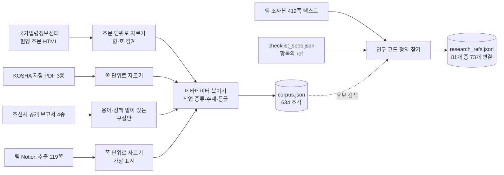
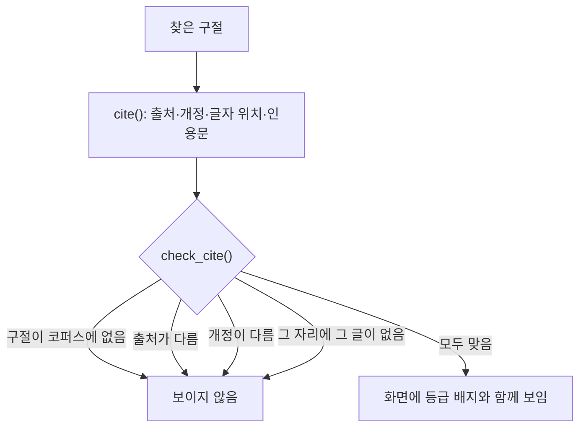

# 10. 근거와 자료 — croScan이 보여 주는 참고 자료는 어디서 오나

croScan은 질문 이유·체크리스트·쌍(두 작업의 짝) 설명 옆에 법령, 공공 지침, 조선사 공개 보고서, 팀 조사 자료를 붙여 보여 줍니다.
이 자료는 읽을거리일 뿐이고, 판정을 정하지 않습니다. 이 문서에는 자료를 어디서 모았는지, 어떻게 찾는지, 무엇을 절대 인용하지 않는지 적습니다.

**이 문서에서 알 수 있는 것**

- 검색 자료(`corpus.json`)의 네 층(법령·공공·조선사·팀)과 「예시」 표시, 각 층의 출처와 건수
- 검색 함수가 자료를 고르고 인용을 검사하는 방법(`search()`, `related()`, `check_cite()`)
- 체크리스트 연구 코드가 412쪽 팀 조사본에 어떻게 이어지는지(81개 중 73개)
- 근거 지도 화면과 사고 사례집 연결
- 인용하지 않는 것, 그리고 작업표준(JSP)을 왜 번호 형식만 보는지

## 목차

1. [무엇을: 자료의 층](#1-무엇을-자료의-층)
2. [왜: 「누가 정한 기준인가」를 보이되 판정에 쓰지 않는다](#2-왜-누가-정한-기준인가를-보이되-판정에-쓰지-않는다)
3. [어떻게: 자료 만들기 (`build_corpus.py`)](#3-어떻게-자료-만들기-build_corpuspy)
4. [어떻게: 검색과 인용 검사 (`retrieval.py`)](#4-어떻게-검색과-인용-검사-retrievalpy)
5. [연구 ref: 412쪽 조사본 연결](#5-연구-ref-412쪽-조사본-연결)
6. [근거 지도 화면](#6-근거-지도-화면)
7. [사고 사례집 연결](#7-사고-사례집-연결)
8. [인용하지 않는 것](#8-인용하지-않는-것)
9. [작업표준(JSP): 번호 형식만 본다](#9-작업표준jsp-번호-형식만-본다)
10. [코드 어디](#10-코드-어디)
11. [시험](#11-시험)
12. [한계](#12-한계)

---

## 1. 무엇을: 자료의 층

검색 자료는 [`server/knowledge/corpus.json`](../server/knowledge/corpus.json) 한 파일입니다. 2026-10-31에 만들었고, 출처 11개에서 조각(청크) 634개를 담았습니다.
모든 조각에는 「등급」(`authority`)이 붙습니다. 화면은 이 등급을 `[법령] [공공] [조선사] [팀] [예시]` 배지로 보입니다.

| 등급 | 출처 | 조각 수 | 쓰임 | 검수 |
|---|---|---:|---|---|
| 법령 | 국가법령정보센터 현행본. 산업안전보건기준에 관한 규칙(시행 2026.3.2), 산업안전보건법(시행 2026.10.27), 원자력안전법(시행 2026.5.19) | 37 (25개 조문) | 조문이 실제로 무엇이라고 적었는지 보여 줌 | 「원문 수집됨」만 뜻함(규칙에 맞는지는 따로) |
| 공공 | KOSHA 기술지원규정 2종(A-G-14-2026 용접·용단 화재예방, B-E-12-2026 전기작업 안전)과 기술지침 B-5-2011(조선업 안전점검) | 211 | 기술적 권고. 법적 최저기준이 아님 | 검수 전 |
| 조선사 | HD현대중공업 2024 안전보건경영보고서·2025 안전보고 한영용어집, 삼성중공업 2023, 한화오션 2025 지속가능경영보고서 | 60 | 용어·정책 설명만. 회사 허가 기준이 아님 | 검수 전 |
| 팀 | 팀 Notion 조사 추출본(119쪽, 2026-10-25) | 326 | 현장 조사 메모 | 검수 전 |
| 예시 | 팀 조각 가운데 스스로 가상·합성이라고 밝힌 부분 | (팀 326 중) 127 | 근거로 쓰지 않음. `related()`·`for_analysis()`에서는 뺌. 근거 지도의 「예시」 칸과 일반 검색 API(`GET /api/knowledge/search`)에서는 나올 수 있음 | — |

- 법령 조각은 앱이 어디선가 인용하는 조문만 모았습니다(규칙표·체크리스트·허가 종류·질문 이유에 적힌 조문). 법령 전체가 아닙니다.
- B-5-2011은 「2026.1 재정비 뒤 현행 여부 미확인」으로 적혀 있습니다. 그래서 업로드 분석에는 넘기지 않습니다(4절).

---

## 2. 왜: 「누가 정한 기준인가」를 보이되 판정에 쓰지 않는다

**보이는 이유.** 작업반장이 「왜 이걸 묻지?」 하고 생각할 때가 있습니다. 그때 질문 이유 옆에 조문이나 조사 자료가 있으면 납득하기 쉽습니다. 안전관리자는 체크리스트 항목과 쌍 규칙이 무엇에 기대는지 한눈에 보고 싶어 합니다(설계서 §3.4.1).

**판정에 쓰지 않는 이유.**
- 검색은 말이 비슷한 구절을 찾습니다. 구절을 찾았다고 해서 그 의무가 이 작업에 적용된다는 증거가 되지는 않습니다.
- 검색이 아무것도 못 찾아도 「적용되는 규정이 없다」는 뜻이 아닙니다.
- 그래서 체크리스트 판정과 쌍 판정은 규칙표만 읽습니다. 검색 결과와 근거 지도는 어떤 판정도 읽지 않습니다([`server/evidencemap.py`](../server/evidencemap.py) 머리말).

**회사 허가 절차를 인용하지 않는 이유.** 조선 3사의 허가 절차 원문은 공개되지 않았습니다. 공개 보고서는 용어·정책 설명에만 씁니다. 회사 허가 기준처럼 인용하지 않습니다.

---

## 3. 어떻게: 자료 만들기 (`build_corpus.py`)

[`tools/build_corpus.py`](../tools/build_corpus.py)가 `corpus.json`과 `research_refs.json`을 오프라인에서 한 번 만듭니다. 앱은 실행 중에 인터넷에서 아무것도 가져오지 않습니다.



**층별로 하는 일**

| 층 | 함수·상수 | 하는 일 |
|---|---|---|
| 법령 | `LAWS`, `cited()`, `fetch_law()`, `articles()`, `law_parts()` | 앱이 인용하는 조문을 모읍니다. 조문은 통째로 둡니다. 700자보다 길면 항(①…)·호(1. …) 경계에서 이어지는 조각으로 자릅니다(`law:<법>:<조>#1, #2 …`). 페이지 주소·해시·수집일을 남깁니다 |
| 공공 | `GUIDES` | `자료/공공_KOSHA`의 PDF를 쪽마다 자릅니다. 표지·목차는 뺍니다. `use`에 「기술적 권고(법적 최저기준 아님)」 |
| 조선사 | `REPORTS`, `TERMS` | 작업중지권·위험작업 허가·밀폐공간 같은 말이 있는 구절만 모읍니다. 파일당 최대 40조각입니다. `use`에 「용어·정책 설명만(회사 허가 기준 아님)」 |
| 팀 | `SYN_SECTIONS`, `SYN_PAGE`, `SYN_VALUES` | Notion 추출본을 쪽마다 자릅니다. 다음 조각은 `synthetic`(가상)으로 표시합니다: 72~99쪽(가상 허가서와 작성 예시), 「가상·합성·예시」라고 적힌 쪽, 가상 설정값(3.6m·4.8m·38톤·380V)이 든 조각 |

**모든 조각의 메타데이터**(`meta()`, 설계서 §3.4): 출처(`source_id`), 개정(`revision`), 해시, PDF 쪽·인쇄 쪽, 절, 회사 범위, 작업 종류(`work_kind`, 화기·밀폐·고소·인양·정전 등을 글에 든 말로 판단, 없으면 `common`), 주제(`topic`: 위험·조치·절차·용어·사고), 등급, 효력 상태, 대체 관계, 가상 여부, 추정값 여부, `legal_verified`, 추출 품질.

**넣지 않는 것.** 시연 정답표(`answers_truth`, `workplans_truth`, `skeleton`, 예상 쌍 결과)는 코퍼스에 넣지 않습니다. 412쪽 조사본 본문도 검색 조각으로는 넣지 않습니다. 연구 코드 연결(5절)에만 씁니다.

**다시 만들기.** 원본 자료는 저장소 밖 `자료/` 폴더(저장소의 상위 폴더)에 있습니다. 법령은 law.go.kr에 접속할 수 있어야 받습니다. 그래서 아무 PC에서나 다시 만들 수는 없습니다.

```bash
python tools/build_corpus.py      # 자료 폴더가 있고 law.go.kr에 닿는 PC에서
```

---

## 4. 어떻게: 검색과 인용 검사 (`retrieval.py`)

[`server/retrieval.py`](../server/retrieval.py)는 표준 라이브러리만 씁니다. 첫 검색 때 색인을 한 번 만듭니다.

**점수.** BM25로 매깁니다. BM25는 낱말이 얼마나 겹치는지로 점수를 매기는 검색 방식입니다. 한국어 낱말과 글자 2~3개 묶음(2~3그램)으로 셉니다. 현장 말은 문서 말로 넓힙니다(`SYNONYMS`, 예: 「용접」 → 용접·용단·화재위험작업, 「LOTO」 → 잠금장치·꼬리표·정전전로).

**거르기는 점수 전에.** `search()`는 점수를 매기기 전에 등급·가상 여부·검수 여부·작업 종류·회사·주제·효력으로 먼저 거릅니다. 그래서 걸러진 조각은 상위 k개 자리를 차지하지 못합니다.

**항상 빼는 것.**
- `CORRECTED`: 현장 정정으로 틀린 것이 확인된 팀 구절 3개(안전관리자가 최종 승인한다는 설명 등). 어떤 필터를 써도 나오지 않습니다.
- 팀원 PC의 파일 경로(`LOCAL_PATH`)는 글에서 지웁니다.
- 같은 구절이 두 번 나오면 한 번만 보입니다.

**쓰는 곳 세 가지**

| 함수 | 어디서 | 무엇을 | 거르기 |
|---|---|---|---|
| `related()` | 질문의 「왜 묻나요?」([`server/app.py`](../server/app.py)의 `_REFS` 캐시), 요청형 「왜?」, 칸 연결 설명([`server/mapcell.py`](../server/mapcell.py)) | 관련 구절 최대 2개 | 질문에 위험·설비 말(동의어표의 말)이 있을 때만. 점수 8 이상(`MIN_SCORE`)이고 같은 말이 든 구절만. 가상 조각 제외. 법령 조각이 1등 점수의 0.6배 이상이면 맨 앞 |
| `for_analysis()` | 업로드 분석([`server/analyze.py`](../server/analyze.py)) | 모델에게 넘기는 참고 구절 최대 3개 | 법령·공공만. 가상과 「현행 여부 미확인」 제외. 허가 종류에 맞는 것 |
| `search()` | 근거 지도의 후보 칸, `GET /api/knowledge/search` | 상위 k개 | 부르는 쪽이 정함 |

**인용 검사.** `related()`와 `for_analysis()`는 구절마다 `cite()`로 인용을 만들고 `check_cite()`로 검사합니다. 인용은 `source_id / revision / span(글자 위치) / quote(그 자리의 글)`입니다. 근거 지도(`evidencemap.py`), 일반 검색 API(`GET /api/knowledge/search`), 연구 ref 표시는 이 검사를 거치지 않습니다. 아래 흐름도는 앞의 두 함수(`related()`, `for_analysis()`)의 흐름입니다.



두 함수에서 검사에 실패한 인용은 보이지 않습니다. 빈자리를 지어낸 인용으로 채우지 않습니다. `missing()`은 보조 함수입니다. 없는 사실을 `MissingObservation`(없다는 기록) 형태로 만듭니다. 지금 앱은 실제 처리 경로에서 이 함수를 부르지 않습니다. 시험(`tools/check_retrieval.py`)에서만 씁니다.

`article()`은 여러 조각으로 잘린 조문을 순서대로 다시 이어 한 조문으로 돌려줍니다. 근거 지도가 씁니다.

---

## 5. 연구 ref: 412쪽 조사본 연결

체크리스트 항목에는 `ref` 칸이 있습니다(예: `HW02-SPARK`). 이것은 팀 조사본(추가본·전체자료, 412쪽)의 연구 코드입니다. 조사본에는 「HW02-SPARK — 불티·열 전달」처럼 코드마다 정의가 있습니다.

**연결 방법**(`build_corpus.py`의 `book_codes()`, `research_refs()`)
1. 412쪽 텍스트(`자료/팀_조사본_추가본전체자료_412쪽_텍스트.txt`, 저장소 밖)에서 코드 정의를 찾습니다. 코드 모양은 `HW·PE·LU·MV·EL + 숫자 2자리(-영문…)`와 `R42-숫자-영문`입니다.
2. ref의 모든 코드가 조사본에 정의돼 있으면 「연결」입니다. 정의의 쪽과 그 정의 범위의 글만 인용합니다. 묶음 코드(`EL13`)는 하위 코드 전부로 봅니다.
3. 조사본 코드로 연결하지 못하면, 가상이 아닌 팀 조각에서 ref 문자열을 그대로 찾습니다. 문자열이 있으면 그 조각에 「연결」합니다.
4. 거기에도 없으면 「미연결」입니다. 가장 가까운 팀 구절을 후보로 붙입니다. 다만 `reviewed: false`(검수 전)로 둡니다. 미연결 ref는 인용하지 않습니다.
5. 법령 인용(「규칙」「법」이 든 ref)은 여기서 다루지 않습니다. 법령 층에서 다룹니다.

**결과**([`server/knowledge/research_refs.json`](../server/knowledge/research_refs.json)): 서로 다른 ref 81개 중 73개 연결, 8개 미연결.
미연결 8개는 모두 조사본 코드가 아닌 표시입니다. 코드가 틀린 것이 아닙니다.

| 미연결 ref | 항목 |
|---|---|
| (조문 미기재) 사내 위험성평가 대조 — 정정내용 D12·안전보건보고서 | `common_ra` |
| 부록B MACHINE | `common_machine` |
| 사례 C02·C03·C22 | `hot_under` |
| 사례 C02·C11 | `hot_tack` |
| 사례집 도장(밀폐·혼재)·멘토 병행 불가 | `confined_solvent` |
| 사례 C26·C28 | `height_mewp` |
| 안전보건보고서 혹서기 온열질환(옥외·고소) | `height_heat` |
| 사례 C56·단기공사표준 | `loto_drop` |

화면에서는 `retrieval.research_ref()`가 이 파일을 읽습니다. 근거 지도는 항목 행 단위로 셉니다. 그래서 「연구 ref 82행, 원문 연결 74행」으로 보입니다. 같은 ref를 두 항목이 쓰는 경우가 있어서 서로 다른 ref 수와 다릅니다.

---

## 6. 근거 지도 화면

**무엇.** 쌍 규칙 36개와 체크리스트 86항목, 모두 122행을 한 표로 봅니다. 열은 등급입니다. 빈칸은 숨기지 않고 「근거 보강 필요」로 보입니다. 이 화면은 지식 보강의 작업 목록 역할도 합니다.

- 화면: [`web/evidence.html`](../web/evidence.html), [`web/evidence.js`](../web/evidence.js). 안전관리자 화면의 「근거 지도 전체 화면(구절 보기)」 링크로 엽니다(`/static/evidence.html`).
- 데이터: `GET /api/knowledge/map` → [`server/evidencemap.py`](../server/evidencemap.py)의 `build()`. 코퍼스와 규칙 파일이 바뀌지 않으면 결과를 다시 계산하지 않습니다.
- 권한: `CROSCAN_AUTH=proxy`일 때 `/api/knowledge/*`는 안전관리자만 엽니다([12 배포와 운영](12_배포와_운영.md)).

**칸**

| 칸 | 내용 |
|---|---|
| 법령 | 인용 조문, 원문, 규칙 적합성 검수 기록 |
| 공공 | KOSHA 검색 후보(검수 전) |
| 조선사 | 검색 후보(검수 전) |
| 팀 | 연구 ref 연결 상태 + 검색 후보(검수 전) |
| 예시 | 가상 자료. 근거로 쓰지 않음 |

**법령 칸의 세 상태는 따로 셉니다.**
1. **원문 수집됨**: 그 조문의 현행 원문이 코퍼스에 있습니다.
2. **인용 있음**: 규칙이나 항목이 그 조문을 적었습니다.
3. **규칙 적합성 검수됨**: 사람이 그 조문이 그 규칙에 맞는지 확인했습니다(`pair_rules.json`의 `law_fit`이 「맞음」). 체크리스트는 공통 4항목에만 이 기록이 있습니다.

「확인된 근거」로는 3번이 「맞음」이고 1번도 참인 것만 셉니다.

**지금 수치**(`evidencemap.build()`의 `flow`, 2026-10-31 코퍼스 기준)

| 항목 | 값 |
|---|---:|
| 전체 행 | 122 (쌍 규칙 36 · 체크리스트 86) |
| 조문 인용 있음 | 39 |
| 그중 원문 수집됨 | 32 |
| 규칙 적합성 검수 「맞음」(= 확인된 근거) | 13 |
| 검수 「약함」 | 7 |
| 인용은 있으나 검수 기록 없음 | 19 |
| 조문 인용 없음(근거 보강 필요) | 83 |

빗금 칸과 「—」는 「연결을 만들지 않았다」는 뜻입니다. 「적용되는 법령이 없다」는 뜻이 아닙니다. 화면 범례에도 그렇게 적혀 있습니다.

---

## 7. 사고 사례집 연결

**출처.** 「2025 조선업 중대재해 사례집(2015~2024)」, 안전보건공단 부산광역본부. 사례 81건입니다([`server/checklist_spec.json`](../server/checklist_spec.json)의 `case_source`).

**체크리스트.** 같은 기전(사고가 일어나는 방식)의 사고만 사람이 골라 붙였습니다.
- 86항목 중 40항목에 연결 78개, 서로 다른 사례 48건. 한 항목에 최대 3건.
- 각 연결은 사례 번호·쪽·짧은 요약·이유를 가집니다(`cases` 칸).
- 같은 기전의 사고가 없는 항목(보호구·흄·소음·온열·아크광 등)은 비워 두었습니다. 원인이 적혀 있지 않거나 장소·기전이 다른 4건은 뺐습니다(설계서 §22).
- 보이는 곳: 항목의 「왜?」 설명에 「참고 사고 사례(조선업 중대재해 사례집 n쪽): …」로 나옵니다([`server/explain.py`](../server/explain.py)).

**쌍 규칙.** [`server/pair_rules.json`](../server/pair_rules.json)의 각 규칙에도 `cases` 칸이 있습니다. 이 칸에는 「참고: 사고사례집 C26 — …」처럼 사례·보고서·멘토 메모를 적은 문장이 들어 있습니다. 안전관리자 화면의 쌍 상세 「유사사고·기준」에 보입니다([`web/app.js`](../web/app.js)).

**코드 주석.** [`server/pairs.py`](../server/pairs.py)와 [`server/holdq.py`](../server/holdq.py)의 일부 규칙·질문 옆에 근거 사례 번호(예: C03·C22)가 주석으로 남아 있습니다.

사례는 「참고」입니다. 이 작업에서 같은 사고가 난다는 판단이 아닙니다. 사례집 본문은 검색 코퍼스에 없습니다. 연결은 사람이 만든 목록입니다.

---

## 8. 인용하지 않는 것

| 무엇 | 어떻게 막나 | 화면에서는 |
|---|---|---|
| 미연결 연구 ref 8개 | `research_refs.json`에 「미연결」 | 「원문 미연결」과 까닭, 가까운 구절은 「검수 전」으로만 |
| 검수 전 후보(공공·조선사·팀 조각 전부) | 조각마다 `reviewed: false` | 「검색 후보 · 검수 전」 |
| 가상·합성 조각 127개 | `related()`, `for_analysis()`가 `synthetic=False`로 뺌 | 근거 지도 「예시」 칸과 일반 검색 API(`GET /api/knowledge/search`)에서는 나올 수 있음 |
| 현장 정정으로 틀린 팀 구절 3개 | `retrieval.CORRECTED` | 어디에도 안 보임 |
| 인용 검사에 실패한 구절 | `check_cite()` (`related()`·`for_analysis()`만) | 그 두 경로에서는 안 보임 |
| 검수 기록 없는 조문 인용 | `law_fit` 없음 | 「인용만(확인된 근거 아님)」 |
| 현행 여부 미확인 지침(B-5-2011) | `for_analysis()`가 `effective=False`로 뺌 | 근거 지도 후보로는 보일 수 있음 |
| 시연 정답표 | 코퍼스에 넣지 않음 | — |
| 조선사 허가 절차 | 원문이 공개되지 않음 | 보고서는 용어·정책 설명만 |
| 작업표준(JSP) 본문 | 구할 수 없음 | 9절 |

---

## 9. 작업표준(JSP): 번호 형식만 본다

**무엇.** 허가서에는 「작업표준(JSP NO.)」 칸이 있습니다(예: `HHIS-CW-A0001190-012-001`). 이 번호는 HD현대 사내 Hi-STANDARD 시스템의 작업표준 문서 번호입니다(팀 조사).

**본문을 구할 수 없습니다.**
- 받은 자료에는 번호만 있고 본문이 없습니다. Notion의 `SIM-JSP-N01` 같은 번호는 합성 번호입니다.
- 공개 웹과 회사 공식 자료에도 본문이 없습니다(2026-11-01 확인, 설계서 §22).
- 회사가 문서를 주지 않는 한 번호를 본문에 이을 수 없습니다.

**croScan이 하는 것.**
- 칸을 읽습니다([`server/form_spec.py`](../server/form_spec.py)의 `jsp_no`, 종류 `code`).
- 번호 형식만 검사합니다. 화면의 `CODE_RULES.jsp_no`와 `codeProblem()`([`web/app.js`](../web/app.js))이 「HHIS로 시작하는지」와 「하이픈 뒤에 구간이 더 있는지」를 봅니다. 실제 번호가 여러 꼴이라서 일부러 느슨하게 만든 시연용 검사입니다. 회사 번호 체계 전체를 검사하지는 않습니다.
- 업로드 분석은 이 칸을 모델에게 주지 않습니다([`server/analyze.py`](../server/analyze.py)의 `HIDDEN`). 문서 번호는 물을 거리가 아니기 때문입니다.
- 근거로는 공개 KOSHA 지침을 보입니다. JSP 본문을 인용하지 않습니다.

---

## 10. 코드 어디

| 고치고 싶은 것 | 파일·함수 |
|---|---|
| 새 법령·지침·보고서 넣기 | [`tools/build_corpus.py`](../tools/build_corpus.py)의 `LAWS`, `GUIDES`, `REPORTS` → 다시 만들기 |
| 가상 표시 범위 | 같은 파일 `SYN_SECTIONS`, `SYN_PAGE`, `SYN_VALUES` |
| 연구 코드 모양·연결 규칙 | 같은 파일 `CODE`, `book_codes()`, `research_refs()` |
| 현장 말 → 문서 말 | [`server/retrieval.py`](../server/retrieval.py) `SYNONYMS` |
| 틀린 팀 구절 숨기기 | 같은 파일 `CORRECTED` |
| 「왜 묻나요?」 관련 자료 기준 | 같은 파일 `related()`, `MIN_SCORE` |
| 업로드 분석에 넘기는 자료 | 같은 파일 `for_analysis()` |
| 근거 지도 행·칸·수치 | [`server/evidencemap.py`](../server/evidencemap.py) `build()`, `_row()`, `_law_cell()` |
| 근거 지도 화면 | [`web/evidence.html`](../web/evidence.html), [`web/evidence.js`](../web/evidence.js) |
| 규칙의 조문 적합성 기록 | [`server/pair_rules.json`](../server/pair_rules.json) `law`, `law_fit`, `law_checked` |
| 체크리스트 ref·사례 | [`server/checklist_spec.json`](../server/checklist_spec.json) `ref`, `cases`, `law_fit` |
| JSP 번호 형식 | [`web/app.js`](../web/app.js) `CODE_RULES`, `codeProblem()` |

---

## 11. 시험

| 시험 | 무엇을 | 확인 수 |
|---|---|---:|
| [`tools/check_retrieval.py`](../tools/check_retrieval.py) | 코퍼스 메타데이터, 거르기, 인용 검사, 정정 구절 숨김, 연구 ref, 근거 지도 | 29 |
| [`tools/check_docs_ai.py`](../tools/check_docs_ai.py) | (일부) 근거 지도의 법령 상태 수치 | 38 중 일부 |
| [`tools/eval_retrieval.py`](../tools/eval_retrieval.py) | 검색 평가 20문항: 일반 `search()`의 Recall@3·@6(설계 기준 95%)·@12 | 평가(통과·실패 아님) |

검색 평가는 일반 `search()`의 상위 3·6·12개 결과를 잽니다. 업로드 분석용 출처·작업 종류·효력 필터(`for_analysis()`)는 적용하지 않습니다. 그래서 Recall@3(상위 3개 안에 정답 구절이 들었는지 보는 값)은 실제 모델 입력의 적중률과 다릅니다.

**검색 평가 기록(2026-10-31, 설계서 부록).** 「하나라도」 기준 @3 19/20 · @6 20/20, 「전부」 기준 @3 18/20 · @6 19/20 · @12 20/20.
문항은 정답을 아는 개발자가 썼습니다. 작은 표본입니다. 그 뒤에 코퍼스나 검색이 바뀌었을 수 있습니다. 그러니 지금 값은 `python tools/eval_retrieval.py`로 다시 확인합니다.

시험 전체 목록과 실행 방법은 [11 시험과 평가](11_시험과_평가.md)에 있습니다.

---

## 12. 한계

- **검수가 적습니다.** 사람이 규칙에 맞는지 확인한 조문은 13행뿐입니다. 공공·조선사·팀 조각은 모두 검수 전입니다.
- **83행은 조문 인용이 없습니다.** 「근거 보강 필요」로 보입니다. 근거가 없다는 뜻은 아닙니다. 연결을 아직 만들지 않았다는 뜻입니다.
- **말로 찾습니다.** BM25는 낱말이 겹치는 구절을 찾습니다. 뜻은 같고 말이 다르면 놓칠 수 있습니다.
- **다시 만들기가 어렵습니다.** 원본 자료가 저장소 밖에 있고, 법령은 인터넷이 필요합니다.
- **코드 머리말이 낡았습니다.** `build_corpus.py`와 `evidencemap.py`의 머리말은 「[공공] 층은 아직 모으지 않았다」고 적혀 있습니다. 하지만 지금 코퍼스에는 KOSHA 조각 211개가 있습니다. 머리말보다 코드와 `corpus.json`이 기준입니다.
- **사례·연구 ref는 참고입니다.** 이 작업에서 그 사고가 난다거나 그 연구 결론이 맞는다는 판단이 아닙니다.
- **JSP 본문은 없습니다.** 번호 형식이 맞아도 그 작업표준이 이 작업에 맞는지는 croScan이 알 수 없습니다.
