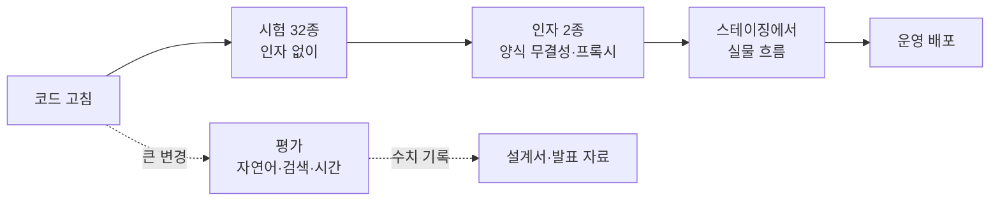
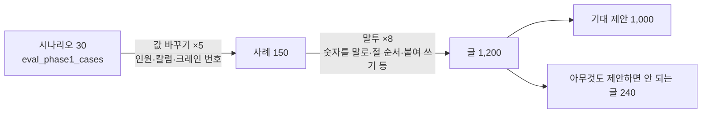

# 11. 시험과 평가 — 고친 뒤 무엇이 깨지지 않았는지 확인하는 법

croScan에는 회귀 시험 `tools/check_*.py` 34종과 평가 도구(`eval_*`, `probe_*`)가 있습니다. 회귀 시험은 코드를 고친 뒤 예전 약속이 깨지지 않았는지 보는 시험입니다.
시험은 「통과/실패」로 규칙과 화면 약속을 지킵니다. 평가는 숫자를 잴 뿐입니다. 통과 기준이 아닙니다.

**이 문서에서 알 수 있는 것**

- 시험 34종이 각각 무엇을 지키는지, 지금 확인이 몇 개인지
- 전부 한 번에 돌리는 방법과 인자가 필요한 2종
- 기준본(v1) 시험과 일부러 둔 예외
- 평가 도구와 기록된 결과(자연어 1,200건, 시연 자료 결과)
- 숫자를 말할 때 붙여야 할 조건

## 목차

1. [무엇을: 시험과 평가의 차이](#1-무엇을-시험과-평가의-차이)
2. [왜: 경보와 질문이 줄면 안 된다](#2-왜-경보와-질문이-줄면-안-된다)
3. [어떻게 돌리나](#3-어떻게-돌리나)
4. [시험 34종](#4-시험-34종)
5. [기준본(v1)과 의도한 예외](#5-기준본v1과-의도한-예외)
6. [평가 도구](#6-평가-도구)
7. [기록된 결과](#7-기록된-결과)
8. [코드 어디: 시험을 더할 때](#8-코드-어디-시험을-더할-때)
9. [한계](#9-한계)

---

## 1. 무엇을: 시험과 평가의 차이

| | 시험 (`check_*`) | 평가 (`eval_*`, `probe_*`) |
|---|---|---|
| 묻는 것 | 약속이 지켜지나? | 얼마나 잘·빨리 하나? |
| 결과 | `PASS`/`FAIL` 줄과 `통과 수/전체 수` | 맞음·틀림·놓침 건수, 시간 |
| 모델 | 부르지 않습니다. 필요한 곳은 가짜 모델로 바꿉니다 | 실제 모델을 부르는 것이 있습니다(서버에서) |
| 실패할 때 | 대부분 종료 코드 1 | 항상 0(측정일 뿐) |
| 언제 | 코드를 고칠 때마다 | 큰 변경 뒤, 발표 수치가 필요할 때 |



---

## 2. 왜: 경보와 질문이 줄면 안 된다

- croScan은 규칙으로 판정합니다. 규칙 하나를 넓히면 다른 곳의 경보가 사라질 수 있습니다. 사라진 경보는 화면에 보이지 않아서 사람이 알아채기 어렵습니다.
- 그래서 시험은 「새 기능이 된다」보다 「이전 경보·질문이 남아 있다」를 더 많이 봅니다. 기준본(v1) 시험이 그 예입니다(5절).
- 모델은 같은 입력에도 다른 답을 낼 수 있습니다. 시험 결과가 흔들리지 않도록, 모델 자리에 늘 정해진 답을 내는 가짜를 넣습니다. 그래서 시험은 「서버가 모델 제안을 어떻게 거르고 다루는가」를 봅니다. 모델의 실력은 평가가 잽니다.

---

## 3. 어떻게 돌리나

**준비**
- `pip install -r requirements.txt`
- Java 17 이상: 판독기(한컴 OpenDataLoader)가 `java`로 jar를 실행합니다. 판독을 쓰는 시험은 Java가 없으면 실패합니다.
- `samples/`가 있어야 합니다. 많은 시험이 `samples/반장_테스트`(허가서 10장)와 `samples/시연_하루`(시연일 DB)를 읽습니다. 도커 이미지에는 `samples/`가 없습니다. 그래서 이미지 안에서는 이 시험들이 돌지 않습니다(서버에서는 [`tools/cloud_test.sh`](../tools/cloud_test.sh)처럼 작업 사본을 붙여 돌립니다).
- Node.js(선택): [`check_ui_state.py`](../tools/check_ui_state.py)와 [`check_dialogue_api.py`](../tools/check_dialogue_api.py)의 한 확인이 `web/app.js` 함수를 node로 돌립니다.
- 콘솔이 cp949인 Windows에서는 `PYTHONIOENCODING=utf-8`을 꼭 둡니다. 없으면 한국어를 출력하다가 멈춥니다.

**전부 돌리기 (Git Bash 또는 리눅스, 저장소 루트에서)**

```bash
export PYTHONIOENCODING=utf-8
logs=$(mktemp -d); fail=""
for f in tools/check_*.py; do
  case "$f" in */check_form_intact.py|*/check_proxy_headers.py) continue ;; esac
  n=$(basename "$f" .py)
  python "$f" > "$logs/$n.log" 2>&1 || fail="$fail $n"
  echo "$n: $(tail -1 "$logs/$n.log")"
done
echo "실패:${fail:- 없음}  (기록: $logs)"
```

**PowerShell**

```powershell
$env:PYTHONIOENCODING = "utf-8"
Get-ChildItem tools\check_*.py | Where-Object { $_.Name -notin "check_form_intact.py", "check_proxy_headers.py" } | ForEach-Object {
  python $_.FullName > "$env:TEMP\$($_.BaseName).log" 2>&1
  if ($LASTEXITCODE -ne 0) { "실패: $($_.BaseName)" } else { "종료 코드 0: $($_.BaseName) — 로그에서 실패·건너뜀 여부 확인" }
}
```

**종료 코드만 믿으면 안 되는 것**
- [`check_extract.py`](../tools/check_extract.py)는 실패해도 종료 코드가 0입니다. 마지막 줄 `all: 맞음/전체`를 읽어야 합니다.
- `check_ui_state.py`는 node가 없으면 `SKIP`을 찍고 0으로 끝납니다.
- `check_checklist.py`는 검사 실패 줄과 최종 합계를 출력합니다(`VERBOSE=1`이면 통과 줄도 찍습니다).
- `check_reflect.py`는 허가서별 반영 내역과 실패 줄, 최종 합계를 출력합니다. 반영 내역은 실패가 아닙니다. 실패 줄은 `FAIL`로 시작합니다.

**인자가 필요한 2종**

```bash
# 사내 로그인 프록시 설정 검사 (오프라인)
python tools/check_proxy_headers.py --conf deploy/oidc-proxy/nginx.conf
# 실제 연결 검사 (붙인 뒤): --url <회사 주소> --app <앱 주소>

# 제출본이 원본 양식을 칸 밖에서 그대로 두는지 (픽셀 비교)
python tools/check_form_intact.py <원본.pdf> <제출본.pdf> <종류>
#   종류: hot · confined · height · lifting · loto
#   제출본: 제출 뒤 /api/submissions/<제출 ID>/permit.pdf 로 받은 파일
```

- `check_proxy_headers.py`는 인자가 없으면 사용법을 찍고 1로 끝납니다.
- `check_form_intact.py`는 인자가 없으면 오류(IndexError)로 멈춥니다. 사용법은 따로 찍지 않습니다.

**임시 데이터 폴더.** 16종은 시작할 때 `CROSCAN_DATA`(데이터 폴더)를 임시 폴더로 정합니다.
- 그중 9종은 언제나 새 임시 폴더를 씁니다.
- 7종(`check_access`, `check_checklist`, `check_checklist_material`, `check_docs_ai`, `check_interpret`, `check_questions_material`, `check_reflect`)은 다릅니다. `CROSCAN_DATA`가 이미 있으면 그 경로를 그대로 씁니다.
- 그래서 시험 전에는 운영 경로 대신 새 임시 폴더를 지정합니다. 아니면 `CROSCAN_DATA`를 비워 둡니다.
- 나머지 18종은 데이터 폴더를 정하지 않습니다. 이런 시험이 저장을 하면 `CROSCAN_DATA`에 씁니다. 그것도 없으면 저장소의 `data/`(git 제외)에 씁니다.

---

## 4. 시험 34종

「확인 수」는 2026-11-01 코드에서 센 값입니다. 시험을 돌려서 얻은 값이 아닙니다. `check_questions_material.py`와 `check_ui_state.py`는 2026-11-02 코드로 다시 셌습니다(돌려서 254/254, 83/83).
- 숫자만 있는 것: 반복 횟수와 검사 보조 함수 호출까지 넣어 셈한 예상 검사 횟수. 소스에 적힌 `check()` 호출 위치의 수와 다를 수 있습니다(예: `check_store.py`는 호출 위치 44곳, 확인 수 61)
- †: 반복문 횟수를 곱해 센 값
- 「조건부」: 자료에 따라 몇 개가 더해지거나 빠짐
- 「실행해서 확인」: 데이터 파일 크기에 따라 달라짐

정확한 수는 시험을 돌려 마지막 줄에서 확인합니다.

**판독·문서**

| 시험 | 지키는 것 | 확인 수 | 필요한 것 |
|---|---|---:|---|
| [`check_extract.py`](../tools/check_extract.py) | 판독기가 샘플 PDF를 정답표(`samples/_truth.json`)대로 읽음: 허가 종류, 공통 값, 작업일 행, 체크 칸 | 실행해서 확인 (정답표 18파일·27쪽 × 칸) | Java. 선택 인자 `시연`·`보관` |
| [`check_form_intact.py`](../tools/check_form_intact.py) | 제출본이 양식 칸과 위 여백(24pt) 밖에서 원본과 같은 픽셀. 뒤쪽 쪽은 croScan 별지 | 2 + 쪽마다 2 | 인자 3개, Java |
| [`check_render.py`](../tools/check_render.py) | 종이 출력: 쪽 나눔의 (계속), 표 머리 반복, AI 표시 한 번 | 11 | — |
| [`check_reflect.py`](../tools/check_reflect.py) | 반영본(반장 답을 허가서 칸에 옮겨 그린 PDF)이 당일·서명·승인·체크 칸에 쓰지 않음, 「모름」·단추 이름을 쓰지 않음, 올린 PDF 바이트 그대로 | 실행해서 확인 (시연 허가서 10장 × 칸) | 시연_하루, Java |
| [`check_docs_ai.py`](../tools/check_docs_ai.py) | 칸 연결(MAP_CELL)은 확인 뒤에만, 계획서 연결 관계, 허가 신호, 관리자 요약, 게시 문안, 근거 지도 법령 수치 | 38 | 시연 DB, corpus.json, 가짜 모델 |
| [`check_critique_link.py`](../tools/check_critique_link.py) | 비평(CRITIQUE)이 부정을 지킴, 계획서 연결(LINK) 후보·가져오기, 고친 계획서의 만료 | 41† | 반장_테스트, Java, 가짜 모델 |

**반장 질문·답 읽기**

| 시험 | 지키는 것 | 확인 수 | 필요한 것 |
|---|---|---:|---|
| [`check_questions.py`](../tools/check_questions.py) | 허가서 10장에서 물어야 할 질문을 묻고 안 물을 것은 안 물음, 대화 종료, 시간 읽기, 답에 따른 쌍 순위 | 179† | 반장_테스트, samples/보관, Java |
| [`check_questions_material.py`](../tools/check_questions_material.py) | 조사자료로 더한 질문(T4~T9, CF3~CF5, D6·D7, LI3, LO5·LO6 등)이 조건일 때만 나옴, 순서·12회 한도, 시간창, 신청 시간을 다시 말한 답, 반영본의 실제 작업 시간 줄 | 254† | 반장_테스트, Java |
| [`check_interpret.py`](../tools/check_interpret.py) | 긴 답 하나가 다른 질문(장소·시간·인원·감시인)을 채우는 것은 확인 뒤에만 | 37~40 (조건부) | 시연_하루, Java |
| [`check_understand.py`](../tools/check_understand.py) | AI 읽기 제안을 서버가 남김·따로 둠(다른 팀 말)·버림으로 나눔 | 53 | 가짜 모델 |
| [`check_analyze.py`](../tools/check_analyze.py) | 업로드 분석의 AI 질문 거르기, 숨김 칸, 참고 자료, 바뀐 칸만 다시 보기 | 28 | 시연_하루, Java, corpus.json, 가짜 모델 |
| [`check_delta_api.py`](../tools/check_delta_api.py) | `/api/analyze/delta`: 바뀐 칸만 모델에, 바뀐 것 없으면 호출 없음, 마감 뒤 추가 없음 | 6 | 시연_하루, Java, 가짜 모델 |
| [`check_store.py`](../tools/check_store.py) | 검토 세션 저장소: 제안은 확인 전에는 답이 아님, 개정 번호, 되묻기 예산, 옛 DB 옮기기 | 61 | — |
| [`check_dialogue_api.py`](../tools/check_dialogue_api.py) | 사실의 극성·양태·단계, 확인 계약(보인 내용 = 확인한 내용), 재시작 뒤 중단 처리, 이벤트, 대화 API | 45 (+node 있으면 1) | 시연_하루, 반장_테스트, Java |
| [`check_cases.py`](../tools/check_cases.py) | 확인 사례: 후보 기록 때 가명 처리 → 검수 대기 → 사람 검토 → 발행 검증 → 공개 판의 예시로 사용 | 12 | — |
| [`check_ui_state.py`](../tools/check_ui_state.py) | `web/app.js`의 순수 함수(상태 합치기, 읽기 카드, 체크리스트 AI 받기, 출력 문, 핵심 정보 확인 창과 확인 기록, 체크리스트 미완료 목록, 담당별 확인의 질문 하나 복사 문안) | 82 (+1 조건부) | node |
| [`check_eval_tools.py`](../tools/check_eval_tools.py) | 평가 도구 자체: 절 모드, 두 번째 읽기, 자연어 사례 파일 모양, 사용자 시험 보고 | 9 | 시연_하루, Java |

**체크리스트·제출**

| 시험 | 지키는 것 | 확인 수 | 필요한 것 |
|---|---|---:|---|
| [`check_checklist.py`](../tools/check_checklist.py) | 명세가 있는 것만 씀, 초안은 해당·해당 없음·확인 필요뿐이고 이유가 있음, 규칙 하나씩의 효과, PDF | 실행해서 확인 (명세 항목 × 조치 × 규칙, 허가서 10장). 2026-11-01 기록 2,794 | 반장_테스트, Java |
| [`check_checklist_material.py`](../tools/check_checklist_material.py) | 412쪽 보강 항목이 그 말이 있는 허가서·답에만 해당, 이름만으로는 해당 아님, 옛 항목 id·순서 유지 | 561† | 반장_테스트, Java |
| [`check_checkai.py`](../tools/check_checkai.py) | AI 추가 위험요인: 카탈로그 항목만, 작업의 말과 대조, 기본 목록은 그대로, 반장이 넣기 전에는 추가 안 됨 | 68~69† (조건부) | 시연_하루, Java, 가짜 모델 |
| [`check_ckmerge.py`](../tools/check_ckmerge.py) | `merge()`: 기본 항목을 다시 세움, 고르지 않은 항목은 「반장 확인 전」 | 6 | — |
| [`check_submissions.py`](../tools/check_submissions.py) | 제출: 체크리스트를 서버 초안과 대조, 스냅숏은 한 번만 | 21 | — |
| [`check_submit_link.py`](../tools/check_submit_link.py) | 안전관리자 목록과 그날 판정이 최신 제출본을 읽음. 그날 목록에 없는 허가서(0701)도 버리지 않음 | 11 | 시연 DB |

**쌍작업·안전관리자**

| 시험 | 지키는 것 | 확인 수 | 필요한 것 |
|---|---|---:|---|
| [`check_pairs.py`](../tools/check_pairs.py) | 시연일 정답표(`skeleton.json`)로 채점합니다. 정답 쌍을 놓치면 실패입니다. 허용한 보류 조건 밖의 근접 경보도 실패입니다. 순위 차이와 정답표 밖 경보는 출력만 합니다. 그것만으로는 실패하지 않습니다 | 실행해서 확인 (지금 정답 10쌍 + 근접 5쌍) | 시연 DB. 선택 `-v` |
| [`check_pairs_cases.py`](../tools/check_pairs_cases.py) | 외부 검토에서 나온 반례(잔류, 모르는 시간, 인원 0, 가스, 낱말) | 35† | — |
| [`check_pairs_material.py`](../tools/check_pairs_material.py) | 조사자료 412쪽 대조로 더한 규칙·문구·보류 질문, 기준본(v1) 보존 | 186† | 시연 DB, `tools/fixtures/pairs_v1` |
| [`check_pairs_final.py`](../tools/check_pairs_final.py) | 최종 전수 검토 보강(상부·낙하·화재·가스·크레인·정전·문구·보류 질문 연결) | 87† | — |
| [`check_hybrid.py`](../tools/check_hybrid.py) | 확인된 답과 제출본이 쌍 입력이 됨, `floor()`: 답이 경보를 낮추지 못함 | 34 | 시연 DB |
| [`check_pairreview.py`](../tools/check_pairreview.py) | AI 쌍 검토(사전 거르기·비평·기한·캐시·상태)와 판정보류(확인이 필요해 3순위로 남긴 경보) 질문의 작업별 문안·예산 | 47 | 시연 DB, 가짜 모델 |
| [`check_explain.py`](../tools/check_explain.py) | 요청형 「왜?」: 쌍의 주장, 고정 답, 범위 밖 질문 거절, 설명 검증기, API | 33~34 (조건부) | 시연 DB, 가짜 모델 |
| [`check_coordnote.py`](../tools/check_coordnote.py) | 협조 문자의 「협의할 점」: 확인된 사실에서만, 모델은 고르고 서버가 씀 | 8 | 가짜 모델 |

**근거·접근**

| 시험 | 지키는 것 | 확인 수 | 필요한 것 |
|---|---|---:|---|
| [`check_retrieval.py`](../tools/check_retrieval.py) | 코퍼스 메타데이터, 거르기, 인용 검사, 정정 구절 숨김, 연구 ref, 근거 지도 | 29 | corpus.json |
| [`check_access.py`](../tools/check_access.py) | `_gate`: 시연 모드는 역할·사용자 검사 없음, 프록시 모드는 역할·사용자별 401/403/404 | 11 | — |
| [`check_proxy_headers.py`](../tools/check_proxy_headers.py) | nginx가 모든 경로에 로그인을 묻고, 두 헤더를 nginx만 정하고, 앱 포트를 열지 않음 | `--conf`: 7 · `--url`: 3(+`--app`이면 1) | 인자 필수 |

**마지막 전체 실행 기록(2026-11-01, 설계서 §22).** 34종 가운데 로컬 32종이 통과했습니다. 인자가 필요한 2종은 따로 돌려 통과했습니다(프록시 7/7, 양식 무결성 4/4 — 스테이징 제출본).

---

## 5. 기준본(v1)과 의도한 예외

**무엇.** [`tools/fixtures/pairs_v1/`](../tools/fixtures/pairs_v1/)에는 조사자료 보강 전의 쌍 판정(`pairs.py`, `pair_rules.json`)을 얼려 두었습니다. [`check_pairs_material.py`](../tools/check_pairs_material.py) 12절이 이 사본을 불러 지금 코드와 비교합니다. 이 사본을 쓰는 시험은 이것 하나뿐입니다.

**비교 규칙**(`lost()`). v1이 낸 이유(짝·규칙·원인 작업·노출 작업)가 지금 결과에도 모두 있어야 합니다. 그리고 아래 값이 낮아지면 안 됩니다.
- 순위·점수
- 노출 E
- 강도 S(같아야 함)
- 판정 표기(판정보류 < 보수위험 < 확인위험)

**어디에 적용하나**

| 하루 | 예외 |
|---|---|
| 시연일(2026-10-29) | 없음 |
| Codex 재현 하루(합성) | `WP-M-100` 「용접봉·용접재료 불출」 |
| 방사선 하루(합성) | `WP-M-162` 「용접봉 불출」 |

**의도한 예외 1: 「용접봉 불출」만 적힌 작업은 화기가 아닙니다.** 근거는 조사본 84쪽 17번 작업 특성입니다. 시험 안에도 이 예외가 이름을 달고 적혀 있습니다(「의도한 예외 하나: …」). 서버에서는 [`server/pairs.py`](../server/pairs.py)의 `ISSUE`(불출·지급·수령·보관…)가 있으면 용접 낱말을 도구가 아닌 물건으로 읽습니다. 「용접봉 운반」은 v1처럼 화기 쪽 경보를 유지하는지 따로 봅니다.

**의도한 예외 2: 「관찰·모니터링」만 적힌 작업은 그 행위가 아닙니다.** 예를 들어 「받침대 제거 상태 관찰」은 제거 작업이 아닙니다. 「입회하에 용접」은 용접입니다.
- 이 예외는 `skip`으로 적혀 있지 않습니다. 동작의 차이로만 있습니다. 지금 `pairs.py`의 `NOT_ACTION`은 끝에 `관찰|모니터링`이 있습니다. v1 사본에는 없습니다.
- v1 비교에 쓰는 하루들에는 이런 작업이 없습니다. 그래서 `lost()`는 이 차이를 볼 기회가 없습니다.
- 이 낱말을 직접 보는 시험은 [`check_pairs_final.py`](../tools/check_pairs_final.py)의 태그 확인입니다(v1 비교가 아님).

**이 시험이 깨지면.** 기존 경보를 낮췄다는 뜻입니다. 먼저 예외로 둘 근거가 자료에 있는지 확인합니다. 근거가 있으면 `skip`에 넣고, 시험 이름에 그 근거를 적습니다. 자세한 판정 방식은 [06 쌍작업 판정](06_쌍작업_판정.md#104-기준본v1-시험)에 있습니다.

---

## 6. 평가 도구

평가 도구에는 통과/실패가 없습니다. 결과는 건수와 분모로 적습니다(작은 표본은 비율로 말하지 않습니다).

| 도구 | 하는 일 | 실제 모델 | 결과가 가는 곳 |
|---|---|---|---|
| [`eval_phase1.py`](../tools/eval_phase1.py) | 작업반장 답 읽기(TURN) 평가: 규칙만 대 통합(규칙 → AI → 비평), 멀티턴 대화. `--mode 1~5`로 비교군. `--no-fewshot`·`--no-critique`·`--no-cache`로 예시·비평·캐시를 끄고, `--think N`으로 생각 길이를 정하고, `--second`·`--clause-ids`로 두 번째 읽기·절 번호 출력을 시험함. `--cases`로 자연어 1,200건 | `turn`의 모드 1·2와 `--dry`, `multi`는 불필요. 모드 3~5는 필요 | 화면, `--out` JSONL(`--resume`로 이어 하기) |
| [`eval_phase1_cases.py`](../tools/eval_phase1_cases.py) | 위 평가의 사례: 30 시나리오 × 표현 2, 멀티턴 대화 | — | — |
| [`eval_nl_variants.py`](../tools/eval_nl_variants.py) | 자연어 1,200건 만들기(아래) | 아니오 | [`eval_nl_cases.json`](../tools/eval_nl_cases.json) |
| [`eval_turn.py`](../tools/eval_turn.py) | 허가서 0735의 작은 TURN 평가 | 필요 | 화면 |
| [`eval_retrieval.py`](../tools/eval_retrieval.py) | 검색 20문항 Recall@3·@6·@12(아래 풀이) | 아니오 | 화면 |
| [`eval_scale.py`](../tools/eval_scale.py) | 큰 규모 결정적 시험: 안전 실패 3,000 · 상태 전이 10,000 · 쌍 보강 · 체크리스트 · 연결 · 설명 200 | 아니오(가짜 LINK) | `$CROSCAN_DATA/eval_scale.json`(기본 임시 폴더) |
| [`probe_analyze.py`](../tools/probe_analyze.py) | 업로드 분석 시간과 출력 | 필요(스테이징) | 화면 |
| [`probe_load.py`](../tools/probe_load.py) | TURN p50·p95, 전체 대화, 캐시, 배경 분석, 동시 사용자 | 필요(`--fake`로 대체 가능) | `$CROSCAN_DATA/probe_load.json` |
| [`probe_timing.py`](../tools/probe_timing.py) | 프롬프트 읽기 대 답 쓰기 시간, 캐시 재사용 | 필요 | 화면 |
| [`stress_extract.py`](../tools/stress_extract.py) | 무작위 허가서 5종을 그려 판독 정확도 | 아니오(Java 필요) | 화면 |
| [`stress_workplan.py`](../tools/stress_workplan.py) | 무작위로 채운 작업계획서를 여러 방식으로 다시 읽기 | 아니오 | 화면 |
| [`usertest_report.py`](../tools/usertest_report.py) | 사용자 시험 결과 JSON 모으기(성공 90% 이상, 오독 0) | 아니오 | 화면 또는 `--md` 파일 |
| [`cloud_test.sh`](../tools/cloud_test.sh) | 서버에서 앱 이미지로 `check_questions`·`check_extract`·`stress_workplan` 실행 | 아니오 | 화면. 각 시험의 종료 코드를 넘기지 않으므로 출력을 읽어야 함 |

[`demo_day_data.py`](../tools/demo_day_data.py)와 [`make_demo_day.py`](../tools/make_demo_day.py)는 평가 도구가 아닙니다. 시연 자료를 만드는 도구입니다. `demo_day_data.py`는 `samples/시연_하루`의 `permits.json`·`workplans.json`·`skeleton.json`을 덮어씁니다.

**평가 용어**
- Recall@k: 상위 k개 검색 결과에 정답이 들어 있는지 보는 지표입니다. 여기서는 정답을 하나라도 찾은 문항(「하나라도」)과 전부 찾은 문항(「전부」)을 따로 셉니다.
- p50·p95: p50은 측정값의 가운데 값입니다. p95는 측정값의 95%가 그 값 이하인 값입니다.

**자연어 1,200건의 짜임**



- 시나리오 30개 중 23개는 기대 제안이 1개입니다. 1개는 2개(「우리 위치 + 다른 팀 전언」)입니다. 그래서 25 × 5 × 8 = **기대 제안 1,000**입니다.
- 6개 시나리오는 아무것도 제안하면 안 됩니다(「아마」, 주입 같은 문장, 위치 모름, 어제 끝난 다른 팀 작업, 다른 팀 퍼지 전언, 조건부 크레인). 이 글이 240건입니다.
- 7개 시나리오에는 「금지 항목」이 있습니다. 그 항목을 제안하면 「금지」로 셉니다.
- `eval_nl_shard0~2.json`은 같은 사례를 셋으로 나눈 사본입니다. 저장소 안에는 이 파일을 만들거나 읽는 코드가 없습니다.

**채점**(`eval_phase1._score`)

| 칸 | 뜻 |
|---|---|
| 맞음 | 기대한 항목을 맞는 보기·값·주체·시점으로 제안 |
| 틀림 | 기대 밖 항목을 제안했거나(허용 목록 제외) 보기·값·주체·시점이 틀림. 작업반장이 거절해야 하는 제안 |
| 놓침 | 기대했는데 맞게 제안하지 못함 |
| 금지 | 금지 항목을 제안함 |
| 실패 | 모델이 시간 안에 끝내지 못함(미확인 종료) |

---

## 7. 기록된 결과

모든 수치는 기록한 날짜의 코드 기준입니다. 지금 코드에서 다시 잰 값이 아닙니다.

**자연어 1,200건 (2026-10-31 코드, 운영 CPU 서버의 Raon-1 mini)**

| | 맞음 | 틀림 | 놓침 | 금지 | 실패 |
|---|---:|---:|---:|---:|---:|
| 규칙만 | 285 | 0 | 715 | 0 | — |
| 통합(규칙 → AI → 비평) | 794 | 53 | 206 | 0 | 6 |

- 분모는 기대 제안 1,000입니다. 규칙만은 285 + 715, 통합은 794 + 206입니다.
- 틀림 53건: 원자료에서 값·주체·시점이 틀린 경우는 0입니다. 53건이 모두 「없음」을 글로 적은 표기 차이라는 분류는 사람이 검토해서 나왔습니다(원자료에는 건별 분류가 없음).
- 실패 6건은 60초를 넘긴 것입니다.
- **11-01 변경 전 코드로 잰 값입니다.** 그 뒤 조사자료 보강(질문·판독·체크리스트)이 들어갔습니다. 1,200건은 다시 돌리지 않았습니다. 바뀐 부분은 4절 시험으로만 확인했습니다.
- 원자료는 서버 데이터 디스크의 평가 폴더(`nl_final.jsonl`)에 있습니다.

**1차 시연 평가셋 (2026-10-31, 설계서 부록)**

| 평가 | 규모 | 결과 |
|---|---|---|
| TURN 규칙만 | 30 시나리오 × 표현 2 = 60건, 기대 제안 50 | 맞음 16 · 틀림 0 · 놓침 34 |
| TURN 통합(보기 + 값·주체·시점 채점) | 같음 | 맞음 40 · 틀림 2 · 놓침 10 · 금지 0 · 실패 0 |
| 멀티턴 | 대화 11개 | 11/11, 확인 항목 33/33 |
| 검색 | 20문항 | 「하나라도」 @3 19/20 · @6 20/20, 「전부」 @3 18/20 · @6 19/20 · @12 20/20 |

틀림 2건은 그 뒤 서버 검사로 막았습니다. 검색 문항은 정답을 아는 개발자가 썼습니다.

**시간 (2026-10-31, 운영 CPU 서버 측정, 설계서 부록·AX 설명)**
- 전체 대화 30개: 모두 6분 안에 끝남. 대화당 p50 111초, p95 240초(질문당 읽고 입력하는 시간 20초 가정).
- 동시 사용자 4명: 1인 중앙값 32.2초, 실패 0.
- 답을 보낸 뒤 다음 질문까지: 0.2~0.3초(앞질러 계산하고 막지 않는 구조).
- 이 시간 수치는 보고 당시 서버에서 잰 값입니다. 저장소와 개발 PC에는 원자료 파일이 없습니다.

**시연 자료 결과 (시연 자료 기준, 2026-10-29 시연일, 11-01 코드로 `check_pairs.py` 실행)**

| 항목 | 값 |
|---|---|
| 서류 | 허가서 10장 · 작업계획서 40장 |
| 경보 짝 | 26 (1순위 8 · 2순위 2 · 3순위 16) |
| 정답 겹침 | 10/10 찾음. 순위까지 맞음 8/10(2쌍은 한 단계 높게) |
| 근접 5쌍(경보하면 안 되는 짝) | 확정 경보 0. 3쌍은 3순위 판정보류(거리·잔류 확인 필요) |
| 정답표 밖 경보 | 13쌍, 모두 3순위 |
| 제출본 양식 무결성 | 칸 밖 픽셀 변화 0 (`check_form_intact` 4/4, 2026-11-01 스테이징 제출본) |

자세한 설명은 [06 쌍작업 판정 11절](06_쌍작업_판정.md#11-하루-화면과-시연-자료-결과)에 있습니다. `samples/시연_하루/README.md`의 「탐지 결과 11쌍」은 10-30 기록입니다. 지금 코드와 다릅니다.

**이 수치를 말할 때**
- 시연 자료 결과는 팀이 만든 합성 하루의 결과입니다. 현장 정확도가 아닙니다.
- 시간 절감률·사고 감소율은 잰 적이 없습니다. 그러니 말하지 않습니다.
- 사용자 시험(작업반장 5명·안전관리자 2명)은 준비물만 있습니다. 실행하지 않았습니다.

---

## 8. 코드 어디: 시험을 더할 때

- 새 시험은 `tools/check_<영역>.py`로 만듭니다. 이미 있는 시험의 `check(name, cond)` 꼴을 따릅니다. 마지막에 `통과/전체`를 찍습니다. 하나라도 실패하면 `sys.exit(1)`로 끝냅니다.
- 시험이 저장소(세션·제출·사례)를 쓰면, 서버 모듈을 불러오기 **전에** `os.environ["CROSCAN_DATA"]`를 임시 폴더로 정합니다([`check_store.py`](../tools/check_store.py) 참고).
- 모델이 들어가는 곳은 `llm.call_json`을 가짜로 바꿉니다. 시험에서 실제 모델을 부르지 않습니다.
- 정답표(`skeleton.json`)는 채점 시험만 읽습니다. 규칙과 화면은 읽지 않습니다.
- 규칙을 넓히는 고침이면 기준본 비교(5절)가 여전히 통과하는지 봅니다.

---

## 9. 한계

- **확인 수는 센 값입니다.** 반복문과 조건이 있는 시험은 자료에 따라 수가 바뀝니다. 이 문서의 수와 실제 출력이 다르면 출력이 맞습니다.
- **시험은 판정의 정답을 보장하지 않습니다.** 정해 둔 사례에서 약속이 지켜지는지만 봅니다. 처음 보는 표현은 놓칠 수 있습니다.
- **평가가 낡았습니다.** 자연어 1,200건은 11-01 변경 전 코드로 잰 값입니다. 시간 측정은 원자료가 저장소에 없습니다.
- **판독 시험은 Java가 있어야 합니다.** 도커 이미지에는 `samples/`가 없습니다. 그래서 이미지만으로는 많은 시험이 돌지 않습니다.
- **종료 코드가 0이어도 실패일 수 있습니다.** `check_extract.py`, node 없는 `check_ui_state.py`, `cloud_test.sh`는 출력을 읽어야 합니다.
- **기준본 예외 2(관찰·모니터링)는 v1 비교로 지켜지지 않습니다.** 태그 시험으로만 봅니다.
