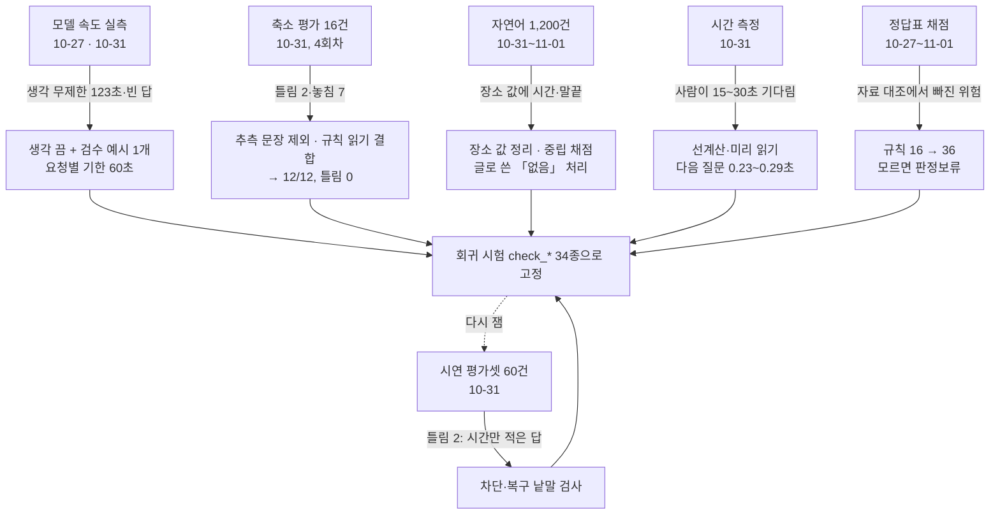

# 11b. 실험과 성능 향상 기록 — AI를 어떻게 재고 고쳤나

croScan 팀이 AI(라온-1 미니)와 규칙을 어떤 실험으로 재고, 그 결과를 보고 무엇을 고쳤는지 시간 순서로 모았습니다. 절마다 「처음 숫자 → 고친 뒤 숫자」와 원자료 위치를 붙였습니다.

**이 문서에서 알 수 있는 것**

- 실험마다 무엇을, 몇 건으로, 어떤 조건에서 쟀는지
- 숫자가 어떻게 바뀌었고, 무엇을 바꿔서 그렇게 됐는지
- 같은 조건에서 비교한 숫자와 조건이 다른 숫자의 구분
- 숫자를 다른 자료에 옮겨 쓸 때 꼭 함께 적어야 할 조건
- 원자료 파일이 어디 있는지(저장소 안 / 내부 기록)

시험 도구를 돌리는 법과 채점 칸의 뜻은 [11 시험과 평가](11_시험과_평가.md)에 있습니다. 이 문서는 그 결과가 시간에 따라 어떻게 바뀌었는지를 다룹니다. 라온이 어떤 일을 맡는지는 [05c 라온이 하는 일](05c_라온이_하는_일.md)에 있습니다.

## 목차

1. [읽기 전에: 말과 숫자의 약속](#1-읽기-전에-말과-숫자의-약속)
2. [한눈에 보는 성능 변화](#2-한눈에-보는-성능-변화)
3. [실험에서 개선까지의 흐름](#3-실험에서-개선까지의-흐름)
4. [실험 1: 모델 속도와 설정 찾기](#4-실험-1-모델-속도와-설정-찾기)
5. [실험 2: 답 읽기 축소 평가 16건, 4회차](#5-실험-2-답-읽기-축소-평가-16건-4회차)
6. [실험 3: 1차 시연 평가셋 — 규칙만 대 통합](#6-실험-3-1차-시연-평가셋--규칙만-대-통합)
7. [실험 4: 자연어 1,200건](#7-실험-4-자연어-1200건)
8. [실험 5: 기다림 줄이기 — 선계산·미리 읽기](#8-실험-5-기다림-줄이기--선계산미리-읽기)
9. [실험 6: 근거 검색 Recall](#9-실험-6-근거-검색-recall)
10. [실험 7: 쌍작업 판정 정답표 채점](#10-실험-7-쌍작업-판정-정답표-채점)
11. [실험 8: 위험 체크리스트](#11-실험-8-위험-체크리스트)
12. [실험 9: PDF 판독과 원본 양식](#12-실험-9-pdf-판독과-원본-양식)
13. [실험 10: 규모 평가(모델 없이 대량 사례)](#13-실험-10-규모-평가모델-없이-대량-사례)
14. [교차검증 회차와 시험 규모](#14-교차검증-회차와-시험-규모)
15. [아직 하지 않은 실험](#15-아직-하지-않은-실험)
16. [숫자를 옮겨 쓸 때 주의할 점](#16-숫자를-옮겨-쓸-때-주의할-점)
17. [원자료 목록](#17-원자료-목록)

---

## 1. 읽기 전에: 말과 숫자의 약속

**채점 말.** 답 읽기 평가는 반장 답 한 건에서 croScan이 낸 제안을 정답과 맞춰 봅니다. 자세한 뜻은 [11 §6 채점](11_시험과_평가.md#6-평가-도구)에 있습니다.

| 말 | 뜻 |
|---|---|
| 맞음 | 기대한 항목을 맞는 보기·값으로 제안함 |
| 틀림 | 기대 밖의 제안이거나, 기대한 항목이라도 보기·값이 틀린 제안(반장이 거절해야 함) |
| 놓침 | 기대했는데 바르게 얻지 못함(틀린 제안을 낸 경우도 포함). croScan은 그 질문을 그대로 다시 묻습니다 |
| 금지 | 절대 제안하면 안 되는 항목을 제안함(예: 남의 작업을 우리 작업으로) |
| 실패 | 모델 호출이 끝나지 못함(시간 초과, 호출 오류, 형식(JSON) 오류) |

**TURN.** 반장이 자유롭게 쓴 답 하나를 라온이 읽는 한 번의 호출입니다. 라온은 다른 질문의 답까지 함께 읽어 「제안」으로 냅니다. 반장이 확인해야 답이 됩니다.

**규칙만 / 통합.** 「규칙만」은 정해 둔 낱말 규칙으로만 읽은 결과입니다. 「통합」은 규칙이 먼저 읽고, 남은 것을 라온이 읽고, 위험한 제안은 비평(CRITIQUE, 한 번 더 검사하는 호출)으로 거른 결과입니다.

**숫자의 약속.**
- 표본이 작으면 비율 대신 「건수/분모」로 씁니다. 설계서 §11.1의 약속입니다.
- 날짜는 그 숫자를 잰 날입니다. 지금 코드로 다시 잰 값은 「11-02 재실행」이라고 따로 적습니다.
- 「시연 자료 기준」은 팀이 만든 합성 하루(허가서 10장·작업계획서 40장)의 결과입니다. 현장 정확도가 아닙니다.
- 모델 시간은 운영 CPU 서버(8 vCPU, 32GB, GPU 없음)에서 잰 값입니다. PDF 판독 같은 다른 측정은 그 기록에 적힌 장비 조건을 따릅니다(예: §11의 약 6초는 2 vCPU·4GB 서버).

---

## 2. 한눈에 보는 성능 변화

「처음」과 「지금」이 같은 조건인지 마지막 칸에 적었습니다. 같은 조건이 아니면 두 숫자를 바로 비교하지 않습니다.

| 지표 | 처음 | 지금 | 무엇을 바꿨나 | 출처 · 조건 |
|---|---|---|---|---|
| 답 읽기 축소 평가 (허가서 8175, 16건, 기대 제안 12) | 맞음 5 · 틀림 2 · 놓침 7 | 맞음 12 · 틀림 0 · 놓침 0 | 추측 문장 제외, 병행 조건 검사, 규칙 읽기 결합, 회수 낱말 검사 | [§5](#5-실험-2-답-읽기-축소-평가-16건-4회차) · 같은 16건, 4회차 |
| 시연 평가셋 60건 (기대 제안 50) | 규칙만 맞음 16 · 놓침 34 | 통합 맞음 40 · 틀림 2 · 놓침 10 · 금지 0 | 규칙 → AI → 비평 | [§6](#6-실험-3-1차-시연-평가셋--규칙만-대-통합) · 같은 60건, 같은 날 |
| 자연어 1,200건 (기대 제안 1,000) | 규칙만 맞음 285 · 놓침 715 | 통합 맞음 794 · 틀림 53 · 놓침 206 · 금지 0 | 규칙 → AI → 비평 | [§7](#7-실험-4-자연어-1200건) · 같은 1,200건, 같은 코드 |
| 답 1건 읽기 시간과 결과 | 생각 무제한: 123초, 빈 답 (짧은 답) | 생각 끔 + 검수 예시: 18~22초, 바르게 제안 (긴 답, 캐시 있음) | 생각 무제한 → 생각 끔, 검수 예시 1개 | [§4](#4-실험-1-모델-속도와-설정-찾기) · 서로 다른 답 1건씩의 관측. 같은 조건 아님 |
| 답 읽기의 프롬프트 처리 | 284토큰 · 9초 | 38토큰 · 1.8~2.3초 | 질문을 보일 때 미리 읽기(캐시) | [§8](#8-실험-5-기다림-줄이기--선계산미리-읽기) |
| 답을 보낸 뒤 다음 질문까지 | AI 읽기(15~30초)가 끝나야 다음 질문 | 0.23~0.29초 | 선계산·비차단 구조, 미리 읽기 요청 정리 | [§8](#8-실험-5-기다림-줄이기--선계산미리-읽기) |
| 부하 측정의 캐시 단계 (`probe_load`) | 캐시 끔 40.8초 | 미리 읽기 27.6초 | 미리 읽기 | [§8](#8-실험-5-기다림-줄이기--선계산미리-읽기) · 서버 측정, 원자료 없음 |
| 쌍 판정 규칙 수 | 16개 | 36개 | 조사자료 412쪽·사례집 81건 대조 | [§10](#10-실험-7-쌍작업-판정-정답표-채점) |
| 시연일 정답 쌍 (같은 자료) | 10/10 (순위 8/10) | 10/10 (순위 8/10) | 규칙을 늘려도 정답을 잃지 않음 | [§10](#10-실험-7-쌍작업-판정-정답표-채점) · 11-02 재실행, 기준본 v1 대 지금 |
| 시연일 경보 쌍 (같은 자료) | 12쌍 (3순위 2) | 26쌍 (3순위 16) | 잔류·거리 미확인을 판정보류로 남김 | [§10](#10-실험-7-쌍작업-판정-정답표-채점) · 11-02 재실행 |
| 근접 5쌍 확정 경보 | 0 | 0 (3쌍은 판정보류) | 거리 모르면 빼지 않고 3순위로 | [§10](#10-실험-7-쌍작업-판정-정답표-채점) |
| 위험 체크리스트 항목 | 53 | 86 | 조사자료 대조 | [§11](#11-실험-8-위험-체크리스트) |
| 체크리스트 연구 ref 연결 | 0/78 | 73/81 | 412쪽 조사본 정의 표에서 찾기 | [§11](#11-실험-8-위험-체크리스트) |
| 근거 검색 Recall@6 (20문항, 하나라도) | 20/20 (10-31) | 20/20 (11-02 재실행) | — (유지) | [§9](#9-실험-6-근거-검색-recall) |
| 근거 검색 Recall@3 (20문항, 하나라도) | 19/20 (10-31) | 16/20 (11-02 재실행) | 낮아짐. 검색 자료에 KOSHA 구절이 늘어난 뒤 다시 매기지 않음 | [§9](#9-실험-6-근거-검색-recall) |
| 판독 정답표 (`check_extract`) | 1,993/1,993 (10-27) | 1,993/1,993 (11-02 재실행) | — (유지) | [§12](#12-실험-9-pdf-판독과-원본-양식) |
| 반장 질문 시험 확인 수 (`check_questions`) | 27 (10-25) | 179 (11-01) | 검토에서 나온 반례를 시험으로 남김 | [§14](#14-교차검증-회차와-시험-규모) · 성능이 아니라 시험 규모 |

---

## 3. 실험에서 개선까지의 흐름

실험이 문제를 보이면 고치고, 고친 것을 시험으로 남기고, 다시 쟀습니다.

**원칙 하나.** 고칠 때는 「AI가 놓치면 그 질문을 다시 묻는다」는 구조를 지켰습니다. 처음 설계 기록은 「놓침이 늘어도 안전 범위는 줄지 않고 편의만 줄어든다」고 적었습니다(설계서 부록 「남은 기능 완수 회차」). 그러나 설계서 §22가 이 말을 고쳤습니다. 보장하는 것은 **서류 기준 경보의 하한**뿐이고, 모델의 놓침·오류가 주는 영향을 편의 손실로만 한정할 수는 없습니다.

---

## 4. 실험 1: 모델 속도와 설정 찾기

**목적.** CPU 서버에서 라온-1 미니가 반장 답을 몇 초에 바르게 읽는지, 어떤 설정이 빠르고 정확한지 찾습니다.

**도구.** [`bench_models.py`](../bench_models.py)(저장소 루트)가 llama.cpp 서버에 croScan 크기의 한국어 과제를 보내고, 프롬프트·답 속도(초당 토큰)와 생각 길이를 찍습니다. 모델 서버가 있어야 돌아갑니다. 이 문서를 쓸 때 다시 돌리지 않았습니다.

### 4.1 첫 측정 (2026-10-27, [`DOCKER.md`](../DOCKER.md))

| 항목 | 값 |
|---|---|
| 프롬프트 읽기 속도 | 초당 32토큰 |
| 답 쓰기 속도 | 초당 6.7토큰 |
| 짧은 과제 한 번 | 40~60초(생각하기 포함), 기록 하나는 약 44초 |
| 허가서 첫 검토 채팅 | 약 66초 |
| 생각 길이 상한 256 | 빨라지지 않음 |
| DFlash2 투기적 디코딩(작은 모델이 먼저 쓰고 큰 모델이 검사) | 초당 4.3토큰으로 오히려 느림 → 끔 |

이 속도 때문에 10-30의 「긴 답 하나로 여러 항목 읽기」는 모델 없이 규칙을 넓혀 만들었습니다(내부 기록 `croScan_현장인터뷰_반영_2026-10-30.md`). 라온이 이 일을 맡게 된 것은 4.2·4.3의 설정을 찾은 10-31부터입니다.

### 4.2 같은 답 1건으로 설정 비교 (2026-10-31, 설계서 부록 「최종 검수 기록」)

질문 「실제 작업 인원은 몇 명인가요?」에 반장 답 「안에는 셋이 들어가고 감시하는 사람은 밖에 하나예요. 옆 도장팀 네 명은 저희 인원이 아니고요.」를 읽혔습니다. 정답은 3개(우리 반 3명, 감시인 1명, 다른 팀 4명은 따로)입니다.

| 설정 | 시간 | 결과 |
|---|---:|---|
| 생각 무제한, 출력 상한 700토큰 | 123초 | 상한에 닿아 빈 답 |
| 생각 끔, 예시 0개 | 2.4초 | 형식은 맞지만 값 없음 |
| 생각 끔, 검수 예시 1개 | 8.7~16.4초 | 2개 맞음, 다른 팀 인원 빠짐 |
| 생각 상한 128, 예시 1개 | 30~34초 | 3개 모두 맞음, 원문 인용 포함 |

- 바꾼 것: 「예시 0개로 시작」이라는 외부 검토(Codex) 권고와 달리, 검수한 예시를 처음부터 넣었습니다. 예시 0개는 값을 하나도 뽑지 못했기 때문입니다.
- 같은 앞부분(접두부)을 다시 보내면 새 입력이 3~4토큰으로 줄었습니다. 미리 읽기(§8)의 출발점입니다.

### 4.3 긴 답에서 다시 비교 (2026-10-31, 설계서 부록 「1조각」)

같은 화기 허가서의 긴 답(제안 3~5개)으로 다시 쟀습니다.

| 설정 | 시간 | 결과 |
|---|---:|---|
| 생각 상한 128 + 예시 1개 | 88초 | 608토큰 상한에 닿아 잘림. 긴 출력에서는 요청별 생각 상한이 지켜지지 않음 |
| 생각 끔 + 예시 1개, 캐시 있음 | 18~22초 | 공법·가스, 병행여부(도장팀 3명) 바르게 제안 |
| 생각 끔 + 예시 1개, 캐시 없음 | 31초 | 작업 위치 바르게 제안 |

- **결정:** TURN 기본값은 「생각 끔 + 검수 예시」입니다. 코드에도 근거가 적혀 있습니다([`server/understand.py`](../server/understand.py) `read()`의 주석, [`server/llm.py`](../server/llm.py) 머리 주석 「123 s for nothing」).
- 온도 0으로 같은 답을 두 번 읽으면 같은 결과였습니다(약 9초, 두 번).

**한계.** 4.2·4.3은 답 1건씩의 관측입니다. 설계서도 「성능 보장으로 쓰지 않는다」고 적었습니다. 설계서 §10.6의 200개 자유 답 시간 게이트는 아직 재지 않았습니다.

---

## 5. 실험 2: 답 읽기 축소 평가 16건, 4회차

**날짜·조건.** 2026-10-31, 운영 CPU 서버의 라온-1 미니. 도구 [`tools/eval_turn.py`](../tools/eval_turn.py). 고소 허가서 8175에서 「작업 시간 답에 다른 내용이 섞인」 8가지 상황 × 표현 2개 = 16건, 기대 제안 12개.

**결과(같은 16건을 회차마다 다시 잼).** 회차 사이에 코드만 고친 것이 아닙니다. 평가 중에 정답 기대값 하나도 고쳤습니다(개수 없이 「그라인더로 해요」는 제안하지 않는 것이 맞다고 봄, 설계서 부록). 그래서 회차 차이를 모두 코드 개선 효과로 보지 않습니다.

| 회차 | 바꾼 것 | 맞음 | 틀림 | 놓침 | 금지 | 실패 | 시간 중앙값/최대 |
|---|---|---:|---:|---:|---:|---:|---:|
| 1 | AI만 | 5 | 2 | 7 | 0 | 0 | 15.1 / 33.6초 |
| 2 | + 추측 문장 제외, 「병행 있음」은 다른 작업이 말해져야 함, 예시 1개 | 6 | 2 | 6 | 0 | 0 | 14.9 / 33.2초 |
| 3 | + 규칙 읽기 결합(러그 절단 방법·개수, 러그 없음, 회수) | 12 | 1 | 0 | 0 | 0 | 14.8 / 25.1초 |
| 4 | + 회수 질문은 회수·하부 낱말이 있어야 함 | **12** | **0** | **0** | **0** | **0** | **14.7 / 24.5초** |

**틀림이었던 것과 막은 방법.**
- 「아마 가스절단일 것 같아요」 → 「병행 있음」: 추측 문장은 제안하지 않음.
- 「러그가 없어요」 → 「병행 없음」: 「없음」 보기는 그 질문의 부정이 문장에 있어야 함.
- 「가스절단으로 6개 떼요」 → 「러그 회수」: 10-31에는 회수 낱말이 없으면 이 제안을 뺐습니다. 11-01부터는 빼지 않고 「질문 내용이 문장에 직접 보이지 않음」 표시(`weak`)를 붙여 기본 선택을 풀어 두고, 반장이 정하게 바꿨습니다(코드: [`server/understand.py`](../server/understand.py) `ITEM_NEEDS`의 `HT2`, 설계서 §22 「고친 것 — 반장 질문」).

**놓침이 준 이유.** 대부분 AI가 보기의 뜻을 짚지 못한 것이었습니다. 규칙 읽기를 먼저 두어 회복했습니다. 「규칙 + AI 혼합」 설계를 숫자로 확인한 실험입니다.

**한계.** 허가서 한 장, 16건입니다. 회차마다 그 16건을 보고 고쳤으므로 4회차 결과는 「본 문제를 고쳤다」는 뜻입니다. 처음 보는 표현의 정확도가 아닙니다. 그래서 다음 실험(§6·§7)을 따로 했습니다.

원자료: 설계서 부록 「1차 게이트 평가 기록」.

---

## 6. 실험 3: 1차 시연 평가셋 — 규칙만 대 통합

**날짜·조건.** 2026-10-31, 운영 CPU 서버의 라온-1 미니. 도구 [`tools/eval_phase1.py`](../tools/eval_phase1.py), 사례 [`tools/eval_phase1_cases.py`](../tools/eval_phase1_cases.py). 허가서 9장(화기·밀폐·고소·인양·정전)에서 독립 시나리오 30개 × 표현 2개 = 60건, 기대 제안 50개.

**결과.**

| 평가 | 맞음 | 틀림 | 놓침 | 금지 | 실패 |
|---|---:|---:|---:|---:|---:|
| 규칙만 (기준선, `--mode 1`) | 16 | 0 | 34 | 0 | — |
| 통합, 1차 채점(보기만 봄) | 46 | 1 | 4 | 1 | — |
| 통합, 2차 채점(보기 + 값의 숫자·번호 + 주체 + 시점) | **40** | **2** | **10** | **0** | **0** |

- 2차 채점에서 맞음이 46에서 40으로 줄었습니다. 1차와 2차 사이에 채점 기준만 엄격해진 것이 아니라 검사 코드도 보강됐습니다(아래 추측 표현 검사). 그래서 이 차이를 채점 강화 효과만으로 읽지 않습니다.
- 1차 채점의 틀림 1건(「…대신 OH-21-02 쓸 수도 있어요」를 크레인 답으로)은 추측 표현 검사로 막았습니다.
- 2차 채점의 틀림 2건(차단·복구 질문에 시간 구절만 값으로 씀)은 「차단·복구 낱말이 있어야 함」 검사로 막았습니다(코드: `ITEM_NEEDS`의 `LO3`, 주석 「eval 2026-10-31」). 11-01부터 이 검사는 제안을 빼지 않고 `weak` 표시로 반장에게 맡깁니다(위와 같음).
- 놓침 10건 가운데 4건은 비평(CRITIQUE)이 부정 답을 보류해 다시 묻게 한 것입니다. 나머지는 AI가 보기의 뜻을 짚지 못한 것입니다(예: 「거더 상부에도 올라감」).
- TURN 1건 시간: 중앙값 12.5초, 최대 50초(서버가 다른 시험과 겹친 시간 포함).

**같은 날의 다른 평가.**

| 평가 | 규모 | 결과 |
|---|---|---|
| 멀티턴 대화 | 대화 11개(모름·거절·정정·재개·중복·12회 소진·명확화·재질문 금지·문서 변경·종료 뒤·늦은 읽기) | 11/11, 확인 항목 33/33 |
| 근거 검색 | 20문항 | §9 |

**한계.** 시나리오는 팀이 만들었습니다. 틀림 2건은 이 평가를 보고 막았으므로, 막은 뒤 같은 60건을 다시 잰 기록은 없습니다.

원자료: 설계서 부록 「남은 기능 완수 회차」의 평가 표.

---

## 7. 실험 4: 자연어 1,200건

**목적.** §6의 60건은 작습니다. 같은 뜻을 여러 말투로 바꿔 크게 다시 잽니다(설계서 §11.1 「150 시나리오 × 8 표현」).

**조건.** 2026-10-31 코드, 운영 CPU 서버의 라온-1 미니, 통합(`--mode 5`). 사례는 [`tools/eval_nl_variants.py`](../tools/eval_nl_variants.py)가 만든 [`tools/eval_nl_cases.json`](../tools/eval_nl_cases.json)입니다. 시나리오 30 × 값 바꾸기 5 × 말투 8 = 1,200건, 기대 제안 1,000개, 「아무것도 제안하면 안 되는 글」 240건이 들어 있습니다. 짜임은 [11 §6](11_시험과_평가.md#6-평가-도구)에 그림이 있습니다.

**결과.**

| | 맞음 | 틀림 | 놓침 | 금지 | 실패 |
|---|---:|---:|---:|---:|---:|
| 규칙만 | 285 | 0 | 715 | 0 | — |
| 통합(규칙 → AI → 비평) | **794** | **53** | **206** | **0** | **6** |

- 분모는 기대 제안 1,000입니다(규칙만 285 + 715, 통합 794 + 206). 틀림은 기대 밖 제안이라 따로 셉니다.
- 금지 0: 하지 않은 말, 남의 작업을 우리 사실로 제안한 경우가 없었습니다.
- 틀림 53: 원자료에서 값·주체·시점이 틀린 경우는 0입니다. 53건이 모두 「없음」을 글로 적은 표기 차이라는 분류는 사람이 검토한 결과입니다(원자료에는 건별 분류가 없습니다).
- 실패 6: 60초를 넘긴 것입니다.
- **시간(이 문서를 쓰며 원자료에서 계산):** 1,200건의 한 건 시간은 중앙값 22.6초, 95백분위수(p95) 50.0초, 최대 68.8초입니다. 원자료(내부 기록 `nl_final.jsonl`) 각 줄의 `time` 값으로 이 문서를 쓰며 계산했습니다. 원자료는 저장소에 없어 다른 사람이 다시 계산해 보지는 않았습니다. 서버가 다른 일과 겹친 시간도 들어 있습니다.

**평가 중에 고친 것(중간 검수, 176/1,200건 시점).**
- 규칙이 작업장소 값에 시간과 말끝을 넣던 것(「오후 1시부터 3시까지 3BAY…」, 「…상부요」)을 고쳤습니다(코드: [`server/augment.py`](../server/augment.py) 주석 「NL eval 2026-10-31」).
- 「틀림」 18건은 블록 위치 질문에 「상부」를 바르게 읽은 것이었습니다. 기대표에 없어서 틀림으로 셌습니다. 그래서 채점에 「맞지만 기대하지 않은 판독」을 중립으로 두는 칸을 넣었습니다.
- 정정 문장(「아까 러그 4개라고 했는데 잘못 말했고」)을 병행작업 「있음」으로 읽던 것을 막았습니다(코드: `understand.py` 주석 「NL eval 2026-10-31」, `ITEM_NEEDS`의 `B3`).
- 글로 쓴 「없음」을 뒤쪽 계산이 다르게 다루던 것(모순 질문·문서와 다름 경고 누락)을 고쳤습니다.

**한계.**
- 이 결과는 **11-01 조사자료 보강 전 코드**로 잰 값입니다. 보강 뒤(질문·판독·체크리스트 변경)에는 1,200건을 다시 돌리지 않았습니다. 바뀐 부분은 회귀 시험으로만 확인했습니다.
- 말투는 생성기가 만든 변형입니다. 실제 반장의 말(사투리, 오타, 숫자를 한글로 쓰기)은 아닙니다.
- 원자료는 운영 서버의 평가 폴더(`nl_final.jsonl`)에 있고, 팀 PC에 사본이 하나 있습니다(내부 기록). 저장소에는 없습니다.

---

## 8. 실험 5: 기다림 줄이기 — 선계산·미리 읽기

**목적.** 모델 자체를 빠르게 만들 수는 없었습니다(GPU 없음). 그래서 「사람이 모델을 기다리는 순간」을 없애는 쪽을 실험했습니다(설계서 §10.7).

### 8.1 시간이 어디서 드나 (2026-10-31)

운영 CPU 서버에서 TURN 한 번(15.7초)을 나눠 봤습니다.

| 부분 | 시간 | 양 |
|---|---:|---|
| 질문 목록 프롬프트 읽기 | 9.7초 | 280토큰, 초당 약 29토큰 |
| 답 쓰기 | 5.8초 | 39토큰, 초당 약 6.7토큰 |

질문 목록은 반장이 답하기 **전에** 정해져 있습니다. 그래서 질문을 보이는 순간 미리 읽게 했습니다.

### 8.2 바꾼 것과 전후

| 지점 | 전 | 후 | 바꾼 것 |
|---|---|---|---|
| 답 → 다음 질문 | AI 읽기(15~30초)가 끝나야 다음 질문 | 실화면 0.5초 → 0.2~0.3초 → 0.23~0.29초 | 읽기를 뒤에서 돌리고 카드는 끝나는 대로 붙임 |
| 답 읽기 프롬프트 | 284토큰 · 9초 | 38토큰 · 1.8~2.3초 | 질문 표시 때 미리 읽기(prefill) |
| 프롬프트 모양 | 목록과 답이 한 메시지 | 목록 따로, 답은 마지막 메시지 | llama.cpp가 마지막 메시지 앞까지만 캐시를 이어 씀(실측, `understand.py` 주석) |
| 연달아 답할 때 | 미리 읽기 요청이 다음 질문을 20초 막음 | 0.23~0.29초 | 원인: 브라우저는 서버 하나에 연결 6개까지만 엶. 종류마다 하나만 열고 앞 질문 것은 끊음 |

### 8.3 부하 측정 (2026-10-31, 도구 [`tools/probe_load.py`](../tools/probe_load.py))

| 측정 | 결과 |
|---|---|
| 대화 30회(시연 허가서 9장을 돌려 씀, 준비된 답이 있는 질문만) | 모두 6분 안. 대화당 p50 111초, p95 240초(질문당 읽고 입력하는 시간 20초 가정) |
| 캐시 | 끄면 40.8초, 미리 읽기를 하면 27.6초 |
| 허가서를 바꿔 가며 쓸 때 | 11.7~15.5초 |
| 동시 사용자 4명 | 1인 중앙값 32.2초, 실패 0 |
| AI 쌍 검토 3쌍(11-01) | 각 28~31초, 모두 완료. 앞선 부하 측정 때의 시간 초과 2건이 사라짐([진행정리](reference/진행정리.md)) |

p50은 가운데 값, p95는 95%가 그 값 이하인 값입니다. 설계서 §10.1의 목표는 대화 p95 ≤ 6분(360초)입니다. 240초는 그 안입니다. 다만 이 측정은 [`tools/probe_load.py`](../tools/probe_load.py)가 시연 허가서 9장을 되풀이하며 준비된 답이 있는 질문만 처리한 제한된 대화입니다. 설계서 §10.6의 「대표 허가서 30개 전체 대화」 게이트와 같은 시험이 아닙니다.

### 8.4 그 밖의 시간 기록

| 기능 | 시간 | 출처 |
|---|---|---|
| 업로드 분석(허가서만) | 5건 5~16초 | 부록 「4조각」 |
| 업로드 분석(허가서 + 작업계획서 1건) | 38초 | 부록 「4조각」 |
| 요청형 「왜?」 자유 질문 | 9~14초(정해진 질문은 즉시) | 부록 「5조각」 |
| 반장 흐름의 제출 | 10.6초 | 부록 「실사용·현장 대조」 |
| AI 카드가 붙기까지 | 약 20초(반장은 그동안 다음 질문에 답함) | 부록 「실사용·현장 대조」 |

**한계.**
- 8.3의 수치는 보고 당시 서버에서 잰 값입니다. 원자료 파일이 저장소와 팀 PC에 없습니다(설계서 §22 표의 마지막 줄).
- 「발화 → 검증된 카드」 시간(설계서 §10.1의 TURN 목표 p50 ≤ 30초, p95 ≤ 60초)은 이 구조로 줄지 않습니다. 따로 보고해야 합니다. §7의 1,200건 시간(중앙값 22.6초, p95 50.0초)이 이 시간에 가장 가까운 기록입니다. 조건이 달라 같은 측정으로 볼 수는 없습니다.
- 「전체 대화」 시간은 사람의 읽기·입력 20초를 가정한 값입니다. 실제 반장의 시간은 사용자 시험(§15)에서 재야 합니다.

---

## 9. 실험 6: 근거 검색 Recall

**무엇.** 「왜 묻나요?」와 업로드 분석에 붙는 참고 구절을 BM25(낱말 겹침으로 순위를 매기는 검색)로 찾습니다. 20문항마다 정답 조문을 정해 두고, 상위 k개 안에 정답이 있는지 셉니다. 도구 [`tools/eval_retrieval.py`](../tools/eval_retrieval.py)는 모델 없이 돕니다.

- Recall@3: 모델에 실제로 넘기는 몫
- Recall@6: 설계서 §11.2의 기준(≥95%)
- Recall@12: 사람이 보는 후보
- 「하나라도」는 정답 하나라도 찾은 문항, 「전부」는 정답을 모두 찾은 문항입니다(정답이 둘인 문항은 1개).

**결과.**

| 날짜 | 검색 자료 | 하나라도 @3 · @6 · @12 | 전부 @3 · @6 · @12 |
|---|---|---|---|
| 2026-10-31 (부록 기록) | 법령 조문·팀 조사·조선사 보고서 구절 | 19/20 · 20/20 · — | 18/20 · 19/20 · 20/20 |
| 2026-11-02 재실행(지금 코드) | 위 + KOSHA 기술지침 구절 211개(전체 634구절) | 16/20 · 20/20 · 20/20 | 15/20 · 19/20 · 20/20 |

- @6과 @12는 그대로입니다.
- @3은 3문항 줄었습니다. 11-02 출력에서 3위 안에 정답이 없는 문항은 탱크 안 용접 환기(5위), 협력업체 조정(4위), 가연물(6위), 밀폐 감시인(5위) 등입니다. 예전 기록에는 문항별 순위가 없어서, 어느 문항이 떨어졌는지와 그 까닭이 KOSHA 구절 추가 때문인지는 단정할 수 없습니다.
- 정답표는 법령 조문과 팀 조사 쪽만 정답으로 칩니다. 뜻이 맞는 KOSHA 구절이 위에 와도 정답으로 세지 않습니다. 그래서 이 하락은 「검색이 나빠졌다」와 「정답표가 자료 변화를 따라가지 못했다」가 섞인 값입니다. 어느 쪽인지는 기록이 없습니다.

**한계.** 20문항은 정답을 아는 개발자가 썼습니다. 설계서도 이 점을 한계로 적었습니다.

---

## 10. 실험 7: 쌍작업 판정 정답표 채점

**무엇.** 시연 하루(허가서 10장, 작업계획서 40장)의 정답표 [`samples/시연_하루/skeleton.json`](../samples/시연_하루/skeleton.json)으로 쌍 판정을 채점합니다. 정답표는 채점에만 쓰고, 규칙은 읽지 않습니다. 도구 [`tools/check_pairs.py`](../tools/check_pairs.py). 판정 방식은 [06 쌍작업 판정](06_쌍작업_판정.md)에 있습니다.

쌍 판정에는 모델이 들어가지 않습니다. 정해진 규칙(`server/pair_rules.json`)으로만 판정합니다. 그래서 이 절의 숫자는 「AI 성능」이 아니라 「규칙 성능」입니다.

### 10.1 시간 순서

| 날짜 | 규칙 | 경보 쌍 (1·2·3순위) | 정답 쌍 | 근접 5쌍 | 정답표 밖 | 출처 |
|---|---:|---|---|---|---:|---|
| 10-27 설계 | 16 | 13 (8·3·2) | 범위 안 11/11, 순위 9/11 | 경보 0 | 1 | [쌍작업탐지_설계 §7](reference/쌍작업탐지_설계.md) |
| 10-30 | 16 | 11 (8·2·1) | 10/10 | 오경보 0/5 | — | 내부 기록 `croScan_현장인터뷰_반영_2026-10-30.md` |
| 11-01 조사자료 보강 | 35 | 24 | 10/10, 순위 8/10 | 확정 0, 판정보류 3 | — | 설계서 §21 |
| 11-01 최종 검토 | 36 | 26 | 10/10, 순위 8/10 | 확정 0, 판정보류 3 | 13 | 설계서 §22 |
| 11-02 재실행 | 36 | 26 (8·2·16) | 10/10, 순위 8/10 | 확정 0, 판정보류 3 | 13 | 이 문서 작성 때 실행 |

- 10-27의 「정답 11쌍」에는 방사선투과(RT) 쌍 C04가 있었습니다. 시연 작업 WP-1029-03이 초음파탐상(UT)으로 바뀌면서 정답표에서 빠져 10쌍이 됐습니다(설계서 §20.7).
- 근접 5쌍은 「경보하면 안 되는 짝」입니다. N05는 10-31 외부 검토(Codex A7)로 바뀌었습니다. 칼럼당 12m라는 추정 거리로 빼지 않고, 3순위 「거리 미확인」 판정보류로 남깁니다. 판정보류는 확인이 필요해 3순위로 남긴 경보입니다.

### 10.2 같은 자료로 「보강 전」과 「지금」 비교 (11-02 재실행)

저장소에는 조사자료 보강 전의 판정기를 얼려 둔 기준본 [`tools/fixtures/pairs_v1/`](../tools/fixtures/pairs_v1/)(규칙 16개)이 있습니다. 같은 시연 하루에 기준본과 지금 판정기를 각각 돌렸습니다. 같은 조건의 비교입니다.

| | 기준본 v1 (규칙 16) | 지금 (규칙 36) |
|---|---:|---:|
| 경보 쌍 | 12 | 26 |
| 1순위 · 2순위 · 3순위 | 8 · 2 · 2 | 8 · 2 · 16 |
| 정답 쌍 찾음 | 10/10 | 10/10 |
| 순위까지 맞음 | 8/10 | 8/10 |
| 근접 5쌍 중 판정보류 | 1 | 3 |
| 근접 5쌍 중 확정 경보(1·2순위) | 0 | 0 |
| 정답표 밖 경보 | 1 | 13 |

- 늘어난 경보 14쌍은 모두 3순위입니다. 잔류위험(앞 작업이 남긴 위험), 옆 BAY 불티, 거리·높이 미확인처럼 「서류만으로는 모르니 확인하라」는 경보입니다.
- 정답 쌍과 1·2순위는 그대로입니다. [`check_pairs_material.py`](../tools/check_pairs_material.py) 12절이 「기준본의 경보가 사라지거나 낮아지지 않음」을 자동으로 지킵니다([11 §5](11_시험과_평가.md#5-기준본v1과-의도한-예외)).
- **순위 8/10은 의도입니다.** C08(인양 경로 × 아래 작업자)과 C09(크레인 정비 × 같은 크레인 사용)는 정답표의 2순위보다 한 단계 높은 1순위로 나옵니다. 근거: 인양물 아래 출입 금지, 정비 중 설비 사용 금지 조합이라 원칙에 따라 1순위로 정했고 외부 검토도 동의했습니다([쌍작업탐지_설계 §7](reference/쌍작업탐지_설계.md)).

**옮겨 쓸 때.** 「경보가 12에서 26으로 늘었다」는 성능 향상이 아닙니다. 확인할 것이 늘었다는 뜻이고, 경고 피로라는 부담도 함께 늘 수 있습니다(설계서 §20.6 「함께 잴 부담」). 「정답 10쌍을 모두 찾고, 경보하면 안 되는 5쌍에 확정 경보 0」을 말하고, 늘어난 3순위는 「확인 질문」으로 설명합니다.

### 10.3 반례 시험과 판정보류 질문

| 항목 | 처음 | 지금 | 출처 |
|---|---|---|---|
| 외부 검토 반례 시험 `check_pairs_cases` | 14/14 (10-27) | 18/18 (10-29) → 확인 35 (11-01) | 쌍작업탐지_설계 §7, 내부 기록 10-29, [11 §4](11_시험과_평가.md#4-시험-34종) |
| 시연일 판정보류 질문 | — | 47개(19건) (11-01 §21) | 설계서 §21 |

---

## 11. 실험 8: 위험 체크리스트

**무엇.** 허가서와 반장 답으로 위험 체크리스트 초안을 만듭니다. 규칙이 정하고, AI는 카탈로그 안에서 추가 후보만 냅니다([07 위험 체크리스트](07_위험체크리스트.md)).

| 지표 | 처음 | 지금 | 바꾼 것 | 출처 |
|---|---|---|---|---|
| 항목 수 | 53 (10-27) | 83 (11-01 §21) → 86 (11-01 §22) | 412쪽 조사본·사례집 대조로 화기·밀폐·고소·인양·정전·공통 항목 추가 | 위험체크리스트_설계 §3, 설계서 §21·§22, `server/checklist_spec.json` |
| 연구 ref(조사본 코드) 연결 | 0/78 | 71/78 → 73/81 | 코드가 없는 119쪽 노션 추출본 대신 412쪽 조사본 정의 표에서 찾음 | [진행정리](reference/진행정리.md), [14 §5.1](14_자료대조와_검토이력.md#51-연구-ref-30개만-미연결은-틀린-보고였다) |
| 「미정」 섞은 입력에서 위험이 낮아진 경우 | — | 630건 중 0건 | 한 칸의 미정이 다른 칸의 확정 위험을 낮추지 않게 함 | 설계서 §21 |
| 항목별 유사 사고 사례 | 없음 | 40항목에 48건 | 2025 조선업 중대재해 사례집에서 같은 기전만 골라 붙임 | 설계서 §22 |
| 회귀 시험 확인 수 `check_checklist` | 1,323 (10-27) | 1,389 → 1,578 → 2,600 → 2,794 (11-01) | 항목·규칙이 늘 때마다 늘어남 | 위험체크리스트_설계 §7·§9, 설계서 §21·§22 |

- 「연구 ref 0/78」은 이전에 「30개만 미연결」로 잘못 보고됐습니다. 코드를 다시 보니 78개 모두 미연결이었습니다. 이 정정은 [14 §5.1](14_자료대조와_검토이력.md#51-연구-ref-30개만-미연결은-틀린-보고였다)에 있습니다.
- 연결되지 않은 8개는 조사본 코드가 아닌 표시(사례집 번호·보고서·멘토 메모)라 인용하지 않습니다.

**한계.** 항목 수와 시험 수는 「덮는 범위」입니다. 반장이 실제로 쓸 때 맞는 항목을 고르는지(정확도)는 재지 않았습니다.

---

## 12. 실험 9: PDF 판독과 원본 양식

**무엇.** 허가서·작업계획서 PDF의 칸 값을 읽습니다. 모델을 쓰지 않습니다. 한컴 OpenDataLoader(PDF 표를 읽는 Java 프로그램)와 PyMuPDF가 읽습니다([04c PDF 판독](04c_PDF_판독.md)).

| 지표 | 결과 | 날짜 · 출처 |
|---|---|---|
| 정답표 대조 `check_extract` (18파일·27쪽 × 칸) | 1,993/1,993 | 10-27부터 같은 값(11-01 설계서 §21, 11-02 재실행) |
| 서버와 개발 PC의 판독 결과 | 시연 PDF 5종에서 값·지적 차이 0, 한 건 약 6초 | 2026-10-25, [`DOCKER.md`](../DOCKER.md) 검증 기록 |
| 서버에서 다시 읽은 작업계획서 | 40건 차이 0 | 10-30, 내부 기록 `croScan_현장인터뷰_반영_2026-10-30.md` |
| 제출본의 양식 칸 밖 픽셀 변화(위쪽 24pt와 각 칸 둘레 2pt는 검사에서 뺌) | 0 (`check_form_intact` 4/4) | 2026-10-31·11-01, 설계서 부록·§21 |
| 업로드 원본 바이트 | 그대로 (`check_reflect`의 sha256) | 2026-10-31, 설계서 부록 |

**무작위 서류 시험.** [`tools/stress_extract.py`](../tools/stress_extract.py)(무작위 허가서 40건)와 [`tools/stress_workplan.py`](../tools/stress_workplan.py)(무작위 작업계획서 30건)는 모델 없이 돕니다. 기록된 결과는 원자료에서 찾지 못했습니다. 11-02에 다시 돌린 결과는 아래와 같습니다.

| 시험 (기본값, seed 1) | 규모 | 결과 |
|---|---|---|
| `stress_extract.py` | 무작위 허가서 40건(5종, 파일 11개) | 값 2,920/2,920 맞음, 152초 |
| `stress_workplan.py` | 무작위 작업계획서 30건(값 1,170개)으로 읽기·수정본 시험, 같은 파일 두 번(10건), 빈 양식(2건), 허가서를 잘못 넣음 등 7개 시나리오 | 7/7 통과. 잘못 넣은 허가서는 「파일 오류가 나야」 통과하는 시험입니다 |
| `check_extract.py` | 정답표 18파일 | 1,993/1,993 (이전 기록과 같음) |

7가지 방식은 한 파일에 한 건, 10건 묶음, 쪽마다 따로 섞어서, 수정본 다시 읽기, 같은 파일 두 번, 빈 양식, 허가서를 잘못 넣음입니다. 무작위 서류도 팀의 양식 그리기 도구로 만든 것이라, 다른 회사 양식이나 손으로 고친 서류의 결과는 아닙니다.

**한계.** 글자 층이 없는 스캔본·사진은 읽지 않습니다. 정답표 18파일은 팀이 만든 시연·시험 자료입니다.

---

## 13. 실험 10: 규모 평가(모델 없이 대량 사례)

**무엇.** [`tools/eval_scale.py`](../tools/eval_scale.py)는 모델 대신 「일부러 틀리게 만든 모델 출력」을 대량으로 만들어, 서버 검사가 막는지 셉니다. 설계서 §11.1의 통합 규모(안전 실패 3,000, 상태 전이 10,000 등) 가운데 모델 없이 잴 수 있는 것입니다.

- 안전 실패 3,000: 남의 작업을 우리 작업으로, 끝난 일을 계획으로, 보호 칸, 답 속 지시문 → 하나도 제안이 되면 안 됩니다.
- 상태 전이 10,000: 답·확인·거절·새로고침·다른 탭을 무작위로 섞어도 「확인 전에는 답이 아님」 「질문 12회 한도」 등이 지켜지는지 봅니다.
- 쌍 하이브리드 200, 체크리스트 200, 문서 연결 200, 설명(XAI) 200 × 3.

**결과: 기록된 숫자가 없습니다.**
- 설계서·진행정리·내부 기록 어디에도 이 도구의 실행 결과가 적혀 있지 않습니다. 설계서 부록은 「통합 목표 규모(안전 실패 3,000 등)는 여전히 축소판」이라고만 적었습니다.
- 이 문서를 쓰며 11-02에 `eval_scale.py all`을 돌렸습니다. 40분이 넘어도 끝나지 않아 멈췄고, 남은 중간 출력도 없습니다. 이 도구는 묶음마다 통과·실패 수를 찍고 마지막에 종합 요약을 찍습니다.
- 결과를 얻으려면 묶음을 하나씩 돌립니다. 예: `python tools/eval_scale.py safety`, `python tools/eval_scale.py state --n 1000`. 결과는 `$CROSCAN_DATA/eval_scale.json`에 남습니다.

**한계.** 이 사례는 생성기가 만든 것입니다. 실제 모델이 내는 오류의 모양과 다를 수 있습니다. 「서버 검사가 정해 둔 실패 유형을 막는다」는 뜻이지, 모델의 정확도가 아닙니다.

---

## 14. 교차검증 회차와 시험 규모

**외부 검토 회차별 지적 수.** 팀은 코드를 고친 뒤 외부 모델(Codex)로 교차검증을 했습니다. 마지막 회차를 미리 정하고, 나온 지적은 모두 고쳤습니다. 자세한 이력은 [14 §4 검토 이력](14_자료대조와_검토이력.md#4-검토-이력)에 있습니다.

| 대상 (날짜) | 회차별 지적 수 | 출처 |
|---|---|---|
| 멀티턴 v2 (10-27) | 9차 11 → 10차 6 → 11차 4 → 12차 2 | [멀티턴_v2_설계 §14](reference/멀티턴_v2_설계.md) |
| 위험 체크리스트 (10-27) | 1차 9 → 2차 4 | [위험체크리스트_설계 §8·§9](reference/위험체크리스트_설계.md) |
| 실사용·현장 대조 (10-31) | 1회차 12 → 2회차 잔여 2 | 설계서 부록 |
| 최종 전수 검토 (11-01) | 쌍 판정 고침 17, 질문·체크리스트 고침 11 | 설계서 §22 |

지적 수가 줄어든 것은 「검토가 찾은 문제가 줄었다」는 뜻입니다. 남은 문제가 없다는 뜻은 아닙니다. 멀티턴 10~12차의 지적은 대부분 앞 회차 수정의 부작용이었습니다(멀티턴_v2_설계 §14).

**문서 주장 검증.** 11-01 최종 전수 검토에서 문서 주장 약 160건 가운데 26건이 코드와 맞지 않았고, 모두 고쳤습니다(설계서 §22).

**반장 질문 시험의 규모.** 검토와 실화면 시험에서 나온 반례를 시험으로 남겨 왔습니다.

| 날짜 | `check_questions` 확인 수 | 출처 |
|---|---:|---|
| 10-25 | 27 | 내부 기록 `croScan_멀티턴_추가검토_설계.md` |
| 10-25 이후 | 40 | 같은 기록 |
| 10-27 | 79 → 100 → 141 → 169 | [멀티턴_v2_설계](reference/멀티턴_v2_설계.md) |
| 11-01 | 179 | 설계서 §21 |

이 숫자는 정확도가 아니라 「지키는 약속의 수」입니다. 전체 시험은 지금 34종입니다([11 §4](11_시험과_평가.md#4-시험-34종)).

---

## 15. 아직 하지 않은 실험

원자료에 계획·도구는 있지만 결과 숫자가 없는 것입니다. 결과처럼 말하지 않습니다.

| 실험 | 계획 · 도구 | 상태 |
|---|---|---|
| 사용자 시험(반장 5명, 안전관리자 2명) | 내부 기록 `croScan_사용자시험_준비물_2026-10-31.md`, [`tools/usertest_report.py`](../tools/usertest_report.py), 화면 `?usertest=1` | 준비물만 있음. 실행하지 않음 |
| 비교군 2~4와 하나씩 끄기(예시 끔, 비평 끔, 캐시 끔, 생각 길이, 두 번째 읽기) | `eval_phase1.py --mode 2~4`, `--no-fewshot`, `--no-critique`, `--no-cache`, `--think`, `--second` | 결과 기록 없음 |
| 출력 줄이기(답을 절로 나누고 모델은 절 번호만) | `eval_phase1.py --clause-ids`, 설계서 §10.7 | 「정확도 회귀 시험 뒤의 후보」로 남음 |
| 자유 답 200개 시간 게이트, 대표 허가서 30개 전체 대화 | 설계서 §10.6 | 둘 다 미측정. §8.3은 시연 허가서 9장을 되풀이한 제한된 대화 30회입니다 |
| 자연어 1,200건 재실행(11-01 보강 뒤) | `eval_phase1.py --cases` | 다시 돌리지 않음 |
| 멀티턴 100대화, XAI 사람 평가 등 통합 규모 | 설계서 §11.1·§11.2 | 축소판(대화 11개)만 |
| 모델 없는 규모 평가(안전 실패 3,000, 상태 전이 10,000 등) | `eval_scale.py` | 결과 기록 없음(§13) |
| 시간 절감률, 사고 감소율, 반복 입력 30% 감소 | 설계서 §11.3·§20.6 (K01~K18 후보) | 잰 적 없음 |

사용자 시험의 통과 기준은 정해져 있습니다. 예: 확인 카드 읽기 성공 90% 이상, 「해석 확인 = 작업 승인」 오해 0건, 질문 수 중앙값 8회 이하·최대 12회. 결과가 나오면 사람 수·성공 수·오해 문장을 그대로 적고, 비율만 떼어 발표하지 않기로 했습니다(사용자 시험 준비물 §5).

---

## 16. 숫자를 옮겨 쓸 때 주의할 점

**표본 크기를 함께 말합니다.**
- 「16건에서 12/12」 「60건에서 맞음 16 → 40」처럼 분모를 붙입니다. 작은 표본을 퍼센트로 바꾸지 않습니다.
- 설정 비교(§4)는 답 1건의 관측입니다. 「설정을 고른 근거」로만 씁니다.

**합성 자료인지 말합니다.**
- 시연 하루, 평가 시나리오, 1,200건의 말투, 검색 20문항은 모두 팀이 만들었습니다. 「시연 자료 기준」이라고 말합니다.
- 실제 반장·안전관리자가 쓴 결과는 아직 없습니다.

**같은 조건 비교인지 확인합니다.**

| 비교 | 같은 조건인가 |
|---|---|
| 규칙만 대 통합(60건, 1,200건) | 예. 같은 사례, 같은 날, 같은 코드 |
| 축소 평가 1회차 대 4회차 | 같은 16건이지만, 그 16건을 보고 고쳤음(과적합 가능) |
| 쌍 판정 기준본 v1 대 지금 | 예. 같은 시연 하루, 11-02 재실행 |
| 쌍 판정 10-27 대 11-01 | 아니오. 정답표(11쌍 → 10쌍)와 시연 자료가 바뀜 |
| 검색 10-31 대 11-02 | 아니오. 검색 자료(KOSHA 추가)가 바뀜 |
| 1,200건 대 지금 코드 | 아니오. 1,200건은 11-01 보강 전 코드 |
| 캐시 끔 40.8초 대 미리 읽기 27.6초 | 같은 측정 도구의 단계 비교(서버 기록, 원자료 없음) |

**하지 말아야 할 말.**
- 「AI가 판단한다」, 「정확도 몇 %」, 「시간을 몇 % 줄였다」, 「사고를 줄였다」. 잰 적이 없거나 croScan이 하는 일이 아닙니다([AX 설명 §5](reference/AX_아키텍처_설명.md)).
- 「경보가 늘었으니 더 안전해졌다」. 경보 수는 확인할 일의 수입니다(§10.2).
- 「틀림 53건은 모두 표기 차이」를 원자료의 분류처럼 말하는 것. 사람이 검토해서 나눈 것입니다.

**붙이면 좋은 말(사실이고 출처가 있음).**
- 「같은 1,000개의 기대 정보 중 규칙만으로 285개, 규칙 + AI로 794개를 바르게 읽었고, 남의 작업을 우리 작업으로 읽은 경우는 0건이었습니다(자연어 1,200건, 10-31 코드, 시연 자료 기준).」
- 「10-31 화면 시험에서 답을 보낸 뒤 다음 질문까지 0.23~0.29초가 걸렸습니다. AI 읽기는 뒤에서 돌고, 반장이 확인해야 답이 됩니다.」
- 「규칙을 16개에서 36개로 늘려도 시연일 정답 10쌍을 모두 찾고, 경보하면 안 되는 5쌍에 확정 경보 0건을 유지했습니다(시연 자료 기준).」

---

## 17. 원자료 목록

**저장소 안**

| 파일 | 담긴 것 |
|---|---|
| [`docs/reference/AI도입계획_설계서.md`](reference/AI도입계획_설계서.md) | §9 장치별 채택 기준, §10 시간 목표·실측, §11 평가 계획·기준, §20.6 효과 후보, §21·§22 보강과 검증, 부록 「최종 검수 기록」 「구현 진행 기록」(1~8조각, 1차 게이트 평가, 남은 기능 완수, 실사용·현장 대조, 현장 정정 반영) |
| [`docs/reference/진행정리.md`](reference/진행정리.md) | 자연어 1,200건 결과, AI 쌍 검토 시간, 11-01 정정 |
| [`docs/reference/AX_아키텍처_설명.md`](reference/AX_아키텍처_설명.md) | §5 발표에 쓸 수 있는 수치와 쓰면 안 되는 수치 |
| [`docs/reference/멀티턴_v2_설계.md`](reference/멀티턴_v2_설계.md) | 질문 시험 확인 수 변화, 검토 9~12차 |
| [`docs/reference/쌍작업탐지_설계.md`](reference/쌍작업탐지_설계.md) | 10-27 쌍 판정 결과(445쌍 → 13쌍), C08·C09 순위 근거 |
| [`docs/reference/위험체크리스트_설계.md`](reference/위험체크리스트_설계.md) | 53항목, 체크리스트 시험 수 변화 |
| [`DOCKER.md`](../DOCKER.md) | 10-25 판독 검증, 10-27 모델 속도 |
| [`bench_models.py`](../bench_models.py) | 모델 속도 측정 도구 |
| [`tools/eval_turn.py`](../tools/eval_turn.py), [`tools/eval_phase1.py`](../tools/eval_phase1.py), [`tools/eval_phase1_cases.py`](../tools/eval_phase1_cases.py) | 답 읽기 평가 도구와 사례 |
| [`tools/eval_nl_variants.py`](../tools/eval_nl_variants.py), [`tools/eval_nl_cases.json`](../tools/eval_nl_cases.json) | 자연어 1,200건 사례 |
| [`tools/eval_retrieval.py`](../tools/eval_retrieval.py) | 검색 20문항(11-02 재실행) |
| [`tools/eval_scale.py`](../tools/eval_scale.py) | 규모 평가 도구(결과 기록 없음, 11-02 실행은 40분 넘어 멈춤) |
| [`tools/probe_load.py`](../tools/probe_load.py), [`tools/probe_timing.py`](../tools/probe_timing.py), [`tools/probe_analyze.py`](../tools/probe_analyze.py) | 시간·부하 측정 도구 |
| [`tools/check_pairs.py`](../tools/check_pairs.py), [`tools/fixtures/pairs_v1/`](../tools/fixtures/pairs_v1/) | 쌍 판정 채점, 기준본(11-02 재실행) |
| [`tools/stress_extract.py`](../tools/stress_extract.py), [`tools/stress_workplan.py`](../tools/stress_workplan.py), [`tools/check_extract.py`](../tools/check_extract.py) | 판독 시험(11-02 재실행) |
| [`server/understand.py`](../server/understand.py), [`server/llm.py`](../server/llm.py), [`server/augment.py`](../server/augment.py) | 실측·평가로 정한 값의 코드 주석(「measured 2026-10-31」, 「NL eval 2026-10-31」) |

**내부 기록(공개 저장소에 아직 없음, 파일 이름만)**

| 파일 | 담긴 것 |
|---|---|
| `nl_final.jsonl` (운영 서버 평가 폴더, 팀 PC 사본) | 자연어 1,200건 건별 결과·시간 |
| `croScan_사용자시험_준비물_2026-10-31.md` | 사용자 시험 과제와 통과 기준(미실행) |
| `croScan_멀티턴_추가검토_설계.md` | 10-25 질문 시험 27·40 |
| `croScan_현장인터뷰_반영_2026-10-29.md` | 10-29 쌍 탐지 11/11, 반례 18/18 |
| `croScan_현장인터뷰_반영_2026-10-30.md` | 10-30 쌍 탐지 11쌍, 계획서 40건 차이 0, 모델을 쓰지 않은 이유 |
| `croScan_현장정정_반영검토_2026-10-31.md` | 숫자의 경계(멘토 참고값·HiSEs 실적을 croScan 성과로 쓰지 않음) |

**11-02 재실행 조건.** 이 문서를 쓰며 모델 없이 돌린 것은 `eval_retrieval.py`, `check_pairs.py`, 기준본 v1 대 지금 비교(`check_pairs_material.py` 12절과 같은 방식으로 두 판정기를 불러 같은 하루에 실행), `check_extract.py`, `stress_extract.py`, `stress_workplan.py`입니다. `eval_scale.py all`은 40분이 넘어 멈췄습니다(§13). 저장소 파일은 바꾸지 않았습니다. 데이터 폴더는 임시 폴더를 썼습니다.
