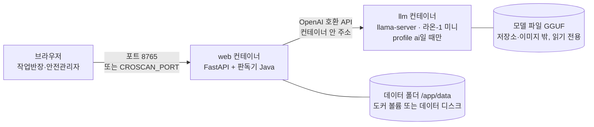
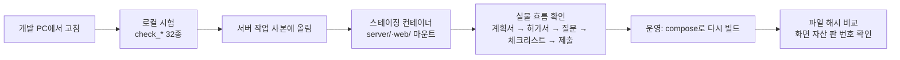
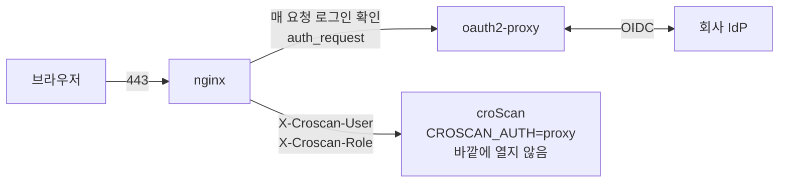

# 12. 배포와 운영 — croScan을 띄우고, 지키고, 데이터를 남기는 법

croScan은 도커 컨테이너 둘로 돕니다. 하나는 웹이고, 다른 하나는 골라서 켜는 사내 언어 모델입니다. 기본 구성은 같은 서버의 llama.cpp 모델을 씁니다. 요청 주소는 `LLM_URL`로 바꿀 수 있습니다. 코드가 외부 주소를 막지는 않습니다.
이 문서는 이미지와 compose 구성, 스테이징과 운영을 나눠 쓰는 방식, 사내 로그인(SSO) 붙이기, 데이터 보관, 환경 변수, 로컬 실행, 샘플 폴더를 다룹니다.

**이 문서에서 알 수 있는 것**

- `Dockerfile`·`docker-compose.yml`·`llm/Dockerfile`이 각각 무엇을 만드는지
- 팀이 스테이징과 운영을 어떻게 나눠 돌리는지
- 사내 로그인 뒤에 둘 때(`CROSCAN_AUTH=proxy`) 누가 무엇을 볼 수 있는지
- 어떤 데이터가 어디에 얼마나 남는지, 코드가 읽는 환경 변수
- 개발 PC에서 띄우는 법과 `samples/` 폴더 지도

## 목차

1. [무엇을: 구성 한눈에](#1-무엇을-구성-한눈에)
2. [왜: 회사 안에서, 계정 없이, 적게 남긴다](#2-왜-회사-안에서-계정-없이-적게-남긴다)
3. [웹 이미지 (`Dockerfile`)](#3-웹-이미지-dockerfile)
4. [compose 구성 (`docker-compose.yml`)](#4-compose-구성-docker-composeyml)
5. [언어 모델 컨테이너 (`llm/Dockerfile`)](#5-언어-모델-컨테이너-llmdockerfile)
6. [스테이징과 운영](#6-스테이징과-운영)
7. [사내 로그인(SSO) 뒤에 두기](#7-사내-로그인sso-뒤에-두기)
8. [남는 데이터](#8-남는-데이터)
9. [환경 변수](#9-환경-변수)
10. [개발 PC에서 띄우기](#10-개발-pc에서-띄우기)
11. [samples 폴더 지도](#11-samples-폴더-지도)
12. [코드 어디](#12-코드-어디)
13. [시험](#13-시험)
14. [한계](#14-한계)

---

## 1. 무엇을: 구성 한눈에



사내 로그인을 붙이면 브라우저와 web 사이에 nginx와 oauth2-proxy가 들어갑니다(7절).

---

## 2. 왜: 회사 안에서, 계정 없이, 적게 남긴다

- **회사 안에서.** 허가서에는 사람 이름·연락처·작업 위치가 있습니다. 그래서 기본 구성은 모델도 회사 서버의 컨테이너로 돌립니다. 서류가 밖으로 나가지 않게 하려는 것입니다. 다만 코드가 외부 주소를 막지는 않습니다. `LLM_URL`을 바꾸면 서류 내용이 그 주소로 갑니다. 바꿀 때는 회사 안의 주소인지 확인합니다.
- **계정 없이.** croScan은 사용자 계정을 만들지 않습니다. 누구인지는 회사 로그인 시스템이 정합니다. 그 앞의 프록시가 헤더로 알려 줍니다.
- **적게 남긴다.** 검토 세션은 마지막 사용 뒤 30일, 제출본은 만든 뒤 30일, 올린 작업계획서는 마지막 접근 뒤 7일이 지나면 정리 대상이 됩니다. 실제로 지우는 때는 다음 새 세션·제출·업로드가 생길 때입니다(8절).
- **판단은 사람이.** croScan은 승인·일정·작업 차단을 하지 않습니다. 운영 설정도 이 경계를 바꾸지 않습니다.

---

## 3. 웹 이미지 (`Dockerfile`)

[`Dockerfile`](../Dockerfile)

| 항목 | 내용 | 까닭 |
|---|---|---|
| 바탕 | Python 3.12 slim(bookworm) | |
| 더 까는 것 | Java 17 JRE(headless), 나눔고딕 글꼴 | 판독기(한컴 OpenDataLoader)가 `java -jar`로 돕니다. 추가검토서(2쪽)를 한국어로 그립니다 |
| 패키지 | [`requirements.txt`](../requirements.txt) (버전 고정) | 개발 PC와 같은 판 |
| 넣는 코드 | `server/`, `web/`만 | `samples/`·`tools/`·`.env`·`data/`·`models/`는 넣지 않음([`.dockerignore`](../.dockerignore)) |
| 실행 사용자 | 일반 사용자(uid 10001) | |
| 데이터 | `/app/data` (볼륨을 붙이는 자리) | 다시 빌드해도 남게 |
| 상태 검사 | 30초마다 `/api/health` | `docker compose ps`에 healthy |
| 실행 | `uvicorn server.app:app` (포트는 `PORT`) | |

올린 PDF와 판독기 출력은 요청을 처리하는 동안만 `/tmp`에 잠깐 둡니다.

---

## 4. compose 구성 (`docker-compose.yml`)

[`docker-compose.yml`](../docker-compose.yml)

| 서비스 | 이미지 | 포트 | 볼륨 | 환경 변수(이름만) |
|---|---|---|---|---|
| `web` | `croscan:latest` (이 저장소에서 빌드, linux/amd64) | 바깥 `CROSCAN_PORT`(없으면 8765) → 안 8765 | `CROSCAN_DATA_DIR`(없으면 이름 붙은 볼륨 `qa`) → `/app/data` | `PORT`, `LLM_URL`, `LLM_MODEL`, `QA_TOKEN`, `CROSCAN_AUTH` |
| `llm` | `croscan-llm:raon-1-mini-preview` (`llm/`에서 빌드). `profiles: ["ai"]` | `127.0.0.1:8000` → 8000 (서버 자신만) | `LLM_MODELS`(없으면 `./models`) → `/models` 읽기 전용 | 명령 줄에서 `LLM_GGUF`, `LLM_CTX`, `LLM_PARALLEL`, `LLM_THINK_BUDGET` |

- 두 서비스 모두 `restart: unless-stopped`입니다.
- 비밀 값(`QA_TOKEN` 등)은 compose 파일 옆 `.env`에 둡니다. `.env`는 git과 이미지 모두에서 빠집니다([`.gitignore`](../.gitignore), `.dockerignore`).
- 웹 컨테이너 안에서 `LLM_URL`은 compose 네트워크 안의 `llm` 서비스를 가리킵니다.

**자주 쓰는 명령**

```bash
docker compose up -d --build                 # 웹만
docker compose --profile ai up -d --build    # 웹 + 언어 모델 (모델 파일을 먼저 둘 것)
docker compose ps                            # web이 healthy인지
docker compose logs web                      # java 오류가 없는지
docker builder prune -f                      # 다시 빌드한 뒤 빌드 캐시 비우기 (시스템 디스크가 작음)
```

---

## 5. 언어 모델 컨테이너 (`llm/Dockerfile`)

[`llm/Dockerfile`](../llm/Dockerfile)

- 크래프톤의 llama.cpp 브랜치를 **고정 커밋**으로 빌드합니다. 이 모델을 돌리는 코드가 아직 원래 llama.cpp에 들어가지 않았기 때문입니다.
- 바탕 이미지(ubuntu 24.04)도 digest(이미지 고유 지문)로 고정합니다. 그래서 다시 빌드해도 같은 바탕을 씁니다.
- CPU 변형(SSE4 … AVX-512)을 모두 빌드합니다. 실행할 때 그 기계에 맞는 것을 고릅니다. 다른 서버로 옮겨도 다시 빌드하지 않아도 됩니다.
- 일반 사용자(uid 10002)로 돕니다. 첫 실행은 모델을 읽느라 오래 걸립니다. 그래서 상태 검사 시작을 10분 늦춥니다.

**모델 파일은 저장소에도 이미지에도 없습니다.**
- 모델: KRAFTON Raon-1 mini preview(라온-1 미니 프리뷰), GGUF 양자화본, 약 20GB.
- 서버의 모델 폴더(`LLM_MODELS`)에 두고 읽기 전용으로 붙입니다. `models/`와 `*.gguf`는 `.gitignore`에 있습니다.
- 파일 이름, 받는 곳, 시험한 판(revision), 체크섬은 팀 배포 자료에서 확인합니다. 둘 곳과 환경 변수는 [`DOCKER.md`](../DOCKER.md) 「AI 모델」에 있습니다.
- 메모리는 모델만 약 20GB를 씁니다. AI까지 켜면 서버 메모리가 32GB 이상 있어야 합니다.

**설정.** compose 명령 줄이 모델 서버의 기본 샘플링 값을 정합니다. 모델 카드의 권장값(temperature 1.0, top-p 0.95 등)과 「생각하기(reasoning) 켬」입니다.
- 요청에 값이 있으면 이 기본값을 덮어씁니다. 지금 구조화 호출([`server/llm.py`](../server/llm.py) `call_json()`)은 온도(temperature, 답의 무작위성) 기본값 0.0을 요청합니다.
- 생각하기는 호출마다 정합니다. 반장 답 읽기(TURN)는 기본으로 생각하기를 끕니다. `call_json()`의 생각 한도 기본값은 128토큰입니다.
- 모델 카드 값을 그대로 넣는 곳은 기본으로 꺼진 옛 `/api/chat`([`server/app.py`](../server/app.py) `LLM_SAMPLING`)뿐입니다.

**속도(DOCKER.md 기록, 2026-10-27, 8 vCPU·32GB CPU 서버).** 답을 초당 약 6.7토큰 씁니다. 짧은 과제 한 번에 40~60초가 걸립니다. 서비스에 쓰기에는 느려서 GPU로 옮길 계획입니다. 그때 `llm/Dockerfile`을 CUDA 빌드로 바꿉니다.

---

## 6. 스테이징과 운영

팀은 같은 서버에서 두 가지를 나눠 돌립니다. 스테이징 컨테이너 설정은 저장소에 파일로 없습니다. 아래는 팀이 운영하는 방식입니다.

| | 스테이징 | 운영 |
|---|---|---|
| 목적 | 고친 코드를 실제 화면에서 먼저 써 봄 | 시연·QA 보고를 받는 판 |
| 만드는 법 | 같은 앱 이미지로 띄운 별도 컨테이너입니다. 서버의 작업 사본에서 `server/`와 `web/`를 컨테이너에 붙입니다(마운트). 다시 빌드하지 않고 코드를 바꿔 봅니다 | `docker compose up -d --build`로 이미지를 다시 빌드 |
| 접근 | 바깥에 열지 않음. SSH 터널로 개발 PC에서 엽니다 | compose의 바깥 포트 |
| 데이터 | 운영과 따로 | 데이터 디스크(`CROSCAN_DATA_DIR`) |



- **화면 자산 판 번호.** `web/index.html`과 `web/evidence.html`은 `style.css?v=…`, `app.js?v=…`처럼 파일 주소에 판 번호를 붙입니다. 브라우저가 캐시에 남은 옛 파일을 쓰지 않게 하려는 것입니다. 화면 파일을 고치면 이 번호를 올립니다.
- **배포 확인.** 팀은 운영 배포 뒤에 개발 사본과 운영 컨테이너의 파일 해시가 같은지 비교해 왔습니다.
- **서버에서 시험.** [`tools/cloud_test.sh`](../tools/cloud_test.sh)는 운영과 같은 이미지에 작업 사본을 붙입니다. 그리고 질문·판독·작업계획서 시험을 돌립니다. 임시 파일은 데이터 디스크의 임시 폴더에 쓰고, 끝나면 비웁니다.
- **데이터 디스크.** 서버의 시스템 디스크는 작습니다. 웹 데이터와 모델 파일은 따로 붙인 데이터 디스크에 둡니다. 서버를 지울 때는 이 디스크를 먼저 떼어 남깁니다(DOCKER.md).

---

## 7. 사내 로그인(SSO) 뒤에 두기

**무엇.** [`deploy/oidc-proxy/`](../deploy/oidc-proxy/)는 croScan을 회사 로그인 시스템(IdP, OIDC) 뒤에 두는 예시입니다. 자세한 설명은 [그 폴더의 README](../deploy/oidc-proxy/README.md)에 있습니다.



**구성**(`deploy/oidc-proxy/docker-compose.yml`)

| 서비스 | 하는 일 | 포트 |
|---|---|---|
| `croscan` | 앱. `CROSCAN_AUTH=proxy` | compose 네트워크 안에만(`expose`) |
| `oauth2-proxy` | 로그인 처리 | 안에만 |
| `nginx` | 바깥 입구. 로그인 확인, IdP 그룹 → 역할 변환, 헤더 설정 | 443만 바깥에 |

**역할.** IdP 그룹 `croscan-manager`는 안전관리자(`manager`)가 됩니다. `croscan-foreman`은 작업반장(`foreman`)이 됩니다([`nginx.conf`](../deploy/oidc-proxy/nginx.conf)의 `map`). 브라우저가 같은 이름의 헤더를 보내도 nginx가 덮어씁니다. 그래서 누구도 스스로 안전관리자가 될 수 없습니다.

**막는 방식**([`server/app.py`](../server/app.py)의 `_gate`)

| 요청 | 작업반장 | 안전관리자 | 로그인 없음 |
|---|---|---|---|
| 반장 검토(`/api/…` 대부분) | 자기 세션만(아래 예외) | 모두 | 401 |
| 안전관리자 화면(`/api/safety/*`), 근거 지도(`/api/knowledge/*`) | 403 | 열림 | 401 |
| 제출 문서(`/api/submissions/{id}/*.pdf`) | 자기 제출본만 | 모두 | 401 |
| `/api/health` | 열림 | 열림 | 열림 |

- 소유자가 기록된 검토 세션은 그 반장만 열 수 있습니다. 안전관리자는 모두 열 수 있습니다. 소유자가 없는 기존 세션에는 이 소유권 제한이 없습니다. 작업계획서 토큰(올린 계획서마다 주는 임의 번호)에도 없습니다.
- 사용자 헤더가 비어 있으면 반장 검토도 401입니다.
- `CROSCAN_AUTH`가 `demo`나 `proxy`가 아니면 앱이 **시작하지 않습니다**. 오타 때문에 앱이 열린 채 도는 일을 막으려는 것입니다.
- 기본은 `demo`(시연 모드)입니다. 이때는 로그인 프록시의 역할·사용자 검사를 하지 않습니다. 화면에는 「시연 모드 · 인증 없음」이 보입니다. 그래도 QA 목록·첨부 받기·처리 표시에는 `X-QA-Token`이 필요합니다. 옛 `/api/chat`도 기본 설정에서는 410으로 응답합니다.
- 헤더 이름은 `CROSCAN_USER_HEADER`, `CROSCAN_ROLE_HEADER`로 바꿀 수 있습니다. 그때는 nginx의 `proxy_set_header`도 함께 바꿔야 합니다.
- 기본 compose(4절)로 `proxy`를 쓸 때는 앱 포트를 서버 자신(127.0.0.1)에만 엽니다. 그래야 프록시를 거치지 않고는 앱에 닿지 않습니다.

**회사가 정해 줄 것.** IdP 주소와 클라이언트 등록, 그룹 이름과 소속 관리, 호스트 이름과 TLS 인증서, 사용자 식별자 이름. IdP 값은 [`oauth2-proxy.env.example`](../deploy/oidc-proxy/oauth2-proxy.env.example)을 틀로 삼아 채우고 `oauth2-proxy.env`로 둡니다. 실제 값은 저장소에 두지 않습니다.

**지금 상태.** 이 구성은 예시입니다. 실제 회사 IdP와 연결해 본 적은 없습니다. 운영은 시연 모드로 돕니다.

---

## 8. 남는 데이터

데이터 폴더는 `CROSCAN_DATA`입니다. 없으면 저장소의 `data/`를 씁니다([`server/qa.py`](../server/qa.py)의 `DATA`). 컨테이너에서는 `/app/data`이고, compose가 볼륨이나 데이터 디스크를 붙입니다. 저장은 모두 SQLite 파일과 폴더로 합니다.

| 무엇 | 파일 | 코드 | 얼마나 남나 |
|---|---|---|---|
| 검토 세션(답, 읽기 제안, 질문 횟수, AI 질문, 작업, 이벤트, 확인 기록) | `review.sqlite3` | [`store.py`](../server/store.py) `KEEP_DAYS` | 마지막 사용 뒤 30일이 지나면 새 세션을 만들 때 정리 |
| 제출 스냅숏 | `review.sqlite3`의 `submissions` 표 + `submitted/` PDF | [`submissions.py`](../server/submissions.py) `KEEP_DAYS` | 만든 뒤 30일이 지나면 새 제출 때 정리. 어느 제출도 쓰지 않는 PDF도 그때 지움 |
| 작업계획서(올린 파일, 읽은 기록, 고친 값, 칸 연결) | `workplans/` | [`workplan.py`](../server/workplan.py) `KEEP_H` | 마지막 접근 뒤 7일 동안 쓰지 않으면 다음 업로드 때 정리 |
| 판정보류(확인이 필요해 3순위로 남긴 경보) 질문의 전달 표시 | `holdq.sqlite3` | [`holdq.py`](../server/holdq.py) | 지우는 코드 없음 |
| 확인 사례 후보(가명 처리 뒤) | `cases.sqlite3` | [`cases.py`](../server/cases.py) | 지우는 코드 없음 |
| 화면 QA 보고와 첨부 | `qa.sqlite3`, `qa_files/` | [`qa.py`](../server/qa.py) | 지우는 코드 없음 |
| 시연 하루(읽기 전용) | `demo_day.sqlite3`, `demo_day/` | [`safety.py`](../server/safety.py) | 손으로 바꿈 |

- **기한과 삭제 시점.** 위 기한은 정리 대상이 되는 때입니다. 기한이 되는 순간 자동으로 지우는 예약 작업은 없습니다. 새 세션·제출·업로드가 없으면 기한이 지난 데이터도 그대로 남습니다.
- **디스크 하한.** 남은 공간이 `CROSCAN_DISK_FLOOR_GB`(기본 2GB)보다 적으면 저장을 멈춥니다. 이 검사는 작업계획서와 QA 첨부를 저장할 때만 합니다. 허가서 판독 요청에는 이 검사가 없습니다. 앱 자체에는 QA 첨부 크기·개수 제한이 없습니다. SSO 예시 프록시는 요청 본문을 64MiB로 제한합니다.
- **시연 하루 DB.** `safety.py`는 데이터 폴더의 `demo_day.sqlite3`를 먼저 찾습니다. 없으면 `samples/시연_하루/`를 씁니다. 이미지에는 `samples/`가 없습니다. 그래서 서버에서는 데이터 폴더에 넣어 둡니다.
- **QA 보고 읽기.** 누구나 화면의 「QA」로 보고를 보낼 수 있습니다. 읽으려면 서버 환경 변수 `QA_TOKEN`과 같은 값을 `X-QA-Token` 요청 헤더로 보냅니다. 팀은 [`tools/qa_pull.py`](../tools/qa_pull.py)로 받아 `qa_inbox/`에 둡니다(git 제외). 이 도구는 서버 주소와 토큰을 저장소 루트의 `.env`나 환경 변수에서 읽습니다.
- **재시작.** 서버가 다시 켜지면 `store.recover()`가 끝나지 않은 작업을 「중단됨」으로 바꿉니다. 그리고 모델 호출 횟수를 돌려줍니다. 판정 결과·설명 같은 메모리 캐시는 사라지고 다시 계산됩니다.

---

## 9. 환경 변수

코드가 읽는 이름과 뜻만 적습니다. 값은 적지 않습니다.

아래 「앱」 표는 앱이 읽는 변수입니다. 도커에서는 compose의 `environment`에 전달 항목을 더해야 적용됩니다. 지금 compose가 넘기는 것은 `PORT`, `LLM_URL`, `LLM_MODEL`, `QA_TOKEN`, `CROSCAN_AUTH`뿐입니다. 그중 `LLM_URL`과 `LLM_MODEL`은 compose에 값이 고정돼 있습니다. 그래서 `.env`만 바꿔서는 바뀌지 않습니다.

**앱(`server/`)**

| 이름 | 뜻 | 읽는 곳 |
|---|---|---|
| `PORT` | 컨테이너가 듣는 포트 | `Dockerfile`의 실행 명령·상태 검사 |
| `LLM_URL` | 언어 모델 서버 주소(OpenAI 호환 chat completions) | [`app.py`](../server/app.py), [`llm.py`](../server/llm.py) |
| `LLM_MODEL` | 요청에 넣는 모델 이름 | 같음 |
| `LLM_MAX_TOKENS` | 옛 `/api/chat`의 생각 + 답 토큰 상한. 지금 구조화 호출의 상한은 호출마다 `think`와 `out_tokens`로 정합니다 | `app.py` |
| `CROSCAN_AUTH` | `demo`(시연, 로그인 프록시 검사 없음) 또는 `proxy`(사내 로그인 뒤). 다른 값이면 시작 안 함. QA 조회는 `demo`에서도 `X-QA-Token`이 필요 | `app.py` |
| `CROSCAN_USER_HEADER`, `CROSCAN_ROLE_HEADER` | 프록시가 넣는 사용자·역할 헤더 이름 | `app.py` |
| `QA_TOKEN` | QA 보고 읽기 열쇠. 요청 헤더 `X-QA-Token`과 비교합니다. 비어 있으면 아무도 못 읽음 | `app.py` |
| `CROSCAN_DATA` | 데이터 폴더 | [`qa.py`](../server/qa.py) (모든 저장 모듈이 따름) |
| `CROSCAN_DISK_FLOOR_GB` | 업로드를 멈추는 남은 디스크 하한 | `qa.py` |
| `CROSCAN_SITE_SHIFT` | 현장이 확인한 주간 근무시간(`시:분-시:분`). 값이 있으면 주간·야간 체크 대조를 넓힙니다. 지금은 알려진 값이 없습니다 | [`augment.py`](../server/augment.py) |
| `CROSCAN_MEASURE` | `1`이면 측정용 설정(답 읽기 기한·생각 길이)을 요청에서 받음. 측정 때만 | `app.py` |
| `CROSCAN_LEGACY_CHAT` | `1`이면 옛 자유 대화 `/api/chat`을 켬. 기본은 꺼짐(410) | `app.py` |

**compose에서만 쓰는 것**: `CROSCAN_PORT`(바깥 포트), `CROSCAN_DATA_DIR`(데이터 폴더를 붙일 곳), `LLM_MODELS`(모델 폴더), `LLM_GGUF`(모델 파일 이름), `LLM_CTX`(문맥 길이), `LLM_PARALLEL`(동시 처리 수), `LLM_THINK_BUDGET`(생각 길이 상한).

**도구(`tools/`)**: `CROSCAN_URL`과 `QA_TOKEN`(qa_pull), `CROSCAN_DATA`(시험·평가가 임시 폴더로 정함), `LLM_URL`(평가).

**SSO 예시**: `oauth2-proxy.env`의 `OAUTH2_PROXY_*` 값들. 회사가 채웁니다.

---

## 10. 개발 PC에서 띄우기

**준비**
- Python 3.12, Java 17 이상(판독기용)
- 한국어 글꼴: 리눅스는 나눔고딕, Windows는 맑은 고딕을 찾습니다([`server/addendum.py`](../server/addendum.py) `FONTS`)

**실행 (저장소 루트에서)**

```bash
pip install -r requirements.txt
uvicorn server.app:app --port 8765
# → http://localhost:8765
```

- 첫 화면에서 허가서 종류를 고르고 `samples/`의 PDF를 올립니다(예: `samples/시연/3702_중량물인양.pdf`, `samples/반장_테스트/화기_A_4012.pdf`).
- 안전관리자 화면은 `samples/시연_하루/demo_day.sqlite3`를 자동으로 읽습니다.
- 데이터는 저장소의 `data/`에 쌓입니다(git 제외). 다른 곳에 두려면 `CROSCAN_DATA`를 정합니다.
- 언어 모델이 없어도 앱은 뜹니다. 모델을 부르는 기능(AI 읽기·업로드 분석 등)만 실패합니다. 답 읽기 화면에는 「AI를 지금 쓸 수 없어 규칙으로만 읽었습니다」가 보입니다. 규칙 질문과 판정은 모델 없이 돕니다. 모델 서버가 따로 있으면 `LLM_URL`로 가리킵니다.
- 상태 확인: `http://localhost:8765/api/health`

---

## 11. samples 폴더 지도

자세한 내용은 [`samples/README.md`](../samples/README.md)와 [`samples/시연_하루/README.md`](../samples/시연_하루/README.md)에 있습니다. 모두 팀이 만든 합성 자료입니다. 이미지에는 들어가지 않습니다.

| 폴더·파일 | 무엇 | 쓰는 곳 |
|---|---|---|
| `_truth.json` | 생성기가 쓴 값(판독 정답표) | `check_extract.py` |
| `반장_테스트/` | 작업반장 시점 허가서 10장(5종 × A형·B형). A형은 실물 서류를 쓰는 습관(하루 내내 같은 시간, 팀 이름을 장소로, 빈칸)을 따랐고, B형은 꼼꼼하게 쓴 것입니다 | `check_questions.py`, `check_checklist*.py` 등. 데이터는 `tools/foreman_permits.py` |
| `시연/` | 대조립 합성 허가 신청 5건(2236~3987). 작업쌍 P01~P05를 심어 둠 | 시연 때 첫 화면에서 올림 |
| `작업계획서/` | 합성 작업계획서 원본(6개 업체 12건 24쪽), 낱건·정리본, 업체별 빈 양식 | `server/workplan.py`가 읽음, `stress_workplan.py` |
| `보관/` | 5건 묶음, 위험작업신고서 양식, 빈 양식 5종, 복원 원본 | 시연에 쓰지 않음. `check_questions.py` 일부 |
| `시연_하루/` | 바쁜 하루(2026-10-29) 합성 자료: 허가서 10장 + 작업계획서 40장 | 안전관리자 화면, 쌍 시험 |
| `시연_하루/허가서/`, `시연_하루/작업계획서/` | 6733~9715, WP-1029-01~40 PDF | |
| `시연_하루/permits.json`, `workplans.json`, `workplans_truth.json` | 쓴 값 | 다시 만들기·대조 |
| `시연_하루/skeleton.json` | 겹침 정답표. 채점 시험만 읽음. 규칙·화면은 읽지 않음 | `check_pairs.py` |
| `시연_하루/demo_day.sqlite3` | croScan이 다시 읽은 서류, 반장 답, 체크리스트 | `server/safety.py` |
| `시연_하루/report_*.json` | 쓴 값과 읽은 값의 대조 결과 | |

- PDF는 글꼴 전체를 넣어 만들었습니다. 그래서 한 파일이 약 15MB입니다.
- 시연 하루를 다시 만드는 법: 데이터 `tools/demo_day_data.py`, PDF `tools/make_demo_day.py make-permits`·`make-plans`, 다시 읽기·DB `tools/make_demo_day.py permits`·`plans`.
- 4BAY·20칼럼 공장 배치는 시연용으로 바꾼 것입니다. 실제 공장 배치가 아닙니다.

---

## 12. 코드 어디

| 고치고 싶은 것 | 파일 |
|---|---|
| 이미지에 넣을 것·패키지 | [`Dockerfile`](../Dockerfile), [`requirements.txt`](../requirements.txt), [`.dockerignore`](../.dockerignore) |
| 포트·볼륨·서비스 | [`docker-compose.yml`](../docker-compose.yml) |
| 모델 서버 빌드·샘플링 | [`llm/Dockerfile`](../llm/Dockerfile), compose의 `llm.command`, [`server/llm.py`](../server/llm.py) |
| 접근 통제 | [`server/app.py`](../server/app.py) `AUTH`, `_needs()`, `_gate()` |
| SSO 예시 | [`deploy/oidc-proxy/`](../deploy/oidc-proxy/) |
| 보관 기간 | `store.KEEP_DAYS`, `submissions.KEEP_DAYS`, `workplan.KEEP_H` |
| 데이터 폴더·디스크 하한 | [`server/qa.py`](../server/qa.py) `DATA`, `FLOOR` |
| 화면 자산 판 번호 | [`web/index.html`](../web/index.html), [`web/evidence.html`](../web/evidence.html)의 `?v=` |
| 운영 메모(모델 받기·서버 사양) | [`DOCKER.md`](../DOCKER.md) |

---

## 13. 시험

| 시험 | 무엇을 |
|---|---|
| [`tools/check_access.py`](../tools/check_access.py) | `_gate`: 시연 모드는 역할·사용자 검사 없음, 프록시 모드는 역할·사용자별로 막음 (11) |
| [`tools/check_proxy_headers.py`](../tools/check_proxy_headers.py) | `--conf deploy/oidc-proxy/nginx.conf`: 모든 경로에 로그인, 헤더는 nginx만, 앱 포트 비공개, `CROSCAN_AUTH=proxy` (7). `--url … --app …`: 실제 연결에서 로그인 없이·헤더 위조로 열리지 않음, 앱 포트가 바깥에서 안 닿음 |
| [`tools/cloud_test.sh`](../tools/cloud_test.sh) | 서버에서 운영과 같은 이미지로 질문·판독·작업계획서 시험 |
| 이미지 상태 검사 | `/api/health`가 응답하는지(`docker compose ps`의 healthy) |

시험 전체는 [11 시험과 평가](11_시험과_평가.md)에 있습니다.

---

## 14. 한계

- **운영은 아직 시연 모드입니다.** 사내 로그인은 붙일 자리와 예시만 있습니다. 실제 회사 IdP와 연결해 본 적이 없습니다.
- **모델이 느립니다.** CPU에서는 짧은 과제 하나에 수십 초가 걸립니다. GPU로 옮기는 것은 아직 계획입니다.
- **일부 데이터는 지우는 코드가 없습니다.** QA 보고·첨부, 판정보류 질문 표시, 확인 사례는 기간이 지나도 남습니다. 사람이 관리해야 합니다.
- **스테이징 설정이 저장소에 없습니다.** 스테이징 컨테이너를 띄우는 명령은 팀 운영 방식으로만 있습니다.
- **이미지에 `samples/`가 없습니다.** 시연 하루 DB는 서버 데이터 폴더에 따로 넣어야 합니다. 샘플이 필요한 시험은 작업 사본을 붙여 돌립니다.
- **`DOCKER.md`에는 운영 기록도 함께 들어 있습니다.** 서버 사양과 날짜별 측정이 섞여 있습니다. 설정의 기준은 `Dockerfile`과 compose 파일입니다.
