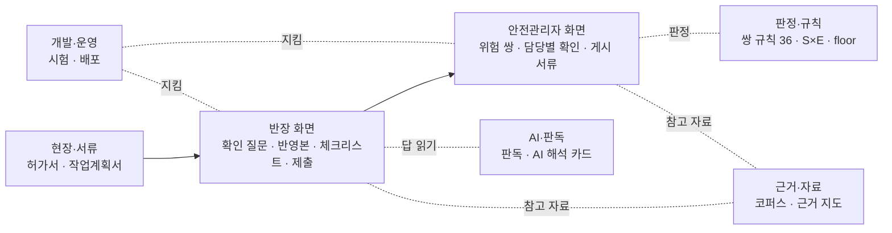

# 13. 용어집 — croScan에서 쓰는 말 한곳에 모으기

이 문서는 croScan 문서·화면·코드에 나오는 말을 모았습니다. 말을 일곱 묶음으로 나누고, 말마다 쉬운 뜻과 코드 이름을 함께 적었습니다.
뜻은 지금 코드(2026-11-01)와 01~12 문서를 기준으로 했습니다. 앞으로 문서에 설명이 없는 말을 더할 때는 「코드 기준」이라고 쓰고 코드가 하는 일을 적습니다.

**이 문서에서 알 수 있는 것**

- 현장 말(허가서·BAY·족장·대면허가 …)이 croScan에서 무엇을 가리키는지
- 화면 글자(「확인 완료」, 「답변 받음」, 「AI 읽음」 …)와 코드 이름(`ck-done`, `holdq.STATES`, `readCard()` …)의 짝
- 확인 질문 번호(T0·L1·CF2·C6·A1·U1 …)가 각각 무엇을 묻는지
- 판정 말(1·2·3순위, 확인위험·보수위험·판정보류, floor)의 정확한 뜻
- 더 자세한 설명이 있는 문서와 절

## 목차

1. [이 용어집 쓰는 법](#1-이-용어집-쓰는-법)
2. [현장·서류](#2-현장서류)
3. [반장 화면](#3-반장-화면)
4. [안전관리자 화면](#4-안전관리자-화면)
5. [판정·규칙](#5-판정규칙)
6. [AI·판독](#6-ai판독)
7. [근거·자료](#7-근거자료)
8. [개발·운영](#8-개발운영)
9. [코드 이름 찾는 법](#9-코드-이름-찾는-법)
10. [한계](#10-한계)

---

## 1. 이 용어집 쓰는 법

**무엇을.** 표 한 줄에 용어 하나를 적습니다. 칸은 넷입니다.

| 칸 | 내용 |
|---|---|
| 용어 | 문서와 화면에서 쓰는 이름 |
| 쉬운 뜻 | 한두 문장 |
| 코드·화면에서의 이름 | 함수 `이름()`, 상수, 파일, 화면 요소 id(`s-check`, `#ck-bar` 꼴), 화면에 보이는 글자(「」) |
| 더 읽을 곳 | 자세한 설명이 있는 문서의 절 |

**왜.** croScan은 같은 것을 세 가지로 부릅니다. 현장 말, 화면 글자, 코드 이름입니다. 예를 들어 「판정보류」(확인이 필요해 3순위로 남긴 경보)의 질문은 화면에서 「담당별 확인」이고, 코드에서는 `holdq`입니다. 처음 보는 팀원도 이 셋을 한 줄에서 맞춰 볼 수 있게 표로 만들었습니다.

**경계.** croScan은 작업을 승인하지 않습니다. 일정을 정하거나 작업을 막지도 않습니다. 판단은 사람(작업반장·안전관리자)이 합니다. 아래 뜻풀이도 이 경계 안에서 읽습니다.

용어 묶음은 일이 흐르는 순서대로 놓았습니다.

---

## 2. 현장·서류

| 용어 | 쉬운 뜻 | 코드·화면에서의 이름 | 더 읽을 곳 |
|---|---|---|---|
| 작업반장 | 현장에서 작업 팀을 이끄는 사람입니다. 위험작업허가서를 신청하고 croScan에서 스스로 점검합니다. | 역할 `foreman`. 로그인 화면 「생산부서 작업반장」 | [04 §1](04_아키텍처.md#1-무엇을-전체-그림), [02 §2](02_화면시연_반장.md#2-로그인) |
| 안전관리자 | 그날 들어온 허가서와 작업계획서를 모아 보는 안전팀 사람입니다. 반장에게 협조를 요청합니다. 전산승인은 생산부서 승인권한자가 합니다. | 역할 `manager`. 화면 `s-safety` | [04 §4](04_아키텍처.md#4-어떻게-안전관리자-화면), [08 §1](08_반영본과_별지.md#1-무엇을) |
| 위험작업허가서 (허가서) | 위험한 비일상 작업을 하기 전에 반장이 회사 전산에서 쓰는 허가 신청서입니다. croScan은 전산에서 내려받은 PDF 한 건을 받아 읽습니다. | `POST /api/parse`, [`server/extract.py`](../server/extract.py) `build()`. 화면 `s-upload` | [04 §3.2](04_아키텍처.md#32-허가서-올리기와-판독extract), [02 §4](02_화면시연_반장.md#4-②-허가서-올리기) |
| 작업계획서 | 그날 할 일상 작업(마킹·검사·도장·운반 등)을 적은 서류입니다. 협력사가 낸 것도 있습니다. 반장 화면의 첫 단계에서 올립니다. 마지막 접근 뒤 7일 동안 쓰지 않으면 다음 업로드 때 지웁니다. | [`server/workplan.py`](../server/workplan.py) `stage()`, `read_staged()`. 화면 `s-plans`. 안전관리자 쪽 문서 종류 `plan` | [02 §3](02_화면시연_반장.md#3-①-작업계획서-확인), [06 §1](06_쌍작업_판정.md#1-무엇을-하나) |
| 허가서 5종 | 위험작업허가서의 다섯 종류로, 화기·밀폐·고소·중량물인양·정전(LOTO)입니다. 양식은 같고 종류별 추가정보 칸만 다릅니다. 종류는 반장이 고릅니다. croScan은 PDF를 보고 종류를 추측하지 않습니다. | `hot`·`confined`·`height`·`lifting`·`loto` ([`server/permit_kinds.py`](../server/permit_kinds.py) `KINDS`). `GET /api/kinds`, 화면 `#kinds` | [04 §3.2](04_아키텍처.md#32-허가서-올리기와-판독extract), [현장프로세스 정리 §0](reference/현장프로세스_조사자료_정리.md#0-한눈에-보기) |
| 승인번호 | 허가서 한 건에 붙는 번호입니다. `AC00-IH-YYYYMMDD-NNNN` 꼴이고 가운데에 날짜가 들어갑니다. 질문·제출·판정에서는 이 번호로 허가서를 가리킵니다. | 칸 `permit_no` ([`server/form_spec.py`](../server/form_spec.py)). 질문 번호 `항목:승인번호`(예: `T5.2:AC00-IH-20261029-0731`). 안전관리자 화면은 끝 4자리(0731)로 부름 | [05 §3](05_멀티턴_질문.md#3-어떻게-전체-흐름) |
| JSP (작업표준) | 작업 방법을 정한 사내 문서의 번호입니다. 허가서 「작업표준(JSP NO.)」 칸에 HD현대 사내 Hi-STANDARD 작업표준 문서 번호를 적습니다. 문서 본문은 공개되지 않았습니다. 그래서 croScan은 번호 형식만 느슨하게 봅니다(HHIS로 시작, 하이픈 뒤 구간). | 칸 `jsp_no`. 화면 검사 `CODE_RULES.jsp_no`, `codeProblem()`. 업로드 분석은 이 칸을 모델에 주지 않음(`analyze.HIDDEN`) | [10 §9](10_근거와_자료.md#9-작업표준jsp-번호-형식만-본다) |
| 하이세스 (Hi-SEs) | HD현대의 통합 HSE(안전·보건·환경) 전산입니다. 허가서를 쓰고 접수·승인하는 곳입니다(조선 3사 조사). croScan은 하이세스를 대신하거나 바꾸지 않습니다. 하이세스와 연결하는 코드도 없습니다. 화면 색만 하이세스와 같은 계열로 맞췄습니다. | 코드 이름 없음. 색 기준은 [`DESIGN.md`](../DESIGN.md) | [조선 3사 조사 §1.1](reference/조선3사_작업허가_조사.md#11-용어-확인-용어집), [02 §9.3](02_화면시연_반장.md#92-무엇이-제출되나) |
| BAY · 칼럼 | 공장 바닥의 위치를 적는 주소입니다. BAY는 큰 작업 구역이고, 칼럼은 그 안의 번호입니다(「3BAY 08-10 칼럼」). 칼럼은 주소일 뿐이고 거리를 뜻하지 않습니다. 시연 공장은 4BAY × 20칼럼으로 놓았고, 실제 공장 배치가 아닙니다. | [`server/safety.py`](../server/safety.py) `spans()`, `BAYS, COLS = 4, 20`. 두 작업의 관계 `place_rel()`: `same`·`near`·`far`·`unknown`·`none`·`off` | [06 §5.1](06_쌍작업_판정.md#51-bay와-칼럼), [06 §2](06_쌍작업_판정.md#2-왜-이렇게-하나) |
| 블록 | 배를 여러 조각으로 나눠 만들 때의 큰 조각 하나입니다. 번호는 `E42P`, `B21S` 꼴입니다. 두 서류에 같은 블록 번호가 있으면 칼럼이 달라도 같은 곳으로 봅니다. | `pairs.BLOCK_ID`, `_place()`의 `forced` | [06 §4.5](06_쌍작업_판정.md#45-블록-번호) |
| 대조립 | 블록을 크게 짜 맞추는 내업(공장 안 작업) 단계입니다. 배 건조 공정(철판 절단 → 소조립 → 중조립 → 대조립 → 도장 → 탑재) 가운데 하나입니다. croScan 시나리오는 이 공장에서 일어납니다. | 코드 이름 없음. 시연 위치 글 「대조립21공장」 | [프로젝트 이해 정리 §3](reference/프로젝트_이해정리.md#3-현장의-실제-업무-흐름-as-is), [현장프로세스 정리 §5](reference/현장프로세스_조사자료_정리.md#5-대조립-작업-목록-조사-대상-11종) |
| 족장 | 블록 둘레에 세우는 작업 발판(비계)입니다. 시연 자료 P01은 블록 위의 러그(임시 인양고리) 절단과 그 아래 족장 해체가 짝을 이룬 경우입니다. | `pairs.OVERHEAD` 정규식이 「족장·비계」를 상부 설치·취급 말로 읽음(태그 `OVERHEAD`) | [06 §4.3](06_쌍작업_판정.md#43-태그-표) |
| 화재감시자 | 화기 작업 곁에서 불이 나는지 지켜보는 사람입니다. 작업 반경 11m 안에 가연물이 있으면 둡니다(안전보건규칙 제241조의2). 11m는 감시자를 두는 반경이고, 작업을 금지하는 반경이 아닙니다. croScan은 이 값으로 거리를 계산하지 않습니다. | `pairs.FIRE_REACH_M = 11`. 사슬 문구 「화재감시자 반경 11m 기준」 | [06 §2](06_쌍작업_판정.md#2-왜-이렇게-하나) |
| LOTO | Lock-Out Tag-Out의 줄임말입니다. 정비하기 전에 전원을 끊고 잠금장치와 꼬리표를 거는 일입니다. 허가서 5종 가운데 「정전」이 이것입니다. | 종류 `loto`. 태그 `CRANE_LOTO`·`POWER_LOTO`. 규칙 `CRANE_LOTO`·`POWER_LOTO`·`SHARED_LOTO`·`VENT_LOTO` | [06 §4.3](06_쌍작업_판정.md#43-태그-표), [06 §8](06_쌍작업_판정.md#8-규칙-36개) |
| 2중점검 · 대면허가 · 허가구분 | 허가서의 「2중점검 대상 Y/N」 칸입니다. Y이면 허가기간 동안 실제로 작업하는 날마다 아침에 안전 측 대면허가(현장 확인·교육·서명)를 받습니다. 허가구분(전산허가/안전현장허가)과 Y/N을 누가, 어떤 기준으로 정하는지는 공개되지 않았습니다. croScan은 이 칸들을 묻지도, 정하지도, 쓰지도 않습니다. | 칸 `double_check`, `permit_type`. `augment.NOT_FOREMAN`, `reflect.NEVER` | [08 §4.1](08_반영본과_별지.md#41-절대-쓰지-않는-칸-never), [현장프로세스 정리 §3](reference/현장프로세스_조사자료_정리.md#3-허가구분안전현장허가--전산허가과-2중점검) |
| 일상 작업 · 비일상 작업 | 비일상 작업은 허가서가 필요한 위험작업(5종)입니다. 일상 작업은 허가 없이 하는 작업이고, 작업계획서에 적힙니다. croScan은 비일상×비일상, 일상×비일상 짝만 봅니다. 일상×일상 짝은 범위 밖입니다. | 안전관리자 쪽 문서 종류 `permit`(비일상)·`plan`(일상) ([`server/safety.py`](../server/safety.py)) | [06 §1](06_쌍작업_판정.md#1-무엇을-하나), [현장프로세스 정리 §5](reference/현장프로세스_조사자료_정리.md#5-대조립-작업-목록-조사-대상-11종) |
| 당일 칸 (현장 안전조치 및 추가정보) | 작업 당일, 시작하기 전에 체크하는 칸입니다(가스농도·풍속·하중 같은 측정값과 체크칸). 미리 쓰면 안 됩니다. croScan도 이 칸에 쓰지 않습니다. | `augment.DAY_OF_VALUES`. 체크리스트 조치의 `permit_key` → 화면 「당일 허가서 5번에서 확인」 | [08 §4.1](08_반영본과_별지.md#41-절대-쓰지-않는-칸-never), [07 §5.1](07_위험체크리스트.md#51-조치는-모두-계획-문장) |

---

## 3. 반장 화면

| 용어 | 쉬운 뜻 | 코드·화면에서의 이름 | 더 읽을 곳 |
|---|---|---|---|
| 반장 5단계 | 반장 화면이 지나가는 다섯 단계입니다. ① 작업계획서 확인 → ② 허가서 올리기 → ③ 허가서 검토 → ④ 위험 체크리스트 → ⑤ 제출. | 화면 `s-plans` → `s-upload`(읽는 동안 `s-load`) → `s-edit` → `s-check` → `s-submit`. 단계 표시 `.stepper` | [02 §1](02_화면시연_반장.md#1-한-번에-보기-움직이는-시연) |
| 확인 질문 (규칙 질문) | 허가서에 빠졌거나 서로 맞지 않는 값을 반장에게 짧게 묻는 질문입니다. 규칙이 만들고 화면에는 한 번에 하나씩 나옵니다. 번호별 뜻은 [5절 표](#확인-질문-번호-한눈에)에 있습니다. | `augment.questions()` → `_foreman()`, 순서 `need_catalog.order()`. `POST /api/augment`, 화면 `askNext()`, `#msgs` | [05 §4](05_멀티턴_질문.md#4-질문-항목-전체-표), [02 §5](02_화면시연_반장.md#5-③-허가서-검토-확인-질문) |
| 질문 한도 | 검토 1건에서 반장에게 답을 요청할 수 있는 횟수로, 12회입니다. 규칙 질문만 세지 않습니다. 다시 묻기·AI 해석 카드·계획서 연결 카드·마무리 요청도 1회씩 셉니다. 그중 다시 묻기는 3회까지입니다. 모델 호출은 30회까지입니다. 12회를 다 쓰면 남은 질문은 「안전팀 확인 필요」로 넘어갑니다. | `store.ASKS, CLARIFY, LLM_CALLS`, `store.issue()`, `app._reserve()`, `/api/dialogues/{sid}/ask` | [05 §5](05_멀티턴_질문.md#5-순서와-한도) |
| 「왜 묻나요?」 | 질문 옆에서 펼쳐 보는 이유 설명입니다. 답을 어디에 쓰는지 한 줄로 보여 줍니다. 현행 조문과 대조한 근거가 있을 때만 조문을 붙입니다. | `need_catalog.why()`, `NEED` | [05 §3](05_멀티턴_질문.md#3-어떻게-전체-흐름) |
| 모름 | 모든 질문의 마지막 보기입니다. 누르면 질문이 닫히고 안전팀 확인으로 넘어갑니다. 「모름」은 값이 아니어서 계산에 쓰지 않습니다. 「모름」을 눌러도 진행이 막히지 않습니다. 별지에는 함께 적은 말을 보고 미정·확인 예정·불확실·모름을 나눠 적습니다. | 보기 상태 「미확인」. `augment.unknown_kind()`, `NOT_A_VALUE`. 반영본은 `reflect.CHECK`로 「… 확인 필요」를 적음 | [05 §6](05_멀티턴_질문.md#6-모름-처리) |
| AI 해석 카드 | 반장이 8자 이상 글로 답하면 나오는 카드입니다. 모델이 그 글에서 아직 열린 다른 질문의 답을 찾아 보여 줍니다. 줄마다 근거 구절(←)과 들어갈 곳(→)이 있습니다. 반장이 「확인 (N건)」을 눌러야 답이 됩니다. | `readCard()`, `.ai-card`. 줄 표시 「AI 읽음」. `POST /api/understand`, 확인 `POST /api/dialogues/{sid}/confirm`. 단추 「이것 빼기」·「다시 넣기」·「항목 고치기」·「해석 취소」 | [02 §6.2](02_화면시연_반장.md#62-ai-해석-카드), [05b §7](05b_AI_판독.md#7-확인-카드) |
| 반영본 | 반장의 답을 허가서에 옮겨 적은 새 PDF입니다. 원본 허가서 사본의 알맞은 칸에만 파란 글씨와 변경 번호(①②…)로 적습니다. 내부 초안이고 승인 문서가 아닙니다. | `reflect.plan()`, `reflect.apply()`. 화면 `#v-sheet`. 반영 계획 `fills`·`extra`·`pending` | [08 §1](08_반영본과_별지.md#1-무엇을), [08 §4](08_반영본과_별지.md#4-어떻게-어느-칸에-무엇을) |
| 추가검토서 · 별지 | 반영본 뒤에 붙는 A4 쪽입니다. 변경 내역, 칸 밖 보충, 확인된 작업 범위, 안전팀 확인 필요, 추가조치 초안을 적습니다. 반영본과 한 PDF로 나옵니다. (안전관리자 쪽 「현장 게시용 별지」와는 다릅니다: [4절](#4-안전관리자-화면)) | [`server/addendum.py`](../server/addendum.py) `layout()`, `html()`, `pdf()`, 안내 첫 줄 `NOTE` | [08 §7](08_반영본과_별지.md#7-어떻게-별지) |
| 원본 불변 | 올린 원본 PDF는 끝까지 한 바이트도 바꾸지 않는다는 원칙입니다. 답은 반영본과 별지에만 남습니다. 제출본도 칸 상자 둘레와 위 여백을 빼면 픽셀이 원본과 같아야 합니다. | `reflect.apply()`가 새 PDF를 만듦. 점검 [`tools/check_form_intact.py`](../tools/check_form_intact.py), [`tools/check_reflect.py`](../tools/check_reflect.py) | [08 §2](08_반영본과_별지.md#2-왜), [08 §10](08_반영본과_별지.md#10-양식-훼손-점검) |
| 확인 필요 (pending) | 반영본 칸에 쓰지 않고 사람이 정하도록 남긴 것의 목록입니다(「모름」, 허가서와 반대되는 답, 칸 형식이 안 맞는 값 등). 숨기지 않고 별지 4절 「안전팀 확인 필요」에 모두 적습니다. | 반영 계획의 `pending`, `reflect.CHECK`, `NOT_THERE` | [08 §6](08_반영본과_별지.md#6-어떻게-확인-필요pending) |
| 위험 체크리스트 | 허가서 한 건마다 만드는 위험요인 목록입니다. croScan이 허가서와 반장 답만 보고 초안을 채웁니다. 반장은 항목마다 확인합니다. 작업 전날 세우는 계획이고, 조치를 했다는 증거가 아닙니다. 모두 86항목(공통 7 + 종류별 79)입니다. | `checklist.draft()`, [`server/checklist_spec.json`](../server/checklist_spec.json). 화면 `s-check`, `.ck-item`. `POST /api/checklist` | [07 §1](07_위험체크리스트.md#1-무엇을), [02 §8.1](02_화면시연_반장.md#81-항목-확인) |
| 해당 · 해당 없음 · 안전팀 확인 | 체크리스트 항목마다 고르는 세 값입니다. croScan은 기본으로 「안전팀 확인」을 제안합니다. 「해당 없음」은 허가서와 반장 답이 둘 다 분명히 「없다」고 할 때, 6항목에서만 제안합니다. 반장은 어느 항목이든 직접 고를 수 있습니다. | 코드 값 `yes`·`no`·`check`. 규칙 `prefill.yes`·`prefill.no`, `evaluate()` | [07 §1](07_위험체크리스트.md#1-무엇을), [07 §4.3](07_위험체크리스트.md#43-해당-없음은-언제-제안하나) |
| 확인 완료 | 반장이 그 항목을 확인했다는 표시입니다. 해당 여부를 확인하면 붙습니다. 「해당」이면 준비할 안전조치까지 확인해야 붙습니다. 조치를 했다거나 승인됐다는 뜻이 아닙니다. croScan이 고른 값이 맞으면 「그대로 확인」 칸만 체크해도 됩니다. | 항목 표시 `ck-done`: 「확인 전」·「조치 확인 전」·「확인 완료」(`ckNeedCtl()`). 진행 막대 `#ck-bar` 「n / N 확인 완료」. 저장 값 `touched`, `ctl_touched` | [07 §6](07_위험체크리스트.md#6-어떻게-확인과-만료), [02 §8.1](02_화면시연_반장.md#81-항목-확인) |
| 미완료 · 다음 미완료로 이동 | 체크리스트에서 아직 끝나지 않은 항목입니다. 해당 여부를 확인하지 않았거나, 「해당」인데 준비할 안전조치를 확인하지 않았거나, 채택한 AI 항목을 다시 확인해야 하는 항목입니다. 위에 붙은 현황 줄에 「미완료 N개」가 나옵니다. 「다음 미완료로 이동」과 「미완료 목록」으로 그 항목에 갑니다. 「다음: 제출 확인」도 남은 항목이 있으면 넘어가지 않고 첫 미완료 항목으로 데려갑니다. | [`web/app.js`](../web/app.js) `ckPending()`(「확인 완료」 수와 같은 계산), `ckGo()`, `ckGoNext()`, `renderCkBar()`, `#ck-bar`, `#ck-next` | [07 §6](07_위험체크리스트.md#6-어떻게-확인과-만료) |
| 근거가 달라졌습니다 (확인 만료) | 허가서나 답이 바뀌면, 그것을 보고 한 확인이 풀립니다. 작업 사실이 조금이라도 바뀌면 해당 여부 확인이 풀립니다. 작업 방법·인원·높이가 바뀌면 해당 여부와 조치 확인이 모두 풀립니다. 조치 문장만 바뀌면 조치 확인만 풀립니다. 시각만 바뀌면 풀리지 않습니다. | `basis`, `basis_ctl`, `work_digest`. 화면 `ckMerge()`, 제출 `submissions.confirm_checklist()` → 409 `checklist_changed`·`checklist_left` | [07 §6](07_위험체크리스트.md#6-어떻게-확인과-만료) |
| preselect (미리 고른 조치) | 항목이 「해당」일 때 미리 켜 두는 준비할 안전조치입니다(131개). 법으로 꼭 해야 한다는 뜻이 아닙니다. 반장이 끄거나 다른 조치를 켤 수 있습니다. 조치 문장 275개는 모두 「…할 예정」으로 끝납니다. | 명세 `preselect`, 화면 조치의 `pre` 표시(`ckItem()`) | [07 §5.1](07_위험체크리스트.md#51-조치는-모두-계획-문장) |
| 체크리스트 AI 제안 | 모델이 체크리스트에 보탤 것을 제안합니다. 다른 종류의 카탈로그 항목을 「넣기」 후보로 고릅니다(최대 3). 기존 항목에는 작업 글이 그 위험을 말하는지 읽어 줍니다(최대 6). 반장이 「채택」해야 들어갑니다. | [`server/checkai.py`](../server/checkai.py) `suggest()`, `picks`·`marks`. 채택 항목 id `A:<항목 id>`. `POST /api/checklist/ai-suggest` | [07 §7](07_위험체크리스트.md#7-어떻게-ai-제안checkai) |
| 핵심 정보 확인 창 | 허가서 검토를 마치고 「다음: 위험 체크리스트」를 누르면 뜨는 창입니다. 반장이 자주 틀리는 핵심 값(시간·위치·인원 등)만 「제출되는 값」으로 보여 줍니다. 「확인하고 체크리스트로」를 눌러야 체크리스트로 갑니다. 이 버튼은 제출하지 않습니다. 확인한 뒤 핵심 값이 바뀌면 체크리스트·제출로 가지 못하고 다시 확인해야 합니다. 보통 제출에는 이 창이 뜨지 않습니다. | `preSubmitView()`, `enterChecklist()`, `#presub`, 본 값 지문 `psPrint`, 확인 기록 `psKey`·`psValid()` | [08 §8](08_반영본과_별지.md#8-어떻게-핵심-정보-확인-창), [02 §9](02_화면시연_반장.md#9-⑤-제출) |
| 제출 (제출 스냅숏) | 제출하는 순간의 허가서·답·반영본·별지·체크리스트를 그대로 고정해 보관하는 것입니다. croScan 안에만 남는 기록이고, 회사 전산이나 결재로 보내지 않습니다. 만든 지 30일이 지나면 다음 새 제출 때 정리합니다. | `POST /api/submissions`, `submit_snapshot()`, `submissions.create()`, 같은 제출 판단 `key_of()`. 화면 `sendFinalOnce()` | [08 §9](08_반영본과_별지.md#9-어떻게-제출-스냅숏) |

---

## 4. 안전관리자 화면

| 용어 | 쉬운 뜻 | 코드·화면에서의 이름 | 더 읽을 곳 |
|---|---|---|---|
| 안전관리자 화면 | 안전관리자가 그날의 허가서·작업계획서 목록, 위험 쌍, 게시 서류를 보는 화면입니다. 지금은 시연 하루 자료를 읽습니다. | 화면 `s-safety`, `sfLoad()`. `GET /api/safety/overview` | [03 §1](03_화면시연_안전관리자.md#1-한-번에-보기-움직이는-시연), [04 §4](04_아키텍처.md#4-어떻게-안전관리자-화면) |
| 위험 쌍 목록 | 경보가 붙은 작업 짝의 목록입니다. 순위 순서대로 P01, P02 … 번호를 붙입니다. | `POST /api/safety/detect` → `app._detect()`, 화면 `sfDetect()`, `#sf-plist`, 상세 `#sf-pdetail` | [03 §2](03_화면시연_안전관리자.md#2-위험-쌍-목록), [06 §11](06_쌍작업_판정.md#11-하루-화면과-시연-자료-결과) |
| 근접 (near) 목록 | 가까이 있지만 경보 조건에는 맞지 않는 짝입니다. 경보 대신 이유만 설명으로 남깁니다. 안전하다고 확인했다거나 작업을 승인했다는 뜻이 아닙니다. | 판정 결과의 `near`, `pairs._quiet()`. 화면 `#sf-near` | [06 §7.5](06_쌍작업_판정.md#75-한-짝의-정리) |
| 담당별 확인 (holdq) | 판정보류가 된 까닭을 각 작업의 반장에게 묻는 질문 문안입니다. 판정보류 이유(E 1)를 그 반장이 답할 「자기 작업」 질문으로 나눕니다. 쌍에 E 1 이유가 하나라도 있으면 나옵니다. 쌍의 대표 순위가 1·2순위여도 나옵니다. 상대 팀 작업은 묻지 않고, 같은 사실은 한 번만 묻습니다. croScan은 질문을 보내지 않습니다. 안전관리자가 복사해서 기존 연락 방법으로 보냅니다. | [`server/holdq.py`](../server/holdq.py) `build()`, `_asks()`, `RULE_SIDE`, 지문 `fingerprint()`. `GET /api/safety/hold-questions`, 화면 `sfHoldLoad()`, `sfHoldRender()`, `.sf-hq`. 반장별 카드의 「질문 복사」는 질문 하나만 복사(`sfHqText()`) | [03 §4](03_화면시연_안전관리자.md#4-담당별-확인-판정보류-질문), [06b §1](06b_보류질문_holdq.md#1-무엇을-하나) |
| 전달함 · 답변 받음 | 담당별 확인 질문이 어디까지 갔는지 보여 주는 상태 표시입니다. 서버 값은 미전달 → 전달함 → 응답 받음 순서로 한 단계씩만 움직입니다. 「전달함 표시」를 누르면 화면 상태는 「답변 대기」가 됩니다. 처음 전달함으로 표시할 때 질문 1회를 씁니다. 단, 연결된 검토가 열려 있고 한도가 남아 있을 때만입니다. 검토가 없거나, 마감됐거나, 한도를 넘었어도 전달 표시는 저장합니다. 상태를 되돌렸다가 다시 표시해도 두 번 세지 않습니다. 「답변 받음」은 판정을 바꾸지 않습니다. | 서버 값 `holdq.STATES` = 미전달·전달함·응답 받음. 화면 글자 미전달·답변 대기·답변 받음(`HQ_KO`). `holdq.mark()`, `_charge()`, `holdq.sqlite3`. `POST /api/safety/hold-questions/mark`, `sfHoldMark()` | [06b §7](06b_보류질문_holdq.md#7-상태와-전달-표시) |
| 작업 조정 문자 (coordnote) | 위험 쌍마다 두 반장에게 보낼 「일정 조율 협조 문자」입니다. 그 안의 「협의할 점」 한 문장은 반장이 확인한 사실이 있을 때만 만듭니다. 모델은 번호만 고릅니다. 문장은 서버가 정해진 틀로 씁니다. croScan이 실제로 보내지는 않습니다. | 화면 「① 작업 조정」(`POST_STEPS`), `mgNote()`. [`server/coordnote.py`](../server/coordnote.py) `note()`, `sentence()`. `POST /api/safety/coord-note` | [03 §8](03_화면시연_안전관리자.md#8-작업-조정-문자와-현장-게시-서류), [06b §11](06b_보류질문_holdq.md#11-답-다음-협조-문자와-별지) |
| 현장 게시 서류 (posting) | 화면의 「② 서류 발행」에서 만드는 서류입니다. 현장 게시용은 허가서 원본 뒤에 별지 「병행작업 조정·착수조건」을 붙인 PDF입니다. 일상작업반 전달문은 허가서가 없는 일상 작업을 위한 별지로, 그 작업의 짝만 담습니다. 별지는 내용에 따라 여러 쪽이 될 수 있습니다. 문안 초안은 안전관리자가 「문안 채택」을 눌러야 들어갑니다. 채택은 보내는 것도, 작업을 허락하는 것도 아닙니다. | 화면 `sf-post` 「현장 게시용 서류」, `postPdf()`, `postAiGo()`. [`server/posting.py`](../server/posting.py) `pdf()`, `draft()`, `layout()`, `compose()`. 종류 `post`·`notice`. `POST /api/safety/sheet.pdf`, `/api/safety/post-draft` | [03 §8](03_화면시연_안전관리자.md#8-작업-조정-문자와-현장-게시-서류), [06b §11](06b_보류질문_holdq.md#11-답-다음-협조-문자와-별지) |
| 계획 배치도 | 작업들이 어느 BAY·칼럼에 계획돼 있는지 격자로 보여 주는 그림입니다. 시연 하루 가운데 고른 시각의 모습을 보여 줍니다. 위치만 보여 주고 판정하지 않습니다. 화면 범례에 「시연용 배치도입니다. 실제 거리와 작업 점유 범위를 나타내지는 않습니다」라고 적혀 있습니다. | 화면 `sf-map`, `#sf-grid`, 보기 전환 `#sf-view`(「배치도」), `sfMap()` | [03 §6](03_화면시연_안전관리자.md#6-계획-배치도), [06 §5.1](06_쌍작업_판정.md#51-bay와-칼럼) |
| AI 검토 권장 (pairreview) | 규칙이 아무 경보도 띄우지 않은 가까운 쌍을 모델이 한 번 더 봅니다. 이때 모델은 「검토 권장」을 낼 수 있습니다. 규칙 판정이 아닙니다. | [`server/pairreview.py`](../server/pairreview.py) `review()`, `listing()`. `POST /api/safety/pair-review` | [04 §7](04_아키텍처.md#7-코드-어디-모듈-지도), [04b §6](04b_API.md#6-안전관리자) |
| 문서별 관리자 요약 · 허가 검토 신호 | 관리자 요약은 서류마다 시간·장소·대상·공유 설비를 한 줄로 줄인 것입니다. 허가 검토 신호는 계획서에 허가 대상 작업이 있는데 맞는 허가서를 찾지 못했을 때 띄웁니다. | [`server/docsum.py`](../server/docsum.py) `build()`, [`server/permitsignal.py`](../server/permitsignal.py) `signals()`. `GET /api/safety/doc-summaries`, `sfSumLoad()` | [04 §7](04_아키텍처.md#7-코드-어디-모듈-지도) |

---

## 5. 판정·규칙

| 용어 | 쉬운 뜻 | 코드·화면에서의 이름 | 더 읽을 곳 |
|---|---|---|---|
| 쌍작업 | 같은 날 하는 두 작업의 짝입니다. 두 작업이 시간·장소·설비로 이어져 한쪽의 위험이 다른 쪽에 닿을 수 있습니다. 규칙표와 정해진 계산으로만 판정합니다. 모델은 쓰지 않습니다. | [`server/pairs.py`](../server/pairs.py) `detect()` | [06 §1](06_쌍작업_판정.md#1-무엇을-하나) |
| 원인 작업 · 노출 작업 | 원인 작업(A)은 위험을 만드는 쪽입니다(불티, 매단 하물, 정전 등). 노출 작업(B)은 그 위험을 받는 쪽입니다. | 규칙의 `cause`·`exposed`, 이유의 `cause`·`exposed` | [06 §1](06_쌍작업_판정.md#1-무엇을-하나) |
| 쌍 규칙 36 | 두 작업이 위험하게 이어지는 길을 적은 규칙 36개입니다. 성질별로 세면 금지 10 · 바로 경로 15 · 잔류 22 · 새 규칙 20 · 조문 대조 16입니다. | [`server/pair_rules.json`](../server/pair_rules.json)의 `rules`. id 예: `FIRE`, `CRANE_LOTO`, `DROP_BELOW`. 조건 `pairs._path()` | [06 §8](06_쌍작업_판정.md#8-규칙-36개) |
| 태그 (작업 성질) | 서류 한 장에서 읽어 낸 작업의 성질입니다. 예: 화기 `SPARK`, 유기용제 `SOLVENT`, 밀폐 진입 `CONFINED`. 확인하는 말, 부정하는 말, 물건 이름은 작업 행위로 치지 않습니다. | `profile()` → `tags`. 정규식 `NOT_ACTION`, `WELD_TOOL` 등 | [06 §4.3](06_쌍작업_판정.md#43-태그-표) |
| S × E | 경보 점수를 내는 곱셈입니다. 강도 S는 사고가 나면 얼마나 큰지입니다(3 사망·중대재해 가능, 2 중상·건강장해). S는 규칙마다 정해져 있습니다. 노출 E는 두 작업이 정말 이어지는지 서류로 얼마나 확실한지입니다(3 확인, 2 가능, 1 미확인). S와 E를 곱한 값이 점수입니다. | 규칙의 `S`, 이유의 `E`, `score`. E 계산은 `_judge()` | [06 §7.1](06_쌍작업_판정.md#71-노출-e-계산), [06 §7.2](06_쌍작업_판정.md#72-순위) |
| 1순위 · 2순위 · 3순위 | 경보가 얼마나 급한지 나타냅니다. 1순위는 즉시 조정입니다(금지 조합이고 E 3). 2순위는 조건부 병행입니다(S×E ≥ 6). 3순위는 확인 필요입니다(S×E ≥ 3이거나 정보가 빠짐). 3순위에는 판정보류와 보수위험이 함께 들어 있습니다. 1순위 문구도 「두 작업반장이 협의하도록 안내」이고, 승인·일정 권한은 없습니다. | 이유의 `priority`, `pair_rules.json`의 `priority` 표, 정보 빠짐 `info_gap` | [06 §7.2](06_쌍작업_판정.md#72-순위) |
| 금지 조합 | 법과 멘토가 「동시에 하면 안 된다」고 한 조합입니다(도장×화기, 상하 동시 작업 등). 서류로 확인(E 3)될 때만 1순위가 됩니다. 모든 금지 조합을 담은 완전한 표는 아닙니다. | 규칙의 `forbidden`(10개), 상하 동시 작업 `upper_lower` | [06 §7.3](06_쌍작업_판정.md#73-금지-조합) |
| 확인위험 · 보수위험 · 판정보류 | 경보에 붙는 판정 이름 셋입니다. 확인위험은 E 3입니다(경로가 서류로 확인됨). 보수위험은 E 2인 경보입니다. 장소 연결이 확인되고 인원 0·추가 미확인 조건·맞닿음이 없는 잔류위험도 보수위험입니다. 이 예외에 들지 않는 E 1은 판정보류입니다(확인이 필요해 3순위로 남긴 경보). | 이유의 `judgement`, `_label()`, `LABEL_RANK` | [06 §7.4](06_쌍작업_판정.md#74-판정-표기) |
| 잔류위험 | 앞 작업이 끝난 뒤에도 남는 위험입니다(잔불, 용제 증기, 잔압, 안에 남은 사람 등). 시간이 지났다고 없어졌다고 보지 않습니다. 해제 기록이 없으면 E 1입니다. | 규칙의 `sequence`, `sequence_first`, `residual`. 화면 상자 「서류상 선후 계획 · 남은 확인」(`sequence_plan()`, `annotate()`) | [06 §9](06_쌍작업_판정.md#9-잔류위험-자세히) |
| 맞닿음 | 앞 작업이 끝나는 시각에 뒤 작업이 바로 시작하는 경우입니다. 앞 작업이 늦어지면 두 작업이 겹칩니다. 그래서 E 1로 두고 묻습니다. | `TOUCH`, 보류 질문 `end_time` | [06 §6.3](06_쌍작업_판정.md#63-겹침과-선후) |
| 확인된 사실 (쌍 하이브리드) | 쌍 판정에 넣는 반장 답입니다. 반장이 croScan에서 자기 작업을 확인하고 제출한 답만 넣습니다. 다른 팀 이야기, 「모름」, 부정 구절은 넣지 않습니다. 단, D7 압력시험 답은 다릅니다. 제외 선택(모름·해당 없음·없음·아니오)이 아니면 부정·다른 팀 표현도 `PRESSURE`로 읽습니다. | `pairs.confirmed_facts()`, `safety.hybrid_inputs()`. 근거 칸 「작업반장 답변 · 반장 답변 확인」 | [06 §10](06_쌍작업_판정.md#10-작업반장-제출본-반영과-안전-하한floor) |
| floor (안전 하한) | 서류로 낸 경보 밑으로는 내려가지 않는 바닥선입니다. 반장 답을 반영해도 지금 모인 서류로 낸 경보는 하한으로 남습니다. 서류가 띄운 경보가 답 때문에 사라지거나 낮아지면 서류 기준을 지킵니다. 제출본 답 때문에만 생긴 경보는 다음 제출에서 답이 바뀌면 사라질 수 있습니다. 서류로 낸 경보는 사람만 내릴 수 있습니다. | `pairs.floor()`, 표시 `floor: "gone"`·`"lowered"`. 화면 「답으로는 해소 · 문서 기준 유지」. 변경 기록 `compare()` | [06 §10.3](06_쌍작업_판정.md#103-floor-경보는-답으로-내려가지-않는다) |
| stale 답 (낡은 답) | 반장이 서류를 고쳐서 더는 믿을 수 없게 된 답입니다. 질문을 만들 때 그 질문이 기댄 칸 목록과 그 값의 해시(값을 줄인 지문)를 함께 넣어 둡니다. 반장이 그 칸을 고치면 해시가 달라집니다. 그러면 그 답을 「낡음」으로 보고 다시 묻습니다. | 질문의 `fp_keys`, `fp`(`_fp()`, `_deps()`). `stale_answers()`, `answers_now()`. 서버 응답 `dropped`, 화면 `markDropped()` | [05 §10](05_멀티턴_질문.md#10-반장이-서류를-고친-뒤의-답) |
| 철회 (C6) · 정정 (C5) | 철회는 앞 답을 거두는 것입니다. 답이 서류와 다를 때 반장이 「서류가 맞음」을 고르면 철회됩니다. 정정은 앞 답을 고치는 것입니다. 앞의 「없음」 답과 추가 전달이 다를 때 「추가로 적은 내용이 맞음」을 고르면 앞 답을 그 문장으로 바꿉니다. | `augment.withdrawn()`, `live_answers()`, `C5_POSITIVE`. 체크리스트 `checklist.standing()`, 쌍 `pairs.standing()` | [05 §11](05_멀티턴_질문.md#11-철회c6와-정정c5) |
| 공용 답 읽기 함수 | 철회·정정·낡음을 모든 곳(질문·반영본·체크리스트·쌍 판정)이 똑같이 읽게 하는 함수 묶음입니다. | `augment.live_answers()`, `stale_answers()`, `answers_now()`, `drop_stale()`. 서버 입구 `app._calc_answers()`, `_normalize()` | [04 §6](04_아키텍처.md#6-공용-답-읽기-함수) |
| 「미정·확인 필요」 규칙 | 답에 「미정」, 「확인 필요」, 「협의 중」 같은 말이 붙으면 아직 말하지 않은 것으로 봅니다. 그래서 이런 말 한 단어로는 질문이 닫히지 않습니다. | `said()`, `OPEN`, `HEDGE`, `COND`, `need_catalog.atoms()` | [05 §9](05_멀티턴_질문.md#9-미정확인-필요-규칙open) |
| 글로 쓴 「없음」 | 반장이 보기 대신 「연결 없음」처럼 글로 분명히 부정하면 「없음」 보기와 같게 봅니다. 이렇게 보는 것은 CF2·H2·LI2·HT1·B3 다섯 항목뿐입니다. | `negated()`, `eff_choice()`, `NEG_CHOICE` | [05 §12](05_멀티턴_질문.md#12-글로-쓴-없음) |

### 확인 질문 번호 한눈에

질문 번호(`item`)는 [`server/augment.py`](../server/augment.py) `_foreman()`이 만듭니다. 번호의 뜻과 무게는 [`server/need_catalog.py`](../server/need_catalog.py) `NEED`·`W`·`REQUIRED`에 있습니다. 실제 질문 번호(qid)는 `항목:승인번호`입니다. 행마다 따로 묻는 질문은 `T0.행`, `T5.행`처럼 행을 뒤에 붙입니다(단, T5의 첫 행은 그냥 `T5`). 칸마다 묻는 질문은 `B1.칸`처럼 칸을 뒤에 붙입니다.

| 묶음 | 번호와 묻는 것 | 더 읽을 곳 |
|---|---|---|
| 시간 (T) | **T0** 빈 작업일시 행의 날짜·시작·종료 · **T1** 하루 거의 내내·3일 이상 같은 시간이 실제 작업 시간인지 · **T4** 잔불 확인이 언제 끝나나(extra 등급, 맨 뒤) · **T5** 종료가 시작보다 이르거나 같음: 다음 날 끝나나, 잘못 적었나(첫 행은 `T5`, 둘째 행부터 `T5.2`·`T5.3`) · **T6** 참고 작업시간보다 길거나 짧은 까닭 · **T7** 체크한 주간·야간과 적힌 시간이 맞나 · **T8** 화기의 야간·교대 지원과 인계 · **T9** 멈추거나 교대하는 동안 차단·받침·통제 유지와 재개 시각 | [05 시간(T)](05_멀티턴_질문.md#시간t), [05 §8](05_멀티턴_질문.md#8-t5t7t8t4-시간-규칙) |
| 장소 (L) · 대상 (D) | **L1** 실제 작업 위치(BAY·칼럼·블록, 정전은 설비 번호) · **L3** 블록 위·옆·아래·안과 높이 · **L4** 여러 블록의 순서·날짜 · **L5** 인양 이동 경로 · **L6** 작업 중 출입 통제 범위(extra) · **L7** 칼럼 범위가 실제 작업 위치인가 · **D1** 어느 블록·배관·구획인가 · **D6** 수전구역의 통전·시운전 설비와 차단 확인자 · **D7** 압력시험 매체와 가압·감압 시각 | [05 장소(L)·대상(D)](05_멀티턴_질문.md#장소l대상d) |
| 화기 (H) | **H1** 용접부 보수인가 부재 교체인가, 몇 군데 · **H2** 절단·용접 방법과 가스 · **H3** 떼거나 파내는 부재를 무엇으로 받쳐 어디로 내리나 | [05 화기(H)](05_멀티턴_질문.md#화기h) |
| 밀폐 (CF) | **CF1** 안에서 하는 일과 진입 방식(머리만/몸 전체) · **CF2** 연결 계통(가스·공기)과 진입 중 차단 · **CF3** 환기팬·송기·조명의 전원 · **CF4** 밀폐 안에서 화기를 하나 · **CF5** 도장·세정할 구획의 화기가 끝났다고 들었나 | [05 밀폐(CF)](05_멀티턴_질문.md#밀폐cf) |
| 고소 (HT) | **HT1** 러그(임시 인양고리) 몇 개를 어떤 방법으로 떼나 · **HT2** 떼어 낸 러그를 무엇으로 받아 어디에 내리나 | [05 고소(HT)](05_멀티턴_질문.md#고소ht) |
| 인양 (LI) · 중량 (C4) | **LI1** 어느 크레인, 인양 방법, 블록 번호·개수 · **LI2** 옮기기 전 블록 안·위의 작업과 붙어 있는 배관·발판·전선 · **LI3** 그 크레인 정비, 같은 주행로의 다른 크레인 운행을 들었나 · **C4** 인양물 중량이 정격하중보다 큼: 어느 값이 맞나 | [05 인양(LI)·중량(C4)](05_멀티턴_질문.md#인양li중량c4) |
| 정전 (LO) | **LO1** 원인 찾는 점검인가, 수리·교체·증설인가 · **LO3** 차단·복구 시각(필수)과 함께 멈추는 설비 · **LO4** 제어반 앞에서만인가, 거더·상부에도 올라가나 · **LO5** 전원이 들어간 상태로 측정하나 · **LO6** 같은 주행로 다른 크레인, 복구 전 확인할 다른 팀 작업 | [05 정전(LO)](05_멀티턴_질문.md#정전lo) |
| 빈칸 (B) · 상충 (C) · 인원 (W) | **B1.칸** 필수 머리 칸이 비었음 · **B3** 병행여부 빈칸: 같은 시간·장소의 알고 있는 다른 작업 · **B4** 호선/공사(반장 화면에서는 묻지 않음) · **C5.항목** 앞 「없음」 답과 추가 전달이 다름(정정) · **C5.concurrent** 병행여부 N인데 추가 전달에 다른 작업 · **C6.항목** 답이 서류와 다름: 정정인가(철회) · **W1** 질문이 아님: 긴 답의 감시·입회 인원을 별지에만 적음 | [05 빈칸·상충·인원](05_멀티턴_질문.md#빈칸b상충c인원w) |
| 다시 묻기 (A · U) | **A1** 「2시~4시」가 오후인가 새벽인가 · **A2** 그 시간이 며칠인가 · **A3** 숫자 없는 시간(「오후에」)은 몇 시~몇 시 · **A4** 거꾸로 적힌 칼럼 범위(「14-12」) · **A5** 잔불 확인 끝이 작업 끝보다 이름: 다음 날인가 · **U1** 알아듣지 못한 추가 전달이 무엇에 대한 말인가. 허가서 1장에 3번까지(`ASK_BACK`) | [05 다시 묻기(A·U)](05_멀티턴_질문.md#다시-묻기au) |
| 업로드 분석 AI 질문 | 규칙이 묻지 않는 애매한 점을 모델이 고릅니다. 분석 한 번에 최대 2개이고, 변경 분석까지 합쳐 검토 한 건에 모두 최대 8개입니다. 종류는 `referent`(가리키는 대상) · `act_scope`(실제 작업 범위) · `dependency`(함께 멈추는 설비) · `doc_mismatch`(서류끼리 다름)입니다. 규칙 질문보다 뒤에 묻습니다. | [04 §3.3](04_아키텍처.md#33-질문-만들기augmentsummary) |
| 안전관리자 분기 (지금 앱에서 부르지 않음) | **T2 · T3 · L2 · B2 · C1 · C2 · C2h · C3 · D2~D5 · X1~X6**. 하루치 허가서를 서로 비교해 묻던 옛 분기입니다. `questions(manager=True)`는 시험만 부릅니다. 안전관리자 쪽 질문은 지금 `holdq`가 만듭니다. | [05 §4.2](05_멀티턴_질문.md#42-안전관리자-보기-분기지금-앱에서-부르지-않음) |

---

## 6. AI·판독

| 용어 | 쉬운 뜻 | 코드·화면에서의 이름 | 더 읽을 곳 |
|---|---|---|---|
| 판독 (extract) | 허가서 PDF의 표 칸·문단을 읽어 양식 칸 값으로 바꾸는 일입니다. 한컴 OpenDataLoader(ODL, Java)로 읽습니다. 글자 층이 없는 스캔본(사진처럼 찍힌 PDF)은 거절합니다. | `extract.run_odl()`, `build()`. `POST /api/parse`(진행 줄 NDJSON), 화면 `s-load` | [04 §3.2](04_아키텍처.md#32-허가서-올리기와-판독extract), [04b §2](04b_API.md#2-문서-업로드판독) |
| 양식 칸 (fields) | 판독 결과입니다. 칸마다 이름·형식·값·쪽이 들어 있는 묶음입니다. 모든 계산이 이것을 입력으로 받습니다. | `fields`, 예 `{"p1.permit_no": {name, type, value, page, …}}`. 칸 정의 [`server/form_spec.py`](../server/form_spec.py) `FIELDS` | [04b §1.3](04b_API.md#13-공통-입력-모양) |
| 사내 언어 모델 | croScan이 쓰는 언어 모델입니다. 기본 구성에서는 croScan과 같은 서버의 컨테이너에서 llama.cpp로 돕니다. 요청 주소는 `LLM_URL`로 바꿀 수 있고, 코드가 외부 주소를 막지는 않습니다. 모델은 제안만 하고 판정하지 않습니다. 모델이 없어도 규칙 질문과 판정은 돕니다. | compose 서비스 `llm`(`--profile ai`일 때만), 주소 `LLM_URL` | [05b §12](05b_AI_판독.md#12-모델-서버), [12 §5](12_배포와_운영.md#5-언어-모델-컨테이너-llmdockerfile) |
| 모델로 가는 문 | 모델 호출을 한곳에 모은 코드입니다. 일반 호출은 `call_json()`을 씁니다. 미리 읽기는 `prefill()`을 씁니다. 기본으로 꺼진 옛 `/api/chat`만 모델 서버를 직접 부릅니다. `call_json()`은 호출마다 JSON 스키마·생각 길이 한도·마감이 있습니다. 호출이 실패하면 규칙만으로 계속합니다. | [`server/llm.py`](../server/llm.py) `call_json()`, `prefill()`, 실패 `LlmFail` | [04 §2](04_아키텍처.md#2-왜-이렇게-나눴나) |
| 모델 자리 순서 | CPU 서버에는 모델 자리가 하나뿐입니다. 그래서 급한 순서대로 나눠 씁니다. 순서는 반장 답 읽기 → 사람이 지금 요청한 것 → 미리 해 두는 분석 → 예열입니다. 급한 호출이 오면 뒤의 둘은 끊습니다. | `llm._Slot`, 순서 `FG` → `ASKED` → `PREPARED` → `WARM` | [04 §2](04_아키텍처.md#2-왜-이렇게-나눴나), [05b §10](05b_AI_판독.md#10-한도) |
| TURN (AI 판독) | 반장이 글로 쓴 답 하나를 모델이 읽는 호출입니다. 모델은 열린 규칙 질문(최대 14) 가운데 그 글이 답한 것을 고릅니다. 고를 때 보기·값·근거 구절을 함께 냅니다. 제안은 최대 5개입니다. | `understand.read()`, `candidates()`, `MAX_Q`, `MAX_PROPS`. `POST /api/understand` | [05b §4](05b_AI_판독.md#4-모델에-주는-것turn-프롬프트) |
| 서버 검사 | 모델 제안을 원문과 맞춰 보는 규칙 17가지입니다. 제안을 「카드에 보임 / 따로 남김 / 버림」으로 나눕니다. 구절이 답에 없거나, 불확실·미정인 말이거나, 숫자가 문장과 다르면 버립니다. | `understand.check()`, `_supported()`, `ITEM_NEEDS`, `CORRECTION`, `PAST`, `OTHER_TEAM`, `UNDECIDED` | [05b §5](05b_AI_판독.md#5-서버-검사-check) |
| 따로 남김 (apart) | 우리 작업 답에 넣지 않고 따로 둔 말입니다. 다른 팀 이야기, 누구 이야기인지 모를 말, CRITIQUE가 붙잡은 부정 답이 여기에 듭니다. 카드 아래에 원문과 이유를 함께 보여 줍니다. | 응답의 `apart`. 화면 「따로 남김 · 우리 작업 답에 넣지 않음」 | [05b §7](05b_AI_판독.md#7-확인-카드) |
| weak (약한 읽기) | 근거가 약한 제안입니다. HT2·LO3·B3·T6에서 그 질문의 핵심 말이 문장에 직접 보이지 않으면 weak로 봅니다. 버리지 않고 **체크 해제 상태로** 카드에 보입니다. 맞으면 반장이 「다시 넣기」를 누릅니다. | 제안의 `weak`, 상수 `WEAK`, `ITEM_NEEDS` ([`server/understand.py`](../server/understand.py)) | [05b §5](05b_AI_판독.md#5-서버-검사-check) |
| 미확인 원자 | 제안이 질문의 일부만 답했을 때 빠진 조각입니다. 원자는 질문을 닫는 데 필요한 작은 조각입니다. 카드에 「미확인: 러그 개수」처럼 보입니다. | 제안의 `unread`. 질문을 닫는 원자 `need_catalog.atoms()` | [05b §5](05b_AI_판독.md#5-서버-검사-check) |
| CRITIQUE (부정 답 재검사) | 「없음·안 함·해당 없음」 제안은 안전 신호를 낮출 수 있습니다. 그래서 모델에 한 번 더 묻습니다. 모델 답이 supports(뒷받침함)가 아니면 「뜻 확인 필요 — 따로 묻기」로 남습니다. | [`server/critique.py`](../server/critique.py) `review()`, `verdict()` | [05b §6](05b_AI_판독.md#6-부정-답-한-번-더-보기critique) |
| NORMALIZE · PHRASE · 미리 읽기 | NORMALIZE는 「4개가 아니라 6개」 같은 정정 문장을 읽는 호출로, **지금 꺼져 있습니다**. PHRASE는 다음 질문의 말투를 세 가지 가운데 고릅니다(검토당 8회). 미리 읽기는 질문 목록을 모델 캐시에 미리 넣어 둡니다(검토당 16회). | `understand.normalize()`(`normalize_on=False`), `phrase()`(`PHRASE_MAX`), `warm()`(`store.WARM_CALLS`), `llm.prefill()` | [05b §9](05b_AI_판독.md#9-normalizephrase미리-읽기) |
| 규칙 판독 (interpret) | 모델보다 먼저, 정해진 방식으로 긴 답에서 장소·시간·인원·러그 등을 읽는 것입니다. 이것도 바로 답이 되지 않습니다. 같은 카드에 「확인 대기 제안」으로 올라갑니다. | `augment.interpret()` | [05b §3](05b_AI_판독.md#3-어떻게-흐름) |
| 제안과 확인 | 규칙이나 모델이 읽은 것은 「제안」으로 저장됩니다. 반장이 카드에서 확인해야 답이 됩니다. 확인할 때 카드에 보인 내용의 해시를 함께 보내 「보인 것 = 확인한 것」을 지킵니다. | `store.propose()`, `decide()`, `digest()`. 화면 `shownDigest()`, `displayed_digest` | [05b §8](05b_AI_판독.md#8-제안-저장), [05b §7](05b_AI_판독.md#7-확인-카드) |
| 업로드 분석 | 규칙이 묻지 않는 애매한 점을 찾는 모델 호출입니다. 검토를 시작한 뒤 화면 뒤(배경)에서 한 번 돕니다. 허가서를 고치면 바뀐 칸만 다시 봅니다. 분석 호출 한 번에 최대 2개, 변경 분석까지 합쳐 검토 한 건에 누적 최대 8개입니다. | [`server/analyze.py`](../server/analyze.py) `analyze()`, `delta()`. `POST /api/analyze`, `/api/analyze/delta` | [04 §3.3](04_아키텍처.md#33-질문-만들기augmentsummary), [04b §3.2](04b_API.md#32-ai-분석과-ai-읽기) |
| 계획서 연결 · 칸 연결 | 계획서 연결은 허가서와 같은 작업인 작업계획서 후보를 모델이 제안하는 것입니다. 반장이 「같은 작업으로 연결」이나 「아님」을 정합니다. 칸 연결은 계획서에서 모르는 칸 이름이 어느 항목인지 제안하는 것입니다. 반장이 확인합니다. | [`server/link.py`](../server/link.py) `suggest()`, `/api/dialogues/{sid}/link`. [`server/mapcell.py`](../server/mapcell.py) `prepare()`, `/api/workplans/{token}/maps` | [04b §3.4](04b_API.md#34-작업계획서-연결), [04 §3.1](04_아키텍처.md#31-작업계획서-올리기확인) |
| 확인 사례 | 반장이 확인하거나 거절한 읽기를 모델 예시로 쓰는 것입니다. 먼저 가명 처리해 후보로 기록합니다. 사람이 검토하고 발행 검증을 거친 뒤 공개해 모델 예시로 씁니다. | [`server/cases.py`](../server/cases.py) `record()`, `publish()`, `example()`, `cases.sqlite3` | [04b §3.3](04b_API.md#33-제안-확인) |

---

## 7. 근거·자료

| 용어 | 쉬운 뜻 | 코드·화면에서의 이름 | 더 읽을 곳 |
|---|---|---|---|
| 코퍼스 (검색 자료) | croScan이 참고로 보여 주는 자료 조각을 모은 파일 하나입니다. 출처 11개, 조각 634개입니다. 오프라인으로 한 번 만들어 둡니다. 앱은 실행 중에 인터넷에서 아무것도 가져오지 않습니다. 판정에는 쓰지 않습니다. | [`server/knowledge/corpus.json`](../server/knowledge/corpus.json), 만드는 도구 [`tools/build_corpus.py`](../tools/build_corpus.py) | [10 §1](10_근거와_자료.md#1-무엇을-자료의-층), [10 §3](10_근거와_자료.md#3-어떻게-자료-만들기-build_corpuspy) |
| 검색 등급 ([법령] [공공] [조선사] [팀] [예시]) | 조각마다 붙는 배지로, 「누가 정한 기준인가」를 알려 줍니다. 법령 37(국가법령정보센터 현행본), 공공 211(KOSHA 지침, 법적 최저기준 아님), 조선사 60(공개 보고서, 용어·정책 설명만), 팀 326(팀 조사 메모)입니다. 예시는 팀 조각 가운데 가상·합성이라고 밝힌 127개입니다. 예시는 근거로 쓰지 않습니다. | 조각의 `authority`, 가상 표시 `synthetic`, 검수 표시 `reviewed` | [10 §1](10_근거와_자료.md#1-무엇을-자료의-층) |
| 검색 · 인용 검사 | BM25(낱말이 얼마나 겹치는지로 점수를 매기는 검색 방식)로 낱말이 비슷한 구절을 찾습니다. `related()`와 `for_analysis()`가 보여 주거나 넘기는 구절은 출처·개정·글자 위치가 맞는지 검사합니다. 검사에 실패한 인용은 뺍니다. 근거 지도와 일반 검색 API 결과는 이 검사를 거치지 않습니다. | [`server/retrieval.py`](../server/retrieval.py) `search()`, `related()`, `for_analysis()`, `cite()`, `check_cite()`, 동의어 `SYNONYMS`, 숨김 `CORRECTED` | [10 §4](10_근거와_자료.md#4-어떻게-검색과-인용-검사-retrievalpy) |
| 연구 ref | 체크리스트 항목의 `ref` 칸입니다(예: `HW02-SPARK`). 팀 조사본(412쪽)에 나오는 위험 코드입니다. 서로 다른 ref 81개 가운데 73개가 조사본 정의와 연결됐습니다. 연결되지 않은 8개는 인용하지 않습니다. | 명세의 `ref`, [`server/knowledge/research_refs.json`](../server/knowledge/research_refs.json), `retrieval.research_ref()`, 도구 `book_codes()`, `research_refs()` | [10 §5](10_근거와_자료.md#5-연구-ref-412쪽-조사본-연결), [07 §8.1](07_위험체크리스트.md#81-연구-ref-팀-조사본-412쪽) |
| 사고 사례집 | 안전보건공단 부산광역본부가 낸 「2025 조선업 중대재해 사례집(2015~2024)」입니다. 사람이 같은 기전의 사고만 골랐습니다. 그 사례 48건을 체크리스트 40항목에 붙였습니다. 사례는 참고일 뿐이고, 사례가 있다고 「해당」이 되지는 않습니다. | 명세의 `case_source`, 항목의 `cases`, 쌍 규칙의 `cases`. 항목 「왜?」의 「참고 사고 사례(…N쪽)」 | [10 §7](10_근거와_자료.md#7-사고-사례집-연결) |
| 근거 지도 | 규칙과 항목마다 어떤 근거가 있는지 한 표로 보는 화면입니다. 쌍 규칙 36과 체크리스트 86, 모두 122행을 등급별 칸으로 나눠 보여 줍니다. 빈칸은 숨기지 않고 「근거 보강 필요」로 적습니다. 판정을 읽지도 바꾸지도 않습니다. | [`server/evidencemap.py`](../server/evidencemap.py) `build()`, `GET /api/knowledge/map`, [`web/evidence.html`](../web/evidence.html)·[`web/evidence.js`](../web/evidence.js), 화면 `sfEvidence()` | [10 §6](10_근거와_자료.md#6-근거-지도-화면), [03 §9](03_화면시연_안전관리자.md#9-근거-지도) |
| 조문 검수 (law_fit · law_checked) | 그 조문이 그 규칙에 맞는지 사람이 현행본과 대조한 기록입니다. 「맞음」이고 원문이 있는 것만 「확인된 근거」로 셉니다(13행). 그 밖의 조문은 「인용만」으로 보이거나, 표시하지 않습니다. | `pair_rules.json`의 `law`, `law_fit`, `law_checked`. 명세의 `law_fit`(공통 4항목) | [10 §6](10_근거와_자료.md#6-근거-지도-화면), [07 §8](07_위험체크리스트.md#8-근거-연구-자료사고-사례법-조문) |
| 「왜?」 설명 | 쌍 판정·체크리스트 항목·반영본 변경의 이유를 보여 주는 설명입니다. 체크리스트 항목에서는 버튼 이름이 「위험한 이유 보기」입니다. 서버가 만든 주장을 이 순서로 짭니다: 판단 → 사용한 사실 → 적용한 규칙 → 아직 확인할 것 → 근거. 정해진 질문에는 모델 없이 답합니다. 자기 말로 묻는 질문만 모델을 거칩니다. | [`server/explain.py`](../server/explain.py) `claims()`, `checklist()`, `change()`. `POST /api/safety/explain`(`sfWhyAsk()`), `POST /api/explanations/query`(`xWhy()`) | [04b §7](04b_API.md#7-근거설명) |
| 설계서 | 팀의 AI 도입 설계 문서입니다. 다른 문서가 「설계서 §22」처럼 가리키는 것이 이 문서입니다. 문서와 코드가 다르면 코드가 맞습니다. | [`docs/reference/AI도입계획_설계서.md`](reference/AI도입계획_설계서.md) | [05 §2](05_멀티턴_질문.md#2-왜) |

---

## 8. 개발·운영

| 용어 | 쉬운 뜻 | 코드·화면에서의 이름 | 더 읽을 곳 |
|---|---|---|---|
| check_* 시험 | 코드를 고친 뒤 약속이 깨지지 않았는지 보는 회귀 시험 34종입니다. 32종은 인자 없이 돌립니다. 2종(프록시 설정·양식 무결성)은 인자를 넣어 돌립니다. 모델 대신 늘 정해진 답을 내는 가짜 모델을 씁니다. | `tools/check_*.py`, 꼴 `check(name, cond)`, 마지막 줄 `통과/전체`. 가짜는 `llm.call_json`을 바꿔 끼움 | [11 §4](11_시험과_평가.md#4-시험-34종), [11 §8](11_시험과_평가.md#8-코드-어디-시험을-더할-때) |
| 평가 도구 | 얼마나 잘, 얼마나 빨리 하는지 숫자로 재는 도구입니다. 통과 기준이 아닙니다. 실제 모델을 부르는 도구도 있습니다. | `tools/eval_*.py`, `tools/probe_*.py` (예: `eval_phase1.py`, `eval_retrieval.py`, `probe_load.py`) | [11 §6](11_시험과_평가.md#6-평가-도구) |
| v1 기준선 (기준본) | 조사자료로 보강하기 전의 쌍 판정 코드를 얼려 둔 사본입니다. 지금 코드가 그때의 경보를 하나도 없애거나 낮추지 않았는지 비교합니다. 일부러 둔 예외는 「용접봉 불출」과 「관찰·모니터링」 두 가지입니다. | [`tools/fixtures/pairs_v1/`](../tools/fixtures/pairs_v1/), [`tools/check_pairs_material.py`](../tools/check_pairs_material.py) 12절 `lost()` | [11 §5](11_시험과_평가.md#5-기준본v1과-의도한-예외), [06 §10.4](06_쌍작업_판정.md#104-기준본v1-시험) |
| 시연 하루 자료 | 팀이 만든 바쁜 하루(2026-10-29)의 합성 자료입니다. 허가서 10장(0731~0740)과 작업계획서 40장(WP-1029-01~40)이 있습니다. 안전관리자 화면이 읽기 전용으로 엽니다. 데이터 폴더에 없으면 `samples/시연_하루/`를 씁니다. | `demo_day.sqlite3`, `safety.data()`, `_HOMES`. 만드는 도구 [`tools/make_demo_day.py`](../tools/make_demo_day.py), `tools/demo_day_data.py` | [12 §11](12_배포와_운영.md#11-samples-폴더-지도), [06 §11](06_쌍작업_판정.md#11-하루-화면과-시연-자료-결과) |
| 시연 자료 기준 · 정답표 | 시연 하루 자료로 낸 결과라는 표시입니다. 현장 정확도가 아닙니다. 정답표(겹침·근접)는 채점 시험만 읽습니다. 규칙과 화면은 정답표를 읽지 않습니다. | `samples/시연_하루/skeleton.json`, [`tools/check_pairs.py`](../tools/check_pairs.py) | [11 §7](11_시험과_평가.md#7-기록된-결과) |
| 반장 테스트 허가서 | 반장 쪽에서 쓰려고 만든 합성 허가서 10장입니다(5종 × A형·B형). A형은 실물 서류의 습관을 따랐습니다(하루 내내 같은 시간, 팀 이름을 장소로, 빈칸). B형은 꼼꼼하게 쓴 것입니다. 많은 시험이 이 허가서를 읽습니다. | `samples/반장_테스트/`, 데이터 `tools/foreman_permits.py` | [12 §11](12_배포와_운영.md#11-samples-폴더-지도) |
| 스테이징 · 운영 | 같은 서버에서 나눠 돌리는 두 판입니다. 스테이징은 먼저 써 보는 컨테이너입니다. 작업 사본의 `server/`·`web/`를 붙여서 다시 빌드하지 않고 씁니다. 스테이징은 바깥에 열지 않습니다. 운영은 compose로 이미지를 다시 빌드한 판입니다. 스테이징 설정은 저장소에 파일로 없습니다. | [`docker-compose.yml`](../docker-compose.yml), [`tools/cloud_test.sh`](../tools/cloud_test.sh) | [12 §6](12_배포와_운영.md#6-스테이징과-운영) |
| 시연 모드 · 프록시 모드 | croScan이 로그인을 다루는 두 방식입니다. `demo`(기본)는 로그인 프록시 검사를 하지 않고, 화면에 「시연 모드 · 인증 없음」이 보입니다. 단, QA 목록·첨부 조회·처리 표시는 `demo`에서도 `X-QA-Token`이 필요합니다. `proxy`는 회사 로그인 프록시가 넣은 사용자·역할 헤더로 막습니다. 다른 값이면 앱이 시작하지 않습니다. | 환경 변수 `CROSCAN_AUTH`, 미들웨어 `app._gate()`, 규칙 `_needs()` | [04b §1.1](04b_API.md#11-권한-croscan_auth), [12 §7](12_배포와_운영.md#7-사내-로그인sso-뒤에-두기) |
| SSO 프록시 | croScan을 회사 로그인(IdP, OIDC) 뒤에 두는 예시 구성입니다(nginx + oauth2-proxy). IdP 그룹을 역할 `manager`·`foreman`으로 바꿔 헤더로 넘깁니다. croScan은 계정을 만들지 않습니다. 실제 회사 IdP와는 연결해 본 적이 없습니다. | [`deploy/oidc-proxy/`](../deploy/oidc-proxy/README.md), 헤더 `X-Croscan-User`·`X-Croscan-Role`, 시험 [`tools/check_proxy_headers.py`](../tools/check_proxy_headers.py) | [12 §7](12_배포와_운영.md#7-사내-로그인sso-뒤에-두기) |
| 개정 번호 (revision) | 검토 세션이 바뀔 때마다 오르는 번호입니다. 브라우저는 마지막으로 본 번호를 함께 보냅니다. 그 번호가 낡았으면 서버가 거절합니다. 그래서 다른 탭이나 늦게 온 요청이 새 답을 덮어쓰지 못합니다. | `expected_revision`, 409 `stale_revision`, 428 `revision_required` ([`server/store.py`](../server/store.py) `_sync()`·`current()`) | [04b §1.2](04b_API.md#12-개정-번호와-오류-모양) |
| 데이터 폴더 · 보관 기간 | 검토 세션은 마지막으로 쓴 뒤 30일이 지나면 새 세션을 만들 때 정리합니다. 제출본은 만든 뒤 30일이 지나면 새 제출 때 정리합니다. 올린 작업계획서는 마지막 접근 뒤 7일 동안 쓰지 않으면 다음 업로드 때 지웁니다. 기한이 되는 순간 바로 지우는 예약 작업은 없습니다. 판정보류 표시·확인 사례·QA 보고는 지우는 코드가 없습니다. | `CROSCAN_DATA`(없으면 `data/`), `qa.DATA`, `store.KEEP_DAYS`, `submissions.KEEP_DAYS`, `workplan.KEEP_H` | [12 §8](12_배포와_운영.md#8-남는-데이터), [04 §5](04_아키텍처.md#5-상태는-어디에-저장되나) |
| 판 번호 (?v=) | 화면 파일 주소 뒤에 붙인 번호입니다. 브라우저가 캐시에 남은 옛 파일을 쓰지 않게 합니다. 화면 파일을 고치면 이 번호를 올립니다. | [`web/index.html`](../web/index.html)·[`web/evidence.html`](../web/evidence.html)의 `style.css?v=…`, `app.js?v=…`, `evidence.js?v=…` | [12 §6](12_배포와_운영.md#6-스테이징과-운영) |
| QA 신고 | 화면의 「의견 보내기」로 누구나 보낼 수 있는 보고입니다(첨부·설명·화면 상태). 보고를 읽으려면 토큰이 맞아야 합니다. | `POST /api/qa`, 화면 `#qa-form`, 받기 도구 [`tools/qa_pull.py`](../tools/qa_pull.py), `qa.sqlite3` | [04b §8](04b_API.md#8-qa운영) |

---

## 9. 코드 이름 찾는 법

표에 적은 코드 이름은 이 문서를 쓰면서 저장소에서 모두 찾아 확인했습니다. 새 이름을 찾을 때는 이렇게 합니다.

| 찾는 것 | 어디서 | 예 |
|---|---|---|
| 서버 함수·상수 | `server/` 아래 파일. 모듈 지도는 [04 §7](04_아키텍처.md#7-코드-어디-모듈-지도) | `grep -n "def floor" server/pairs.py` |
| 화면 요소 id | [`web/index.html`](../web/index.html). 화면은 `s-`(반장·안전관리자 화면 전체), 안전관리자 부분은 `sf-`, 체크리스트는 `ck-`, 작업계획서는 `wp-`, 제출 직전 확인 창은 `ps-` | `grep -n 'id="sf-near"' web/index.html` |
| 화면 글자 | [`web/app.js`](../web/app.js). 화면 글자는 대부분 여기서 만듭니다 | `grep -n "확인 완료" web/app.js` |
| 끝점 | [`server/app.py`](../server/app.py), 표는 [04b](04b_API.md) | `grep -n "hold-questions" server/app.py` |
| 규칙·명세 값 | [`server/pair_rules.json`](../server/pair_rules.json), [`server/checklist_spec.json`](../server/checklist_spec.json) | `grep -n '"preselect"' server/checklist_spec.json` |
| 질문 번호의 뜻 | [`server/need_catalog.py`](../server/need_catalog.py) `NEED`, 말투 `FALLBACK` | `grep -n '"LI2"' server/need_catalog.py` |

Windows 콘솔에서 한국어가 깨지면 `PYTHONIOENCODING=utf-8`을 먼저 둡니다([11 §3](11_시험과_평가.md#3-어떻게-돌리나)).

---

## 10. 한계

- **지금 코드 기준입니다.** 수치(쌍 규칙 36, 체크리스트 86항목, 연구 ref 73/81, 시험 check_* 34종, 코퍼스 634조각)는 2026-11-01 코드와 자료 기준입니다. 코드가 바뀌면 이 표도 고쳐야 합니다.
- **현장 용어의 뜻은 조사 자료에 기댑니다.** 2중점검 Y/N과 허가구분을 누가, 어떤 기준으로 정하는지는 회사가 공개하지 않았습니다. 하이세스를 실제로 어디까지 쓰는지도 공개하지 않았습니다. 조사 문서의 [확인]/[추정] 표시를 함께 봅니다.
- **화면 이름과 서버 이름이 다른 곳이 있습니다.** 담당별 확인의 「응답 받음」(서버) = 「답변 받음」(화면)입니다. 「전달함」(서버) = 「답변 대기」(화면 상태 글자)입니다. 체크리스트의 「안전팀 확인」은 설계 문서와 코드 주석에서 「확인 필요」라고도 부릅니다.
- **전체 흐름은 다른 문서에 있습니다.** 이 표는 낱말 찾기용입니다. croScan 전체 그림은 [01 한눈에 보기](01_한눈에보기.md)에서, 화면 순서는 [02](02_화면시연_반장.md)·[03](03_화면시연_안전관리자.md)에서 봅니다.
- **이 용어집은 판단 기준이 아닙니다.** 뜻풀이는 읽기를 도울 뿐입니다. 판정과 승인은 규칙·코드와 사람이 합니다.
