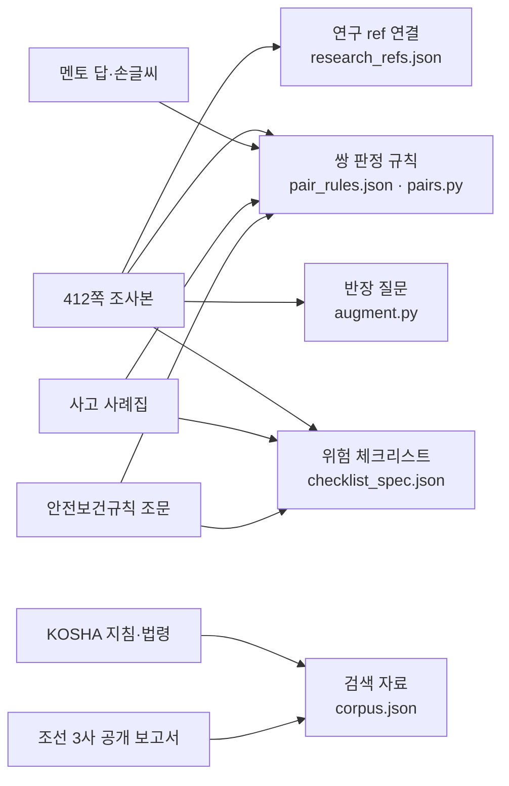
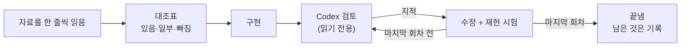
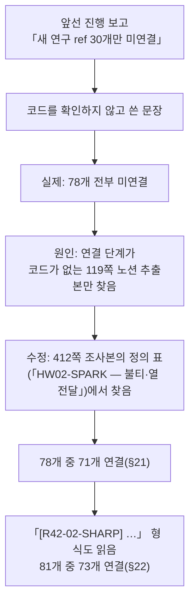

# 14. 자료 대조와 검토 이력 — croScan은 무엇에 맞춰 만들었고, 어떻게 검토했나

croScan의 규칙·질문·체크리스트는 팀이 준 자료(412쪽 조사본, 멘토 답, 조선 3사 조사, 현장 프로세스 조사, KOSHA 지침, 사고 사례집, 안전보건규칙)에 맞춰 만들었습니다.
이 문서에는 앱의 어느 부분이 어느 자료에 기대는지 적습니다. 그것을 언제 어떻게 검토하고 고쳤는지, 구하지 못한 것과 일부러 다르게 한 것이 무엇인지도 적습니다.

**이 문서에서 알 수 있는 것**

- 자료마다 무엇을 가져와 앱의 어느 파일·기능에 넣었고, 어떤 시험으로 확인하는지
- 검토 이력: 날짜, 검토 대상, 지적 수, 바뀐 것(설계 문서에 적힌 사실만)
- 틀렸던 보고와 그 정정(연구 ref 「30개만 미연결」 → 실제로는 전부 미연결 → 지금 81개 중 73개 연결)
- 구하지 못한 것(JSP 작업표준 원문, 실제 사용자 시험, 회사 SSO, GPU)과 그 이유
- 자료와 일부러 다르게 한 것, 아직 남은 것, 앞 설계 설명과 지금 코드가 다른 곳

## 목차

1. [무엇을: 이 문서가 답하는 것](#1-무엇을-이-문서가-답하는-것)
2. [왜: 자료 대조를 따로 적는 이유](#2-왜-자료-대조를-따로-적는-이유)
3. [자료별 대조표](#3-자료별-대조표)
4. [검토 이력](#4-검토-이력)
5. [정정 기록](#5-정정-기록)
6. [구하지 못한 것과 이유](#6-구하지-못한-것과-이유)
7. [자료와 일부러 다르게 한 것](#7-자료와-일부러-다르게-한-것)
8. [남은 것](#8-남은-것)
9. [앞 절 설계 설명과 지금 코드가 다른 곳](#9-앞-절-설계-설명과-지금-코드가-다른-곳)
10. [코드 어디](#10-코드-어디)
11. [시험](#11-시험)
12. [한계](#12-한계)

---

## 1. 무엇을: 이 문서가 답하는 것

팀원이 자주 묻는 질문은 세 가지입니다.

- 「이 규칙(질문, 체크 항목)은 어느 자료에서 왔나?」 → [3절](#3-자료별-대조표)
- 「자료와 다 맞춰 봤나? 언제, 몇 번?」 → [4절](#4-검토-이력), [5절](#5-정정-기록)
- 「자료에 있는데 왜 앱은 다르게 하나? 왜 안 했나?」 → [6절](#6-구하지-못한-것과-이유)~[8절](#8-남은-것)

**지금 코드 기준 수치**(2026-11-01 이 문서를 쓰며 직접 셈)

| 대상 | 수 | 센 곳 |
|---|---:|---|
| 쌍 판정 규칙 | 36 | [`server/pair_rules.json`](../server/pair_rules.json) `rules` |
| 위험 체크리스트 항목 | 86 (공통 7·화기 21·밀폐 16·고소 16·인양 12·정전 14) | [`server/checklist_spec.json`](../server/checklist_spec.json) |
| 체크리스트 연구 ref | 81개 중 73개 연결, 8개 미연결 | [`server/knowledge/research_refs.json`](../server/knowledge/research_refs.json) `refs`의 `status` |
| 사고 사례집 연결 | 40항목, 서로 다른 사례 48건(항목당 최대 3건, 연결 수로는 78) | `checklist_spec.json` 항목의 `cases` |
| 검색 자료 조각 | 634 (법령 37·공공 211·조선사 60·팀 326, 그중 가상 표시 127) | [`server/knowledge/corpus.json`](../server/knowledge/corpus.json) |
| 회귀 시험 | `tools/check_*.py` 34종 | [`tools/`](../tools/) |

---

## 2. 왜: 자료 대조를 따로 적는 이유

- **안전 주제입니다.** 자료에 있는 위험을 앱이 빠뜨리면 안전팀은 그 위험을 듣지 못합니다. 그래서 「반영했다」는 말보다 「어디에, 어떤 시험으로」가 중요합니다.
- **보고가 틀린 적이 있습니다.** 코드를 확인하지 않고 쓴 진행 보고가 있었습니다([5절](#5-정정-기록)). 그런 문장을 다시 쓰지 않으려고, 이 문서는 수치를 지금 코드에서 세어 적습니다.
- **자료끼리 다르고, 자료와 현장도 다릅니다.** 앱이 자료와 다르게 하는 곳에는 이유가 있어야 합니다. 이유 없이 다르면 결함입니다.

---

## 3. 자료별 대조표

자료 원문(412쪽 조사본 텍스트, 사례집 PDF 등)은 저장소에 없습니다. 팀 자료 폴더에 있습니다. 저장소에는 그 자료를 정리한 [`docs/reference/`](reference/) 문서와, 자료에서 뽑은 규칙·인용만 있습니다.

| 자료 | 무엇을 가져왔나 | 앱 어디(파일·기능) | 확인 방법(시험 이름) |
|---|---|---|---|
| **412쪽 팀 조사본**(추가본·전체자료) | 체크리스트 연구 코드(예: `HW02-SPARK`)의 정의 쪽·원문 | [`server/knowledge/research_refs.json`](../server/knowledge/research_refs.json), 만드는 곳 [`tools/build_corpus.py`](../tools/build_corpus.py) `research_refs()` | [`check_retrieval.py`](../tools/check_retrieval.py) — 「원문에 없는 ref는 「미연결」(인용하지 않음)」, 「코드가 아닌 ref(사례·보고서)는 미연결, 이유가 적힘」 |
| 〃 | 쌍 판정 보강: 잔류 분기(잔열·흄, 지지 상실, 분리물, 시험운전, 공유 잠금, 방사선 선원), 새 규칙(정전×밀폐 환기, 크레인 시험운전×상부, 대피로 막힘, 용접 귀환선, 연삭 비산 등), 「거리 미확인」을 빼지 않고 판정보류(확인이 필요해 3순위로 남긴 경보)로 둠 | [`server/pairs.py`](../server/pairs.py) `profile()`·`detect()`, [`server/pair_rules.json`](../server/pair_rules.json) | [`check_pairs_material.py`](../tools/check_pairs_material.py) 186/186 |
| 〃 | 반장 질문: T4(잔불 확인 끝), T7(주간·야간 체크와 시간), T8(야간 화기 지원·인계), T9(대기 중 상태), CF3~CF5, D6·D7, LO5·LO6, LI3, A4, T6 문구 | [`server/augment.py`](../server/augment.py) `_time_of_day()`, `WAIT_Q` 등 | [`check_questions_material.py`](../tools/check_questions_material.py) 245/245 |
| 〃 | 체크리스트 53 → 83항목(§21), 「해당 없음」 제안 조건, 같은 허가서 안 화기(cross) | [`server/checklist_spec.json`](../server/checklist_spec.json), [`server/checklist.py`](../server/checklist.py) | [`check_checklist_material.py`](../tools/check_checklist_material.py) 561/561 |
| **멘토 Q&A·팀 결정**([멘토질문_팀결정.md](reference/멘토질문_팀결정.md)) | D4: 맞닿은 작업(10:00 끝·10:00 시작)은 앞 작업의 잔류위험으로 봅니다. 잔류가 미확인이면 「확인 필요」. D7: RT(방사선투과검사) 통제구역이 비면 「확인 필요」. D9: 멘토 수치는 논리로만 쓰고 통계처럼 쓰지 않음 | `pairs.py`의 잔류(`residual`)·RADIATION 규칙 | [`check_pairs.py`](../tools/check_pairs.py), `check_pairs_material.py` |
| **멘토 손글씨** | 「상·하 병행 절대 불가」 → 반장이 「아래에서 작업」이라 답한 상하 동시 작업은 금지 조합 1순위. 도장×밀폐 금지 조합(`CONF_PAINT`). RT × 다른 작업 병행 불가 | `pair_rules.json`의 `forbidden` 규칙 10개, `pairs.py` | [`check_pairs_final.py`](../tools/check_pairs_final.py) — 「상하 동시, 반장이 「아래 작업」이라고 답함 → 금지 조합 1순위」; `check_pairs_material.py` — 「RT × 같은 블록 작업(서류 확인) → 1순위」 |
| **조선 3사 조사**([조선3사_작업허가_조사.md](reference/조선3사_작업허가_조사.md)) | 공개 보고서의 용어·정책 설명. 허가 절차 원문은 비공개라 회사 기준처럼 인용하지 않음. croScan은 기존 PTW 전산을 대체하지 않고 보완한다는 위치. 도장×화기 사례는 「선내 사례」로 범위를 좁혀 적음 | `corpus.json` 조선사 층 60조각, [`server/retrieval.py`](../server/retrieval.py) `search()`, `pair_rules.json` FIRE 규칙의 `cases` 참고 문구 | `check_retrieval.py` |
| **현장 프로세스 조사**([현장프로세스_조사자료_정리.md](reference/현장프로세스_조사자료_정리.md)) | 허가서 5종(화기·밀폐·고소·인양·정전)과 종류별 체크 항목, 전날 마감 뒤 그날 신청을 한꺼번에 대조하는 구조, 쌍 판정 순서와 상태(확인 필요·보류) | [`server/permit_kinds.py`](../server/permit_kinds.py) `checks()`·`values()`, [`server/form_spec.py`](../server/form_spec.py), `pairs.detect()` | [`check_extract.py`](../tools/check_extract.py), [`check_checklist.py`](../tools/check_checklist.py), `check_pairs.py` |
| **현장 인터뷰·실물 양식** | 화기 × 가연성 가스·오일 미스트(인터뷰 00:21) → 새 규칙 `FIRE_GAS`. 실물 블록 번호(B11·E170(A)·B-01) 읽기. 작업표준(JSP) 번호 칸. 펜던트·소켓 점검 | `pairs.py` `BLOCK_ID`·`FIRE_GAS`, `form_spec.py` `jsp_no` | `check_pairs_final.py`(「화재 … 인터뷰 00:21」 묶음), `check_questions_material.py`(실물 양식 블록 번호), [`check_form_intact.py`](../tools/check_form_intact.py) |
| **KOSHA 지침 3종**(A-G-14-2026 용접·용단 화재예방, B-E-12-2026 전기작업, B-5-2011 조선업 안전점검) | 「왜 묻나요?」·근거 지도에 보이는 공공 근거. JSP 본문 대신 보이는 근거. B-5-2011은 현행 여부 미확인이라 업로드 분석에는 넘기지 않음 | `corpus.json` 공공 층 211조각, `retrieval.py` `for_analysis()`·`related()`, [`server/evidencemap.py`](../server/evidencemap.py) | `check_retrieval.py` 29/29 |
| **조선업 중대재해 사례집**(2015~2024 사례, 안전보건공단 부산광역본부 2025 발간) | 같은 기전의 사고만 골라 체크 항목 40개에 사례 48건(쪽수·짧은 요약). 숫돌 시운전 1분·3분(C59·C60). 블록 안착 규칙의 사고 근거(ACC-E04·ACC-KR-B08) | `checklist_spec.json` `cases`, [`server/explain.py`](../server/explain.py)의 「참고 사고 사례」 문장, `pair_rules.json` `cases` | `check_checklist_material.py` — 「사고사례집 연결: …항목, 사례마다 쪽수·짧은 제목(40자 이하), 항목당 3건 이하」, 「체크 항목 설명(왜?)에 같은 위험의 참고 사고 사례와 쪽수」 |
| **안전보건규칙 등 법령**(국가법령정보센터 현행본) | 쌍 규칙 36개 중 35개에 조문. 그중 현행본 대조 기록(`law_checked`)이 있는 규칙은 16개(맞음 11·약함 5). 체크리스트는 공통 4항목에만 대조 기록(`law_fit`). T7은 근로기준법 제56조 제3항의 야간 시간만 씀 | `pair_rules.json` `law`·`law_fit`·`law_checked`, `checklist_spec.json` `law_fit`, [`server/review.py`](../server/review.py) `LEGAL_NIGHT`, `corpus.json` 법령 37조각 | `check_retrieval.py`, [`check_explain.py`](../tools/check_explain.py), `check_questions_material.py` — 「「주간」 + 01:00~04:00(통째로 법정 야간) → T7」 |

**주의.** 412쪽 조사본은 검색 자료(`corpus.json`)에 들어 있지 않습니다. 검색의 팀 층은 119쪽 노션 추출본입니다. 412쪽 조사본은 연구 ref 연결(`research_refs.json`)로만 앱에 들어옵니다. 자세한 것은 [10 근거와 자료](10_근거와_자료.md#5-연구-ref-412쪽-조사본-연결)에 있습니다.

---

## 4. 검토 이력

검토는 주로 Codex(gpt-6-astra, 읽기 전용)로 했습니다. Codex가 지적하면 고쳤습니다. 「마지막 회차」는 미리 정했고, 그 회차의 지적을 모두 고친 뒤 끝냈습니다(회차 상한). 표의 high·xhigh는 Codex의 추론 강도 설정이고, xhigh가 더 깊게 봅니다. 아래 표는 [설계서](reference/AI도입계획_설계서.md)(부록·§20·§21·§22)와 [진행정리](reference/진행정리.md)에 적힌 사실만 옮겼습니다.

| 날짜 | 무엇을 검토했나 | 누가·어떻게 | 지적 수 | 바뀐 것 |
|---|---|---|---|---|
| 2026-10-30 | 통합 AI 설계 | 설계 3회차 | — | 설계 검토를 3회차로 끝내고 구현 기본값 확정 |
| 2026-10-31 | 설계 최종 검수 | Codex 전수 검수 | 건수 기록 없음 | 「최소 보완 후 구현 가능」 판정, 표의 최소 수정 반영 |
| 2026-10-31 | AI 출력물의 화면·문서 배치(§19) | Codex 2회 | 18건(2회차) | 모두 반영 |
| 2026-10-31 | 구현 조각 1~8 | 조각마다 Codex(xhigh 중심) | 2조각 7+8, 3조각 8, 4조각 11(계획)+9, 5조각 6, 6조각 9, 7조각 7, 8조각 5. 1조각은 건수 없이 고친 항목만 적힘 | 모두 반영(6조각의 열람 권한은 한계로 기록) |
| 2026-10-31 | 남은 기능 완수(근거 지도·체크리스트 AI·판정보류 질문 등) | Codex 마지막 검토(xhigh) | 23건(상 8·중하 15) | 모두 반영. 모델이 규칙 경보를 줄이는 경로 4개를 막음 |
| 2026-10-31 | 실사용·현장 자료 대조 | 페르소나(가상의 사용자 역할) 실사용 + Codex 2회(xhigh) | 실사용 7건, Codex 1회차 12건(A1~A12), 2회차 잔여 2건 | 모두 반영. 원본양식 픽셀 비교 시험(`check_form_intact`) 신설 |
| 2026-10-31 저녁 | 현장 정정 35항목(D01~D35) | 412쪽본 대비 정정 목록 대조 + Codex 1회 | 이미 맞음 18·반영 필요 11·범위 밖 6, Codex 12건 | 옛 승인 모델 문구 삭제, 그 구절 3개를 검색에서 뺌(`retrieval.CORRECTED`) |
| 2026-10-31~11-01 | 자연어 1,200건 평가 | 운영 서버 | 통합: 맞음 794·틀림 53·놓침 206·금지 0·실패 6 | **보강 전 코드** 값. 이후 다시 돌리지 않음 |
| 2026-11-01 | 조사자료 전수 대조(§21) | 412쪽: 독자 8명 + Codex 앞뒤 절반. 그 밖의 자료: 독자 18명, 1,295행 | 대조표 「빠짐·일부」 행 | 쌍 규칙 16 → 35, 체크리스트 53 → 83, 질문 추가 |
| 2026-11-01 | §21 구현의 축별 검토 | Codex high 4회 | 매칭 14, 질문 12, 체크리스트 8, 확인 창 7(+글 부정 3) | 모두 반영 |
| 2026-11-01 | §21 전체 | Codex xhigh 1회(마지막) | 14건 | 반영. 다만 #4는 표의 항목만 고쳐져 같은 유형이 남음 → §22에서 고침 |
| 2026-11-01 | T7(주간·야간 체크와 시간) | Codex 2회 | 1회차 6건, 마지막 7건 | 모두 반영. 서식 점검도 같은 기준으로 바꿈 |
| 2026-11-01 | 연구 ref 연결 | Codex 전수 대조 | 뜻이 어긋난 3건 | 항목 ref 수정(+LU02, +PE10-RESCUE, ACC-E16→LU03) |
| 2026-11-01 오후 | 최종 전수 검토(§22): 대조표 「빠짐·일부」 행 하나하나를 지금 코드와 | Codex xhigh 2묶음 + 한도 뒤 검토자(Claude 에이전트) 7명 + 문서 주장 검증 1묶음 | 서로 다른 결함 약 60개, 문서 주장 약 160건 중 26건 틀림 | 쌍 판정 안전 결함, 질문(「미정」에 닫히던 6개 등), 체크리스트 83 → 86, 연구 ref 73/81 |
| 2026-11-01 오후 | §22 수정분 재검토 | Codex high 2회 | 쌍 판정 17건, 질문·체크리스트 11건(회귀 2건 포함) | 모두 반영 |
| 2026-11-01 밤 | 최종 회차: 9묶음 처음부터 | Codex xhigh | 묶음별 표(아래) | 판독·문구 결함 수정, T8을 좁힘, 사례집 연결 |

**최종 회차 묶음별 결과**(설계서 §22. DONE = 반영됨, PARTIAL = 일부, MISSING = 빠짐, WRONG = 틀림)

| 묶음 | DONE | PARTIAL | MISSING | WRONG |
|---|---:|---:|---:|---:|
| part1~3 | 79 | 28 | 1 | 6 |
| part4~5 | 140 | 26 | 0 | 16 |
| part6 | 65 | 39 | 1 | 8 |
| part7~8 | 93 | 55 | 1 | 5 |
| 재독 A | 42 | 224 | 29 | 13 |
| 재독 B | 70 | 222 | 70 | 30 |
| 사례집·양식·인터뷰 | 87 | 37 | 3 | 1 |
| 멘토·슬라이드 | 23 | 15 | 0 | 1 |

xhigh 기준이 앞선 검토보다 엄격해서 PARTIAL이 크게 늘었습니다(설계서 §22). 같은 결함이 여러 묶음에 되풀이해 나옵니다. 그래서 행 수를 더한 값을 결함 수라고 말하지 않습니다. 남은 PARTIAL 가운데 일부러 두는 것은 [8절](#8-남은-것)에 있습니다.

**최종 회차 뒤 바로 고친 것**
- 인원 칸이 빈 작업도 노출을 낮추지 않습니다(인원 수는 따로 묻습니다).
- 체크 항목별 유사 사고 사례를 붙였습니다(40항목, 48건).

**시연 자료 결과(시연 자료 기준, 2026-10-29 시연일)**: 정답 쌍 10/10 찾음(순위까지 맞음 8/10), 근접 5쌍 중 확정 경보 0(3쌍은 판정보류). 합성한 하루의 결과입니다. 현장 정확도가 아닙니다. 자세한 표는 [11 시험과 평가](11_시험과_평가.md#7-기록된-결과)에 있습니다.

---

## 5. 정정 기록

틀렸던 보고·판단과 그 정정을 숨기지 않고 적습니다.

### 5.1 연구 ref 「30개만 미연결」은 틀린 보고였다

- **무엇이 틀렸나.** 진행 보고에 「새 연구 ref 30개만 미연결」이라고 썼습니다. 코드를 확인하지 않은 문장이었습니다.
- **실제.** 그때 78개 전부가 미연결이었습니다. 연결 단계가 연구 코드가 없는 119쪽 노션 추출본만 찾았기 때문입니다.
- **고친 것.** 412쪽 조사본 텍스트의 정의 표에서 찾게 고쳤습니다. 인용은 그 코드의 정의 범위만 씁니다(묶음 코드는 하위 코드 전부, 문장 안 하위 코드는 조건~결과 절).
- **지금.** `research_refs.json`을 세면 81개 중 73개가 「연결」입니다. 나머지 8개는 「미연결」이고 인용하지 않습니다. 8개 모두 조사본 코드가 아닌 표시라서 그렇습니다.

| 미연결 ref | 항목 |
|---|---|
| (조문 미기재) 사내 위험성평가 대조 — 정정내용 D12·안전보건보고서 | `common_ra` |
| 부록B MACHINE | `common_machine` |
| 사례 C02·C03·C22 | `hot_under` |
| 사례 C02·C11 | `hot_tack` |
| 사례집 도장(밀폐·혼재)·멘토 병행 불가 | `confined_solvent` |
| 사례 C26·C28 | `height_mewp` |
| 안전보건보고서 혹서기 온열질환(옥외·고소) | `height_heat` |
| 사례 C56·단기공사표준 | `loto_drop` |

- **이 일로 바꾼 방식.** §22에서는 구현 기록(impl 메모)을 믿지 않았습니다. 대신 대조표의 「빠짐·일부」 행을 지금 코드와 하나씩 다시 맞췄습니다. 이 문서의 수치도 코드에서 직접 셌습니다.

### 5.2 「다 반영했다」도 맞지 않았다

§21 보강 뒤에 「다 반영했다」고 보고했습니다. 이 보고는 §22 재검토에서 맞지 않았습니다. 서로 다른 결함이 약 60개 나왔습니다. 문서 주장 약 160건 중 26건이 맞지 않았습니다. 현재 상태를 말하는 문장은 각 절에서 고쳤습니다. 앞 절 설계 설명이 지금 구현과 다른 곳은 [9절](#9-앞-절-설계-설명과-지금-코드가-다른-곳)에 모았습니다.

### 5.3 그 밖의 정정

| 언제 | 앞의 판단·보고 | 정정 |
|---|---|---|
| 2026-11-01(§21 → §22) | 「미정 표현에도 질문이 닫힘」(#4)을 고쳤음 | 표에 든 항목만 고쳐졌습니다. H2·H3·L5·LI2·LO4·LO5는 「미정」에도 닫혔습니다. §22에서 고쳤습니다 |
| 2026-11-01 밤 | T8(야간 화기 지원·인계)을 야간 체크·다음 날 종료로 묻기 | 자료(MT12 205쪽 「필요하나 모호」, MT14 247쪽·N4-MT15 315쪽 「야간 자체로 묻지 않음」)와 Codex 세 묶음에 따라 좁혔습니다([7절](#7-자료와-일부러-다르게-한-것)) |
| 2026-11-01 | 연구 ref 3건의 뜻 | 공구 낙하 +LU02, 구조자 상해 +PE10-RESCUE, 줄걸이하러 올라가다 추락 ACC-E16(블록 회전 추락, 다른 뜻) → LU03 |
| 2026-10-31 저녁 | 검색 자료의 옛 승인 설명(안전팀 전산승인, 안전 측 최종 승인, 전산허가 = 대면 불필요) | 전산승인은 생산부서 승인권한자가 합니다. 그 구절을 검색에서 뺐습니다(`retrieval.CORRECTED`) |
| 2026-10-31 저녁 | 자연어 평가 중간 「틀림 18건」 | L3에 「상부」를 바르게 읽은 것이었습니다. 기대표 밖이라 틀림으로 셌습니다. 채점에 「맞지만 기대하지 않은 판독」 중립 처리를 넣었습니다 |
| 2026-10-31 | 자연어 1,200건 「틀림 53」의 성격 | 원자료로 보면 값·주체·시점 틀림은 0입니다. 53건이 모두 글로 적은 「없음」의 표기 차이라는 분류는 **수작업 검토 결과**입니다(건별 분류 원자료 없음) |

---

## 6. 구하지 못한 것과 이유

| 무엇 | 왜 못 구했나 | croScan이 대신 하는 것 |
|---|---|---|
| **JSP 작업표준 원문** | JSP 번호(실물 양식 예: HHIS-CN-C6B0-014)는 HD현대 사내 Hi-STANDARD 시스템의 작업표준 문서 번호입니다(팀 조사). 받은 자료 전체에 번호만 있고 본문이 없습니다. 노션의 `SIM-JSP-N01` 등은 합성 번호입니다. 공개 웹·회사 공식 자료에도 원문이 없습니다(2026-11-01 확인). 회사가 문서를 주지 않는 한 연결할 수 없습니다 | 번호 **형식만** 검사합니다: [`web/app.js`](../web/app.js)의 `CODE_RULES.jsp_no`와 `codeProblem()`이 「HHIS로 시작」, 「하이픈 뒤 구간」을 봅니다. 근거로는 공개 KOSHA 지침 3종을 보입니다. JSP 본문을 인용하지 않습니다. 형식 검사를 직접 보는 `check_*` 시험은 없습니다 |
| **실제 사용자 시험** | 사람(작업반장·안전관리자)이 있어야 합니다. 준비물은 만들었지만 실행하지 않았습니다 | 페르소나 실사용(스테이징)과 회귀 시험만 했습니다. 효과(시간 절감·사고 감소)는 잰 적이 없습니다 |
| **회사 SSO** | 회사 인증 체계에 붙을 수 없습니다. 시연판에는 계정이 없습니다 | 사내 로그인 프록시 예시와 설정 검사([`check_proxy_headers.py`](../tools/check_proxy_headers.py), 오프라인 7/7)만 있습니다. 제출본은 추측하기 어려운 ID와 30일 보관으로 범위를 줄였습니다 |
| **GPU** | 이번 범위 밖으로 남겼습니다. 운영 서버는 CPU로 추론합니다 | 미리 계산하고 결과를 기다리지 않는 구조로 대기를 줄였습니다. 그래도 지연·시간 초과가 날 수 있습니다 |
| 확인된 현장 근무시간 | 자료의 08~18 / 18~익일 08 구분은 작성자 시나리오입니다(N4-MT15). 현장 값이 없습니다 | 법정 야간 한 줄로 명백한 경우만 묻습니다(T7). 현장 값이 생기면 환경변수 `CROSCAN_SITE_SHIFT`로 넓게 대조합니다 |
| 칼럼 간격 실측, 3D 형상·좌표, 전날 잔류 | 입력이 없습니다 | 칼럼 2칸 이내를 「가깝다」로 둡니다(`augment.NEAR_COLS`, 잠정). 거리 미확인은 판정보류로 남깁니다 |
| 조선 3사 허가 절차 원문 | 비공개 | 공개 보고서는 용어·정책 설명에만 씁니다 |

---

## 7. 자료와 일부러 다르게 한 것

각 항목은 이 문서를 쓰며 코드에서 확인했습니다.

### 7.1 기준본(v1) 보존과 그 예외

**기준본(v1)** 은 조사자료 보강 전의 쌍 판정 사본입니다([`tools/fixtures/pairs_v1/`](../tools/fixtures/pairs_v1/)). 보강 뒤에도 v1이 낸 경보가 사라지거나 순위·점수·판정 표기가 내려가면 안 됩니다(`check_pairs_material.py`의 `lost()`). 설계서 §22가 적은 의도한 예외는 둘입니다.

| 예외 | 근거 | 코드 | 시험 |
|---|---|---|---|
| 「용접봉·용접재료 불출」만 적힌 작업은 화기가 아닙니다 | 조사본 84쪽 17번(불출·포장 확인을 용접 수행으로 넓히지 않음) | `pairs.py`의 `ISSUE`(불출·지급·수령·보관·선정·재고·반납)가 있으면 `WELD_THING`으로 용접 낱말을 물건으로 읽음. 「용접봉 운반」, 「불출 후 보강재 용접」은 그대로 화기 | `check_pairs_material.py` — 「의도한 예외 하나: 「용접봉·용접재료 불출」만 적힌 작업은 화기가 아님」, 「불출과 함께 실제 용접 행위가 적히면 화기 유지」. `lost(..., skip={"WP-M-100"})`·`skip={"WP-M-162"}` |
| 「관찰·모니터링」만 적힌 작업은 그 행위가 아닙니다 | §22 최종 검토 | `pairs.py`의 `NOT_ACTION` 끝에 「관찰」, 「모니터링」이 있습니다. v1 사본에는 없습니다. 「입회하에 용접」은 용접입니다 | `check_pairs_final.py` — 「「받침대 제거 상태 관찰」은 받침 제거 작업이 아님」, 「#1 「입회하에 용접」은 용접」. v1 비교 하루에는 이런 작업이 없어서 `lost()`의 `skip`에는 없습니다 |

**「RT 검사 여부 확인」, 「방사선 표지 확인」** 도 방사선 촬영으로 읽지 않습니다(`pairs.py`의 `RAD_NOT`에 `여부|표지`). 다만 이것은 v1 예외가 **아닙니다**. v1도 `NOT_ACTION`의 「확인·여부·표지」 때문에 이 말을 촬영으로 읽지 않았습니다. 지금 코드는 낱말 「RT」 하나와 「방사선투과검사」도 촬영으로 읽게 넓혔습니다(v1은 「RT 촬영」만). 그리고 그 넓힘이 확인·표지 문구까지 잡지 않게 막았습니다. 시험: `check_pairs_final.py` — 「「RT 검사 여부 확인」 → 방사선 촬영 아님」, 「「방사선 표지 확인」 → 방사선 촬영 아님」.

### 7.2 T7: 주간·야간 체크와 적힌 시간

- **자료.** 08~18 구분은 작성자 시나리오입니다. 자료에는 「야간 자체·08~18 가정만으로 질문·오류 금지」(N4-MT15 315쪽)라고 적혀 있습니다.
- **croScan.** 확인된 현장 근무시간이 없으면 08~18을 쓰지 않습니다. 법정 야간(근로기준법 제56조 제3항, 22:00~다음 날 06:00) 한 줄로 **명백한 경우만** 묻습니다.
  - 「주간」 체크인데 어느 날 시간이 통째로 그 안입니다(예: 01~04시). `review.legal_night_only()`
  - 「야간」 체크인데 모든 날이 그 밖이고 정오를 지납니다(예: 10~15시). `review.plain_day()`
  - 묻지 않습니다: 저녁 연장(18~21시, 20~23시), 22시에 걸친 행, 주야 둘 다 체크.
- **질문.** 「체크와 적힌 시간이 서로 맞나요?」입니다. 선택지에 「둘 다 맞음(현장에서 이 시간을 …으로 봄)」이 있습니다. 법 조항은 임금 가산의 야간 정의이고, 체크의 뜻이 아니기 때문입니다.
- **코드.** [`server/augment.py`](../server/augment.py) `t7_target()`, `_time_of_day()`. 현장 값은 `SITE_SHIFT`(`CROSCAN_SITE_SHIFT`).
- **시험.** `check_questions_material.py` — 「확인된 근무시간 없음 → 「주간」 체크 + 20~23시도 T7 없음」, 「「주간」 + 01:00~04:00(통째로 법정 야간) → T7」, 「서식 점검: 주간 + 20~23시(저녁 연장)는 표시 안 함」.

### 7.3 T8: 야간 화기 지원·인계

- **자료.** MT12 205쪽은 야간 지원·인계 확인이 「필요하나 모호」하다고 했습니다. MT14 247쪽·N4-MT15 315쪽은 「야간 자체로 묻지 않음」입니다.
- **croScan.** 화기 허가서에서, 서류·답에 **교대·인계·지원(조명·화재감시 등) 언급이 있을 때만** 묻습니다. 야간 체크·다음 날 종료·T7 「적힌 시간이 맞음」만으로는 묻지 않습니다. 지원과 인계가 **둘 다** 적혀 있으면 묻지 않습니다. 「교대」 한 낱말만으로는 질문이 닫히지(답한 것으로 처리되지) 않습니다.
- **코드.** `augment._time_of_day()`의 언급 검사(`교대|인계|야간조|…|조명|투광등|작업등|지원`)와 `NIGHT_SUPPORT`·`NIGHT_HANDOVER`.
- **시험.** `check_questions_material.py` — 「(최종 검토) 교대·인계·지원 언급이 하나도 없으면 야간 체크만으로는 T8 없음」, 「(Codex #6) 「교대」 한 단어로는 T8이 닫히지 않음」, 「지원(투광등)과 인계가 모두 적혀 있으면 T8 없음」, 「비화기도 T7은 묻고, T8(화기 야간 지원)은 묻지 않음」.

### 7.4 자료에 있지만 만들지 않은 것(설계서 §21·§22 「하지 않은 것」)

| 자료에 있는 것 | 하지 않은 이유 |
|---|---|
| 잘못된 지시·불일치 재료·결함 공구가 위험 작업으로 이어지는 규칙(INFO·QUALITY·TOOL) | croScan은 작업지시·자재·공구 기록을 받지 않습니다 |
| 보행 × 다른 작업의 호스·케이블 걸림 쌍 | 같은 BAY의 거의 모든 쌍에 붙습니다. 체크리스트 「호스·케이블·잔재를 통로에서 정리」로 다룹니다 |
| 화기에서 칼럼 2칸 넘게 떨어진 일반 작업(HOT_PERSON 확장) | 칼럼 간격이 측정값이 아닙니다. 화재·압력·방사선 계열은 거리 미확인 판정보류로 남깁니다 |
| 비화기 야간 자체 질문 | 자료가 금지합니다 |
| 「같은 블록만으로 확인위험 금지」, 높이 숫자 하나의 미확정 처리 | 기존 경보를 낮추게 됩니다(기준본 보존 위반) |
| 규칙 쌍의 AI 검토 | 쌍 판정은 결정적 규칙(같은 입력이면 늘 같은 결과)만 씁니다 |
| 계획서×계획서 쌍, 3D 형상·좌표, 전날 잔류 | 설계 범위 밖이거나 입력이 없습니다 |
| 집결·대기 인원의 통로 점유 | 사람을 적치물로 다루지 않습니다. 밀폐·고소 작업과의 동시 노출로만 봅니다 |
| 4BAY·20칼럼 밖 칼럼(예: 28-32) | 4BAY·20칼럼은 시연 공장 배치입니다. 범위 밖은 위치 미상(판정보류)으로 남깁니다 |

---

## 8. 남은 것

설계서 §22의 「남은 것」입니다. 지금 방식이 안전 쪽이라 바꾸지 않습니다. 바꾸면 경보를 지우거나 놓칠 수 있습니다. 이 항목들은 자료 문구와 다르다는 「일부」 판정입니다. 위험 누락 결함은 아닙니다.

| 남은 것 | 지금 동작 |
|---|---|
| 선택지별 부정 범위 | 「없음」 하나가 복합 질문의 모든 원자(질문 안의 작은 확인 항목)를 닫습니다([`server/need_catalog.py`](../server/need_catalog.py) `ATOMS`) |
| 체크리스트 확인 만료 | 작업 내용이 바뀌면 모든 항목이 만료됩니다. 시간만 바뀌면 아무것도 만료되지 않습니다(항목별 의존성 아님). 해당·해당 없음 규칙이 함께 맞으면 「확인」으로 둡니다 |
| 거꾸로 적힌 시간·칼럼 | 끝이 시작보다 이른 시간, 큰 번호부터 적힌 칼럼은 넓게 읽고 「익일·오기 확인」을 묻습니다(자료는 확인 전 판정 보류를 요구) |
| 날짜의 시간대 오프셋 | 따로 보존하지 않습니다 |
| 이름만으로 붙는 태그 | 허가 종류·체크 항목·장비 번호만으로 화기·밀폐·인양 태그가 붙습니다(v1부터의 동작. 빼면 기존 경보가 내려감). TIG·퍼지 이름만으로 불활성가스, 도장·세정 작업명만으로 용제 태그가 붙습니다(「작업명에서 추정」 표시·종류 질문 있음) |
| JSP 원문 조회 | 구할 수 없습니다([6절](#6-구하지-못한-것과-이유)) |
| 「같은 불량 재작업」 참고시간 1회 추가 | 자료가 「같은 결함 재작업(명시)」을 근거로 들어서 유지합니다 |

§22 「하지 않은 것」에 적힌 다음 단계도 남아 있습니다.
- 옛 `augment.pairs()`의 X1~X6 생성 분기는 남아 있습니다. 서식 교차점검(`review.check(cross=True)`)이 이 분기를 씁니다. 쌍 판정 본체(`pairs.detect()`)로 옮기는 것은 다음 단계입니다.
- 새 체크 항목의 조문(제241조의2·제618조·제122조)은 문장에만 있고 현행본 대조 기록(`law_fit`)이 없습니다. 지금 `law_fit`이 있는 체크 항목은 공통 4개입니다.
- 자연어 1,200건은 11-01 보강 뒤 다시 돌리지 않았습니다.

---

## 9. 앞 절 설계 설명과 지금 코드가 다른 곳

설계서 §22의 표입니다. 앞 절(10-30 설계 시점)의 문장이 지금 구현과 다릅니다. 설계서를 읽을 때는 오른쪽을 믿습니다.

| 절 | 앞 절의 설명 | 지금 구현 |
|---|---|---|
| §1.1 | 파생 답을 즉시 합침, 먼저 저장하고 나중에 취소 | 파생 해석은 확인 대기 제안으로 보관합니다. 반장이 채택한 해석만 반영합니다 |
| §1.1 | /api/chat은 자유문장 스트리밍 | 레거시 /api/chat은 기본 비활성(410). 환경변수로 켤 때만 동작 |
| §1.1 | 관리자 화면은 시연 DB를 읽음 | 시연 자료에 실제 croScan 제출 스냅숏과 확인 답을 연결합니다 |
| §2.1 | croscan.sqlite3가 서버 상태의 기준 | 대화·확인·제출 메타데이터는 review.sqlite3, 보류 질문은 holdq.sqlite3, 제출 PDF는 submitted 폴더 |
| §3.5·부록 | 남은 규칙 질문 수만큼 예약 | 아직 발급하지 않은 일반(비-extra) 규칙 질문만 예약합니다. T4 같은 extra·되묻기 질문은 빼고 셉니다 |
| §3.1·§3.5 | 정확한 질량 재요구 차단, C4는 불일치 기록으로 | C4는 중량이 정격보다 크면 「어느 값이 맞나요?」와 「맞는 값 입력」을 보입니다 |
| §7 | clean()이 서버 기본 목록을 재구성 | 기본 목록 복원과 선택 병합은 merge()가 합니다. clean()은 받은 항목을 정리합니다 |
| §8.3 | AI가 담당자별로 질문을 나눔 | 판정보류 질문은 모델 호출 없이 규칙과 문장 틀로 작업별로 만듭니다(holdq) |
| §10.4 | 검색 캐시는 끈다 | 질문의 관련 자료 검색 결과는 메모리 캐시(_REFS)를 씁니다 |
| §10.5 | PHRASE를 끈다 | 질문을 보일 때 PHRASE를 배경에서 부릅니다 |
| §10.7 | 출력이 없는 호출 | prefill은 max_tokens=1로 부르고, 그 출력은 쓰지 않습니다 |
| §19 | 답으로 해소된 경보는 현재 건수에 합산하지 않음·사라짐 | 답으로 해소된 기존 경보도 문서 기준으로 목록에 남습니다(「답으로는 해소 · 문서 기준 유지」) |
| §21 매칭 | 원인 작업이 먼저일 때만·같은 블록만 | 원인 선행 제한은 그 설정이 있는 규칙에만 있습니다. 양방향 잔류 규칙도 있습니다. 블록 번호 없이 같은 칼럼의 잔재 청소·수거도 보류합니다 |
| §21 체크리스트 | 해당 없음은 허가서와 답이 둘 다 말할 때만 | 그것은 규칙이 「해당 없음」을 자동으로 제안하는 조건입니다. 반장은 직접 「해당 없음」을 고를 수 있습니다 |
| 부록 | 모든 작업 조합, 편의만 손해 | 검사 조합은 허가서×허가서와 허가서×계획서입니다. 보장 하한은 서류 기준 경보입니다. 모델 오류의 영향이 편의 손실뿐이라고 할 수는 없습니다 |
| §21·부록·AX §5 | 대화 30개 p50 111·p95 240초, 캐시 40.8→27.6초, 교차 11.7~15.5초, 동시 4명 32.2초, 운영 AI 쌍 검토 28~31초 | 서버 측정값이고, 로컬에 원자료 파일이 없습니다(보고 당시 값). 자연어 1,200건만 로컬 사본이 있습니다 |

이 문서를 쓰며 표의 몇 곳을 코드에서 확인했습니다: `/api/chat`의 410([`server/app.py`](../server/app.py)), `_REFS` 캐시(같은 파일), prefill의 `max_tokens: 1`([`server/llm.py`](../server/llm.py)), `holdq.sqlite3`([`server/holdq.py`](../server/holdq.py)), `merge()`·`clean()`([`server/checklist.py`](../server/checklist.py)).

---

## 10. 코드 어디

| 고치고 싶은 것 | 파일·함수 |
|---|---|
| 연구 ref 연결 규칙(코드 모양, 정의 범위) | [`tools/build_corpus.py`](../tools/build_corpus.py) `CODE`, `book_codes()`, `research_refs()` → [`server/knowledge/research_refs.json`](../server/knowledge/research_refs.json) 다시 만들기 |
| 체크 항목의 연구 코드·사고 사례·조문 | [`server/checklist_spec.json`](../server/checklist_spec.json) 항목의 `ref`, `cases`, `law_fit` |
| 쌍 규칙의 근거·조문·사고 | [`server/pair_rules.json`](../server/pair_rules.json) `law`, `law_fit`, `law_checked`, `cases` |
| 「불출」, 「관찰·모니터링」, 「RT 여부·표지」 읽기 | [`server/pairs.py`](../server/pairs.py) `ISSUE`, `WELD_THING`, `NOT_ACTION`, `RAD_NOT` |
| T7·T8 기준 | [`server/augment.py`](../server/augment.py) `t7_target()`, `_time_of_day()`, `NIGHT_SUPPORT`, `NIGHT_HANDOVER`; [`server/review.py`](../server/review.py) `LEGAL_NIGHT`, `legal_night_only()`, `plain_day()` |
| 검색에서 뺀 틀린 팀 구절 | [`server/retrieval.py`](../server/retrieval.py) `CORRECTED` |
| JSP 번호 형식 | [`web/app.js`](../web/app.js) `CODE_RULES`, `codeProblem()` |
| 기준본(v1) 사본과 비교 | [`tools/fixtures/pairs_v1/`](../tools/fixtures/pairs_v1/), [`tools/check_pairs_material.py`](../tools/check_pairs_material.py) `lost()` |

---

## 11. 시험

자료 대조를 지키는 시험입니다. 확인 수는 2026-11-01 이 문서를 쓰며 로컬에서 돌린 값입니다.

| 시험 | 지키는 것 | 확인 수 |
|---|---|---:|
| [`check_pairs_material.py`](../tools/check_pairs_material.py) | 412쪽 대조로 더한 쌍 규칙·문구·보류 질문, 기준본(v1) 보존과 「불출」 예외 | 186/186 |
| [`check_pairs_final.py`](../tools/check_pairs_final.py) | §22 최종 검토에서 찾은 빠짐의 재현(상부·낙하·화재·가스·크레인·정전·판독·문구) | 87/87 |
| [`check_questions_material.py`](../tools/check_questions_material.py) | 자료로 더한 질문(T4~T9, CF3~CF5, D6·D7 등)이 조건일 때만 나옴, T7·T8 기준, 실물 블록 번호 | 245/245 |
| [`check_checklist_material.py`](../tools/check_checklist_material.py) | 보강 항목이 그 말이 있을 때만 해당, 사고 사례집 연결 | 561/561 |
| [`check_retrieval.py`](../tools/check_retrieval.py) | 연구 ref 연결·미연결 규칙, 검색 자료 층, 인용 검사 | 29/29 |

전체 34종을 돌리는 법과 각 시험의 설명은 [11 시험과 평가](11_시험과_평가.md#4-시험-34종)에 있습니다. 기준본 비교의 자세한 규칙은 [11 시험과 평가 5절](11_시험과_평가.md#5-기준본v1과-의도한-예외)에 있습니다.

---

## 12. 한계

- **검토자는 사람 현장 전문가가 아닙니다.** 검토는 Codex와 Claude 에이전트가 자료와 코드를 대조한 것입니다. 현장 사람이 확인한 것이 아닙니다.
- **검토 회차마다 기준이 다릅니다.** 최종 회차(xhigh)는 앞선 검토보다 엄격했습니다. 그래서 회차 사이의 DONE·PARTIAL 수를 그대로 비교하지 않습니다.
- **결함 수는 대략입니다.** 「서로 다른 결함 약 60개」는 여러 표의 반복을 묶은 추정입니다.
- **평가가 낡았습니다.** 자연어 1,200건은 11-01 보강 전 코드의 결과입니다. 시간 측정은 원자료가 저장소에 없습니다.
- **시연 자료 결과는 합성 하루의 결과입니다.** 현장 정확도가 아닙니다(시연 자료 기준).
- **croScan은 승인·일정·작업 차단을 하지 않습니다.** 자료와 맞췄다는 것은 「안전팀에 물을 것을 빠뜨리지 않게 했다」는 뜻입니다. 판단은 작업반장과 안전관리자가 합니다.
