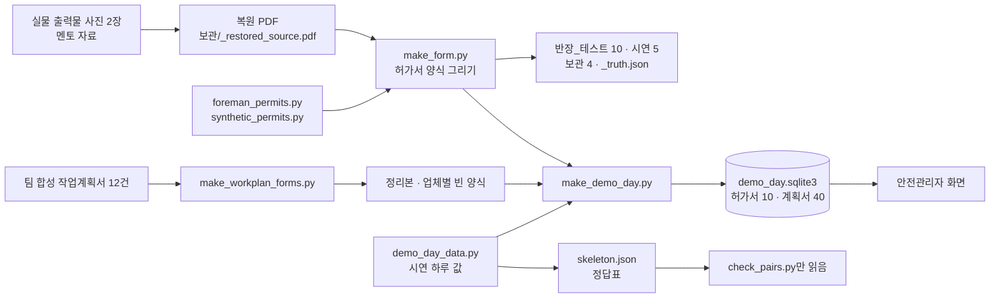
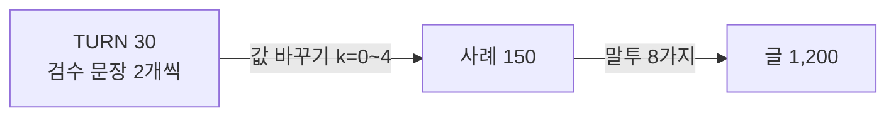
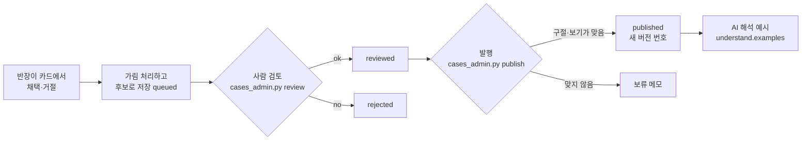

# 15. 자료와 시연 데이터 — croScan이 쓰는 자료는 무엇이고 어떻게 만들었나

croScan이 쓰는 시험 서류·시연 자료·평가 자료·지식 자료를 모두 적었습니다. 파일마다 실물인지, 복원한 것인지, 합성인지 적었습니다. 생성기마다 무엇을 넣고 무엇을 정해 두고 무엇을 무작위로 뽑는지도 적었습니다.
이 자료를 남에게 설명하는 사람은 마지막 부분의 「말할 수 있는 것 / 말하면 안 되는 것」 표를 꼭 봅니다.

**이 문서에서 알 수 있는 것**

- `samples/` 파일 114개가 각각 어디서 왔는지(실물 복원 2쪽 말고는 모두 합성)와 이름·전화번호를 어떻게 가렸는지
- 생성기 10개의 입력, 값 목록, 손으로 정한 값, 무작위와 시드, 출력, 정답표 만드는 법
- 시연 하루(2026-10-29, 작업 50건)의 설계와 정답표, 정답표를 화면에 내보내지 않는 방법
- 평가 자료·지식 자료·규칙 자료·확인 사례가 무엇이고 어디에 있는지
- 이 자료로 말할 수 있는 것과 말하면 안 되는 것(사실과 다르게 말하기 쉬운 곳)

**목차**

1. [무엇을: 자료 한눈에](#1-무엇을-자료-한눈에)
2. [왜: 거의 다 합성인 이유](#2-왜-거의-다-합성인-이유)
3. [실물·복원·합성과 가림 처리](#3-실물복원합성과-가림-처리)
4. [samples 폴더: 파일마다 어디서 왔나](#4-samples-폴더-파일마다-어디서-왔나)
5. [생성기 1: 허가서 그리기 make_form.py](#5-생성기-1-허가서-그리기-make_formpy)
6. [생성기 2: 허가서 값 synthetic_permits.py · foreman_permits.py](#6-생성기-2-허가서-값-synthetic_permitspy--foreman_permitspy)
7. [생성기 3: 작업계획서 양식 make_workplan_forms.py](#7-생성기-3-작업계획서-양식-make_workplan_formspy)
8. [생성기 4: 시연 하루 값 demo_day_data.py](#8-생성기-4-시연-하루-값-demo_day_datapy)
9. [생성기 5: 시연 하루 PDF와 DB make_demo_day.py](#9-생성기-5-시연-하루-pdf와-db-make_demo_daypy)
10. [정답표: 만드는 법과 숨기는 법](#10-정답표-만드는-법과-숨기는-법)
11. [시연 자료 기준 결과](#11-시연-자료-기준-결과)
12. [평가 자료와 생성기](#12-평가-자료와-생성기)
13. [지식 자료와 규칙 자료](#13-지식-자료와-규칙-자료)
14. [확인 사례: 후보 → 가림 → 사람 검토 → 발행](#14-확인-사례-후보--가림--사람-검토--발행)
15. [작은 도구](#15-작은-도구)
16. [처음 설계와 지금 비교](#16-처음-설계와-지금-비교)
17. [이 자료로 말할 수 있는 것과 말하면 안 되는 것](#17-이-자료로-말할-수-있는-것과-말하면-안-되는-것)
18. [코드 어디](#18-코드-어디)
19. [시험](#19-시험)
20. [한계](#20-한계)

이 문서의 수치는 2026-11-02에 저장소 파일을 직접 세어 적었습니다. 「시연 자료 기준」은 팀이 만든 합성 자료로 낸 결과라는 뜻입니다. 현장 정확도가 아닙니다.

---

## 1. 무엇을: 자료 한눈에

croScan이 쓰는 자료는 여덟 묶음입니다.

| 묶음 | 어디 | 얼마나 | 실물/합성 | 누가 씀 |
|---|---|---|---|---|
| 허가서 시험 서류 | `samples/반장_테스트/`, `samples/시연/`, `samples/보관/` | 파일 19개 | 실물 복원 2쪽 + 합성 | 회귀 시험, 시연 업로드 |
| 작업계획서 시험 서류 | `samples/작업계획서/` | 파일 34개 | 합성 | 작업계획서 읽기, 시험 |
| 시연 하루 | `samples/시연_하루/` | PDF 50개(허가서 10 · 작업계획서 40) + JSON 7 + DB 1 + 안내 1 | 합성 | 안전관리자 화면, 쌍 시험 |
| 판독 정답표 | `samples/_truth.json` | 파일 18개 · 쪽 27개의 쓴 값 | 생성기가 쓴 값 | `check_extract.py` |
| 평가 자료 | `tools/eval_*` | 자연어 시나리오 30 → 글 1,200 등 | 합성 | 평가 도구 |
| 지식 자료 | `server/knowledge/` | 조각 634개, 연구 ref 81개 | 공개 자료 + 팀 조사(일부 가상 표시) | 근거 표시, 검색 |
| 규칙 자료 | `server/checklist_spec.json`, `server/pair_rules.json` | 체크리스트 86항목, 쌍 규칙 36개 | 팀이 자료를 보고 씀 | 체크리스트, 쌍 판정 |
| 확인 사례 | 데이터 폴더 `cases.sqlite3` | 저장소에는 0건 | 실행 중 생김 | AI 해석 예시 |

---

## 2. 왜: 거의 다 합성인 이유

- **실물 서류를 구할 수 없었습니다.** 팀이 가진 실물은 멘토 자료에 찍힌 위험작업허가서 출력물 사진 2장(밀폐, 승인번호 끝 0453과 0400)뿐입니다. 작업계획서와 공장 배치도는 실물이 없습니다.
- **개인정보를 넣을 수 없습니다.** 실물에는 사람 이름·전화번호·서명이 있습니다.
- **정답을 알아야 잴 수 있습니다.** croScan이 위험한 짝을 찾았는지 보려면, 어떤 짝이 위험한지 미리 정해 둔 자료가 필요합니다. 합성 자료는 정답을 함께 만들 수 있습니다.
- 처음 설계([데이터셋 설계](reference/데이터셋_설계.md))도 「시연용은 거의 다 합성해야 한다」고 적었습니다.

그래서 합성 자료는 실물 서류의 **작성 습관**을 따릅니다. 실물 2장에서 본 습관은 다섯 가지입니다. 근무시간 전체(08:00~16:59)를 여러 날 복사합니다. 장소를 팀 이름으로 적습니다. 호선·병행여부 칸을 비웁니다. 유해위험요소를 몇 낱말로만 적습니다. 블록 여러 개를 한 줄에 나열합니다.

---

## 3. 실물·복원·합성과 가림 처리

### 3.1 세 가지 구분

| 구분 | 뜻 | 저장소의 파일 |
|---|---|---|
| 실물 | 현장에서 실제로 쓴 서류 | 저장소에 없습니다. 사진 원본도 넣지 않았습니다 |
| 복원 | 실물 사진을 보고 다시 그린 것 | `samples/보관/_restored_source.pdf`(2쪽), `samples/보관/위험작업신고서_양식.pdf`(2쪽) |
| 합성 | 팀이 지어낸 값으로 만든 것 | 나머지 모든 시험·시연 서류 |

### 3.2 복원 2건에 남은 것과 가린 것

복원 2건은 실물 0453(1쪽, 안전부서 제출용)과 0400(2쪽, 현장 게시용)입니다. 값은 [`make_form.py`](../tools/make_form.py)의 `P1`·`P2`(332~357줄)에 있습니다.

| 칸 | 처리 |
|---|---|
| 사람 이름(신청자·승인자·감독자·관리자) | 성 + XX로 가림. 예: 김XX, 최XX, 오XX |
| 전화번호 | `010-XXXX-XXXX`. 0400의 관리자 칸은 출력물 모양대로 `010XXXXXXXX` |
| 전산 도장 줄 | 사번 자리를 `XXXXXX`, 이름을 정XX처럼 가림 |
| 승인번호·작업표준(JSP) 번호·호선·부서·업체 이름·작업 내용·날짜 | **실물 값 그대로**. 예: 호선 3595-157K-COT, 부서 「대조립3부-(주)혁신이엔지」 |
| 손글씨·서명·QR 그림 | **가리지 않음.** 아래 「확인 필요」 참고 |

- **의도**: 이름·전화번호만 가리고 나머지 서류 값은 그대로 둡니다. 판독기가 실물 형식(승인번호·JSP·호선 모양)을 그대로 읽어야 하기 때문입니다. — 근거: [데이터셋 설계 §3 [A]](reference/데이터셋_설계.md#a-위험작업신고서--실제-hd현대-양식-기준)의 「실명·전화번호는 저장 안 함」, `make_form.py` 설명의 「Names and numbers stay masked (XX)」.

> **확인 필요.** `_restored_source.pdf`에는 실물 사진에서 오려 낸 그림 조각이 들어 있습니다. 1쪽에는 손글씨 이름·날짜, 서명, QR, 손글씨 추가조치 메모가 있고, 2쪽에는 QR이 있습니다. `make_form.py`의 `old_images()`(361줄)가 이 조각을 꺼내 `위험작업신고서_양식.pdf`에 그대로 붙입니다(1쪽 그림 5개, 2쪽 1개). 같은 파일 설명은 「이름은 XX로 가린다」고 적었는데, 그림 속 손글씨 이름·서명은 가려지지 않습니다. 그림을 그대로 둔 의도 근거는 찾지 못했습니다. 판단이 나기 전까지 이 두 파일은 발표 화면이나 바깥에 보이는 자료에 쓰지 않는 편이 안전합니다.

### 3.3 합성 자료의 가림 규칙

합성 자료도 실물처럼 보이게 가린 모양으로 씁니다.

- 이름은 성 + XX입니다. 시연 하루의 작성자는 `WRITERS`(윤XX·이XX·정XX·최XX·한XX·오XX), 책임자는 `LEADS`(김XX·박XX·강XX·조XX·임XX·서XX)에서 돌려 씁니다([`demo_day_data.py`](../tools/demo_day_data.py) 331~332줄).
- 전화번호는 모두 `010-XXXX-XXXX`입니다.
- 시연 하루 허가서의 QR은 `demo_qr()`([`make_demo_day.py`](../tools/make_demo_day.py) 202줄)가 그린 **QR처럼 보이는 그림**입니다. 허가번호의 해시로 칸을 칠합니다. 아무 정보도 담지 않고 어떤 시스템과도 이어지지 않습니다.
- 팀이 만든 원본 합성 작업계획서(`합성_작업계획서_6사12건24쪽_R05.pdf`)는 XX 모양을 쓰지 않습니다. 지어낸 실명 꼴 이름 19개(예: 윤재현, 김도현)를 씁니다. 호선 칸에는 팀이 가진 선박 도면의 선박 이름과 IMO 번호(GOLAR IGLOO, IMO 9633991)를 씁니다. 문서마다 「합성 시연 계획입니다. 회사 공식 발행·현장 관측 기록이 아닙니다」라고 적혀 있습니다. 정리본도 같은 값을 씁니다. 이 파일만 다른 모양을 쓰는 이유는 기록에 없습니다(설계 근거 미기록).

### 3.4 실제 이름을 빌린 것

- **양식 모양**: 허가서 양식은 실물 출력물의 칸 격자·문구·로고를 본떠 다시 그렸습니다(오타 「REQUSTED」도 그대로). 회사가 낸 공식 양식 파일이 아닙니다.
- **협력사 이름**: 현대힘스·삼녹·세진중공업·한국카본·동화엔텍·동성화인텍은 실제 있는 회사 이름입니다. 계획서 내용은 모두 합성입니다. 그 회사가 낸 서류가 아닙니다.
- **번호 형식**: 승인번호(`AC00-IH-날짜-번호`)와 작업표준 번호(`HHIS-CW-…`)는 실물의 형식을 따라 지어냈습니다.

---

## 4. samples 폴더: 파일마다 어디서 왔나

`samples/`에는 파일이 114개 있습니다. 도커 이미지에는 들어가지 않습니다(`.dockerignore`). 폴더별 쓰임은 [12 §11](12_배포와_운영.md#11-samples-폴더-지도)에도 있습니다.

| 파일 | 개수 | 구분 | 만든 것 | 쓰는 곳 |
|---|---:|---|---|---|
| `README.md` | 1 | 안내 | 사람 | — |
| `_truth.json` | 1 | 판독 정답표 | `make_form.py` | `check_extract.py` |
| `반장_테스트/<종류>_<A\|B>_07xx.pdf` | 10 | 합성 | `make_form.py` + `foreman_permits.py` | `check_questions.py`, `check_checklist*.py` 등 |
| `시연/06xx_<종류>.pdf` | 5 | 합성 | `make_form.py` + `synthetic_permits.py` | 시연 때 직접 올림, `check_extract.py`, `stress_workplan.py`(잘못 넣은 허가서 시험) |
| `보관/합성_대조립_허가신청_5건.pdf` | 1 | 합성(시연 5건 묶음) | `make_form.py` | `check_questions.py` |
| `보관/위험작업허가서_빈양식_5종.pdf` | 1 | 빈 양식 | `make_form.py` | `check_extract.py` |
| `보관/위험작업신고서_양식.pdf` | 1 | 복원(가림, 그림 조각 포함) | `make_form.py` | `check_questions.py`, `check_extract.py` |
| `보관/_restored_source.pdf` | 1 | 복원(그림 조각 원본) | 팀이 손으로 만듦(LibreOffice) | `make_form.py`가 그림을 가져감 |
| `작업계획서/합성_작업계획서_6사12건24쪽_R05.pdf` | 1 | 합성 원본 | 팀이 만듦(생성 코드는 저장소에 없음) | 손대지 않음 |
| `작업계획서/낱건_12건/` | 12 | 합성 | 원본을 건마다 2쪽씩 나눔(나눈 코드는 저장소에 없음) | `make_workplan_forms.py` 입력 |
| `작업계획서/정리본_12건/`, `정리본_6사12건24쪽.pdf` | 13 | 합성 | `make_workplan_forms.py` | 읽기 확인 |
| `작업계획서/빈양식/` 업체 6종 + 6사 묶음 | 7 | 빈 양식 | `make_workplan_forms.py` | `make_demo_day.py`, `stress_workplan.py` |
| `작업계획서/빈양식/작업계획서_빈양식_본청.pdf` | 1 | 빈 양식 | 만든 코드가 저장소에 없음(2026-10-30) | 본청 계획서 10건 |
| `시연_하루/허가서/07xx_<종류>_<A\|B>.pdf` | 10 | 합성 | `make_demo_day.py make-permits` | 안전관리자 화면 원본 보기 |
| `시연_하루/작업계획서/WP-1029-nn_<업체>.pdf` | 40 | 합성 | `make_demo_day.py make-plans` | 안전관리자 화면 원본 보기 |
| `시연_하루/permits.json`, `workplans.json`, `skeleton.json` | 3 | 합성 값 · 정답표 | `demo_day_data.py` | PDF·DB 만들기, 채점 |
| `시연_하루/workplans_truth.json` | 1 | 계획서에 쓴 값 | `make_demo_day.py make-plans` | 다시 읽기 대조 |
| `시연_하루/demo_day.sqlite3` | 1 | 다시 읽은 서류 + 답 + 정답표 | `make_demo_day.py permits`·`plans` | `server/safety.py` |
| `시연_하루/report_all.json`, `report_permits.json`, `report_plans.json` | 3 | 대조 결과 | `make_demo_day.py` | 사람이 확인 |
| `시연_하루/README.md` | 1 | 안내 | 사람 | — |

- 허가서 PDF는 글꼴 전체를 넣어 한 파일이 약 15MB입니다. 시연 하루의 작업계획서는 서브셋해서 한 파일이 약 0.3MB입니다. **의도**: 허가서는 실제로 올라올 파일처럼 만들고, 계획서 40건은 크기를 줄입니다. — 근거: `make_form.save()` 설명 「like the uploads we expect」, `make_demo_day.make_plans()` 주석 「the full Korean font is 7 MB per file」, [samples/README.md](../samples/README.md).
- `report_all.json`(2026-10-30)이 지금 DB와 맞습니다. `report_permits.json`은 그 전에 `permits` 단계만 돌린 결과라서 0732·0734의 허가번호와 답 개수가 지금 DB와 다릅니다. 도구가 단계마다 `report_<단계>.json`을 따로 쓰기 때문입니다(`main()`). 예전 파일을 남겨 둔 이유는 기록에 없습니다(설계 근거 미기록).

---

## 5. 생성기 1: 허가서 그리기 make_form.py

[`tools/make_form.py`](../tools/make_form.py)는 위험작업허가서 PDF를 그리는 도구입니다. 값은 다른 파일에서 받고, 이 파일은 양식만 그립니다.

| 항목 | 내용 |
|---|---|
| 실행 | `python tools/make_form.py` (Windows만. 맑은 고딕·Segoe UI Symbol·Century Gothic 글꼴을 `C:/Windows/Fonts`에서 읽음, 31~35줄) |
| 입력 | `P1`·`P2`(복원 2건, 332~357줄), `SYN`(`synthetic_permits.py`), `FOREMAN`(`foreman_permits.py`), 허가 종류 5개(`server/permit_kinds.py`의 `KINDS`), 그림 조각(`보관/_restored_source.pdf`) |
| 손으로 정한 것 | 칸 격자 좌표(42~49줄), 칸 이름·문구, 체크칸 모양(□ 빈칸, ■ 시스템이 정한 칸), 쪽 종류(제출용은 「안전대면허가」 줄이 있고 게시용은 없음) |
| 일부러 비운 칸 | 「당일 작업시작 전 기입(사전 작성금지)」 칸. 실물의 펜 체크는 출력 뒤 현장에서 한 것이라 그리지 않습니다 |
| 무작위 | 없습니다. 같은 입력이면 같은 파일이 나옵니다 |
| 출력 | `보관/위험작업신고서_양식.pdf`(2쪽) · `시연/06xx_<종류>.pdf` 5개 · `보관/합성_대조립_허가신청_5건.pdf` · `반장_테스트/<종류>_<A\|B>_07xx.pdf` 10개 · `보관/위험작업허가서_빈양식_5종.pdf` · `_truth.json` |
| 정답표 | `truth()`(392줄)가 쪽마다 쓴 값을 남깁니다. 그리기용 키(`checks`·`stamp`·`days`·`case`·`asked` 등)는 빼고, `kind`·`days`(날짜·시작·종료)·`checks`(체크한 칸 이름, 정렬)를 다시 넣습니다. 18개 파일 · 27쪽이 `_truth.json`에 들어갑니다 |

**만드는 순서**(`main()`, 399줄)

1. `old_images()`가 복원 PDF에서 그림 조각을 위치로 나눠 꺼냅니다(QR, 손글씨 메모, 이름·날짜·서명).
2. 복원 2건을 그림 조각과 함께 그립니다 → `위험작업신고서_양식.pdf`.
3. 합성 5건을 한 건씩, 그리고 한 묶음으로 그립니다. 그림 조각은 넣지 않습니다.
4. 반장 테스트 10건을 한 건씩 그립니다. 그림 조각은 넣지 않습니다.
5. 종류마다 빈 양식 1쪽을 그립니다.
6. `_truth.json`을 씁니다.

---

## 6. 생성기 2: 허가서 값 synthetic_permits.py · foreman_permits.py

두 파일은 그리지 않고 값만 둡니다. 무작위는 없습니다. 모든 값을 손으로 적었습니다.

### 6.1 synthetic_permits.py: 시연 5건(0611~0615)

[`tools/synthetic_permits.py`](../tools/synthetic_permits.py)의 `SYN`(22줄)입니다.

| 항목 | 내용 |
|---|---|
| 근거 | 팀 조사자료의 가상 허가서 N01~N05와 위험쌍 P01~P05 |
| 날짜 | 작업일 2026-10-27, 신청일 2026-10-26(`REQ_DAY`). 승인 줄과 당일 칸은 비움 |
| 장소 | 대조립21공장 3BAY(0614만 1BAY 반출장까지), 호선 3611 |
| 심어 둔 위험쌍 | P01 0611×0612 같은 블록 E41P 외판 용접 × 배관 진입 · P02 0612×0614 사람이 든 블록을 인양 · P03 0613×0614 인양 경로 × 러그 제거 발판 · P04 0614×0615 같은 크레인 OH-21-03 인양 × 수리 · P05 0611×0614 수리 중인 블록을 인양 |
| 심어 둔 빈틈 | 0613·0614 병행여부 빈칸, 0615 병행여부 N(같은 크레인인데) |
| 출력 | `samples/시연/` 5개, `보관/합성_대조립_허가신청_5건.pdf` |

시연 5건 값 전체

| 번호 | 종류 | 형 | 호선 | 작업장소 | 작업내용 | 부서 | 인원 | 유해위험요소 | 병행 | 작업일시 | 체크 |
|---|---|---|---|---|---|---|---|---|---|---|---|
| 0611 | 화기 | — | 3611-E41P | 대조립21공장 3BAY 12-16 칼럼 E41P 블록 동측 측판 / 대조립 21공장 3BAY 12-16 칼럼 | E41P 블록 중대 불량부 절단·가우징·재취부·재용접 / 동측 측판·보강재 불량부 절단 후 신규 부재 취부·재용접, 작업높이 3.6m | 대조립3부-구조보수1팀 | 5 | 절단물 낙하·전도, 불티 비산(화재), 용접흄·소음, 3.6m 작업면 추락 / 같은 블록 내부 배관 진입작업 예정 | Y | 10-27~10-28 2일, 09:00~12:00 | day, gouging, hot_at_height, weld_cut |
| 0612 | 밀폐 | — | 3611-E41P | 대조립21공장 3BAY 12-16 칼럼 E41P 블록 내부 / E41P 블록 내부 배관 P-07 퍼지 구간 | 아르곤 퍼지 배관 내부 진입 (용접부 비드 확인) / 배관 내 사람이 들어가는 작업 / 진입 2명, 외부 감시 1명 | 대조립3부-배관취부2팀 | 3 | 질식(아르곤 산소결핍), 소음, 좁은 통로 대피 곤란 / 같은 블록 외판 절단·용접작업 있음 | Y | 10-27 09:30~11:00 | argon, confined_space, day |
| 0613 | 고소 | — | 3611-E42P | 대조립21공장 3BAY 17-20 칼럼 E42P 블록 상부 / E42P 블록 상부 동측, 작업발판 WP-02 | E42P 블록 상부 임시 인양러그 절단·제거 / 사용 완료 러그 6EA 절단·회수 및 그라인딩 | 대조립3부-취부3팀 | 4 | 추락(4.8m), 러그·공구 낙하, 절단 불티 / 하부 통로 통행 통제 필요 | (빈칸) | 10-27 10:00~12:00 | day, scaffold |
| 0614 | 중량물인양 | — | 3611-E41P | 대조립21공장 3BAY 12-16 칼럼 → 1BAY 4-6 칼럼 반출장 / E41P 블록 반출, 3BAY 동측 통로 경유 | E41P 블록 반출 인양·이동·안착 (천장크레인 OH-21-03) / 기존 받침에서 인양, 1BAY 반출장 정반에 안착 후 줄걸이 해제 | 대조립3부-운반1팀 | 5 | 인양물 낙하·전도, 협착, 크레인 간 충돌 / 블록 내부 인원·임시 지지재 확인 필요 | (빈칸) | 10-27 10:30~11:30 | day, overhead_crane |
| 0615 | 정전·LOTO | — | (빈칸) | 대조립21공장 3BAY 천장크레인 OH-21-03 제어반 / 3BAY 크레인 거더 상부 제어반 CP-01 | 천장크레인 OH-21-03 제어반 전기계통 고장 수리 / 주행 인버터 제어 접점·배선 점검 및 교체, 정전 후 작업 | 설비보전부-전기2팀 | 3 | 감전·아크, 재가동 시 끼임, 거더 상부 추락 / 수리 중 크레인 사용 금지 통보 필요 | N | 10-27 08:30~11:30 | crane_power, day, low_voltage |

0614에는 하중 38t, 크레인 정격 50t, 인양 높이 3m가, 0611·0613에는 작업높이 3.6m·4.8m가, 0615에는 정격전압 380V·잠금 2개가 더 있습니다.

### 6.2 foreman_permits.py: 작업반장 시험 10건(0701~0710)

[`tools/foreman_permits.py`](../tools/foreman_permits.py)의 `FOREMAN`(39줄)입니다. 종류마다 A형 1건, B형 1건입니다.

| 항목 | 내용 |
|---|---|
| A형 | 실물 0453·0400의 습관을 넣었습니다. 08:00~16:59를 여러 날 복사, 장소는 팀 이름이나 공장까지만, 호선·병행여부 빈칸, 짧은 위험요소, 블록 나열 |
| B형 | 꼼꼼하게 썼습니다. 그래도 남는 질문이 있습니다. 0706은 절단 방법(HT1)과 러그를 내리는 법(HT2)이 없습니다. 0708은 인양 40분이 참고 모델(120~240분, 작성자 추정)보다 아주 짧습니다(T6). 0710은 복구·시험운전 시각이 없고(LO3), 120분이 모듈 교체 모델(150~360분)보다 짧습니다(T6) |
| 공통 값 | `common()`(32줄): 감독자 김XX, 관리자 박XX, 전화 `010-XXXX-XXXX`, 신청자 김XX, 신청일 2026-10-26(`REQ`). 승인 줄은 비움 |
| 날짜 | `days(first, n)`(28줄): 2026-10-27부터 n일. A형은 08:00~16:59, B형은 실제 시간 |
| 정답 | 파일마다 `asked`(croScan이 꼭 물어야 하는 질문)와 `assumed`(그 작업이면 비어도 정상이라 2쪽에 적기만 하는 칸) |
| 무작위 | 없습니다 |

반장 시험 10건 값 전체

| 번호 | 종류 | 형 | 호선 | 작업장소 | 작업내용 | 부서 | 인원 | 유해위험요소 | 병행 | 작업일시 | 체크 | 묻는 항목(asked) / 추정(assumed) |
|---|---|---|---|---|---|---|---|---|---|---|---|---|
| 0701 | 화기 | A | (빈칸) | 대조립1부 용접3팀 | 취부 불량부 절단·재용접(B11, F31, E11 블록) / 발판 위 높이 2.5m 구간 포함 | 대조립1부-용접3팀 | 4 | 용접흄, 소음 | (빈칸) | 10-27~10-30 4일, 08:00~16:59 | day, weld_cut | T1, L1, H1, H2, B3 |
| 0702 | 화기 | B | 3611-E33S | 대조립21공장 3BAY 14-16 칼럼 / E33S 블록 하부 종통재 | E33S 블록 종통재 균열부 가우징·재용접 / 지상 작업, 화재감시자 1명 배치 | 대조립3부-구조보수2팀 | 3 | 불티 비산(화재), 용접흄, 절단물 낙하 / 하부 가연물 제거 | N | 10-27 13:00~15:30 | day, gouging, weld_cut | 없음 |
| 0703 | 밀폐 | A | (빈칸) | UNIT3공장 유니트2팀 | 배관 내 사람이 들어가는 작업 / 파이프 내부 진입 | UNIT생산부-생산1과-UNIT2팀 | 2 | 질식,소음 | (빈칸) | 10-27~10-31 5일, 08:00~16:59 | argon, confined_space, day | T1, L1, CF1, CF2, B3 |
| 0704 | 밀폐 | B | 3611-F12C | 대조립22공장 1BAY 8-10 칼럼 / F12C 블록 이중저 내부 | F12C 이중저 내부 취부 상태 점검 / 진입 2명, 맨홀 외부 감시 1명 | 대조립2부-취부1팀 | 3 | 산소결핍·질식, 좁은 통로 대피 곤란 / 진입 전 산소·가스 측정 | Y | 10-27 09:00~11:30 | confined_space, day | 없음 |
| 0705 | 고소 | A | 3611-E42P | 대조립21공장 | 블록 상부 임시 러그 절단·제거 | 대조립3부-취부3팀 | 4 | 안전대 착용, 공구 휴대 | (빈칸) | 10-27~10-29 3일, 08:00~16:59 | day | T1, L1, HT1, L3, HT2, B3 |
| 0706 | 고소 | B | 3611-E42P | 대조립21공장 3BAY 17-20 칼럼 / E42P 블록 상부 동측, 작업발판 WP-02 | E42P 블록 상부 임시 인양러그 절단·제거 / 사용 완료 러그 6EA 절단·회수 | 대조립3부-취부3팀 | 4 | 추락(4.8m), 러그·공구 낙하 / 하부 통행 통제 | N | 10-27 10:00~12:00 | day, scaffold | HT1, HT2 |
| 0707 | 중량물인양 | A | 3611-E21P | 대조립21공장 3BAY | E21P 블록 반출 / 천장크레인 사용 | 대조립3부-운반1팀 | 5 | 신호수 배치, 유도로프 사용 | (빈칸) | 10-27~10-28 2일, 08:00~16:59 | day, overhead_crane | T1, LI1, L5, LI2, B3 |
| 0708 | 중량물인양 | B | 3611-E25S | 대조립21공장 2BAY 5-8 칼럼 → 1BAY 반출장 / 2BAY 서측 통로 경유 | E25S 블록 반출 인양·이동·안착 (천장크레인 OH-21-01) / 정반 안착 후 줄걸이 해제 | 대조립3부-운반1팀 | 5 | 인양물 낙하·협착, 크레인 충돌 / 블록 내부 인원 확인 | N | 10-27 11:00~11:40 | day, overhead_crane | T6 |
| 0709 | 정전·LOTO | A | (빈칸) | 설비보전부 전기2팀 | 천장크레인 제어반 점검 | 설비보전부-전기2팀 | 2 | 감전 | N | 10-27~10-29 3일, 08:00~16:59 | day, low_voltage | T1, L1, LO3, LO4 / B4 |
| 0710 | 정전·LOTO | B | (빈칸) | 대조립21공장 3BAY 천장크레인 OH-21-03 / 크레인 거더 상부 제어반 CP-01 | 천장크레인 OH-21-03 제어반 인버터 교체 / 정전·잠금 후 작업, 복구 전 시험운전 | 설비보전부-전기2팀 | 3 | 감전·아크, 재가동 시 끼임, 거더 상부 추락 | N | 10-27 13:00~15:00 | crane_power, day, low_voltage | LO3, T6 / B4 |

질문 기호(T1, L1, B3 …)의 뜻은 [05 §4](05_멀티턴_질문.md#4-질문-항목-전체-표)에 있습니다. [`check_questions.py`](../tools/check_questions.py)는 `asked`에 412쪽 자료 대조로 더한 질문(`MATERIAL`)을 합쳐 기대값으로 씁니다.

---

## 7. 생성기 3: 작업계획서 양식 make_workplan_forms.py

[`tools/make_workplan_forms.py`](../tools/make_workplan_forms.py)는 팀이 만든 합성 작업계획서를 정리한 양식으로 다시 그립니다.

| 항목 | 내용 |
|---|---|
| 입력 | `samples/작업계획서/낱건_12건/` 12개(A1·A2·B1·B2·C1·C2·E1·E2·G1·G2·L1·L2, 업체 6곳) |
| 처리 | `server/workplan.py`로 읽고 → `server/workplan_pdf.py`로 같은 값을 정리한 양식에 다시 그립니다. 업체별 로고는 원본에서 가져옵니다(`W._logo`) |
| 손으로 정한 것 | 정리한 양식의 모양(제목·값 세로 가운데, 단일 선, 같은 틀 너비, 공정 단계도 표)은 `workplan_pdf.py`에 있습니다 |
| 무작위 | 없습니다 |
| 출력 | `정리본_12건/` 12개, `정리본_6사12건24쪽.pdf`, `빈양식/작업계획서_빈양식_<업체>.pdf` 6개, `작업계획서_빈양식_6사.pdf` |
| 확인 | 다시 그린 파일을 다시 읽어 값·머리 칸·확인 기록 표를 원본과 비교하고 「값 차이 N개」를 출력합니다. 빈 양식은 「채워진 칸이 없음」 경고가 나오는지 봅니다 |

> **확인 필요.** 이 도구는 시작할 때 `빈양식/`의 PDF를 모두 지우고 6사 양식을 새로 만듭니다(낡은 양식을 남기지 않으려는 동작으로 보입니다). 그런데 `작업계획서_빈양식_본청.pdf`(2026-10-30, QA #57로 본청 계획서 10건을 넣을 때 생김)를 만드는 코드는 저장소에 없습니다. 그래서 이 도구를 다시 돌리면 본청 빈 양식이 사라지고, `make_demo_day.py make-plans`가 본청 계획서 10건을 그리지 못합니다. 설계서는 본청 10건을 시연 입력으로 적었습니다([설계서](reference/AI도입계획_설계서.md) 「시연 입력은 작업계획서 40건」 단락). 이 충돌을 다룬 의도 근거는 찾지 못했습니다.

---

## 8. 생성기 4: 시연 하루 값 demo_day_data.py

[`tools/demo_day_data.py`](../tools/demo_day_data.py)는 시연 하루의 값을 모두 손으로 적은 파일입니다. Claude가 쓰고 GPT(Codex)가 검토했습니다. 실행하면 `permits.json`, `workplans.json`, `skeleton.json`을 덮어씁니다.

### 8.1 하루의 틀

| 항목 | 값 | 어디 |
|---|---|---|
| 날짜 | 2026-10-29(목), 신청일 2026-10-28 | `DAY`, `REQ` (21줄) |
| 공장 | 대조립21공장. 조사자료의 F01 모델(3BAY · 01~21축)을 늘린 **시연용 변형판** 4BAY × 01~20칼럼. BAY 폭 36m, 칼럼 간격 12m | 머리 설명, `server/safety.py`의 `BAYS, COLS = 4, 20` |
| 크레인 | BAY마다 천장크레인 1대: 1BAY OH-21-01 · 2BAY OH-21-02 · 3BAY OH-21-03 · 4BAY OH-21-04 | `CRANE` (152줄) |
| 호선 | 블록에 따라 3611(E41P~E45P, 5개) · 3612(B21S~B31S, 10개) · 3615(D31C~D36C, 6개). 블록 21개 | `HULL` (153줄) |
| 블록 위치 | 블록 하나는 한 곳에만 있습니다(블록 번호 = 위치) | 머리 설명 |
| 7일 단위 신청 | 같은 작업장에서 이어지는 작업은 7일로 묶어 한 번 신청한다고 봤습니다(사용자 채택 해석). 0732·0734가 그렇습니다: 10-27~11-02 중 일요일 11-01을 뺀 6일, 날마다 같은 시간 | `WEEK` (39줄) |
| 문서 수 | 허가서 10 + 작업계획서 40 = 50. 멘토가 말한 「한 팀에 하루 40~50건이면 바쁜 날」을 따랐습니다 | — |

### 8.2 허가서 10건(0731~0740)

`PERMITS`(47줄)입니다. 종류마다 A형(대충 씀) 1건과 B형(꼼꼼) 1건입니다. `permit()`(24줄)이 공통 값을 채웁니다: 감독자 김XX, 관리자 박XX, 신청자 김XX, 신청일 10-28, 2중점검 N. 허가번호에는 첫 작업일이 들어갑니다. 그래서 7일 신청인 0732·0734는 `AC00-IH-20261027-…`입니다.

`answers_truth`는 croScan이 질문하면 작업반장이 할 **시나리오 답**입니다. 처음 실행에서 croScan이 물었는데 시나리오에 답이 없던 두 질문은 나중에 답을 더했습니다(0736 HT1 「해당 없음」, 0735 T6, 140~141줄).

시연 하루 허가서 10건 값 전체

| 번호 | 종류 | 형 | 호선 | 작업장소 | 작업내용 | 부서 | 인원 | 유해위험요소 | 병행 | 작업일시 | 체크 | 시나리오 답(answers_truth) |
|---|---|---|---|---|---|---|---|---|---|---|---|---|
| 0731 | 화기 | A | (빈칸) | 대조립3부 용접2팀 | 론지 균열부 가우징·재용접 (E42P) | 대조립3부-용접2팀 | 3 | 용접흄, 소음 | (빈칸) | 10-29 08:00~16:59 | day, gouging, weld_cut | T1=partial 「13:00~15:00」; L1=place 「3BAY 08-10 칼럼 E42P 블록 상부」; H1=local; H2=text 「CO2 용접, 아크 가우징」; B3=no; L3=text 「블록 상부 갑판, 높이 3m」 |
| 0732 | 화기 | B | 3612-B21S | 대조립21공장 1BAY 14-16 칼럼 / B21S 블록 외판 하부 | B21S 블록 외판 취부 불량부 절단·재용접 / 지상 작업, 화재감시자 1명 | 대조립1부-구조보수1팀 | 3 | 불티 비산(화재), 용접흄, 절단물 낙하 / 하부 가연물 제거 | Y | 10-27~11-02 6일, 09:00~11:30 | day, weld_cut | T1=yes; B3=yes 「같은 칼럼 오후 13:00부터 족장 해체 예정, 시간 분리」; H1=local; H2=text 「가스절단, CO2 용접」 |
| 0733 | 밀폐 | A | (빈칸) | 대조립3부 취부1팀 | 이중저 탱크 내부 검사·잔재 정리 | 대조립3부-취부1팀 | 3 | 질식, 소음 | (빈칸) | 10-29 08:00~16:59 | confined_space, day | T1=partial 「09:00~11:30」; L1=place 「3BAY 12-14 칼럼 E41P 블록 이중저 내부」; CF1=inspect; CF2=none; B3=no |
| 0734 | 밀폐 | B | 3612-B22S | 대조립21공장 2BAY 05-06 칼럼 / B22S 블록 내부 배관 P-12 퍼지 구간 | 아르곤 퍼지 배관 내부 진입 (용접부 비드 확인) / 진입 2명, 맨홀 외부 감시 1명 | 대조립2부-배관1팀 | 3 | 아르곤 질식, 좁은 통로 대피 곤란 / 진입 전 산소 측정 | N | 10-27~11-02 6일, 13:00~15:00 | argon, confined_space, day | T1=yes; CF1=inspect; CF2=text 「P-12 아르곤 공급 밸브 잠금, 퍼지 후 측정」 |
| 0735 | 고소 | A | 3612-B21S | 대조립21공장 | 블록 상부 임시 러그 절단·제거 | 대조립1부-취부2팀 | 3 | 안전대 착용 | (빈칸) | 10-29 08:00~16:59 | day | T1=partial 「14:00~16:00」; L1=place 「1BAY 14-16 칼럼 B21S 블록 상부」; HT1=gas 「3」; L3=text 「4.5m」; HT2=text 「로프로 하부 적치함에 내림, 하부 통행 통제」; B3=yes 「하부에서 족장 해체 13:00~15:30 (삼녹)」; T6=text 「러그 3개 절단·회수만, 3명이 2시간」 |
| 0736 | 고소 | B | 3615-D31C | 대조립21공장 4BAY 03-05 칼럼 / D31C 블록 동측 측판, 고소작업대 MEWP-04 | D31C 블록 측판 상부 보강재 취부 / 고소작업대 1대, 작업자 2명 탑승 | 대조립4부-취부1팀 | 3 | 추락(6.0m), 작업대 전도, 공구 낙하 / 하부 출입 통제 | N | 10-29 09:00~11:00 | day, mewp | HT1=na; HT2=text 「해당 없음」 |
| 0737 | 중량물인양 | A | 3611-E45P | 대조립21공장 3BAY | E45P 블록 반전 후 이동 / 천장크레인 사용 | 대조립3부-운반1팀 | 5 | 신호수 배치 | (빈칸) | 10-29 08:00~16:59 | day, overhead_crane | T1=partial 「10:30~11:30」; LI1=text 「천장크레인 OH-21-03, 반전 후 2점 인양」; L5=text 「3BAY 06칼럼에서 16칼럼 정반까지 중앙 통로 위」; LI2=none; B3=no |
| 0738 | 중량물인양 | B | 3612-B22S | 대조립21공장 2BAY 05-06 칼럼 → 2BAY 20칼럼 반출장 / 2BAY 중앙 통로 경유 | B22S 블록 반출 인양·이동·안착 (천장크레인 OH-21-02) / 정반 안착 후 줄걸이 해제 | 대조립2부-운반1팀 | 5 | 인양물 낙하·협착, 크레인 충돌 / 블록 내부 인원 확인 | N | 10-29 15:30~16:30 | day, overhead_crane | LI2=none; T6=stage 「15:40~16:10 실제 이동」 |
| 0739 | 정전·LOTO | A | (빈칸) | 설비보전부 전기2팀 | 천장크레인 제어반 고장 수리 | 설비보전부-전기2팀 | 2 | 감전 | N | 10-29 08:00~16:59 | day, low_voltage | T1=partial 「10:00~12:00」; L1=place 「3BAY 천장크레인 OH-21-03 제어반 CP-03」; LO1=diag; LO3=text 「10:00 차단, 11:50 복구 후 시험운전」; LO4=text 「거더 위 주행부까지 올라감」 |
| 0740 | 정전·LOTO | B | (빈칸) | 대조립21공장 4BAY 배전반 MCC-4 / 4BAY 10칼럼 벽면 배전반 | MCC-4 용접기 전원 분기 증설 / 정전·잠금 후 작업, 복구 전 절연 측정 | 설비보전부-전기1팀 | 3 | 감전·아크, 오통전 / 4BAY 용접기 전원 차단 영향 | Y | 10-29 13:00~15:00 | day, low_voltage | B3=yes 「4BAY 11-13 칼럼 전동공구 볼트 체결 작업, 전원 차단 시간 협의 필요」; LO3=text 「13:00 차단, 14:40 절연 측정, 14:50 복구」; L1=place 「4BAY 10칼럼 벽면 배전반 MCC-4」; LO1=repair; LO4=front |

0732·0734는 승인 줄(이XX, 10-26)이 채워져 있습니다. 이미 승인된 7일 신청이기 때문입니다. 더한 값: 0736 작업높이 6.0m, 0737 하중 42t·인양 높이 4m, 0738 하중 28t·정격 40t·인양 높이 3m, 0740 정격전압 380V·잠금 3개.

**작업반장이 몰랐던 것과 알았던 것.** B3(병행작업)에 「없음」이라고 답한 0731·0733·0737은 겹침을 몰랐습니다. 안전관리자가 찾아야 하는 경우입니다. 0735(B3 「있음」: 하부 족장 해체)와 0740(협의 필요)은 알았지만 조정하지 않았습니다.

### 8.3 작업계획서 40건(WP01~WP40)

`PLANS`(156줄)에 한 줄씩 적었습니다. 한 줄은 (ID, 업체, 작업 종류 키, 작업명, 시작, 종료, BAY, 칼럼, 블록, 인원, 혼재작업 칸)입니다.

| 항목 | 값 |
|---|---|
| 본청 생산부서(직영) | 10건: WP10·11·12·14·15·17·20·26·32·33(`INHOUSE`, 151줄). 업체 칸에 「부서-팀 / 본청 생산부서」 |
| 협력사 | 30건: 동화엔텍 7 · 한국카본 6 · 동성화인텍 5 · 세진중공업 4 · 삼녹 4 · 현대힘스 4 |
| BAY | 1BAY 11 · 2BAY 8 · 3BAY 10 · 4BAY 10 · 사무동 1(WP40 검사 결과 정리) |
| 작업 종류 | 30가지(`T`, 205줄). 용접·가용접·사상·방사선투과검사는 넣지 않았습니다. 이 작업들은 허가 대상(비일상)이기 때문입니다(QA #55~#57) |
| 쓰임 | 겹침·근접 비교용 13건(WP01~WP13) + 겹치지 않게 배치한 일상 작업 27건(WP14~WP40) |
| 혼재작업 칸 | 빈칸이면 쓴 사람이 겹침을 모르는 것입니다. 안전관리자가 찾아야 합니다 |
| 작업 순서·인원·장비·시간 | 조사자료의 일상작업 목록과 종류별 참고값을 따랐습니다(예: 러그 3개 2시간) |

작업계획서 40건 줄 전체

| ID | 업체·부서 | 본청/협력사 | 종류 키 | 작업명 | 시간 | BAY | 칼럼 | 블록(호선) | 인원 | 혼재작업 칸 |
|---|---|---|---|---|---|---|---|---|---|---|
| WP01 | 동성화인텍 | 협력사 | `paint` | E42P 블록 상부 도장 터치업 | 13:30~15:00 | 3BAY | 08-10 | E42P(3611) | 3 | (빈칸: 쓴 사람이 겹침을 모름) |
| WP02 | 세진중공업 | 협력사 | `outfit_crane` | E41P 블록 상부 갑판 의장품 거치·볼트 체결 | 10:00~12:00 | 3BAY | 12-14 | E41P(3611) | 4 | (빈칸: 쓴 사람이 겹침을 모름) |
| WP03 | 동화엔텍 | 협력사 | `ut` | B22S 블록 맞대기 이음부 초음파탐상검사 | 13:30~14:30 | 2BAY | 05-07 | B22S(3612) | 2 | (빈칸: 쓴 사람이 겹침을 모름) |
| WP04 | 삼녹 | 협력사 | `scaffold_down` | B21S 블록 측면 족장 해체 | 13:00~15:30 | 1BAY | 14-16 | B21S(3612) | 4 | 같은 칼럼 오전 외판 용접 09:00-11:30 종료 후 시작 |
| WP05 | 현대힘스 | 협력사 | `forklift` | 강재 부재 지게차 운반 | 09:30~10:30 | 4BAY | 01-08 | D31C(3615) | 2 | (빈칸: 쓴 사람이 겹침을 모름) |
| WP06 | 세진중공업 | 협력사 | `outfit` | B27P 블록 소조립 의장품 브래킷 볼트 체결 | 15:30~17:00 | 2BAY | 09-11 | B27P(3612) | 3 | (빈칸: 쓴 사람이 겹침을 모름) |
| WP07 | 현대힘스 | 협력사 | `bolt_mcc4` | D32C 블록 론지 브래킷 볼트 체결 (전동공구) | 13:00~16:00 | 4BAY | 11-13 | D32C(3615) | 4 | (빈칸: 쓴 사람이 겹침을 모름) |
| WP08 | 동성화인텍 | 협력사 | `paint` | B24S 블록 내판 도장 터치업 | 09:00~11:00 | 2BAY | 17-19 | B24S(3612) | 3 | (빈칸: 쓴 사람이 겹침을 모름) |
| WP09 | 한국카본 | 협력사 | `insulation` | B24S 블록 보온재 부착 (도장 완료면) | 10:00~11:30 | 2BAY | 18-19 | B24S(3612) | 2 | (빈칸: 쓴 사람이 겹침을 모름) |
| WP10 | 대조립1부-운반1팀 | 본청 | `forklift` | 입고 강재 지게차 반입 | 08:30~09:30 | 1BAY | 01-05 | B26S(3612) | 2 | (빈칸: 쓴 사람이 겹침을 모름) |
| WP11 | 대조립1부-정도관리팀 | 본청 | `marking` | B26S 블록 심출·조립위치 마킹 | 08:00~10:00 | 1BAY | 02-04 | B26S(3612) | 2 | (빈칸: 쓴 사람이 겹침을 모름) |
| WP12 | 대조립4부-정도관리팀 | 본청 | `marking` | D31C 블록 하부 내부재 위치 마킹 | 13:00~14:00 | 4BAY | 03-05 | D31C(3615) | 2 | 같은 칼럼 오전 고소작업대 작업 09:00-11:00 종료 후 |
| WP13 | 한국카본 | 협력사 | `fan_mcc5` | D33C 블록 내부 환기팬·작업등 설치 (MCC-5 전원) | 13:00~15:00 | 4BAY | 17-19 | D33C(3615) | 2 | MCC-4 정전과 무관, 4BAY 18칼럼 MCC-5 사용 |
| WP14 | 대조립1부-취부3팀 | 본청 | `fitup` | B23P 블록 소조립 부재 배치·정렬 | 08:00~10:20 | 1BAY | 06-09 | B23P(3612) | 4 | 10:30 정렬 작업에 크레인 인계 |
| WP15 | 대조립1부-정도관리팀 | 본청 | `measure` | B23P 블록 정도 계측·치수 기록 | 13:00~15:00 | 1BAY | 06-09 | B23P(3612) | 2 | 오전 부재 배치 완료 후 같은 구역 |
| WP16 | 동화엔텍 | 협력사 | `measure` | B25S 블록 치수·형상 측정 | 08:30~10:00 | 1BAY | 10-12 | B25S(3612) | 2 | 없음 |
| WP17 | 대조립1부-운반1팀 | 본청 | `align` | B25S 블록 정렬·받침대 설치 | 10:30~12:00 | 1BAY | 10-12 | B25S(3612) | 3 | 치수 측정 종료 후, 크레인 인수 |
| WP18 | 한국카본 | 협력사 | `surface` | B29S 소조립 검사 부위 표면 청소 | 08:00~10:30 | 1BAY | 17-20 | B29S(3612) | 2 | 없음 |
| WP19 | 동화엔텍 | 협력사 | `vt` | B29S 소조립 이음부 육안검사 | 16:00~17:00 | 1BAY | 17-20 | B29S(3612) | 2 | 인근 러그 절단 종료 후 |
| WP20 | 대조립1부-생산관리팀 | 본청 | `receive` | 입고 부재 인수 확인 | 13:00~14:00 | 1BAY | 01-02 | B26S(3612) | 2 | 오전 지게차 반입 종료 후 |
| WP21 | 세진중공업 | 협력사 | `pipe` | B31S 블록 배관 스풀 거치·플랜지 볼트 체결 | 08:00~11:30 | 2BAY | 01-03 | B31S(3612) | 3 | 없음 |
| WP22 | 동성화인텍 | 협력사 | `primer` | 배관 플랜지부 방청 프라이머 터치업 | 15:00~16:30 | 2BAY | 01-03 | B31S(3612) | 2 | 오전 배관 설치 종료 후 |
| WP23 | 한국카본 | 협력사 | `insulation` | B28P 블록 보온재 부착 (용접 완료면) | 09:00~12:00 | 2BAY | 13-15 | B28P(3612) | 3 | 없음 |
| WP24 | 동화엔텍 | 협력사 | `cable` | B28P 블록 케이블 트레이 설치 | 13:00~15:00 | 2BAY | 13-15 | B28P(3612) | 3 | 15:30 B22S 반출 경로 통과 전 종료 |
| WP25 | 삼녹 | 협력사 | `scaffold_up` | E43S 블록 측면 족장 설치 | 07:30~09:00 | 3BAY | 01-04 | E43S(3611) | 4 | 없음 |
| WP26 | 대조립3부-취부3팀 | 본청 | `fitup_nc` | E43S 블록 내부 부재 반입·배치 | 09:30~12:00 | 3BAY | 01-04 | E43S(3611) | 4 | 족장 설치 완료 후 |
| WP27 | 현대힘스 | 협력사 | `outfit` | E43S 블록 내부 사다리·난간 브래킷 볼트 체결 | 13:00~16:30 | 3BAY | 01-04 | E43S(3611) | 4 | 오전 부재 배치 완료 후 |
| WP28 | 한국카본 | 협력사 | `surface` | E44P 블록 검사 부위 표면 청소 | 08:00~10:00 | 3BAY | 17-20 | E44P(3611) | 2 | 없음 |
| WP29 | 동화엔텍 | 협력사 | `mt` | E44P 블록 자분탐상검사 | 10:30~12:00 | 3BAY | 17-20 | E44P(3611) | 2 | 표면 청소 종료 후 |
| WP30 | 동성화인텍 | 협력사 | `degrease` | E44P 블록 도장 전 세정·탈지 | 13:00~14:00 | 3BAY | 17-20 | E44P(3611) | 2 | 화기작업 없음 확인 |
| WP31 | 삼녹 | 협력사 | `cleaning` | E41P 블록 주변 청소·잔재 정리 | 15:00~16:00 | 3BAY | 12-14 | E41P(3611) | 2 | 인근 의장품 작업 종료 후 |
| WP32 | 대조립3부-운반1팀 | 본청 | `jig` | 3BAY 16칼럼 정반 지그 정리 | 14:00~15:30 | 3BAY | 16-17 | E45P(3611) | 2 | 오전 E45P 안착 후 |
| WP33 | 대조립4부-취부2팀 | 본청 | `fitup` | D32C 블록 론지 부재 배치·정렬 | 08:00~12:00 | 4BAY | 11-13 | D32C(3615) | 4 | 없음 |
| WP34 | 한국카본 | 협력사 | `surface` | D35C 블록 검사 부위 표면 청소 | 08:30~11:30 | 4BAY | 14-16 | D35C(3615) | 2 | 없음 |
| WP35 | 동화엔텍 | 협력사 | `ut` | D35C 블록 초음파탐상검사 | 13:00~14:00 | 4BAY | 14-16 | D35C(3615) | 2 | 없음 |
| WP36 | 동성화인텍 | 협력사 | `coat_check` | 방청 도장 건조 상태 확인 | 08:00~09:00 | 4BAY | 18-20 | D33C(3615) | 1 | 없음 |
| WP37 | 삼녹 | 협력사 | `haul` | 잔재·자투리 강재 반출 정리 | 13:00~14:00 | 4BAY | 01-02 | D36C(3615) | 2 | 없음 |
| WP38 | 현대힘스 | 협력사 | `welder_check` | 공용 용접기 점검·케이블 정리 | 07:30~08:00 | 4BAY | 08-10 | D34C(3615) | 1 | 08:00 부재 배치 전 종료 |
| WP39 | 세진중공업 | 협력사 | `tidy` | B23P 블록 야간 자재·공구 정리 | 18:00~20:00 | 1BAY | 06-09 | B23P(3612) | 3 | 주간 작업 종료 후 야간 |
| WP40 | 동화엔텍 | 협력사 | `report` | 비파괴검사(UT·MT) 결과 정리 | 17:30~18:30 | 사무동 | — | B22S(3612) | 2 | 없음 |

### 8.4 계획서 칸 채우기 plan()

`plan()`(335줄)이 한 줄을 계획서 칸 약 40개로 늘립니다. 무작위는 쓰지 않습니다. 문서 번호 n(1~40)으로 값을 돌려 씁니다.

| 칸 | 정하는 법 |
|---|---|
| 머리 | 문서번호 `WP-1029-nn`, 작업번호 `Dnn`, 개정 R0, 작성·발행 2026-10-28, 계획일 2026-10-29, 도면 배치 기준 F01-R1 |
| 작성자 / 책임자 | `WRITERS[n % 6]` / `LEADS[n % 6]` |
| 면적·길이 `{a}` | 6 + (n % 9) × 2 |
| 개수 `{n}` | 3 + n % 7 |
| 높이 `{h}` | [2.5, 3.0, 3.6, 4.2, 4.8] 중 n % 5번째(m) |
| 인원 `{w}`, `{w1}` | 줄의 인원, 인원 − 1(최소 1) |
| 크레인 `{crane}` | 그 BAY의 크레인(`CRANE`) |
| 작업위치 | 「대조립21공장 {BAY} {칼럼} 칼럼 {블록} 블록」. 사무동은 「2층 검사실」 |
| 1~3단계·담당배치·장비·사용물질·작업사양·작업높이·방호조치·종료기록 | 작업 종류 키의 틀(`T`)에 위 값을 넣음 |
| 공정단계 | `PROCESS`(328줄): 도장류는 선행도장, 배관·보온·케이블·의장류는 선행의장, 나머지는 대조립 |
| 고정 문구 | 작업상태 「계획 / 전일 작성」, 확인자 「직반장 확인 예정」, 검토승인 「직반장 검토 예정 / 승인 아님」, 기록근거 `작업지시서 WO-1029-nn` 등 |
| 확인 기록 표 | 다섯 줄(공간·대상, 위험요소, 방호 상태, 가동·위험 기간, 위험 종료)에 블록·BAY, 위험요소, 방호조치, 시간, 종료기록 |
| 빈 양식 | 협력사는 자기 업체 빈 양식, 본청 부서는 본청 빈 양식 |

작업 종류 30가지의 틀(T)

`{a}` `{n}` `{h}` `{w}` `{w1}` `{crane}`은 위 표의 값으로 바뀝니다.

| 종류 키 | 1·2·3단계 | 담당배치 | 장비 | 사용물질 | 작업사양 | 작업높이 | 위험요소 | 방호조치 | 종료기록 |
|---|---|---|---|---|---|---|---|---|---|
| `paint` | 표면 이물 제거·마스킹, 화기작업 여부 확인 → 붓·롤러로 손상부 터치업 도장 → 건조 확인, 유기용제 용기 회수 | 도장공 2명 / 감시 1명 | 붓·롤러, 국소배기 송풍기 1대 | 에폭시 도료, 희석제(유기용제) | 손상부 터치업 약 {a}m² | 블록 상부 {h}m | 유기용제 증기·인화 | 환기·방독마스크 / 반경 내 화기 금지 표지 | 건조 확인 후 용제 용기 회수 |
| `fitup` | 도면·부재 번호 확인 → 크레인·체인블록으로 부재 배치 → 클램프 고정·치수 확인 | 취부사 {w1}명 / 신호수 1명 | 체인블록, 클램프, 크레인 {crane} | 보강재·론지 부재 | 부재 약 {n}개 배치 | 지상 ~ {h}m | 부재 낙하·협착 | 신호수 배치 / 하부 출입 통제 | 배치·고정 상태 기록 |
| `outfit_crane` | OH-21-03로 의장품 인양 (10:30) → 갑판 위 브래킷에 의장품 거치·볼트 체결 → 체결 토크 확인, 공구·자재 회수 | 의장공 2명 / 취부사 1명 / 신호수 1명 | 크레인 OH-21-03, 토크렌치, 체인블록 | 의장품(사다리·난간), 볼트·너트 | 의장품 {n}개 거치·체결 | 블록 상부 갑판 {h}m | 부재 낙하·협착 | 신호수 배치 / 하부 출입 통제 | 체결 상태 기록 |
| `outfit` | 도면·의장품 번호 확인 → 브래킷·의장품 볼트 체결 → 체결 토크 확인·기록 | 의장공 {w}명 | 토크렌치, 충전 임팩트렌치 | 의장품 브래킷, 볼트·너트 | 브래킷 {n}개 체결 | 지상 ~ {h}m | 공구 낙하·협착 | 작업구역 표지 / 하부 출입 통제 | 체결 상태 기록 |
| `bolt_mcc4` | 작업 구역·전원 상태 확인 → 전동 임팩트렌치로 론지 브래킷 볼트 체결 (전원 MCC-4) → 체결 토크 확인·전원 정리 | 의장공 3명 / 조공 1명 | 전동 임팩트렌치 3대·작업등 (전원 MCC-4) | 론지 브래킷, 볼트·너트 | 브래킷 약 {n}개 체결 | 지상 작업 | 공구 협착·감전 | 누전차단기 확인 / 작업구역 표지 | 체결 상태·전원 정리 기록 |
| `fitup_nc` | 도면·부재 번호 확인 → 체인블록으로 부재 반입·배치 (크레인 미사용) → 클램프 고정·치수 확인 | 취부사 {w1}명 / 조공 1명 | 체인블록 2대, 지그·클램프 | 내부 보강재 부재 | 부재 약 {n}개 배치 | 블록 내부 {h}m | 부재 낙하·협착 | 체인블록 점검 / 하부 출입 통제 | 배치·고정 상태 기록 |
| `surface` | 검사 범위·도면 확인 → 솔·걸레로 검사 부위 이물·녹 제거 → 청소 상태 확인·검사 인계 | 조공 {w}명 | 와이어 솔, 청소 걸레, 진공청소기 | 해당 없음 | 검사 부위 약 {a}m 청소 | 지상 작업 | 분진 | 방진마스크·보안경 | 청소 완료·검사 인계 기록 |
| `fan_mcc5` | 전원 위치(MCC-5)·케이블 경로 확인 → 환기팬·작업등 설치, 전원 MCC-5 연결 → 작동·누전차단기 확인 | 전장공 {w}명 | 환기팬 2대, LED 작업등 (전원 MCC-5) | 연장 케이블·케이블 행거 | 환기팬 2대·작업등 {n}개 설치 | 블록 내부 {h}m | 감전·케이블 걸림 | 누전차단기 확인 / 케이블 정리 | 설치·작동 확인 기록 |
| `tidy` | 야간 작업 범위 확인 → 자재·공구 정리, 자투리 수거 → 통로·조명 확인 | 조공 {w}명 | 수레, 이동식 조명 | 해당 없음 | 구역 약 {a}m² 정리 | 지상 작업 | 야간 조도 부족·걸림 | 이동식 조명 / 통로 확보 | 정리 완료 기록 |
| `scaffold_down` | 상부 작업 여부·자재 낙하 위험 확인 → 위에서부터 족장 해체·하강 → 해체 자재 정리·반출 | 족장공 {w}명 | 족장 해체 공구, 로프 | 강관 족장·발판 | 족장 약 {a}m 해체 | 최고 {h}m | 해체 자재 낙하·추락 | 안전대 / 하부 출입 통제 | 해체 완료·자재 반출 기록 |
| `scaffold_up` | 바닥·받침 상태 확인 → 족장 설치·발판 고정 → 난간·승강로 점검 후 사용 표지 | 족장공 {w}명 | 족장 설치 공구, 로프 | 강관 족장·발판 | 족장 약 {a}m 설치 | 최고 {h}m | 추락·자재 낙하 | 안전대 / 하부 출입 통제 | 사용 가능 표지 부착 |
| `forklift` | 운반 경로·통행 인원 확인 → 지게차로 부재 운반 → 적치 상태·통로 확보 확인 | 지게차 운전 1명 / 유도원 1명 | 지게차 5톤 1대 | 강재 부재 | 부재 약 {n}회 운반 | 지상 작업 | 지게차 충돌·협착 | 유도원 배치 / 경광등 | 통로 정리 확인 |
| `marking` | 도면 기준선 확인 → 먹줄·마커로 조립위치 표시 → 표시 확인·기록 | 마킹공 {w}명 | 줄자, 먹줄, 마커 | 마킹 도료 | 기준선 약 {a}m 표시 | 지상 작업 | 통행 차량 충돌 | 작업구역 표지 | 마킹 확인 기록 |
| `measure` | 측정 기준점 확인 → 토탈스테이션으로 치수·형상 측정 → 측정값 기록·보정 요청 | 측정원 {w}명 | 토탈스테이션 1대 | 해당 없음 | 측정점 약 {n}개 | 지상 ~ {h}m | 통행 차량 충돌 | 작업구역 표지 | 측정 결과 보고 |
| `align` | 받침대 위치 확인 → 크레인으로 블록 정렬 → 받침대 고정·수평 확인 | 취부사 2명 / 신호수 1명 | 크레인 {crane}, 유압잭 | 받침대·쐐기 | 받침대 {n}개 설치 | 지상 작업 | 블록 전도·협착 | 신호수 배치 / 하부 출입 통제 | 수평 측정 기록 |
| `vt` | 검사 범위·도면 확인 → 용접부 육안검사 → 불합격부 표시·보고 | 검사원 {w}명 | 검사 게이지, 랜턴 | 해당 없음 | 용접부 약 {a}m 검사 | 지상 작업 | 통행 차량 충돌 | 작업구역 표지 | 검사 결과 보고 |
| `receive` | 입고 목록·부재 번호 확인 → 부재 수량·상태 확인 → 인수 기록·적치 위치 표시 | 생산관리 1명 / 조공 1명 | 해당 없음 | 입고 부재 | 부재 약 {n}개 확인 | 지상 작업 | 적치 부재 전도 | 적치 상태 확인 | 인수 기록 |
| `pipe` | 스풀 번호·도면 확인 → 체인블록으로 스풀 거치·플랜지 볼트 체결 → 가스켓·체결 상태 확인 | 배관사 {w}명 | 체인블록, 토크렌치 | 배관 스풀, 가스켓·볼트 | 스풀 {n}개 설치 | 블록 내부 {h}m | 부재 낙하·협착 | 체인블록 점검 / 하부 출입 통제 | 체결 상태 기록 |
| `primer` | 플랜지부 청소·건조 확인 → 프라이머 터치업 → 건조 확인·용기 회수 | 도장공 {w}명 | 붓, 송풍기 1대 | 방청 프라이머 | 플랜지 {n}개소 터치업 | 블록 내부 {h}m | 용제 증기 | 환기·방독마스크 / 화기 금지 | 건조 확인 |
| `insulation` | 부착 면 청소·확인 → 보온재 재단·부착 → 고정 상태 확인 | 보온공 {w}명 | 커터, 고정 핀 공구 | 미네랄울 보온재 | 보온재 약 {a}m² 부착 | 블록 내부 {h}m | 분진·가연물 적치 | 방진마스크 / 화기 금지 표지 | 자투리 회수 |
| `cable` | 트레이 위치·도면 확인 → 트레이 브래킷·트레이 설치 → 고정 상태 확인 | 전장공 {w}명 | 충전 드릴, 이동식 작업대 | 케이블 트레이·볼트 | 트레이 약 {a}m 설치 | 블록 내부 {h}m | 사다리 추락 | 작업대 난간 확인 / 안전대 | 설치 확인 |
| `mt` | 검사 부위 청소 확인 → 자분탐상검사 → 결함 표시·보고 | 검사원 {w}명 | 요크형 자화기 1대 | 형광 자분액 | 용접부 약 {a}m 검사 | 지상 작업 | 자분액 미끄럼 | 작업구역 표지 | 검사 결과 보고 |
| `degrease` | 화기작업 없음·환기 확인 → 세정제로 탈지 → 세정제 회수·건조 확인 | 도장공 {w}명 | 송풍기 1대, 세정 걸레 | 세정제(유기용제) | 세정 면적 약 {a}m² | 지상 ~ {h}m | 유기용제 증기·인화 | 환기·방독마스크 / 화기 금지 | 세정제 용기 회수 |
| `cleaning` | 잔재 범위 확인 → 잔재·자투리 수거 → 통로 정리 확인 | 조공 {w}명 | 수레, 집게 | 해당 없음 | 구역 약 {a}m² 정리 | 지상 작업 | 날카로운 잔재 | 장갑·안전화 | 정리 완료 기록 |
| `jig` | 정반 사용 일정 확인 → 지그 해체·정리 → 정반 상태 확인 | 조공 {w}명 | 크레인 {crane}, 렌치 | 지그·쐐기 | 지그 {n}개 정리 | 지상 작업 | 지그 낙하·협착 | 신호수 배치 | 정반 사용 가능 표지 |
| `ut` | 검사 부위 확인 → 초음파탐상검사 → 결함 기록·보고 | 검사원 {w}명 | 초음파탐상기 1대 (배터리) | 접촉 매질 | 용접부 약 {a}m 검사 | 지상 작업 | 통행 차량 충돌 | 작업구역 표지 | 검사 결과 보고 |
| `coat_check` | 건조 시간 확인 → 도막 두께·건조 상태 측정 → 결과 기록 | 도장 검사원 1명 | 도막 두께 측정기 | 해당 없음 | 측정점 약 {n}개 | 지상 작업 | 통행 차량 충돌 | 작업구역 표지 | 측정 결과 기록 |
| `haul` | 반출 대상 확인 → 수레·지게차 요청으로 반출 → 적치장 정리 | 조공 {w}명 | 수레 | 자투리 강재 | 약 {n}회 반출 | 지상 작업 | 적치 전도 | 통로 확보 | 반출 완료 기록 |
| `welder_check` | 용접기 외관·접지 확인 → 케이블 손상 점검·정리 → 점검 결과 기록 | 전기 담당 1명 | 절연저항계 | 해당 없음 | 용접기 {n}대 점검 | 지상 작업 | 감전 | 전원 차단 후 점검 | 점검표 기록 |
| `report` | 검사 기록 수집 → 결과 정리·불합격부 목록 작성 → 결과 통보 | 검사원 {w}명 | 노트북 | 해당 없음 | 검사 {n}건 정리 | 사무 작업 | 해당 없음 | 해당 없음 | 결과 통보 기록 |

### 8.5 검토와 고친 이력

- GPT(Codex) 검토에서 의도하지 않은 겹침 5쌍이 나왔습니다. 일정을 옮기거나 C13을 정답에 더해 풀었습니다.
- 한 블록이 두 곳에 있던 문제, 공정 순서, 답의 모순, 근거 부족(C09·C10), 연구값과의 차이를 고쳤습니다.
- 2026-10-30 QA #55~#57: 일상 계획서에서 불티 작업과 방사선투과검사를 빼고 대조립 일상 작업으로 바꿨습니다. 그래서 정답 C04(방사선투과)와 C11(도장 × 그라인딩)이 없어졌습니다. C02와 C10의 내용도 바뀌었습니다.

자세한 기록은 [`samples/시연_하루/README.md`](../samples/시연_하루/README.md)에 있습니다.

---

## 9. 생성기 5: 시연 하루 PDF와 DB make_demo_day.py

[`tools/make_demo_day.py`](../tools/make_demo_day.py)는 8절의 값을 PDF로 그리고, croScan으로 다시 읽어 시연 DB에 넣습니다. 네 단계로 나눠 돌립니다.

| 명령 | 어디서 | 하는 일 | 출력 |
|---|---|---|---|
| `make-permits` | Windows | `permits.json`의 10건을 `make_form.draw_page()`로 그림. QR은 `demo_qr()` | `허가서/07xx_<종류>_<A\|B>.pdf` 10개 |
| `make-plans` | 어디서나 | `workplans.json`의 40건을 빈 양식에 채움(`fill_plan()`, 55줄). 칸 이름을 PDF에서 찾아 그 옆에 씀. 글꼴 서브셋 | `작업계획서/WP-1029-nn_<업체>.pdf` 40개, `workplans_truth.json` |
| `permits` | 서버·앱 이미지(PDF 읽기 도구 ODL, Java 필요) | 다시 읽기 → 대조 → 시나리오 답으로 대화 → 체크리스트 → 반영본 → 추가검토서 | DB `permits`, `meta`, `clashes`, `near_misses` |
| `plans` | 서버 | 다시 읽기 → 대조 | DB `workplans`, `meta` |

**허가서 한 건을 DB에 넣는 순서**(`build_permits()`, 252줄)

1. `extract.build()`로 PDF를 다시 읽습니다. 쓴 값(`truth()`)과 다르면 「읽기 오류」로 셉니다.
2. `converse()`(144줄)가 대화를 흉내 냅니다. croScan이 묻는 첫 질문에 `answers_truth`의 답을 넣습니다. 시나리오에 답이 없으면 「모름」입니다. 선택 질문(`tier: extra`)은 답이 있을 때만 받습니다. 값이 읽히지 않으면 한 번 「모름」으로 바꿉니다. 질문이 없어질 때까지, 최대 12번 돕니다.
3. `checklist.draft()`로 허가서 값과 답만으로 위험 체크리스트를 만듭니다. 모든 항목을 「작업반장이 확인함」(`touched`)으로 표시합니다.
4. `reflect.plan()`으로 반영본을, `addendum.build()`로 추가검토서 배치를 만듭니다.
5. 한 줄로 저장합니다. 쓴 값(`truth`)도 같은 줄에 남습니다.

**DB의 표**(`demo_day.sqlite3`, 지금 저장소 기준)

| 표 | 줄 | 내용 |
|---|---:|---|
| `meta` | 5 | date 2026-10-29, factory 대조립21공장, permits 10, workplans 40, source |
| `permits` | 10 | 다시 읽은 칸, 답, 남은 질문, 기록, 체크리스트, 추가검토서, `truth` |
| `workplans` | 40 | 다시 읽은 계획서, `truth` |
| `clashes` | 11 | 정답 겹침 |
| `near_misses` | 5 | 경보하면 안 되는 근접 쌍 |

**대조 결과**(`report_all.json`): 허가서 10건 읽기 오류 0, 작업계획서 40/40 읽음, 값 차이 0. 답은 모두 31개이고 남은 질문은 0입니다. 체크리스트는 허가서마다 13~14항목입니다(20절 한계 참고).

---

## 10. 정답표: 만드는 법과 숨기는 법

### 10.1 정답표 종류

| 정답표 | 무엇의 정답 | 만드는 법 | 읽는 것 |
|---|---|---|---|
| `samples/_truth.json` | 허가서 판독(칸마다 쓴 값) | `make_form.truth()`가 그린 값 그대로 | [`check_extract.py`](../tools/check_extract.py) |
| `foreman_permits.py`의 `asked`·`assumed` | 반장 시험 10건에서 물어야 할 질문 | 손으로 적음 | [`check_questions.py`](../tools/check_questions.py) |
| `시연_하루/workplans_truth.json` | 계획서 판독 | `fill_plan()`이 쓴 값 그대로 | `make_demo_day.py plans` |
| DB `permits.truth`, `workplans.truth` | 시연 하루 판독 | 위와 같음 | `make_demo_day.py`만 |
| `시연_하루/skeleton.json`, DB `clashes`·`near_misses` | 위험한 짝 | 손으로 적음(`CLASHES` 378줄, `NEAR` 405줄) | [`check_pairs.py`](../tools/check_pairs.py) |
| `answers_truth` | 반장이 할 답 | 손으로 적음 | `make_demo_day.py`만(DB에는 답 결과만 남음) |

### 10.2 위험한 짝 정답(skeleton.json)

정답 겹침은 계산으로 만들지 않았습니다. 조사자료의 위험쌍 유형에서 골라, 두 서류의 시간·장소가 실제로 겹치게 값을 맞춰 적었습니다. 줄마다 `a`·`b`(허가번호 또는 WP ID), `type`, `priority`, `why`가 있습니다.

| ID | 짝 | 유형 | 순위 |
|---|---|---|---:|
| C01 | 0731 × WP01 | 화기 × 도장(유기용제) | 1 |
| C02 | 0733 × WP02 | 밀폐 내부 인원 × 같은 블록 인양 | 1 |
| C03 | 0737 × 0733 | 인양 경로 × 밀폐 진입 | 1 |
| C05 | 0735 × WP04 | 고소 러그 절단 × 하부 족장 해체 | 1 |
| C06 | 0736 × WP05 | 고소작업대 × 지게차 통로 | 2 |
| C07 | 0737 × 0739 | 같은 크레인 정비 × 사용 | 1 |
| C08 | 0738 × WP06 | 인양 경로 × 하부 작업자 | 2 |
| C09 | 0739 × WP02 | 크레인 정전 × 크레인 필요 작업 | 2 |
| C10 | 0740 × WP07 | 공유 전원 정전 × 전원 사용 작업 | 2 |
| C13 | 0737 × WP02 | 인양 경로 × 상부 작업자 | 1 |
| C12 | WP10 × WP11 | 지게차 × 바닥 마킹 작업자(일상×일상, 탐지 범위 밖) | 3 |

1순위 6 · 2순위 4 · 3순위 1, 모두 11쌍입니다. C04와 C11은 QA #55~#57에서 없앴습니다.

근접 5쌍(경보하면 안 되는 짝)은 과잉 경보를 보려고 넣었습니다.

| ID | 짝 | 겹치지 않는 이유 |
|---|---|---|
| N01 | 0732 × WP04 | 같은 1BAY 14-16 칼럼이지만 용접 09:00-11:30, 족장 해체 13:00 시작 |
| N02 | 0734 × WP06 | 같은 2BAY지만 칼럼 3칸 이상 떨어지고 시간도 떨어짐 |
| N03 | 0736 × WP12 | 같은 4BAY 03-05 칼럼이지만 고소작업대 오전, 마킹 오후 |
| N04 | 0740 × WP13 | 같은 4BAY 같은 시간이지만 다른 배전반(MCC-5) |
| N05 | 0731 × WP30 | 같은 3BAY 같은 시간이지만 칼럼 7칸(84m) 떨어짐 |

### 10.3 정답표를 화면에 내보내지 않는 법

- [`server/safety.py`](../server/safety.py)의 `_load()`는 DB를 읽기 전용(`mode=ro`)으로 엽니다. `meta`, `permits`, `workplans`만 읽습니다. `clashes`·`near_misses` 표는 열지 않습니다. `permits`·`workplans` 줄의 `truth` 칸은 꺼내 쓰지 않습니다. 모듈 설명에도 「정답(clashes, near_misses, truth)은 내보내지 않는다」고 적었습니다.
- `server/` 안에서 `skeleton.json`을 읽는 코드는 없습니다. 판정(`pairs.detect()`)은 서류와 반장 답만 봅니다.
- [`tools/build_corpus.py`](../tools/build_corpus.py)는 정답표(`answers_truth`, `workplans_truth`, `skeleton`, 예상 쌍 결과)를 검색 자료에 넣지 않습니다.
- 정답표를 읽는 것은 채점 시험 `check_pairs.py`뿐입니다.

---

## 11. 시연 자료 기준 결과

자세한 설명은 [06 §11](06_쌍작업_판정.md#11-하루-화면과-시연-자료-결과)에 있습니다. 2026-11-02에 `python tools/check_pairs.py`를 다시 돌려 같은 결과를 확인했습니다.

| 항목 | 값(시연 자료 기준) |
|---|---|
| 서류 | 허가서 10 · 작업계획서 40 |
| 후보 짝 | 445(비일상×비일상 45 · 일상×비일상 400) |
| 경보 짝 | 26(1순위 8 · 2순위 2 · 3순위 16) |
| 정답 겹침(범위 안 10쌍) | 10/10 찾음. 순위까지 맞음 8, 2쌍(C08·C09)은 한 단계 높게 1순위 |
| 근접 5쌍 | 확정 경보 0. 3쌍(N01·N03·N05)은 3순위 판정보류, 2쌍은 경보 없음 |
| 정답표 밖 경보 | 13쌍. 모두 3순위 |

판정보류는 확인이 필요해 3순위로 남긴 경보입니다. 보류 질문 수는 [06b §9](06b_보류질문_holdq.md#9-시연-자료-결과)에 있습니다.

---

## 12. 평가 자료와 생성기

평가 결과 수치는 [11 §7](11_시험과_평가.md#7-기록된-결과)에 있습니다. 여기에는 자료를 어떻게 만들었는지만 적습니다. 도구 목록은 [11 §6](11_시험과_평가.md#6-평가-도구)에 있습니다.

### 12.1 eval_phase1_cases.py: 손으로 쓴 시나리오

[`tools/eval_phase1_cases.py`](../tools/eval_phase1_cases.py)에는 무작위가 없습니다. 모두 손으로 적고 사람이 검수했습니다.

| 항목 | 내용 |
|---|---|
| TURN 30개 | 작업반장이 열린 질문 하나에 답하면서 다른 말도 섞는 경우입니다. 한 줄은 (이름, 시연 하루 허가서 번호, 답한 질문, 그 보기, [표현 1, 표현 2], 기대 제안, 제안하면 안 되는 항목)입니다. 표현 2개 × 30 = 60건 |
| 기대 제안 | `{항목: 보기}` 또는 `{항목: (보기, {v: 값에 꼭 든 숫자·ID, who: self\|other, when: plan\|done})}` |
| 아무것도 제안하면 안 되는 6개 | 「아마」, 주입 같은 문장, 위치 모름, 어제 끝난 다른 팀 작업, 다른 팀 퍼지 전언, 조건부 크레인 |
| `ALSO_OK` | 맞게 읽었지만 기대하지 않은 읽기(중립 채점): 「작업 위치」 시나리오의 L3 |
| MULTI 11개 | 멀티턴 대화의 이름과 확인할 것. 단계는 `eval_phase1.py`의 `MULTI_STEPS`에 있음 |
| 쓰는 허가서 | 0731·0732·0733·0734·0735·0736·0737·0739·0740 |

TURN 30개와 MULTI 11개

| # | 이름 | 허가서 | 답한 질문(item·보기) | 기대 제안 | 금지 항목 |
|---|---|---|---|---|---|
| 1 | 러그 가스절단 6개 | 0735 | T1·partial | HT1=gas | — |
| 2 | 러그 그라인더 3개 | 0735 | T1·partial | HT1=mech | — |
| 3 | 작업 위치 | 0735 | T1·partial | L1=place | — |
| 4 | 옆 팀 도장(다른 팀 전언) | 0735 | T1·partial | B3=yes | HT1, L1 |
| 5 | 러그 없음(부정) | 0735 | T1·partial | HT1=na | — |
| 6 | 러그 회수 | 0735 | T1·partial | HT2=text | — |
| 7 | 확실하지 않음(아마) | 0735 | T1·partial | 없음(아무것도 제안하면 안 됨) | HT1 |
| 8 | 높이(위치 답에 섞임) | 0735 | L1·place | L3=text | — |
| 9 | 정정이 섞인 문장 | 0735 | T1·partial | HT1=gas | — |
| 10 | 위치(화기) | 0731 | T1·partial | L1=place | — |
| 11 | 우리 위치 + 다른 팀 전언 | 0731 | T1·partial | L1=place, B3=yes | — |
| 12 | 주입 같은 문장 | 0731 | T1·partial | 없음(아무것도 제안하면 안 됨) | B3, L1 |
| 13 | 위치 모름 | 0731 | T1·partial | 없음(아무것도 제안하면 안 됨) | L1 |
| 14 | 용접부 보수 3군데 | 0732 | T1·partial | H1=local | — |
| 15 | 방법·가스 | 0732 | T1·partial | H2=text | — |
| 16 | 가스 안 씀(부정) | 0732 | T1·partial | H2=na | — |
| 17 | 부재 교체 2개 | 0732 | T1·partial | H1=replace | — |
| 18 | 어제 끝난 다른 팀 작업(완료) | 0733 | T1·partial | 없음(아무것도 제안하면 안 됨) | B3 |
| 19 | 위치(밀폐) | 0733 | T1·partial | L1=place | — |
| 20 | 아르곤 계통 차단 | 0734 | T1·partial | CF2=text | — |
| 21 | 연결 계통 없음(부정) | 0734 | T1·partial | CF2=none | — |
| 22 | 다른 팀 퍼지(전언) | 0734 | T1·partial | 없음(아무것도 제안하면 안 됨) | CF2 |
| 23 | 크레인 번호 | 0737 | T1·partial | LI1=text | — |
| 24 | 이동 경로 | 0737 | T1·partial | L5=text | — |
| 25 | 블록 위 작업 없음(부정) | 0737 | T1·partial | LI2=none | — |
| 26 | 조건부 크레인 | 0737 | T1·partial | 없음(아무것도 제안하면 안 됨) | LI1 |
| 27 | 차단·복구 시각 | 0739 | T1·partial | LO3=text | — |
| 28 | 거더 상부에도 올라감 | 0739 | T1·partial | LO4=text | — |
| 29 | 부품 교체 + 차단 시각 | 0740 | LO1·module | LO3=text | — |
| 30 | 러그 4개 + 회수 | 0736 | HT1·gas | HT2=text | — |

MULTI 11개:

- 모름은 보류: 「모름」 답은 그대로 남고 그 질문에 제안을 만들지 않음, 질문은 한 번만 셈
- 거절: 뺀 제안은 계산에 없고 같은 말로는 다시 제안하지 않음
- 정정: 바탕 답을 고치면 채택이 무효가 되고, 옛 개정의 요청은 409
- 재개: 새로고침 뒤 직접 답·기다리는 제안·개정·이미 보인 질문이 그대로
- 중복 클릭: 같은 동작 번호는 처음 결과, 같은 질문 재표시는 한 번만 셈
- 12회 소진 후 종료: 13번째 질문 거절, 마무리 요청도 한도로 거절 → 종료 기록
- 명확화 3회: 다시 묻기는 검토 전체 3회, 같은 답은 한 번
- 같은 질문 재질문 금지: 같은 질문을 다시 보여도 새로 세지 않음
- 문서 변경은 관련 결과만: 한 허가서 쪽 양식이 바뀌면 그 쪽 채택만 무효
- 종료 뒤 새 정보: 마무리 뒤 고친 답은 개정으로 기록되고, 질문 예산·마무리는 그대로
- 늦게 끝난 읽기(비동기): 다른 답만 늘었으면 저장, 원래 답이 바뀌었으면 거절

### 12.2 eval_nl_variants.py: 자연어 1,200건

[`tools/eval_nl_variants.py`](../tools/eval_nl_variants.py)가 12.1의 TURN 30개를 늘려 [`tools/eval_nl_cases.json`](../tools/eval_nl_cases.json)을 만듭니다. **무작위는 쓰지 않습니다.** 모든 바꾸기는 정해진 규칙입니다.

**값 바꾸기**(`VARIANTS = 5`, 22줄; `sub()`·`sub_token()`). k=0은 검수한 그대로입니다. 글과 기대값을 같은 규칙으로 함께 바꿉니다.

| 대상 | 규칙 | 예(k=1) |
|---|---|---|
| 개수 2~9(「개」「군데」 앞, 숫자나 「두~아홉」) | `cnt(n, k) = (n − 2 + k) % 8 + 2` (2~9 안에서 하나씩 짝지음) | 6개 → 7개 |
| 칼럼 번호 두 자리 | + 2k, 최대 38 | 12-14 칼럼 → 14-16 칼럼 |
| 크레인 `OH-21-01~03` | 01~03 안에서 k만큼 돌림 | OH-21-03 → OH-21-01 |
| 배전반 `MCC-n` | 1~9 안에서 k만큼 돌림 | MCC-4 → MCC-5 |

**말투 8가지**(`TRANSFORMS`, 58줄)

| # | 이름 | 바꾸는 법 |
|---|---|---|
| 1 | 검수 문장 1 | 그대로 |
| 2 | 검수 문장 2 | 그대로 |
| 3 | 숫자를 말로 | 「6개」 → 「여섯개」 |
| 4 | 말머리 | 앞에 「음, 」 |
| 5 | 절 순서 바꿈 | 첫 문장을 맨 뒤로 |
| 6 | 시각 표기 | 「13시부터 15시까지」 → 「13:00~15:00」 |
| 7 | 붙여 쓰기 | 「3BAY 12-14 칼럼」 → 「3BAY12-14칼럼」 |
| 8 | 공손한 말머리 | 앞에 「말씀드리면 」 |

바꿔도 글이 같아지면 「그러니까, 」「네, 」「아 그거요, 」「일단 」 중 아직 안 쓴 말머리를 붙입니다. 3~8번은 검수 문장 1과 2를 번갈아 바탕으로 씁니다.

**정답과 확인.** 사례마다 `want`(기대 제안), `never`(금지 항목), `synthetic: true`가 붙습니다. 생성기는 기대한 숫자·ID가 모든 표현에 들어 있는지 스스로 확인하고 「값 대응 불일치」 수를 출력합니다. 같은 시나리오의 변형은 프롬프트 예시로 쓰지 않습니다(학습과 시험을 섞지 않음). 기대 제안 1,000, 아무것도 제안하면 안 되는 글 240입니다([11 §6](11_시험과_평가.md#6-평가-도구)). `eval_nl_shard0~2.json`(50사례·400글씩)은 같은 사례를 셋으로 나눈 사본입니다.

### 12.3 eval_retrieval.py: 검색 20문항

[`tools/eval_retrieval.py`](../tools/eval_retrieval.py)의 `QS`(16줄)는 작업반장이나 안전관리자가 물을 법한 질문 20개와, 사람이 정답으로 표시한 조각 ID입니다. 19문항은 법령 조문(예: 「용접할 때 화재감시자를 꼭 둬야 하나요」 → 안전보건규칙 제241조의2)이고, 1문항은 팀 조사 52쪽(아르곤 배관 질식 사고)입니다. 무작위는 없습니다. 상위 3·6·12개 안에 정답이 드는지(Recall@k) 잽니다.

### 12.4 eval_scale.py: 큰 규모 결정적 평가

[`tools/eval_scale.py`](../tools/eval_scale.py)는 모델 없이 가짜 입력을 많이 만들어 서버의 막는 장치가 버티는지 셉니다. **무작위 시드는 `random.Random(20261031)`**(40줄)입니다. `--n`으로 개수를 바꿉니다. 정답표는 없습니다. 대신 지켜야 할 규칙(불변식)으로 채점합니다.

| 묶음 | 기본 개수 | 입력 만드는 법 | 지켜야 할 것 |
|---|---:|---|---|
| `safety` 안전 실패 | 3,000 | 허가서 0735의 질문에 대해 세 범주를 조합: 다른 팀 작업(`TEAMS` 8 × `ACTS` 8), 지난 일(`PAST` 4 × `ACTS` 8), 주입 문장(`INJECT` 7). 섞은 뒤 범주마다 750개씩 돌려 뽑고, 보호 칸 바꾸기 요청 750개를 더함 | 우리 작업 제안이 되면 안 됨 |
| `state` 상태 전이 | 10,000 | 검토 저장소에 3~9단계를 무작위로 시킴(답·읽기·확인·거절·질문·카드·마무리·늦은 쓰기·새로고침·반복). 답 문장은 `WORDS` 3개 중 하나 | 확인 없이 답이 되지 않음, 질문 12회 이하, 늦은 쓰기 거절, 같은 동작은 같은 결과, 마무리 뒤 새 질문 없음 |
| `hybrid` 쌍 하이브리드 | 200 | 시연 하루 허가서 1~3건에 확인 사실 1~3개를 무작위로 줌(값 목록 214줄: 절단 방법, 크레인 번호, 전원, 퍼지 등) | 서류 경보가 사라지거나 낮아지지 않음(`floor()`) |
| `checklist` 체크리스트 | 200 | 0735 작업내용에 낱말 0~3개를 더함(`adds`, 244줄), 가짜 AI 고르기 0~4개 | 목록 밖 AI 항목·구절 없는 항목은 거절 |
| `link` 문서 연결 | 200 | 가짜 계획서 3건(블록 `3612-B21S`·`B21S`·`B33P`, 날짜 10-29·11-05·빈칸)과 가짜 연결 답 | 공통 근거 없는 연결 금지, 서명·이름·연락처 칸을 모델에 주지 않음, 다른 날 계획 연결 금지 |
| `xai` 설명 | 200 × 3 | 시연 하루 허가서 3건의 시간을 −180~+240분(15분 단위)으로 옮긴 날의 설명 그래프 | 고정 질문 3개의 설명이 `explain.verify`를 통과 |

`link`의 가짜 계획서에는 연락처 `010-1234-5678`과 서명 「김반장」이 일부러 들어 있습니다. 이 값이 모델에 가지 않는지 보려는 것입니다.

### 12.5 stress_extract.py · stress_workplan.py: 무작위 서류

| 도구 | 기본 | 시드 | 값 목록 | 하는 일 |
|---|---|---|---|---|
| [`stress_extract.py`](../tools/stress_extract.py) | 허가서 40건 | 1(두 번째 인자로 바꿈) | 성 `SURN`(19자), 장소 틀 `PLACES` 5, 작업 틀 `JOBS` 7, 부서 `DEPTS` 5, 위험요소 `HAZ` 6(33~40줄), 블록 번호 `blk()`(E·B·F·D·C + 10~59 + P·S·C·빈칸), 30%는 승인된 상태 | 5종 · 제출용/게시용 · 한 파일 1~6건을 임시 폴더에 그려 판독을 채점. 샘플 파일로 남기지 않음 |
| [`stress_workplan.py`](../tools/stress_workplan.py) | 계획서 30건 | 1 | 업체 `COMPANIES` 8(6사 + 지어낸 2곳), 낱말 `WORDS` 약 50개, 빈 칸 8%, 두 줄 10%, 긴 한 줄 12%, 높이 30% | 빈 양식(본청 포함)을 채워 여러 방식으로 나눠 다시 읽음. 허가서를 잘못 넣는 경우도 시험 |

---

## 13. 지식 자료와 규칙 자료

### 13.1 검색 자료 corpus.json

[`server/knowledge/corpus.json`](../server/knowledge/corpus.json)은 2026-10-31에 만들었습니다. 출처 11개, 조각 634개입니다.

| 등급 | 조각 | 출처 |
|---|---:|---|
| 법령 | 37 | 산업안전보건기준에 관한 규칙, 산업안전보건법, 원자력안전법(앱이 인용하는 조문만) |
| 공공 | 211 | KOSHA 기술지원규정 2종, 기술지침 B-5-2011 |
| 조선사 | 60 | HD현대중공업 2024 안전보건경영보고서·2025 안전보고 한영용어집, 삼성중공업 2023, 한화오션 2025 지속가능경영보고서 |
| 팀 | 326 | 팀 Notion 조사 추출본(119쪽). 그중 127개는 `synthetic`(가상) 표시 |

[`tools/build_corpus.py`](../tools/build_corpus.py)가 만듭니다. 원본은 저장소 밖 `자료/` 폴더에 있고, 법령은 국가법령정보센터에서 받습니다. 무작위는 없습니다. 팀 조각의 가상 표시는 세 규칙입니다: 72~99쪽(가상 허가서 설명과 작성 예시, `SYN_SECTIONS`), 「가상·합성·예시」라고 적힌 쪽(`SYN_PAGE`), 가상 설정값(3.6m·4.8m·38톤·380V)이 든 조각(`SYN_VALUES`). 층별 처리와 메타데이터는 [10 §1](10_근거와_자료.md#1-무엇을-자료의-층)·[10 §3](10_근거와_자료.md#3-어떻게-자료-만들기-build_corpuspy)에 있습니다.

### 13.2 연구 ref research_refs.json

[`server/knowledge/research_refs.json`](../server/knowledge/research_refs.json)은 체크리스트 항목의 `ref`(예: `HW02-SPARK`)를 팀 조사본(412쪽, 저장소 밖)의 정의와 이은 표입니다. 서로 다른 ref 81개 중 73개 연결, 8개 미연결입니다. 연결 방법은 [10 §5](10_근거와_자료.md#5-연구-ref-412쪽-조사본-연결)에 있습니다.

### 13.3 규칙 자료

| 파일 | 내용 | 자세히 |
|---|---|---|
| [`server/checklist_spec.json`](../server/checklist_spec.json) | 위험 체크리스트 86항목: 공통 7 + 화기 21 · 밀폐 16 · 고소 16 · 중량물인양 12 · 정전·LOTO 14. 다른 종류 항목(`cross`) 2개. 사고 사례 출처는 2025 조선업 중대재해 사례집 | [07 §9](07_위험체크리스트.md#9-86항목-표) |
| [`server/pair_rules.json`](../server/pair_rules.json) | 쌍 규칙 36개와 강도(S)·노출(E)·순위 정의 | [06 §8](06_쌍작업_판정.md#8-규칙-36개) |
| [`tools/fixtures/pairs_v1/`](../tools/fixtures/pairs_v1/) | 보강 전 쌍 판정(`pairs.py`, `pair_rules.json`)을 얼려 둔 사본. 기존 경보가 낮아지지 않았는지 보는 기준 | [06 §10.4](06_쌍작업_판정.md#104-기준본v1-시험) |

이 파일들은 생성기가 아니라 사람이 자료를 보고 직접 썼습니다(Codex 초안 + Claude 검토 포함). 그래서 「데이터」이지만 「규칙」으로 다룹니다.

---

## 14. 확인 사례: 후보 → 가림 → 사람 검토 → 발행

확인 사례는 작업반장이 AI 해석 카드에서 채택하거나 거절한 읽기입니다. 사람이 검토해 발행한 것만 다음 AI 해석의 예시로 씁니다. 다시 학습하지 않고 고치는 방법입니다(설계서 §4.5).

| 단계 | 코드 | 내용 |
|---|---|---|
| 후보 | [`server/cases.py`](../server/cases.py) `record()` | 카드 결정 하나에서 답 하나당 후보 1건. 채택한 읽기는 `out`, 거절한 읽기는 `refused`(반례로만 씀). 같은 답은 한 번만 |
| 가림 | `deidentify()` | **저장하기 전에** 가립니다. 전화번호 → `[전화]`, 메일 → `[메일]`, 허가번호 → `[허가번호]`, 「반장·님·씨·대리·과장·주임·기사」 바로 앞의 한글 2~4자 → `[이름]` |
| 사람 검토 | [`tools/cases_admin.py`](../tools/cases_admin.py) `review <id> ok\|no "<검수자>"` | 검수자 이름이 없으면 거절. 대기(`queued`) 사례만 검토 |
| 발행 | `cases_admin.py publish` | `reviewed` 중 인용 구절이 답 안에 있고 보기가 질문의 보기인 것만 `published`. 새 버전 번호를 붙임 |
| 쓰임 | `example()`, `similar()` | 칸 묶음마다 가장 새 발행 사례 1건을 프롬프트 예시로. 비슷한 사례·반례 찾기 |

- 저장 위치는 데이터 폴더의 `cases.sqlite3`입니다. `data/`는 저장소에 올리지 않습니다(`.gitignore`). 개발 PC의 `data/cases.sqlite3`는 비어 있습니다(사례 0건). **지금 발행된 확인 사례는 없습니다.**
- **의도**: 가림은 후보로 저장하기 전에 합니다. 저장소에 가리지 않은 말이 남지 않게 하려는 것입니다. — 근거: `cases.py` 설명 「masked before anything is stored」, [11 §4](11_시험과_평가.md#4-시험-34종)의 `check_cases.py` 줄, [13 용어집](13_용어집.md)의 「확인 사례」.
- **설계 근거 미기록**: 이름 가림은 「반장·님·씨…」 같은 호칭 앞의 이름만 잡습니다. 「김철수가 했어요」처럼 호칭이 없으면 가리지 않습니다(2026-11-02 실행해 확인). 좁게 잡은 이유는 기록에 없습니다. 설계는 사람 검토를 꼭 거친 뒤에만 쓰게 했습니다(설계서 위험표 「검수·비식별화·버전 발행·회귀 후 사용」).
- 시험: [`tools/check_cases.py`](../tools/check_cases.py)가 버리는 임시 저장소에서 전 과정을 돌립니다. 2026-11-02 실행 12/12.

---

## 15. 작은 도구

| 도구 | 하는 일 | 자료를 만드나 |
|---|---|---|
| [`dump_reflect.py`](../tools/dump_reflect.py) | 시연 허가서와, 작업일시·장소·내용·인원을 비운 사본에 모든 질문의 모든 보기로 답해 보고, 반영본·별지에 무엇이 들어가는지 출력(사람 검토용). 서버에서 ODL 필요 | 화면 출력만 |
| [`usertest_report.py`](../tools/usertest_report.py) | 사용자 시험 모드(`?usertest=1`)가 저장한 JSON을 모아 과제별 성공률·시간·오독을 셈(성공 90% 이상, 오독 0 기준) | 입력 파일이 있어야 함. 실제 사용자 시험 결과 파일은 아직 없음 |
| [`probe_analyze.py`](../tools/probe_analyze.py) | 업로드 분석 시간과 출력(서버 모델 필요) | 아니오 |
| [`probe_load.py`](../tools/probe_load.py) | 응답 시간 p50·p95, 대화 전체, 캐시, 동시 사용자. `--fake`로 가짜 모델 | 결과 JSON |
| [`probe_timing.py`](../tools/probe_timing.py) | 프롬프트 읽기 대 답 쓰기 시간 | 아니오 |
| `stress_extract.py`, `stress_workplan.py` | 12.5절 | 임시 파일만 |
| [`qa_pull.py`](../tools/qa_pull.py) | 웹의 QA 버튼으로 온 보고를 `qa_inbox/`로 가져옴. 주소·토큰은 환경 변수에서 읽고 출력하지 않음. `qa_inbox/`는 저장소에 올리지 않음 | 저장소 밖 |
| [`build_corpus.py`](../tools/build_corpus.py) | 13.1절 | `corpus.json`, `research_refs.json` |

---

## 16. 처음 설계와 지금 비교

[데이터셋 설계](reference/데이터셋_설계.md)(2026-10-23 초안)는 자료 아홉 가지(A~I)를 계획했습니다. 지금 저장소와 비교하면 다음과 같습니다.

| ID | 계획 | 지금 |
|---|---|---|
| A 위험작업신고서 | 실물 양식 형식으로 합성 | 허가서 5종 양식(`make_form.py`). 합성 25건(반장 10 · 시연 5 · 시연 하루 10) + 복원 2건 |
| B 작업계획서 | 블록 × 시간 행. 일상 + 비일상을 풀어 쓴 표, 연결 신고ID | 업체 양식 PDF(1건 = 2쪽). 팀 합성 12건 + 시연 하루 40건. **일상만** 담습니다. 블록 × 시간으로 풀어 쓴 표와 신고ID 연결은 없습니다 |
| C 작업장 배치 | 공장·BAY·칼럼 표(이웃 칼럼 포함) | 따로 된 자료가 없습니다. `safety.py`의 `BAYS, COLS = 4, 20`뿐입니다. 칼럼은 주소이고 거리가 아닙니다 |
| D 블록 배치표 | 날짜별 블록 위치·공정 | 없습니다. 시연 하루는 「블록 하나는 한 곳」으로 정했고, 서류의 블록 번호를 읽습니다([06 §4.5](06_쌍작업_판정.md#45-블록-번호)) |
| E 작업종류 사전 | 표준 이름·별칭·위험 속성·영향 범위 | 따로 된 사전이 없습니다. `pairs.py`의 작업 성질 태그([06 §4.3](06_쌍작업_판정.md#43-태그-표))와 `permit_kinds.py`의 5종이 그 일을 합니다 |
| F 위험조합 규칙표 | 시연 범위만 작성 | `pair_rules.json` 36개 |
| G 작업별 체크 기준 | 보유 자료로 정리 | `checklist_spec.json` 86항목 |
| H 확인 질문 템플릿 | 작성 | `server/augment.py`의 질문([05 §4](05_멀티턴_질문.md#4-질문-항목-전체-표)) |
| I 정답 평가셋 | 합성 데이터에 맞춰 작성, AI 입력과 분리 | `skeleton.json`(11 + 5), `_truth.json`, `asked`, 평가 자료. 정답은 판정과 분리(10.3절) |

| 규모 | 계획(설계 §4) | 지금 시연 하루 |
|---|---|---|
| 호선 | 1척 + 같은 블록 번호의 다른 호선 1척(오탐 확인) | 3척(3611·3612·3615). 블록 번호가 겹치지 않아 「같은 블록 번호, 다른 호선」 경우는 없음 |
| 공장·BAY·칼럼 | 1공장 2BAY, BAY당 20칼럼 | 1공장 4BAY × 20칼럼 |
| 블록 | 15~20개 | 21개 |
| 날짜 | 1~2일 | 하루(7일 신청 2건 포함) |
| 신고서 | 10~15건 | 허가서 10건 |
| 작업계획서 | 40~60행 | 40건 |
| 기대 깔때기 | 후보 40 → 가까움 8 → 겹침 3 → 조정 1(예시) | 후보 445 → 경보 26(1순위 8) |

설계 §6 「아직 모르는 것」 가운데 칼럼 번호와 실제 거리의 관계, 작업종류별 영향 범위·잔류위험의 실제 값, 작업장 도면은 지금도 모릅니다.

---

## 17. 이 자료로 말할 수 있는 것과 말하면 안 되는 것

| 주제 | 이 자료로 말할 수 있는 것 | 말하면 안 되는 것 |
|---|---|---|
| 자료의 정체 | 「시연 하루 50건은 조사자료와 멘토 말을 바탕으로 팀이 만든 합성 자료입니다.」 | 「실제 조선소의 하루 서류입니다.」 |
| 쌍 탐지 결과 | 「시연 자료 기준, 범위 안 정답 겹침 10쌍을 모두 찾았습니다.」 | 「정확도 100%」, 「현장에서 검증했습니다.」 |
| 과잉 경보 | 「근접 5쌍에 확정 경보를 내지 않았습니다. 3쌍은 확인 필요(3순위)로 남겼습니다.」 | 「오경보가 0입니다.」(정답표 밖 3순위 경보 13쌍이 있음) |
| 경보 수 | 「경보 26쌍 중 16쌍은 거리·잔류를 확인해 달라는 3순위입니다.」 | 「위험 26건을 찾았습니다.」 |
| 정답표 | 「정답표는 화면과 판정에 쓰지 않고, 채점 시험만 읽습니다.」 | 「AI가 정답을 배워서 찾았습니다.」, 「AI가 판단했습니다.」 |
| 반장 답 | 「반장의 답은 시나리오에 적어 둔 답을 도구가 자동으로 넣은 것입니다.」 | 「현장 반장이 직접 답했습니다.」 |
| 자연어 평가 | 「합성 문장 1,200건으로 잰 값이고, 11-01 변경 전 코드 기준입니다.」 | 「반장 말 1,200건으로 실험했습니다.」 |
| 양식 | 「실물 출력물 2장을 본떠 다시 그린 시연용 양식입니다.」 | 「회사 공식 양식·전산과 연결됐습니다.」 |
| 업체 이름 | 「협력사 이름은 실제 회사 이름을 빌렸고, 계획서 내용은 합성입니다.」 | 「그 회사가 낸 계획서입니다.」 |
| 공장 배치 | 「4BAY × 20칼럼은 시연용 배치입니다. 칼럼은 주소이고 거리가 아닙니다.」 | 「몇 m 떨어져 있어 안전합니다.」 |
| 사용자 시험 | 「사용자 시험 도구는 있지만 실제 사용자 시험은 아직입니다.」 | 「현장 반장들이 써 보고 좋다고 했습니다.」 |
| 확인 사례 | 「사람이 검토한 사례만 예시로 쓰는 구조를 만들었습니다.」 | 「현장 사례로 계속 좋아지고 있습니다.」(발행 0건) |
| 효과 | 「서류에서 빠진 칸과 겹침 후보를 보여 줍니다. 판단은 사람이 합니다.」 | 「검토 시간을 몇 % 줄였습니다.」(잰 적 없음), 「작업을 막아 줍니다.」 |
| 개인정보 | 「시연 서류의 이름·전화번호는 김XX, 010-XXXX-XXXX로 가렸습니다.」 | 「모든 파일에 개인정보가 없습니다.」(복원 2건에 손글씨 그림이 남음, 3.2절) |

---

## 18. 코드 어디

| 고치고 싶은 것 | 파일 |
|---|---|
| 허가서 양식 모양 | [`tools/make_form.py`](../tools/make_form.py) `draw_page()` |
| 허가 종류·칸 정의(생성기와 판독기가 같이 씀) | [`server/permit_kinds.py`](../server/permit_kinds.py) |
| 시연 5건 값 | [`tools/synthetic_permits.py`](../tools/synthetic_permits.py) |
| 반장 시험 10건 값과 기대 질문 | [`tools/foreman_permits.py`](../tools/foreman_permits.py) |
| 작업계획서 정리 양식 | [`server/workplan_pdf.py`](../server/workplan_pdf.py), [`tools/make_workplan_forms.py`](../tools/make_workplan_forms.py) |
| 시연 하루 값·정답표 | [`tools/demo_day_data.py`](../tools/demo_day_data.py) |
| 시연 하루 PDF·DB | [`tools/make_demo_day.py`](../tools/make_demo_day.py) |
| 시연 DB 읽기(정답 숨김) | [`server/safety.py`](../server/safety.py) `_load()` |
| 평가 시나리오·변형 | [`tools/eval_phase1_cases.py`](../tools/eval_phase1_cases.py), [`tools/eval_nl_variants.py`](../tools/eval_nl_variants.py) |
| 큰 규모 평가 | [`tools/eval_scale.py`](../tools/eval_scale.py) |
| 검색 자료 | [`tools/build_corpus.py`](../tools/build_corpus.py) |
| 확인 사례 | [`server/cases.py`](../server/cases.py), [`tools/cases_admin.py`](../tools/cases_admin.py) |

**시연 하루를 바꿀 때 순서**

1. `demo_day_data.py`에서 값을 고칩니다. 정답(`CLASHES`, `NEAR`)도 같이 고칩니다.
2. `python tools/demo_day_data.py` → JSON 3개.
3. Windows에서 `python tools/make_demo_day.py make-permits`, 어디서나 `make-plans`.
4. 서버(앱 이미지)에서 `permits`, `plans` → DB와 `report_*.json`. 읽기 차이가 0인지 봅니다.
5. `python tools/check_pairs.py`로 채점합니다. 서버에서는 데이터 폴더의 DB를 바꿔 넣어야 화면에 보입니다([12 §8](12_배포와_운영.md#8-남는-데이터)).

---

## 19. 시험

| 시험·확인 | 무엇을 | 결과 |
|---|---|---|
| [`check_extract.py`](../tools/check_extract.py) | `_truth.json`으로 허가서 판독 채점 | [11 §4](11_시험과_평가.md#4-시험-34종) |
| [`check_questions.py`](../tools/check_questions.py) | 반장 시험 10건에서 기대한 질문이 정확히 나오는지 | [11 §4](11_시험과_평가.md#4-시험-34종) |
| [`check_pairs.py`](../tools/check_pairs.py) | `skeleton.json`으로 쌍 탐지 채점 | 2026-11-02 실행: 찾음 10/10 · 근접 오경보 0/5 · 정답표 밖 13 |
| [`check_cases.py`](../tools/check_cases.py) | 확인 사례 전 과정 | 2026-11-02 실행: 12/12 |
| `make_workplan_forms.py` 끝부분 | 정리본 다시 읽기 값 차이 | 도구 출력 |
| `make_demo_day.py` `report_*.json` | 시연 하루 다시 읽기 | `report_all.json`: 읽기 차이 0, 40/40 |
| `eval_nl_variants.py` 끝부분 | 기대값이 모든 표현에 있는지 | 도구 출력 |

---

## 20. 한계

### 20.1 자료 자체의 한계

- **거의 모두 합성입니다.** 실물은 출력물 사진 2장뿐이고 둘 다 밀폐 허가서입니다. 다른 4종의 실물 작성 습관은 추정입니다.
- **실제 거리와 배치를 모릅니다.** 4BAY × 20칼럼은 시연용 배치입니다. 블록 배치표·작업장 도면이 없습니다(16절).
- **반장 답은 시나리오 답입니다.** 실제 작업반장이 한 말이 아닙니다. 사용자 시험 결과도 아직 없습니다.

### 20.2 어긋나 보이는 곳과 그 이유

어긋나 보이는 곳은 먼저 코드 주석과 설계 문서에서 이유를 찾았습니다. 찾은 결과를 세 가지로 나눴습니다. 「의도」는 이유가 기록된 것, 「확인 필요」는 설계가 밝힌 의도와 실제 동작이 다른데 이유를 못 찾은 것, 「설계 근거 미기록」은 이유도 충돌 근거도 기록에 없는 것입니다.

| 보이는 것 | 구분 | 이유 또는 근거 |
|---|---|---|
| 복원 2건에서 이름·전화만 가리고 승인번호·JSP·호선·업체 이름은 실물 값 | 의도 | 실물 형식을 판독기가 그대로 읽게 함 — [데이터셋 설계 §3 [A]](reference/데이터셋_설계.md#a-위험작업신고서--실제-hd현대-양식-기준) 「실명·전화번호는 저장 안 함」 |
| 복원 2건에 손글씨 이름·서명·QR 그림이 가려지지 않고 남음 | 확인 필요 | `make_form.py` 설명은 「이름은 XX로 가린다」고 적었으나 그림 조각(`old_images()`)은 그대로 붙음. 의도 근거를 찾지 못함(3.2절) |
| 시연 N05를 정답표는 「근접(경보 안 함)」, 코드는 3순위 판정보류로 둠 | 의도 | 칼럼 번호는 후보를 찾는 주소이고 거리가 아님 — `server/safety.py` 20~22줄 주석(Codex B 518~525), [06 §11](06_쌍작업_판정.md#11-하루-화면과-시연-자료-결과). 채점은 확정 경보만 오경보로 셈 |
| 정답 C12(일상×일상)를 탐지하지 않음 | 의도 | 일상작업끼리는 보지 않음 — [README](../README.md) 「일상작업끼리의 조합은 보지 않습니다」, [06 §15](06_쌍작업_판정.md#15-한계) |
| 0732·0734가 10-27부터 6일짜리 허가 | 의도 | 같은 작업장 연속 작업은 7일 단위 신청 — 설계서 현장 정정 표, `demo_day_data.py` 37~39줄(인터뷰 2026-10-29, 사용자 채택 해석). 7일 중 변경 시 재신청 방식은 설계서에 미확인 질문으로 남음 |
| 허가서는 글꼴 전체(15MB), 계획서는 서브셋 | 의도 | 4절 |
| 확인 사례를 저장 전에 가림 | 의도 | 14절 |
| `make_demo_day.py`를 Windows와 서버에서 나눠 돌림 | 의도 | 허가서 그리기는 맑은 고딕, 다시 읽기는 ODL(Java) — `make_demo_day.py` 설명 |
| 시연 DB의 체크리스트가 허가서마다 13~14항목(지금 규격으로 다시 만들면 19~28항목, 2026-11-02 `checklist.draft()`로 확인) | 설계 근거 미기록 | DB는 「반장이 그날 확인한 체크리스트」를 2026-10-30에 저장한 것입니다(`make_demo_day.py` 설명). 규격이 바뀐 뒤 DB를 다시 만들지 정한 기록은 없습니다. 관리자 화면이 시연 DB를 읽는 것 자체는 설계서가 「실제 제출 스냅숏과 연결」할 항목으로 적어 두었습니다 |
| `make_workplan_forms.py`를 다시 돌리면 본청 빈 양식이 지워지고, 만드는 코드가 없음 | 확인 필요 | 7절. 본청 10건은 설계서의 시연 입력인데, 다시 만들 길이 저장소에 없음 |
| `report_permits.json`이 지금 DB와 다름 | 설계 근거 미기록 | 단계별로 따로 쓰는 파일 이름 때문(4절). 남겨 둔 이유는 기록에 없음 |
| 팀 원본 작업계획서와 낱건 나누기를 다시 만드는 코드가 없음 | 의도(원본) · 설계 근거 미기록(낱건) | 원본은 「팀이 만든 원본, 손대지 않는다」 — [samples/README.md](../samples/README.md). 낱건을 나눈 방법은 기록에 없음 |
| 팀 원본 작업계획서만 XX 대신 지어낸 실명 꼴 이름을 씀 | 설계 근거 미기록 | 문서에 「합성」 표시는 있음(3.3절) |
| `demo_day_data.py`의 일부 주석이 바뀌기 전 작업을 적음(0738 주석의 WP06 「취부 용접」, 0740 주석의 WP07 「용접」·WP13 「사상」) | 설계 근거 미기록 | 2026-10-30 QA #55~#57에서 값만 볼트 체결·환기팬 설치로 바뀜. 값과 정답표가 기준 |
| 이름 가림이 호칭 앞 이름만 잡음 | 설계 근거 미기록 | 설계는 사람 검토를 거친 뒤에만 쓰게 함(14절) |
| 설계에서 계획한 「같은 블록 번호, 다른 호선」 경우가 시연 하루에 없음 | 설계 근거 미기록 | 16절 |
