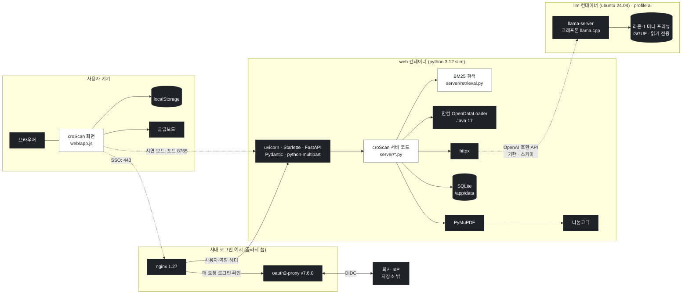

# 18. 블랙박스와 외부 부품 — croScan이 만들지 않은 부품을 어떻게 먹이고, 막고, 검사하나

croScan은 직접 만들지 않은 부품 위에서 돕니다. 언어 모델, 모델 서버, PDF 판독기, PDF 도구, 글꼴, 웹 서버 부품, 데이터베이스, 브라우저, 로그인 프록시, 도커 바탕 이미지가 그렇습니다. 이 문서는 그 부품을 하나도 빼지 않고 적습니다. 부품마다 croScan이 무엇을 넣고, 무엇을 받고, 어떻게 막고 검사하는지 적습니다.

**이 문서에서 알 수 있는 것**
- 실행 중인 croScan 안에 있는 블랙박스 전부와, 각각이 하는 일
- 부품마다 넣는 것·받는 것·설정값(파일과 줄 번호)·막는 것·실패할 때·버전·라이선스
- 언어 모델(라온-1 미니 프리뷰)이 느리거나 꺼졌을 때 croScan이 어떻게 버티는지
- 저장소에 판이나 라이선스가 기록되지 않은 부품이 무엇인지
- 개발에만 쓰고 운영 서비스에는 없는 것(Codex 등)

## 목차

1. [한눈에](#1-한눈에)
2. [실행 중 그림](#2-실행-중-그림)
3. [왜 따로 적나](#3-왜-따로-적나)
4. [언어 모델: 라온-1 미니 프리뷰](#4-언어-모델-라온-1-미니-프리뷰)
5. [모델 서버: llama.cpp](#5-모델-서버-llamacpp)
6. [PDF 판독기: 한컴 OpenDataLoader](#6-pdf-판독기-한컴-opendataloader)
7. [PDF 도구: PyMuPDF](#7-pdf-도구-pymupdf)
8. [글꼴](#8-글꼴)
9. [검색: BM25 (직접 쓴 코드)](#9-검색-bm25-직접-쓴-코드)
10. [웹 서버 부품](#10-웹-서버-부품)
11. [httpx](#11-httpx)
12. [SQLite](#12-sqlite)
13. [브라우저](#13-브라우저)
14. [사내 로그인 예시: nginx와 oauth2-proxy](#14-사내-로그인-예시-nginx와-oauth2-proxy)
15. [도커 이미지와 바탕 이미지](#15-도커-이미지와-바탕-이미지)
16. [바깥 스크립트와 CDN](#16-바깥-스크립트와-cdn)
17. [개발에만 쓰는 것: Codex 등](#17-개발에만-쓰는-것-codex-등)
18. [코드 어디](#18-코드-어디)
19. [시험](#19-시험)
20. [한계와 확인할 것](#20-한계와-확인할-것)

---

## 1. 한눈에

**블랙박스**는 croScan이 속을 쓰지 않았고, 속을 다 들여다볼 수도 없는 부품입니다. croScan은 그 부품에 넣는 것과 받는 것만 다룹니다. 그래서 넣는 것을 좁히고, 받은 것을 다시 검사합니다.

아래 표의 「버전」과 「라이선스」는 저장소 파일에 적힌 것만 옮겼습니다. 적힌 곳이 없으면 「기록 없음」이라고 썼습니다.

| 부품 | 하는 일 | 어디서 도나 | croScan의 울타리(한 줄) | 버전(저장소) | 라이선스(저장소) |
|---|---|---|---|---|---|
| 라온-1 미니 프리뷰 | 반장 말 읽기 등 열네 가지 「고르기」 작업 | `llm` 컨테이너(골라서 켬) | 허락된 id만 고르는 스키마, 기한, 자리 하나, 서버 재검사, 사람 확인 | Raon-1 mini preview(판은 팀 배포 자료) | Apache 2.0 |
| llama.cpp(llama-server) | 모델 파일을 CPU에서 돌리고 API를 엶 | `llm` 컨테이너 | 고정 커밋으로 빌드, 서버 자신에게만 포트 엶, 모델 읽기 전용 | 크래프톤 브랜치 고정 커밋 | 기록 없음 |
| 한컴 OpenDataLoader + Java 17 | PDF의 표·칸·글 읽기 | `web` 컨테이너 | 글자 층 없는 PDF는 넣지 않음, 빠진 글자는 PDF 글자 층으로 보충, 정답표 채점 | 패키지 2.5.15, JRE 17 | 기록 없음 |
| PyMuPDF | PDF 열기·쪽 그림·새 PDF 쓰기 | `web` 컨테이너 | 원본 바이트는 바꾸지 않음, 바꿀 값의 글자만 지움, 픽셀 대조 시험 | 2.0 | 기록 없음 |
| PDF 글꼴(나눔고딕·맑은 고딕) | PDF에 한국어 글자 그리기 | `web` 컨테이너 | 없으면 PyMuPDF 내장 글꼴, 글자 대응표 고침 | apt 패키지(판 고정 없음) | 기록 없음 |
| 화면 글꼴(Pretendard·HD현대체) | 화면 글자 | 브라우저(croScan 서버가 줌) | 바깥 글꼴 서버를 쓰지 않음 | 기록 없음 | Pretendard OFL 1.1, HD현대체 자유 사용 |
| BM25 검색 | 근거 구절 찾기 | `web` 컨테이너 | **블랙박스 아님**: 직접 쓴 코드 | 해당 없음 | croScan과 같음(Apache 2.0) |
| FastAPI·Starlette·Pydantic·uvicorn·python-multipart | HTTP 서버와 요청 해석 | `web` 컨테이너 | 버전 고정, 접근 통제 미들웨어 | 각각 고정(10절) | 기록 없음 |
| httpx | 모델 서버로 HTTP 요청 | `web` 컨테이너 | 요청마다 기한, 연결 5초 | 0.28.1 | 기록 없음 |
| SQLite | 세션·QA·제출 기록 저장 | `web` 컨테이너 | WAL, 5초 대기, 시연 DB는 읽기 전용으로 엶 | 바탕 이미지의 Python이 정함(기록 없음) | 기록 없음 |
| 브라우저 | 화면, localStorage, 클립보드 | 사용자 기기 | 저장은 모두 try/catch, 비밀번호는 남기지 않음, 문자는 보내지 않음 | 고르지 않음 | 해당 없음 |
| nginx | 443 입구, 로그인 확인, 헤더 설정 | SSO 예시 | 역할 헤더는 nginx만 씀, 본문 64MiB | 1.27-alpine | 기록 없음 |
| oauth2-proxy | 회사 IdP 로그인 처리 | SSO 예시 | 허용 그룹 둘, 비밀 값은 저장소 밖 | v7.6.0 | 기록 없음 |
| 도커 바탕 이미지 | python, ubuntu | 빌드 때 | ubuntu는 digest 고정, python은 태그만 | 15절 | 기록 없음 |
| 바깥 스크립트·CDN | 없음 | 없음 | 모든 화면 파일을 croScan 서버가 줌 | 해당 없음 | 해당 없음 |
| Codex | 개발 중 코드 검토 | 개발 PC(운영 서비스에 없음) | 읽기 전용, 지적은 재현한 뒤 고침 | 검토 이력에 gpt-6-astra | 해당 없음 |

croScan 자체의 라이선스는 Apache 2.0입니다([`LICENSE`](../LICENSE)).

---

## 2. 실행 중 그림

검은 상자가 블랙박스입니다. 흰 상자는 croScan이 쓴 코드입니다. 점선은 골라서 켜는 경로입니다.

- 서버에서 바깥으로 나가는 요청은 모델 서버(`LLM_URL`) 하나뿐입니다. httpx를 쓰는 곳은 [`server/llm.py`](../server/llm.py)와 [`server/app.py`](../server/app.py) 두 파일입니다.
- PDF 판독은 모델을 쓰지 않습니다. OpenDataLoader와 PyMuPDF가 합니다.

---

## 3. 왜 따로 적나

- **안을 볼 수 없는 부품이 결과를 냅니다.** 모델은 같은 질문에도 틀릴 수 있습니다. 판독기는 표를 덜 읽을 수 있습니다. croScan은 그 부품을 고칠 수 없습니다. 그래서 넣는 것과 받는 것에서 막습니다.
- **판단은 사람이 합니다.** croScan은 승인·일정·작업 차단을 하지 않습니다. 어느 블랙박스의 결과도 그 경계를 넘지 않게 짰습니다. 모델 결과는 제안이고, 사람이 확인해야 쓰입니다([05c §4](05c_라온이_하는_일.md#4-공통-원칙과-지키는-코드)).
- **허가서에는 사람 이름·연락처·작업 위치가 있습니다.** 그래서 기본 구성은 모델도 회사 서버 안에서 돌립니다([12 §2](12_배포와_운영.md#2-왜-회사-안에서-계정-없이-적게-남긴다)). 어느 부품이 바깥과 이야기하는지 알아야 그 약속을 지킬 수 있습니다.
- **판이 바뀌면 결과가 바뀝니다.** 어느 판을 고정했고 어느 판이 열려 있는지 한곳에 모았습니다.

---

## 4. 언어 모델: 라온-1 미니 프리뷰

**무엇.** 크래프톤(KRAFTON)이 낸 언어 모델 Raon-1 mini preview입니다. 「프리뷰」는 정식판 전에 먼저 내놓은 판이라는 뜻입니다. 그래서 원래 저장소의 최신판이 바뀔 수 있습니다([`DOCKER.md:52`](../DOCKER.md?plain=1#L52)). 이 모델에는 답하기 전에 속으로 생각하는 기능(reasoning, 생각하기)이 있습니다. croScan은 이 모델을 훈련하지도, 고치지도 않습니다. 모델 안에서 무슨 일이 일어나는지 볼 수 없습니다. 이 모델이 하는 작업 열네 가지는 [05c 라온이 하는 일](05c_라온이_하는_일.md)에 있습니다.

**모델 파일.** 양자화한 GGUF 파일입니다. 양자화는 모델의 숫자를 작게 줄여 메모리를 아끼는 방법입니다. GGUF는 llama.cpp가 읽는 모델 파일 형식입니다. 크기는 약 20GB입니다. 파일은 저장소에도 이미지에도 없습니다. 파일 이름, 받는 곳, 시험한 판, 체크섬은 팀 배포 자료에서 확인합니다([`DOCKER.md:50`](../DOCKER.md?plain=1#L50)).

| 항목 | 내용 |
|---|---|
| 우리가 넣는 것 | `messages`(서버가 쓴 지시문 + 허가서 칸 값·반장 답·질문 목록·후보 id 같은 내용), `response_format`(JSON 스키마), `max_tokens`, `temperature`, `top_p`, `cache_prompt`, 생각 설정([`server/llm.py:82-90`](../server/llm.py#L82-L90)) |
| 받는 것 | OpenAI 형식 JSON. `choices[0].message.content`(답 JSON 글), `finish_reason`, `timings`(읽은 토큰·쓴 토큰·캐시 토큰·시간)([`server/llm.py:126-132`](../server/llm.py#L126-L132)) |
| 모델 이름 | 요청에 넣는 이름 `LLM_MODEL` = `Raon-1-mini-preview`([`docker-compose.yml:18`](../docker-compose.yml#L18), [`server/llm.py:16`](../server/llm.py#L16)) |
| 버전 | Raon-1 mini preview. 받은 판(revision)과 체크섬은 팀 배포 자료 |
| 라이선스 | Apache 2.0([`llm/Dockerfile:1`](../llm/Dockerfile#L1), [`DOCKER.md:44`](../DOCKER.md?plain=1#L44)) |

### 4.1 설정값

토큰은 모델이 글을 나눠 읽는 작은 조각입니다. 문맥 길이는 모델이 한 번에 볼 수 있는 토큰 수입니다.

| 설정 | 값 | 어디 | 뜻 |
|---|---|---|---|
| 문맥 길이 | 16384 토큰(`LLM_CTX`) | [`docker-compose.yml:41`](../docker-compose.yml#L41) | 허가서 한 건과 대화에 넉넉한 길이(같은 파일 35줄 주석) |
| 동시 처리 칸 | 1(`LLM_PARALLEL`) | [`docker-compose.yml:41`](../docker-compose.yml#L41) | 모델 서버가 한 번에 처리하는 요청 수 |
| 서버 기본 샘플링 | temp 1.0, top-p 0.95, top-k 20, min-p 0.0 | [`docker-compose.yml:42`](../docker-compose.yml#L42) | 모델 카드 권장값 |
| 반복 억제 | repeat 1.0, frequency 0.0, presence 1.5 | [`docker-compose.yml:43`](../docker-compose.yml#L43) | 모델 카드 권장값 |
| 생각하기 | 켬, 서버 쪽 생각 상한 `LLM_THINK_BUDGET` 기본 -1(무제한) | [`docker-compose.yml:44`](../docker-compose.yml#L44) | 크래프톤이 끄지 말라고 권함(같은 파일 34줄) |
| 지난 생각 | `truncate_history_thinking: false` | [`docker-compose.yml:45`](../docker-compose.yml#L45) | 대화 기록 속 앞선 생각을 자르지 않음 |
| 요청 온도 | 0.0(기본) | [`server/llm.py:93`](../server/llm.py#L93) | 같은 요청이면 같은 답이 나오게 함 |
| 요청 top-p | 0.95 | [`server/llm.py:83`](../server/llm.py#L83) | |
| 요청 생각 | `think`가 있으면 `reasoning_budget`, 없으면 생각하기 끔 | [`server/llm.py:86-89`](../server/llm.py#L86-L89) | `call_json()` 기본 128. 반장 답 읽기(TURN)는 0 |
| 쓰는 길이 상한 | 생각 + 답 토큰(`think + out_tokens`) | [`server/llm.py:107`](../server/llm.py#L107) | 생각까지 합친 상한 |
| 기한 | 작업마다 30~120초 | 예: [`server/understand.py:412`](../server/understand.py#L412) 60초, [`server/checkai.py:336`](../server/checkai.py#L336) 120초 | 접수한 때부터 셈 |
| 검토 1건 호출 한도 | 30회, 미리 읽히기 16회 | [`server/store.py:602-603`](../server/store.py#L602-L603) | 넘으면 `budget` 실패 |

- **의도: 서버 기본 온도는 1.0인데 요청은 0.0입니다.** 모델 서버 기본값은 모델 카드를 따랐습니다. 구조화 호출은 요청에서 온도 0을 줘서 이 기본값을 덮어씁니다. 같은 요청에 같은 답이 나오게 하려는 것입니다. — 근거: [`server/llm.py:94-95`](../server/llm.py#L94-L95) 주석, [`docker-compose.yml:34`](../docker-compose.yml#L34) 주석, [12 §5](12_배포와_운영.md#5-언어-모델-컨테이너-llmdockerfile).
- **의도: 서버 쪽 생각 상한은 무제한(-1)입니다.** 256으로 걸어도 빨라지지 않았습니다. — 근거: [`DOCKER.md:99`](../DOCKER.md?plain=1#L99). 대신 croScan이 요청마다 생각 한도와 쓰는 길이 상한을 겁니다.
- **의도: 반장 답 읽기(TURN)는 생각하기를 끕니다.** 설계서 표에는 TURN 기본이 「생각 상한 128」로 적혀 있습니다. 2026-10-31 CPU 서버 측정에서 요청별 생각 상한이 긴 답에서 지켜지지 않았습니다(608토큰, 88초, 잘림). 생각을 끄고 예시를 주자 18~31초에 읽었습니다. — 근거: [`server/understand.py:414-415`](../server/understand.py#L414-L415), [`server/llm.py:87`](../server/llm.py#L87), [`server/app.py:890`](../server/app.py#L890).

### 4.2 croScan이 막고 검사하는 것

| 울타리 | 어떻게 | 코드 |
|---|---|---|
| 답 모양을 정함 | 요청마다 JSON 스키마를 넣습니다. 그 호출에서 고를 수 있는 번호(Q1…, F1…, C1…)만 스키마의 `enum`(허락된 값 목록)에 넣습니다 | 예: [`server/understand.py:246-251`](../server/understand.py#L246-L251), [`server/analyze.py:141-142`](../server/analyze.py#L141-L142) |
| 스키마를 믿지 않음 | 모델 서버가 스키마를 지킨다고 믿지 않습니다. 각 모듈이 받은 답을 다시 검사합니다 | [05c §4](05c_라온이_하는_일.md#4-공통-원칙과-지키는-코드) |
| 원문 대조 | 모델이 옮긴 구절은 원문에 그대로 있어야 합니다 | `understand.check()`, `analyze.check()` |
| 문장은 서버가 씀 | 화면에 보이는 문장은 서버의 틀입니다. 모델은 고르기만 합니다 | [05c §4](05c_라온이_하는_일.md#4-공통-원칙과-지키는-코드) |
| 사람 확인 | 모델 결과는 「제안」으로만 저장됩니다. 반장·안전관리자가 확인해야 쓰입니다 | `store.propose()`, `store.decide()` |
| 경보는 낮아지지 않음 | 모델 답이 쌍 경보를 지우거나 낮추지 못합니다 | `pairs.floor()`, `critique.review()` |
| 문서 속 지시 무시 | 서류에 「무시하고 …」가 있어도 읽을 자료일 뿐입니다. 답은 어차피 id로만 받습니다 | 각 모듈의 `SYSTEM` 문장 |
| 자리 하나와 순서 | croScan 안에 모델 자리가 하나 있습니다. 급한 순서(0 반장이 기다림, 1 사람이 요청, 2 미리 하는 일, 3 데우기)로 줄을 섭니다. 급한 호출은 2·3번 호출을 끊습니다 | [`server/llm.py:17-21`](../server/llm.py#L17-L21), [`server/llm.py:24-72`](../server/llm.py#L24-L72) |
| 기한 | 접수한 때부터 잽니다. 기한이 지나면 HTTP 요청을 닫습니다. 그러면 모델 서버가 그 칸을 비웁니다 | [`server/llm.py:108-121`](../server/llm.py#L108-L121) |
| 잘린 답·JSON 아닌 답 | `finish_reason`이 `length`이거나 답이 비면 실패입니다. JSON 객체가 아니어도 실패입니다 | [`server/llm.py:133-140`](../server/llm.py#L133-L140) |
| 호출 한도 | 검토 1건에 30회를 넘으면 부르지 않습니다 | [`server/llm.py:101-106`](../server/llm.py#L101-L106), [`server/store.py:680`](../server/store.py#L680) |
| 미리 읽히기 | 답을 쓰지 않는 호출(`max_tokens` 1)로 질문 목록을 모델 서버 캐시에 넣어 둡니다. 결과는 쓰지 않습니다 | [`server/llm.py:146-172`](../server/llm.py#L146-L172) |

- **의도: 모델 자리가 하나입니다.** CPU 서버 한 대에서 호출이 llama.cpp 안에 쌓이지 않게, croScan 안에서 순서대로 기다리게 했습니다. — 근거: [`server/llm.py:25-27`](../server/llm.py#L25-L27) 주석, [설계서](reference/AI도입계획_설계서.md) §10.7과 모듈 표의 「슬롯 1개 대기열」.

### 4.3 느리거나 꺼졌을 때

| 상황 | 실패 코드 | 무엇이 일어나나 |
|---|---|---|
| 다른 호출이 자리를 쥐고 기한 안에 못 시작 | `busy` | [`server/llm.py:108-111`](../server/llm.py#L108-L111) |
| 남은 시간이 3초 미만 | `timeout` | [`server/llm.py:114-116`](../server/llm.py#L114-L116) |
| 기한 안에 답이 안 옴 | `timeout` | 요청을 닫아 모델 서버의 칸을 돌려줌([`server/llm.py:120-121`](../server/llm.py#L120-L121)) |
| 모델 서버에 연결 안 됨 | `down` | [`server/llm.py:122-123`](../server/llm.py#L122-L123) |
| 모델 서버가 오류 응답 | `http` | [`server/llm.py:124-125`](../server/llm.py#L124-L125) |
| 답이 잘림·JSON 아님 | `length`, `json` | [`server/llm.py:133-140`](../server/llm.py#L133-L140) |
| 검토 1건 한도 넘음 | `budget` | [`server/llm.py:101-106`](../server/llm.py#L101-L106) |

- 실패는 「실패」로 남깁니다. 부르는 쪽은 빈 결과를 받고 규칙 결과로 갑니다. 추측으로 채우지 않습니다([`server/llm.py:6`](../server/llm.py#L6)).
- 규칙 질문, 규칙 판독, 쌍 판정, 체크리스트 86항목 초안은 모델 없이 돕니다. 빠지는 기능은 [05c §9](05c_라온이_하는_일.md#9-모델이-없을-때)에 있습니다.
- 반장 확인 카드는 30초 뒤 「기다리지 않고 다음 질문」을 보이고, 65초에 끊습니다([05c §8](05c_라온이_하는_일.md#8-모델-자리와-우선순위)). 브라우저가 기다리기를 그만두면 서버가 모델 호출을 취소하고 자리를 풉니다([`server/app.py:897`](../server/app.py#L897)).
- 화면은 `GET /api/llm`으로 모델 서버가 살아 있는지 봅니다. 이 끝점은 모델 서버의 `/health`와 `/v1/models`를 3초 안에 묻습니다([`server/app.py:1716-1727`](../server/app.py#L1716-L1727)).
- 속도 기록(2026-10-27, 8 vCPU·32GB CPU 서버): 답을 초당 약 6.7토큰 씁니다. 짧은 과제 한 번에 40~60초입니다([`DOCKER.md:55`](../DOCKER.md?plain=1#L55)).

---

## 5. 모델 서버: llama.cpp

**무엇.** llama.cpp는 언어 모델 파일을 CPU에서 돌리는 오픈소스 프로그램입니다. 그 안의 `llama-server`가 HTTP 서버를 엽니다. 이 서버는 OpenAI 호환 API를 줍니다. OpenAI 호환 API는 OpenAI가 정한 요청·응답 모양을 따르는 주소(`/v1/chat/completions`)라는 뜻입니다. croScan은 원래 llama.cpp가 아니라 **크래프톤이 갈라 낸 llama.cpp 브랜치**를 씁니다. 이 모델을 돌리는 코드가 아직 원래 llama.cpp에 들어가지 않았기 때문입니다([`llm/Dockerfile:2`](../llm/Dockerfile#L2)).

### 5.1 빌드 (`llm/Dockerfile`)

| 줄 | 설정 | 뜻 |
|---|---|---|
| [7](../llm/Dockerfile#L7), [19](../llm/Dockerfile#L19) | `ubuntu:24.04@sha256:…` | 바탕 이미지를 digest(이미지 고유 지문)로 고정. 다시 빌드해도 같은 바탕(6줄 주석) |
| [8](../llm/Dockerfile#L8) | `LLAMA_REPO` | 크래프톤 llama.cpp 저장소 |
| [9](../llm/Dockerfile#L9) | `LLAMA_REF` | 고정 커밋(앞 7자리 `fb89566`) |
| [10-12](../llm/Dockerfile#L10-L12) | git, cmake, build-essential, libssl-dev | 빌드 도구 |
| [13](../llm/Dockerfile#L13) | `git clone --filter=blob:none` 후 `checkout` | 그 커밋만 받아 씀 |
| [14](../llm/Dockerfile#L14) | `CMAKE_BUILD_TYPE=Release` | 최적화 빌드 |
| [15](../llm/Dockerfile#L15) | `GGML_NATIVE=OFF` | 빌드한 기계 전용 최적화를 끔 |
| [15](../llm/Dockerfile#L15) | `GGML_BACKEND_DL=ON`, `GGML_CPU_ALL_VARIANTS=ON` | CPU 종류(SSE4 … AVX-512)마다 따로 빌드. 실행할 때 그 기계에 가장 빠른 것을 고름. 다른 서버로 옮겨도 다시 빌드하지 않음(3-4줄) |
| [15](../llm/Dockerfile#L15) | `LLAMA_CURL=OFF` | llama.cpp가 인터넷에서 모델을 받는 기능을 빼고 빌드 |
| [16](../llm/Dockerfile#L16) | 시험·예제 빌드 끔 | |
| [20-22](../llm/Dockerfile#L20-L22) | libgomp1, libssl3, ca-certificates, curl | 실행에 필요한 것만. curl은 상태 검사용 |
| [23-24](../llm/Dockerfile#L23-L24) | 빌드 결과(`bin/`)만 복사, `LD_LIBRARY_PATH` | 실행 이미지에 빌드 도구가 없음 |
| [25-26](../llm/Dockerfile#L25-L26) | 일반 사용자 uid 10002 | 관리자 권한 없이 돎 |
| [27](../llm/Dockerfile#L27) | `EXPOSE 8000` | |
| [29](../llm/Dockerfile#L29) | 30초마다 `/health`, 시작 유예 600초 | 20GB를 읽는 첫 시작이 오래 걸림(28줄) |
| [30](../llm/Dockerfile#L30) | `ENTRYPOINT llama-server` | |

### 5.2 실행 (`docker-compose.yml`의 `llm`)

| 줄 | 설정 | 뜻 |
|---|---|---|
| [29-32](../docker-compose.yml#L29-L32) | `build: ./llm`, 이미지 `croscan-llm:raon-1-mini-preview` | |
| [33](../docker-compose.yml#L33) | `profiles: ["ai"]` | `docker compose --profile ai …`로 띄울 때만 켜짐. 없으면 웹만 돎 |
| [39](../docker-compose.yml#L39) | `-m /models/…` | 모델 파일. 이름은 `LLM_GGUF`로 정함 |
| [40](../docker-compose.yml#L40) | `--host 0.0.0.0 --port 8000` | 컨테이너 안에서 8000번으로 들음 |
| [40](../docker-compose.yml#L40) | `--alias Raon-1-mini-preview` | 요청의 모델 이름과 맞춤 |
| [41-45](../docker-compose.yml#L41-L45) | 문맥·동시 처리·샘플링·생각 | 4.1절 표 |
| 35-36줄 주석 | `--threads` 없음 | 스레드 수는 llama.cpp가 물리 코어 수로 정함 |
| 37줄 주석 | 투기적 디코딩 끔 | 8 vCPU 서버에서 오히려 느렸음(초당 4.3 대 6.7토큰) |
| [46-47](../docker-compose.yml#L46-L47) | `${LLM_MODELS}:/models:ro` | 모델 폴더를 읽기 전용으로 붙임 |
| [48-49](../docker-compose.yml#L48-L49) | `127.0.0.1:8000:8000` | 서버 자신에게만 엶. 바깥에서 닿지 않음 |
| [50](../docker-compose.yml#L50) | `restart: unless-stopped` | 죽으면 다시 켬 |

웹 컨테이너는 compose 네트워크 안 주소 `http://llm:8000/v1/chat/completions`로 부릅니다([`docker-compose.yml:17`](../docker-compose.yml#L17)).

| 항목 | 내용 |
|---|---|
| 우리가 넣는 것 | `POST /v1/chat/completions`(4절의 요청), `GET /health`, `GET /v1/models` |
| 받는 것 | OpenAI 형식 JSON과 `timings`. 옛 대화는 스트림(SSE) |
| 막는 것 | 포트를 서버 자신에게만 엶, 모델 읽기 전용, 일반 사용자, 고정 커밋, 요청마다 기한·길이 상한 |
| 실패하면 | `--profile ai` 없이 띄웠거나 컨테이너가 죽으면 `down`. 웹은 그대로 돎 |
| 버전 | 크래프톤 브랜치 고정 커밋([`llm/Dockerfile:9`](../llm/Dockerfile#L9)) |
| 라이선스 | 저장소에 기록 없음 |

- **의도: 웹의 상태 검사는 모델을 보지 않습니다.** 웹 상태 검사(`/api/health`)는 웹이 살아 있는지만 봅니다([`server/app.py:259-261`](../server/app.py#L259-L261)). 모델이 없어도 웹은 떠야 하기 때문입니다. — 근거: [12 §10](12_배포와_운영.md#10-개발-pc에서-띄우기) 「언어 모델이 없어도 앱은 뜹니다」, compose의 `profiles: ["ai"]`. 모델 상태는 `/api/llm`이 따로 봅니다.

---

## 6. PDF 판독기: 한컴 OpenDataLoader

**무엇.** 한글과컴퓨터(한컴)가 낸 PDF 판독기입니다. 파이썬 패키지 `opendataloader-pdf` 안에 Java 프로그램(jar)이 들어 있습니다. 패키지가 그 jar를 `java`로 실행합니다. 그래서 웹 이미지에 Java 17 실행 환경이 들어갑니다([`Dockerfile:1`](../Dockerfile#L1), [`Dockerfile:14-17`](../Dockerfile#L14-L17)). croScan은 로컬 모드로만 씁니다. PDF는 서버 밖으로 나가지 않습니다([`server/extract.py:3`](../server/extract.py#L3)).

| 항목 | 내용 |
|---|---|
| 우리가 넣는 것 | 허가서: 임시 폴더에 둔 PDF 한 개, `format="json"`, `quiet=True`([`server/extract.py:34-37`](../server/extract.py#L34-L37)). 작업계획서: 파일 여러 개 묶음, 머리글·바닥글 포함, 그림 출력 끔([`server/workplan.py:411-414`](../server/workplan.py#L411-L414)) |
| 받는 것 | JSON 나무(`kids`). 요소마다 `type`(table, table cell, paragraph, heading, caption, list item, text block, image), `page number`, `row number`·`column number`, `row span`·`column span`, `bounding box`(자리), `content`(글), `number of rows`([`server/extract.py:26`](../server/extract.py#L26), [`server/extract.py:57-85`](../server/extract.py#L57-L85)) |
| croScan이 하는 일 | 표 칸만 칸 모델로 만듭니다. 판독기가 칸에서 빠뜨린 글자는 PDF 글자 층에서 글자 단위로 채웁니다(출처 표시 `pdf`)([`server/extract.py:91-108`](../server/extract.py#L91-L108)). 그다음 양식 규칙(`form_spec`)으로 칸을 값으로 바꿉니다. 작업계획서는 `・`를 `·`로 바꿉니다([`server/workplan.py:57-60`](../server/workplan.py#L57-L60)) |
| 설정값 | 작업계획서: 한 번에 10개 파일, Java 동시 실행 4개(`BATCH, WORKERS`, [`server/workplan.py:52`](../server/workplan.py#L52)). CPU 수와 파일 수보다 많이 띄우지 않음 |
| 막는 것 | 글자 층이 없는 PDF(사진·스캔본)는 판독기에 넣지 않고 거절합니다([`server/app.py:106-111`](../server/app.py#L106-L111)). 허가서 종류를 먼저 골라야 받습니다([`server/app.py:143-144`](../server/app.py#L143-L144)). 허가서 판독은 임시 폴더 안에서 하고 끝나면 지웁니다([`server/app.py:132-138`](../server/app.py#L132-L138)). 작업계획서는 올린 파일을 데이터 폴더에 7일 두고, 판독기 출력만 임시 폴더에 씁니다([`server/workplan.py:53`](../server/workplan.py#L53), [`server/workplan.py:461`](../server/workplan.py#L461)). 올린 원본 바이트는 바꾸지 않습니다 |
| 검사 | 판독 정답표(`samples/_truth.json`)로 모든 값·체크 항목을 채점합니다(`tools/check_extract.py`) |
| 실패하면 | 허가서: 로딩 화면에 「읽기 실패: …」([`server/app.py:128-129`](../server/app.py#L128-L129)). 작업계획서: 묶음이 실패하면 한 파일씩 다시 읽고, 그래도 안 되면 그 파일만 「PDF를 읽지 못함」([`server/workplan.py:417-429`](../server/workplan.py#L417-L429), [`server/workplan.py:476`](../server/workplan.py#L476)). 양식을 못 찾으면 「작업계획서 양식을 찾지 못함」([`server/workplan.py:407`](../server/workplan.py#L407)). `java`가 없으면 판독이 실패합니다. 첫 실행 때 로그의 java 오류를 봅니다([`DOCKER.md:83`](../DOCKER.md?plain=1#L83)) |
| 버전 | `opendataloader-pdf==2.5.15`([`requirements.txt:1`](../requirements.txt#L1)). jar는 그 패키지 안에 들어 있어 따로 판이 적혀 있지 않습니다. Java는 `openjdk-17-jre-headless`(apt, 판 고정 없음) |
| 라이선스 | 저장소에 기록 없음 |

- 표를 덜 읽으면 칸이 빠지거나 값이 빕니다. croScan은 실행 중에 이것을 따로 알아채지 못합니다. 화면에 원본 쪽 그림이 함께 보이고, 반장이 값을 고칠 수 있습니다. 판독 품질은 정답표 시험으로 잽니다. 자세한 흐름은 [04c PDF 판독](04c_PDF_판독.md)에 있습니다.
- **설계 근거 미기록: 판독기 실행에 시간 제한이 없습니다.** croScan 코드는 `opendataloader_pdf.convert()`를 시간 제한 없이 부릅니다([`server/extract.py:36`](../server/extract.py#L36), [`server/workplan.py:412`](../server/workplan.py#L412)). 시간 제한을 두지 않은 이유는 저장소에서 찾지 못했습니다. SSO 예시에서는 nginx가 응답을 300초까지 기다립니다(14절).

---

## 7. PDF 도구: PyMuPDF

**무엇.** PDF를 열고, 글자를 꺼내고, 쪽을 그림으로 그리고, 새 PDF를 쓰는 파이썬 라이브러리입니다.

| 쓰는 곳 | 무엇 | 코드 |
|---|---|---|
| 글자 층 확인 | 올린 PDF에 글자 층이 있는지 셈 | [`server/app.py:105-107`](../server/app.py#L105-L107) |
| 글자 단위 읽기 | `get_text("rawdict")`로 글자마다 자리·크기·글꼴 | [`server/extract.py:96`](../server/extract.py#L96), [`server/extract.py:364-373`](../server/extract.py#L364-L373) |
| 쪽 그림 | 3배(216dpi) PNG. 고칠 값 자리를 둘레 종이 색으로 덮은 배경도 만듦(PDF는 그대로) | [`server/extract.py:344-361`](../server/extract.py#L344-L361) |
| 작업계획서 쪽 그림 | 쪽 PNG와 값을 지운 배경 | [`server/workplan.py:530-548`](../server/workplan.py#L530-L548) |
| 반영본 | 원본 쪽 위에 파란 글씨로 값을 씀. 바꾸는 값의 옛 글자만 지움(redaction: PDF에서 그 자리 글자를 실제로 지우는 기능). 그림·선은 지우지 않는 설정 | [`server/reflect.py:567-591`](../server/reflect.py#L567-L591) |
| 추가검토서 | A4 새 쪽을 그리고 반영본 뒤에 붙임 | [`server/addendum.py:482-497`](../server/addendum.py#L482-L497) |
| 체크리스트 PDF | 새 PDF | [`server/checklist.py:562-572`](../server/checklist.py#L562-L572) |
| 현장 게시용 별지 | 새 쪽, 원본 뒤에 붙임 | [`server/posting.py:157-170`](../server/posting.py#L157-L170) |
| 작업계획서 수정본 | 새 PDF | [`server/workplan_pdf.py:93-101`](../server/workplan_pdf.py#L93-L101) |
| 글꼴 줄이기 | `subset_fonts()`: 쓴 글자만 남김(한국어 글꼴 전체는 5MB) | [`server/checklist.py:569`](../server/checklist.py#L569), [`server/addendum.py:476`](../server/addendum.py#L476), [`server/addendum.py:488`](../server/addendum.py#L488), [`server/posting.py:162`](../server/posting.py#L162), [`server/workplan_pdf.py:99`](../server/workplan_pdf.py#L99) |
| 글자 대응표 고침 | `fix_tounicode()`: 복사·검색했을 때 쓴 글자 그대로 나오게(8절) | [`server/workplan_pdf.py:108-123`](../server/workplan_pdf.py#L108-L123) |
| 저장 | `tobytes(garbage=…, deflate=True)`: 안 쓰는 조각을 치우고 압축 | [`server/addendum.py:497`](../server/addendum.py#L497), [`server/checklist.py:572`](../server/checklist.py#L572) |

| 항목 | 내용 |
|---|---|
| 우리가 넣는 것 | 올린 PDF 바이트, 칸 자리, 쓸 글과 글꼴 |
| 받는 것 | 글자와 자리, PNG, 새 PDF 바이트 |
| 막는 것 | 원본 바이트는 바꾸지 않고 새 PDF를 만듭니다([`server/addendum.py:483-484`](../server/addendum.py#L483-L484)). redaction은 글자만 지우고 그림·선은 두는 설정입니다([`server/reflect.py:589-590`](../server/reflect.py#L589-L590)). 원본 쪽 글꼴을 줄이지 못하면 통째로 둡니다([`server/addendum.py:477-478`](../server/addendum.py#L477-L478)) |
| 검사 | `check_form_intact`: 제출본을 원본과 쪽마다 픽셀로 비교해, 정해진 칸과 위 여백 한 줄 밖이 바뀌지 않았는지 봅니다. `check_render`: 긴 행이 잘리지 않고 다음 쪽으로 이어지는지 봅니다 |
| 실패하면 | 업로드 단계의 예외는 「읽기 실패」로 보입니다. 글꼴 줄이기 실패는 로그에만 남고 PDF는 만들어집니다 |
| 버전 | `pymupdf==2.0`([`requirements.txt:2`](../requirements.txt#L2)) |
| 라이선스 | 저장소에 기록 없음 |

반영본과 별지의 내용 규칙은 [08 반영본과 별지](08_반영본과_별지.md)에 있습니다.

---

## 8. 글꼴

### 8.1 PDF 글꼴

| 항목 | 내용 |
|---|---|
| 무엇 | 추가검토서·반영본·체크리스트·별지·계획서 수정본에 한국어를 그리는 글꼴 |
| 고르는 순서 | ① 나눔고딕(`/usr/share/fonts/truetype/nanum/`, 보통·굵게) ② 맑은 고딕(`C:/Windows/Fonts/malgun.ttf`, `malgunbd.ttf`) ③ 둘 다 없으면 PyMuPDF 내장 글꼴 `korea` |
| 고르는 곳 | [`server/addendum.py:36-37`](../server/addendum.py#L36-L37)·[247-249](../server/addendum.py#L247-L249), [`server/workplan_pdf.py:13`](../server/workplan_pdf.py#L13)·[30-32](../server/workplan_pdf.py#L30-L32), [`server/reflect.py:27`](../server/reflect.py#L27)·[53-58](../server/reflect.py#L53-L58)(반영본은 보통체만) |
| 어디서 오나 | 이미지: apt `fonts-nanum`([`Dockerfile:17`](../Dockerfile#L17)). 개발 PC(Windows): 맑은 고딕 |
| 막는 것 | 쓴 글자만 남겨 파일을 줄입니다(7절). 나눔고딕은 `·`와 `・`, 빈칸과 줄바꿈 없는 빈칸을 같은 모양 하나로 그립니다. 그러면 줄인 글꼴에서 글을 복사할 때 다른 글자가 나옵니다. `fix_tounicode()`가 글자 대응표(ToUnicode: 모양을 어떤 글자로 읽을지 적은 표)를 고칩니다([`server/workplan_pdf.py:108-111`](../server/workplan_pdf.py#L108-L111)) |
| 실패하면 | 글꼴 파일이 없으면 내장 글꼴로 그립니다. 모양이 달라집니다 |
| 버전 | apt 패키지, 판 고정 없음 |
| 라이선스 | 저장소에 기록 없음 |

- 서버(리눅스)는 나눔고딕, 개발 PC(Windows)는 맑은 고딕을 씁니다. 같은 입력이어도 두 곳의 PDF 모양이 조금 다를 수 있습니다(추정).

### 8.2 화면 글꼴

| 항목 | 내용 |
|---|---|
| 무엇 | 제목은 HD현대체(Medium·Bold), 본문은 Pretendard(4종) |
| 어디서 오나 | 저장소의 `web/fonts/`. croScan 서버가 `/static/fonts/…`로 줍니다([`web/style.css:8-13`](../web/style.css#L8-L13)). 바깥 글꼴 서버를 쓰지 않습니다 |
| 없을 때 | 기기 글꼴(Apple SD Gothic Neo, 맑은 고딕 등)로 넘어갑니다([`web/style.css:30-31`](../web/style.css#L30-L31)) |
| 라이선스 | Pretendard: SIL OFL 1.1([`DESIGN.md:49`](../DESIGN.md?plain=1#L49), [`web/style.css:5`](../web/style.css#L5)). HD현대체: HD현대중공업이 「누구나 자유롭게 사용 가능」으로 배포([`DESIGN.md:48`](../DESIGN.md?plain=1#L48)) |
| 버전 | 저장소에 기록 없음 |

---

## 9. 검색: BM25 (직접 쓴 코드)

**블랙박스가 아닙니다.** 근거 구절을 찾는 검색은 croScan이 직접 쓴 코드입니다. 파이썬 표준 라이브러리만 씁니다([`server/retrieval.py:1-3`](../server/retrieval.py#L1-L3)). 바깥 검색 라이브러리나 검색 서버가 없습니다. BM25는 낱말이 문서에 얼마나 자주, 얼마나 드물게 나오는지로 점수를 매기는 계산법입니다.

| 항목 | 내용 | 코드 |
|---|---|---|
| 낱말 나누기 | 한국어 글자 2~3개 묶음과 낱말 | [`server/retrieval.py:37-44`](../server/retrieval.py#L37-L44) |
| 점수 값 | `K1 = 1.4`, `B = 0.75` | [`server/retrieval.py:27`](../server/retrieval.py#L27) |
| 현장 말 → 문서 말 | 동의어 표(예: 「불티」 → 불꽃·비산) | [`server/retrieval.py:19-26`](../server/retrieval.py#L19-L26) |
| 거르기 먼저 | 출처 등급·작업 종류·회사·시행 여부로 먼저 거르고 점수를 셈 | [`server/retrieval.py:93-124`](../server/retrieval.py#L93-L124) |
| 현장이 정정한 구절 | 어떤 조건에서도 보이지 않음 | [`server/retrieval.py:32-34`](../server/retrieval.py#L32-L34) |
| 개인 경로 지움 | 팀원 PC 파일 경로를 구절에서 지움 | [`server/retrieval.py:70`](../server/retrieval.py#L70), [77](../server/retrieval.py#L77) |
| 최소 점수 | 8 | [`server/retrieval.py:157`](../server/retrieval.py#L157) |
| 인용 검사 | 구절이 있는지, 출처·개정이 같은지, 인용 글자가 그 자리에 있는지 | [`server/retrieval.py:172-186`](../server/retrieval.py#L172-L186) |

검색 결과는 보여 주고 대조하는 데만 씁니다. 어떤 판정도 정하지 않습니다. 검색 대상 자료(`server/knowledge/corpus.json`)는 `tools/build_corpus.py`가 법령·공공 지침·조선사 자료·팀 조사로 만듭니다. 자료의 층과 인용 규칙은 [10 §4](10_근거와_자료.md#4-어떻게-검색과-인용-검사-retrievalpy)에 있습니다.

---

## 10. 웹 서버 부품

모두 널리 쓰는 오픈소스입니다. croScan은 정해진 기능만 쓰고, 판은 [`requirements.txt`](../requirements.txt)에 고정했습니다.

| 부품 | 판 | croScan에서 하는 일 | 설정·코드 |
|---|---|---|---|
| uvicorn | 0.54.0([`requirements.txt:6`](../requirements.txt#L6)) | 앱을 HTTP 서버로 띄움 | [`Dockerfile:35`](../Dockerfile#L35) `uvicorn server.app:app --host 0.0.0.0 --port ${PORT}`. 프로세스 하나 |
| Starlette | 1.9.0([`requirements.txt:4`](../requirements.txt#L4)) | FastAPI의 바탕. 접근 통제 미들웨어, 정적 파일, 스트림 응답 | [`server/app.py:80-93`](../server/app.py#L80-L93) `_gate`, [`server/app.py:1801`](../server/app.py#L1801) `/static`, [`server/app.py:132-138`](../server/app.py#L132-L138) NDJSON 진행 |
| FastAPI | 0.162.0([`requirements.txt:3`](../requirements.txt#L3)) | 끝점 정의, 파일·폼 받기, 오류 응답 | [`server/app.py`](../server/app.py), 끝점 목록은 [04b API](04b_API.md) |
| Pydantic | 2.14.1([`requirements.txt:5`](../requirements.txt#L5)) | JSON 요청 본문의 모양 검사. 모양이 틀리면 FastAPI가 422로 돌려보냄 | 예: [`server/app.py:883`](../server/app.py#L883) `Understand` |
| python-multipart | 0.0.32([`requirements.txt:7`](../requirements.txt#L7)) | 파일 업로드(multipart) 해석 | [`server/app.py:141-145`](../server/app.py#L141-L145), [`server/app.py:148`](../server/app.py#L148) |

| 항목 | 내용 |
|---|---|
| 막는 것 | `CROSCAN_AUTH`가 `demo`·`proxy`가 아니면 앱이 시작하지 않습니다([`server/app.py:62-64`](../server/app.py#L62-L64)). `proxy`면 역할·사용자 헤더로 막습니다(`_gate`) |
| 실패하면 | 끝점의 예외는 오류 응답이 됩니다. 프로세스가 죽으면 compose가 다시 켭니다(`restart: unless-stopped`). 30초마다 `/api/health` 상태 검사([`Dockerfile:33-34`](../Dockerfile#L33-L34)) |
| 라이선스 | 다섯 모두 저장소에 기록 없음 |

- **설계 근거 미기록: uvicorn 프로세스가 하나입니다.** 실행 명령에 프로세스 수 설정이 없습니다([`Dockerfile:35`](../Dockerfile#L35)). 모델 자리(`_SLOT`)와 메모리 캐시는 프로세스 안에 있습니다([`server/llm.py:72`](../server/llm.py#L72)). 그래서 프로세스를 늘리면 자리도 프로세스마다 하나씩 생깁니다. 프로세스 수를 정한 기록은 찾지 못했습니다.
- **의도: QA 첨부와 작업계획서에는 앱의 크기·개수 제한이 없습니다.** 디스크로 흘려 쓰고, 남은 디스크 하한(`CROSCAN_DISK_FLOOR_GB`, 기본 2GB)으로 막습니다. — 근거: [`server/app.py:1621`](../server/app.py#L1621), [`server/app.py:150`](../server/app.py#L150) 주석, [`DOCKER.md:88`](../DOCKER.md?plain=1#L88).
- **설계 근거 미기록: 허가서 업로드(`/api/parse`)는 파일을 메모리로 통째로 읽고, 앱 쪽 크기 제한이 없습니다**([`server/app.py:145`](../server/app.py#L145)). 디스크 하한 검사도 하지 않습니다([12 §8](12_배포와_운영.md#8-남는-데이터)). 이유를 적은 곳은 찾지 못했습니다. SSO 예시에서는 nginx가 64MiB로 막습니다.

---

## 11. httpx

| 항목 | 내용 |
|---|---|
| 무엇 | 파이썬 HTTP 클라이언트. croScan 서버가 모델 서버를 부를 때만 씁니다 |
| 우리가 넣는 것 | `LLM_URL`로 보내는 JSON 요청 |
| 받는 것 | 모델 서버의 응답 |
| 설정값 | 구조화 호출: 남은 기한만큼, 연결은 5초(`httpx.Timeout(left, connect=5)`, [`server/llm.py:118-119`](../server/llm.py#L118-L119)). 상태 확인: 3초([`server/llm.py:178`](../server/llm.py#L178), [`server/app.py:1720`](../server/app.py#L1720)) |
| 막는 것 | 기한이 지나면 요청을 닫습니다. 연결 오류는 `down`, 시간 초과는 `timeout`으로 바꿉니다([`server/llm.py:120-123`](../server/llm.py#L120-L123)) |
| 실패하면 | 4.3절 |
| 버전 | 0.28.1([`requirements.txt:8`](../requirements.txt#L8)) |
| 라이선스 | 저장소에 기록 없음 |

- **설계 근거 미기록: croScan 코드는 `LLM_URL`이 바깥 주소인지 막지 않습니다.** 주소를 바꾸면 서류 내용이 그 주소로 갑니다. 이 사실과 「바꿀 때는 회사 안의 주소인지 확인」은 [12 §2](12_배포와_운영.md#2-왜-회사-안에서-계정-없이-적게-남긴다)에 적혀 있습니다. 코드에서 막지 않기로 한 이유는 찾지 못했습니다.
- **의도: 옛 자유 대화 `/api/chat`은 기한 없이 부릅니다(`timeout=None`, [`server/app.py:1749`](../server/app.py#L1749)). 이 기능은 기본으로 꺼져 있습니다(410).** 모든 모델 호출은 타입이 있고 한도가 있는 작업이어야 한다는 설계 때문에 껐습니다. — 근거: [`server/app.py:1735-1737`](../server/app.py#L1735-L1737) 주석(design §1.4), 켜는 설정 `CROSCAN_LEGACY_CHAT=1`([`server/app.py:1730`](../server/app.py#L1730)).

---

## 12. SQLite

| 항목 | 내용 |
|---|---|
| 무엇 | 파일 하나로 된 데이터베이스. 파이썬 표준 라이브러리 `sqlite3`로 씁니다. 따로 도는 DB 서버가 없습니다 |
| 우리가 넣는 것 | 검토 세션·제안·작업·이벤트, 제출 스냅숏, 판정보류 질문 전달 표시, 확인 사례 후보, QA 보고 |
| 받는 것 | 저장한 행 |
| 파일과 여는 법 | `review.sqlite3`: 5초 대기, `busy_timeout=5000`, WAL([`server/store.py:98-103`](../server/store.py#L98-L103)). `holdq.sqlite3`: 같음([`server/holdq.py:135-139`](../server/holdq.py#L135-L139)). `cases.sqlite3`: 5초 대기, WAL([`server/cases.py:32-35`](../server/cases.py#L32-L35)). `qa.sqlite3`: 기본 설정([`server/qa.py:74`](../server/qa.py#L74)). `demo_day.sqlite3`: 읽기 전용(`mode=ro`, [`server/safety.py:155`](../server/safety.py#L155)) |
| 데이터 폴더 | `CROSCAN_DATA`, 없으면 저장소의 `data/`([`server/qa.py:16`](../server/qa.py#L16)). 컨테이너에서는 `/app/data` |
| 막는 것 | WAL(쓰는 동안에도 읽을 수 있게 하는 기록 방식)과 대기 시간으로 동시 요청이 부딪히지 않게 합니다. 시연 DB는 읽기 전용으로 엽니다. 남은 디스크가 하한보다 적으면 업로드 저장을 멈춥니다([`server/qa.py:22`](../server/qa.py#L22)) |
| 실패하면 | 작업계획서 저장 실패는 507로 알립니다([`server/app.py:150-154`](../server/app.py#L150-L154)) |
| 버전 | 바탕 이미지의 Python에 딸린 SQLite. 저장소에 기록 없음 |
| 라이선스 | 저장소에 기록 없음 |

보관 기간과 지우는 때는 [12 §8](12_배포와_운영.md#8-남는-데이터)에 있습니다.

---

## 13. 브라우저

**무엇.** 반장·안전관리자의 기기에 있는 브라우저입니다. croScan은 어느 브라우저인지 고르지 않습니다. 화면 파일(`index.html`, `app.js`, `style.css`, 글꼴, 그림)은 모두 croScan 서버의 `/static`에서 옵니다.

**localStorage(브라우저가 그 기기에 남기는 작은 저장 공간)**

| 열쇠 이름 | 무엇 | 코드 |
|---|---|---|
| `croscan.view` | 글자 크기·대비·테마·움직임 설정 | [`web/index.html:11-17`](../web/index.html#L11-L17), [`web/app.js:3689-3695`](../web/app.js#L3689-L3695) |
| `croscan.loginId` | 첫 화면 아이디(「기억」을 고를 때만). 비밀번호는 남기지도 보내지도 않음 | [`web/app.js:177-183`](../web/app.js#L177-L183), [`web/app.js:211`](../web/app.js#L211) |
| `croscan.draft.v2.{종류}.{해시}` | 검토하던 내용(답, 고친 칸, 계획서 확인, 체크리스트, 단계) | [`web/app.js:2308-2329`](../web/app.js#L2308-L2329) |
| `croscan.qa.author` | QA 보고에 적은 이름 | [`web/app.js:3790`](../web/app.js#L3790), [`web/app.js:3817`](../web/app.js#L3817) |
| `croscan.safety.checked`, `croscan.safety.view…` | 안전관리자 화면의 「봤음」 표시와 보기 설정 | [`web/app.js:3835`](../web/app.js#L3835), [`web/app.js:3864-3909`](../web/app.js#L3864-L3909) |

- 모든 읽기·쓰기를 `try/catch`로 감쌉니다. 저장이 막혀 있어도 화면은 돕니다. 초안 저장이 안 되면 「이 기기에 저장 못 함」을 보입니다([`web/app.js:2324-2326`](../web/app.js#L2324-L2326)).
- 첫 화면의 아이디·비밀번호는 서버가 확인하지 않습니다([`web/app.js:177`](../web/app.js#L177) 주석). 실제 로그인은 SSO 예시(14절)가 맡습니다.
- **설계 근거 미기록: 검토 초안은 그 기기에 남고, 기한으로 지우는 코드를 `app.js`에서 찾지 못했습니다.** 초안에는 반장 답이 들어 있습니다. 「새로 시작」을 고르면 지웁니다([`web/app.js:2379`](../web/app.js#L2379)). 공용 PC에서 쓸 때를 정한 기록은 찾지 못했습니다.

**클립보드**

- 협조 문자 등은 「문자 복사」로 클립보드에 넣습니다. https 화면이면 Clipboard API를 씁니다. 그렇지 않으면 숨긴 글 상자를 골라 `execCommand("copy")`로 복사합니다([`web/app.js:5219-5226`](../web/app.js#L5219-L5226)). 시연 모드(http)에서도 복사되게 하려는 것입니다.
- croScan은 문자를 보내지 않습니다. 복사하고, 복사했다는 기록만 남깁니다([`web/app.js:5227`](../web/app.js#L5227) 주석).
- QA 보고 창은 붙여넣기(Ctrl+V)로 캡처 파일을 받습니다([`web/app.js:3796`](../web/app.js#L3796)).

**그 밖**

- 체크리스트 PDF 미리보기는 새 창(`window.open`)으로 엽니다([`web/app.js:3641`](../web/app.js#L3641)).
- 「기다리지 않고 다음 질문」은 `AbortController`로 요청을 거둡니다. 서버는 그때 모델 호출을 취소합니다([`web/app.js:1909`](../web/app.js#L1909), [`server/app.py:897`](../server/app.py#L897)).
- 화면 파일 주소에 판 번호(`?v=…`)를 붙여 옛 캐시를 쓰지 않게 합니다([`web/index.html:10`](../web/index.html#L10), [`web/index.html:555`](../web/index.html#L555)).

| 항목 | 내용 |
|---|---|
| 버전 | 고르지 않음(기록 없음) |
| 라이선스 | 해당 없음 |

---

## 14. 사내 로그인 예시: nginx와 oauth2-proxy

[`deploy/oidc-proxy/`](../deploy/oidc-proxy/)는 croScan을 회사 로그인 시스템 뒤에 두는 예시입니다. IdP는 사용자를 확인하는 회사 로그인 시스템입니다. OIDC는 IdP가 로그인 결과를 다른 프로그램에 넘기는 표준입니다. **실제 회사 IdP와 연결해 본 적은 없습니다.** 운영은 시연 모드로 돕니다([12 §7](12_배포와_운영.md#7-사내-로그인sso-뒤에-두기)).

### 14.1 compose ([`deploy/oidc-proxy/docker-compose.yml`](../deploy/oidc-proxy/docker-compose.yml))

| 줄 | 설정 | 뜻 |
|---|---|---|
| [7](../deploy/oidc-proxy/docker-compose.yml#L7) | `image: croscan:latest` | 앱 이미지는 저장소 루트에서 먼저 빌드 |
| [10](../deploy/oidc-proxy/docker-compose.yml#L10) | `CROSCAN_AUTH: proxy` | 역할·사용자 헤더로 막는 모드 |
| [11](../deploy/oidc-proxy/docker-compose.yml#L11) | `LLM_URL` | 이 구성에는 `llm` 서비스가 없음. 닿는 주소와 네트워크를 따로 맞춤 |
| [12-13](../deploy/oidc-proxy/docker-compose.yml#L12-L13) | `expose: 8765` | compose 네트워크 안에만. 바깥에 열지 않음 |
| [19](../deploy/oidc-proxy/docker-compose.yml#L19) | `oauth2-proxy:v7.6.0` | quay.io 이미지, 태그 고정 |
| [20](../deploy/oidc-proxy/docker-compose.yml#L20) | `env_file: oauth2-proxy.env` | IdP 값. 저장소에 두지 않음 |
| [22](../deploy/oidc-proxy/docker-compose.yml#L22) | `--http-address=0.0.0.0:4180` | 네트워크 안에서 4180번으로 들음 |
| [23](../deploy/oidc-proxy/docker-compose.yml#L23) | `--reverse-proxy=true` | 앞에 nginx가 있다고 알고 그 전달 헤더를 씀 |
| [24](../deploy/oidc-proxy/docker-compose.yml#L24) | `--set-xauthrequest=true` | 확인 응답에 `X-Auth-Request-User`·`-Groups`를 붙임. nginx가 읽음 |
| [25](../deploy/oidc-proxy/docker-compose.yml#L25) | `--skip-provider-button=true` | 「로그인」 버튼 화면 없이 바로 IdP로 |
| [26](../deploy/oidc-proxy/docker-compose.yml#L26) | `--upstream=static://202` | oauth2-proxy는 앱을 대신 열지 않음. 확인만 하고 202를 줌 |
| [27-28](../deploy/oidc-proxy/docker-compose.yml#L27-L28) | `expose: 4180` | 바깥에 열지 않음 |
| [32](../deploy/oidc-proxy/docker-compose.yml#L32) | `nginx:1.27-alpine` | 태그 고정 |
| [33-34](../deploy/oidc-proxy/docker-compose.yml#L33-L34) | `443:443` | 바깥에 여는 포트는 이것 하나 |
| [36-37](../deploy/oidc-proxy/docker-compose.yml#L36-L37) | `nginx.conf`, `tls/` 읽기 전용 | 인증서는 회사가 줌 |

### 14.2 nginx ([`deploy/oidc-proxy/nginx.conf`](../deploy/oidc-proxy/nginx.conf))

| 줄 | 설정 | 뜻 |
|---|---|---|
| [7-11](../deploy/oidc-proxy/nginx.conf#L7-L11) | `map $croscan_groups $croscan_role` | IdP 그룹 `croscan-manager` → `manager`(안전관리자), `croscan-foreman` → `foreman`(작업반장). 둘 다 아니면 빈 값 |
| [14](../deploy/oidc-proxy/nginx.conf#L14) | `listen 443 ssl` | https만 |
| [15](../deploy/oidc-proxy/nginx.conf#L15) | `server_name` | 회사 호스트 이름 자리(예시 값) |
| [16-17](../deploy/oidc-proxy/nginx.conf#L16-L17) | `ssl_certificate`, `ssl_certificate_key` | 회사 인증서 파일 자리 |
| [18](../deploy/oidc-proxy/nginx.conf#L18) | `client_max_body_size 64m` | 요청 본문 64MiB까지. 넘으면 프록시에서 거절 |
| [20-25](../deploy/oidc-proxy/nginx.conf#L20-L25) | `location /oauth2/` | 로그인 화면·돌아오기 주소를 oauth2-proxy로 |
| [27-33](../deploy/oidc-proxy/nginx.conf#L27-L33) | `location = /oauth2/auth`, `internal`, 본문 안 넘김 | 로그인 확인 전용. 바깥에서 직접 부를 수 없음 |
| [36-38](../deploy/oidc-proxy/nginx.conf#L36-L38) | `location = /api/health` | 상태 검사는 로그인 없이 열어 둠 |
| [41](../deploy/oidc-proxy/nginx.conf#L41) | `auth_request /oauth2/auth` | 모든 요청마다 로그인 확인. 확인이 통과할 때만 앱에 넘김 |
| [42](../deploy/oidc-proxy/nginx.conf#L42) | `error_page 401 = /oauth2/sign_in` | 로그인 안 했으면 로그인으로 |
| [44-45](../deploy/oidc-proxy/nginx.conf#L44-L45) | `auth_request_set` | 확인 응답의 사용자·그룹을 변수로 |
| [48-49](../deploy/oidc-proxy/nginx.conf#L48-L49) | `X-Croscan-User`, `X-Croscan-Role` | **여기서만** 넣음. 브라우저가 같은 이름을 보내도 덮어씀. 그래서 스스로 안전관리자가 될 수 없음 |
| [50-51](../deploy/oidc-proxy/nginx.conf#L50-L51) | `Host`, `X-Forwarded-Proto https` | |
| [52](../deploy/oidc-proxy/nginx.conf#L52) | `proxy_read_timeout 300s` | 모델 읽기가 오래 걸릴 수 있어 300초까지 기다림 |
| [53](../deploy/oidc-proxy/nginx.conf#L53) | `proxy_pass http://croscan:8765` | 앱으로 |

### 14.3 oauth2-proxy 설정 틀 ([`oauth2-proxy.env.example`](../deploy/oidc-proxy/oauth2-proxy.env.example))

| 줄 | 이름 | 뜻 |
|---|---|---|
| [2](../deploy/oidc-proxy/oauth2-proxy.env.example#L2) | `PROVIDER=oidc` | OIDC 방식 |
| [3](../deploy/oidc-proxy/oauth2-proxy.env.example#L3) | `OIDC_ISSUER_URL` | 회사 IdP 주소 자리(예시 값) |
| [4](../deploy/oidc-proxy/oauth2-proxy.env.example#L4) | `CLIENT_ID` | IdP에 등록한 이름 |
| [5-6](../deploy/oidc-proxy/oauth2-proxy.env.example#L5-L6) | `CLIENT_SECRET`, `COOKIE_SECRET` | 비워 둠. 회사가 채우고 저장소에 두지 않음. 쿠키 비밀은 로그인 쿠키를 지키는 열쇠 |
| [7](../deploy/oidc-proxy/oauth2-proxy.env.example#L7) | `COOKIE_SECURE=true` | https에서만 쿠키를 보냄 |
| [8](../deploy/oidc-proxy/oauth2-proxy.env.example#L8) | `EMAIL_DOMAINS=*` | 전자우편 도메인으로 거르지 않음. 그룹으로 거름(12줄) |
| [9](../deploy/oidc-proxy/oauth2-proxy.env.example#L9) | `REDIRECT_URL` | 로그인 뒤 돌아올 주소 |
| [11](../deploy/oidc-proxy/oauth2-proxy.env.example#L11) | `OIDC_GROUPS_CLAIM=groups` | IdP가 주는 그룹 칸 이름 |
| [12](../deploy/oidc-proxy/oauth2-proxy.env.example#L12) | `ALLOWED_GROUPS` | `croscan-manager`, `croscan-foreman`만 들어옴 |
| [13](../deploy/oidc-proxy/oauth2-proxy.env.example#L13) | `SCOPE` | openid, email, profile, groups를 요청 |
| [14](../deploy/oidc-proxy/oauth2-proxy.env.example#L14) | `USER_ID_CLAIM=preferred_username` | 누구인지로 쓸 값. 사번을 쓰면 이것만 바꿈 |

| 항목 | 내용 |
|---|---|
| croScan이 검사하는 것 | `_gate`가 역할·사용자 헤더로 막습니다([`server/app.py:80-93`](../server/app.py#L80-L93)). `tools/check_proxy_headers.py`가 설정 파일과 실제 연결을 검사합니다 |
| 실패하면 | 로그인 확인을 통과하지 못한 요청은 앱에 닿지 않습니다 |
| 버전 | nginx 1.27-alpine, oauth2-proxy v7.6.0(태그만, digest 없음) |
| 라이선스 | 저장소에 기록 없음 |

---

## 15. 도커 이미지와 바탕 이미지

| 이미지 | 바탕 | 고정 방식 | 더 까는 것 | 실행 사용자 |
|---|---|---|---|---|
| `croscan:latest`(웹) | `python:3.12-slim-bookworm`([`Dockerfile:5`](../Dockerfile#L5)) | 태그만 | apt: `openjdk-17-jre-headless`, `fonts-nanum`(판 고정 없음, [`Dockerfile:16-18`](../Dockerfile#L16-L18)). pip: [`requirements.txt`](../requirements.txt) 판 고정([`Dockerfile:22`](../Dockerfile#L22)) | uid 10001([`Dockerfile:29-30`](../Dockerfile#L29-L30)) |
| `croscan-llm:raon-1-mini-preview` | `ubuntu:24.04`([`llm/Dockerfile:7`](../llm/Dockerfile#L7), [19](../llm/Dockerfile#L19)) | digest 고정 | 5.1절 | uid 10002 |
| `quay.io/oauth2-proxy/oauth2-proxy:v7.6.0` | 받은 이미지 그대로 | 태그만 | 없음 | 이미지 기본 |
| `nginx:1.27-alpine` | 받은 이미지 그대로 | 태그만 | 없음 | 이미지 기본 |

- **웹 이미지에 넣는 것**은 `server/`와 `web/`뿐입니다([`Dockerfile:24-25`](../Dockerfile#L24-L25)). `.env`, `tools/`, `samples/`, `data/`, `models/`, `llm/`, `bench_models.py`는 빠집니다([`.dockerignore`](../.dockerignore)).
- **환경**: `LANG=C.UTF-8`, `PORT=8765`, 파이썬 캐시 파일 안 씀([`Dockerfile:7-12`](../Dockerfile#L7-L12)). 플랫폼은 `linux/amd64`([`docker-compose.yml:11`](../docker-compose.yml#L11)).
- **빌드 때 인터넷을 씁니다.** apt 저장소, PyPI, GitHub(크래프톤 llama.cpp), 이미지 저장소에서 받습니다. 실행 중 croScan 서버가 바깥으로 보내는 요청은 `LLM_URL` 하나뿐입니다(2절).
- **설계 근거 미기록: 바탕 이미지 고정 방식이 이미지마다 다릅니다.** `llm`의 ubuntu는 「다시 빌드해도 같은 바탕」을 위해 digest로 고정했습니다([`llm/Dockerfile:6`](../llm/Dockerfile#L6)). 웹의 python, oauth2-proxy, nginx는 태그만 적었고 apt 패키지 판도 고정하지 않았습니다. 이렇게 나눈 이유는 찾지 못했습니다.

---

## 16. 바깥 스크립트와 CDN

**없습니다.** CDN은 여러 사이트가 함께 쓰는 바깥 파일 서버입니다. croScan 화면은 바깥 주소에서 스크립트·스타일·글꼴을 받지 않습니다.

- [`web/index.html`](../web/index.html): 글꼴·아이콘·스타일·스크립트가 모두 `/static/…`입니다(8-10줄, 555줄). 11-17줄의 짧은 스크립트는 파일 안에 적힌 것입니다. 22줄의 `http://www.w3.org/2000/svg`는 SVG 이름표일 뿐, 받아 오는 주소가 아닙니다.
- [`web/evidence.html`](../web/evidence.html): `/static/style.css`(7줄), `/static/evidence.js`(66줄)뿐입니다.
- `web/style.css`, `web/app.js`, `web/evidence.js`에는 `@import`나 바깥 `https://` 주소가 없습니다.
- 법령 주소(`law.go.kr`)는 [`server/need_catalog.py:17-19`](../server/need_catalog.py#L17-L19)에 글로 들어 있습니다. 서버가 그 주소에 요청하지 않습니다. 사용자가 누를 때만 브라우저가 엽니다.

---

## 17. 개발에만 쓰는 것: Codex 등

아래는 개발할 때만 쓰고, **운영 중인 croScan 안에는 없습니다.**

| 무엇 | 하는 일 | 운영에 없는 근거 |
|---|---|---|
| Codex | 고친 코드와 설계를 다른 눈으로 검토. 읽기 전용으로 씀. 지적은 코드에서 재현한 뒤 고침. 검토 회차를 미리 정함 | `server/`에 Codex·OpenAI를 부르는 코드가 없습니다. 바깥 요청은 `LLM_URL` 하나뿐입니다. 이력: [14 §4](14_자료대조와_검토이력.md#4-검토-이력)(gpt-6-astra로 기록), [`CONTRIBUTING.md:113`](../CONTRIBUTING.md?plain=1#L113) |
| [`bench_models.py`](../bench_models.py) | 모델 서버 속도 재기 | 이미지에서 빠짐([`.dockerignore`](../.dockerignore)) |
| [`tools/`](../tools/) | 시험(`check_*`), 평가, 시연 자료·근거 자료 만들기 | 이미지에서 빠짐. 평가 도구 일부는 `LLM_URL`로 실제 모델을 부름 |

---

## 18. 코드 어디

| 고치고 싶은 것 | 파일 |
|---|---|
| 모델에 넣는 요청·기한·자리·실패 코드 | [`server/llm.py`](../server/llm.py) |
| 모델 작업별 스키마·검사 | [05c §10](05c_라온이_하는_일.md#10-코드-어디) |
| 모델 서버 빌드 | [`llm/Dockerfile`](../llm/Dockerfile) |
| 모델 서버 실행 설정 | [`docker-compose.yml`](../docker-compose.yml)의 `llm.command` |
| 판독기 호출과 결과 처리 | [`server/extract.py`](../server/extract.py) `run_odl()`·`Page`, [`server/workplan.py`](../server/workplan.py) `_odl_batch()`·`_odl_safe()` |
| PDF 쓰기 | [`server/addendum.py`](../server/addendum.py), [`server/reflect.py`](../server/reflect.py), [`server/checklist.py`](../server/checklist.py), [`server/posting.py`](../server/posting.py), [`server/workplan_pdf.py`](../server/workplan_pdf.py) |
| PDF 글꼴 | `addendum.FONTS`, `workplan_pdf.FONTS`, `reflect.FONT_FILES` |
| 화면 글꼴 | [`web/style.css`](../web/style.css) `@font-face`, [`web/fonts/`](../web/fonts/) |
| 검색 | [`server/retrieval.py`](../server/retrieval.py) |
| 패키지 판 | [`requirements.txt`](../requirements.txt) |
| 웹 이미지 | [`Dockerfile`](../Dockerfile), [`.dockerignore`](../.dockerignore) |
| 접근 통제 | [`server/app.py`](../server/app.py) `AUTH`, `_needs()`, `_gate()` |
| SSO 예시 | [`deploy/oidc-proxy/`](../deploy/oidc-proxy/) |
| 브라우저 저장 | [`web/app.js`](../web/app.js) `saveDraft()`, `viewGet()`, `copyText()` |

---

## 19. 시험

블랙박스 자체를 시험하지는 않습니다. croScan이 넣는 것과 받은 것을 다루는 쪽을 시험합니다. 부품 판을 올리면 아래를 다시 돌립니다.

| 시험 | 무엇을 | 부품 |
|---|---|---|
| `tools/check_extract.py` | 판독 결과를 정답표와 대조 | OpenDataLoader, PyMuPDF |
| `tools/check_form_intact.py` | 제출본이 원본 양식을 정해진 칸 밖에서 바꾸지 않았는지 픽셀 비교 | PyMuPDF, 글꼴 |
| `tools/check_render.py` | 긴 행이 쪽을 넘어도 잘리지 않음 | PyMuPDF, 글꼴 |
| `tools/check_reflect.py` | 반영본에 쓰면 안 되는 칸에 쓰지 않음(서버에서 판독기 필요) | OpenDataLoader, PyMuPDF |
| `tools/check_understand.py`, `check_analyze.py`, `check_checkai.py`, `check_docs_ai.py`, `check_explain.py`, `check_coordnote.py`, `check_critique_link.py` | 모델 대신 만든 답으로 서버 검사가 버릴 것을 버리는지 | 언어 모델(가짜 답) |
| `tools/check_pairreview.py` | 사람의 호출이 미리 하는 호출을 끊을 때의 처리 | 모델 자리 |
| `tools/check_retrieval.py` | 검색 필터·인용 검사·연구 ref | BM25(직접 쓴 코드) |
| `tools/check_store.py` | 제안은 확인 전까지 답이 아님 | SQLite |
| `tools/check_access.py` | `_gate`의 역할·사용자 검사 | Starlette 미들웨어 |
| `tools/check_proxy_headers.py` | nginx 설정(모든 경로 로그인, 헤더는 nginx만, 앱 포트 비공개)과 실제 연결 | nginx, oauth2-proxy |
| `tools/eval_turn.py` 등 평가 | 실제 모델로 반장 말 읽기 | 언어 모델, llama.cpp |
| `bench_models.py` | 모델 서버 속도 | llama.cpp |
| 상태 검사 | 웹 `/api/health`, 모델 `/health` | 이미지 |

- `tools/check_*`에서 `llm._Slot`을 직접 부르는 시험은 찾지 못했습니다. 끊기 처리는 `check_pairreview.py`가 부르는 쪽에서 봅니다.
- 시험 전체는 [11 시험과 평가](11_시험과_평가.md)에 있습니다.

---

## 20. 한계와 확인할 것

아래는 어긋나 보이는 곳을 이유와 함께 나눈 것입니다. 「의도」는 이유를 찾은 것, 「확인 필요」는 설계와 실제가 분명히 다른데 이유를 못 찾은 것, 「설계 근거 미기록」은 이유를 못 찾았지만 설계와 부딪힌다는 근거도 없는 것입니다.

| 구분 | 무엇 | 근거 |
|---|---|---|
| 의도 | 서버 기본 온도 1.0, 요청 온도 0.0 | [`server/llm.py:94-95`](../server/llm.py#L94-L95), [`docker-compose.yml:34`](../docker-compose.yml#L34) |
| 의도 | 서버 쪽 생각 상한 무제한(-1) | [`DOCKER.md:99`](../DOCKER.md?plain=1#L99) (256도 빨라지지 않음) |
| 의도 | TURN 생각하기 끔(설계서 표는 상한 128) | [`server/understand.py:414-415`](../server/understand.py#L414-L415) (2026-10-31 측정) |
| 의도 | 모델 자리 하나 | [`server/llm.py:25-27`](../server/llm.py#L25-L27), 설계서 §10.7 |
| 의도 | 웹 상태 검사가 모델을 보지 않음 | [12 §10](12_배포와_운영.md#10-개발-pc에서-띄우기), compose `profiles` |
| 의도 | 옛 `/api/chat`은 기한 없음, 그러나 기본으로 꺼짐 | [`server/app.py:1735-1737`](../server/app.py#L1735-L1737) (design §1.4) |
| 의도 | QA 첨부·작업계획서에 앱 크기 제한 없음, 디스크 하한으로 막음 | [`server/app.py:1621`](../server/app.py#L1621), [`DOCKER.md:88`](../DOCKER.md?plain=1#L88) |
| 설계 근거 미기록 | 판독기 실행에 시간 제한 없음 | 6절 |
| 설계 근거 미기록 | 허가서 업로드는 메모리로 통째로 읽고 크기 제한·디스크 하한 없음 | 10절 |
| 설계 근거 미기록 | uvicorn 프로세스 하나(자리와 캐시가 프로세스 안) | 10절 |
| 설계 근거 미기록 | `LLM_URL`이 바깥 주소여도 막지 않음 | 11절, [12 §2](12_배포와_운영.md#2-왜-회사-안에서-계정-없이-적게-남긴다) |
| 설계 근거 미기록 | 바탕 이미지 고정 방식이 이미지마다 다름, apt 판 고정 없음 | 15절 |
| 설계 근거 미기록 | 검토 초안이 기기에 기한 없이 남음 | 13절 |

그 밖에 알고 있어야 할 것:
- **라이선스가 저장소에 적히지 않은 부품이 많습니다.** 1절 표에서 「기록 없음」인 부품은 저장소만으로 라이선스를 알 수 없습니다. 회사에 배포하기 전에 따로 확인해야 합니다.
- **모델은 프리뷰 판이고 CPU에서 느립니다.** 짧은 과제 하나에 수십 초가 걸립니다. GPU로 옮기는 것은 아직 계획입니다([`DOCKER.md:55`](../DOCKER.md?plain=1#L55)).
- **모델 안은 볼 수 없습니다.** croScan이 할 수 있는 것은 고르기만 맡기고, 받은 답을 검사하고, 사람이 확인하게 하는 것입니다. 모델이 틀린 답을 그럴듯하게 내도 서버 검사를 통과할 수 있습니다. 그래서 마지막 확인은 사람이 합니다.
- **SSO 예시는 실제 IdP와 연결해 본 적이 없습니다.**
