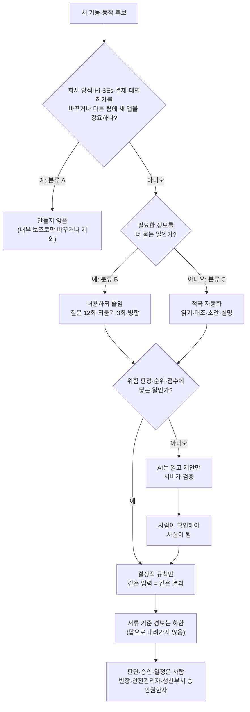
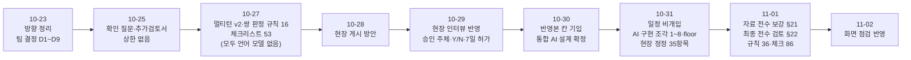
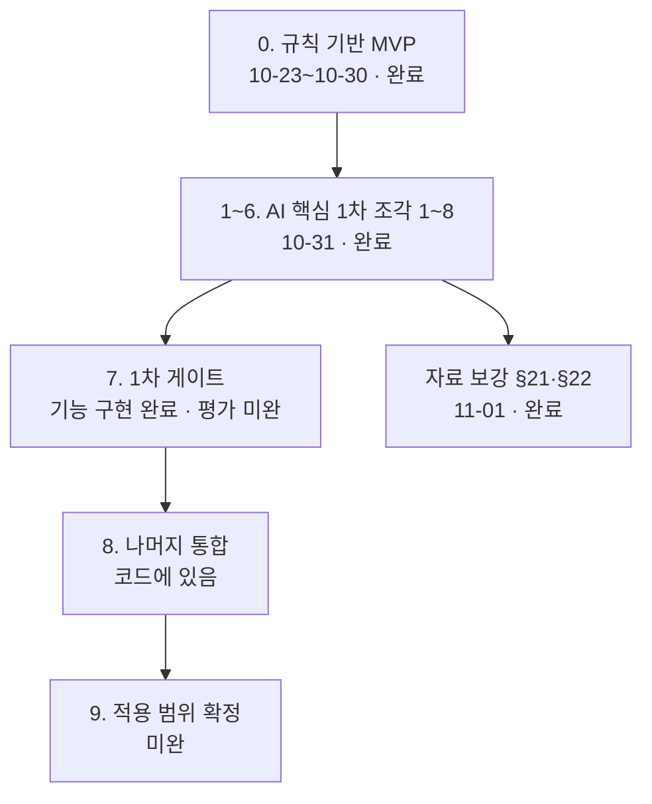

# 19. 설계 결정과 변경 이력 — 왜 이렇게 만들었나

croScan의 동작에는 대부분 정한 까닭이 있습니다. 이 문서는 그 결정과 까닭, 버린 대안, 바뀐 역사를 한곳에 모읍니다.
코드가 이상해 보일 때 「버그인가?」를 묻기 전에 이 문서에서 결정을 먼저 찾아보세요.

**이 문서에서 알 수 있는 것**

- 결정 하나하나의 까닭, 버린 대안, 근거 문서, 그 결정이 코드의 어디에 있는지
- 결정이 언제 어떻게 바뀌었는지(뒤집힌 결정 포함)
- 레드팀(RED TEAM, 일부러 반대편에 서서 약점을 찾는 검토)의 지적·대응·남은 위험, 아직 정하지 못한 질문과 그동안의 임시 동작
- 요구사항이 어디에 구현됐는지, 구현 단계, 현장 정정 35항목의 반영 여부
- 「한계처럼 보이지만 일부러 그렇게 한 동작」과 그 근거

## 목차

1. [무엇을: 이 문서를 쓰는 법](#1-무엇을-이-문서를-쓰는-법)
2. [왜: 결정을 따로 모으는 이유](#2-왜-결정을-따로-모으는-이유)
3. [결정의 큰 흐름](#3-결정의-큰-흐름)
4. [결정 목록](#4-결정-목록)
5. [변경 이력](#5-변경-이력)
6. [레드팀 검토](#6-레드팀-검토)
7. [열린 질문과 지금의 임시 동작](#7-열린-질문과-지금의-임시-동작)
8. [요구사항 대응표](#8-요구사항-대응표)
9. [구현 단계](#9-구현-단계)
10. [현장 정정 반영](#10-현장-정정-반영)
11. [코드 어디](#11-코드-어디)
12. [시험](#12-시험)
13. [한계](#13-한계)
14. [의도인데 한계처럼 보이는 동작](#14-의도인데-한계처럼-보이는-동작)

---

## 1. 무엇을: 이 문서를 쓰는 법

**찾는 법.** 궁금한 동작의 낱말(예: 「12회」, 「floor」, 「해당 없음」, 「Y/N」)로 이 문서를 검색합니다. 그 결정의 근거 열을 따라 원문을 엽니다.

**근거 줄임말.** 표가 길어서 근거 문서를 줄여 씁니다.

| 줄임말 | 문서 |
|---|---|
| 설계서 | [reference/AI도입계획_설계서.md](reference/AI도입계획_설계서.md) — 통합 AI 설계(10-30 확정)와 그 뒤의 구현 기록(부록), 현장 정정(§20), 자료 보강(§21·§22) |
| 멘토결정 | [reference/멘토질문_팀결정.md](reference/멘토질문_팀결정.md) — 10-23 팀 결정 D1~D9, 멘토 질문 M1~M8 |
| 이해정리 | [reference/프로젝트_이해정리.md](reference/프로젝트_이해정리.md) — 10-23 처음 방향 |
| 진행정리 | [reference/진행정리.md](reference/진행정리.md) — 11-01 진행 기록 |
| 멀티턴v2 | [reference/멀티턴_v2_설계.md](reference/멀티턴_v2_설계.md) — 10-27 반장 질문 설계 |
| 쌍설계 | [reference/쌍작업탐지_설계.md](reference/쌍작업탐지_설계.md) — 10-27 위험 쌍 판정 설계 |
| 체크설계 | [reference/위험체크리스트_설계.md](reference/위험체크리스트_설계.md) — 10-27 위험 체크리스트 설계 |
| 데이터셋 | [reference/데이터셋_설계.md](reference/데이터셋_설계.md) — 10-23 데이터셋 초안 |
| AX | [reference/AX_아키텍처_설명.md](reference/AX_아키텍처_설명.md) — 10-31 구조 설명 |
| 14문서 | [14 자료 대조와 검토 이력](14_자료대조와_검토이력.md) — 검토 회차와 지적 수 |

**내부 기록.** 아래 일곱 파일은 저장소 밖 팀 폴더에만 있습니다(공개 저장소에 아직 없음). 이 문서에서는 「내부 기록(파일 이름)」으로 적습니다. 파일 이름 앞의 `croScan_`과 끝의 `.md`는 줄였습니다.

| 표시 | 내용 |
|---|---|
| 내부 기록(현장인터뷰_반영_2026-10-29) | 현장 인터뷰 통합본 반영, 팀 화면 점검 1~5차 |
| 내부 기록(현장인터뷰_반영_2026-10-30) | 반영본 칸 배치 고도화, 화면 점검 반영(10-30~10-31) |
| 내부 기록(현장정정_반영검토_2026-10-31) | 현장 정정 35항목(D01~D35) 항목별 대조 |
| 내부 기록(멀티턴_추가검토_설계) | 10-25 확인 질문·추가검토서 첫 설계 |
| 내부 기록(현장게시_쌍작업전달_방안) | 10-28 현장 게시 방안 비교 |
| 내부 기록(위험체크리스트_설계_Codex초안) | 10-27 체크리스트 초안(Codex 작성) |
| 내부 기록(사용자시험_준비물_2026-10-31) | 사용자 시험 과제 카드와 기록지(실행 안 함) |

**표기.** 「Codex」는 개발 중 코드를 읽기만 하고 지적한 외부 검토 모델입니다. 「설계서 부록 2조각」은 설계서 부록의 구현 진행 기록 가운데 그 조각입니다. 「§22 정정표」는 설계서 §22의 「현재 구현과 다른 앞 절 설명」 표입니다([14문서 §9](14_자료대조와_검토이력.md#9-앞-절-설계-설명과-지금-코드가-다른-곳)에도 있음). 「팀 점검 #번호」는 팀이 화면을 써 보고 낸 지적의 번호이고, 코드 주석에는 「QA #번호」로 적혀 있습니다. 사람 이름은 쓰지 않고 역할(현장 반장, 안전관리자, 팀장, 멘토)로만 씁니다.

**수치 기준.** 지금 코드 기준입니다: 쌍 규칙 36(금지 조합 10), 체크리스트 86항목, 연구 ref 73/81 연결, 시험 `check_*` 34종. 이 문서를 쓰며 `pair_rules.json`, `checklist_spec.json`, `tools/`를 다시 셌습니다.

---

## 2. 왜: 결정을 따로 모으는 이유

- **어긋나 보이는 코드 대부분은 일부러 그렇게 만든 것입니다.** 예를 들어 「그라인더 안 씀」도 화기로 읽습니다. 고치면 경보가 줄어서 일부러 두었습니다([14절](#14-의도인데-한계처럼-보이는-동작)).
- **결정이 여러 문서에 흩어져 있습니다.** 10-23부터 11-02까지 문서가 열 개 넘게 쌓였습니다. 뒤 문서가 앞 결정을 뒤집은 곳도 많습니다([5.3절](#53-뒤집힌-결정)).
- **안전 주제입니다.** 결정을 모르고 「고치면」 경보나 질문이 사라질 수 있습니다. 그래서 「무엇을 버렸고 왜 버렸는지」까지 적습니다.

---

## 3. 결정의 큰 흐름

모든 결정은 아래 순서로 걸러졌습니다. 먼저 현장 틀을 바꾸는지 봅니다. 그다음 AI가 할 일과 규칙이 할 일을 나눕니다. 마지막으로 사람이 판단할 자리를 남깁니다.

근거: 설계서 「[현장 적용성 원칙](reference/AI도입계획_설계서.md#현장-적용성-원칙)」, 설계서 서두, AX §1·§2, 설계서 §8.1 개정.

---

## 4. 결정 목록

열은 다음과 같습니다. **결정** = 지금 코드가 따르는 결정. **이유** = 기록에 적힌 까닭. **버린 대안** = 기록에 적힌 다른 안(기록에 없으면 「기록 없음」). **근거** = 문서 §·기록 파일. **코드** = 그 결정이 있는 곳.

결정 번호의 머리 글자는 영역입니다: R 범위·역할, Q 질문, A AI 사용, P 위험 쌍, C 체크리스트, D 반영본·제출, G 현장 게시, E 근거·설명, U 화면, S 속도·운영, V 검토 방식. 설계서 §14 「이전 회차의 충돌·미결정 최종 정리」 20안건은 근거 열에 「§14」로 표시했습니다.

### 4.1 범위와 역할

| 번호 | 결정 | 이유 | 버린 대안 | 근거 | 코드 |
|---|---|---|---|---|---|
| R1 | croScan은 사전검토·초안 도구다. 승인·일정 결정·작업 차단을 하지 않는다 | 법정 의무와 판단은 기존 주체에게 있다. 도구 결함을 확인 버튼 누른 사람에게 떠넘기지 않으려고 구조로 막는다 | 승인 전 필터가 「승인 후보/보완 필요/조정 필요」로 나누는 안(10-23) | 설계서 현행 기준·§13·부록 「책임에 대한 설계 입장」, 이해정리 §4.2 | [`server/addendum.py`](../server/addendum.py)·[`server/checklist.py`](../server/checklist.py) 머리말 문구 |
| R2 | 현장 적용성 A/B/C: A(기존 틀 변경) 제외, B(추가 확인) 최소화, C(기존 수고 자동화) 중심 | 회사 양식·결재·대면허가를 바꾸면 현장이 쓰지 못한다 | 새 회사 필수 칸·양식, Hi-SEs 변경, 다른 팀 앱 가입·서명 의무 | 설계서 현장 적용성 원칙·§6.1 | 전반(한 곳 아님) |
| R3 | 안전관리자는 일정을 정하지 않는다. 작업 시간·순서는 반장끼리 협의한다 | 현장 사실(팀 화면 점검 #87·#91·#93·#94·#98, 10-31) | 조정 확정·당일 확인·변경관리, 「만약?」 일정 가정 재계산 | 설계서 현행 기준·부록 「서비스–설계 비교검토」, 내부 기록(현장인터뷰_반영_2026-10-30) 마지막 절 | [`web/app.js`](../web/app.js) `POST_STEPS`(두 단계), 공개 `/api/safety/what-if` 삭제 |
| R4 | 전산승인 = 생산부서 승인권한자. 안전 측 = 검토·지원·현장 확인과 2중점검 Y 작업의 대면허가 | 현장 인터뷰(10-29), 현장 정정 D01 | 「최종 판단과 승인은 안전팀」(10-23 이해, 멘토에게 보낸 요약) | 설계서 §20.1·§14, 내부 기록(현장인터뷰_반영_2026-10-29) §1 | `addendum.py`·`checklist.py` 머리말, [`server/retrieval.py`](../server/retrieval.py) `CORRECTED` |
| R5 | 허가구분·2중점검 Y/N은 묻지도, 정하지도, 고쳐 쓰지도 않는다. 적힌 값만 옮긴다 | 정하는 기준·주체가 미확인이다(조사자료 p16, D02) | Y/N 세부 판정식, 소속별 Y/N, 허가 명칭과 Y/N 대응 | 멀티턴v2 §1-5, 설계서 §3.5·§20.1, 내부 기록(현장인터뷰_반영_2026-10-29) §4 | [`server/augment.py`](../server/augment.py) `NOT_FOREMAN`, [`server/reflect.py`](../server/reflect.py) `NEVER` |
| R6 | 같은 작업장의 7일 단위 허가는 「진행 중 허가」로 그날 작업에 함께 보인다 | 이어지는 작업은 7일 단위 신청, 날마다 새 허가서가 아니다(인터뷰, D03) | 날마다 새 허가서 요구 | 내부 기록(현장인터뷰_반영_2026-10-29) §1, 설계서 §20.1 | [`server/safety.py`](../server/safety.py) `running` |
| R7 | 일상작업 = 신고서 없이 하는 작업. croScan은 비일상(신고서를 올리는) 작업 검토에 집중 | 위험 여부와 무관한 구분이다 | 일상 R03 용접 × TIG 병행 금지를 모순으로 보기 | 멘토결정 D2 | — |
| R8 | 7공정 = 판넬조립·대조립·선행의장·선행도장·PE장·탑재·선체도장 | 빠진 7번째를 확인 | 기록 없음 | 멘토결정 D8 | — (발표 자료) |
| R9 | 시연 자료는 팀이 새로 만들고 「합성」으로 표시한다 | 그림 속 예시 시간은 아이디어 설명용 | 예시값끼리 맞추기 | 멘토결정 D3, 데이터셋 §2 | [`tools/demo_day_data.py`](../tools/demo_day_data.py), [`samples/시연_하루/`](../samples/시연_하루/) |
| R10 | 멘토·사용자 수치(하루 8건·40건, 15·5·10분 등)는 참고값이다. 합산해 절감시간·인력 산정에 쓰지 않는다 | 실측 통계가 아니다(D9, D05·D06) | 「절감 시간 × 건수 × 인건비」 추산을 실적처럼(10-23 D9의 방향) | 멘토결정 D9, 설계서 §20.2 | 화면에 효과 수치 없음 |
| R11 | 효과는 모두 「후보·미측정」이다. 회사 공개실적·HiSEs 실적을 croScan 성과로 쓰지 않는다 | D24~D28 | 시간가치 표(128·384·640만원)를 실적으로 | 설계서 §20.5·§20.6 | 화면에 넣지 않음 |
| R12 | HiSEs·HI-SIGHT·Hi-Standard의 기존 기능은 대체하지 않고 보완·연동 후보로 둔다 | 회사 공식 보고서에 이미 있는 기능(D17~D22) | 체크리스트·도장 필터를 croScan 최초 기능으로 소개 | 설계서 현행 기준·§20.4 | [`server/pair_rules.json`](../server/pair_rules.json) FIRE 규칙 참고 문구 |
| R13 | 시연 범위는 대조립21공장 하루(허가서 10건·작업계획서 40건), 공장 배치는 합성 4BAY·20칼럼 | 실제 작업장 도면이 없다(D6). 선박 도면은 공장 판정 근거가 아니다 | 선박 도면(GOLAR)으로 공장 공간 판정 | 멘토결정 D6, 설계서 §20.7·§22 | `samples/시연_하루/`, `tools/demo_day_data.py` |
| R14 | 도장×용접을 대표 혼재 사례로 쓰지 않는다 | 멘토: 같은 장소 동시 진행이 드물다 | 도장×용접 대표 시나리오 | 이해정리 §2 | — |
| R15 | 일상 작업계획서에서 화기·방사선 허가 대상 작업(용접·가용접 취부·사상·RT)을 뺐다 | 일상 계획서에 비일상 작업이 섞여 있었다(팀 점검 #55·#56) | Codex의 「크레인 없는 지상 작업」 안(크레인 시나리오 C09·C13을 지키려고 따르지 않음) | 내부 기록(현장인터뷰_반영_2026-10-30) #55·#56 | `tools/demo_day_data.py`, `samples/시연_하루/workplans.json` |
| R16 | 작업계획서 40건 중 10건은 본청, 30건은 협력사 | 팀 점검 #57, D32 | 기록 없음 | 설계서 §20.7 | `samples/시연_하루/workplans.json` |
| R17 | 일일작업지시서, 감시 인력 운영, 질문지 응답 범위, 연도별 원문 목록, 특수선 사례, 기능 57개 대조는 범위 밖 | 발표·기획 자료의 몫(D04·D10·D15·D16·D23·D30) | — | 설계서 §20.8 | — |
| R18 | 「후속 조율 기능」(D5)은 확정되지 않았고, 일정 비개입(R3)으로 대체됐다 | D5는 「팀원 작성 중」으로 남았다. 10-31에 일정 결정이 범위 밖이 됐다 | D5 권고안: 관련 작업 전체 재검토·영향 작업 목록 | 멘토결정 D5(확정 ☐), 설계서 현행 기준 | — |

### 4.2 질문(멀티턴)

| 번호 | 결정 | 이유 | 버린 대안 | 근거 | 코드 |
|---|---|---|---|---|---|
| Q1 | 확인 질문에 답하는 사람은 반장이다 | 사용자 결정(10-25) | 기록 없음 | 내부 기록(멀티턴_추가검토_설계) §11 | `augment._foreman()` |
| Q2 | 반장 시점과 안전관리자 시점을 나눈다. 반장 화면에는 쌍 질문·쌍 표가 없다 | 반장은 허가서 한 장만 본다. 쌍은 그날 서류 전체가 있어야 판정한다 | 반장에게 X1~X6 쌍 질문 | 내부 기록(멀티턴_추가검토_설계) §12 | `augment.questions(manager=False)`, [`server/pairs.py`](../server/pairs.py) |
| Q3 | 당일 칸(현장 안전조치·추가정보 체크·수치)은 묻지 않는다 | 양식에 「작업당일 작업시작 전 체크(대면접수시 작성금지)」가 적혀 있다 | v1의 C2·C2h·B2 질문 | 멀티턴v2 §1-1·§2, 멘토결정 D1 | `augment.DAY_OF_VALUES` |
| Q4 | 예정 작업조건(공법·가스·진입·회수)은 묻는다. 답은 계획으로만 기록한다 | 신청 때 적는 칸이다. 계획을 조치 완료 증빙으로 바꾸면 안 된다 | 계획 답을 이행 기록으로 | 멀티턴v2 §1-2, 설계서 §2.2·§4.4 | `augment._foreman()` |
| Q5 | 질문을 ASK(묻기)/SKIP(넘기기)/DEFER(안전팀 확인으로 넘기기)로 나눈다 | 조사자료 각 작업 2.7절 | 기록 없음 | 멀티턴v2 §1-3 | `augment._foreman()` |
| Q6 | 정밀값(좌표·질량·풍량·농도·회로 치수)은 요구하지 않는다 | 「반장에게 전부 수기로 요구하는 목록이 아니다」(조사자료 2.5절) | 정밀값 재요구 | 멀티턴v2 §1-4, 설계서 §3.5 | — |
| Q7 | 질문 예산은 검토 회차당 12회. 정보 질문·명확화·해석 확인 카드·마무리 요청을 모두 센다. 화면에 보일 때 한 번 센다 | 현장 부담 상한, 종료 보장. 현장 시험이 불편하다고 자동으로 늘리지 않는다 | 「상한 없음」(10-25 사용자 결정), 자동 확대 | 설계서 §3.5·§11.3·§14, 4조각 | [`server/store.py`](../server/store.py) `ASKS = 12`, `issue()` |
| Q8 | 되묻기(명확화)는 허가서당 최대 3번 | 애매하면 묻되 무한루프는 안 된다(사용자 요청, 10-27) | 끝없이 되묻기, 짐작해서 채우기 | 멀티턴v2 §13, 설계서 §3.5 | `augment.ASK_BACK`, `store.CLARIFY` |
| Q9 | 같은 질문은 한 번만 묻는다. 「모름」은 한 번 안내하고 다시 묻지 않는다 | 반장 부담, 종료 보장 | 재촉 | 멀티턴v2 §7, 설계서 §3.5 | `store.issue()` 질문 키 |
| Q10 | 오전·오후 없는 1~6시는 되묻고, 7~12시는 주간으로 읽는다 | 「2시」가 2시인지 14시인지 모른다(사용자 요청 10-27). 7~12시는 주간 근무 가정 | 짐작해서 값 채우기 | 멀티턴v2 §13 | `augment._clocks()` |
| Q11 | 규칙 질문이 먼저, AI 질문은 뒤. 카드·되묻기·AI 질문은 남은 규칙 질문 몫을 남기고만 쓴다 | AI가 놓치거나 늦어도 규칙 질문이 12회 밖으로 밀리지 않게 | 규칙이나 AI 한쪽이 질문 의제를 모두 가짐 | 설계서 §3.5·§14, 부록 「남은 기능 완수 회차」 | `store.issue(reserve)`, [`server/need_catalog.py`](../server/need_catalog.py) `order()` |
| Q12 | 질문 순서는 결정적이다: 상충·주체·범위 확인 → 필수 → 점수(위험 무게 − 부담) | 같은 입력이면 같은 순서 | AI가 순서·예산을 정함 | 설계서 §3.2·§9 | `need_catalog.score()`·`order()` |
| Q13 | AI 신규 필요정보는 회차당 8개·분석당 2개, 모델 호출은 검토당 30회 | 유한 예산으로 종료를 보장 | 기록 없음 | 설계서 §3.7·§14 | `store.MAX_NEEDS`·`NEEDS_PER_CALL`·`LLM_CALLS` |
| Q14 | 질문은 필요한 원자(작은 확인 항목)가 확정일 때만 닫힌다. 「미정·확인 필요·모름·협의 중」이 붙은 말은 답한 것으로 보지 않는다 | §21의 고침이 표에 든 항목만 고쳐 같은 유형이 남았다 | 낱말 하나로 질문 닫기 | 설계서 §21·§22 | `need_catalog.ATOMS`, `augment.said()` |
| Q15 | 반장이 서류 칸을 고치면 그 칸에 기대던 답은 쓰지 않고 다시 묻는다 | 낡은 답이 계산에 남지 않게 | 기록 없음 | 설계서 §22 | `augment.answers_now()` |
| Q16 | T7(주간·야간 체크와 시간)은 확인된 근무시간이 없으면 법정 야간(22~06시)으로 명백할 때만 묻는다 | 자료가 08~18 가정만으로 묻지 말라고 함(N4-MT15). 「말도 안 되는 시간대는 있지 않나」(사용자 지적) | 08~18 가정으로 묻기 | 설계서 §21, 진행정리 「11-01 추가」, 14문서 §7.2 | `augment.t7_target()`, [`server/review.py`](../server/review.py) `LEGAL_NIGHT`, `SITE_SHIFT` |
| Q17 | T8(야간 화기 지원·인계)은 교대·인계·지원 언급이 있을 때만 묻는다 | 자료 MT12·MT14·N4-MT15, Codex 세 묶음 | 야간 체크·다음 날 종료만으로 묻기(앞 판단) | 설계서 §22 최종 회차, 14문서 §7.3 | `augment._time_of_day()` |
| Q18 | 글로 쓴 「없음」은 답 전체가 그 항목의 단일·무조건 부정일 때만 선택지처럼 계산한다(5개 항목) | 1,200건 평가의 틀림 53이 모두 글 부정 표기였다 | 「가스 안 씀」 낱말 규칙(넣었다 되돌림) | 설계서 §21, AX §3·§4 | `augment.negated()` |
| Q19 | 철회(C6)·정정(C5)은 매칭·체크리스트·반영본이 같은 함수로 읽는다 | 화면·문서·계산이 같은 답을 쓰게 | 기록 없음 | 설계서 §21 | `augment.live_answers()` |
| Q20 | 마무리 문구는 「…「없음 · 검토 마치기」를 눌러 주세요」 | 「제출」이 아니라 검토를 마치는 단계다(팀 문구 검토 #62) | 「없으면 제출해 주세요」(10-27) | 내부 기록(현장인터뷰_반영_2026-10-30) #62 | `augment.CLOSING` |
| Q21 | X6 문구는 「해당 반장과 협의한 변경 가능 시간대가 있나요?」 | 일정은 반장끼리 정하고 croScan은 후보를 기록만 한다 | 「이 작업 시간을 옮길 수 있나요?」 | 설계서 부록 3조각 | `augment.py` X6 |
| Q22 | 멀티턴 v2 검증은 12차를 마지막으로 끝냈다 | 자유 답 해석의 예외는 끝없이 나온다. 오해해도 질문 하나가 늘거나 줄 뿐이고 원문은 2쪽에 남는다 | 회차를 계속 늘리기 | 멀티턴v2 §10·§14 | [`tools/check_questions.py`](../tools/check_questions.py) |

### 4.3 AI를 쓰는 자리

| 번호 | 결정 | 이유 | 버린 대안 | 근거 | 코드 |
|---|---|---|---|---|---|
| A1 | AI는 읽고 제안한다. 규칙은 계산·권한·보호·종료를 맡는다(뉴로-심볼릭) | 안전 판정은 재현돼야 하고 놓쳤을 때 책임이 분명해야 한다 | 판정을 언어 모델에 맡김 | 설계서 서두, AX §1·§2 | 전반 |
| A2 | 문서 의미·자유 답 읽기는 정상 경로에서 AI가 한다 | 반장은 여러 정보를 섞어 말한다. 규칙만으로는 다 못 읽는다(1,200건: 규칙 285 → 통합 794) | AI를 정규식 실패 때만 호출 | 설계서 §14, AX §2 | [`server/understand.py`](../server/understand.py) `read()`, [`server/analyze.py`](../server/analyze.py) `analyze()` |
| A3 | 규칙이든 AI든, 한 답에서 다른 질문의 답으로 읽은 것은 반장이 확인해야 답이 된다(B6 닫음) | AI·규칙 읽기도 틀릴 수 있다 | 먼저 저장하고 나중에 취소(`takeDerived()`) | 설계서 §1.1·§4.2, 부록 2조각, §22 정정표 | `store.decide()`, `web/app.js` 확인 카드 |
| A4 | 높은 확신의 자동 반영은 버튼·타입 입력 같은 구조화 직접 응답만 | 영향 있는 AI 해석은 확인을 거친다 | AI 해석의 자동 확정 | 설계서 §4.2·§14 | `store.decide()` |
| A5 | 답 읽기(TURN) 기본은 「생각 끔 + 검수 예시」 | 실측: 생각 상한 128이 긴 출력에서 지켜지지 않아 88초·잘림. 끔+예시는 18~31초 | 설계표의 「생각 상한 128」 | 설계서 부록 1조각 | `understand.read(think=0)` |
| A6 | 검수한 합성 예시를 처음부터 1~2개 쓴다 | 실측: 예시 0개는 JSON은 맞지만 값을 하나도 못 뽑음 | Codex 권고 「few-shot 0개로 시작」 | 설계서 부록 「최종 검수 기록」, §4.5 | `understand.examples()`, [`server/cases.py`](../server/cases.py) |
| A7 | 추출 호출의 온도는 0 | 같은 답이면 같은 읽기(실측 두 번 같은 결과) | 기록 없음 | 설계서 부록 1조각 | [`server/llm.py`](../server/llm.py) `call_json(temperature=0.0)` |
| A8 | 정상 경로에서 다중 샘플을 쓰지 않는다. 합의에 확정 권한이 없다 | 같은 모델의 합의는 같은 오해일 수 있다 | 다중 샘플 합의 | 설계서 §9·§14·§15 | — |
| A9 | 비평(CRITIQUE)은 부정·「없음」 제안, 관계 가설, 문서 연결에만 한 번. 실패·불명·시간 부족은 보류 | 같은 모델의 자기 검증에는 한계가 있다 | 모든 제안에 비평 | 설계서 §9·§14, AX §2 | [`server/critique.py`](../server/critique.py) `review()`·`relation()` |
| A10 | 1차 호출은 UPLOAD_ANALYZE·TURN·WRITE·EXPLAIN·CRITIQUE 5종. 자유 질의 해석(QUERY_PARSE)은 뺐다 | 범위를 줄였다 | 13종 전부 1차 | 설계서 §1.4, 부록 비교검토 | `server/` 각 모듈 |
| A11 | 모델에는 DB 수정·파일 쓰기·외부 통신·승인·예산 변경 권한이 없다 | 기록 없음(구조 원칙) | — | 설계서 §1.2 | `llm.py`(JSON만 돌려줌) |
| A12 | 협조 문자의 「협의할 점」은 모델이 사실과 확인할 것을 **고르기만** 하고 문장은 서버 틀이 쓴다 | 자유 문장이 「4시에 시작」·지어낸 이름을 만들 수 있었다(Codex) | 자유 문장 생성 | 설계서 부록 8조각 | [`server/coordnote.py`](../server/coordnote.py) `sentence()` |
| A13 | 「왜?」 자유 질문은 모델이 의도와 사실 순서만 고른다. 문장은 서버가 쓴다 | 자유 한 줄은 「15분→15시」, 「예정→완료」로 바뀔 수 있다 | 모델이 쓴 설명 문장 | 설계서 부록 5조각 | [`server/explain.py`](../server/explain.py) `ask()` |
| A14 | 판정보류 쌍의 담당별 질문은 모델 없이 규칙과 문장 틀로 만든다 | 규칙의 부족 정보가 질문을 정한다(결정적) | §8.3 원래 문장 「AI가 담당자별로 나눔」 | 설계서 §22 정정표, 부록 「남은 기능 완수」 | [`server/holdq.py`](../server/holdq.py) `build()` |
| A15 | 업로드 분석에서 모델은 {종류, 칸 id, 구절}만 낸다. 이름·연락처·서명·승인·허가구분·2중점검·날짜·문서번호 칸은 주지 않는다 | croScan이 판단하지 않는 칸, 문서 속 지시를 따르지 않게 | 기록 없음 | 설계서 부록 4조각 | `analyze.inputs()`·`_hidden()` |
| A16 | AI 질문의 답은 별지에만 적고 양식 칸에는 쓰지 않는다 | 기록 없음 | — | 설계서 부록 4조각·「1차 게이트 평가 기록」 | [`server/reflect.py`](../server/reflect.py) |
| A17 | 체크리스트 AI는 카탈로그 안 항목만 최대 3개 제안. 반장이 「넣기」를 눌러야 들어간다 | 모델이 기본 항목을 줄이거나 지어낸 위험명을 넣지 못하게 | 모델이 자기 말로 위험 추가 | 설계서 §7·§19.1, 부록 「남은 기능 완수」 | [`server/checkai.py`](../server/checkai.py) |
| A18 | 규칙 밖 「AI 검토 권장」은 요청한 쌍만, 별도 목록, 「규칙 판정 아님」. 순위·점수를 만들지 않는다 | 쌍 AI는 네 기능을 채택하되 점수·순위·승인 권한이 없다 | AI가 쌍 순위에 관여 | 설계서 §8·§8.2·§14 | [`server/pairreview.py`](../server/pairreview.py) |
| A19 | 계획서 연결(LINK)은 반장 확인만으로 성립하고, 연결로 위험 쌍 후보에서 빼지 않는다 | 연결 오류가 작업을 없애지 않게 | 연결된 문서의 쌍 제외 | 설계서 §6.3·§14·§15 | [`server/link.py`](../server/link.py) |
| A20 | 옛 자유 대화 `/api/chat`은 기본으로 끈다(410) | 모든 모델 호출은 타입과 한도가 있는 작업이어야 한다 | 자유문장 스트리밍 | 설계서 부록 「남은 기능 완수」 Codex, §22 정정표 | [`server/app.py`](../server/app.py) |
| A21 | 음성 입력은 1차에 넣지 않는다 | 조선소 소음, CPU 한 대를 모델과 나눠 써야 함 | 서버 음성 인식(2차 후보로만) | 설계서 §19.9 | — |
| A22 | 위험 쌍 매칭·점수·순위에는 확률적 요소가 없다 | 안전 주제라 모델이 놓쳐도 규칙만 한 것과 같은 상태여야 한다 | 학습된 신뢰도 점수 | 설계서 부록 「남은 기능 완수」 확률적 요소 표 | `pairs.detect()` |
| A23 | 확인 사례는 사람 검수·비식별화·버전 발행 뒤에만 예시로 쓴다 | 사례집에 오답·주입이 쌓이지 않게 | 확인만으로 자동 편입 | 설계서 §4.5·§15 | `cases.py` |

### 4.4 위험 쌍 판정

| 번호 | 결정 | 이유 | 버린 대안 | 근거 | 코드 |
|---|---|---|---|---|---|
| P1 | 쌍 판정은 결정적 규칙만 쓴다. 같은 입력이면 늘 같은 결과 | 재현과 책임 | 언어 모델 판정, 규칙 쌍의 AI 검토 | 쌍설계 §1, 설계서 §21 「하지 않은 것」 | `pairs.detect()` |
| P2 | 검사 조합은 일상×비일상, 비일상×비일상. 일상×일상과 계획서×계획서는 보지 않는다 | 사용자 요청 범위, 설계 §8 범위 | 기록 없음 | 쌍설계 §1, 설계서 §8.2·§21 | `pairs.detect()` |
| P3 | 판정 6단계(서로 다른 작업 → 시간·잔류 → 경로 → 노출 → 원인·사고 → 모르면 확인 필요) | 조사자 원칙 그대로 | 기록 없음 | 쌍설계 §2 | `pairs._judge()` |
| P4 | 같은 BAY만으로는 위험이 아니다. 「확인(노출 3)」은 같은 블록·명시 경로·같은 설비 ID·상하 진술이 있어야 | BAY 하나는 약 43m×120m로 너무 넓다 | 같은 BAY = 위험 | 쌍설계 §2, 내부 기록(멀티턴_추가검토_설계) §12 | `pairs._place()` |
| P5 | 위험도 = 강도 S × 노출 E, 1·2·3순위. 금지 조합이 노출 3이면 1순위 | 노출은 확률이 아니라 서류로 확인된 정도다 | 이름을 「중대성×가능성」으로(팀 문구 검토 #62에서 거절) | 쌍설계 §5, 내부 기록(현장인터뷰_반영_2026-10-30) #62 | `pair_rules.json`, `pairs._judge()` |
| P6 | 모르는 값(시간·위치·인원)은 「확인 필요」(노출 1, 판정보류 = 확인이 필요해 3순위로 남긴 경보). 안전으로 보지 않는다 | 누락을 0이나 「위험 없음」으로 채우지 않는다 | 미확인을 경보 없음으로 | 쌍설계 §2, 이해정리 §7 설계 원칙 | `pairs._judge()` `gaps` |
| P7 | 10:00에 끝나고 10:00에 시작하는 작업은 앞 작업의 잔류위험으로 판정한다 | 종료 시각 ≠ 위험 소멸 | 경계 시각만 비교 | 멘토결정 D4 | `pair_rules.json` `sequence`·잔류 규칙 |
| P8 | 잔류위험은 시간이 지나도 저절로 사라지지 않는다. 해제 확인 기록이 없으면 같은 날 뒤 작업은 확인 대상 | 해제를 확인한 기록을 받지 않는다 | 시간 경과로 해제 | 쌍설계 §2·§8 | `pairs._judge()` |
| P9 | 거리를 모르면 빼지 않고 3순위 판정보류로 남긴다 | 칼럼당 12m 추정 거리로 위험 전달을 배제한 것을 Codex가 지적(A7) | 추정 거리로 배제 | 설계서 부록 「실사용·현장 대조」 A7, §20.5 | `pairs._place()` reach |
| P10 | 11m는 안전보건규칙 제241조의2 화재감시자 반경이다. 병행금지 반경이 아니다 | D25. 판독이 불확실한 멘토 손글씨 메모는 쓰지 않는다 | 멘토 메모의 11m | 설계서 §20.5 | `pairs.FIRE_REACH_M` |
| P11 | 같은 BAY에서 칼럼 2칸 이내를 「가깝다」로 본다(잠정) | 칼럼 간격 실측이 없다 | 기록 없음 | 내부 기록(멀티턴_추가검토_설계) §12 | `augment.NEAR_COLS` |
| P12 | 서류상 인원 0명이어도 사람이 있다고 본다. 인원 칸이 빈 작업도 노출을 낮추지 않는다 | 인원 합계 0만으로 무인을 확정하지 않는다(자료 MV03·Q06) | 「인원 0명이면 제외, 미상이면 노출 2 이하」(10-27) | 쌍설계 §2(앞 판단), 설계서 §22 최종 회차, [06c §7.1](06c_태그와_작업프로필.md#71-의도) | `pairs._people()` |
| P13 | 확인된 답은 경보를 **더하거나 올리기만** 한다. 서류 경보는 답으로 사라지거나 내려가지 않는다(안전 하한) | 반장이 확인한 답도 틀릴 수 있다. 그 오류가 경보 제거로 이어지면 놓침이다 | 「사라진 경보는 현재 목록에 겹쳐 보이지 않음」(§8.1 원래 문장) | 설계서 §8.1 개정(10-31) | `pairs.floor()` |
| P14 | 확인 사실은 (질문, 보기) → 사실 대응표로만 규칙 입력에 더한다. 다른 팀 이야기·자유 입력·AI 질문·「모름」은 넣지 않는다 | Codex: 다른 팀 진술 승격, 부정 답의 긍정 태그 | 자유 문장을 규칙 추출기에 넣기 | 설계서 부록 7조각 | `pairs.confirmed_facts()` |
| P15 | 제출본 보강은 같은 작업일의 최신 제출본만 쓴다 | 다른 작업일 제출본이 섞임(Codex) | 기록 없음 | 설계서 부록 7조각 | `pairs.detect(submitted=…)` |
| P16 | 기준본(v1) 보존: 보강 뒤에도 기존 경보가 사라지거나 내려가지 않는다. 의도한 예외는 「용접봉 불출」만, 「관찰·모니터링」만 적힌 작업 둘 | 경보가 줄면 안전팀이 위험을 못 듣는다 | 「같은 블록만으로 확인위험 금지」, 높이 숫자 하나의 미확정 처리 | 설계서 §21·§22, 14문서 §7.1 | [`tools/fixtures/pairs_v1/`](../tools/fixtures/pairs_v1/), [`tools/check_pairs_material.py`](../tools/check_pairs_material.py) `lost()` |
| P17 | 규칙 16 → 35 → 36개, 금지 조합 10개 | 412쪽 조사본·사례집·인터뷰 전수 대조 | — | 설계서 §21·§22 | `pair_rules.json` |
| P18 | 멘토 예시는 「완전한 금지표가 아님」. 「절대 병행 불가」를 「병행 제한 예시」로 바꿨다. 1톤은 공통 임계값이 아니다 | 인터뷰(10-29), D07 | 멘토 예시를 금지표로 | 내부 기록(현장인터뷰_반영_2026-10-29) §1, 설계서 §20.5 | `pair_rules.json` 머리 설명 |
| P19 | 반장이 「아래에서 작업」이라고 답한 상하 동시 작업은 금지 조합 1순위. 같은 블록이라는 사실만으로는 2순위 그대로 | 멘토 손글씨 「상·하 병행 절대 불가」 | 같은 블록만으로 1순위 | 설계서 §22 | `pairs.py`(상하 동시 주석) |
| P20 | 같은 배관 번호는 BAY가 달라도 압력시험 1순위. 같은 설비 번호의 연결이 장소 주소보다 앞선다 | 계통이 주소보다 우선 | 기록 없음 | 설계서 §22, [06d §6](06d_규칙별_경로와_판정.md#6-한계와-알려진-문제) | `pairs._place()` |
| P21 | 답으로 해소된 경보도 「답으로는 해소 · 문서 기준 유지」로 목록에 남는다 | P13과 같은 까닭 | §19 문장 「현재 건수에 합산하지 않음·사라짐」 | 설계서 §22 정정표 | `pairs.floor()`, `web/app.js` 보강 전후 3칸 |
| P22 | 「검토 통과 인접 작업」 이름을 유지하고, 고정 설명을 늘 붙이며, 초록을 쓰지 않는다 | 팀 결정. 「통과」가 승인으로 읽힐 위험은 설명과 사용성 시험으로 막는다 | 이름 변경 안건을 다시 열기 | 설계서 §5.6·§14, 내부 기록(현장인터뷰_반영_2026-10-30) #75~#77 | `web/app.js` `sfNearBody()` |
| P23 | 선후 계산은 여러 구간이면 실제로 가장 가까운 종료→시작을 쓴다 | 마지막 종료로 재면 간격이 틀린다 | 마지막 종료 기준 | 내부 기록(현장인터뷰_반영_2026-10-30) #79~#98 「함께 고친 것」 | `pairs.py` |
| P24 | 4BAY·20칼럼 밖 칼럼(예: 28-32)은 위치 미상(판정보류) | 시연 공장 배치가 4BAY·20칼럼이다 | 기록 없음 | 설계서 §22 | `pairs._place()` |
| P25 | 만들지 않은 규칙: 지시·재료·공구 결함(INFO·QUALITY·TOOL), 보행×호스·케이블, 화기에서 칼럼 2칸 넘는 일반 작업, 집결 인원의 통로 점유 | 입력을 받지 않음 / 같은 BAY의 거의 모든 쌍에 붙음 / 칼럼 간격이 측정값이 아님 / 사람을 적치물로 보지 않음 | 각 규칙 | 설계서 §22 「하지 않은 것」 | — |
| P26 | RT 통제구역은 신고서에 입력된 값을 쓰고, 비면 「확인 필요」 | 통제범위 자료가 없다. 임의 반경을 계산하지 않는다 | 임의 반경 계산 | 멘토결정 D7(확정 ☐), 이해정리 §9-7, [14문서 §3](14_자료대조와_검토이력.md#3-자료별-대조표) | `pairs.py` RADIATION 규칙 |

### 4.5 위험 체크리스트

| 번호 | 결정 | 이유 | 버린 대안 | 근거 | 코드 |
|---|---|---|---|---|---|
| C1 | 체크리스트는 허가서와 그 답만으로 만든다. 작업계획서는 쓰지 않는다 | 현장에서는 생산 쪽이 허가서와 함께 1차 체크리스트를 올린다(사용자 결정 10-27). 다른 작업과의 겹침은 안전관리자 단계에서 본다 | 같은 날 계획서로 병행 「해당 없음」을 막는 규칙(Codex 1차 #4) | 체크설계 §1·§11 | `checklist.draft(fields, answers)` |
| C2 | 처음 상태의 기본은 「확인 필요」. croScan은 「해당 없음」을 짐작하지 않는다. 규칙이 「해당 없음」을 제안하는 것은 허가서와 확정 답이 둘 다 없다고 말할 때만 | 침묵·빈칸·모름은 없음이 아니다 | 빈칸을 해당 없음으로 | 체크설계 §4, 설계서 §21·§22 정정표 | `checklist.evaluate()` |
| C3 | 조치 문장은 모두 「…할 예정」. 「실시함·완료함」은 쓰지 않는다 | 전날 계획이지 당일 확인이 아니다 | 기록 없음 | 체크설계 §2 | [`server/checklist_spec.json`](../server/checklist_spec.json) |
| C4 | 판단은 참·거짓·모름 세 값. 해당·해당 없음이 함께 맞으면 「확인」 | 「아마 연결돼 있음」이 뒤집혀 해당 없음이 되던 것(Codex 1차 #5) | 참·거짓 두 값 | 체크설계 §4·§8 | `checklist._match()` |
| C5 | 반장이 모든 위험요인을 확인해야 제출 확인·최종 제출로 간다. 「안전팀 확인」을 고른 것도 확인이다 | 팀 점검 #96(10-31) | 「확인 안 한 항목은 한 번 묻고 막지 않음」(10-27), #13의 「넘어감」 | 설계서 현행 기준, 체크설계 §6(앞 판단) | `web/app.js` 115행 주석(QA #96) |
| C6 | 근거·조치가 바뀌면 상태가 같아도 확인을 만료한다. 작업 사실이 조금만 바뀌어도 모든 기본 항목 확인을 푼다 | 안전 쪽(항목별 의존성보다 넓게) | 항목별 의존성 | 설계서 §7, 부록 6조각, [07b §9.3](07b_체크리스트_판정식.md#93-의도) | `checklist.work_digest()`, [`server/submissions.py`](../server/submissions.py) `confirm_checklist()` |
| C7 | 항목 53 → 83 → 86 | 412쪽 대조와 최종 검토 | — | 설계서 §21·§22 | `checklist_spec.json` |
| C8 | 선택 색: 해당 빨강, 안전팀 확인 노랑, 해당 없음 연파랑 | 팀 점검 #58 | 셋 다 같은 색(#47) | 내부 기록(현장인터뷰_반영_2026-10-30) #58, 설계서 §19 | [`web/style.css`](../web/style.css) |
| C9 | PDF 머리말에 「TBM 교육이나 조치 이행의 완료 기록이 아닙니다」 | D12: 자료 준비 ≠ 교육·조치 완료 | 기록 없음 | 설계서 §7·§20.3 | `checklist.py` 머리말 |
| C10 | 사고 사례는 같은 기전만, 항목당 최대 3건 | 원인이 없거나 장소·기전이 다른 사례는 뺀다 | 기록 없음 | 설계서 §22 | `checklist_spec.json` `cases` |
| C11 | 미리 고른 조치(`preselect`)는 법정 필수라는 뜻이 아니다 | 제안일 뿐 이행·승인이 아니다 | 기록 없음 | 설계서 §7, 체크설계 §10 | `checklist_spec.json` |
| C12 | croScan 체크리스트는 Hi-Standard 맞춤 체크리스트의 **보완**이다 | D20 | 최초 기능으로 소개 | 설계서 §7 | — |

### 4.6 반영본·별지·제출

| 번호 | 결정 | 이유 | 버린 대안 | 근거 | 코드 |
|---|---|---|---|---|---|
| D1 | 업로드 원본 파일은 바꾸지 않는다. 제출 PDF 앞부분은 「사전검토 반영본」: 답 가운데 시점·칸 용도에 맞는 값만 원본 양식 칸에 파란 글씨·번호로 적고, 나머지는 별지에 적는다 | 사용자 「꼭 반영」(팀 점검 #37, 10-30) | 「1쪽 원본 칸은 고치지 않고 2쪽에만 보강값」(10-25) | 내부 기록(현장인터뷰_반영_2026-10-29) §9, 내부 기록(멀티턴_추가검토_설계) §1, 설계서 §14 | `reflect.plan()`·`apply()` |
| D2 | 쓰지 않는 칸: 당일 칸, 서명·승인·대면허가, 허가구분·2중점검, 체크·이미지, 안전요원 추가조치 칸 | 작성 시점과 권한. AI 해석 확인으로도 풀리지 않는다 | 기록 없음 | 설계서 §6.2 | `reflect.NEVER` |
| D3 | 반영은 세 갈래: 비어 있던 칸에 기입 / 채워진 칸의 상세 줄에 보충 / 자리가 없는 정보는 별지 | 사용자 지적(10-30): 빈칸·보충·추가정보를 고심하라 | 기록 없음 | 내부 기록(현장인터뷰_반영_2026-10-30) 「세 분류」 | `reflect._facts()` |
| D4 | 칸에 안 들어가면 글자를 줄이지 않고(최소 7pt) 별지로 보낸다. 조건을 잘라 칸에 맞추지 않는다 | 잘린 조건은 위험하다 | 글자 줄이기, 자르기 | 설계서 §6.2·§19.6 | `reflect.py` |
| D5 | 신청 작업일시는 그대로 두고 실제 작업 시간은 별지에. 시간 칸은 T5 「잘못 적음」 정정일 때만 고친다 | 더 구체적인 단계 시간이 신청 시간을 덮으면 안 된다 | 기록 없음 | 설계서 §6.2, 내부 기록(현장인터뷰_반영_2026-10-29) §9 | `reflect.py` |
| D6 | 추가검토서와 별지는 한 산출물 체계, 다섯 블록 유지 | 기록 없음 | 상단 건수 요약 추가(넣지 않음: 「4. 안전팀 확인 필요」가 그 자리) | 설계서 §6.5·§14·부록 「출력물 인간공학 검수」 | `addendum.build()` |
| D7 | 종이에서 AI 문안만 키우지 않고 같은 역할의 칸과 같은 서식 | 글자 크기 상향은 문서 전체 점검 안건으로 따로 | AI 문안만 큰 글씨 | 설계서 부록 「출력물 인간공학 검수」 | `addendum.py`, `posting.py` |
| D8 | 제출 때 서버가 검토를 한 번 고정하고 PDF를 바이트로 보관한다. 같은 입력이면 같은 제출본(시각은 멱등 키에서 뺌) | 다운로드 때 다시 그리면 작성 시각·명세 문구가 바뀐다. 시각이 키에 섞이면 2분 뒤 재시도가 새 제출본이 된다 | 다운로드 때 다시 그리기 | 설계서 §2.3, 부록 6조각 | `submissions.create()`·`key_of()` |
| D9 | 클라이언트가 보낸 `read`·`by`·`ai`·`pid`는 받지 않는다. 답·양식을 바꾸는 요청은 개정 번호가 필요하다(없으면 428, 옛 것이면 409) | 기존 API가 확인 경계를 우회하지 못하게 | 클라이언트의 임의 답 목록 | 설계서 §12.1·§15, 부록 2조각 | `store.py`, `app._normalize()` |
| D10 | 보관 30일, 추측 불가 제출본 ID. 인증은 사내 로그인 프록시 자리(`CROSCAN_AUTH=proxy`)만 있고 기본은 시연 모드 | 시연판에 계정이 없다. 회사 SSO는 회사 시스템이 있어야 붙는다 | 기록 없음 | 설계서 부록 6조각·「남은 기능 완수」 | `store.KEEP_DAYS`, `app.AUTH` |
| D11 | 핵심 값 확인 창을 보여 준다. 처음(11-01)에는 제출 직전에만, 지금은 체크리스트 작성 전(「확인하고 체크리스트로」)과 제출 때(「확인하고 제출」) 둘 다. 확인한 값과 보낼 값이 다르면 다시 보여 주고 보내지 않는다 | 팀장 요청. 11-02 화면 점검에서 체크리스트 앞으로도 옮김 | 기록 없음 | 설계서 §21, 14문서 §4(11-02) | `web/app.js` `preSubmitView()`, `psValid()` |
| D12 | 계획서 사실은 같은 작업·범위로 확인해 채택한 것만 쓴다 | 다른 작업계획서를 자동으로 섞지 않는다 | 기록 없음 | 설계서 §7·§14 | `link.py`, `analyze.related_plan()` |

### 4.7 현장 게시

| 번호 | 결정 | 이유 | 버린 대안 | 근거 | 코드 |
|---|---|---|---|---|---|
| G1 | (10-28, 뒤에 바뀜) 원본은 그대로 + 추가조치 칸 3줄 초안 + 「병행작업 조정·착수조건」 별지 + 일상작업반 발췌본 | 기존 게시 습관, 안전팀 「혼재작업 조정」과 같은 일 | A 쌍작업 체크리스트 따로 발행(기각: 종이가 늘고 형식적 서명), D 모바일·QR 중심(보조) | 내부 기록(현장게시_쌍작업전달_방안) §2·§3 | — (G2로 바뀜) |
| G2 | 현장 게시는 두 단계: ① 반장에게 보낼 「일정 조율 협조 문자」 작성 ② 규칙 문안의 별지·전달문 발행. 발행본을 고칠 때는 새 개정본 | 안전관리자는 일정을 정하지 않는다(R3) | 조정 확정 → 발행 → 당일 확인 → 변경 대응 네 단계 | 설계서 현행 기준·§6.5, 내부 기록(현장인터뷰_반영_2026-10-30) #79~#98 | `web/app.js` `POST_STEPS`, [`server/posting.py`](../server/posting.py) |
| G3 | croScan은 문자를 보내지 않는다. 「보내기」는 복사하고 기록만 한다(「복사·기록 완료」) | D14·D35. 발송·수신·합의로 오해하지 않게 | 「보냄」 표기 | 설계서 §19.1·§20.3, 내부 기록(현장정정_반영검토_2026-10-31) | `web/app.js` `mgSend()` |
| G4 | 협조 문자는 받는 반장 한 명과 협의 상대의 연락처로 쓴다. 받는 사람을 바꿔 상대 반장에게도 쓴다 | D35 | 「두 반장에게」 한 번에 | 설계서 §20.3 | `web/app.js` `mgModel()`·`postCoordList()` |
| G5 | 협조 문자는 **작업 전 서류 단계**의 협의 요청 초안이다. 현장에서 위험을 발견했을 때의 절차(「종료」 → 게시 허가서 확인 → 전화)를 대신하지 않는다 | D14 | 전화를 문자로 바꾸라고 요구 | 설계서 §20.3 | `mgParts()` |
| G6 | 발행본은 고정하고 새 판 발행 시 이전 판은 효력 없음·회수 대상 | 한쪽만 최신판을 받는 위험 | 발행본 직접 수정 | 설계서 현행 기준, 내부 기록(현장게시_쌍작업전달_방안) §3 | `web/app.js` `postIssue()`, `posting.py` |
| G7 | 게시 서류 AI 보충은 미발행 서류에서만, 발행본에는 적용하지 않는다 | 기록 없음 | — | 설계서 §19.1 | `web/app.js` 게시 서류 AI 보충 |
| G8 | 도장 중·건조 중 표지와 출입인원 현재 상태 갱신은 만들지 않는다 | 정보 경로와 갱신 책임이 답변되지 않았다(D11) | 상태 갱신 기능 | 설계서 §20.3 | — |
| G9 | 이름 「현장 게시」를 유지한다 | 원본·별지·전달문 발행까지 포함하는 기능이라 「안전 게시물」로 바꾸면 범위가 흐려진다 | 「안전 게시물」 | 내부 기록(현장인터뷰_반영_2026-10-30) #62 | — |
| G10 | 게시 문서에 양쪽 반장의 디지털 확인을 새 의무 절차로 만들지 않는다 | 다른 팀에 새 앱·서명을 강요하지 않는다(R2) | 양쪽 확인 전 착수 보류(10-28 방안) | 설계서 §6.5·§14 | — |

### 4.8 근거와 설명(XAI)

| 번호 | 결정 | 이유 | 버린 대안 | 근거 | 코드 |
|---|---|---|---|---|---|
| E1 | 근거 등급 `[법령] [공공] [조선사] [팀] [예시]`를 쓰고, 등급·확인 상태·위험 순위를 한 배지에 합치지 않는다 | 「누가 정한 기준인가」를 보이되 판정에 쓰지 않는다 | 기록 없음 | 설계서 §3.4.1·§19.3 | [`server/evidencemap.py`](../server/evidencemap.py) |
| E2 | 법령은 현행본 대조를 마치고 「맞음」인 조문만 근거로 보인다 | 대조에서 틀린 조문 2건·약한 연결 7건이 나왔다 | 일괄 `[팀]` 대체 근거 | 설계서 부록 3조각 | `need_catalog.why()`, `pair_rules.json` `law_fit`·`law_checked` |
| E3 | 검색 자료의 조사 원문은 119쪽 검수본만. 412쪽 조사본은 연구 ref 연결에만 쓴다 | 412쪽본은 청크·검수 전이다. 자료 담당 확인 전 | 412쪽본 검색 편입 | 설계서 §3.4·§14·§16 | [`server/knowledge/`](../server/knowledge/) `corpus.json`·`research_refs.json` |
| E4 | 현장 정정으로 틀린 팀 조사 구절 3개(안전팀 전산승인·안전 측 최종 승인·전산허가=대면 불필요)는 검색에서 늘 뺀다 | D01·D02. 코퍼스를 다시 만들어도 돌아오지 않게 코드 상수로 둔다 | 코퍼스에서만 지우기 | 설계서 §20.1, 내부 기록(현장정정_반영검토_2026-10-31) | `retrieval.CORRECTED` |
| E5 | 검색은 BM25 + 한국어 문자 2~3그램, 표준 라이브러리만 | 무거운 ML 의존성을 넣지 않는다 | 기록 없음 | 설계서 §3.4 | `retrieval.py` |
| E6 | 검색 결과는 「검색 후보 · 근거 확정 아님」으로 보이고 판정에 쓰지 않는다. 검색 실패는 근거 부재의 증명이 아니다 | 기록 없음 | — | 설계서 §3.4, 부록 확률적 요소 표 | `retrieval.py` |
| E7 | 연결하지 못한 연구 ref는 인용하지 않는다 | 근거 없는 인용 방지 | 기록 없음 | 설계서 §3.4, [10 §5](10_근거와_자료.md#5-연구-ref-412쪽-조사본-연결) | `research_refs.json` `status` |
| E8 | 작업표준(JSP)은 번호 형식만 검사하고 본문을 인용하지 않는다 | 원문을 구할 수 없다 | 기록 없음 | 설계서 §22, 14문서 §6 | `web/app.js` `CODE_RULES` |
| E9 | 규칙 쌍 상세에는 AI 산문을 기본으로 붙이지 않는다. 확인된 반장 답 근거 행과 요청형 「왜?」만 | 규칙 도식·사고 설명과 같은 설명이 두 벌이 된다 | AI 보충 설명 | 설계서 §19.1, 부록 「출력물 인간공학 검수」 | `web/app.js` `sfPairBody()` |
| E10 | 「왜?」 1차는 세 질문: 선후 쌍이 왜 확인 대상인가, 어떤 서류 값·반장 답을 썼나, 무엇이 부족해 판정보류인가 | 일정 가정 계산은 범위 밖(R3) | 「만약?」 가정별 재계산 | 설계서 §5.5, 부록 5조각 | `explain.fixed()` |
| E11 | 설명 검증기는 미상→없음, 계획→완료, 경보 없음→안전의 변환을 막는다 | 안전 의미를 바꾸는 표현 방지 | 기록 없음 | 설계서 §5.4 | `explain.verify()` |

### 4.9 화면

| 번호 | 결정 | 이유 | 버린 대안 | 근거 | 코드 |
|---|---|---|---|---|---|
| U1 | AI 기능은 새 화면을 만들지 않고 기존 컴포넌트의 정해진 자리에 들어간다 | 매일 쓰는 사람에게 같은 정보는 늘 같은 자리 | 새 AI 화면 | 설계서 §19 | `web/app.js` |
| U2 | 초록은 사람의 확인 동작에만 쓴다. 경보 없음·인접 작업에는 초록·체크를 쓰지 않는다 | 「경보 없음 = 안전」 오해 방지 | 기록 없음 | 설계서 §5.6·§19.3 | `web/style.css` |
| U3 | 확률·%·모델명·토큰을 보이지 않고 「AI가 판단」이라고 쓰지 않는다 | 자동화 편향 방지 | 확신 백분율 | 설계서 §19.7 | `web/app.js` 상태 말 |
| U4 | 늦게 온 AI 결과는 목록 순서·선택·스크롤·포커스를 저절로 바꾸지 않는다 | 읽던 자리가 튀지 않게 | 기록 없음 | 설계서 §19.4 | `web/app.js` 상태 줄 |
| U5 | 화면 단계 순서: 작업계획서 확인 → 허가서 올리기 → 허가서 검토 → 위험 체크리스트 → 제출. 안쪽 화면 번호는 그대로 둔다 | 사용자 확정(팀 점검 #33, 10-29 밤) | 처음에는 「시연 직전이라 보류」로 둠(같은 날 3차) | 내부 기록(현장인터뷰_반영_2026-10-29) §7·§8 | `web/app.js` `STEP_ORDER` |
| U6 | 작업계획서를 모두 확인해야 다음 단계가 열린다 | 팀 점검 #54 | 확인하지 않고도 넘어감 | 내부 기록(현장인터뷰_반영_2026-10-30) #54 | `web/app.js` `plansOk` |
| U7 | 로그인 화면은 아무것도 검사하지 않고 비밀번호를 저장·전송하지 않는다 | 시연판은 계정 없이 쓴다(팀 점검 #25) | 기록 없음 | 내부 기록(현장인터뷰_반영_2026-10-29) §6 | [`web/index.html`](../web/index.html) `s-login` |
| U8 | 상단 고정 역할 탭은 만들지 않는다 | 정적 시안이다. 사용성 시험에서 필요가 확인되면 검토(D34) | 상단 탭 | 설계서 §20.7 | `web/app.js` `setRole()` |
| U9 | 다음 질문은 AI 읽기를 기다리지 않는다(0.2~0.5초). 확인 카드는 끝나는 대로 나중에 붙는다 | 사람이 모델을 기다리는 순간을 없앤다 | AI 읽기가 끝나야 다음 질문 | 설계서 §10.7 | `web/app.js`(§10.7 주석) |
| U10 | 상태 말 고정: 반장 화면 「확인함」, 관리자·종이 「반장 답변 확인」, 문안 「문안 채택」. `AI` 칩은 확인·채택 전에만 | 상태 말이 흔들리면 오해한다 | 기록 없음 | 설계서 §19.3·§19.5, 부록 「출력물 인간공학 검수」 | `web/app.js` |
| U11 | 새 그림·문서 라이브러리를 들이지 않는다. 기존 SVG·CSS와 PyMuPDF 렌더러를 쓴다 | 배치에 새 라이브러리가 필요 없다 | 기록 없음 | 설계서 §19.6·§19.8·§19.9 | `addendum.py`, `posting.py` |
| U12 | 시연 PDF의 QR은 허가번호 해시로 그린 무늬로, 아무 시스템에도 연결되지 않는다 | 원본에 PTW QR이 있다는 지적(팀 점검 #6) | 기록 없음 | 내부 기록(현장인터뷰_반영_2026-10-29) §1 | `tools/demo_day_data.py` |

### 4.10 속도·운영

| 번호 | 결정 | 이유 | 버린 대안 | 근거 | 코드 |
|---|---|---|---|---|---|
| S1 | 시간 목표: 자유 답 TURN p50 30초·p95 60초, 대표 허가서 대화 전체 6분 | 기록 없음(목표값) | 일반 턴 60/120초(폐기) | 설계서 §10.1·§14 | `understand.read(deadline=60)` |
| S2 | 매 턴 질문 표현(PHRASE) 호출을 기다리는 경로는 없다 | 기다림을 만든다 | 매 턴 PHRASE 호출(폐기) | 설계서 §1.3·§14 | `understand.phrase()`(배경) |
| S3 | 미리 계산·기다리지 않는 구조: 질문 표시 순간 미리 읽기(출력 없는 호출), 필요 순서 큐(반장 답 > 사람 요청 > 준비 > 데우기) | 실측: TURN 15.7초 중 질문 목록 읽기가 9.7초였고, 목록은 답 전에 정해져 있다 | 모델을 빠르게 만드는 것부터 | 설계서 §10.7 | `understand.warm()`, `llm._Slot`, `store.WARM_CALLS` |
| S4 | 모델 자리는 하나다. 사람의 호출은 다른 호출 때문에 취소되지 않고, 준비·데우기만 양보한다 | CPU 서버 한 대 | 선착순 | 설계서 §10.5·§10.7 | `llm._Slot` |
| S5 | 접두부 캐시는 기본 켬 | 같은 접두부 재요청의 새 입력이 3~4토큰으로 줄었다(실측) | 기록 없음 | 설계서 §10.4·§14 | `llm._payload()` `cache_prompt` |
| S6 | 호출별 생각(reasoning) 예산은 시작값을 정하고 정확도 게이트 뒤 줄인다. 상한 없는 생각은 쓰지 않는다 | 무제한 설정이 짧은 답 하나에 123초를 쓰고 빈 답 | 무제한 reasoning | 설계서 §1.4·§9·§14 | `llm._payload()` |
| S7 | 미리 읽기 요청은 종류마다 하나만, 앞 질문 것은 끊는다 | 브라우저 연결 6개 한도를 긴 요청이 차지해 다음 질문이 20초 막혔다 | 기록 없음 | 설계서 부록 「현장 정정 반영·QA·평가 중간 검수 회차」 | `web/app.js` |
| S8 | 시간 목표 미달 시 순서: 생각 예산 축소 → 연쇄 호출 병합 → 문맥 축소 → TURN 모델 교체 시험 → 하드웨어. 규칙 전용 경로를 정상 경로로 바꿔 숨기지 않는다 | AI 성능 문제를 감추지 않는다 | 기록 없음 | 설계서 §10.6 | — |
| S9 | GPU 없이 CPU 서버로 운영 | 이번 범위 밖 | — | 진행정리 「남은 것」, 14문서 §6 | `llm/` |
| S10 | 서버 상태는 `review.sqlite3`(대화·확인·제출), `holdq.sqlite3`(보류 질문), 제출 PDF 폴더에 나눠 둔다 | 기록 없음 | 설계의 `croscan.sqlite3` 하나 | 설계서 §22 정정표 | `store.py`, `holdq.py`, `submissions.py` |

### 4.11 검토 방식

| 번호 | 결정 | 이유 | 버린 대안 | 근거 | 코드 |
|---|---|---|---|---|---|
| V1 | 통합 AI 설계 검토는 3회차로 끝내고, 이후 기본값으로 구현하며 시험에서 미달한 항목만 고친다 | 요구사항 9 「면밀한 3회 검토로 종료」 | 설계 회차 더 열기 | 설계서 머리말·§17 | — |
| V2 | Codex 교차검증은 마지막 회차를 미리 정하고, 그 회차 지적은 모두 고친 뒤 끝낸다 | 끝없는 검토 방지 | 기록 없음 | 14문서 §4 | — |
| V3 | 최종 검토(§22)는 구현 메모를 믿지 않고 대조표 행을 지금 코드와 하나씩 맞췄다 | 앞 보고 「연구 ref 30개만 미연결」이 코드를 확인하지 않은 문장이었다 | 구현 기록 신뢰 | 설계서 §22, 14문서 §5.1 | — |
| V4 | 작은 평가는 비율 대신 건수로 보고한다 | 표본이 작다 | 비율 보고 | 설계서 §11.1, 부록 「1차 게이트 평가 기록」 | [`tools/eval_turn.py`](../tools/eval_turn.py) 등 |
| V5 | 「AI 핵심 1차 완료」가 아니라 「1차 기능 구현 완료 · 평가 미완」으로 적는다 | §11 평가셋·통과 기준·사용자 시험을 하지 않았다 | 「완료」 표기 | 설계서 부록 「1차 게이트 평가 기록」 | — |
| V6 | AI 핵심 1차 = 여섯 묶음(멀티턴 이해·혼합 질문·XAI·문서 작성·쌍 하이브리드 1개·안전 기반), 추정 24~34인일 | 설명 버튼만 붙인 상태를 완료로 보지 않는다 | 기록 없음 | 설계서 §12.2·§14 | — |
| V7 | 그림(피그마)은 로직을 확정한 뒤 한 번에 고친다 | 사용자 지적 | 로직이 바뀔 때마다 그림 수정 | 멀티턴v2 §11 | — |

**결정 수.** R 18, Q 22, A 23, P 26, C 12, D 12, G 10, E 11, U 12, S 10, V 7. 모두 163개입니다.

---

## 5. 변경 이력

### 5.1 한눈에 보기

### 5.2 날짜별 표

| 날짜 | 무엇이 바뀌었나 | 왜 | 근거 |
|---|---|---|---|
| 10-23 | 분석 단위를 「작업쌍」에서 「신고서 단건 누락 + 작업쌍 혼재」로. 대표 시나리오를 도장×용접에서 선행의장×배관 RT로 | 멘토링: 단건 누락이 핵심, 도장×용접 동시 진행은 드묾 | 이해정리 §2 |
| 10-23 | 팀 결정 D1~D9와 멘토 질문 M1~M8 정리. 정할 수 있는 것은 임시안으로 먼저 정하고 개발 | 열린 문제 9개 | 멘토결정 |
| 10-23 | 데이터셋 설계 초안. 시연 자료는 거의 모두 합성 | 실제 자료는 허가서 사진 2장과 빈 계획서 양식뿐 | 데이터셋 §2 |
| 10-25 | 확인 질문과 추가검토서(2쪽) 구현. 1쪽 원본은 그대로. 답하는 사람은 반장, 질문 상한 없음 | 사용자 결정 | 내부 기록(멀티턴_추가검토_설계) §11 |
| 10-25 | 반장 시점과 안전관리자 시점 분리. 핵심·선택 질문으로 나눔 | 사용자 결정: 반장 부담 | 내부 기록(멀티턴_추가검토_설계) §12 |
| 10-27 | 멀티턴 v2: 당일 칸 질문 제거, ASK/SKIP/DEFER, 종류별 질문, A형 질문 최대 11개 → 4~6개. 언어 모델 호출 없음 | 412쪽 조사본, Codex 1~8차. 「서버 CPU 모델은 한 번에 수십 초」 | 멀티턴v2 §1·§8·§10 |
| 10-27 | 애매하면 다시 묻기(A1~A3·U1), 되묻기 3번 | 사용자 요청 | 멀티턴v2 §13 |
| 10-27 | Codex 9~12차 검증, 12차를 마지막으로 | 사용자 결정. 10~12차는 앞 수정의 부작용이 대부분 | 멀티턴v2 §14 |
| 10-27 | 위험 쌍 판정: 규칙 16개, 언어 모델 없음, 판정 6단계 | 조사자 원칙 | 쌍설계 |
| 10-27 | 위험 체크리스트 53항목, 허가서만으로 만들기 | 사용자 지적 「허가서만 가지고 생겨야」 | 체크설계 §3·§11 |
| 10-28 | 현장 게시: 원본 + 추가조치 3줄 초안 + 조정 별지 + 일상반 발췌본 | Claude·Codex 각자 방안 뒤 비교 2회 | 내부 기록(현장게시_쌍작업전달_방안) |
| 10-29 | 대면허가 집계를 2중점검 Y 기준으로, 7일 단위 진행 중 허가, 승인 주체 문구를 역할별로, 「절대 병행 불가」 → 「병행 제한 예시」, 압력시험 잔압 확인, 당일 확인에 선후 인계 칸 | 현장 인터뷰 통합본 | 내부 기록(현장인터뷰_반영_2026-10-29) §1 |
| 10-29 | 첫 화면을 로그인으로, 안전관리자 화면을 한 페이지 스크롤로, 작업계획서 단계를 맨 앞으로 | 팀 점검, 사용자 지적 「너무 압축돼서 보기 힘들다」, 사용자 확정 | 내부 기록(현장인터뷰_반영_2026-10-29) §3·§6·§8 |
| 10-30 | 제출본을 「사전검토 반영본」으로: 원본 양식 칸에 답을 적음 | 사용자 「꼭 반영」(#37) | 내부 기록(현장인터뷰_반영_2026-10-29) §9 |
| 10-30 | 반영 세 갈래(빈칸·보충·별지), 빈 작업일시 행별 질문 | 사용자 지적 | 내부 기록(현장인터뷰_반영_2026-10-30) |
| 10-30 | 긴 답 하나로 여러 항목 읽기(규칙 확장) | CPU 모델은 한 번에 40~60초라 규칙으로 | 내부 기록(현장인터뷰_반영_2026-10-30) #39 |
| 10-30 | 안전관리자 화면 3탭 → 왼쪽 메뉴·도넛·상세 카드 | 팀 점검 #42·#66~#71 | 내부 기록(현장인터뷰_반영_2026-10-30) |
| 10-30 | 일상 계획서에서 화기·방사선 작업을 빼고 RT 시나리오가 빠짐. 40건 중 10건 본청 | 일상 계획서에 비일상 작업이 섞여 있었음(#55~#57) | 내부 기록(현장인터뷰_반영_2026-10-30) |
| 10-30 | 체크리스트 선택 색 분리, 「검토 통과 인접 작업」 이름과 고정 설명 | 팀 점검 #58·#75~#77, Codex | 내부 기록(현장인터뷰_반영_2026-10-30) |
| 10-30 | 통합 AI 설계 3회차 확정(요구사항 10개) | 설계 검토 종료 | 설계서 머리말 |
| 10-31 | 안전관리자는 일정을 정하지 않음: 현장 게시 두 단계, 조정 확정·당일 확인·변경관리·「만약?」 제거, 체크리스트 모든 위험요인 확인해야 제출 | 현장 사실(팀 점검 #79~#98), 서비스–설계 비교검토 | 설계서 현행 기준·부록, 내부 기록(현장인터뷰_반영_2026-10-30) 마지막 절 |
| 10-31 | AI 출력물의 화면·문서 배치 규약(§19) | Codex 2회 18건 | 설계서 부록 「출력물 인간공학 검수」 |
| 10-31 | 구현 조각 1~8(확인 카드, 검토 세션 저장소, 「왜 묻나요?」, 혼합 질문·12회, 「왜?」, 제출 스냅숏, 쌍 하이브리드, 협의할 점). TURN은 생각 끔 | 설계 §18 순서, 실측 | 설계서 부록 1~8조각 |
| 10-31 | 1차 게이트: 「1차 기능 구현 완료 · 평가 미완」 | 평가셋·사용자 시험 없음 | 설계서 부록 「1차 게이트 평가 기록」 |
| 10-31 | 안전 하한(floor), 규칙 질문 몫 예약, 선계산 구조, 검색·근거 지도, 체크리스트 AI, AI 검토 권장, 판정보류 질문, 비평, 계획서 연결, 인증 자리 | 사용자 지시: 확률적 판단으로 놓침이 생기지 않게, 대기는 미리 계산으로 | 설계서 부록 「남은 기능 완수 회차」 |
| 10-31 | 페르소나 실사용 결함 7건, Codex A1~A12, 원본양식 픽셀 비교 시험 신설 | 사용자 지시: 실사용·현장 자료 대조·원본 훼손 확인 | 설계서 부록 「실사용·현장 대조·최종 교차검증 회차」 |
| 10-31 저녁 | 현장 정정 35항목(이미 맞음 18·반영 필요 11·범위 밖 6). 옛 승인 구절 검색 제외, Y/N과 허가구분 분리 | 412쪽본 대비 정정 목록 | 설계서 §20, 내부 기록(현장정정_반영검토_2026-10-31) |
| 10-31~11-01 | 자연어 1,200건 평가(보강 전 코드) | 통합 평가 | 진행정리 |
| 11-01 | 자료 전수 보강(§21): 규칙 16 → 35, 체크리스트 53 → 83, 질문 추가, 제출 직전 확인 창 | 412쪽·사례집·인터뷰 등 전수 대조, 팀장 요청 | 설계서 §21 |
| 11-01 | T7을 법정 야간 기준으로 | 사용자 지적 | 진행정리 「11-01 추가」 |
| 11-01 | 연구 ref 연결 정정(0 → 71/78) | 「30개만 미연결」 보고가 틀림 | 진행정리, 14문서 §5.1 |
| 11-01 오후 | 최종 전수 검토(§22): 규칙 36, 체크리스트 86, 「미정」에 닫히던 질문 6개, 칸을 고치면 다시 묻기, ref 73/81 | 「다 반영했다」 보고가 맞지 않음 | 설계서 §22 |
| 11-01 밤 | 최종 회차: 판독·문구 고침, T8 좁힘, 사례집 연결 | Codex xhigh 9묶음 | 설계서 §22 |
| 11-02 | 화면 점검 반영(체크리스트 남은 항목 이동, 핵심 정보 확인 창을 체크리스트 앞으로, 담당별 확인 카드), 실제 작업 시간 해석 | Codex 분류·최종 검토 9건 | 14문서 §4 |

회차별 지적 수와 검토 모델 설정은 [14문서 §4](14_자료대조와_검토이력.md#4-검토-이력)에 있습니다.

### 5.3 뒤집힌 결정

앞 문서만 읽으면 지금 코드와 다르게 알 수 있습니다. 아래는 지금 기준이 오른쪽입니다.

| 앞 결정(날짜) | 지금(날짜) | 바뀐 까닭 | 근거 |
|---|---|---|---|
| 질문 상한 없음(10-25) | 검토당 12회(10-30 설계, 10-31 구현) | 현장 부담 상한과 종료 보장 | 내부 기록(멀티턴_추가검토_설계) §2, 설계서 §3.5 |
| 1쪽 원본 칸은 고치지 않음, 2쪽에만 보강(10-25) | 원본 파일은 그대로, 제출본은 칸에 적은 반영본(10-30) | 사용자 「꼭 반영」 | 내부 기록(현장인터뷰_반영_2026-10-29) §9 |
| 질문·쌍·체크리스트 모두 언어 모델 없음(10-27) | 읽기·질문·설명·문안에 AI, 쌍 판정은 여전히 규칙만(10-30~31) | 통합 AI 설계 요구사항 | 멀티턴v2 §1-6, 설계서 서두 |
| 긴 답의 여러 항목은 규칙으로 읽음(10-30) | AI 읽기 + 확인 카드(10-31) | 미리 읽기로 대기를 숨겼다 | 내부 기록(현장인터뷰_반영_2026-10-30) #39, 설계서 부록 1조각·§10.7 |
| 체크리스트 병행 판단에 같은 날 계획서 사용(10-27 Codex 1차) | 허가서와 답만(10-27 같은 날) | 사용자 지적 | 체크설계 §11 |
| 확인 안 한 체크 항목은 한 번 묻고 제출을 막지 않음(10-27) | 모두 확인해야 제출(10-31) | 팀 점검 #96 | 체크설계 §6, 설계서 현행 기준 |
| 「최종 판단과 승인은 안전팀」(10-23) | 전산승인은 생산부서 승인권한자(10-29, D01) | 현장 인터뷰 | 이해정리 §1, 설계서 §20.1 |
| 「PTW 스캔 때 전산이 Y/N을 정함」(10-29) | 「스캔 때 정해짐(기준·스캔 주체 미확인)」, 허가구분과 분리(10-31) | 현장 정정 D02: 자동화를 단정했음 | 내부 기록(현장정정_반영검토_2026-10-31) D02 |
| 현장 게시 네 단계(조정 확정·발행·당일 확인·변경 대응, 10-28~29) | 두 단계(협조 문자·서류 발행, 10-31) | 안전관리자는 일정을 정하지 않음 | 내부 기록(현장게시_쌍작업전달_방안), 설계서 현행 기준 |
| 「1순위는 해소 안 되면 승인 보류, 양쪽 확인 전 착수 보류」(10-28) | croScan은 승인·착수를 다루지 않음 | 일정 비개입, 새 의무 절차 금지 | 내부 기록(현장게시_쌍작업전달_방안) §3, 설계서 §6.5 |
| 「인원 0명이면 제외, 미상이면 노출 2 이하」(10-27) | 0명도 사람이 있다고 보고, 빈 인원도 노출을 낮추지 않음 | 자료 MV03·Q06, 최종 회차 | 쌍설계 §2, 설계서 §22 |
| 사라진 경보는 현재 목록에 겹쳐 보이지 않음(§8.1 원래) | 서류 경보는 답으로 내려가지 않음(floor, 10-31) | 확인한 답의 오류도 놓침이 된다 | 설계서 §8.1 |
| 칼럼당 12m 추정 거리로 위험 전달 배제 | 거리 미확인은 판정보류(10-31) | Codex A7 | 설계서 부록 「실사용·현장 대조」 |
| T8을 야간 체크·다음 날 종료로 물음(11-01) | 교대·인계·지원 언급이 있을 때만(11-01 밤) | 자료와 Codex 세 묶음 | 설계서 §22 |
| TURN 생각 상한 128(10-30 설계) | 생각 끔 + 예시(10-31) | 긴 출력에서 상한이 지켜지지 않음 | 설계서 부록 1조각 |
| PHRASE·검색 캐시는 1차에서 끔(10-31 검수) | PHRASE는 질문 표시 때 배경 호출, 검색은 메모리 캐시 `_REFS` | 지금 구현(이유 문장은 기록에 없음, 정정표만 있음) | 설계서 §22 정정표 |
| 판정보류 질문을 AI가 담당별로 나눔(§8.3) | 모델 없이 규칙(holdq) | 결정적 | 설계서 §22 정정표 |
| 대표 시나리오 선행의장 × 배관 RT(10-23) | 대조립21공장 하루, 시연 RT 없음(10-30, D33) | 일상 계획서 정리(#55·#56) | 이해정리, 설계서 §20.7 |
| 작업계획서 단계를 시연 직전에는 옮기지 않음(10-29 3차) | 맨 앞으로(10-29 4차) | 사용자 확정 | 내부 기록(현장인터뷰_반영_2026-10-29) §7·§8 |
| 「가스 안 씀」 낱말 규칙(10-31 평가 중) | 되돌림. 글 「없음」은 답 전체가 무조건 부정일 때만 | 가드레일 원칙에 맞지 않음 | AX §4 |
| 멘토 수치로 「절감 시간 × 건수 × 인건비」 추산(10-23 D9) | 참고값·가정 표만, 화면 미표시, 비용 차감 전, ROI 미측정 | 현장 정정 D05·D06·D28 | 멘토결정 D9, 설계서 §20.2·§20.6 |

---

## 6. 레드팀 검토

설계서 [§15 RED TEAM](reference/AI도입계획_설계서.md#15-red-team--반론과-닫힌-처리)의 반론 20개와, 그 뒤 기록에서 나온 반론입니다. 「남은 위험」은 기록에 적힌 것만 옮겼습니다.

| 지적 | 대응 | 남은 위험 |
|---|---|---|
| 틀린 해석에 실제 인용을 붙이면 더 설득력 있게 틀린다 | 구절이 있는지와 뜻을 뒷받침하는지를 나눠 검사, 중요한 것은 비평과 사람 확인(`understand.check()`, `critique.py`) | 숫자·ID가 원문과 다를 때 원문 구절로 바꾸는 검사는 「값의 의미가 다른 모든 경우를 잡지 못한다」(AX §3) |
| 같은 모델의 합의는 같은 오해일 수 있다 | 온라인 다중 샘플 끔, 합의에 확정 권한 없음 | 비평도 같은 모델이라 자기 검증 한계가 있다. 그래서 결정적 검사와 사람 확인을 따로 둔다(AX §3) |
| 확인이 많아 현장에서 못 쓴다 | 한 발화를 카드 하나로, 직접 응답은 다시 확인시키지 않음, 12회·6분 | 사용자 시험을 하지 않아 실제 부담은 모른다([7절](#7-열린-질문과-지금의-임시-동작)) |
| 12회 안에 필수 정보를 못 받는다 | 자동 확대 금지, 남은 질문은 별지 「질문 한도로 묻지 않음」 | 그 정보는 안전팀이 다시 확인해야 한다 |
| 미리 만든 질문이 이미 낡았다 | need·의존 사실·개정 일치 검사, 실패 시 대체 문구. 데우기 목록 지문 검사(Codex) | 기록 없음 |
| 업로드 분석으로 기다림을 앞에 숨긴다 | 겹치지 못한 대기를 전체 시간에 넣어 잰다 | 대화 30개 측정(p50 111초·p95 240초)은 서버 값이고 로컬 원자료가 없다(설계서 §22 정정표) |
| 캐시가 맞을 때만 빠르다 | 첫 턴·미적중·세션 교대·동시 사용을 따로 잼 | CPU에서 확인 카드까지 10~30초. TURN 시간 목표(발화→카드)는 이 구조로 줄지 않는다(설계서 §10.7) |
| 확인 버튼이 새 결재처럼 보인다 | 해석 확인 범위만 저장, 승인·이행 기록과 분리, 「해석 확인은 작업 승인이 아님」 문구 | 이해도 시험(사용자 시험 R3) 미실시 |
| 별지가 사실상 새 회사 양식이다 | 현장 수용 방식에 맞추고, 안 받으면 내부 참고·옮겨 쓰는 초안 | 첨부가 받아들여지는지 미확인(설계서 §16, 내부 기록(멀티턴_추가검토_설계) §10) |
| 게시가 상대 팀에 앱 사용을 강제한다 | 기존 연락·출력 경로, 새 가입·서명 없음, 문자는 복사·기록만 | 문자 협의 요청이 현장에서 받아들여지는지 미확인(설계서 §20.9-6) |
| 검색이 오래된 역할·타사 기준을 섞는다 | 회사·권한·개정·대체 관계 필터, 정정된 구절 3개 제외 | 팀·조선사 구절은 검수 전 후보, 체크리스트 법령 인용 적합성 기록 없음(설계서 부록 「남은 것」, §21) |
| 사례집에 오답·주입이 쌓인다 | 검수·비식별화·버전 발행 뒤 사용(`cases.py`) | 이름 가림이 호칭 앞 이름만 잡는다(설계 근거 미기록, [15 §20.2](15_자료와_시연데이터.md#202-어긋나-보이는-곳과-그-이유)) |
| 태그를 더했는데 경보가 사라진다 | 비단조성 인정, 보강 전후 3칸 비교, floor | floor는 순위·점수·표기만 서류 쪽으로 되돌리고 설명 문장은 답을 넣은 판정의 것이 남을 수 있다([06d §6](06d_규칙별_경로와_판정.md#6-한계와-알려진-문제)) |
| 검토한 20쌍 밖 관계가 안전해 보인다 | 「검토 완료 N / 대상 M」, 권장 0건과 미분석을 다른 말로 | AI 검토는 요청한 쌍과 배치만 본다. 나머지는 「미분석」 |
| 협조 문자·선후 계획 문구로 경보가 풀린다 | 계획 표시만, 「서류상 선후 계획 · 남은 확인」. 새로 제출·정정된 자료로만 다시 검토 | 기록 없음 |
| 문서 연결 오류가 작업을 없앤다 | 연결과 값 채택 분리, 자동 쌍 제외 금지 | 기록 없음 |
| 기존 API가 확인 경계를 우회한다 | 모든 소비 경로를 서버 스냅숏으로, 클라이언트 `read`·`ai` 등 안 받음 | 기록 없음 |
| 「통과」를 승인으로 오해한다 | 이름 유지 + 고정 설명 + 초록 없음 + 이해도 배포 게이트 | 사용성 시험 미실시. 오해가 나오면 배포 보류(설계서 §5.6) |
| 시연에서만 잘 작동한다 | 시나리오·업체·양식 분리, 실사용 평가와 주장 범위 구분 | 결과는 시연 자료 기준. 실사용자 시험 없음(Codex 2회차가 지정한 한계) |
| 새 실패가 전혀 없다는 과장 | 구조적 차단과 의미 정확도 평가를 나눠 보고 | 자연어 1,200건은 11-01 보강 전 코드 결과, 이후 다시 돌리지 않음 |
| (10-31 사용자 질문) 확률적 판단이 쌍 매칭에 들어가 놓침이 생기지 않나 | 쌍 판정·순위에 확률 없음. 모델이 규칙 신호를 줄이던 경로 4개(예산 잠식·채택 항목 자동 삭제·판정보류 질문 숨김·작업 변경 뒤 확인 유지)를 막고 시험으로 고정 | 모델 오류의 영향이 「편의 손실뿐」이라고 할 수는 없다. 보장 하한은 서류 기준 경보다(설계서 §22 정정표) |
| (설계 입장) 사람이 확인했으니 책임은 사람에게 있다? | 도구 결함을 확인 누른 사람에게 떠넘기지 않는다. 구조와 회귀 시험으로 막고, 구조가 깨지는 결함은 개발·운영 측 책임 | 운영 인증 없음, 사내 SSO 미연동 |
| (Codex 2회차 판정) 보고서에 밝힐 한계 | — | 실사용자 시험 미실시, 시간 절감·사고 감소 효과 미검증, 회사 SSO 미연동, CPU 추론 지연·시간 초과 가능, 시연 작업 목록 밖 제출은 자동 쌍 판정에서 빠짐 |

---

## 7. 열린 질문과 지금의 임시 동작

정하지 못한 것이 있어도 croScan은 멈추지 않습니다. 아래 임시 동작으로 갑니다. 대부분 「판단하지 않고 사람에게 남긴다」 쪽입니다.

| 열린 질문 | 확인할 역할 | 지금 임시 동작 | 근거 |
|---|---|---|---|
| 2중점검 Y/N의 판정 기준과 스캔 주체. 허가구분은 언제·누가 정하나 | 현장 연락 담당 | 적힌 값만 옮김. 「스캔 때 정해짐(판정 기준·스캔 주체 미확인)」으로 표시 | 설계서 §20.9-1, `augment.py` `fixed_pending` |
| 7일 허가 중 위치·내용이 바뀔 때 재신청 방식 | 현장 연락 담당 | 보충·새 개정본 제안만, 재신청 여부는 판단 안 함 | 설계서 §20.1·§20.9-2 |
| 협력사 건 전산승인자의 범위, 보고서의 「안전요원 최종확인」 대상 | 현장 연락 담당 | 승인 주체를 새로 정의하지 않음 | 설계서 §20.9-3 |
| 출입구 게시 허가서의 출입인원이 예정인지 현재인지, 누가 갱신하나 | 현장 연락 담당 | 상태 갱신 기능 없음 | 설계서 §20.9-4 |
| 위험 발견 뒤 작업 「종료」 다음 재개 권한과 변경 기록 | 현장 연락 담당 | 새 개정본 작성만 지원, 재개 판단 안 함 | 설계서 §20.9-5 |
| 문자 협의 요청이 받아들여지나, 반장 한 명씩이 맞나 | 현장 연락 담당 | 반장 한 명씩, 복사·기록만 | 설계서 §20.9-6 |
| 선내 도장·화기 필터가 대조립에도 쓰이나, 넘길 경로가 있나 | 현장 시스템 담당 | 연동 없음, 「선내 사례」로만 인용 | 설계서 §20.9-7 |
| Hi-Standard 체크리스트와 겹치나 | 도메인 담당 | croScan 항목을 그대로 냄(겹치면 보충 항목만 내는 것이 계획) | 설계서 §20.9-8 |
| 412쪽본을 검색 자료에 넣나 | 자료 담당 | 119쪽 검수본만 검색 | 설계서 §20.9-9·§16 |
| 확인된 현장 근무시간 | 현장 연락 담당 | 법정 야간으로 명백할 때만 T7. 값이 생기면 `CROSCAN_SITE_SHIFT` | 설계서 §21, 14문서 §6 |
| 칼럼 간격 실측, 실제 하물 외곽·높이 | 데이터·도메인 담당 | 칼럼 2칸 이내를 가깝다로(잠정), 거리 미확인은 판정보류 | `augment.NEAR_COLS`, 설계서 §22 |
| 작업별 잔류위험의 해제 방식·시간(M2) | 멘토·도메인 담당 | 잔류에 시간 한도 없음, 그날 뒤 작업은 3순위 확인 | 멘토결정 D4(작업별 값 ☐)·M2, 쌍설계 §8 |
| RT 통제구역 정하는 법(M3) | 멘토 | 입력값을 쓰고 비면 확인 필요 | 멘토결정 D7·M3 |
| 비식별 실제 허가서·안전팀 코멘트 예시(M8) | 자료 담당 | 합성 자료로 평가 | 멘토결정 M8 |
| 실제 작업자 소속(본청·협력사) 인원 | 현장 연락 담당 | 넣지 않음. 현장 확인 뒤 추가할 후보 | 설계서 부록 「실사용·현장 대조」 |
| 반영본·별지가 전산 첨부로 받아들여지나 | 현장 연락 담당 | 내부 참고·기존 칸에 옮겨 쓸 초안 | 설계서 §16, 내부 기록(멀티턴_추가검토_설계) §10-3 |
| 회사 실물 양식 다섯 종류 호환 | 문서 담당 | 미검증 양식에 칸 자동 기입 금지 | 설계서 §16 |
| 실제 인증·권한 | 백엔드·현장 시스템 담당 | 시연 모드(「시연 모드 · 인증 없음」 표시), 프록시 자리만 | 설계서 §16, 부록 「남은 기능 완수」 |
| 동시 사용자·보존기간 | 제품·운영 담당 | 검증된 범위만, 30일 보관 | 설계서 §16 |
| 사용자 시험(반장 5명·안전관리자 2명) | 제품 담당 | 준비물만 있고 실행 안 함 | 내부 기록(사용자시험_준비물_2026-10-31) |
| 추가조치 칸에 혼재 조정과 별지 참조를 적어도 되나, 일상작업반 TBM 전달 책임자는 누구인가 | 멘토 | 추가조치 보호 칸에 쓰지 않고 옮겨 쓸 초안만 | 내부 기록(현장게시_쌍작업전달_방안) §5, 설계서 §6.5 |
| 상단 고정 역할 탭이 필요한가 | 제품 담당 | 만들지 않음 | 설계서 §20.7 |
| 설계서 §16 표의 담당자 실명 배정 | 팀 | 이 기록을 찾지 못함(「착수 때 배정」으로만 적힘) | 설계서 §16 |

멘토결정 문서의 확정란이 비어 있는(☐) 결정은 D1(당일 체크란 제외), D4의 작업별 값, D5(후속 조율), D6(합성 공간), D7(RT 통제범위), D9의 실제 수치입니다. D1은 뒤에 양식 문구로 확인돼 그 방향으로 구현됐습니다(멀티턴v2 §1-1 [확인]). D5는 일정 비개입(R3)으로 대체됐습니다. 나머지는 위 표의 임시 동작으로 갑니다.

---

## 8. 요구사항 대응표

### 8.1 설계서 §17의 요구사항

설계서 [§17 요구사항 커버리지](reference/AI도입계획_설계서.md#17-요구사항-커버리지)의 요구 10개와 알고리즘 요구 7개입니다.

| 번호 | 요구사항 | 구현 위치(문서 + 코드) | 상태 |
|---|---|---|---|
| 1 | 구체적 아키텍처·알고리즘·작은 모델 | [04 아키텍처](04_아키텍처.md), [05b AI 판독](05b_AI_판독.md) · `llm.py`, `store.py`, `need_catalog.py`, `understand.py` | 구현 |
| 2 | AI가 멀티턴·XAI·문서의 핵심 | [05c 라온이 하는 일](05c_라온이_하는_일.md) · 여섯 묶음 연결(설계서 부록 「1차 게이트 평가 기록」) | 구현(평가 미완은 [9절](#9-구현-단계)) |
| 3 | 규칙 + AI 혼합 질문·이유·RAG | [05 멀티턴 질문](05_멀티턴_질문.md), [10 근거와 자료](10_근거와_자료.md) · `analyze.py`, `need_catalog.why()`, `retrieval.py` | 구현 |
| 4 | 가드·금지·예외·무한루프 방지 | [05f 답 상태와 세션](05f_답_상태와_세션.md) · `store.ASKS`·`CLARIFY`·`LLM_CALLS`, `reflect.NEVER`, `augment.ASK_BACK` | 구현 |
| 5 | 깊고 다양한 XAI | [06e 하루 판정과 설명문](06e_하루판정과_설명문.md) · `explain.py`, `evidencemap.py`, `web/app.js` 「왜 묻나요?」 | 구현(「만약?」은 일정 비개입으로 뺌) |
| 6 | 양식 보충·교차 문서 AI | [08 반영본과 별지](08_반영본과_별지.md) · `reflect.py`, `link.py`, [`server/mapcell.py`](../server/mapcell.py), [`server/docsum.py`](../server/docsum.py), [`server/permitsignal.py`](../server/permitsignal.py) | 구현 |
| 7 | 수십 초 허용·긴 지연 최적화·비상 규칙 | [12 배포와 운영](12_배포와_운영.md), [18 블랙박스와 외부 부품](18_블랙박스와_외부부품.md) · `llm._Slot`, `understand.warm()` | 부분: 기다리지 않는 구조와 규칙 비상 경로는 있음. 발화→카드 30/60초 목표는 CPU에서 줄지 않음, TURN 200개 게이트 미측정 |
| 8 | 위험 쌍 네 기능 하이브리드 | [06 쌍작업 판정](06_쌍작업_판정.md), [06b 보류 질문](06b_보류질문_holdq.md) · `pairs.confirmed_facts()`·`floor()`, `pairreview.py`, `holdq.py` | 구현(판정보류 질문은 모델 없이 규칙) |
| 9 | 면밀한 3회 검토로 종료 | 설계서 머리말·§14~§16 | 구현 |
| 10 | 현장 적용성 최우선 | 설계서 현장 적용성 원칙·§6.1 · 전반 | 부분: A 제외·C 중심은 지킴. §11.3 현장 적용성 게이트(반복 입력 30% 감소, 응답 요청 중앙값 8회, 이해도)는 사용자 시험이 없어 미판정 |
| 가 | 단계 분해·JSON 스키마(GBNF)·타입 있는 출력 | [05b AI 판독](05b_AI_판독.md) · `llm.call_json()`(`response_format.json_schema`), `understand._valid()` | 구현 |
| 나 | 검수 사례 기반 동적 예시 | `understand.examples()`, `cases.py` | 구현 |
| 다 | 확신 등급·다중 샘플의 권한 제한 | `understand.check()`(약한 판독 표시 `WEAK`), 다중 샘플 없음 | 구현(등급 이름 대신 처리 경로로: 직접 응답 수용 / 확인 카드 / 되묻기 / 버림) |
| 라 | 결정적 검증·비평 1회·재시도 1회 | `understand.check()`, `critique.py` | 부분: 검증·비평은 구현. 잘못된 JSON 때 자동 재시도 1회는 일반 호출 경로에서 찾지 못함([14.3절](#143-확인-필요)) |
| 마 | 위험 × 누락 × 답할 수 있음 − 부담 | `need_catalog.score()` | 구현 |
| 바 | 압축 상태표·안정 접두부·결과 캐시 | `understand.warm()`, `llm._payload()` `cache_prompt` | 구현 |
| 사 | 유한 예산에 의한 종료·수정·장애 처리 | `store.issue()`·`charge_llm()`, `llm.LlmFail` | 구현 |

### 8.2 사용자·팀 지시로 생긴 요구사항과 설계의 남은 요구

| 번호 | 요구사항(누가, 언제) | 구현 위치(문서 + 코드) | 상태 |
|---|---|---|---|
| N1 | 애매하면 다시 묻되 무한루프는 없게(사용자, 10-27) | [05e 답 해석과 시간·장소](05e_답_해석과_시간장소.md) · `augment.ASK_BACK`, `store.CLARIFY` | 구현 |
| N2 | 체크리스트는 허가서만으로(사용자, 10-27) | [07 위험 체크리스트](07_위험체크리스트.md) · `checklist.draft()` | 구현 |
| N3 | 답하는 사람은 반장(사용자, 10-25) | [05 멀티턴 질문](05_멀티턴_질문.md) · `augment._foreman()` | 구현 |
| N4 | 멀티턴 답을 원본 양식에 반영(사용자, 10-30) | [08 반영본과 별지](08_반영본과_별지.md) · `reflect.plan()` | 구현 |
| N5 | 빈칸·보충·추가정보를 가려 반영(사용자, 10-30) | [08b 반영 규칙 전부](08b_반영_규칙_전부.md) · `reflect._facts()` | 구현 |
| N6 | 확률적 판단으로 쌍 매칭 놓침이 없게, 대기는 미리 계산으로(사용자, 10-31) | [06 쌍작업 판정](06_쌍작업_판정.md) · `pairs.floor()`, `store.issue(reserve)`, `understand.warm()` | 구현 |
| N7 | 설계서대로 구현, 페르소나 실사용, 현장 자료 대조, 원본양식 훼손 확인(사용자, 10-31) | [11 시험과 평가](11_시험과_평가.md) · [`tools/check_form_intact.py`](../tools/check_form_intact.py) | 구현 |
| N8 | 말이 안 되는 시간대는 묻기(사용자, 11-01) | 14문서 §7.2 · `augment.t7_target()` | 구현 |
| N9 | 제출 직전 핵심 값 확인 창(팀장) | [02 화면 시연 반장](02_화면시연_반장.md) · `preSubmitView()` | 구현 |
| N10 | 안전관리자 화면을 덜 압축되게(사용자, 10-29) | [03 화면 시연 안전관리자](03_화면시연_안전관리자.md) · `web/app.js` | 구현 |
| N11 | 작업계획서 단계를 맨 앞으로(사용자 확정, 10-29) | [04d 화면 코드 구조](04d_화면_코드_구조.md) · `STEP_ORDER` | 구현 |
| N12 | 사용자 시험(설계서 §11.3·§19.10) | 내부 기록(사용자시험_준비물_2026-10-31) · `web/app.js` 사용자 시험 모드(`?usertest=1`) | 미구현(준비물·화면 모드만, 실행 안 함) |
| N13 | 운영 인증(설계서 §16) | [12 배포와 운영](12_배포와_운영.md) · `app.AUTH`, [`deploy/oidc-proxy/`](../deploy/oidc-proxy/) | 부분(프록시 자리와 예시만, 회사 SSO 미연동) |
| N14 | §11.1 통합 평가 규모와 §11.2 통과 기준 | [11 시험과 평가](11_시험과_평가.md) · [`tools/eval_phase1.py`](../tools/eval_phase1.py), [`tools/eval_nl_variants.py`](../tools/eval_nl_variants.py) | 부분(1,200건·시나리오 30×2·대화 11·검색 20의 축소판) |
| N15 | 효과 측정(설계서 §20.6 K01~K18) | 설계서 §20.6 | 미구현(모두 후보·미측정) |

**상태별 개수.** 모두 32개: 구현 25, 부분 5(7·10·라·N13·N14), 미구현 2(N12·N15).

---

## 9. 구현 단계

설계서 [§18 한 페이지 구현 순서](reference/AI도입계획_설계서.md#18-한-페이지-구현-순서)의 아홉 단계와, 그 앞뒤 단계입니다.

| 단계 | 범위 | 완료 여부 | 근거 |
|---|---|---|---|
| 0. 규칙 기반 MVP | 추출, 확인 질문(규칙), 추가검토서·반영본, 위험 쌍 규칙 16, 체크리스트 53, 현장 게시, 안전관리자 화면 | 완료 | 멀티턴v2, 쌍설계, 체크설계, 내부 기록(현장인터뷰_반영_2026-10-29·10-30) |
| 1. 기준·역할 고정 | 규칙 결과·보호 칸·원본 보존 회귀, 필수 need, A/B/C 검수, §16 담당 배정 | 부분: 회귀와 보존 시험은 있음(기준본 v1, `check_form_intact`). 담당 실명 배정 기록은 없음 | 설계서 §18·§16 |
| 2. 모델 실행 가능성 확인 | 스키마·생각 상한·캐시·취소 계측, 짧은 TURN 시제품 | 완료(상한이 긴 출력에서 안 지켜짐을 확인 → 생각 끔) | 설계서 부록 「최종 검수 기록」·1조각 |
| 3. 사실·확인 기반 | 원문·제안·확정 분리, 개정·멱등·무효화·스냅숏, API 우회 차단 | 완료 | 설계서 부록 2조각·6조각 |
| 4. 혼합 대화 | 업로드 분석·질문 은행·TURN·구조화 즉시 처리·플래너·12회 종료 | 완료 | 설계서 부록 1·3·4조각 |
| 5. 문서·XAI·업무 연결 | 반영본·별지, 협조 문자·서류 발행 연결, 읽기·규칙 XAI, 요청형 왜, 관리자 제출 스냅숏 | 완료 | 설계서 부록 5·6·8조각 |
| 6. 1차 쌍 하이브리드 | 확인 태그 어댑터, 보강 전후 비교 | 완료 | 설계서 부록 7조각 |
| 7. AI 핵심 1차 게이트 | 정확도·상태·TURN 30/60초·허가서 6분·현장 부담 시험 | 부분: 「1차 기능 구현 완료 · 평가 미완」. 축소 평가(시나리오 30×2, 대화 11/11, 검색 20, 자연어 1,200건)만 함 | 설계서 부록 「1차 게이트 평가 기록」·「남은 기능 완수」, 진행정리 |
| (1차 남은 기능) | 검색·근거 지도, 체크리스트 AI, AI 검토 권장, 판정보류 질문, 비평, 계획서 연결, 인증 자리, 선계산 | 완료(사용자 시험·통합 평가 미완) | 설계서 부록 「남은 기능 완수 회차」 |
| 8. 나머지 통합(2차) | 문서 간 보충, 셀 의미 복구(MAP_CELL), 체크리스트 AI 확장, 쌍 보조 3개, 관리자 요약·허가 검토 신호 | 코드에 있음(`mapcell.py`, `docsum.py`, `permitsignal.py`, `link.py`). 10-31 기록은 「이번 범위 아님」이라 적었고, 그 뒤 구현한 날짜 기록은 찾지 못함(설계 근거 미기록) | 설계서 §12.3, 부록 「남은 기능 완수」 남은 것, [04 아키텍처](04_아키텍처.md) |
| 9. 적용 범위 확정(3차 검증) | 확장 평가·실물 양식·실사용·부하·수용 방식 | 미완: 원본양식 픽셀 비교(4/4)와 부하 일부만 | 설계서 §12.3·§18, 부록 「실사용·현장 대조」 |
| 자료 보강 | 412쪽·사례집·인터뷰 전수 대조, 최종 전수 검토 | 완료(11-01). 자연어 1,200건은 그 뒤 다시 돌리지 않음 | 설계서 §21·§22 |

공수 추정(설계서 §12.2·§12.3): AI 핵심 1차 24~34인일, 통합 합계 42~62인일, 라벨링·현장 검토 별도 8~15인일. 개발자 기준 초기 추정이며 실적이 아닙니다.

---

## 10. 현장 정정 반영

팀이 412쪽 조사본(조사자 생각 포함)과 비교해 정리한 추가·정정 35항목(D01~D35)입니다. 항목별 대조는 내부 기록(현장정정_반영검토_2026-10-31), 설계서 반영은 [§20](reference/AI도입계획_설계서.md#20-현장-정정-35항목-반영-2026-10-31)에 있습니다. 결과는 **이미 맞음 18 · 반영 필요 11 · 범위 밖 6**입니다. 반영 필요 11건은 모두 문구·설명 수준이고, 동작·판정 로직은 바꾸지 않았습니다. 화면 문구 패치(D01·D02·D35)는 지금 코드에 들어간 것을 확인했습니다.

| 항목 | 무엇을 바로잡았나 | 반영 여부와 이유 | 코드 위치 |
|---|---|---|---|
| D01 | 전산승인 = 권한 있는 생산부서 담당자, 안전 측 = 검토·지원·현장 확인 | 반영 필요 → 고침. 옛 승인 설명이 남은 팀 조사 구절 2개(p2·p9)를 검색에서 뺐고, 설계서·화면 문구를 고침 | `retrieval.CORRECTED`, `addendum.py`·`checklist.py` 머리말, `web/index.html` 제출 안내 |
| D02 | Y/N은 PTW 스캔 때 정해짐. Y = 실제 작업일마다 아침 대면허가, N = 대상 아님. 주체·자동화 미확인 | 반영 필요(문구) → 고침. 허가구분과 Y/N 설명을 나눔, 「전산이 정함」 단정 삭제, 「전산허가는 대면 불필요」 구절(p3) 검색 제외 | `augment.py` `fixed_pending`, `retrieval.CORRECTED`, `web/app.js` 문서 상세 「PTW 스캔 때 정해진 값 · croScan은 판정하지 않음」 |
| D03 | 같은 작업장의 이어지는 작업은 7일 단위 신청 | 이미 맞음. 진행 중 허가를 그날 작업으로 보임 | `safety.py` `running` |
| D04 | 일일작업지시서의 작성·서명 | 범위 밖(다루지 않음) | — |
| D05 | 신규 허가 약 8건/일, 일상 약 40건/일은 참고값 | 이미 맞음. 합산 계산 없음 | 설계서 §20.2 |
| D06 | 작성 15분·검토 5분·계획서 10분은 참고값 | 이미 맞음. 어디에도 쓰지 않음 | 설계서 §20.2 |
| D07 | 멘토 병행·인양 예시는 금지표가 아님, 1톤은 공통 임계값 아님 | 이미 맞음 | `pair_rules.json` 머리 설명 |
| D08 | 순서·시간은 관리자들이 협의 | 이미 맞음. croScan은 정하지 않음 | `web/app.js` `postCoordList()` 안내 |
| D09 | 예정 종료·실제 완료·잔여·재진입 구분, 허가 차단은 제안일 뿐 | 이미 맞음. 잔류 규칙과 「서류상 선후 · 남은 확인」, 차단 없음 | `pair_rules.json` `sequence`, 설계서 §8.4 |
| D10 | 화재감시·출입인원 확인 등 감시 운영 부담 | 범위 밖 | — |
| D11 | 출입구 허가서 게시, 도장 중/건조 중 표지 | 이미 맞음. 게시 서류는 원본 쪽에 별지. 상태 갱신은 정보 경로·책임 미응답이라 만들지 않음 | `posting.py`, `web/app.js` `sheetFor()` |
| D12 | 위험성평가 → 수칙 → TBM, 교육자료 작성 ≠ 교육 완료 | 반영 필요(문구) → 체크리스트 PDF 머리말에 「TBM 교육이나 조치 이행의 완료 기록이 아닙니다」 | `checklist.py` 머리말 |
| D13 | 병행 판단은 신체영향·재해유형, 마스크로 병행 허용 아님 | 이미 맞음. 규칙은 원인 → 노출 → 사고 사슬 | `pair_rules.json` `chain` |
| D14 | 위험 발견 후: 「종료」 → 게시 허가서 확인 → 반장 전화 → 협의 | 이미 맞음(범위 구분). 협조 문자는 작업 전 서류 단계 초안, 발송 없음 | `web/app.js` `mgParts()`·`mgSend()` |
| D15 | 새 질문지 응답 범위 | 범위 밖(자료 관리) | — |
| D16 | 연도별 원문 목록 | 범위 밖. 조선사 보고서는 용어·정책 설명용 | `tools/build_corpus.py` |
| D17 | 위험성평가·MOC·PSM은 회사 보고서의 기존 기능, 일부는 2026 계획 | 반영 필요(설계서) → 운영분과 계획분을 나눔, 대조립 현장 사용 범위 미확인 명시 | 설계서 §20.4 |
| D18 | PTW 사진·카드·복사·과거 불러오기는 기존 기능, 150초→7초는 HiSEs 실적 | 반영 필요(설계서) → 「반복 입력 30% 감소」의 비교 기준을 「지금 방식」으로 | 설계서 §11.3 |
| D19 | HI-SIGHT 기존 AI 기능과 수치는 croScan 성과 아님 | 이미 맞음 | 설계서 §20.4 |
| D20 | Hi-Standard 맞춤 체크리스트는 기존 기능 | 이미 맞음. 최초라고 쓴 곳 없음 | 설계서 §7 |
| D21 | 선내 도장·화기 필터·알람메일, 대조립 모든 쌍으로 넓히지 않음 | 반영 필요 → FIRE 규칙 참고 문구에서 「유일한 조합」 단정을 빼고 선내 사례로 좁힘 | `pair_rules.json` FIRE `cases` |
| D22 | 모바일 PTW 점검대상 자동등록 ≠ Y/N ≠ 승인 ≠ 대면허가 | 이미 맞음. 화면이 넷을 구분 | `web/app.js` `SF_FACETS` |
| D23 | 특수선 전산 작업계획 | 범위 밖 | — |
| D24 | 회사 공개실적은 croScan 전후 비교가 아님 | 이미 맞음. 화면·설계서에 회사 재해 통계 없음 | 설계서 §20.5 |
| D25 | 11m의 근거와 한계 | 이미 맞음. 제241조의2 화재감시자 반경, 거리 미확인은 판정보류 | `pairs.FIRE_REACH_M` |
| D26 | 경제효과 후보 20 | 반영 필요 → 기능별 후보 대응표(달성 실적 아님) | 설계서 §20.6 |
| D27 | 안전효과 후보 18 | 반영 필요 → 대응과 주의 문장 | 설계서 §20.6 |
| D28 | 시간가치 가정(8건×240일, 4만원/인시, 1·3·5분) | 반영 필요 → 가정 표로 고정, 비용 별도, 화면 미표시 | 설계서 §20.6 |
| D29 | KPI 18과 함께 잴 부담 | 반영 필요 → 부담 측정 문단과 자리 | 설계서 §11.3·§20.6 |
| D30 | 기능 57개 대조 | 범위 밖(발표·기획) | — |
| D31 | 지금 MVP 범위, 자동승인·자동 일정 최적화 아님 | 이미 맞음 | 설계서 §0 |
| D32 | 시연 계획 40건, 본청 10·협력사 30 | 이미 맞음 | `samples/시연_하루/workplans.json` |
| D33 | WP-03은 초음파탐상(UT), 구본 RT를 재사용하지 않음 | 이미 맞음(데이터). 생성기 주석에 남은 구본 설명만 고침 | `tools/demo_day_data.py` |
| D34 | 상단 가로 역할 탭(정적 시안) | 이미 맞음(기능). 로그인 화면 역할 선택 뒤 역할별 화면. 상단 고정 탭은 만들지 않음 | `web/index.html`, `web/app.js` `setRole()` |
| D35 | 반장 한 명씩 협의 요청 | 반영 필요(문구) → 목록 안내 「두 반장에게」를 「반장 한 명씩」으로 | `web/app.js` `mgModel()`·`postCoordList()` |

세어 보면: 이미 맞음 18(D03·05·06·07·08·09·11·13·14·19·20·22·24·25·31·32·33·34), 반영 필요 11(D01·02·12·17·18·21·26·27·28·29·35), 범위 밖 6(D04·10·15·16·23·30). 원자료와 같습니다.

---

## 11. 코드 어디

| 결정을 바꾸고 싶다면 | 파일·이름 |
|---|---|
| 질문 예산 12·명확화 3·모델 호출 30·AI need 8/2 | [`server/store.py`](../server/store.py) `ASKS, CLARIFY, LLM_CALLS`, `MAX_NEEDS, NEEDS_PER_CALL` |
| 되묻기 3번, 묻지 않는 칸, 마무리 문구 | [`server/augment.py`](../server/augment.py) `ASK_BACK`, `NOT_FOREMAN`, `DAY_OF_VALUES`, `CLOSING` |
| 질문 순서·점수·원자 | [`server/need_catalog.py`](../server/need_catalog.py) `score()`, `order()`, `ATOMS` |
| 안전 하한, 확인 사실 대응표 | [`server/pairs.py`](../server/pairs.py) `floor()`, `confirmed_facts()`, `compare()` |
| 11m, 칼럼 가까움 | `pairs.FIRE_REACH_M`, `augment.NEAR_COLS` |
| 반영본에 쓰지 않는 칸 | [`server/reflect.py`](../server/reflect.py) `NEVER` |
| 정정된 검색 구절 | [`server/retrieval.py`](../server/retrieval.py) `CORRECTED` |
| 모델 호출 계약(온도·생각·캐시·자리) | [`server/llm.py`](../server/llm.py) `call_json()`, `_payload()`, `_Slot` |
| 체크리스트 만료 | [`server/checklist.py`](../server/checklist.py) `work_digest()`, [`server/submissions.py`](../server/submissions.py) `confirm_checklist()` |
| 화면 단계·현장 게시 단계·문자 복사 | [`web/app.js`](../web/app.js) `STEP_ORDER`, `plansOk`, `POST_STEPS`, `mgSend()` |
| 인증 모드 | [`server/app.py`](../server/app.py) `AUTH`(`CROSCAN_AUTH`) |
| 기준본(v1) 사본 | [`tools/fixtures/pairs_v1/`](../tools/fixtures/pairs_v1/) |

결정을 바꿀 때는 이 문서의 해당 행과 근거 문서를 함께 고칩니다. 특히 「버린 대안」 열에 있는 안으로 돌아가려면, 그 안을 버린 까닭이 아직 맞는지 먼저 확인합니다.

---

## 12. 시험

결정이 깨지지 않게 지키는 시험입니다. 전체 34종은 [11 시험과 평가](11_시험과_평가.md#4-시험-34종)에 있습니다.

| 시험 | 지키는 결정 |
|---|---|
| [`check_store.py`](../tools/check_store.py) | Q7·Q8·Q11·Q13(예산·예약·종료), D9(개정 번호) |
| [`check_hybrid.py`](../tools/check_hybrid.py) | P13·P14·P15(floor 하한, 확인 사실 대응표, 작업일) |
| [`check_pairs_material.py`](../tools/check_pairs_material.py) | P16(기준본 보존과 의도한 예외) |
| [`check_pairs_final.py`](../tools/check_pairs_final.py) | P19·P20 등 §22 결정 |
| [`check_questions.py`](../tools/check_questions.py), [`check_questions_material.py`](../tools/check_questions_material.py) | Q3·Q9·Q10·Q14·Q16·Q17 |
| [`check_understand.py`](../tools/check_understand.py) | A3·A15(제안 검사, 다른 팀·추측 제외) |
| [`check_reflect.py`](../tools/check_reflect.py) | D1~D5(반영본, 원본 바이트 불변) |
| [`check_checklist.py`](../tools/check_checklist.py), [`check_checklist_material.py`](../tools/check_checklist_material.py) | C1~C4·C10 |
| [`check_submissions.py`](../tools/check_submissions.py) | D8(제출 스냅숏·멱등) |
| [`check_coordnote.py`](../tools/check_coordnote.py), [`check_explain.py`](../tools/check_explain.py) | A12·A13(모델은 고르기만) |
| [`check_retrieval.py`](../tools/check_retrieval.py) | E3·E4·E7(정정 구절 제외, 미연결 ref 인용 안 함) |
| [`check_form_intact.py`](../tools/check_form_intact.py) | D1(양식 칸 밖 픽셀 변화 0) |
| [`check_proxy_headers.py`](../tools/check_proxy_headers.py) | D10(인증 설정) |

이 문서를 쓰며 시험을 새로 돌리지는 않았습니다. 확인 수는 각 문서(11·14)의 기록을 따릅니다.

---

## 13. 한계

- **결정의 근거는 기록에 적힌 것만 옮겼습니다.** 「기록 없음」은 그런 까닭이 없다는 뜻이 아니라 찾지 못했다는 뜻입니다.
- **내부 기록 일곱 파일은 공개 저장소에 없습니다.** 근거 열의 「내부 기록(…)」은 팀 폴더에서만 열 수 있습니다.
- **검토자는 현장 사람이 아닙니다.** 레드팀·Codex·Claude 에이전트 검토는 자료와 코드 대조입니다. 현장 확인은 [7절](#7-열린-질문과-지금의-임시-동작)에 남았습니다.
- **시연 자료 결과는 합성 하루의 결과입니다(시연 자료 기준).** 현장 정확도가 아닙니다.
- **croScan은 승인·일정·작업 차단을 하지 않습니다.** 이 문서의 결정은 「안전팀이 물을 것을 빠뜨리지 않게」 하는 쪽으로 기울어 있습니다. 판단은 작업반장과 안전관리자가 합니다.

---

## 14. 의도인데 한계처럼 보이는 동작

코드가 어긋나 보이면 먼저 까닭을 찾았습니다. 셋으로 나눕니다.

- **의도**: 까닭을 코드 주석이나 설계 문서에서 찾은 것
- **확인 필요**: 설계가 밝힌 의도와 실제 동작이 분명히 다른데, 그 까닭을 찾지 못한 것
- **설계 근거 미기록**: 까닭을 찾지 못했지만 의도와 부딪힌다는 근거도 없는 것

### 14.1 의도

**판독(위험 쌍 태그)**

| 한계처럼 보이는 동작 | 의도 — 근거 |
|---|---|
| 「그라인더 안 씀」을 화기(불티 작업, `SPARK`)로 읽음 | 의도: 기준본(v1) 동작을 지킵니다. 화기 태그에 쉬운 부정을 더하면 v1 경보가 내려가는데, 의도한 예외 목록(불출, 관찰·모니터링)에 없습니다. 이 말만 겨냥한 결정 기록은 없습니다 — 근거: 설계서 §21 「기준본 보존 시험」, [06c §7.1](06c_태그와_작업프로필.md#71-의도), [06 §15](06_쌍작업_판정.md#15-한계) |
| 「아르곤 없이」를 불활성가스로 읽음(질소만 행위마다 부정을 봄) | 의도: 「질소는 행위마다, 예전 말은 구절 규칙 그대로」 — 근거: 설계서 §21 「판독 보강: … 질소 부정」, [06c §7.1](06c_태그와_작업프로필.md#71-의도) |
| 허가 종류·체크 항목·장비 번호만으로 화기·밀폐·인양 태그가 붙음 | 의도: v1부터의 동작이고, 빼면 기존 경보가 내려갑니다 — 근거: 설계서 §22 「남은 것」 |
| 도장·세정 작업명만으로 용제, TIG·퍼지 이름만으로 불활성가스(「수성 도료」여도) | 의도: 안전 쪽. 「작업명에서 추정」 표시와 종류 질문이 붙습니다 — 근거: 설계서 §22 「남은 것」 |
| 「용접봉 불출」만, 「관찰·모니터링」만 적힌 작업은 화기·그 행위가 아님 | 의도: 기준본 보존의 의도한 예외 둘(조사본 84쪽 17번, §22 최종 검토) — 근거: 14문서 §7.1 |
| 서류상 인원 0명이어도 사람이 있다고 봄 | 의도: 인원 합계 0만으로 무인을 확정하지 않습니다(자료 MV03·Q06) — 근거: [06c §7.1](06c_태그와_작업프로필.md#71-의도), 결정 P12 |
| 거꾸로 적힌 시간·칼럼을 넓게 읽음 | 의도: 보수적으로 넓게 읽고 「익일·오기 확인」을 묻습니다(자료는 확인 전 판정 보류를 요구해 「일부」 판정) — 근거: 설계서 §22 「남은 것」 |

**위험 쌍 판정**

| 한계처럼 보이는 동작 | 의도 — 근거 |
|---|---|
| 같은 BAY라도 경보하지 않는 쌍이 많음 | 의도: 같은 BAY는 위험이 아닙니다. BAY 하나는 약 43m×120m입니다 — 근거: 쌍설계 §2, 결정 P4 |
| 3순위 판정보류가 많음(시연 자료 26쌍 중 16) | 의도: 거리·위치를 모르면 빼지 않고 남깁니다(Codex A7) — 근거: 결정 P6·P9, [06 §15](06_쌍작업_판정.md#15-한계) |
| 잔류위험에 시간 한도가 없어 그날 뒤 작업이 모두 확인 대상 | 의도: 잔류위험은 시간이 지나도 저절로 사라진다고 보지 않습니다 — 근거: 쌍설계 §8, 결정 P8 |
| 반장 답으로 서류 경보가 내려가지 않고, croScan에 경보 「해제」 버튼이 없음 | 의도: 확인한 답도 틀릴 수 있습니다. 해제는 안전관리자가 판단합니다 — 근거: 설계서 §8.1 개정, `pairs.floor()` 설명 「Only a person lifts an alarm」 |
| 답으로 해소된 경보가 「문서 기준 유지」로 목록에 남음 | 의도: 위와 같음 — 근거: 설계서 §22 정정표 |
| 일상×일상, 계획서×계획서 쌍을 보지 않음 | 의도: 사용자 요청 범위와 설계 §8 범위 — 근거: 쌍설계 §1, 설계서 §21 「하지 않은 것」 |
| 4BAY·20칼럼 밖 칼럼은 위치 미상 | 의도: 시연 공장 배치 — 근거: 설계서 §22 |
| 같은 설비 번호면 장소가 멀어도 1순위 | 의도: 같은 설비라는 서류의 연결이 장소 주소보다 앞섭니다 — 근거: [06d §6](06d_규칙별_경로와_판정.md#6-한계와-알려진-문제) |
| 규칙 쌍 상세에 AI 설명이 없음 | 의도: 규칙 설명과 두 벌이 됩니다 — 근거: 설계서 §19.1, 결정 E9 |
| 「검토 통과 인접 작업」에 「통과」라는 말을 씀 | 의도: 팀 결정으로 이름을 유지하고 고정 설명·초록 없음으로 오해를 막습니다 — 근거: 설계서 §5.6 |

**질문**

| 한계처럼 보이는 동작 | 의도 — 근거 |
|---|---|
| 12번 묻고 나면 남은 질문을 묻지 않음 | 의도: 현장 부담 상한과 종료 보장. 남은 질문은 별지 「질문 한도로 묻지 않음」 — 근거: 설계서 §3.5·§11.3 |
| 「모름」이라고 하면 다시 묻지 않음 | 의도: 재촉하지 않고 미확인으로 남깁니다 — 근거: 멀티턴v2 §7, 설계서 §3.5 「모름·미정·거절이면 즉시 보류」 |
| 되묻기 3번이 넘은 애매한 말은 묻지 않고 별지로 | 의도: 무한루프 방지 — 근거: 멀티턴v2 §13 |
| 현장 안전조치·추가정보 체크·작업높이 같은 칸을 묻지 않음 | 의도: 당일 작성 칸(사전 작성 금지) — 근거: 멀티턴v2 §1-1 |
| 허가구분·2중점검을 묻지도 고치지도 않음 | 의도: 정하는 기준·주체 미확인 — 근거: 결정 R5 |
| 「9시~11시」를 야간 허가서에서도 오전으로 읽음 | 의도: 7~12시는 주간 근무 가정. 야간 허가서는 T5와 원본 시간으로 대부분 걸러집니다 — 근거: 멀티턴v2 §14 「알려진 한계」 |
| 저녁 연장(18~21시)이 「주간」 체크여도 T7을 묻지 않음 | 의도: 확인된 근무시간 없이 08~18 가정으로 묻지 않습니다(N4-MT15) — 근거: 14문서 §7.2 |
| 비화기 작업에는 야간 지원 질문(T8)이 없음 | 의도: 자료가 「야간 자체로 묻지 않음」 — 근거: 14문서 §7.3 |
| 「없음」 하나가 복합 질문의 모든 원자를 닫음 | 의도: 안전 쪽이라 바꾸지 않는 「일부」 판정 — 근거: 설계서 §22 「남은 것」 |
| 다음 질문은 바로 뜨고 AI 카드는 10~30초 뒤 붙음 | 의도: 사람이 모델을 기다리지 않게. 카드는 확인 전에는 답이 아닙니다 — 근거: 설계서 §10.7 |

**체크리스트·반영본·게시**

| 한계처럼 보이는 동작 | 의도 — 근거 |
|---|---|
| 체크리스트가 작업계획서를 보지 않음 | 의도: 허가서와 답만으로(사용자 결정 10-27) — 근거: 체크설계 §11 |
| croScan이 「해당 없음」을 잘 제안하지 않음 | 의도: 짐작하지 않습니다. 반장은 직접 고를 수 있습니다 — 근거: 체크설계 §4, 설계서 §22 정정표 |
| 작업이 조금 바뀌어도 모든 확인이 풀림 / 시간만 바뀌면 풀리지 않음 | 의도: 안전을 위해 항목별이 아니라 한꺼번에(Codex 최종 #3). 시간만의 경우는 §22 「남은 것」의 「일부」 판정 — 근거: [07b §9.3](07b_체크리스트_판정식.md#93-의도), 설계서 §22 |
| 모든 위험요인을 눌러야 제출됨 | 의도: 팀 점검 #96 — 근거: 설계서 현행 기준 |
| AI 질문의 답이 양식 칸에 들어가지 않음 | 의도: 별지에만 — 근거: 설계서 부록 4조각 |
| 칸에 안 맞는 글이 칸 대신 별지로 감 | 의도: 조건을 잘라 칸에 맞추지 않습니다 — 근거: 설계서 §6.2, [08b §8](08b_반영_규칙_전부.md#8-한계와-알려진-문제) |
| 협조 문자를 보내지 않음 | 의도: 복사·기록만(D14·D35) — 근거: 결정 G3 |
| 「만약 시간을 옮기면?」 계산이 없음 | 의도: 안전관리자는 일정을 정하지 않습니다 — 근거: 설계서 §5.5 |
| 판정보류 질문을 AI가 쓰지 않음 | 의도: 결정적 규칙과 문장 틀 — 근거: 설계서 §22 정정표 |

**근거·운영**

| 한계처럼 보이는 동작 | 의도 — 근거 |
|---|---|
| 412쪽 조사본이 검색에 나오지 않음 | 의도: 검색은 119쪽 검수본만. 412쪽은 ref 연결에만 — 근거: 설계서 §14·§16 |
| 법령 근거가 적게 보임 | 의도: 현행본 대조 「맞음」만 보입니다 — 근거: 설계서 부록 3조각 |
| JSP 본문이 없음 | 의도: 원문을 구할 수 없어 번호 형식만 — 근거: 설계서 §22 |
| 효과 수치(절감률 등)가 화면에 없음 | 의도: 미측정 — 근거: 설계서 §20.6 |
| 로그인이 아무것도 검사하지 않음 | 의도: 시연판은 계정 없이 씀(팀 점검 #25), 실제 통제는 사내 로그인 프록시 자리 — 근거: [04d §24](04d_화면_코드_구조.md#24-한계) |
| TURN 생각이 꺼져 있음(설계표의 128과 다름) | 의도: 실측에서 상한이 긴 출력에서 지켜지지 않음 — 근거: 설계서 부록 1조각, [18 문서](18_블랙박스와_외부부품.md) |
| 음성 입력이 없음 | 의도: 소음·CPU 공유 — 근거: 설계서 §19.9 |
| 확률·%가 화면에 없음 | 의도: 자동화 편향 방지 — 근거: 설계서 §19.7 |

### 14.2 이 문서를 쓰며 찾은 것

이 문서를 쓰며 기록과 코드를 맞춰 보고 새로 분류한 것입니다. 코드는 고치지 않았습니다.

### 14.3 확인 필요

| 무엇이 어떻게 다름 | 의도 근거 |
|---|---|
| **자동 재시도 1회.** 설계서 §3.6·§3.7은 잘못된 JSON·출력 절단 때 「남은 기한 안 최대 1회 재시도」, 「작업별 자동 재시도 1회」를 정했습니다. `llm.call_json()`은 실패 코드(`length`·`json` 등)를 바로 알리고, 부르는 쪽은 규칙으로 돌아갑니다. 자동 재시도는 `pairreview.batch()`의 배치 끝 1회에서만 찾았습니다. 화면에는 사람이 누르는 「다시 시도」가 있습니다 | 의도 근거를 찾지 못함. `llm.py` 머리 주석은 「실패는 실패로 알리고 규칙으로 돌아간다」고만 적습니다 |

### 14.4 설계 근거 미기록

| 동작 | 메모 |
|---|---|
| 2차 범위 기능(셀 의미 복구 `mapcell.py`, 관리자 요약 `docsum.py`, 허가 검토 신호 `permitsignal.py`)이 코드에 있음 | 10-31 「남은 기능 완수」 기록은 이 셋을 「이번 범위가 아니다」라고 적었습니다. 그 뒤 언제 구현했는지 적힌 기록을 찾지 못했습니다. 설계(§6.1·§6.4·§6.5)와 부딪히는 근거는 없습니다 |
| 설계서 §16의 「담당자 실명 배정」 기록이 없음 | 「착수 때 실명으로 배정」이라고만 적혀 있습니다 |
| PHRASE·검색 캐시를 1차에서 끈다는 결정이 지금은 켜져 있음 | 설계서 §22 정정표가 「지금 구현」을 적었지만, 다시 켠 까닭은 적지 않았습니다 |

### 14.5 다른 문서의 「확인 필요」·「설계 근거 미기록」 목록

함수 단위의 분류는 각 문서에 있습니다. 결정을 바꾸기 전에 함께 봅니다.

| 문서 | 절 |
|---|---|
| 04d 화면 코드 구조 | [24 한계](04d_화면_코드_구조.md#24-한계) |
| 05d 질문 규칙 전부 | [8 한계와 알려진 문제](05d_질문_규칙_전부.md#8-한계와-알려진-문제) |
| 05e 답 해석과 시간·장소 | [13 한계와 알려진 문제](05e_답_해석과_시간장소.md#13-한계와-알려진-문제) |
| 05f 답 상태와 세션 | [16 한계와 알려진 문제](05f_답_상태와_세션.md#16-한계와-알려진-문제) |
| 06c 태그와 작업 프로필 | [7 한계와 알려진 문제](06c_태그와_작업프로필.md#7-한계와-알려진-문제) |
| 06d 규칙별 경로와 판정 | [6 한계와 알려진 문제](06d_규칙별_경로와_판정.md#6-한계와-알려진-문제) |
| 06e 하루 판정과 설명문 | [12 한계와 알려진 문제](06e_하루판정과_설명문.md#12-한계와-알려진-문제) |
| 07b 체크리스트 판정식 | [9 한계와 알려진 문제](07b_체크리스트_판정식.md#9-한계와-알려진-문제) |
| 08b 반영 규칙 전부 | [8 한계와 알려진 문제](08b_반영_규칙_전부.md#8-한계와-알려진-문제) |
| 15 자료와 시연 데이터 | [20.2 어긋나 보이는 곳과 그 이유](15_자료와_시연데이터.md#202-어긋나-보이는-곳과-그-이유) |
| 18 블랙박스와 외부 부품 | [20 한계와 확인할 것](18_블랙박스와_외부부품.md#20-한계와-확인할-것) |
