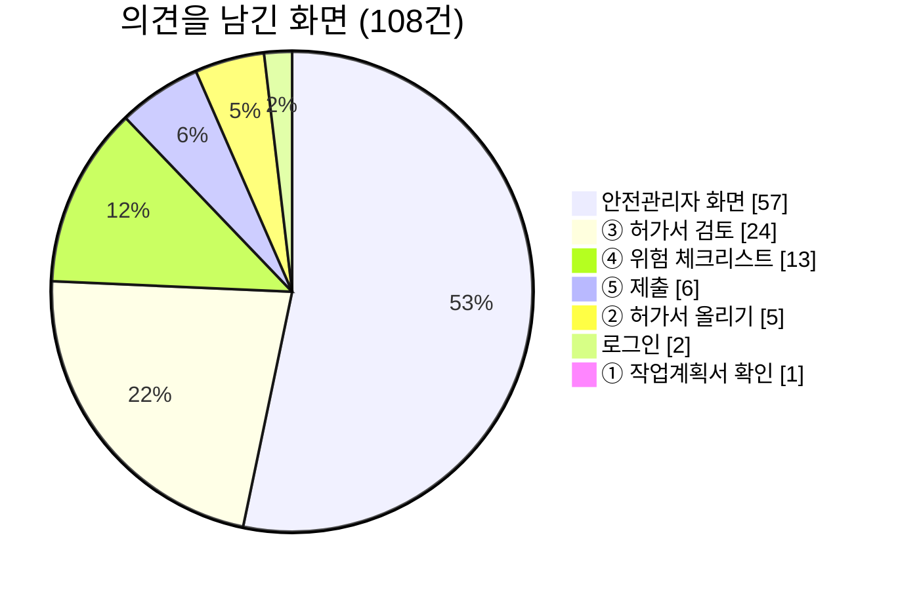

# 20 사용자 의견 반영 이력

팀원과 시험 사용자가 화면을 직접 써 보고 의견 108건을 남겼습니다. 이 문서는 그 의견이 croScan을 어떻게 바꿨는지 주제별로 정리합니다.

**이 문서에서 알 수 있는 것**
- 의견이 몇 건이고, 어느 화면에서 나왔고, 어떻게 처리했는지(수용·부분 수용)
- 주제마다 사용자가 겪은 불편, 그래서 바꾼 것, 지금 동작을 설명하는 문서
- 일부만 받아들이거나 다르게 반영한 의견과 그 이유
- 의견 번호로 코드 위치를 찾는 법

## 목차
1. [한눈에](#1-한눈에)
2. [작업반장 화면](#2-작업반장-화면)
3. [안전관리자 화면](#3-안전관리자-화면)
4. [두 화면 공통: 글자 크기·알림·간격](#4-두-화면-공통-글자-크기알림간격)
5. [시연 자료를 현장에 맞게](#5-시연-자료를-현장에-맞게)
6. [일부만 받아들인 의견과 이유](#6-일부만-받아들인-의견과-이유)
7. [번호 대조표](#7-번호-대조표)
8. [원자료](#8-원자료)

---

## 1. 한눈에

의견은 2026-10-26부터 2026-11-02까지 8일 동안 들어왔습니다. 번호는 #1~#109입니다. #32는 기록에 없어서 모두 108건입니다. 108건 모두 처리했습니다. 통째로 거절하거나 보류한 의견은 없습니다.

| 구분 | 항목 | 건수 |
|---|---|---:|
| 처리 결과 | 수용 | 93 |
| | 부분 수용 | 15 |
| | 거절 | 0 |
| | 보류 | 0 |
| | 미처리 | 0 |
| 의견을 남긴 화면 | 안전관리자 화면 | 57 |
| | ③ 허가서 검토 | 24 |
| | ④ 위험 체크리스트 | 13 |
| | ⑤ 제출 | 6 |
| | ② 허가서 올리기 | 5 |
| | 로그인 | 2 |
| | ① 작업계획서 확인 | 1 |
| 날짜 | 2026-10-26 ~ 10-28 | 16 |
| | 2026-10-29 | 20 |
| | 2026-10-30 | 52 |
| | 2026-10-31 | 13 |
| | 2026-11-01 ~ 11-02 | 7 |
| **합계** | | **108** |

처리 결과를 세는 법은 이렇습니다. #103~#109의 7건은 기록에 결정(수용 4, 부분 수용 3)이 적혀 있습니다. #1~#102의 101건은 결정 칸이 비어 있고 처리 메모만 있습니다. 그래서 메모에 「부분」이라고 적은 12건을 부분 수용으로, 나머지 89건을 수용으로 셌습니다.

「의견을 남긴 화면」은 의견을 쓸 때 열려 있던 화면입니다. 의견의 주제와 꼭 같지는 않습니다. 예를 들어 #62는 로그인 화면에서 보냈지만 화면 전체 문구를 다룹니다.

**읽는 법.** 2~5절은 주제 16개입니다. 절마다 「불편 → 바꾼 것 → 지금 → 코드」 순서로 씁니다. 절 끝 괄호에 관련 의견 번호를 모았습니다. 코드 주석에는 같은 번호가 `QA #번호`로 남아 있습니다. `web/app.js`나 `web/style.css`에서 그 번호를 찾으면 고친 자리가 나옵니다.

---

## 2. 작업반장 화면

### 2.1 로그인·첫 화면·로고

**불편.** 왼쪽 위 로고를 눌러도 첫 화면으로 가지 않았습니다. 역할은 왼쪽의 「생산부서 작업반장」「안전관리자」 버튼으로 바꿨습니다. 그래서 서비스가 어디서 시작하는지 분명하지 않았습니다. 로그인 버튼 아래 안내문과 로고 밑 회색 글자는 군더더기로 보였습니다. 로고도 팀이 만든 그림으로 바꾸고 싶었습니다.

**바꾼 것.**
- 첫 화면을 로그인 화면으로 만들었습니다. 역할 탭을 고르고 「로그인」을 누르면 그 역할의 화면이 열립니다.
- 시연판은 ID와 비밀번호를 검사하지 않습니다. 비밀번호는 저장하지도 보내지도 않습니다.
- 왼쪽 역할 버튼은 없앴습니다. 로고를 누르면 로그인 화면으로 돌아갑니다. 작업반장으로 다시 들어가면 하던 단계가 그대로 있습니다.
- 로그인 버튼 아래 안내문은 지웠습니다. 대신 입력칸 안에 「시연판: 비워 두어도 됩니다」를 넣었습니다.
- 로고 밑 회색 글자를 지웠습니다. 로고는 받은 그림으로 바꿨습니다. 밝은 화면용과 어두운 화면용 두 장입니다.

**지금.** [02 §2 로그인](02_화면시연_반장.md#2-로그인). 실제 접근 통제는 서버 앞 사내 로그인이 맡습니다([12 §7](12_배포와_운영.md#7-사내-로그인sso-뒤에-두기)).

**코드.** [`web/index.html`](../web/index.html)의 `s-login`, [`web/app.js`](../web/app.js)의 `showLogin()`.

(의견 #9, #25, #29, #30, #31)

### 2.2 단계 순서와 「다음」 버튼

**불편.** 작업계획서 확인이 3단계에 있었습니다. 현장에서는 계획서를 먼저 봅니다. 계획서를 확인하지 않아도 「다음: 허가서 올리기」가 눌렸습니다. 같은 요청이 두 번 왔습니다(#54, #59). 끝까지 마쳤는데 지나온 3·4단계에 체크 표시가 없었습니다. 체크리스트를 다 보지 않아도 제출로 갈 수 있었습니다. 2단계 안내 문장은 어려웠습니다. 핵심 정보 확인 창은 제출 직전에 떴습니다. 그래서 고칠 것이 있으면 멀리 돌아가야 했습니다.

**바꾼 것.**
- 순서를 ① 작업계획서 확인 → ② 허가서 올리기 → ③ 허가서 검토 → ④ 위험 체크리스트 → ⑤ 제출로 바꿨습니다.
- 계획서를 모두 확인해야 「다음: 허가서 올리기」와 위쪽 단계 표시가 열립니다. 계획서를 고치면 그 계획서의 확인이 풀립니다.
- 위험요인을 모두 확인해야 ⑤로 갑니다. 답이 바뀌면 다시 잠깁니다.
- 덜 끝내고 지나간 단계에는 「!」 표시를 붙입니다.
- 2단계 안내를 「croScan이 위험작업허가서를 읽고 필요한 것을 물어봅니다.」로 바꿨습니다.
- 핵심 정보 확인 창은 ③에서 ④로 넘어갈 때 엽니다. 정상 제출 때는 다시 뜨지 않습니다. 확인한 뒤 핵심 정보가 바뀌면 ③에서 다시 확인합니다.
- #106을 고치면서 답 해석 문제 두 가지도 찾아 고쳤습니다. 하나는 신청 시간을 다시 말한 구간을 실제 작업시간으로 합치던 것입니다. 다른 하나는 블록 번호가 다른 통제 범위 문장에서 뒷부분만 쓰던 것입니다.

**지금.** [02 §3 작업계획서 확인](02_화면시연_반장.md#3-①-작업계획서-확인), [02 §7.2 핵심 정보 확인 창](02_화면시연_반장.md#72-핵심-정보-확인-창-③--④), [04d §5 화면 전환과 5단계 번호](04d_화면_코드_구조.md#5-어떻게-화면-전환과-5단계-번호), [04d §6 핵심 정보 확인 창](04d_화면_코드_구조.md#6-어떻게-핵심-정보-확인-창).

화면의 단계 번호와 코드 안쪽 번호는 다릅니다. 의도: 순서만 바꾸고 화면 id는 그대로 두었습니다 — 근거: `app.js`의 `STEP_ORDER` 주석(의견 #33), [04d §5.2](04d_화면_코드_구조.md#52-화면-번호와-안쪽-번호).

**코드.** [`web/app.js`](../web/app.js)의 `STEP_ORDER`, `plansOk`, `enterChecklist()`. 시간 해석은 [`server/augment.py`](../server/augment.py), 별지 문장은 [`server/reflect.py`](../server/reflect.py). 시험은 [`tools/check_questions_material.py`](../tools/check_questions_material.py).

(의견 #13, #33, #54, #59, #96, #97, #106)

### 2.3 확인 질문 대화

**불편.** 말풍선 좌우가 메신저 습관과 반대였습니다. 「바로 끝남」을 누른 뒤 아래 버튼이 무엇을 하는지 분명하지 않았습니다. 작성 예시는 입력칸 안에 있었습니다. 그래서 글자를 적기 시작하면 예시가 사라졌습니다(#3, #12). 「가스절단」 같은 보기를 고르고 빈 채로 보내면 아무 일도 일어나지 않았습니다. 크레인 번호를 소문자로 적으면 같은 질문이 한 번 더 나왔습니다. 질문 속 참고 시간 뒤의 「(작성자 추정)」 괄호는 믿음을 떨어뜨렸습니다. 긴 답 하나에 장소·시간·인원이 함께 있어도 하나만 읽혔습니다.

**바꾼 것.**
- AI 말풍선은 왼쪽, 작업반장 답은 오른쪽에 둡니다.
- 질문이 끝나면 아래 「보내기」가 「전송」으로 바뀌고, 누르면 제출본을 만듭니다.
- 예시는 입력칸 위 「적을 내용」 줄에 고정합니다. 적는 동안에도 보입니다.
- 보기를 고르고 빈 채로 보내면 무엇을 적을지 알려 줍니다.
- 소문자 번호(`oh-21-01`)도 대문자로 읽습니다.
- 질문에는 「참고 작업시간 120~240분」만 씁니다. 괄호와 「작성자 추정」은 지웠습니다.
- 긴 답에서 장소·실제 작업시간·작업인원·감시인을 함께 읽습니다. 읽은 것은 해당 질문의 답 **제안**이 됩니다. 근거가 된 구절을 보여 주고, 「이것 빼기」로 뺄 수 있습니다.

**일부만 받아들인 것.** 사용자는 「통상적인 작동시간」이라는 말을 제안했습니다. croScan은 「참고」를 씁니다. 「통상」은 추정값을 현장 평균처럼 보이게 하기 때문입니다. 비교 조건·출처·추정값이라는 사실은 2쪽 별지에 남깁니다. 긴 답(#39)은 규칙으로 확실히 읽을 수 있는 것만 읽습니다. 조건·추측·부정·다른 팀 작업은 받지 않습니다.

**지금.** [02 §5 확인 질문](02_화면시연_반장.md#5-③-허가서-검토-확인-질문), [02 §6 말로 답하기와 AI 해석 카드](02_화면시연_반장.md#6-③-허가서-검토-말로-답하기와-ai-해석-카드), [05 멀티턴 질문](05_멀티턴_질문.md), [05f §14 긴 답 읽기](05f_답_상태와_세션.md#14-augment-긴-답-읽기).

**코드.** [`web/app.js`](../web/app.js)의 `setAsk()`(예시 줄), `takeDerived()`(긴 답). [`server/app.py`](../server/app.py)(대문자 읽기, 긴 답), [`server/augment.py`](../server/augment.py)(참고 작업시간 문구, 긴 답 읽기). 시험은 [`tools/check_interpret.py`](../tools/check_interpret.py).

(의견 #2, #3, #5, #11, #12, #19, #39)

### 2.4 문서 보기와 칸 입력

**불편.** 작업계획서 목록의 글자가 반쯤 접혀 보였습니다. 「허가서에서 이 칸 보기」 버튼은 왼쪽에 너무 붙어 있었습니다. 문서 보기의 ‹ › 버튼은 1쪽·2쪽 버튼과 같은 일만 했습니다. 번호 형식 안내는 입력칸 안에 있어서 값을 적으면 사라졌습니다. 승인번호·호선/공사·작업표준은 형식을 외워야 정확히 적을 수 있었습니다. 칸 목록에서는 원본을 함께 볼 수 없었습니다. 빈칸을 위에서부터 차례로 채우기 어려웠습니다. 목록과 채팅이 따로 있어서 답이 어느 칸에 들어갔는지 알기 어려웠습니다. 칸을 누르면 문서 아래에 편집창이 열려 흐름이 끊겼습니다.

**바꾼 것.**
- 계획서 목록 행이 접히지 않게 고쳤습니다. 「허가서에서 이 칸 보기」 위치를 맞췄습니다.
- ‹ ›는 계획서에서는 앞뒤 계획서로, 허가서에서는 쪽으로 넘어갑니다.
- 번호 칸 셋(승인번호·호선/공사·작업표준)에는 예시를 입력칸 아래에 고정하고 「형식 보기」를 붙였습니다. 입력칸 안 안내(placeholder)는 쓰지 않습니다.
- 번호 칸은 칸을 벗어날 때 검사합니다. 적는 동안에는 빨간색을 띄우지 않습니다. 오류는 틀린 구간 하나만 알려 줍니다. 승인번호는 실제 있는 날짜인지도 봅니다.
- 0과 O, 1과 I가 구별되는 글꼴을 씁니다. 글자를 지우지 않고 대문자로만 바꿉니다.
- 다른 칸은 입력칸 안 안내에 그 칸의 형식을 보여 줍니다.
- 문서 칸이 1080px 이상이면 칸 목록을 나눕니다. 왼쪽에 원본(고른 칸 위치 표시), 오른쪽 위에 짧은 칸 목록, 오른쪽 아래에 고른 칸 입력이 있습니다. 좁은 화면은 전처럼 긴 목록입니다.
- 빈칸은 양식 위에서 아래 순서로 나옵니다. 「적용」을 누르면 다음 빈칸으로 갑니다.
- 문서 아래 편집창을 없앴습니다. 허가서에서 칸을 누르면 채팅 입력창 위에 「수정할 칸: …」이 뜹니다. 입력창에는 기존 값이나 형식 안내가 들어갑니다. 확대율과 스크롤 위치는 그대로입니다.
- 목록 행에 답으로 채운 값을 강조합니다. 고른 칸의 관련 질문·답과 「대화에서 보기」를 보여 줍니다.
- 허가구분처럼 croScan이 쓰지 않는 칸은 보기만 합니다.

**일부만 받아들인 것.** #40은 목록 안에서 바로 고치기를 원했습니다. 입력은 #41에 따라 채팅 입력창 하나로 모았습니다. 호선·작업표준 규칙은 일부러 느슨합니다. 시연 값과 실제 값의 모양이 섞여 있기 때문입니다(`app.js` 의견 #35 주석).

**지금.** [02 §3.2 읽은 계획서 확인](02_화면시연_반장.md#32-읽은-계획서-확인), [04d §10 문서 보기](04d_화면_코드_구조.md#10-어떻게-문서-보기), [04d §11 작업계획서 목록](04d_화면_코드_구조.md#11-어떻게-작업계획서-목록).

**코드.** [`web/app.js`](../web/app.js)의 `renderFieldSplit()`, `stepPage()`, `renderPlanList()`, `CODE_RULES`. 보호 칸 목록은 [`server/app.py`](../server/app.py)가 [`server/reflect.py`](../server/reflect.py)의 `NEVER`로 보냅니다.

(의견 #8, #15, #16, #34, #35, #36, #38, #40, #41)

### 2.5 답을 양식에 넣기: 반영본과 별지

**불편.** 2쪽 추가검토서는 1쪽 양식과 모양이 달라 읽기 어려웠습니다. 빈칸(병행여부)에 답해도 답이 「추가정보」에만 들어갔습니다. 사용자는 이런 빈칸은 양식에 바로 넣는 것이 맞다고 했습니다(#4). 이어서 더 큰 요청이 왔습니다(#37). 멀티턴 답이 모두 추가정보로 갑니다. 양식에 맞는 답은 그 칸에 넣고, 나머지만 추가정보로 보내 달라고 했습니다. 「모름」을 서류에 그대로 적지 말 것, 특정 사례에 맞추지 말고 답의 뜻과 칸의 용도로 판단할 것도 요청했습니다.

**바꾼 것.**
- 2쪽을 1쪽처럼 만들었습니다. 테두리, 같은 여백, 회색 바(#E0E3E6), 로고, 머리표, 항목별 표를 씁니다(#1).
- 처음에는 원본을 그대로 두었습니다. 읽은 양식의 빈칸에 「반장 답」 점선 표시만 하고, 칸 설명은 2쪽에 붙였습니다(#4).
- 그다음 제출 PDF를 「사전검토 반영본 + 별지」로 바꿨습니다(#37).
  - 반영본: 원본 양식에 칸 용도에 맞는 답과 화면에서 고친 값을 파란 글씨와 ① 같은 번호로 적습니다.
  - 별지: 반영 내역, 양식 밖 보충, 작업 범위, 안전팀 확인 사항을 적습니다.
- 올린 원본 파일은 바뀌지 않습니다.
- 어느 칸에 넣을지는 「질문의 뜻 × 칸의 용도」로 정합니다.
  - 모름·미정·버튼 이름은 적지 않습니다.
  - 당일·서명·승인 칸에는 쓰지 않습니다.
  - 실제 작업시간은 별지에 씁니다. 다른 팀 정보는 따로 둡니다.
  - 상세 칸에는 덧붙입니다. 맞는 칸이 없으면 별지로 보냅니다.
- 웹 미리보기도 서버가 같은 계획으로 그립니다.
- 시험 [`tools/check_reflect.py`](../tools/check_reflect.py)를 새로 만들었습니다. 처리 메모 기준 144개 확인이 모두 통과했습니다.

**지금.** [08 반영본과 별지](08_반영본과_별지.md), [08b 반영 규칙 전부](08b_반영_규칙_전부.md), [02 §7 반영본과 별지](02_화면시연_반장.md#7-③-허가서-검토-끝-반영본과-별지).

**코드.** [`server/reflect.py`](../server/reflect.py)(어느 칸에 무엇을), [`server/addendum.py`](../server/addendum.py)(별지), [`server/augment.py`](../server/augment.py). 칸별로 보는 도구는 [`tools/dump_reflect.py`](../tools/dump_reflect.py)입니다.

(의견 #1, #4, #37)

### 2.6 위험 체크리스트

**불편.** 모든 작업 공통 항목과 이 작업만의 항목이 섞여 헷갈렸습니다. croScan이 미리 고른 칸을 반장이 확인했는지 알 수 없었습니다. 처음 만든 확인 버튼은 이미 체크된 것처럼 보여서 지나치기 쉬웠습니다. 띠지, 굵은 선, 상자 안 상자, 남색 글자로 화면이 무거웠습니다. 「해당」과 「안전팀 확인」은 색으로 잘 구별되지 않았습니다. 위쪽 요약 숫자의 색과 순서도 답과 맞지 않았습니다. 위험요인 묶음에 제목과 번호가 없었습니다. 「왜?」라는 버튼 이름은 무엇을 여는지 알기 어려웠습니다. 항목이 많아서 남은 것을 찾기 어려웠습니다(#105 제안서).

**바꾼 것.**
- 「{종류} 작업 위험요인 : N개」(예: 화기 작업 위험요인 : 10개)와 「모든 작업 공통」을 두 구역으로 나눴습니다. 구역마다 테두리·개수·설명이 있습니다.
- 위험요인에 「01 | …」 번호를 붙였습니다. 한 허가서 안에서 두 묶음을 이어 셉니다. 체크리스트 PDF도 같은 번호입니다.
- croScan이 고른 답 아래에 빈 네모 체크칸 「그대로 확인」을 두었습니다. 안내는 「croScan이 고른 답이 맞으면 체크해 주세요」입니다. 체크하면 「확인함」, 다시 누르면 취소입니다. 메모만 적어서는 확인이 되지 않습니다.
- 띠지·굵은 선·상자 중첩을 없앴습니다. 글자는 회색 단계로 나누고, 파란색은 고른 항목과 주요 버튼에만 씁니다.
- 해당은 #A00000 바탕에 경고 세모입니다. 해당 없음은 연한 파랑에 체크입니다. 안전팀 확인은 #FFD400 바탕에 물음표 사람입니다.
- 요약 숫자도 같은 색이고, 순서는 해당 → 해당 없음 → 안전팀 확인입니다.
- 안내를 「croScan이 허가서를 보고 미리 채웠습니다. 항목마다 해당 여부를 고르고, 해당하면 안전조치를 체크하세요.」로 바꿨습니다.
- 체크리스트의 「왜?」를 「위험한 이유 보기」로 바꿨습니다. 다른 화면의 「왜?」는 그대로입니다.
- 위쪽 고정 막대에 남은 수, 「다음 미완료로 이동」, 남은 목록을 둡니다. 「다음」을 누르면 첫 남은 칸으로 가서 강조하고 이유를 보여 줍니다. 아래 버튼 줄은 고정입니다(#105).

**일부만 받아들인 것.** #105 제안서의 새 하단 고정 막대와 제안서에 적힌 시험 항목 전체는 이번 범위에서 뺐습니다.

**지금.** [02 §8 위험 체크리스트](02_화면시연_반장.md#8-④-위험-체크리스트), [02 §8.2 남은 항목 찾아가기](02_화면시연_반장.md#82-남은-항목-찾아가기), [02 §8.3 위험한 이유 보기](02_화면시연_반장.md#83-위험한-이유-보기), [07 위험 체크리스트](07_위험체크리스트.md), [04d §12](04d_화면_코드_구조.md#12-어떻게-위험-체크리스트-화면).

**코드.** [`web/app.js`](../web/app.js)의 `renderChecklist()`, `ckItem()`, `ckPending()`, `ckCount()`. PDF 번호는 [`server/checklist.py`](../server/checklist.py). 색은 [`web/style.css`](../web/style.css). 시험은 [`tools/check_ui_state.py`](../tools/check_ui_state.py)의 `CK` 묶음입니다.

(의견 #21, #22, #47, #58, #60, #61, #64, #88, #89, #90, #104, #105)

### 2.7 제출 화면과 화면 문구

**불편.** 제출 요약에서 「확인 안 함」이 다른 답과 같은 줄에 있어 읽기 어려웠습니다. 제출 아래 문구가 길었습니다. 무엇이 제출되는지 설명도 부족했습니다. 화면 전체에서 잘못 읽히거나 뜻이 여러 개인 말이 있었습니다. #62는 문구 검토서를 붙여 보냈습니다. 원칙은 한 낱말에 한 뜻, 회사 표준 용어 먼저, 같은 것은 같은 이름, 한 문장에 한 가지였습니다.

**바꾼 것.**
- 제출 요약 1줄은 「해당 · 안전팀 확인 · 해당 없음」입니다. 2줄은 「확인 안 함 N개 (위 숫자에 포함)」입니다.
- 제출 아래 문구를 「안전팀 검토자료 제출(시연)입니다.」로 줄였습니다.
- 제출 안내와 도움말을 바꿨습니다. 안전팀에는 허가서(원본 + 추가검토서), 작업계획서, 위험 체크리스트 세 가지가 갑니다. 하이세스(Hi-SEs, HD현대의 안전 전산) 신청·승인, 작업 당일 현장 확인, 대면허가는 기존과 같습니다.
- #62에서 받은 것: 잘못 읽히는 문구(③ 마무리와 하단 바, ① 안내, ④ 「맞음」, ⑤ 면책 문구와 Hi-SEs), 「주는 쪽 / 받는 쪽」, 「일상작업 × 비일상작업」, 「위험 쌍 찾기 · 다시 검사」, 「변경관리」, 빈칸과 「예:」 표기, 받침에 맞는 조사.

**일부만 받아들인 것.** #62에서 보류한 낱말은 [6절](#6-일부만-받아들인-의견과-이유)에 모았습니다.

세 답의 순서는 화면마다 다릅니다. ④ 체크리스트 요약은 해당 → 해당 없음 → 안전팀 확인입니다(#64). ⑤ 제출 요약은 해당 · 안전팀 확인 · 해당 없음입니다(#23). 설계 근거 미기록: #64의 처리 메모는 ④ 요약만 말합니다. ⑤를 그대로 둔 이유는 적혀 있지 않습니다.

**지금.** [02 §9 제출](02_화면시연_반장.md#9-⑤-제출), [02 §9.2 무엇이 제출되나](02_화면시연_반장.md#92-무엇이-제출되나), [13 용어집](13_용어집.md).

**코드.** [`web/app.js`](../web/app.js)의 `renderSummary()`, 조사 함수 `pp()`. 안내 문구는 [`web/index.html`](../web/index.html).

(의견 #23, #62, #92, #95)

---

## 3. 안전관리자 화면

### 3.1 화면 배치와 메뉴

**불편.** 안전관리자 화면 전체가 스크롤되지 않았습니다. 그래서 문서 목록이 한 건씩만 보였습니다(#10, #17, #18). 사용자는 시안을 보내 왔습니다(#42). 순위별 목록은 스크롤로 보고, 버튼 크기를 맞추고, 색과 글꼴은 그대로 두자는 내용이었습니다. 위쪽 요약 타일 6개와 탐지 과정 줄은 정보가 너무 많았습니다. #53은 정보 순서를 다시 짜자는 제안서였습니다. 위쪽은 줄이고, 목록·필터·상세가 서로 이어지게 하자는 것입니다. #66은 위쪽 가로 탭을 왼쪽 메뉴로 옮기자고 했습니다. 시연 고지 줄도 필요 없다고 했습니다.

**바꾼 것.**
- 화면 전체가 한 페이지로 스크롤됩니다. 목록과 배치도는 전체 폭을 씁니다.
- 「위험 쌍 / 계획 배치도 / 문서 목록」 세 보기로 나눴습니다. 순위별 목록은 안에서 스크롤되고, 아래에 남은 순위를 알려 줍니다. 쌍 상세는 목록 옆에 엽니다. 버튼 높이를 맞췄습니다.
- 요약 타일 6개는 숨겼습니다. 건수는 문서 종류 탭에, 조건은 필터에 그대로 있습니다.
- 탐지 과정 줄은 목록 아래 「탐지 과정 보기」로 접었습니다. 이름은 뒤에 「위험 조합 검토 과정」으로 바뀌었습니다([3.2](#32-머리-요약과-위험-쌍-현황)).
- #53: 위쪽을 줄였습니다. 목록 한 줄은 조합 → 두 작업 → 위치·시간 순서입니다. P번호는 필터를 바꿔도 같습니다. 고른 쌍이 필터 밖으로 빠지면 선택이 풀렸다고 알려 줍니다. 상세는 위치·시간 → 확인·조정 → 게시 → 왜 위험한가 → 판정 근거·원본 순서입니다.
- 넓은 화면(1181px 이상)은 왼쪽 메뉴를 씁니다. 위험 쌍(펼치기·접기, 1·2·3순위와 근접 건수), 계획 배치도, 문서 목록, 현장 게시 서류가 있습니다. 좁은 화면은 탭을 그대로 씁니다.
- 시연 고지 줄과 「시연 기록 지우기」를 지웠습니다.

**일부만 받아들인 것.** #42의 날짜 고르기는 보류했습니다. #42의 문서 목록 좌우 배치도 그때는 보류했지만, 뒤에 #45에서 반영했습니다([3.6](#36-문서-목록과-작업-전-현장-확인-일정)). #53에서 판정 근거 표는 되살리지 않았습니다. #49에서 지우기로 한 결정을 따랐습니다. #66의 왼쪽 메뉴는 넓은 화면에만 둡니다.

**지금.** [03 화면 시연: 안전관리자](03_화면시연_안전관리자.md), [04d §14.1 배치](04d_화면_코드_구조.md#141-배치), [04d §17 휴대폰과 좁은 화면](04d_화면_코드_구조.md#17-어떻게-휴대폰과-좁은-화면).

**코드.** [`web/index.html`](../web/index.html)의 왼쪽 메뉴와 세 탭(의견 #66, #42 주석), [`web/app.js`](../web/app.js)의 `sfNav()`, [`web/style.css`](../web/style.css).

(의견 #10, #17, #18, #42, #43, #52, #53, #66, #86)

### 3.2 머리 요약과 위험 쌍 현황

**불편.** 위쪽 요약 문장에 「이날」이 들어가 어색했고, 문장이 중간에 끊겼습니다. 왼쪽 날짜 카드의 내용과 순서를 바꾸고 싶었습니다(#72, #83). 「croScan 규칙으로 찾은 위험 11쌍 · 445쌍 검토 · …」 줄 대신 작업 날짜를 보고 싶었습니다(#74). 1·2·3순위 건수 카드는 도넛 그림으로 바꾸고 싶었습니다(#67). 탐지 과정 화면은 단계별 문장으로 정리하고 싶었습니다(#84).

**바꾼 것.**
- 「이날」을 지웠습니다. 1줄은 공장 · 접수 기준 · 건수, 2줄은 허가서 구성입니다.
- 왼쪽 날짜 카드는 이렇게 보입니다. 작업일 전날 날짜, 「현재 시각 14:55」(한국 시간, 매분 갱신), 「안녕하세요. / 대조립 21공장 안전관리자님」, 그리고 비일상 작업·일상 작업·총 작업 건수입니다. #72에서 만든 카드를 #83이 이어서 바꿨습니다.
- 현황 카드 제목은 「2026.10.29(목) 작업 현황 기준」처럼 작업일입니다.
- 「위험 쌍 현황」 도넛을 만들었습니다. 1순위 빨강, 2순위 노랑, 3순위 연한 파랑입니다. 가운데에 전체 쌍 수를 씁니다. 범례 줄을 누르면 그 순위로 걸러집니다. 작은 조각에는 숫자를 생략합니다.
- 탐지 과정은 「위험 조합 검토 과정」 4단계로 씁니다. 단계마다 쉬운 문장 하나와 건수가 있습니다.

**일부만 받아들인 것.** #84의 제안 숫자 가운데 둘은 실제 계산과 달랐습니다. ③에는 위치 확인이 필요한 5쌍을 더해 37쌍으로 적었습니다. ④는 실제 사유대로(겹쳐서 위험이 전해지는 10쌍, 앞 작업이 끝난 뒤 확인할 1쌍) 나눠 적었습니다.

날짜 카드(작업일 전날)와 현황 카드(작업일)의 날짜는 하루 다릅니다. 의도: 검토는 작업 전날 하고, 현황은 실제 작업 날짜를 기준으로 합니다 — 근거: `app.js` `sfNav()`의 의견 #83 주석, `sfResults()`의 의견 #74 주석.

**지금.** [03 §2 위험 쌍 목록](03_화면시연_안전관리자.md#2-위험-쌍-목록), [03 §5 검토 과정 보기](03_화면시연_안전관리자.md#5-검토-과정-보기), [06e 하루 판정과 설명문](06e_하루판정과_설명문.md).

**코드.** [`web/app.js`](../web/app.js)의 `sfNav()`, `sfResults()`, `sfDayLabel()`, `sfClockNow()`. 도넛과 검토 과정 틀은 [`web/index.html`](../web/index.html).

(의견 #28, #67, #72, #74, #83, #84)

### 3.3 위험 쌍 목록과 쌍 상세

**불편.** 쌍 상세의 「조건 → 원인 → 사고」 화살표가 상자와 겹쳤습니다. 위쪽 문장과 상자 내용이 겹쳤습니다. 판정 근거 표는 바쁜 관리자에게 필요 없는 정보였습니다(#49). 위험도 매트릭스의 축 제목과 눈금이 어긋났습니다. 사용자는 목록을 한 화면에 보고(#69), 상세를 짧은 카드로 보고(#70), 위험도 설명을 「결과 → 사유 → 근거」 순서로 보고 싶어 했습니다(#71). 「왜 위험한가요?」에는 상자 테두리도 설명도 없었습니다(#73). 상세 위의 「검토용 · 조치 확인과 승인은 별도…」 문장 대신 배치도로 가는 버튼을 원했습니다(#100). 반장에게 물을 질문 화면도 단순하게 바꾸고 싶었습니다(#108 제안서).

**바꾼 것.**
- 상자 사이를 넓혀 화살표가 겹치지 않게 했습니다. 좁은 상세에서는 세로로 놓습니다.
- 위쪽 요약 문장을 모든 쌍에서 지웠습니다. 상자는 남겼습니다.
- 판정 근거 표와 근거 문구를 모든 쌍에서 지웠습니다. 원문은 「문서 열기」로 봅니다.
- 매트릭스는 강도 S를 세로 제목, 노출 E를 가로 제목으로 격자 가운데에 둡니다. 눈금은 행·열 가운데에 맞췄습니다. 이 그림은 「평가 기준 보기」 안에 있습니다.
- 목록 한 줄은 순위 · P번호 · 위험 조합입니다. 제목이 같은 쌍은 문서번호로 구별합니다.
- 상세 카드는 P번호·순위, 한 줄 요약, 위치, 확대한 시간축 순서입니다. 그 아래에 「왜 위험한가요?」(주는 작업 → 받는 작업 → 사고), 확인할 것, 필요한 조치가 옵니다. 「판정 근거·원문」「유사 사고·기준」「추가 위험」은 접어 두었습니다. 규칙 16개의 문구는 [`server/pair_rules.json`](../server/pair_rules.json)에 있습니다.
- 위험도 설명은 점수·순위·결론 → 강도·노출의 사유 → 문서 시간과 근거(답 인용) 순서입니다. 평가 기준은 접어 두었습니다.
- 「왜 위험한가요?」 상자는 고대비를 포함한 모든 모드에서 테두리를 보입니다. 설명은 옆에 두고, 좁으면 설명이 먼저 나옵니다. 위아래 낙하 규칙은 「위험을 주는 작업 · 상부 / 받는 작업 · 하부」로 씁니다.
- 「검토용 …」 문장을 지우고 「배치도에서 확인」 버튼을 넣었습니다. 휴대폰에서는 상세를 닫고 배치도로 갑니다.
- 반장에게 물을 질문은 이 쌍의 질문만 반장별 카드로 보여 줍니다. 질문마다 「질문 복사」가 있고, 복사되면 2초 동안 「✓ 복사됨」이 뜹니다. 전달·답변 기록과 전체 질문은 접어 둡니다.

**일부만 받아들인 것.**
- #69: 1920×911 창, 기본 글자 크기에서 11쌍이 한 화면에 들어갑니다(처리 메모 기준). 작은 창, 큰 글씨, 장갑 모드에서는 목록이 스크롤됩니다.
- #70: 정비·정전 쌍은 주는/받는 역할 표시에서 예외입니다.
- #71: 「강도 / 노출」 이름은 바꾸지 않았습니다([6절](#6-일부만-받아들인-의견과-이유)).
- #108: 새 요약 문장은 만들지 않았습니다. 다른 확인사항은 규칙 문구를 그대로 씁니다.

**지금.** [03 §3 쌍 하나 자세히](03_화면시연_안전관리자.md#3-쌍-하나-자세히), [03 §4 담당별 확인](03_화면시연_안전관리자.md#4-담당별-확인-판정보류-질문), [06 쌍작업 판정](06_쌍작업_판정.md), [06b 보류 질문](06b_보류질문_holdq.md), [04d §14.4](04d_화면_코드_구조.md#144-쌍-목록과-쌍-상세).

**코드.** [`web/app.js`](../web/app.js)의 `sfOpenPair()`, `sfMatrix()`, `sfJudgement()`, `sfHoldRender()`, `sfHqCopy()`. 질문 문안은 [`server/holdq.py`](../server/holdq.py). 시험은 [`tools/check_ui_state.py`](../tools/check_ui_state.py)의 `HQ` 묶음입니다.

(의견 #46, #48, #49, #65, #69, #70, #71, #73, #100, #108)

### 3.4 검토 통과 인접 작업

**불편.** 「경보하지 않은 근접」이라는 이름이 어색했습니다. 목록이 복잡했고, 일상 작업과 비일상 작업이 구별되지 않았습니다. 상세가 비었을 때 나오는 둘째 줄은 필요 없었습니다. 「왜 경보하지 않았나요?」라는 제목도 바꾸고 싶었습니다.

**바꾼 것.**
- 이름을 「검토 통과 인접 작업」으로 바꿨습니다. 안전을 확인하거나 승인한 것이 아니라는 설명을 함께 보여 줍니다.
- 목록 한 줄은 일상/비일상 배지와 두 작업명입니다. 작업명은 원문 그대로 두고 길면 말줄임합니다. 누르면 오른쪽(좁으면 따로 뜨는 칸)에 근거와 두 문서가 나옵니다.
- 상세가 비었을 때는 「목록에서 인접 작업을 선택하세요.」 한 줄만 보입니다.
- 상세 제목을 「검토 통과 근거」로 바꿨습니다.

**일부만 받아들인 것.** #77은 「검사 통과」를 제안했습니다. #75·#76과 맞추려고 「검토 통과」로 통일했습니다. #79는 기준별 근거를 바랐습니다. 지금 대표 사유가 하나뿐이라 기준별 행은 만들지 않았습니다. 고정 문구는 그대로입니다.

**지금.** [03 §2 위험 쌍 목록](03_화면시연_안전관리자.md#2-위험-쌍-목록), [06e 하루 판정과 설명문](06e_하루판정과_설명문.md).

**코드.** [`web/app.js`](../web/app.js)의 `sfNearRow()`, `sfNearBody()`(의견 #75–#77 주석).

(의견 #75, #76, #77, #79)

### 3.5 계획 배치도와 하루 일정

**불편.** 시각을 고르는 그래프와 BAY별 작업 표의 경계가 흐렸습니다. 표 위 숫자가 칼럼이라는 표시도 없었습니다(#20). 막대를 누르면 화면이 튀었습니다. 칼럼 01이 BAY 이름 칸과 겹쳤습니다. 배치도 위 안내 줄과 하루 일정 안내 문장은 현장이 이미 아는 정보였습니다. 계획 배치도 버튼을 눌러도 배치도가 나오지 않았습니다(#44). 제목·축 안내·아래 설명 문구도 바꾸고 싶었습니다(#80). 「14:55 계획 작업 12건 (허가4)」라는 표기는 알아보기 어려웠습니다(#82).

**바꾼 것.**
- 시각 고르기를 따로 상자로 묶었습니다. 그 아래 배치도에 「BAY × 칼럼」 머리글을 달고, 칼럼 숫자 줄 왼쪽에 「칼럼」이라고 씁니다. 하루 일정에서는 「시각」입니다.
- 막대를 눌러도 가로·세로 스크롤 위치가 그대로입니다. 접힌 BAY가 펼쳐져도 배치도는 움직이지 않습니다.
- BAY 이름 칸과 칼럼 사이에 세로 경계선을 넣었습니다.
- 배치도 위 안내 줄과 하루 일정 안내 문장을 지웠습니다. 칼럼 간격 12m는 배치도 머리글에 있습니다.
- #44는 이전 화면에서 보낸 의견이었습니다. 받았을 때는 이미 계획 배치도가 탭이 되어 있었습니다. 배치도와 하루 일정을 바꿔 볼 수 있고, 기존 기능도 남아 있습니다.
- 제목은 「14:55 기준 작업 배치현황」, 축 안내는 「가로축: 칼럼 01–20 · 칼럼 간격 12m」입니다. 아래 설명은 「시연용 배치도입니다. 실제 거리와 작업 점유 범위를 나타내지는 않습니다.」입니다. 칼럼 번호는 칸마다 가운데에 씁니다.
- 「14:55 일상 작업 8건 · 비일상 작업 4건」으로 씁니다.

**일부만 받아들인 것.** #27은 안내 줄을 모두 지우길 원했습니다. 교차 검토 의견에 따라 범례 끝에 시연용이라는 짧은 고지만 남겼습니다. #82는 「일상 작업 12건 [비일상 작업 4건]」을 제안했습니다. 그런데 12건은 허가서를 포함한 전체입니다. 그래서 숫자를 바로잡아 일상 8건 · 비일상 4건으로 적었습니다.

**지금.** [03 §6 계획 배치도](03_화면시연_안전관리자.md#6-계획-배치도), [04d §14.5 배치도와 하루 일정](04d_화면_코드_구조.md#145-배치도와-하루-일정).

**코드.** [`web/app.js`](../web/app.js)의 `sfMapView()`, `sfMap()`. 시각 고르기 틀은 [`web/index.html`](../web/index.html)(의견 #20 주석).

(의견 #20, #24, #26, #27, #44, #51, #80, #82)

### 3.6 문서 목록과 작업 전 현장 확인 일정

**불편.** 대면허가 대상은 안전팀이 고르지 않습니다. 작업반장이 PTW(작업허가 전산) QR을 찍을 때 전산이 2중점검 여부를 이미 정합니다(#7). 현장 확인 일정 버튼은 열리지 않았습니다. 사용자는 목록을 스크롤로 보는 시안을 보냈습니다(#45). 필터 버튼을 한 번 누르면 글자가 사라졌습니다(#50). 문서 목록 한 줄의 순서와 모양을 바꾸고 싶었습니다(#78). 현장 확인 일정의 안내에는 내부 처리 설명이 섞여 있었습니다(#85). 문서 상세는 너무 길어서 스크롤해야 다 보였습니다(#102).

**바꾼 것.**
- 대면허가 집계는 「PTW 2중점검 Y」인 허가를 셉니다. Y/N은 전산이 정한 값을 그대로 보여 줍니다.
- 문서 목록은 왼쪽 목록(스크롤)과 오른쪽 고른 문서 요약으로 나눴습니다. 검색·필터·정렬·자료 확인·문서 열기는 그대로입니다. 현장 확인 일정은 계획 배치도 탭 아래로 옮겼습니다.
- 고른 필터 버튼 위에 마우스가 있으면 글자가 사라지던 색 우선순위를 고쳤습니다.
- 목록 한 줄은 일상/비일상 → 작업유형(허가서) → 굵은 작업명 → 문서번호 순서입니다. 작업명은 길면 말줄임하고, 마우스를 올리면 전체가 보입니다. 문서번호는 오른쪽 시간 앞에 씁니다. 둘째 줄 정보는 오른쪽 요약으로 옮겼습니다.
- 제목은 「작업 전 현장 확인 일정」입니다. 안내는 「허가 기간 중 매 작업일 아침, 대면 확인이 필요한 작업입니다. 작업 시작 시간순으로 표시했습니다.」로 바꿨습니다. 내부 처리 설명은 지웠습니다.
- 문서 상세는 한 화면짜리 요약 카드입니다. 장소·시간·인원과 짧은 표시가 먼저 나옵니다. 안전팀 확인 필요, 추가 답변, 관련 위험 쌍, 문서 정보는 접어 둡니다. 「문서 열기」「배치도에서 보기」 버튼이 있습니다.

**일부만 받아들인 것.** #45는 현장 확인 일정을 문서 목록 쪽에 두는 시안이었습니다. 현장 확인 일정은 계획 배치도 탭 아래에 두었습니다.

**지금.** [03 §7 문서 목록](03_화면시연_안전관리자.md#7-문서-목록), [04d §14.3 문서 목록·필터·요약 타일](04d_화면_코드_구조.md#143-문서-목록필터요약-타일).

**코드.** [`web/app.js`](../web/app.js)의 `sfDocSummary()`, `sfTitleParts`, `sfProgress()`(대면허가 대상). 틀은 [`web/index.html`](../web/index.html)(의견 #45 주석).

(의견 #7, #45, #50, #78, #85, #102)

### 3.7 작업 조정과 현장 게시 서류

**불편.** 사용자는 사실 하나를 바로잡았습니다. 안전관리자에게는 일정을 정할 권한이 없습니다. 두 작업반장이 어떻게 조정할지 정합니다(#87). 그래서 당일 확인·변경관리 기능이 필요 없었습니다. 미확정·보류 쌍의 PDF도 필요 없었습니다(#91). 조정 목록의 칸은 복잡했습니다(#81). 버튼 이름은 「조정 확인」보다 「작업 조정」이 맞았습니다. 두 버튼 사이 간격도 좁았습니다(#93). 발행 안내 문장도 필요 없었습니다(#94). 조정 입력 양식 대신 반장에게 보낼 협조 메시지를 쓰고 싶었습니다(#98). 현장 게시 서류 칸은 정보가 많았습니다. 안전팀이 확인하지 않은 허가서는 출력되면 안 됐습니다(#99). 별지의 「위험」이라는 칸 이름도 막연했습니다(#107).

**바꾼 것.**
- 당일 확인·변경관리 탭과 일정 조정 코드를 지웠습니다.
- 미확정·보류 블록, 초안 PDF, 발행 막기를 지웠습니다. 규칙 문안으로 바로 발행합니다. 별지의 당일 서명 표도 지웠습니다.
- 조정 목록은 한 줄입니다. [순위][P번호] 제목과 문자 상태를 보여 줍니다.
- 버튼 이름은 「① 작업 조정」입니다. 두 버튼 사이를 넓혔습니다.
- 발행 안내 문장을 지웠습니다. 발행한 서류를 고칠 때는 「새 개정본 작성」을 씁니다.
- 「일정 조율 협조 메시지」 작성 창을 만들었습니다. 번호·작업구역·보내는 사람은 제출된 허가서와 계획서에서 가져옵니다. 받는 사람과 협의 상대를 바꿀 수 있습니다. 미리보기에서 직접 고칠 수도 있습니다. 「보내기」는 글을 복사하고 기록만 남깁니다. 실제로 보내지는 않습니다.
- 현장 게시 서류는 「최종 서류 출력」 목록입니다. 종류, 작업명, 확인/확인 전, 허가서·체크리스트 출력 버튼이 있습니다.
- 출력은 문서 목록에서 안전관리자가 「자료 확인」을 한 뒤에만 열립니다. 작업일, 내용 판, 최신 제출본이 확인한 때와 같아야 합니다.
- 별지의 「위험」 칸 이름을 「예상 사고 경로」로 바꿨습니다. 미리보기와 PDF가 같습니다. 내용은 그대로이고, 이미 발행한 별지도 그대로입니다.

**일부만 받아들인 것.** #99는 「승인」하면 출력되게 해 달라고 했습니다. 화면에는 「승인」 대신 「확인」이라고 씁니다. 전산 승인은 생산부서의 권한이기 때문입니다.

croScan이 일정을 정하지 않는 것은 의도입니다 — 근거: `app.js`의 의견 #87·#91·#98 주석, [04d §14.7 현장 게시 흐름](04d_화면_코드_구조.md#147-현장-게시-흐름).

**지금.** [03 §8 작업 조정 문자와 현장 게시 서류](03_화면시연_안전관리자.md#8-작업-조정-문자와-현장-게시-서류), [06b §11 협조 문자와 별지](06b_보류질문_holdq.md#11-답-다음-협조-문자와-별지).

**코드.** [`web/app.js`](../web/app.js)의 `postCoordList()`, `postCoordOpen()`, `sheetFor()`, `outGate()`. 문안은 [`server/coordnote.py`](../server/coordnote.py), 별지는 [`server/posting.py`](../server/posting.py). 출력 시험은 [`tools/check_ui_state.py`](../tools/check_ui_state.py)입니다.

(의견 #81, #87, #91, #93, #94, #98, #99, #107)

---

## 4. 두 화면 공통: 글자 크기·알림·간격

**불편.** 글자 크기는 「보기 설정」을 열어야 바꿀 수 있어서 찾기 어려웠습니다. 그렇다고 첫 화면에 설정 버튼을 늘어놓으면 보기 싫었습니다(#14). 계획서 확인 안내문과 아래 상자가 너무 붙어 있었습니다(#63). 위험 전달방식 줄과 위 상자도 너무 가까웠습니다(#68). 검은 알림 바가 「다음: 허가서 올리기」 버튼을 가렸습니다(#101, #103). 안전관리자 화면에 나란히 있는 작업 카드 둘은 높이·여백·버튼 줄이 맞지 않았습니다(#109).

**바꾼 것.**
- 머리줄에 「가+ 글자 크기」 버튼을 두었습니다. 누르면 작은 막대(슬라이더)가 나옵니다. 보기 설정의 글자 크기와 같은 값입니다.
- 안내문과 상자 사이, 위험 전달방식 줄과 위 상자 사이에 여백을 두었습니다.
- 알림 바는 먼저 머리글 아래로 옮기고, 클릭이 버튼까지 닿게 했습니다(#101). 그다음 계획서 확인 완료 알림을 아래 버튼 줄 바로 위에 띄워 버튼을 가리지 않게 했습니다(#103).
- 나란한 작업 카드 둘을 같은 높이, 같은 안쪽 여백으로 맞췄습니다. 제목이 두 줄이어도 「문서 열기」 버튼은 같은 줄에 옵니다.

**지금.** [04d §16 보기 설정](04d_화면_코드_구조.md#16-어떻게-보기-설정), [04d §18 접근성](04d_화면_코드_구조.md#18-어떻게-접근성).

**코드.** [`web/app.js`](../web/app.js)의 `textTo()`(글자 크기 막대), `toast()`(`above` 옵션), [`web/style.css`](../web/style.css).

(의견 #14, #63, #68, #101, #103, #109)

---

## 5. 시연 자료를 현장에 맞게

**불편.** 실제 허가서에는 QR 코드가 있는데 시연 허가서 PDF에는 없었습니다(#6). 사용자는 시연 자료의 작업 분류도 바로잡았습니다. 방사선투과검사는 이리듐을 써서 옆 작업자가 피폭될 수 있습니다. 그래서 일상 작업이 아니라 허가서가 필요한 비일상 작업입니다(#55). 용접(가용접 포함)과 사상은 불티가 나서 화기작업허가서가 필요합니다(#56). 작업계획서 40건이 모두 협력사였지만, 실제로는 본청 생산부서 계획서도 있습니다(#57).

**바꾼 것.**
- 시연 허가서 PDF의 PTW 칸에 시연용 QR 모양을 넣었습니다. 어디에도 연결되지 않습니다.
- WP03 방사선투과검사를 초음파탐상검사(일상 작업)로 바꿨습니다. 정답표의 C04 쌍은 지웠습니다.
- 용접·가용접(취부)·사상 계획서 16건을 의장품 볼트 체결, 부재 배치, 표면 청소, 계측 같은 일상 작업으로 바꿨습니다. 전체 50건은 그대로입니다. PDF와 DB를 다시 만들었습니다. 처리 메모 기준으로 읽기 차이는 0건이고, 찾은 위험 쌍은 11쌍입니다.
- 작업계획서 40건 가운데 10건은 본청 생산부서, 30건은 협력사로 바꿨습니다. 본청 계획서는 업체 자리에 부서-팀을 씁니다.

**지금.** [15 §8 시연 하루 값](15_자료와_시연데이터.md#8-생성기-4-시연-하루-값-demo_day_datapy), [15 §9 시연 하루 PDF와 DB](15_자료와_시연데이터.md#9-생성기-5-시연-하루-pdf와-db-make_demo_daypy).

**코드.** [`tools/demo_day_data.py`](../tools/demo_day_data.py)(의견 #55~#57 주석), [`tools/make_demo_day.py`](../tools/make_demo_day.py)(QR, 의견 #6 주석).

(의견 #6, #55, #56, #57)

---

## 6. 일부만 받아들인 의견과 이유

통째로 거절하거나 보류한 의견은 없습니다. 다만 부분 수용 15건이 있습니다. 수용한 의견 가운데도 요청과 다르게 반영한 것이 있습니다. 아래에 주제별로 묶었습니다. 이유는 처리 메모와 코드 주석에서 가져왔습니다.

### 6.1 낱말을 바꾸지 않은 것

| 의견 | 요청 | 한 것 | 이유 |
|---|---|---|---|
| #62, #71 | 「강도·노출」을 「중대성·가능성」으로 | 보류. 「강도 / 노출」 유지 | 의도: 「노출」은 확률이 아닙니다 — 근거: `app.js` `sfJudgement()` 위 의견 #71 주석 |
| #62 | 안전 게시물 용어, 사고유형 전체 태그, R1을 「1차」로 | 보류 | 설계 근거 미기록: 처리 메모는 이유를 다른 기록에 적었다고만 합니다. 이 저장소에서는 찾지 못했습니다 |
| #19 | 「통상적인 작동시간」 | 「참고 작업시간」 | 「통상」은 추정값을 현장 평균처럼 보이게 합니다(처리 메모) |
| #77 | 「검사 통과 인접 작업」 | 「검토 통과 인접 작업」 | #75·#76과 같은 말로 맞춤 |
| #99 | 안전관리자가 「승인」하면 출력 | 「확인」 뒤에 출력 | 전산 승인은 생산부서 권한입니다 |

### 6.2 숫자를 사실대로 고친 것

| 의견 | 요청 | 한 것 | 이유 |
|---|---|---|---|
| #82 | 「일상 작업 12건 [비일상 작업 4건]」 | 「일상 작업 8건 · 비일상 작업 4건」 | 12건은 허가서를 포함한 전체입니다 |
| #84 | ③ 32쌍(위치 미기재 5쌍 포함), ④ 11쌍(위험 영향 10쌍 · 정보 부족 1쌍) | ③ 37쌍, ④ 겹쳐서 위험이 전해지는 10쌍 · 앞 작업이 끝난 뒤 확인할 1쌍 | ③은 위치 확인이 필요한 5쌍을 더해야 맞습니다. ④의 1쌍은 실제 사유대로 적습니다. ④는 ③을 좁힌 것이 아닙니다. 크레인·전원을 함께 쓰는 쌍은 BAY가 없기 때문입니다(`app.js` `sfResults()`의 의견 #84 주석) |

### 6.3 원칙 때문에 다른 방법을 쓴 것

| 의견 | 요청 | 한 것 | 이유 |
|---|---|---|---|
| #4 | AI가 빈칸을 양식에 직접 입력 | 처음엔 점선 표시, 뒤에 #37의 반영본 | 올린 원본 파일은 바꾸지 않습니다. 답은 반영본(파란 글씨)과 별지로 남깁니다 |
| #39 | 긴 답 하나로 빈칸 보충·값 수정·다른 질문 답까지 | 장소·실제 시간·인원·감시인만 제안으로 | 규칙으로 추측 없이 읽을 수 있는 것만 받습니다. 조건·추측·부정·다른 팀 작업은 받지 않습니다 |
| #40 | 목록 행에서 바로 입력·수정 | 채팅 입력창 하나로 | #41이 입력창을 하나로 모으자고 했습니다 |
| #27 | 배치도 위 안내를 모두 삭제 | 범례 끝 짧은 시연 고지만 남김 | 시연용 배치라는 사실은 남겨야 한다는 교차 검토 의견 |
| #29 | 로그인 아래 안내문 삭제 | 삭제하고 입력칸 안에 「시연판: 비워 두어도 됩니다」 | ID·비밀번호를 비워 두어도 된다는 안내를 입력칸 안으로 옮겼습니다(처리 메모) |
| #35 | 번호 형식을 정확히 검사 | 호선·작업표준은 느슨한 규칙 | 시연 값과 실제 값의 모양이 섞여 있습니다(`app.js` 의견 #35 주석) |

### 6.4 지운 정보를 되살리지 않은 것

| 의견 | 요청 | 한 것 | 이유 |
|---|---|---|---|
| #53 | 상세에 판정 근거 표시 | 근거 표는 되살리지 않음. 짧은 근거와 원문만 접어 둠 | #49에서 바쁜 관리자에게 필요 없는 정보라며 지웠습니다 |

### 6.5 화면 크기에 따라 나눈 것

| 의견 | 요청 | 한 것 | 이유 |
|---|---|---|---|
| #36 | 원본 옆 칸 목록 | 문서 칸 1080px 이상에서만 | 좁은 화면은 기존 긴 목록을 씁니다. 긴 목록은 큰 입력칸이라 장갑·화면 읽기 프로그램에 맞습니다([04d §10.2](04d_화면_코드_구조.md#102-보기-네-가지-view-stview)) |
| #66 | 탭을 왼쪽 메뉴로 | 1181px 이상에서만 왼쪽 메뉴 | 좁은 화면은 기존 탭을 씁니다(처리 메모). 나눈 이유는 따로 적혀 있지 않습니다 |
| #69 | 11쌍을 한 화면에 | 1920×911 기본 글씨에서 한 화면 | 작은 창·큰 글씨·장갑 모드에서는 목록을 스크롤합니다 |

### 6.6 이번 범위에서 뺀 것

| 의견 | 뺀 것 | 이유 |
|---|---|---|
| #42 | 날짜 고르기, 문서 목록 좌우 배치 | 그때는 보류. 문서 목록 좌우 배치는 뒤에 #45에서 반영 |
| #45 | 현장 확인 일정을 문서 목록 쪽에 | 계획 배치도 탭 아래에 둠 |
| #70 | 정비·정전 쌍의 「주는 작업 / 받는 작업」 표시 | 처리 메모에는 예외라고만 적혀 있습니다. 화면은 규칙이 따로 정한 역할 이름이 있으면 그것을 씁니다(`app.js` `sfRoles()`) |
| #79 | 기준별 근거 행 | 지금 대표 사유가 하나뿐입니다 |
| #105 | 새 하단 고정 막대, 제안서의 시험 항목 전체 | 처리 메모에 「범위 밖」으로 적었습니다 |
| #106 | 제안서 가운데 일부 | 처리 메모에 뺀 부분이 따로 적혀 있지 않습니다 |
| #108 | 새 요약 문장 | 질문은 규칙 문구 그대로 씁니다 |

---

## 7. 번호 대조표

모든 의견이 한 주제에 한 번씩 들어갔습니다.

| 주제 | 의견 번호 | 건수 |
|---|---|---:|
| [2.1 로그인·첫 화면·로고](#21-로그인첫-화면로고) | #9, #25, #29, #30, #31 | 5 |
| [2.2 단계 순서와 「다음」 버튼](#22-단계-순서와-다음-버튼) | #13, #33, #54, #59, #96, #97, #106 | 7 |
| [2.3 확인 질문 대화](#23-확인-질문-대화) | #2, #3, #5, #11, #12, #19, #39 | 7 |
| [2.4 문서 보기와 칸 입력](#24-문서-보기와-칸-입력) | #8, #15, #16, #34, #35, #36, #38, #40, #41 | 9 |
| [2.5 답을 양식에 넣기](#25-답을-양식에-넣기-반영본과-별지) | #1, #4, #37 | 3 |
| [2.6 위험 체크리스트](#26-위험-체크리스트) | #21, #22, #47, #58, #60, #61, #64, #88, #89, #90, #104, #105 | 12 |
| [2.7 제출 화면과 화면 문구](#27-제출-화면과-화면-문구) | #23, #62, #92, #95 | 4 |
| [3.1 화면 배치와 메뉴](#31-화면-배치와-메뉴) | #10, #17, #18, #42, #43, #52, #53, #66, #86 | 9 |
| [3.2 머리 요약과 위험 쌍 현황](#32-머리-요약과-위험-쌍-현황) | #28, #67, #72, #74, #83, #84 | 6 |
| [3.3 위험 쌍 목록과 쌍 상세](#33-위험-쌍-목록과-쌍-상세) | #46, #48, #49, #65, #69, #70, #71, #73, #100, #108 | 10 |
| [3.4 검토 통과 인접 작업](#34-검토-통과-인접-작업) | #75, #76, #77, #79 | 4 |
| [3.5 계획 배치도와 하루 일정](#35-계획-배치도와-하루-일정) | #20, #24, #26, #27, #44, #51, #80, #82 | 8 |
| [3.6 문서 목록과 작업 전 현장 확인 일정](#36-문서-목록과-작업-전-현장-확인-일정) | #7, #45, #50, #78, #85, #102 | 6 |
| [3.7 작업 조정과 현장 게시 서류](#37-작업-조정과-현장-게시-서류) | #81, #87, #91, #93, #94, #98, #99, #107 | 8 |
| [4. 두 화면 공통](#4-두-화면-공통-글자-크기알림간격) | #14, #63, #68, #101, #103, #109 | 6 |
| [5. 시연 자료](#5-시연-자료를-현장에-맞게) | #6, #55, #56, #57 | 4 |
| **합계** | #1~#109 (#32 없음) | **108** |

---

## 8. 원자료

의견 원문과 첨부(화면 그림, 제안서)는 팀 내부의 비공개 기록입니다. 이 저장소에는 넣지 않았습니다. 이 문서는 그 기록의 처리 메모와 코드 주석을 맞춰 보고 썼습니다. 숫자는 2026-11-02 기록 기준입니다.
